# 11 关注你的进程

在我们的应用程序运行在云端时，我们应该在任何时刻都能持续了解正在发生的情况。为实现这一点，我们将配置两种不同的机制来获取有关正在运行的 ElixirDrip 实例的信息：

- 一个 Prometheus 服务器持续收集有关正在运行应用程序的指标并通过 Grafana 仪表板公开它们
- 一种在连接到正在运行的 Erlang 节点时运行 Erlang observer 工具的方法，以便分析 Erlang VM 的整体状态和现有的正在运行的进程
- 两种深入了解生产系统发生情况的方式：对应用程序进行剖析和追踪函数

让我们先了解 Prometheus 的工作原理以及它为何非常适合已建立的 ElixirDrip 架构。

## 收集指标

Prometheus 是一个开源监控工具，采用拉取方式工作：而不是每个单独的应用程序将收集的指标发送到服务器，每个应用程序公开一个端点，Prometheus 服务器会不断抓取可用的指标。它还能够动态发现要抓取的指标源，并且开箱即用地支持不同的源，例如 AWS EC2、Azure VM 和 Google Container Engine 实例。

在此基础上，Prometheus 提供强大的查询语言，还能够基于收集的数据发送警报。Prometheus 能够收集的指标类型如下：

- **计数器**：这允许你在发生某事时进行计数。按定义，计数器只能增加。
- **仪表**：这让你可以跟踪随时间变化的数量，例如 CPU 时间或 BEAM 中运行的 Elixir 进程数。每个数据点捕获特定时刻仪表指标的值。
- **直方图**：这让你可以采样观测值，例如请求持续时间或响应大小，并将每个观测值计入预定义的桶中。对于每个直方图，Prometheus 还会收集观测值的数量和观测值的总和（借助这些数据，你也可以计算观测值的平均值）。借助直方图收集的数据，你能够计算分布百分位。直方图对于了解任何应用程序发生的情况非常宝贵，因为它们可以告诉你，例如 99% 的请求在 x 毫秒以内得到处理。
- **摘要**：这与直方图类似，因为这种类型的指标也对观测值进行采样并具有关联的求和和计数指标，但百分位需要在事先配置并且在客户端计算。这降低了 Prometheus 服务器的负载，但不允许我们在之后计算不同的百分位。


也有可能直接从短生命周期的应用程序（如批处理作业）推送指标，但默认情况下 Prometheus 将从被监控的应用程序获取指标。

无论指标类型如何，所有 Prometheus 时间序列数据都具有以下格式：

```
<metric_name>{<lbl1>=<lbl1_val>,<lbl2>=<lbl2_val>,...} <value> <timestamp>
```

直方图观测值始终具有带有桶值的 le 标签；摘要观测值则使用 quantile 标签代替，而计数器指标的测量值始终递增。尽管它们各自具有不同的特性，Prometheus 观测值共享一个通用格式。

我们第一步是配置 ElixirDrip 应用程序以收集 Prometheus 指标并通过 /metrics 端点公开它们。然后，我们将在 ElixirDrip 旁边启动一个 Prometheus 服务器，该服务器将不时访问应用程序的 ElixirDrip /metrics 端点以收集所有可用指标。

## 公开 Prometheus 指标

为了公开 Prometheus 指标，我们将使用一组 Elixir 库，这些库让我们可以发出新的指标并引入开箱即用的 Phoenix、Plug 和 Ecto 指标：

```
$ cat apps/elixir_drip/mix.exs
  # ...
  defp deps do
    [
      # ...
      {:prometheus, "~> 4.0", override: true},
      {:prometheus_ex, "~> 3.0", override: true},
      {:prometheus_ecto, "~> 1.0"},
    ]
  end
  # ...
```

```
$ cat apps/elixir_drip_web/mix.exs
  # ...
  defp deps do
    [
      # ...
      {:prometheus_phoenix, "~> 1.2"},
      {:prometheus_plugs, "~> 1.1"},
    ]
  end
  # ...
```

现在让我们从 Phoenix 指标开始。我们需要定义一个简单的 EndpointInstrumenter 模块，该模块将使用 PhoenixInstrumenter 模块：

```
$ cat apps/elixir_drip_web/lib/elixir_drip_web/prometheus/
endpoint_instrumenter.ex
defmodule ElixirDripWeb.EndpointInstrumenter do
  use Prometheus.PhoenixInstrumenter
end
```

我们需要在应用程序启动时调用此新模块的 setup/0 函数：

```
$ cat apps/elixir_drip_web/lib/elixir_drip_web/application.ex
  # ...
  def start(_type, _args) do
    # ...
    ElixirDripWeb.EndpointInstrumenter.setup()
    # ...
  end
```

最后，我们应该将 EndpointInstrumenter 添加到端点配置中的 instrumenters 列表中：

```
$ cat apps/elixir_drip_web/config/config.exs
# ...
config :elixir_drip_web, ElixirDripWeb.Endpoint,
# ...
instrumenters: [ElixirDripWeb.EndpointInstrumenter]
```

对于 Plug 和 Ecto 库来说过程非常相似：我们使用相应的 Prometheus 模块定义一个简单模块，在应用程序启动时对其进行配置，然后配置应用程序以使用它。对于 Plug 来说，该模块将在请求管道中作为普通 plug 被调用；对于 Ecto 来说，它将作为记录器进行配置。你可以查看应用程序代码以获取完整细节。


除了以与 EndpointInstrumenter 完全相同的方式定义 PlugInstrumenter 外，我们还添加了一个 label_value/2 函数来定义自定义指标，基于传递给 def label_value(:request_path, conn), do: conn.request_path 函数的 conn plug。这样，PlugInstrumenter 收集的所有指标都将包含一个自定义的 request_path 标签，其值为 conn.request_path。

最后，我们需要公开收集到的指标。这可以通过定义一个 MetricsExporter 模块以类似的方式完成：

```
$ cat apps/elixir_drip_web/lib/elixir_drip_web/prometheus/metrics_exporter.ex
defmodule ElixirDripWeb.MetricsExporter do
  use Prometheus.PlugExporter
end
```

在应用程序启动时对其进行配置：

```
$ cat apps/elixir_drip_web/lib/elixir_drip_web/application.ex
  # ...
  def start(_type, _args) do
    # ...
    ElixirDripWeb.MetricsExporter.setup()
    # ...
  end
```

然后，像其他任何 plug 一样将其添加到请求管道中，如下所示：

```
$ cat apps/elixir_drip_web/lib/elixir_drip_web/endpoint.ex
# ...
    plug(ElixirDripWeb.MetricsExporter)
    plug(ElixirDripWeb.Router)
    end
```

我们现在可以访问 `/metrics` 端点。这段文字墙是 Prometheus 知道如何解析并转换为时间序列数据以便查询的：

```
$ curl http://localhost:4000/metrics
# TYPE http_requests_total counter
# HELP http_requests_total Total number of HTTP requests made.
http_requests_total{status_class="client-error",method="GET",host="...",scheme="http",request_path="/index.action"}
1
http_requests_total{status_class="success",method="GET",host="10.40.0.10",scheme="http",request_path="/health"} 3785
http_requests_total{status_class="success",method="GET",host="10.40.0.10",scheme="http",request_path="/metrics"} 633
http_requests_total{status_class="success",method="GET",host="...",scheme="http",request_path="/"} 3
# TYPE elixir_drip_cache_worker_hit_count counter
# HELP elixir_drip_cache_worker_hit_count Counter for each download served by the CacheWorker instead of relying on the Cloud provider
elixir_drip_cache_worker_hit_count 1427
# ...
```

借助当前的 Elixir `prometheus` 库，我们可以从多个角度了解应用程序的实际状态。但如果我们想测量函数花费的时间呢？或者如果你想在发生某事时发送自定义计数器呢？在这些场景中，`prometheus_ex` 库允许我们发出任何自定义指标，只要它使用 Prometheus 支持的四种指标类型之一即可。

让我们实现一个自定义指标来测量 `Storage.store/4` 函数的执行时间。

## 创建自定义 Prometheus 指标

为了实现自定义指标，我们将遵循之前相同的步骤：我们首先配置自定义指标，然后创建一个新的 `Chronometer.defmeasured/2` 宏，该宏不仅定义新函数，还会基于函数名称和模块发出直方图指标。


这次，不过，暴露 setup/0 函数的模块会更复杂一些，因为它需要注册指标，并且还要暴露 count/1、observe/2 和 observe_duration/2 函数：

```
$ cat apps/elixir_drip/lib/elixir_drip/prometheus/instrumenter.ex
defmodule ElixirDrip.Instrumenter do
  use Prometheus

  @histograms %{"storage_store" => "Time histogram for the Storage.store/4 function"}

  @counters %{"cache_worker_hit" => "Counter for each download served by the CacheWorker instead of relying on the Cloud provider"}

  @default_buckets :prometheus_http.microseconds_duration_buckets()

  def setup do
    @histograms
    |> Enum.map(&__MODULE__.histogram_config(&1, @default_buckets))
    |> Enum.each(&Histogram.new(&1))

    @counters
    |> Enum.map(&__MODULE__.counter_config(&1))
    |> Enum.each(&Counter.new(&1))
  end

  def counter_config({name, help}), do: [name: counter_name(name), help: help]
  def histogram_config({name, help}, buckets), do: [name: histogram_name(name), help: help, buckets: buckets]

  def counter_name(name),
    do: "elixir_drip_" <> to_string(name) <> "_count" |> String.to_atom()
  def histogram_name(name),
    do: "elixir_drip_" <> to_string(name) <> "_microseconds" |>
    String.to_atom()
  # ...
end
```

在之前的片段中，setup/0 函数会遍历 @histograms 和 @counters 模块属性，并分别调用 Histogram.new/1 和 Counter.new/1 宏来配置我们想要设置的自定义直方图和计数器。

为了生成指标名称，我们使用 elixir_drip_ 作为前缀，然后根据指标类型添加后缀。

需要注意的是，我们需要显式地将直方图指标的时间单位作为后缀添加（即 _microseconds），否则在发出指标之前库就不知道如何转换测量的时间（另一种选择是在指标规范中设置 duration_units 关键字，但将指标单位插值到其名称上是良好的实践）。

要完成这个 Instrumenter 模块，我们只需要为新的计数器和直方图指标定义 count 和 observe 函数：

```
$ cat apps/elixir_drip/lib/elixir_drip/prometheus/instrumenter.ex
defmodule ElixirDrip.Instrumenter do
  # ...
  @counters
  |> Enum.map(&elem(&1, 0))
  |> Enum.map(&String.to_atom(&1))
  |> Enum.map(fn counter ->
    def count(unquote(counter)), do: count(unquote(counter), 1)
    def count(unquote(counter), count), do: Counter.count([name: __MODULE__.counter_name(unquote(counter))], count)
  end)

  @histograms
  |> Enum.map(&elem(&1, 0))
  |> Enum.map(&String.to_atom(&1))
  |> Enum.map(fn histogram ->
    def observe(unquote(histogram), value), do: Histogram.observe([name: __MODULE__.histogram_name(unquote(histogram))], value)

    def observe_duration(unquote(histogram), body), do:
      Histogram.observe_duration([name: __MODULE__.histogram_name(unquote(histogram))], body.())
  end)
end
```

每当我们调用 Instrumenter.count(:cache_worker_hit, 2) 时，相应的 elixir_drip_cache_worker_hit_count 指标将被发出。如果我们改为调用 Instrumenter.observe(:storage_store, 3_000_000)，则 elixir_drip_storage_store_microseconds_bucket 指标以及 _count 和 _sum 直方图指标将被发出并在 /metrics 端点上可用。

由于在之前的第 6 章 Metaprogramming—Code That Writes Itself 中我们实现了一个 defchrono/2 宏来测量函数执行所需的时间，让我们在此基础上迭代，创建一个 defmeasured/2 宏，它做同样的事情，但不是打印函数花费的时间，而是使用 Instrumenter.observe_duration/2 函数发出一个 Prometheus 直方图指标：

```
$ cat apps/elixir_drip/lib/elixir_drip/chronometer.ex
# ...
defmacro defmeasured(function_definition, do: body) do
  {function, args} = Macro.decompose_call(function_definition)
  arity = length(args)

  quote bind_quoted: [
    function_definition: Macro.escape(function_definition),
    body: Macro.escape(body),
    function: function,
    arity: arity
  ] do
    require Prometheus.Metric.Histogram, as: Histogram

    def unquote(function_definition) do
      module_name = __MODULE__
        |> Atom.to_string()
        |> String.split(".")
        |> Enum.at(-1)
        |> String.downcase()

      function_name = Atom.to_string(unquote(function))

      histogram = String.to_atom("#{module_name}_#{function_name}")

      Instrumenter.observe_duration(histogram, fn -> unquote(body)
      end)
    end
  end
end
```

这个 `defmeasured/2` 宏与我们之前做的事情非常相似，所以我们将只关注指标部分。我们首先获取模块和函数名称以获得 ElixirDrip 指标别名（例如，`:storage_store`）。该别名需要与 `Instrumenter` 模块的 `@histograms` 映射的键匹配，否则它将无法匹配任何 `observe_duration/2` 函数签名。然后，只需调用 `Instrumenter.observe_duration/2` 函数即可，该函数将依赖于 `Prometheus.Metric.Histogram` 模块中同名的函数。

我们把更简单的计数器指标留到最后。每当 `CacheWorker` 提供其缓存的媒体时增加缓存命中计数器，只需在 `:get_media` 处理程序上调用 `Instrumenter.count/1` 函数即可：

```
$ cat apps/elixir_drip/lib/elixir_drip/storage/workers/cache_worker.ex
# ...
def handle_call(:get_media, _from, %{hits: hits, content: content,
    timer: timer} = state) do
        ElixirDrip.Instrumenter.count(:cache_worker_hit)
        # ...
    end
end
```

现在我们只需要在应用程序启动时调用 Instrumenter.setup/0 即可：

```
  $ cat apps/elixir_drip/lib/elixir_drip/application.ex
    # ...
    def start(_type, _args) do
      # ...
      ElixirDrip.Instrumenter.setup()
      # ...
    end
```

现在 ElixirDrip 应用程序已配置为收集和公开 Prometheus 指标，我们将更新本地开发环境以运行一个 Prometheus 服务器。

## 本地 Prometheus 服务器

为了在本地测试 Prometheus，我们将使用 Docker Compose 启动一个 Prometheus 容器，与我们已有的 Postgres 和 ElixirDrip 容器一起运行。Prometheus 容器还将暴露其端口，并访问 /metrics 端点以抓取应用程序指标。Prometheus 服务器通过配置文件了解其目标。让我们创建我们自己的配置：

```
  $ cat monitoring/prometheus.dev.yml
  global:
    scrape_interval: 15s

  scrape_configs:
    - job_name: 'prometheus'
      static_configs:
        - targets: ['localhost:9090']

    - job_name: 'elixir-drip'
      static_configs:
        - targets: ['app:4000']
```

如你所见，这是一个指向可用 Prometheus 目标的 YAML 文件。我们的配置非常简单，但你可以用它配置每个方面。还记得我们说过 Prometheus 能够动态找到其他目标吗？

这被称为 *service discovery*，你可以在这里进行配置。

在我们的例子中，我们有两个 *jobs*（`job` 标签将以 `job_name` 的值为每个指标添加）：第一个告诉 Prometheus 从自身抓取指标，第二个告诉它从运行在端口 4000 上的 `app` 主机获取指标。由于我们将 ElixirDrip 指标公开在 Prometheus 预期的默认 `/metrics` 端点上，我们不需要其他任何东西（要更改它，我们应该使用 `metrics_path` 配置字段）。


请记住，运行在容器中的 Prometheus 服务器能够通过使用 `app:4000` 地址访问 ElixirDrip 应用程序，因为在我们用于本地开发的 `docker-compose.dev.yml` 文件中，运行应用程序的容器名为 `app`。

如果你在不做任何更改的情况下运行 `prom/prometheus` Docker 镜像，你将能够在端口 9090 上访问 Prometheus，但只有它自己的指标可用。我们必须将我们刚刚定义的配置文件复制到我们自己创建的自定义 Docker 镜像中：

```
$ cat monitoring/Dockerfile.prometheus
FROM prom/prometheus

COPY monitoring/prometheus.dev.yml /etc/prometheus/

CMD ["--config.file=/etc/prometheus/prometheus.dev.yml"]
```

除了复制配置文件外，我们还在容器启动时覆盖运行命令。现在我们只需要更新 `docker-compose.dev.yml` 文件，以基于我们刚刚定义的 `Dockerfile` 启动一个 `prometheus` 容器：

```
$ cat docker-compose.dev.yml
version: '2.3'
services:
  prometheus:
    build:
      context: .
      dockerfile: monitoring/Dockerfile.prometheus
    depends_on:
      app:
        condition: service_started
    ports:
      - 9090:9090
  app:
    image: elixir_drip:dev
    build:
  # ...
```


现在，如果你像往常一样使用 `docker-compose -f docker-compose.dev.yml up` 启动应用程序，你可以访问 http://localhost:9090/graph 并查看一些指标：

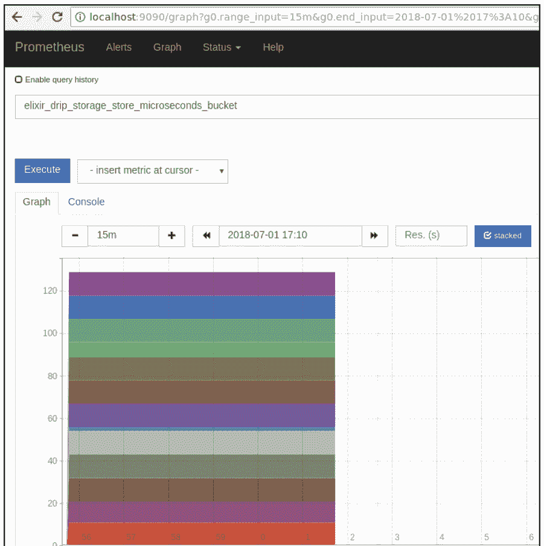

在本地环境运行后，让我们配置云端也托管一个 Prometheus 服务器（以及一些其他实用功能）。

## 在 Kubernetes 中部署 Prometheus

如我们在上一章对应用程序所做的那样，我们可以基于 Prometheus Docker 镜像配置一个 Pod，然后就完事了。它能工作，但每当 Prometheus Pod 轮换时，我们都会丢失所有指标，因为 Pod 本质上是短暂的。为了建立一个合适的监控解决方案，我们应该将 Prometheus 部署为它本身就是有状态的应用程序，并利用 Kubernetes 提供的抽象，如 StatefulSets 和 PersistentVolumes 等。

然而，这并不那么简单，所以我们将改用 Helm 来安装一个图表，该图表将为我们正确部署和配置 Prometheus 及其伙伴在 Kubernetes 集群中。你可以把 Helm 想象成 Kubernetes 的包管理器（如 apt、chocolatey 或 homebrew）。图表不过是一组 Kubernetes 模板（一种 Kubernetes 配方）的捆绑包，Helm 让我们可以在集群中安装它。要使用 Helm，我们还需要其服务器端对应物：Tiller。

Tiller 将在集群上运行，并根据你在机器上运行的 Helm 提供的说明安装图表。让我们先创建一个将由 Tiller 使用的 tiller-sa ServiceAccount：

```
$ kubectl -n kube-system create serviceaccount tiller-sa
serviceaccount "tiller-sa" created
```

以下是将之前的服务账户关联到 cluster-admin 角色的角色绑定，以便 Tiller 拥有其可能需要的所有权限：

```
$ cat monitoring/tiller-sa-role-binding.yml
apiVersion: rbac.authorization.k8s.io/v1beta1
kind: ClusterRoleBinding
metadata:
  name: tiller-role-binding
roleRef:
  apiGroup: rbac.authorization.k8s.io
  kind: ClusterRole
  name: cluster-admin
subjects:
  - kind: ServiceAccount
    name: tiller-sa
    namespace: kube-system
```

现在，我们只需要应用之前的 ClusterRoleBinding 资源：

```
$ kubectl create -f monitoring/tiller-sa-role-binding.yml
clusterrolebinding.rbac.authorization.k8s.io "tiller-role-binding" created
```

创建 tiller-sa 服务账户后，我们可以继续安装 Helm 及其兄弟 Tiller。按照 https://docs.helm.sh/using_helm/#installing-helm 处的说明进行操作，你应该在路径中的某个位置得到 helm 二进制文件。由于我们已将 kubectl 上下文配置为访问我们的 GKE 集群，helm 将利用此上下文与集群交互并一次性安装其服务器端组件：

```
$ helm init --service-account tiller-sa
Creating /home/andre/.helm
Creating /home/andre/.helm/repository
Creating /home/andre/.helm/repository/cache
Creating /home/andre/.helm/repository/local
Creating /home/andre/.helm/plugins
Creating /home/andre/.helm/starters
Creating /home/andre/.helm/cache/archive
Creating /home/andre/.helm/repository/repositories.yaml
Adding stable repo with URL:
https://kubernetes-charts.storage.googleapis.com
Adding local repo with URL: http://127.0.0.1:8879/charts
$HELM_HOME has been configured at /home/andre/.helm.

Tiller (the Helm server-side component) has been installed into your Kubernetes Cluster.
```

之后，我们可以看到 kube-system 命名空间中正在运行的 tiller-deploy Pod：

```
$ kubectl get pods --all-namespaces
NAMESPACE NAME READY STATUS RESTARTS AGE
# ...
kube-system tiller-deploy-75d774db4f-fbxch 1/1 Running 5 3d
```

我们将安装两个 Helm 图表：prometheus-operator 和 kube-prometheus。这两个图表由 CoreOS 提供，正在积极开发中。kube-prometheus 图表使用 prometheus-operator 引入的 Kubernetes 资源，并简化了在 Kubernetes 集群中管理 Prometheus 和 Grafana（以及其他工具）的过程（例如，持久存储的配置、应用程序升级的安全协调、灾难恢复等）。

除了 Prometheus，我们还将使用 Grafana。Grafana 是一个开源数据可视化工具，能够消费 Prometheus 指标（以及其他数据源）并用它们创建图表和仪表板。

我们首先需要安装 CoreOS 仓库，以便 helm 随后可以找到我们需要的图表：

```
$ helm repo add coreos
https://s3-eu-west-1.amazonaws.com/coreos-charts/stable/
"coreos" has been added to your repositories
```

现在，只需在特定的 monitoring 命名空间上安装这两个图表即可。我们使用不同的命名空间来保持整洁，但 Prometheus 服务器仍然能够监控在生产命名空间中运行的 ElixirDrip Pod：

```
$ helm install coreos/prometheus-operator --name prometheus-operator --namespace monitoring
NAME: prometheus-operator
LAST DEPLOYED: Wed Jun 27 19:51:49 2018
NAMESPACE: monitoring
STATUS: DEPLOYED
  # ...
```

```
$ helm install coreos/kube-prometheus --name kube-prometheus --namespace monitoring
NAME: kube-prometheus
LAST DEPLOYED: Wed Jun 27 20:04:00 2018
NAMESPACE: monitoring
STATUS: DEPLOYED
  # ...
```

```
$ kubectl -n monitoring get pods
NAME READY STATUS RESTARTS AGE
alertmanager-kube-prometheus-0 2/2 Running 4 2h
kube-prometheus-exporter-kube-state-5ffd856844-m6wbj 2/2 Running 0 1h
kube-prometheus-exporter-node-4ddt6 1/1 Running 2 2h
kube-prometheus-exporter-node-ppj2g 1/1 Running 0 1h
kube-prometheus-grafana-6c9496d766-q7278 2/2 Running 4 2h
prometheus-kube-prometheus-0 3/3 Running 1 2h
prometheus-operator-f454cb555-htqxx 1/1 Running 2 2h
```

过了一会儿，你将能够看到这两个图表在 monitoring 命名空间中创建的所有 Pod 正在运行。


当我在只有一个 n1-standard-1 节点（1 vCPU 和 3.75 GB RAM）的 GKE 集群上尝试部署这两个 Helm 图表时，一些 Pod 无法启动，并且在 Google Cloud 控制台中出现了不可调度 Pod 的通知。在激活集群自动扩缩器并将其最大大小设置为 2 后，Kubernetes 自动将集群扩容以腾出空间给新 Pod。

如果我们转发 `prometheus-kube-prometheus-0` Pod 的 9090 端口，我们将能够访问刚刚部署的 Prometheus 服务器：

```
$ kubectl -n monitoring port-forward prometheus-kube-prometheus-0 49090:9090
Forwarding from 127.0.0.1:49090 -> 9090
Forwarding from [::1]:49090 -> 9090
# ...
```

如果你现在访问 http://localhost:9090/graph，你将看到与之前本地访问相同的 Prometheus 页面。然而，我们仍然没有任何 ElixirDrip 指标，因为我们尚未配置 Prometheus 从应用程序的 `/metrics` 端点抓取指标。

为了从我们的应用程序抓取指标，我们不需要直接更新 Prometheus 配置文件，因为 `prometheus-operator` 引入了一个名为 `ServiceMonitor` 的自定义 Kubernetes 资源，其唯一目的是配置 Prometheus 如何找到可用目标。

在配置我们自己的 `ServiceMonitor` 之前，让我们先看看 operator 为我们创建的 `ServiceMonitors`：

```
$ kubectl -n monitoring get servicemonitors
NAME AGE
kube-prometheus 3h
kube-prometheus-alertmanager 3h
kube-prometheus-exporter-kube-controller-manager 3h
kube-prometheus-exporter-kube-dns 3h
kube-prometheus-exporter-kube-etcd 3h
kube-prometheus-exporter-kube-scheduler 3h
kube-prometheus-exporter-kube-state 3h
kube-prometheus-exporter-kubelets 3h
kube-prometheus-exporter-kubernetes 3h
kube-prometheus-exporter-node 3h
kube-prometheus-grafana 3h
prometheus-operator 3h
```

正是 `kube-prometheus-exporter-kubelets` 服务监控器告诉 Prometheus 如何从 Kubernetes 抓取指标。默认情况下，Prometheus 以安全的方式获取 Kubernetes 指标。然而，由于 Google Kubernetes Engine 的工作方式，我们需要更改此目标的服务监控器：

```
$ kubectl -n monitoring get servicemonitor kube-prometheus-exporter-kubelets -o yaml | sed 's/https/http/' | kubectl replace -f -
servicemonitor.monitoring.coreos.com "kube-prometheus-exporter-kubelets" replaced
```

在之前的片段中，我们获取 `kube-prometheus-exporter-kubelets` ServiceMonitor 的 YAML 定义，将其 `https` 出现的地方替换为 `http`，然后用新的仅 HTTP 版本替换其资源。通过此更改，Prometheus 能够抓取 operator 开箱即用的所有目标配置。

我们刚刚更新的 `ServiceMonitor` 资源是由 `prometheus-operator` 引入的自定义资源。它使我们能够通过依赖类似 Kubernetes 的概念（如标签选择器）来配置 Prometheus 目标，而无需实际更新任何 Prometheus 配置。以下是我们将创建的 `ServiceMonitor` 定义，以将 ElixirDrip 设置为 Prometheus 目标：

```
$ cat monitoring/elixir-drip-service-monitor-prod.yml
apiVersion: monitoring.coreos.com/v1
kind: ServiceMonitor
metadata:
  labels:
    app: prometheus
  name: elixir-drip-monitor
  namespace: monitoring
spec:
  jobLabel: elixir-drip
  endpoints:
  - interval: 30s
    port: web
  namespaceSelector:
    matchNames:
    - production
  selector:
    matchLabels:
      app: elixir-drip
```


我们正在自定义 ServiceMonitor 中设置 `app=prometheus` 标签，因为 `kube-prometheus` 资源（类型为 `Prometheus`，也是 Prometheus operator 引入的自定义资源）默认会搜索具有特定 `app` 标签值的 ServiceMonitor（`alertmanager`、`grafana`、`prometheus` 等）：

```
$ kubectl -n monitoring get prometheus kube-prometheus -o yaml
apiVersion: monitoring.coreos.com/v1
kind: Prometheus
metadata:
  # ...
  name: kube-prometheus
  namespace: monitoring
  # ...
serviceMonitorSelector:
  matchExpressions:
  - key: app
    operator: In
    values:
    - alertmanager
    - exporter-coredns
    - exporter-kube-controller-manager
    - exporter-kube-dns
    - exporter-kube-etcd
    - exporter-kube-scheduler
    - exporter-kube-state
    - exporter-kubelets
    - exporter-kubernetes
    - exporter-node
    - grafana
    - prometheus
    - prometheus-operator
```

我们刚刚定义的 `elixir-drip-monitor` 将在 `production` 命名空间中搜索带有 `app=elixir-drip` 标签的端点，然后配置 Prometheus 通过这些端点的 `web` 端口抓取指标。我们没有指定自定义指标路径，因为默认情况下 ServiceMonitor 通过 `/metrics` 路径获取指标：

```
$ kubectl create -f monitoring/elixir-drip-service-monitor-prod.yml
servicemonitor.monitoring.coreos.com "elixir-drip-monitor" created

$ kubectl -n monitoring get servicemonitors
NAME AGE
elixir-drip-monitor 16s
# ...
```

创建 `elixir-drip-monitor` 后，我们能够在 http://localhost:49090/targets URL 暴露的其他 Prometheus 目标中看到 `elixir-drip-loadbalancer` 条目：

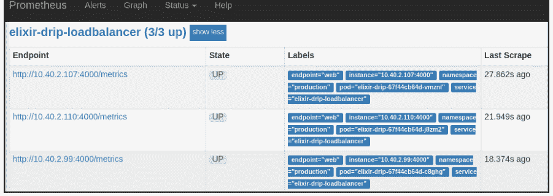

这意味着我们现在可以用 Prometheus 查询 ElixirDrip 指标。尽管 Prometheus 能够绘制我们的指标图表，但我们将使用 Grafana，这是一款开源数据可视化工具，能够使用 Prometheus 作为数据源。幸运的是，我们之前部署的 `prometheus-operator` 也部署了一个 `grafana` Pod，因此只需将 `kube-prometheus-grafana-6c9496d766-q7278` Pod 的 3000 端口暴露出来即可：

```
$ kubectl -n monitoring get pods -l app=kube-prometheus-grafana
NAME READY STATUS RESTARTS AGE
kube-prometheus-grafana-6c9496d766-q7278 2/2 Running 4 5d

$ kubectl -n monitoring port-forward kube-prometheus-grafana-6c9496d766-q7278 43000:3000
Forwarding from 127.0.0.1:43000 -> 3000
Forwarding from [::1]:43000 -> 3000
```

如果你现在访问 `http://localhost:43000`，将会看到 Grafana 主页。如果你点击 **Home** 然后打开 **General** 文件夹，就能找到一些 Kubernetes 仪表盘。这就是 **Kubernetes Capacity Planning** 仪表盘的外观：

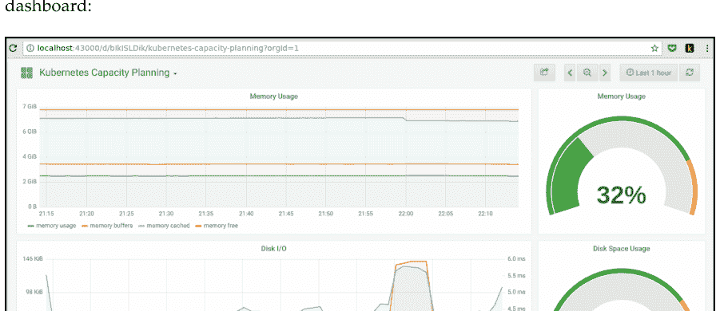

在左下角使用 `admin/admin` 登录，以便我们可以创建我们的第一个仪表盘。通过点击加号并选择 **Create dashboard**，我们可以创建 ElixirDrip 仪表盘。在添加任何面板之前，先为其命名，然后按 `Ctrl + S` 保存。

我们现在将添加一个面板，显示 Kubernetes 用于评估我们的 ElixirDrip Pod 是否按预期工作 的 `/health` 端点的响应时间直方图。在 **New panel** 部分中，选择 `Graph`，一个带有虚拟数据（实际上是随机游走）的新图表将会出现：

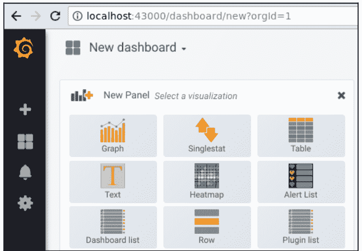

通过点击面板标题，我们可以编辑它。在这里我们可以更改面板标题（参见 **General** 选项卡），也是在这里我们将配置与图表相关的所有内容。让我们从 `Metrics` 选项卡开始并选择相关指标。

因为我们使用了 `prometheus-operator`，Grafana 已经将 Prometheus 配置为数据源，只需选择它即可。如果你开始输入指标名称，Grafana 会根据可用的 Prometheus 数据建议指标。输入 `http_request_duration_microseconds_bucket{request_path="/health"}` 作为第一个指标，图表将显示具有自定义标签 `request_path="/health"` 的每个观测值的 `http_request_duration_microseconds_bucket` 指标。

默认情况下，每个图例键都会显示完整的标签集，包括 `pod` 和 `le` 标签（后者给出指标桶，是 *lower than or equal to* 的简写）。为了简化，你可以在 `Legend format` 字段中写入 `{{pod}}` `{{le}}` 表达式，使每个图例仅包含 `pod` 和 `le` 标签。然而，我们仍然会看到 60 个数据系列，因为我们目前有 20 个桶和三个 ElixirDrip Pod（几乎一半的数据系列甚至没有出现在下面的截图中）：

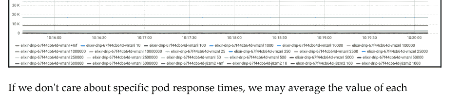

如果我们不关心特定 Pod 的响应时间，可以使用 `avg` 聚合操作符对每个桶的值进行平均：

```
avg(http_request_duration_microseconds_bucket{request_path="/health"}) by (le)
```

采用这种方法，我们不想知道数据点是由哪个 Pod 发出的，因此应从图例格式中删除 `{{pod}}` 部分。由于 HTTP 响应时间以微秒为单位测量，让我们在图例中添加 µs 单位（`{{le}}` µs）。

让我们还更改 `Left Y axis`，将其标签设置为 `No. of requests`，单位设置为 `none`，以便可以看到完整的图例值。

为了提高图表的可读性，在 Display 选项卡中将图表的绘制模式更改为点：

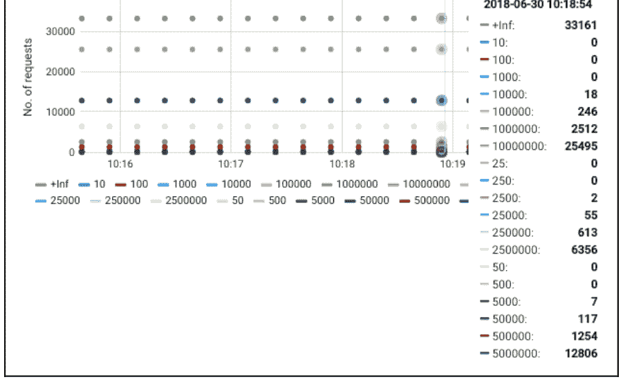

通过查看图表中某个特定时间点，我们可以得出大多数观测值属于 +Inf、10 秒（10000000）、5 秒（5000000）、2.5 秒（2500000）、1 秒（1000000）和 0.5 秒（500000）桶。因此，让我们只考虑这些桶，使用以下指标表达式选择它们：

```
avg(http_request_duration_microseconds_bucket{
request_path="/health",
le=~".+Inf|10000000|5000000|2500000|1000000|500000"}) by (le)
```

我们现在有一个更整洁的图表，显示了 /health 平均响应时间在我们六个桶之间的分布：

尽管如此，这个图表仍然无法一目了然地告诉我们应用程序发生了什么。让我们尝试使用百分位数来全面了解情况。

## 计算百分位数

而不是查看按桶划分的观测频率，让我们使用 `histogram_quantile()` 查询函数来计算一些百分位数。这样，我们就能更好地了解 `/health` 响应时间的分布。我们将从计算第 50 百分位数开始，用以下表达式替换之前的指标：

```
histogram_quantile(0.5,
    rate(
        http_request_duration_microseconds_bucket{request_path="/health",
        pod=~"elixir-drip.*"}[5m]
    ))
```

我们使用 `rate(...) [5m]` 函数来获取每个直方图桶中样本的 5 分钟平均速率。因为直方图分位数是针对指标拥有的每个标签组合计算的，所以我们可以看到每个 Pod 的三个不同图表。我们还需要将 `Legend format` 更改为 `50th percentile {{pod}}`，并将 `Left Y axis` 的单位更改为 `microseconds (µs)`。

我们现在可以观察到，在此时间段内，50% 的 `/health` 请求耗时少于 8 秒，且 8lts4 Pod 是最快的 Pod：

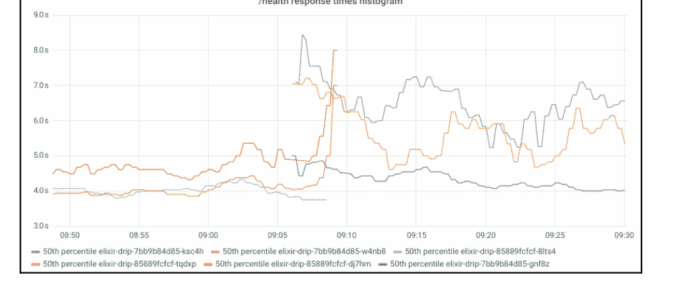

随着我们绘制的每个百分位数都有三个图表，很快就会变得混乱，因此让我们将此百分位数聚合为仅有一个数据系列：

```
histogram_quantile(0.5,
    sum without(instance, pod, host) (
        rate(http_request_duration_microseconds_bucket{request_path="/health",
        pod=~"elixir-drip.*"}[5m])
    )
```

我们使用 sum without(...) 来删除 Pod 之间不同的标签，以便 Pod 聚合按预期工作。然而，采用这种方法我们最终会丢失每个单独 Pod 的信息。我们希望能够轻松选择 Pod 标签表达式的值。幸运的是，Grafana 允许我们定义变量，然后可以在图表中使用这些变量。

## 设置 Grafana 变量

如果你转到设置（右上角）并选择 Variables，我们可以添加一个新的 Pod 变量：

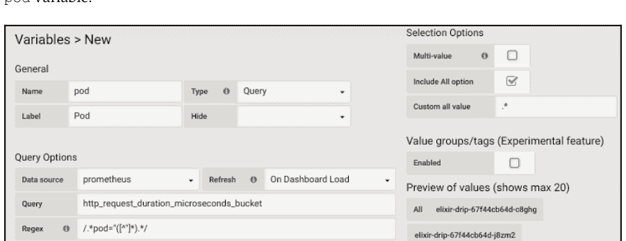

除了变量名称外，我们将其类型设置为 query，以从 Prometheus http_request_duration_microseconds_bucket 查询中获取其值。然后我们设置 /.*pod="([^"]*).*/ 作为正则表达式，从每个观测值中提取 Pod 标签值。


回顾一下，每个 Prometheus 观测值的格式为
`<metric_name>{<lbl1>=<lbl1_val>,<lbl2>=<lbl2_val>,...}`
`<value> <timestamp>`。

`pod` 变量可以取 `pod` 标签的不同值，但由于我们还选择了 **Include All option**，我们可以说 **All** 值会插入一个自定义值；在我们的例子中，**All** 值将是 `.*`。这将使我们能够查看通过变量查询获得名称的其中一个 pod 的百分位，或者所有 pod 的聚合百分位。

如果我们现在在之前的 50th 百分位指标表达式中将 `pod` 标签值设置为 `$pod`，我们就可以通过更改仪表板中的 `Pod` 下拉菜单来控制其图表。你也可以在任何图例中使用变量，只需将指标图例更新为 `50th percentile {{$pod}}` 即可：

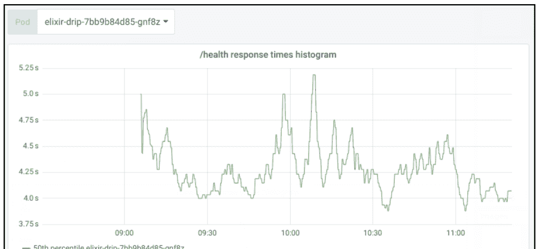

我们现在需要以相同的方式定义其他百分位，因此让我们为 90th、95th、99th 和 max 百分位定义以下指标，其中 `<percentile>` 分别为 `0.9`、`0.95`、`0.99` 和 `1`：

```
histogram_quantile(<percentile>, sum without(instance, pod, host) (
  rate(http_request_duration_microseconds_bucket{request_path="/health",
  pod=~"$pod"}[5m]))
```

如果我们现在查看图表，你可能会觉得奇怪，因为我们刚刚定义了五个百分位，但只能看到两个数据系列：

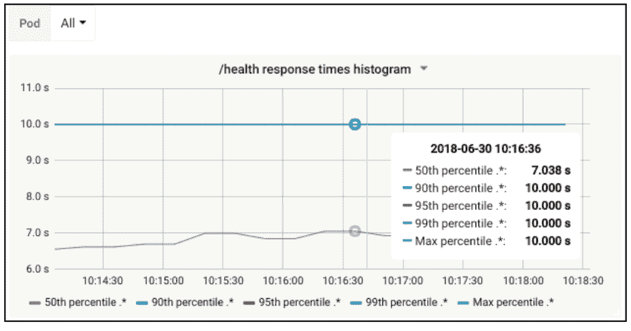

这是使用 Prometheus 直方图时可能发生的常见错误。因为你需要在事先指定桶区间，所以你可能会定义出大多数观测值都落入顶部桶的桶。这导致我们在 10 秒线处看到的平坦线，其中除 50th 之外的所有百分位都显示相同的值。

在我们的例子中，因为我们没有覆盖由 :prometheus_phoenix 库设置的默认 HTTP 桶，所以我们使用的是由 :prometheus_http.microseconds_duration_buckets/0 函数给出的默认 20 个桶（下面显示的 19 个桶，外加一个 +Inf）：

```
iex> :prometheus_http.microseconds_duration_buckets
[10, 25, 50, 100, 250, 500, 1000, 2500, 5000, 10000, 25000, 50000,
100000, 250000, 500000, 1000000, 2500000, 5000000, 10000000]
```

为了解决这个问题，我们将通过设置从 500 微秒到 25 秒的新桶来覆盖默认的 `ElixirDripWeb.EndpointInstrumenter` 配置：

```
$ cat apps/elixir_drip_web/config/config.exs
# ...
config :prometheus, ElixirDripWeb.EndpointInstrumenter,
  duration_buckets: [500, 1000, 2500, 5000, 10_000, 25_000, 50_000,
    100_000, 250_000, 500_000, 1_000_000, 2_500_000, 5_000_000,
    10_000_000, 12_500_000, 15_000_000, 17_500_000, 20_000_000]
```

然而，Phoenix 并没有那么慢，特别是考虑到 `/health` 路由是由 `HealthController.health/2` 函数提供服务的，该函数只是生成一个时间戳并返回当前节点连接到的节点列表。如果你觉得有什么不对劲，你是对的：我在 `health/2` 函数中添加了一个随机休眠（即 `Process.sleep(:rand.uniform(13_000))`），休眠时间在 1 到 13,000 毫秒之间，以便我们有更分散的响应时间。

尽管如此，原则仍然成立；在获得足够的生产数据后，你很可能会需要稍后调整你的桶。在我们的例子中，我们将移除随机休眠并相应地添加更多桶。更改部署后，相同的图表如下所示：

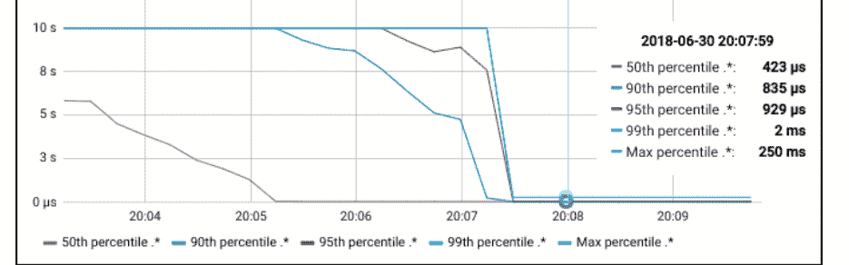

如果我们现在放大，就会发现所有响应都在 2.5 ms 以下，99th 百分位在 1 ms 以下，而不是之前的奇怪响应时间：

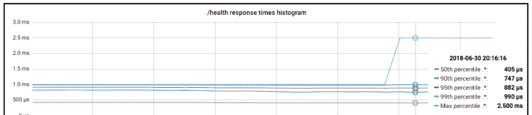

响应时间现在快得多，并且符合预期的 Phoenix 敏捷性，当处理由我们简单的 HealthController.health/2 支持的请求时。让我们检查 Prometheus 直方图创建的另外两个指标。

因为我们对 HTTP 响应时间使用了直方图，所以 _sum 和 _count 指标也在被收集。这些指标使我们能够计算平均 HTTP 请求持续时间。顾名思义，_sum 指标是一个计数器，累积观测值，而 _count 指标则计算观测次数。借助这两个指标，我们可以在给定周期内计算平均 /health 响应时间：

```
rate(http_request_duration_microseconds_sum{request_path="/health", pod=~"$pod"}[5m])
/
rate(http_request_duration_microseconds_count{request_path="/health", pod=~"$pod"}[5m])
```

这将为我们提供每个 pod 的平均响应时间。然而，如果我们将 pod 变量设置为 All，我们将得到与 pod 数量一样多的 Average 数据系列。为了解决这个问题，我们可以通过取其最大值来聚合之前的表达式。这样，我们将只有一个 Average 数据系列，它在任何给定时间都对应于所有现有 pod 的最大平均响应时间：

```
max(rate(http_request_duration_microseconds_sum{request_path="/health", pod=~"$pod"}[5m])
/
rate(http_request_duration_microseconds_count{request_path="/health", pod=~"$pod"}[5m]))
```

当平均响应时间与其它百分位一起显示在同一图表中时，它似乎几乎没有变化，因为图表的时间轴是为百分位时间准备的（平均响应时间始终保持在 1 ms 以下）。为了解决这个问题，我们可以使用右侧的新 y 轴绘制它。

在任何 Grafana 图表中，你可以点击图例中的彩色线并将 **Y Axis** 设置为 **Right**。在我们的例子中，有点棘手：因为我们有与不同的 `pod` 变量值一样多的平均响应时间数据系列，所以我们想要使用 **Series specific overrides** 一次影响所有数据系列。进入 **Display** 选项卡，添加一个新的覆盖，并将其正则表达式字段设置为 `/Average/`。然后，点击 + 号并选择 **Y-axis: 2** 覆盖，如以下屏幕截图所示：

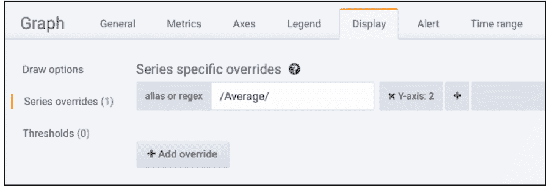

这将把名称中包含 `Average` 的每个图表数据系列绘制在右侧 y 轴上。我们现在只需要在 `Axes` 选项卡中将右侧 y 轴的单位设置为 `microseconds (µs)`。

平均响应时间现在可以更详细地看到：

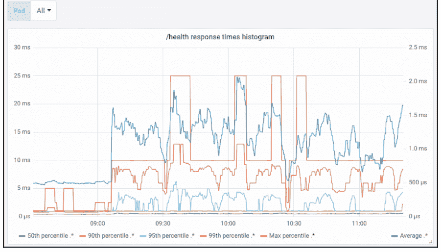

掌握了这些知识后，你现在可以为我们之前设置的自定义 `Storage.store/4` 直方图和缓存命中计数器指标创建图表。

## 通往节点的窗口

在我们设计一种查看和与远程应用程序交互的方式之前，让我们分析一下 Elixir 鉴于其 Erlang  heritage，在分布式环境中是如何工作的。当你运行一个 IEx shell 或 ElixirDrip release 时，会启动一个 Erlang VM。每个 VM 被称为一个 *node*，你可以在同一台计算机上运行多个节点。

要启动一个节点，你需要定义它的 `name` 和 `magic cookie`，然后节点会尝试在本地 **Erlang Port Mapper Daemon (EPMD)** 上注册自己。这个 EPMD 是一种名称服务器，默认在端口 `4369` 上运行，并注册每个主机上运行的节点。


cookie 确实被描述为 magic；请查看 Erlang 文档 http://erlang.org/doc/reference_manual/distributed.html。任何知道 cookie 值的人都能够使用它连接到节点，无需质疑，因此非常重要它要足够长并且以安全的方式存储。默认情况下，Erlang 以明文形式组成节点集群，因为假设集群运行在受信任的网络上；因此网络上的任何人都可以拦截节点之间交换的数据。

在以下示例中，我们启动一个休眠 20 秒的节点，然后查询本地 EPMD 当前运行哪些节点：

```
$ elixir --name simple@localhost --cookie yummy -e "Process.sleep(20000)" &

$ epmd -names
epmd: up and running on port 4369 with data:
name simple at port 35351
```

如你所见，端口 35351 被分配给了 simple 节点。EPMD 为每个节点分配一个随机的高编号端口。如果远程节点想要连接到我们的 simple 节点，它需要设置相同的 yummy cookie，然后执行 Node.connect(:"simple@<local-hostname>")，其中 <local-hostname> 是本地主机名。这将向在端口 4369 上运行的 <local-hostname> EPMD 发送关于 simple 节点的查询，后者将成功回复端口 35351。有了这些信息，远程节点就可以通过端口 35351 连接到 simple 节点。

我们的第一步是连接到在本地 Docker 容器中运行的 ElixirDrip 节点，这样我们就可以看到节点内部发生了什么。

## 连接到容器化节点

在连接到节点之前，我们必须公开将用于连接节点的容器端口。编辑你的 docker-compose.dev.yml 文件并添加以下内容：

```
$ cat docker-compose.dev.yml
# ...
app:
  image: elixir_drip:dev
# ...
ports:
  - 4000:4000
```

  - 4369
  - 9001-9004
  # ...

`9001-9004` 端口范围是 EPMD 为新节点分配端口的范围。我们将通过在运行 Elixir 时以及在启动应用程序发布时传递 `inet_dist_listen_min` 和 `inet_dist_listen_max` 参数来告知 EPMD 遵守此范围。要在运行发布时传递这些参数，我们需要在发布配置中设置 `erl_opts` 选项：

```
$ cat rel/config.exs
  # ...
environment :prod do
  set include_erts: true
  set include_src: false
  set cookie: :"won't be used, we set it via a custom vm.args file (rel/custom.vm.args)"
  set erl_opts: "-kernel inet_dist_listen_min 9001 inet_dist_listen_max 9004"
end
  # ...
```

如果我们对 `inet_dist_listen_min` 和 `inet_dist_listen_max` 参数设置相同的值，则在每个主机上只能运行单个节点，因为节点数量不能超过此范围内的端口数。这将阻止我们在 pod 内运行其他节点，例如控制台，即使用 `elixir_drip console` 运行发布，如我们在上一章中所做的那样。这就是我们设置四个端口的范围的原因。

在暴露端口后，使用 `docker-compose -f docker-compose.dev.yml up -d` 在本地启动容器（-d 表示 *detached*，因此容器将在后台运行），在 `app` 容器内运行一个 shell，然后使用 `epmd -d` 以调试模式启动 EPMD，以便我们可以查看与它的所有交互：

```
$ docker-compose -f docker-compose.dev.yml up -d
umbrella_postgres_1
umbrella_app_1
umbrella_prometheus_1

$ docker exec -i -t umbrella_app_1 bash

# epmd -d
epmd: Sun Jul 8 11:01:00 2018: epmd running - daemon = 0
```

现在，通过在主机 shell 上运行 `docker inspect` 来查找 `app` 容器的 IP：

```
$ docker inspect umbrella_app_1 | grep "IPAddress"
    "SecondaryIPAddresses": null,
    "IPAddress": "",
    "IPAddress": "172.21.0.3",
```

在另一个容器 shell 上，设置其名称、cookie 和可用端口范围后运行应用程序：

```
$ docker exec -i -t umbrella_app_1 bash

# iex --name inside@172.21.0.3 --cookie testing --erl "-kernel inet_dist_listen_min 9001 inet_dist_listen_max 9004" -S mix phx.server
# ...
Interactive Elixir (1.6.4) - press Ctrl+C to exit (type h() ENTER for help)
iex(inside@172.21.0.3)1>
```

你会立即看到 EPMD 注册 `inside` 节点：

```
epmd: Sun Jul 8 11:19:42 2018: epmd running - daemon = 0
epmd: Sun Jul 8 11:20:45 2018: ** got ALIVE2_REQ
epmd: Sun Jul 8 11:20:45 2018: registering 'inside:1', port 9001
epmd: Sun Jul 8 11:20:45 2018: type 77 proto 0 highvsn 5 lowvsn 5
epmd: Sun Jul 8 11:20:45 2018: ** sent ALIVE2_RESP for "inside"
```

我们现在可以连接到容器内运行的节点。让我们在主机上启动一个名为 `outside` 的节点，然后启动 `observer` 工具：

```
$ iex --name outside@0.0.0.0 --cookie testing --erl "-kernel inet_dist_listen_min 9001 inet_dist_listen_max 9004"
Interactive Elixir (1.6.4) - press Ctrl+C to exit (type h() ENTER for help)
iex(outside@0.0.0.0)1> :observer.start
:ok
```

观察者界面将会出现，我们可以进入 Nodes -> Connect Node 来插入容器内运行的节点名称：

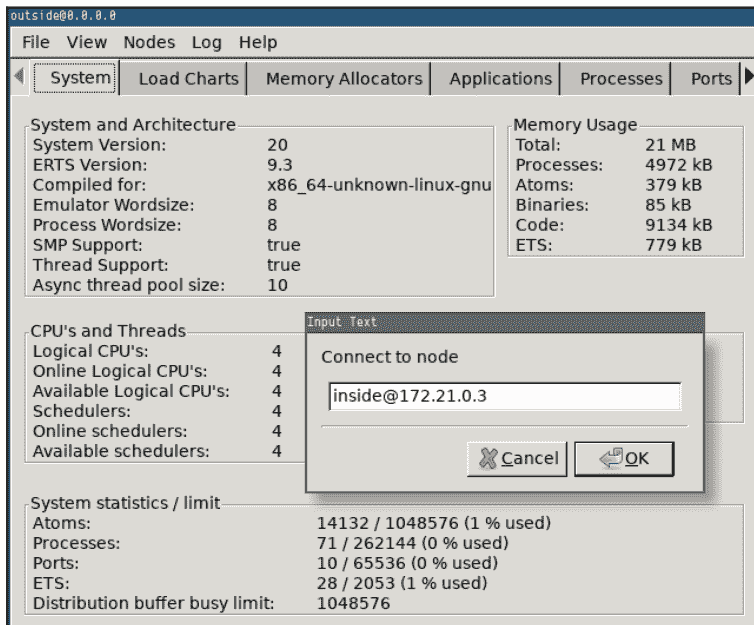

我们现在可以从 Nodes 菜单中选择 inside@172.21.0.3 节点并查看有关它的所有信息，包括每个运行应用程序的现有监督树；深入了解任何进程的状态；观察节点的 CPU、内存和 IO 负载；等等：

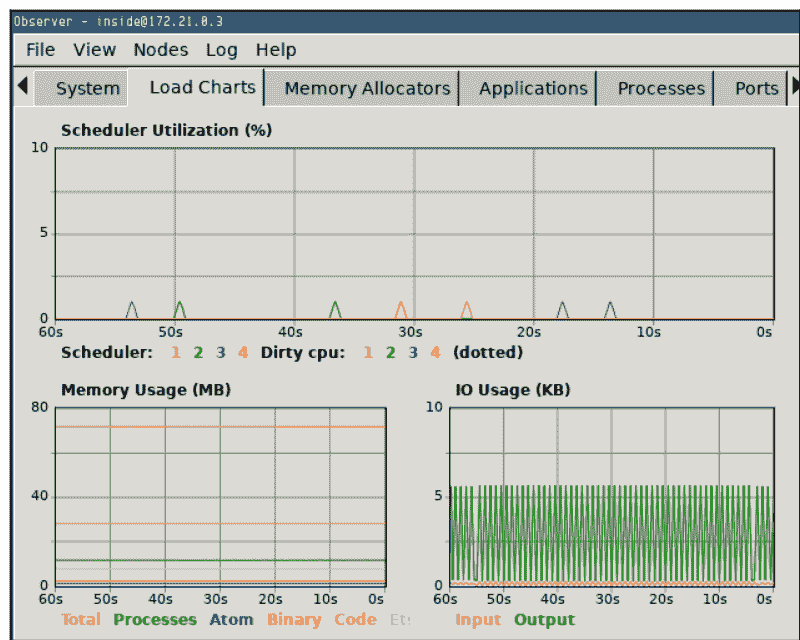

让我们现在应用类似的策略来连接到我们的 ElixirDrip 远程节点。

## 在 Kubernetes 中连接到 Erlang 节点

在上一节中，我们公开了一系列容器端口，允许我们从外部连接到容器内运行的 Erlang 节点。然而，这次我们不想通过更新 Kubernetes `elixir-drip-loadbalancer` 服务来公开已部署 pod 的 `4369` 和 `9001-9004` 端口，因为 EPMD 连接不安全，即使你使用 TLS 连接节点也是如此。

因此，我们将借助 kubectl port-forward 将 EPMD 端口转发到本地环境。由于 EPMD 运行在 4369 端口上，在转发端口之前请确保使用 pkill epmd 没有本地运行的 EPMD，否则你将无法转发 4369 端口：

```
$ pkill epmd

$ kubectl -n production port-forward elixir-drip-7bb9b84d85-ksc4h 4369 9001 9002 9003 9004
Forwarding from 127.0.0.1:4369 -> 4369
Forwarding from 127.0.0.1:9001 -> 9001
Forwarding from 127.0.0.1:9002 -> 9002
Forwarding from 127.0.0.1:9003 -> 9003
Forwarding from 127.0.0.1:9004 -> 9004
```

我们现在可以通过与本地端口 4369 交互来访问 ksc4h pod 中运行的 EPMD 实例：

```
$ epmd -names
epmd: up and running on port 4369 with data:
name elixir_drip at port 9001
```

请记住，我们已使用自定义 vm.args 文件将每个 ElixirDrip 节点命名为 elixir_drip@<pod-ip>，因此我们需要将每个节点连接到 Node.connect(":\"elixir_drip@<pod-ip>\"")，其中 <pod-ip> 是通过以下命令获得的 pod IP：

```
$ kubectl -n production exec -t elixir-drip-7bb9b84d85-ksc4h -c elixir-drip-prod -- env | grep POD_IP
POD_IP=10.40.0.41
```

通过在 ksc4h pod 内运行 env | grep POD_IP，我们知道 pod IP。然而，IP 10.40.0.41 是 Kubernetes 内部 IP，在本地环境中没有有意义的值。如果我们尝试使用 Node.connect/1 函数连接到 elixir_drip@10.40.0.41，后续对 10.40.0.41 地址上运行的 EPMD 的查询将无法工作，因为从本地角度来看，没有办法到达此地址。

为克服这一点，我们将 10.40.0.41 pod IP 转发到 localhost 地址。首先，确保在 /etc/sysctl.conf 配置文件中取消注释 net.ipv4.ip_forward=1 行，以便我们可以设置 IPv4 转发规则。然后，使用以下命令转发 IP：

```
$ sudo iptables -t nat -A OUTPUT -d 10.40.0.41 -j DNAT --to-destination 127.0.0.1
```

```
$ ping 10.40.0.41
PING 10.40.0.41 (10.40.0.41) 56(84) bytes of data.
64 bytes from 10.40.0.41: icmp_seq=1 ttl=64 time=0.079 ms
64 bytes from 10.40.0.41: icmp_seq=2 ttl=64 time=0.086 ms
^C
```

我们现在可以 ping pod IP，即使实际上是 localhost 在回复。让我们现在启动一个本地 IEx shell，类似于我们之前所做的，但这次我们将命名为 console@10.40.0.41：

```
$ iex --name console@10.40.0.41 --cookie <cookie>
Erlang/OTP 20 [erts-9.3] [source] [64-bit] [smp:4:4] [ds:4:4:10] [async-threads:10] [hipe] [kernel-poll:false]

Interactive Elixir (1.6.4) - press Ctrl+C to exit (type h() ENTER for help)
iex(console@10.40.0.41)>
```

我们现在传递的 cookie 值（<cookie>）在上一章中已作为 Kubernetes secret 设置。我们现在必须在运行 console@10.40.0.41 节点时设置相同的 cookie 值，以便后者可以连接到 pod 中运行的节点。


如果你不记得在 Kubernetes secret 上设置的 cookie，你始终可以在 pod 容器内运行 ElixirDrip 控制台（PORT=5678 ./bin/elixir_drip console）并检查 Node.get_cookie/0 值。在我们的例子中，这更简单，因为我们是从名为 ERLANG_COOKIE 的环境变量设置 cookie，所以 kubectl exec -t <pod-name> -c <container-name> - env | grep ERLANG_COOKIE 就足够了。

在之前的端口和 IP 转发设置之后，如果我们运行 epmd -names，我们会看到两个节点（console 和 elixir_drip）已注册。请记住，我们正在查询本地端口 4369 上的 EPMD，该端口转发到 ksc4h pod 上的同一端口，因此我们实际上是在查询远程 pod 中运行的 EPMD：

```
$ epmd -names
epmd: up and running on port 4369 with data:
name console at port 43323
name elixir_drip at port 9001
```

我们现在可以连接到 pod 中运行的节点并启动 observer 工具：

```
iex(console@10.40.0.41)> Node.connect(:"elixir_drip@10.40.0.41")
true

iex(console@10.40.0.41)> :observer.start
:ok
```


因为我们之前已经连接到节点，所以它已经出现在 Nodes 菜单中。我们再次从正在运行的 IEx shell 启动了 observer，但我们也可以立即使用 Erlang 启动 observer 工具：

```
$ erl -name console@10.40.0.41 -setcookie <cookie> -hidden -run observer
```

使用 Erlang 方法，我们从一开始就没有连接到任何节点，因此你仍需要使用 Nodes -> Connect Node 选项连接到 elixir_drip@10.40.0.41 节点。

此外，请注意我们这次传递的 -hidden 标志。通过将本地控制台节点作为隐藏节点启动，它只会连接到单个节点，而不是默认尝试连接到所有可用的已连接节点（由于分布式 Erlang 的传递性）：

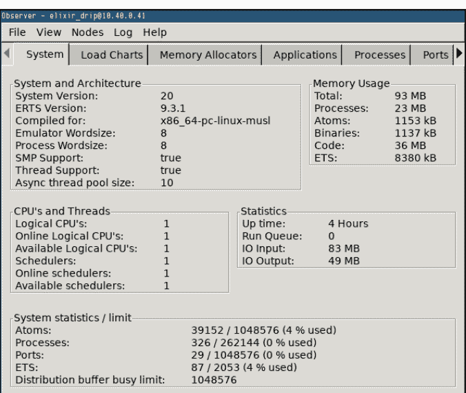

现在让我们了解如何在一个远程节点内部运行 IEx shell。

## 使用远程 shell

如果 observer 提供的信息不足，在此设置下，你也可以从本地 shell 的舒适环境中运行远程 shell：

```
$ iex --name console@10.40.0.41 --cookie $COOKIE --remsh
"elixir_drip@10.40.0.41"
Erlang/OTP 20 [erts-9.3] [source] [64-bit] [smp:4:4] [ds:4:4:10] [async-threads:10] [hipe] [kernel-poll:false]

Interactive Elixir (1.6.4) - press Ctrl+C to exit (type h() ENTER for help)
iex(elixir_drip@10.40.0.41)> node()
:"elixir_drip@10.40.0.41"
iex(elixir_drip@10.40.0.41)> Node.list
[:"elixir_drip@10.40.2.143", :"elixir_drip@10.40.0.42",
:"console@10.40.0.41"]
```

如你所见，当前节点（由 Kernel.node/0 函数给出）是远程节点（elixir_drip@10.40.0.41），因此你运行的任何内容都将在远程节点上运行。由于我们使用 libcluster 库连接了 ElixirDrip 节点，因此 Node.list/0 函数返回了三个节点。

让我们通过远程 shell 存储一个文件，然后使用 observer 查看其内容，从而让远程 shell 和 observer 工具为我们工作：

```
iex(elixir_drip@10.40.0.41)> jose_user =
ElixirDrip.Accounts.get_user_by_username("jose")
%ElixirDrip.Accounts.User{
  # ...
  username: "jose"
}

iex(elixir_drip@10.40.0.41)> ElixirDrip.Storage.store(jose_user.id,
"remote_shell_test.txt", "$/foo/bar", "f○e? V○eV ... ( ^_ ) ( ^_^ ) Hello from Remote Shell")
{:ok, :upload_enqueued,
%ElixirDrip.Storage.Media{
  file_name: "remote_shell_test.txt",
  file_size: 95,
  full_path: "$/foo/bar",
  id: "173aBUSCM8nVJKPUDB e6EondStn",
  # ...
}}
```

在我们刚刚启动的 **Observer** 中，前往 **Applications** 选项卡，并在左侧窗格中选择 `elixir_drip` 应用。然后，在监督树中查找一个 `CacheWorker` 进程，其父进程为 `Supervisors.CacheSupervisor` 进程：

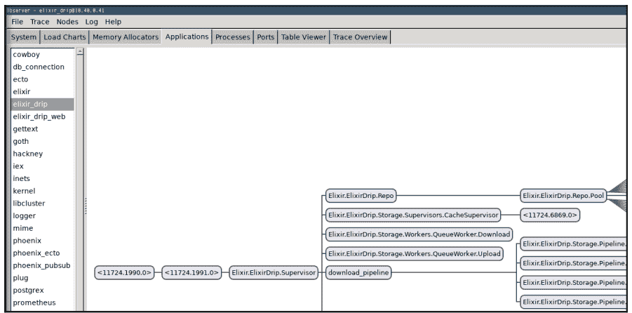

在我们的例子中，`CacheWorker` 进程的 PID 为 `11724.6869.0`。如果右键单击它并选择 **Process info**，你就可以查看进程状态：

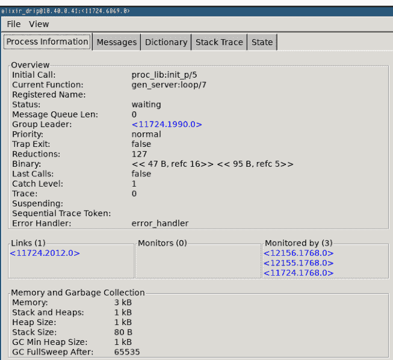

在 State 选项卡中，我们可以看到 CacheWorker 状态：

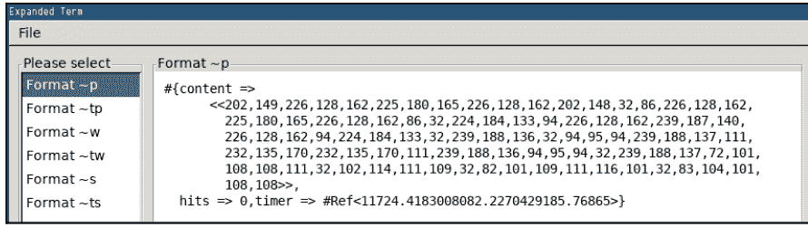

```
#{content => <<202,149,226,128,162,225,180,165,226,128,162,202,148,32,86,226,128,162,
225,180,165,226,128,162,86,32,224,184,133,94,226,128,162,239,187,140,
226,128,162,94,224,184,133,32,239,188,136,94,95,94,239,188,137,111,
232,135,170,232,135,170,111,239,188,136,94,95,94,32,239,188,137,72,101,
108,108,111,32,102,114,111,109,32,82,101,109,111,116,101,32,83,104,101,
108,108>>,
hits => 0, timer => #Ref<11724.4183008082.2270429185.76865>}
```

如果你将进程状态中的二进制内容复制到 IEx shell 并打印它，你会发现，正如预期的那样，就是我们刚刚上传的文件内容：

```
$ iex
Erlang/OTP 20 [erts-9.3] [source] [64-bit] [smp:4:4] [ds:4:4:10] [async-threads:10] [hipe] [kernel-poll:false]

Interactive Elixir (1.6.4) - press Ctrl+C to exit (type h() ENTER for help)
iex> content = <<202,149,226, ...>>
"𝕗𝕠𝕠? 𝕧𝕠𝕣? 𝕒... (^_^) (^_^) Hello from Remote Shell"
```

如果你觉得将 observer 工具连接到远程节点的步骤过于繁琐，请查看 wobserver 库，它与 Phoenix 集成，允许你使用浏览器访问 observer 工具提供的所有信息。你可以在本书的源代码中找到如何配置此库的示例。

wobserver 库还公开了 Prometheus 指标（默认在 /wobserver/metrics 路径上），因此我们甚至可以设置一个新的 Kubernetes ServiceMonitor 来抓取 Wobserver 库公开的有关 VM（使用的内存和 IO 字节）的指标，从而允许我们创建新的 Grafana 图表。现在让我们进入本章的最后一节，在那里我们将探讨如何调查我们在生产中运行的应用发生了什么。

## 检查应用行为

在本章开始时，我们学习了如何在整个应用中收集指标。这是成功维护在生产中平稳运行的应用的第一步。通过收集指标并定期分析它们，我们了解应用的性能如何。在此分析过程中，我们肯定会发现某些函数或模块的异常值或异常行为，这将促使我们分析其原因。

除了学习如何收集指标外，我们还看到了如何运行连接到生产中应用的远程 shell。我们也将使用远程 shell 来运行我们的实验。请注意，在生产中运行它们是危险的。由于我们使用的是实时环境，我们冒着因粗心的实验或仅仅是系统额外负载而导致客户服务中断的风险。

虽然这是事实，我们也建议在执行此类任务时格外小心，但我们也认为这是获得有意义结果的唯一方法。我们在生产中观察到的奇怪行为可能只会在这些确切条件下表现出来。

如果你尝试在本地机器上复制它，你可能只会得到无关紧要的数据，并且永远无法找到你试图解决的问题的根源。

Elixir 依托 Erlang，具有在生产中安全地分析并追踪应用的强大支持。正如我们之前所说，在实时环境中执行此类操作需要格外小心。尽管如此，从 Erlang VM 获得如此强大的支持来在应用中进行分析/追踪是极其有用的。

需要注意的是，与其他系统相反，我们不会通过设置断点并逐步执行来窥探生产应用以尝试分析上下文。我们所做的所有观察都是间接的，并且永远不会停止生产中运行的任何进程。在本书的第一章中，我们看到了如何使用 IEx 助手从 shell 设置断点。这是在本地开发应用时调试应用的有用技术，但不适合在生产中检查应用。

本节分为两个子部分：在第一个部分中，我们探讨使用 Mix 内置的一个分析器来了解应用中某个函数发生了什么，而在后者中，我们使用 Erlang 的 `:dbg` 模块来追踪实时请求是如何处理的。

## 使用 fprof 分析器进行分析

我们现在将学习如何使用随 Mix 一起提供的分析器之一来分析应用中某个函数的性能。我们将使用的分析器基于 Erlang 的 `fprof` 分析器。Mix 通过一个 Mix 任务公开此分析器，这也是我们将与之交互的方式。

我们将对 `ElixirDrip.Storage.store/4` 函数进行分析，该函数负责在数据库上创建新的 `Media` 条目并触发上传任务。为了模拟该函数完成所需的时间远长于预期，我们将在 `store` 函数调用的函数之一 `ElixirDrip.Storage.Media.create_initial_changeset` 函数中插入一个 `Process.sleep/1` 调用。

令人着迷且有趣的分析案例只有在应用部署在实时环境中、被实际用户使用并产生不可预测的工作负载时才会出现。尽管如此，使用 `Process.sleep/1` 调用允许我们演示重要方面，这将使你能够在需要时进行自己的分析。


为了分析我们的应用程序，我们将使用 mix profile.fprof 任务：

```
$ mix profile.fprof -e
'ElixirDrip.Storage.store("177VXwhSuI7vjzkZOU7uvowAZzO", "test.txt", "$",
"some file content")'
```

```
Warmup...
Reading trace data...
End of trace!
Processing data...
Creating output...
Done!
                CNT    ACC
(ms)      OWN (ms)
Total                                   4023
2047.954     28.076
:fprof.apply_start_stop/4              0
2047.954     0.015
anonymous fn/0 in :elixir_compiler_1.__FILE__/1   1
2047.935     0.004
ElixirDrip.Storage.store/4            1
2047.931     0.016
ElixirDrip.Instrumenter.observe_duration/2   1
2047.837     0.010
anonymous fn/4 in ElixirDrip.Storage.store/4   1
2047.658     0.020
:suspend                               14
2019.878     0.000
ElixirDrip.Storage.Media.create_initial_changeset/4   1
2006.250     0.038
Process.sleep/1                        1
2000.888     0.020
DBConnection.run/3                     4
38.715      0.047
DBConnection.run_begin/3              2
37.645      0.017
ElixirDrip.Repo.insert/1              1
35.661      0.004
ElixirDrip.Repo.insert/2              2
35.657      0.008
Ecto.Repo.Schema.insert/4             2
35.653      0.009
# ...
```

我们裁剪了此命令的输出以便于阅读。例如，运行此任务实际上会创建一个上传任务，因为我们在生产环境中运行被分析的代码。

为了分析 store 函数，我们传递了 -e 参数，其中包含将被求值的代码。

分析器首先进行预热，然后进行分析本身，最后对生成的数据进行分析，结果打印到终端。

分析器进行预热是为了确保生成的数据尽可能接近真实请求。在此阶段，分析器在不进行任何测量的情况下运行代码。这很重要，因为第一次运行可能需要执行一些初始设置，例如连接到数据库，从而使第二次运行（即被测量的运行）可以使用第一次运行所做的设置。

现在让我们分析前一个代码块中最重要的部分：分析器的输出。输出由一个表格组成，其中第一列包含被测量的函数名称，其余列包含与该函数对应的数据。第一个数据列称为 CNT，包含在分析期间该函数被调用的次数。然后，我们有两个与时间测量相关的列：ACC 和 OWN，均以毫秒为单位。ACC 列包含在该函数中花费的总时间，而 OWN 列包含在该函数中花费的时间，不考虑其调用的函数所花费的时间。


默认情况下，profile.fprof 任务的输出按 ACC 时间排序，但我们也可以通过向 Mix 任务传递 --sort own 选项按 OWN 时间排序。

查看此表格，很清楚问题所在：我们有从大约 20 ms 到大约 38 ms 的巨大跳跃。这是使用合成示例的副产品，因为在现实世界中，我们可能不会看到两个函数之间花费时间如此明显的分界。另一个表明这是合成示例的线索是 ACC 和 OWN 时间之间的巨大差异。由于我们刚刚让 create_initial_changeset 函数中的进程休眠，这会使进程进入挂起状态，因此我们看不到它具有很大的 OWN 时间跨度。然而，在真实世界的示例中，您还应关注 OWN 列中显示的时间，它会迅速指出哪些函数在内部花费了最多的时间（不考虑对其他函数的调用）。

让我们再次运行分析器，但这次传递 --callers 选项。这将为我们提供有关时间花费的更详细视图（以生产系统额外负载为代价）。让我们分析这次运行的输出：

```
$ mix profile.fprof --callers -e
'ElixirDrip.Storage.store("177VXwhSuI7vjzkZOU7uvowAZzO", "test.txt", "$",
"some file content")'
Warmup...
# ...
ElixirDrip.Instrumenter.observe_duration/2              1      2024.454
0.016
anonymous fn/4 in ElixirDrip.Storage.store/4              1      2024.454
0.016 <--
    ElixirDrip.Storage.Media.create_initial_changeset/4    1      2004.626
0.027
    ElixirDrip.Repo.insert/1                               1      14.972
0.005
    ElixirDrip.Storage.get_owner/1                         1      4.518
0.002
    Ecto.Changeset.put_assoc/3                             1      0.312
0.004
ElixirDrip.Storage.Workers.QueueWorker.enqueue/2          1      0.010
0.001

anonymous fn/4 in ElixirDrip.Storage.store/4              1      2004.626
0.027
    ElixirDrip.Storage.Media.create_initial_changeset/4    1      2004.626
0.027 <--
    Process.sleep/1                                        1      2000.753
0.033
    ElixirDrip.Storage.Media.create_changeset/2           1      1.870
0.024
    KsuId.generate/0                                      1      1.141
0.043
    ElixirDrip.Storage.Media.generate_storage_key/2       1      0.572
0.012
    ElixirDrip.Storage.Providers.Encryption.Simple.generate_ 1      0.263
0.003

# ...
```

正如我们在第一次运行中所做的那样，我们裁剪了此命令的输出。当传递此选项时，我们会为第一次运行中看到的每个被分析函数获得一个专用块。在右侧，我们可以看到每个块上都有一个箭头，它表示当前块的标记函数。块中其余所有数字都相对于带有箭头的行。例如，在第一个块中，我们可以看到标记的函数是 `ElixirDrip.Storage.store`。在此分析器中，我们只有一个调用者，因此所有在 `store` 函数中花费的时间都来自该单个调用者。

更进一步，在 `store` 函数调用的函数中，我们可以详细地看到时间花费在哪里。我们可以观察到对 `ElixirDrip.Storage.Media.create_initial_changeset` 的调用花费了大约两秒，而下一个最长的调用是对 `ElixirDrip.Repo.insert` 的调用，花费了大约 15 毫秒。

再次，与第一个示例一样，存在巨大差距，在真实的分析会话中不太可能找到这种巨大差异。尽管如此，我们可以看到问题必须存在于 `ElixirDrip.Storage.Media.create_initial_changeset` 中。由于我们现在使用了 `--callers` 选项，我们现在可以继续分析此函数专用的块，我们在第一个块之后显示了它。在这个第二个块中，我们可以看到对于 `create_initial_changeset` 函数调用的函数，大部分时间（再次，大约两秒）花费在调用 `Process.sleep` 函数上。此函数调用之后，该块中最长的条目属于 `ElixirDrip.Storage.Media.create_changeset` 函数，花费了大约 2 毫秒。因此，我们找到了罪魁祸首！下一步将是修复它，然后密切监控它以尝试评估问题是否确实已解决。如果没有，调查将重新开始，但现在系统不同，这将导致不同的分析结果。

我们现在已经完成了一次分析会话，并学习了如何使用 `fprof` 分析器来分析代码的行为。然而，`fprof` 并不是随 Mix 一起提供的唯一分析器。我们还拥有 `eprof` 和 `cprof`，它们与 `fprof` 一样，都是 Erlang 分析器。您应该使用最适合您将进行的分析类型的分析器。`eprof` 分析器是基于时间的分析器（如 `fprof`），但以不同的方式呈现信息。除了每个函数的总调用次数外，它还显示每个函数花费的时间百分比，并显示每个函数的每次函数调用的微秒数。`cprof` 分析器仅显示每个被分析函数的函数调用次数，这本质上是我们之前在 `fprof` 输出中看到的第一列。如果您只对该指标感兴趣，使用 `cprof` 而不是 `fprof` 是有利的，因为它对生产系统的影响会更低。我们建议您查看这些 Mix 任务的官方文档，以了解所有可用选项。


`fprof` 的文档可在 https://hexdocs.pm/mix/Mix.Tasks.Profile.Fprof.html 获取，`eprof` 的文档可在 https://hexdocs.pm/mix/master/Mix.Tasks.Profile.Eprof.html 获取，`cprof` 的文档可在 https://hexdocs.pm/mix/Mix.Tasks.Profile.Cprof.html 获取。

我们已经到达了分析部分的结尾。现在让我们继续下一个主题，在那里我们将学习如何跟踪我们的实时应用程序。


## 使用 :dbg 模块进行追踪

在了解了如何分析应用程序的模块和函数性能之后，让我们现在探索如何在实时环境中进行追踪。虽然在上一节中，我们需要将要分析函数的输入数据作为输入提供，在本节中我们将采用不同的方法。我们将告诉 VM 我们想要追踪的函数，然后观察用户在生产环境中发出的实时调用。这非常有趣，因为我们使用真实数据分析应用程序的行为，这通常能让我们得出更好的结论。此外，正如我们之前讨论的，某些错误只会在实时环境中显现。在这种情况下，我们需要能够接入实时请求并尝试弄清楚发生了什么。

为了进行追踪，我们将使用 Erlang 的 :dbg 模块。执行追踪实验有一些更底层的构造，例如 :erlang.trace 函数。我们认为直接处理这些构造与仅使用 :dbg 相比并无额外价值，而 :dbg 提供了有用的抽象层，可以在不必担心太多细节的情况下进行追踪实验。此外，我们认为直接使用 :dbg 已经足够危险了，因为如果使用不当，可能会对生产环境造成巨大损害。更底层的命令通常更容易出错，因此直接使用它们会增加在生产环境中产生意外副作用的可能性。

让我们检查一下追踪实验通常是如何进行的。我们开始在 IEx 会话中调用以下命令：

```
iex> :dbg.tracer
{:ok, #PID<0.661.0>}
```

调用 tracer 函数会生成一个新进程，称为追踪器进程，它负责收集此追踪实验相关的事件。该进程会根据我们定义的追踪模式接收邮件箱中的消息。在以下示例中，我们只是将追踪事件打印到控制台，但可以配置 :dbg 将追踪输出保存到文件中，这在你想稍后分析时非常方便。

要选择我们想要追踪的函数，我们将使用 :dbg.tp 函数：

```
iex> :dbg.tp(Elixir.Drip.Storage, :store, 4, [])
{:ok, [{:matched, :elixir_drip@10.40.0.41, 1}]}
```

使用 tp 函数，我们指定要追踪的模块、函数和元数。我们可以省略函数的元数，这将导致追踪该函数名的所有元数。同样，我们可以省略函数名，这将导致追踪该模块的所有函数。

最后一个参数是一个空列表，是一个匹配规范。它允许我们进一步细化想要追踪的函数调用类型，我们稍后会探索它。

在定义了追踪模式后，启动追踪实验的最后一步是：

```
iex> :dbg.p(:new, :c)
{:ok, [{:matched, :elixir_drip@10.40.0.41, 0}]}
```

这样调用 p 函数会指示 VM 根据我们之前定义的追踪模式，对调用该函数时不存在的新进程和端口进行函数调用追踪。这里我们可以使用一些不同的选项。在第一个参数中，除了 :new 之外，我们也可以使用 :all，这将追踪 VM 中的所有进程。另一个选项是使用 self()，这将只追踪 shell 进程的函数调用——在某些条件下，这可能正是我们需要的。至于第二个参数，除了追踪函数调用之外，我们可能还想追踪某个进程发送和接收的消息。在这种情况下，你可以在第二个参数中使用 :m，这将追踪具有第一个参数 PID 的进程的发送和接收消息。


不要在覆盖 VM 中所有进程时尝试追踪消息。换句话说，在调用 :dbg.p 函数时不要同时使用 :all 和 :m 选项，否则可能会在生产环境中引起麻烦。

这样一来，我们就可以开始追踪 store 函数的调用了。由于我们的应用程序没有真实用户，我们模拟了一个用户与系统交互并通过 Web 应用程序上传了一个新文件。执行此操作后，我们在 IEx 会话中观察到以下条目：

```
(<0.769.0>) call
'Elixir.Drip.Storage':store(<<"17fVtjzyIYW4aKmfKXUG754u4AI">>,<<"testing_tracing.txt">>,<<"$">>,<<"some live content\n">>)
```

我们可以看到 store 函数被调用了，并且带有哪些参数。仅凭这一点可能无法回答我们所有的疑问，但我们可以迭代并尝试在系统中放置更多探针，这将为我们提供更多信息来了解发生了什么。例如，假设我们已经分析了存储函数的代码，并怀疑在排队新的上传任务时存在问题。我们也会开始追踪该函数：

```
iex> :dbg.tp(Elixir.Drip.Storage.Workers.QueueWorker, :enqueue, 2, [])
{:ok, [{:matched, :elixir_drip@10.40.0.41, 1}]}
```

现在，在应用程序中触发新的文件上传后，我们看到以下内容：

```
(<0.935.0>) call
'Elixir.Drip.Storage':store(<<"17fVtjzyIYW4aKmfKXUG754u4AI">>,<<"testing_tracing_with_queue.txt">>,<<"$">>,<<"some live content\n">>)
(<0.935.0>) call
'Elixir.Drip.Storage.Workers.QueueWorker':enqueue('Elixir.Drip.Storage.Workers.QueueWorker.Upload',#{content => <<"some live content\n">>, media =>
  file_name => <<"testing_tracing_with_queue.txt">>,file_size => 6,
  full_path => <<"$">>,id => <<"17fXKLprLRyY9E5xfzsOz7KCw0">>,
  storage_key => <<"17fXKLprLRyY9E5xfzsOz7KCw0_20180720T232423.txt">>,
  inserted_at =>
  #{~__struct__} => 'Elixir.NaiveDateTime',
  calendar => 'Elixir.Calendar.ISO', day => 20, hour => 23,
  microsecond => {844068,6},
  minute => 24, month => 7, second => 23, year => 2018},
  updated_at =>
  #{~__struct__} => 'Elixir.NaiveDateTime',
  calendar => 'Elixir.Calendar.ISO', day => 20 ,hour => 23,
  microsecond => {844088,6},
  minute => 24, month => 7, second => 23, year => 2018},
  uploaded_at => nil,user_id => <<"17fVtjzyIYW4aKmfKXUG754u4AI">>},
  type => upload,
  # ...
  user_id => <<"17fVtjzyIYW4aKmfKXUG754u4AI">>})
```

我们现在可以看到 enqueue 函数正在被追踪，并且可以检查其参数。在这种情况下，我们可以检查传递给它的 %Media{} 结构体，这为我们提供了一些有价值的信息，有助于调试真实情况。如果我们仍然找不到任何东西，我们将重复该过程并尝试缩小我们要解决的问题。只需确保不要同时追踪太多函数，因为这可能会给 Erlang VM 带来过大的负载。

现在让我们简要探索匹配规范以及它们如何帮助我们缩小追踪范围。为了本示例的目的，假设我们有理由相信我们要解决的问题只会在用户上传文件到根路径 ("$") 时发生。在这种情况下，我们可以设置我们的追踪模式，只捕获上传到此路径的文件。以下是创建此模式的函数调用：

```
iex> :dbg.tp(Elixir.Drip.Storage, :store, 4, [{[:_, :_, "$", :_], [], []}])
{:ok, [{:matched, :elixir_drip@10.40.0.41, 1}, {:saved, 1}]}
```

这与我们之前看到的类似，唯一的区别在于最后一个参数。正如我们之前所说，最后一个参数是匹配规范，由三部分组成：head、conditions 和 body。在这里，我们只使用了 head。从概念上讲，我们在这里做的事情类似于对函数子句进行模式匹配。在这种情况下，我们的 store 函数有四个参数，我们说我们只关心第三个参数并希望将其与 "$" 匹配。这是 Erlang 世界中一个非常复杂的话题，我们不会在本 书中深入细节。如果你想进一步探索这个话题，请查看官方文档 at http://erlang.org/doc/apps/erts/match_spec.html。

使用此匹配规范，我们将只从上传到该路径的文件中获取追踪，与我们已经看到的类似。你可以将此技术推广并在需要根据特定参数值过滤追踪时应用它。

为了结束本节，我们将学习如何更改匹配规范以在追踪输出中获取被追踪函数的返回值。在某些情况下，仅访问被追踪函数接收的参数是不够的，我们需要访问其返回值才能弄清楚发生了什么。对于这些情况，我们可以按如下方式调整匹配规范：

```
iex> :dbg.tp(Elixir.Drip.Storage, :store, 4, [{[:_, :_, "$", :_], [], [{:return_trace}]}])
{:ok, [{:matched, :elixir_drip@10.40.0.41, 1}, {:saved, 2}]}
```

为了查看我们正在追踪的函数的返回值，我们需要在匹配规范的主体（其最后一个参数）中插入 {:return_trace}。在更新了追踪模式后，我们现在可以在 Web 界面上进行新的文件上传，这将在我们的 IEx 会话中生成以下输出：

```
(<0.784.0>) call
'Elixir.Drip.Storage':store(<<"17fVtjzyIYW4aKmfKXUG754u4AI">>,<<"testing_tracing_return_value.txt">>,<<"$">>,<<"some live content\n">>)
(<0.784.0>) returned from 'Elixir.Drip.Storage':store/4 ->
{ok, upload_enqueued, file_name =>
<<"testing_tracing_return_value.txt">>,
file_size => 6,
full_path => <<"$">>,
id => <<"17fwfSOqxQnKxp2OhjB1eebDWrd">>,
storage_key =>
<<"17fwfSOqxQnKxp2OhjB1eebDWrd_20180721T025245">>,
# ...
user_id => <<"17fVtjzyIYW4aKmfKXUG754u4AI">>}
```


从之前的代码片段可以看出，我们现在获得了 store 函数的返回值，一个 {:ok, :upload_enqueued, %Media{}} 元组。

现在是任何追踪会话的最后一步：停止所有追踪。要实现这一点，我们只需要调用以下函数：

```
iex> :dbg.stop_clear
:ok
```

这是一个非常简单的步骤。尽管如此，它非常重要，因为跳过执行可能会导致一些不愉快的意外。

在本节中，我们学习了几种根据手头任务需要追踪应用程序的技术。请注意，这些技术不必孤立使用；正是将它们结合起来，才能更好地了解正在发生的事情与我们的

最后，我们想指出，本章中描述的工具并不是用于分析/追踪应用程序的唯一有用工具。特别是，我们想提到 XProf (https://github.com/Appliscale/xprof) 和 Tracer (https://github.com/gabiz/tracer) 库。我们选择演示如何使用 :dbg 模块，因为我们认为这有助于更好地理解 Erlang VM 上追踪的工作原理。然而，在日常工作中，你可能会求助于更高级别的抽象，例如我们刚刚提到的这两个库。现在让我们总结本章并回顾我们在其中探索的最重要的概念。

## 摘要

在本章中，我们分析了在生产环境中运行的 Elixir 项目内部发生情况的不同方式。持续用收集到的指标为仪表板提供数据，可以让你快速评估应用程序的当前状态。

使用 Prometheus 和 Grafana，你可以深入挖掘指标数据并理解那些乍一看可能被忽视的行为和模式。我们还学习了如何通过在 Elixir 代码中添加仪器调用来发出自定义 Prometheus 指标，当 Prometheus 库套件开箱即用的指标不足时。

有时，拥有对已部署运行代码的最新且有根据的视图是必不可少的。在这些情况下，你可以连接到应用程序并借助强大的 Observer 工具查看它。在将应用程序部署到云上后，连接它会更困难，但并非不可能，这要归功于 Erlang 继承的令人难以置信的分布式工具。

确保你始终了解应用程序健康状况的另一个重要方面是告警。我们没有涵盖它，但 Prometheus 和 Grafana 都能够根据一组规则触发告警，然后通过不同的渠道传递，从通常的电子邮件到满足你需求的自定义解决方案。

配置你的监控架构是一个持续的过程，你会根据日常操作中发现的问题和瓶颈创建新图表并更新现有仪表板。与软件工程的大多数主题类似，这里也没有万能的解决方案。努力设置一些告警并尽可能多地进行仪器化，以便你对系统的每个部分都有一个大致的了解，然后再逐步微调。

我们已经看到了几种了解生产环境中应用程序发生情况的方法，通过了解如何分析并追踪其中的函数。我们探索的技术旨在最大程度地减少对生产系统的影响，而无需停止任何进程进行调试。就像我们的 Elixir 应用程序一样，调试和追踪技术基于进程之间的异步消息传递。

在本章中，我们涵盖了以下主题：

- Prometheus，一个在许多生产项目中广泛使用的流行开源监控解决方案
- 安装和配置 `prometheus` Elixir 库套件以收集有关我们的 ElixirDrip 应用程序的指标
- 发出自定义直方图和计数器指标以衡量函数执行所需的时间并统计缓存命中次数
- 在本地使用 Prometheus 并借助 `helm` 图表将 Prometheus 和 Grafana 捆绑解决方案部署到 Kubernetes
- 配置部署在 Kubernetes 中的 Prometheus 实例以自动发现并抓取新 ElixirDrip Pod 发出的指标
- 使用 Grafana 创建美观且富有表现力的仪表板，以有意义的方式呈现大量收集的指标
- 分布式 Erlang 及其如何允许我们运行和连接多个 Elixir 节点
- 使用 Observer 查看正在运行的应用程序，无论是在云上还是在本地容器中运行
- 在 Kubernetes Pod 内部的远程节点中运行 shell
- 使用 `mix profile.fprof` 任务分析某个函数，以及我们可以传递给它的一些可能选项
- 使用 Erlang 的 `:dbg` 模块追踪正在运行的应用程序中函数调用和交换的消息

这是本书的最后一章！我们衷心希望你阅读本书的乐趣与我们写作时的乐趣一样多。虽然我们已经到达了本书的结尾，但我们一起开始的旅程并未结束——永远不会结束。

在涵盖本书中介绍的广泛主题时，沿途我们留下了指向文档或有趣项目的链接，以便你能够继续我们一起开始的旅程，并将你的 Elixir 学习提升到更高的水平。我们很幸运能成为这样一个充满活力和朝气的社区的一部分，我们只能想象这个不可思议的群体将带来怎样的惊人事物。

## 你可能喜欢的其他书籍

如果你喜欢这本书，你可能对 Packt 出版的其他书籍感兴趣：


### 学习函数式数据结构和算法

Atul Khot, Raju Kumar Mishra

ISBN: 9781785888731

- 学习在函数式范式中思考
- 理解常见的数据结构及其相关算法，以及它们通常使用的上下文
- 使用 O 记法查看运行时和空间复杂度
- 查看 ADT 在函数式环境中的实现方式
- 探索不可变性和持久数据结构的基本主题
- 了解内部算法如何重新设计以利用结构共享，从而使持久数据结构性能良好，避免不必要的复制。
- 了解用于实现高效算法的函数式特性，如惰性求值和递归
- 获得 Scala 最佳实践和惯用法


### 学习 Go 中的函数式编程

Lex Sheehan

ISBN: 9781787281394

- 学习如何使用高阶函数组合可靠的应用程序
- 探索使用 FP 技术（如柯里化）消除副作用的技术
- 使用一等函数实现纯函数
- 了解如何在 Go 中实现 lambda 表达式
- 使用装饰器模式组合一个可工作的应用程序
- 使用惰性求值创建更快的程序
- 使用 Go 并发构造组合功能管道
- 理解范畴论以及它与 FP 有何关系

## 留下评论 - 让其他读者知道你的想法

请通过在购买书籍的网站上留下评论，与他人分享你对这本书的想法。如果你是在 Amazon 购买的书籍，请在该书的 Amazon 页面上留下诚实的评论。这至关重要，这样其他潜在读者才能看到并使用你的公正意见来做出购买决定，我们可以了解客户对我们产品的看法，作者也可以看到他们与 Packt 合作创作的书名的反馈。这只需要你几分钟的时间，但对其他潜在客户、我们的作者和 Packt 来说都很有价值。谢谢！


## 索引

## A
抽象语法树 (AST) 218, 220, 222
应用程序行为
  使用 dbg 模块追踪 541, 542, 544
  使用 fprof 分析器分析 536, 538, 540
  检查 535
应用程序模块回调 66
应用程序
  容器编排 454, 458
  容器化 450, 452
  部署容器组合 459
  部署容器创建 461
  开发容器创建 452
assigns 345

## B
BEAM
  关于 100, 101, 102
  缓存工作进程构建 109, 112, 114, 116
  进程间消息传递 104, 106, 108, 109
  进程创建 103
  使用进程 102
行为 49, 51, 53

## C
更改集
  关于 296
  约束 307, 309, 312
  媒体 297, 301
  媒体所有权 304, 307
  用户 302, 303
通道
  事件交换 387, 391, 393
  客户端加入 385, 386
  服务器准备 382, 383, 384
套接字连接认证 394, 396
在交互式应用程序中使用 380, 381
用户状态跟踪存在使用 396, 397, 399, 400
集群组 463
编码风格 92, 94, 96
集合
  使用 Enum 模块的急切处理 40
  使用 Stream 模块的惰性处理 42, 43
  通过递归循环 38, 39
  使用 37
命令行界面 (CLI) 335
无冲突复制数据类型 (CRDT) 397
容器化节点
  连接到 524, 526
持续部署
  使用 Travis CI 479, 481, 483
控制流
  case 45
  cond 44
  异常 47
  if 和 unless 44
  with 45, 47
跨站请求伪造 (CSRF) 343

## D
数据库
  连接 279, 280, 281, 282, 284
部署控制器 463
基于磁盘的 ETS
  关于 172
  使用 162, 165, 168, 169, 171
distillery
  关于 84
  自定义发布任务创建 447, 449
  环境变量插值 442, 445
  发布配置 439, 441
发布创建 445, 446
使用发布 437, 438
领域特定语言 (DSL)
  关于 84, 252
  创建 252
GenStage 模块简化 268
模块属性注册 253, 255
管道步骤收集 256, 257, 259
订阅选项生成 261
工作进程规范生成 261
下载管道
  关于 195, 196
加密阶段 197
最后说明 201
通知阶段 196
远程存储阶段 199
启动阶段 200

## E
Ecto 77
Elixir 应用程序 66, 67, 69
Elixir 节点
  连接 485, 488, 490
  测试 491
Elixir 项目结构
  关于 70
  项目依赖 72, 73
Elixir
  关于 9
  原子 12
  二进制 17
  布尔值 12
  字符列表 17, 19
  数据类型 9, 10
  浮点数 11
  整数 10
  关键字列表 19, 20
  列表 15
  映射 16, 17
  MapSets 20
  其他类型 19
  范围 20
  字符串 17, 19
  元组 14
ElixirDrip
  关于 65, 83, 85
  使用行为 85, 87, 88
  使用 Xref 查看交叉引用 88, 90, 91
嵌入式 Elixir (EEx) 441
Enum 模块
  推导式 41
  使用急切处理 40
Erlang 9
Erlang 节点
  在 Kubernetes 中连接 528, 530
  使用远程 shell 532, 535
Erlang 端口映射守护进程 (EPMD) 523
Erlang 运行时 (ERTS) 438
Erlang 术语存储 (ETS) 139
Erlang VM
  PID 21
  端口 21
  参考链接 21
错误
  通过链接检测 116, 118, 119, 120
  通过监控进程检测 116, 118, 121
  使用监督树恢复 122, 123
  使用主管恢复 122, 123

## F
flow 模块
  关于 203
  磁盘使用量排名查询 213, 215, 216
  惰性查询 210
  示例数据 204, 210
函数插件
  创建 337, 339
函数式编程 8
函数
  关于 27
  匿名函数 28, 29
  命名函数 30, 34, 35

## G
GenServer
  关于 140
  Agent 150, 153
  在服务中 141, 142, 144
  用于实现 CacheWorker 144, 145, 149
GenStage 模块
  管道消费者 273, 276
  管道生产者 268, 270, 272
  简化 268
GenStage 管道 252
GenStage
  关于 84, 182, 183, 184, 186
  下载管道 195, 196
  上传管道 187
Google Kubernetes Engine (GKE)
  关于 462
  参考链接 462

## H
HTTP 请求
  在控制器中处理 344, 345, 347, 349, 351
  路由 339, 341, 342

## I
集成测试 421, 424
交互式应用程序
  使用通道 380, 381
交互式 Elixir (IEx)
  关于 9, 59
  生态系统 58
  Erlang 互操作性 61, 62
  ExUnit 61
  mix 61
  工具 58

## J
JSON API
  实现 371, 373, 376
  用户认证 376, 377, 379

## K
Kubernetes 84
Kubernetes (K8s)
  关于 462
  云数据库配置 466
  部署 462
  作业创建 475
  命名空间创建 468
  Pod 部署 471, 475
  Pod 暴露 477, 479
  生产镜像发布 470, 471
  密钥创建 469

## M
宏
  关于 232
  速查表 276, 278
  卫生访问 225
  测试 428, 429, 430
  调试 222, 224
  unquote 228
指标类型
  计数器 495
  仪表 495
  直方图 495
  摘要 495
指标
  收集 494
  百分位数计算 516
Prometheus 指标创建 498, 502
Prometheus 指标暴露 496, 497
Prometheus 服务器 502, 504
在 Kubernetes 中部署 Prometheus 505, 506, 509, 511, 514
迁移 284, 290, 292
模块插件
  创建 337
模块
  关于 27, 30, 34, 35
  属性 36, 37
  指令 36, 37
  用法 36, 37
模块
  扩展 233, 237, 244, 245
  使用 use 和 __using__/1 宏 247, 249, 250, 252
Mox 库 410

## N
命名空间 463
节点 463

## O
开放电信平台 (OTP) 139
操作系统 (OS) 99

## P
路径助手 346
模式匹配
  关于 22, 23
  二进制匹配 26
  列表匹配 24
  映射匹配 26
  字符串匹配 26
  元组匹配 23, 24
百分位数
  计算 516
Grafana 变量设置 517, 520, 522
Phoenix Channels
  测试 425, 426, 428
Phoenix 框架
  快速 335
  高效 334
  可靠 334
plug 规范
  关于 336
  函数插件创建 338, 339
  模块插件创建 337
Pod 463
进程注册表 175, 177, 179
基于属性的测试 430, 432, 434
协议
  关于 53, 55
  实现 57, 58
  结构体 55, 57

## Q
查询
  关于 313
  关联加载 321, 323
  媒体文件夹查询 315, 319
  模式加载 320, 323
  使用聚合查找用户 326, 331
  使用原始 SQL 324, 326

## S
模式
  关于 284, 285, 290
  自定义字段类型 286, 287
  关系 292, 294, 296
  用户或媒体所有者 287
Stream 模块
  使用惰性处理 42, 43
结构体
  实现 55, 57, 58
监督树
  使用最小化错误影响 133, 134, 136
监督者
  子进程定义，使用动态监督者 129, 131
  定义 123, 126, 127
  启动 123, 126, 127
  简化的子规范 127, 129
  用于恢复错误 122, 123

## T
Task 模块
  关于 153
  并行任务 154, 160
顶级监督者 66
Travis CI
  URL 479
  用于持续部署 479, 481, 483
类型规范
  关于 49
  dialyzer 50

## U
伞形应用程序 65
伞形项目 74, 75, 77, 79, 82
单元测试
  关于 404
  文档测试 419
  具有副作用的函数测试 410
  无副作用的函数测试 404, 407, 409
  使用存储库测试交互 415, 417
  使用 Mox 库创建模拟 410, 413, 415
上传管道
  关于 187
  加密阶段 191
  通知阶段 189
  远程存储阶段 190
  启动阶段 192, 195
用户
  认证 361, 363, 365, 367, 369, 371

## V
视图
  布局 359, 360
  渲染 351, 353, 359

## W
窗口
  连接到容器化节点 524, 526
  在 Kubernetes 中连接到 Erlang 节点 528, 530
  到节点 523
工作进程规范
  消费者阶段 262
  管道工作进程规范收集 264, 267
  生产者阶段 261
  生产者消费者 262
  定义监督者函数 267
