# 精通 Entity Framework Core 2.0：深入实体、关系、查询、性能优化等，学习高效的数据驱动开发


## 制作人员

**作者**
Prabhakaran Anbazhagan

**文字编辑**
Safis Editing

**审稿人**
Jason De Oliveira
Alvin Ashcraft

**项目协调员**
Prajakta Naik

**委托编辑**
Merint Mathew

**校对**
Safis Editing

**策划编辑**
Chaitanya Nair

**索引编制**
Francy Puthiry

**内容开发编辑**
Lawrence Veigas

**图形设计**
Jason Monteiro

**技术编辑**
Tiksha Sarang

**制作协调员**
Deepika Naik

## 关于作者

**Prabhakaran Anbazhagan** 是居住在印度金奈的微软解决方案架构师。他对编程的热爱始于为学校创建网站，也是从那刻起，这段永无止境的旅程开始了。在大学期间，他成为技术社团的秘书，再次创建网站，让研讨会实现自动化，等等。

他的职业生涯始于一家著名的产品型公司；他的知识得到了前辈们的尊重和认可，他们让他开发工具和自动化来磨炼才华。真是个幸运儿！人们很少有機會能够培养自己的天赋，但他得到了不少机会来精进技能，并成为一名解决方案架构师，成为多面手的同时，仍然是 .NET 领域的专家。

Prabhakaran 拥有超过 12 年的 IT 经验，负责架构、设计和开发关键任务的桌面、Web 和移动应用程序。他在全栈开发方面经验丰富，涵盖 ASP.NET MVC、Web API、C#，以及移动开发领域中的 Swift、Objective-C、Blackberry Cascades、混合应用、SharePoint、JavaScript、jQuery 和 MEAN.JS。

> *我要感谢我亲爱的妻子 Girija，在我决定写这本书时一直陪伴在我身边。她牺牲了大量宝贵的时光，陪伴我走完这段旅程，我将这本书献给她。我还要感谢我可爱的孩子们，Venba 和 Inba。在忙碌的周末，他们是我缓解压力的良药。我希望有一天他们会明白，为什么我忙着敲电脑，而不是陪他们玩耍。我要感谢我的父母，在我埋头写作时，他们与我的妻子一同照顾孩子。我的家人，包括我的姻亲，始终支持我撰写这本书，我由衷感激。*

## 关于审稿人

**Jason De Oliveira** 是 MEGA International (http://www.mega.com) 的首席技术官，该公司位于法国巴黎，是一家提供业务转型、企业架构以及企业治理、风险和合规管理建模工具的软件公司。他是一位经验丰富的经理和高级解决方案架构师，在软件架构和企业架构方面拥有高超的技能。

他喜欢通过博客分享知识和经验，参加会议演讲，撰写技术书籍，在技术媒体上发表文章，作为 MCT 讲授软件课程，并在公司内指导同事。他经常与微软合作，经常可以在巴黎的微软技术中心 (MTC) 见到他。

6 年多来，微软因他对微软社区的众多贡献，授予他 Microsoft® 最有价值专家（MVP C#/.NET）称号。微软希望用 MVP 奖项来表彰世界各地技术社区中最优秀、最杰出的人才。这些杰出且备受尊敬的个人来自 90 多个国家，服务本地线上与线下社区，并在全球范围内产生影响。

如果您需要任何技术帮助或想谈论技术主题，请随时通过他的博客联系他 (http://www.jasondeoliveira.com)。

Jason 参与编写了以下书籍：

- .NET 4.5 Expert Programming Cookbook（英文）
- WCF 4.5 Multi-tier Services Development with LINQ to Entities（英文）
- .NET 4.5 Parallel Extensions Cookbook（英文）
- WCF Multi-layer Services Development with Entity Framework（英文）
- Visual Studio 2013: Concevoir, développer et gérer des projets Web, les gérer avec TFS 2013（法文）

*我要感谢我亲爱的妻子 Orianne，以及我美丽的女儿 Julia 和 Léonie，感谢她们支持我的工作，并接受了工作日的漫长白天和短暂夜晚，有时甚至周末也是如此。没有她们，我的生活将截然不同！*

## www.PacktPub.com

有关本书的支持文件和下载，请访问 www.PacktPub.com。

您是否知道 Packt 为已出版的每本书提供电子书版本，并附带 PDF 和 ePub 文件？您可以在 www.PacktPub.com 上升级到电子书版本；作为纸质书客户，您还有权享受电子书折扣。如需更多详情，请通过 service@packtpub.com 与我们联系。

在 www.PacktPub.com 上，您还可以阅读免费技术文章合集，订阅多种免费通讯，并享受 Packt 图书和电子书的专属折扣与优惠。


www.packtpub.com/mapt

使用 Mapt 获取最紧缺的软件技能。Mapt 让您完整访问所有 Packt 图书和视频课程，并为您提供行业领先的工具，帮助您规划个人发展、推进职业生涯。

### 为什么要订阅？

- 可对 Packt 出版的每一本书进行全文搜索
- 支持复制粘贴、打印和收藏内容
- 按需提供，可通过网页浏览器访问

## 客户反馈

感谢您购买这本 Packt 图书。在 Packt，质量是编辑流程的核心。为了帮助我们改进，请在本书的 Amazon 页面（https://www.amazon.com/dp/1788294130）留下您的真实评价。

如果您想加入我们的长期审阅者团队，请发送电子邮件至 customerreviews@packtpub.com。我们会向长期审阅者赠送免费电子书和视频，以感谢他们的宝贵反馈。请帮助我们坚持不懈地改进产品！

献给我亲爱的妻子 Girija、可爱的孩子们 Venba 和 Inba


**使用命令组合查询** 206
命令查询练习的解决方案 214
**使用表达式树增强查询** 214
表达式树练习的解决方案 216
**总结** 218
**第9章：容错机制 – 事务** 219
**事务的默认行为** 220
在博客系统中添加标签支持 220
利用默认事务行为 222
**创建简单事务** 228
**创建跨上下文事务** 231
为博客系统添加文件上传支持 231
事务范围的限制 237
自定义事务范围支持 239
为博客系统添加日期选择器支持 243
**在多种技术之间利用事务** 245
为博客系统添加最近文章支持 245
匿名文章列表和单篇博客文章 246
列出评论 248
使用外部数据库事务添加评论 250
**总结** 254
**第10章：使其真实 – 处理并发** 255
**在 EF 中处理并发** 256
理解并发冲突 257
乐观并发 260
悲观并发 261
**引入并发令牌** 262
**非时间戳并发令牌** 265
通过数据注解配置非时间戳令牌 265
通过 Fluent API 配置非时间戳令牌 272
**基于时间戳的并发令牌** 272
通过数据注解配置时间戳令牌 273
通过 Fluent API 配置时间戳令牌 280
**处理并发冲突** 281
应用乐观并发 281
数据库获胜 282
客户端获胜 283
用户自定义特定解决 284
应用悲观并发 287

## 前言

能够创建和维护面向数据的应用程序已成为现代编程中的关键因素。这就是微软推出 Entity Framework (EF) 的原因，以便架构师在编写高效且可维护的应用程序代码的同时优化存储需求。本书是一本全面的指南，将向您展示如何利用 EF 的强大功能构建高效的 .NET Core 应用程序。它不仅教授 EF Core 的所有基础知识，还演示了如何实际使用它，以便您可以在软件开发中实现它。

本书分为三个模块。第一个模块侧重于构建实体和关系。在这里，您还将学习不同的映射技术，这将帮助您选择最适合您应用程序设计的映射技术。一旦您理解了 EF 的基础知识，您将进入第二模块学习验证和查询。它还将教您如何执行原始 SQL 查询并扩展 EF 以利用查询对象，使用查询对象模式。书籍的最后一个模块侧重于性能优化和管理应用程序的安全性。您将学习如何使用并发令牌实现容错机制。本书还详细探讨了行级安全和多租户数据库。

到本书结束时，您将熟练地在 .NET Core 应用程序上实现 EF。

### 本书涵盖内容

第1章，*入门 – Entity Framework Core 简介*，教您如何在 .NET Core 应用程序中安装/配置 Entity Framework Core。它指导我们执行 CRUD（创建/读取/更新/删除）操作。

第2章，*反向操作 – 数据库优先方法*，解释了使用 EF Core 进行逆向工程和现有数据库的方法。它指导我们执行迁移，并帮助我们在迁移期间保留不会丢失的模型更改。

第3章，*关系 – 术语和约定*，提供有关实体、键和属性相关的关系术语的知识。我们还将看到与关系相关的不同约定。

第4章，*构建关系 – 理解映射*，帮助您探索多种关系技术并解释如何在应用程序设计中利用它们。我们还将探讨如何使用 Fluent API 创建关系。

第5章，*了解验证 – 探索内置验证*，教您框架中验证的工作方式，探索内置验证，展示它们应如何配置，涵盖每个验证对用户期望的模式，并展示 MVC 引擎如何呈现验证错误。

第6章，*自救 – 为实体加固*，帮助我们添加验证，解释为什么我们需要在客户端和服务器端都进行验证，并展示如何实现。它还介绍了自定义验证，以及如何为验证创建客户端逻辑和远程验证。

第7章，*原始操作 – 在 LINQ 中利用 SQL 查询*，教您如何执行原始 SQL 查询，同时教您如何执行参数化查询、与 LINQ 组合、最后在没有 DbSet 或 POCO 对象的的情况下执行。

第8章，*查询就是我们所需 – 查询对象模式*，帮助您理解查询对象模式，并扩展 EF 以利用查询对象。

第9章，*容错机制 – 事务*，帮助您理解事务的现有行为，如何创建常规/跨上下文事务，以及如何使用外部 DBTransactions。

第10章，*使其真实 – 处理并发*，详细阐述并发在 EF 中的连接方式以及如何处理它。它详细解释了并发令牌，并展示如何使用它创建容错机制。

第11章，*性能 – 全在于执行时间*，教您如何通过正确利用框架、减少滥用等来提高 EF 的性能。

第12章，*隔离 – 构建多租户数据库*，详细探讨行级安全和多租户数据库。

### 阅读本书所需条件

要使用本文，我们假设您熟悉 .NET Core 和 C#。


要成功执行本书中的代码，您需要以下工具：

- Visual Studio 2017 Express
- SQL Server 2017 Express
- SQL Server 2017 Developer

## 本书适合谁

本书适合希望在应用程序中集成 EF Core 的 .NET Core 开发者。 assumed 具备 .NET Core 和 C# 的先前知识。

## 惯例

在本書中，您會找到多種區分不同資訊類型的文字樣式。以下是這些樣式的範例及其含義。

文中出現的程式碼單字、資料庫資料表名稱、資料夾名稱、檔案名稱、檔案副檔名、路徑名稱、虛擬 URL 和使用者輸入顯示如下："The new column should be included in the Edit method of PostController."

程式碼區塊設定如下：

```
public interface IPostDetailQueryHandler
{
    Task<Post> Handle(PostDetailQuery query);
}
```

當我們希望引起您對程式碼區塊中特定部分的注意時，相關的行或項目以粗體顯示：

```
public async Task<IActionResult> Index()
{
    return View(await _context.Blogs.FromSql("Select *
    from dbo.Blog").ToListAsync());
}
```

您可以按照以下步驟下載程式碼檔案：

- 1. 使用您的電子郵件地址和密碼登入或註冊我們的網站。
- 2. 將滑鼠指標懸停在頂部的 **SUPPORT** 標籤上。
- 3. 點擊 **Code Downloads & Errata**。
- 4. 在 **Search** 框中輸入書名。
- 5. 選擇您要下載程式碼檔案的書籍。
- 6. 從下拉選單中選擇您購買此書的商店。
- 7. 點擊 **Code Download**。

下載檔案後，請務必使用最新版本的以下工具解壓縮或提取資料夾：

- WinRAR / 7-Zip for Windows
- Zipeg / iZip / UnRarX for Mac
- 7-Zip / PeaZip for Linux

本書的程式碼捆綁包也託管在 GitHub 上，網址為 https://github.com/PacktPublishing/Mastering-Entity-Framework-Core。我們還在 https://github.com/PacktPublishing/ 上提供來自我們豐富書籍和影片目錄的其他程式碼捆綁包。快來看看吧！

## 下載本書的彩色圖片

我們還為您提供了一份 PDF 檔案，其中包含本書中使用的螢幕截圖/圖表的彩色圖片。彩色圖片將幫助您更好地理解輸出中的變化。您可以從 https://www.packtpub.com/sites/default/files/downloads/MasteringEntityFrameworkCore20_ColorImages.pdf 下載此檔案。

## 勘誤

儘管我們已盡一切努力確保內容的準確性，但錯誤仍會發生。如果您在本書中發現錯誤——可能是文字或程式碼中的錯誤——我們將非常感謝您向我們報告。通過這樣做，您可以幫助其他讀者免於沮喪，並幫助我們改進本書的後續版本。如果您發現任何勘誤，請訪問 http://www.packtpub.com/submit-errata，選擇您的書籍，點擊 Errata Submission Form 連結，然後輸入您的勘誤詳情。一旦您的勘誤得到驗證，您的提交將被接受，並且勘誤將上傳到我們的網站或添加到該書籍的勘誤部分下的現有勘誤清單中。

要查看先前提交的勘誤，請前往 https://www.packtpub.com/books/content/support 並在搜尋欄位中輸入書名。所需資訊將顯示在勘誤部分下。

## 盜版

互聯網上版權材料的盜版是一個持續存在的問題，涉及所有媒體。在 Packt，我們非常重視版權和許可證的保護。如果您在互聯網上發現我們作品的任何非法複製，無論形式如何，請立即向我們提供位置地址或網站名稱，以便我們採取補救措施。

請通過 copyright@packtpub.com 與我們聯繫，並附上疑似盜版材料的連結。

我們感謝您保護我們的作者以及我們為您帶來有價值內容的能力。

## 問題

如果您對本書的任何方面有問題，您可以聯繫我們 questions@packtpub.com，我們會盡力解決問題。

## Kickstart - Introduction to Entity Framework Core

我仍然記得我們花費大量時間處理關聯式資料庫而不是專注於解決業務問題的那些日子；那些日子肯定已經一去不復返了。為了闡述這一點，讓我們列出 ORM 之前我們遇到的問題：

- 資料存取層不可移植，這使得從一個平台更改到另一個平台變得困難。
- 沒有抽象層，這迫使我們在面向物件物件和資料實體之間手動映射。
- 供應商特定的 SQL 語句，這需要知識才能在不同的 RDBMS 系統之間移植。
- 嚴重依賴觸發器和預存程序。

整個產品開發流程轉向工具和開源平台，甚至微軟也從 .NET Core 起走上了這條道路。如果我們繼續花時間編寫可以通過工具實現的程式碼，我們可能會變得像穴居人一樣。

Entity Framework 的創建就是為了解決這個問題；它並不是隨初始 .NET 框架一起引入的，而是隨 .NET Framework 3.5 SP1 引入的。

如果我們仔細觀察，很明顯 .NET 團隊出於以下原因構建了它：

- 減少開發人員/架構師在抽象和可移植資料存取層等事項上花費的時間
- 使開發人員不需要供應商特定的 SQL 知識
- 使我們能夠通過消除觸發器和 SP 來構建面向物件的業務邏輯


本書使用 Visual Studio 2017（撰寫時的最新版本）和 ASP.NET Core 2.0 MVC 以及 Entity Framework 2.0。儘管 Entity Framework 2.0 是最新版本，但它仍在不斷發展，因此 .NET 團隊需要時間才能基於完整的 .NET Framework 開發 Entity Framework 6.2 的所有現有功能。

我們將在此涵蓋以下主題：

- 先決條件
- 建立新專案
- 安裝 Entity Framework 2.0
- 資料模型
- 資料庫內容
- 在服務中註冊內容（.Net Core DI）
- 建立和播種資料庫
- 執行 CRUD 操作

## 先決條件

.NET Core，這個開源平台，為 Visual Studio 2017 中的多平台支援鋪平了道路。編輯器有不同的風格，支援平台特定和跨平台 IDE：

- **Visual Studio:** Windows 的獨家版本，提供社群、專業和企業版：

Visual Studio for Mac 可從 `https://www.visualstudio.com/vs/visual-studio-mac/` 下載。

- **Visual Studio Code:** 微軟為 Windows、Linux 和 macOS 提供的跨平台編輯器：

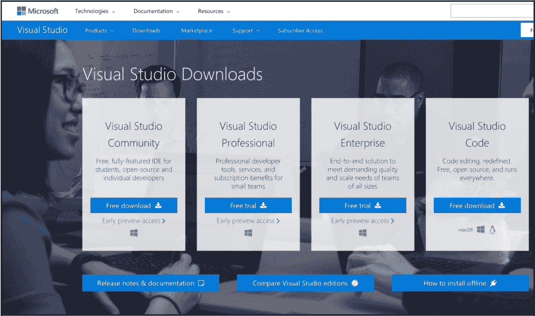

從 `https://www.visualstudio.com/downloads/` 下載您想要的 Visual Studio Code 版本/版本。

Visual Studio 2017 安裝程式分為工作負載、個別元件和語言包。我們將安裝並使用 **Visual Studio Community 2017**，其工作負載為 **ASP.NET and web development** 和 **.NET Core cross-platform development**。工作負載是一組一個或多個個別元件的組合，也可以從安裝程式的 **Individual components** 標籤中安裝，如下所示：

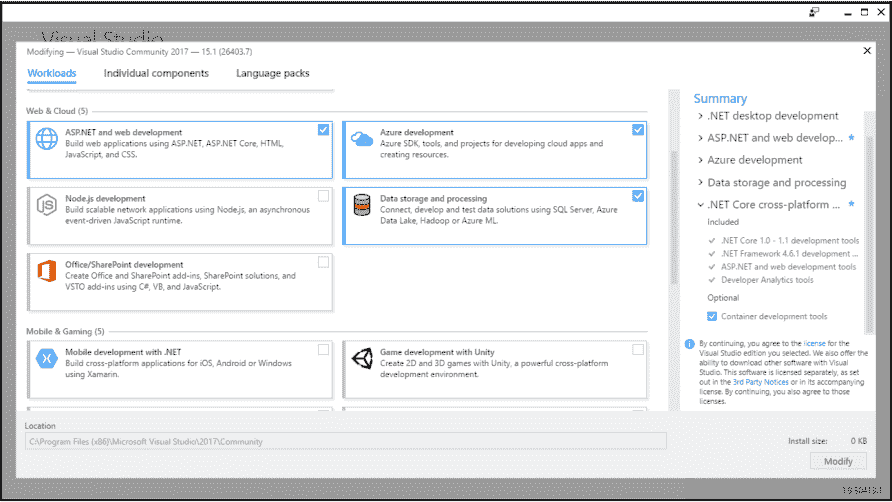

我們已經了解了可供我們使用的 Visual Studio 的不同風格/版本，我們將在旅程中使用 Visual Studio Community，它可免費用於私人和小規模測試用途。讀者可以根據自己的需求選擇適合的版本（IDE 中可用的工具和腳手架可能會有所不同）。

## 建立新專案

開啟 Visual Studio 並從 **File** 選單或 **Start** 頁面建立新專案。

## Start 頁面

從 **New Project** 區段，使用以下任一方法建立新專案：

- 1. 選擇 **Create new project...** 在左側窗格中，選擇 **Templates | Visual C# | .NET Core**。從清單中選擇 **ASP.NET Core Web Application** 模板。


2. 在项目模板中搜索“ASP.NET Core Web 应用程序”并选择它。如下面的截图所示，在“名称”中输入 MasteringEFCore.Web，在“解决方案名称”中输入 MasteringEFCore，然后点击“确定”：

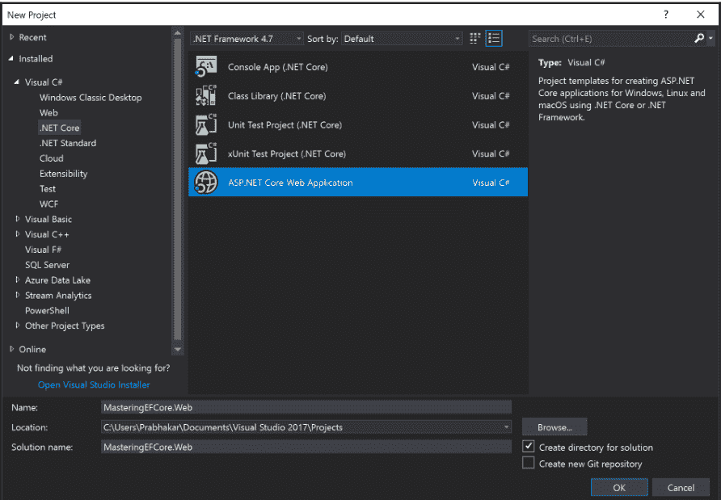

新项目

## 文件菜单

从文件菜单中，执行以下步骤：

1. 选择“新建”|“项目”。
2. 在左侧窗格中，选择“模板”|“Visual C#”|“.NET Core”。
3. 从列表中选择“ASP.NET Core Web 应用程序”模板。
4. 如上图所示，在 **名称** 中输入 `MasteringEFCore.CodeFirst.Starter`，在 **解决方案名称** 中输入 `MasteringEFCore`，然后点击 **确定**。

无论采用上述哪种方式，所选模板都会提供 **“新建 ASP.NET Web 应用程序 (.NET Core)”** 对话框，让我们从以下选项中选择：

- **空**
- **Web API**：创建一个 Web API 项目
- **Web 应用程序（模型-视图-控制器）**：创建一个 MVC Web 应用程序，也允许我们创建 API

我们将从对话框中选择 **Web 应用程序（模型-视图-控制器）**，如下所示：

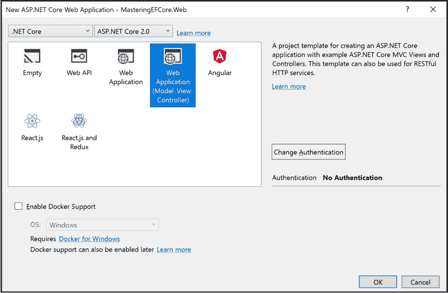

新建 ASP.NET Web 项目对话框

5. 在我们的案例中，选择 **.NET Core**、**ASP.NET Core 2.0** 和 **Web 应用程序（模型-视图-控制器）** 模板，同时将身份验证设置为 **无身份验证**。点击“确定”：

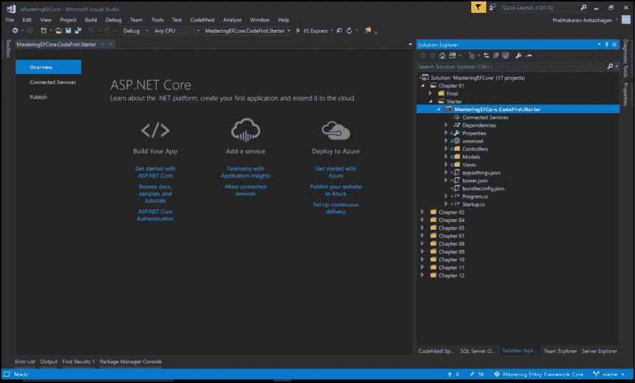

生成的 Web 应用程序显示了一个对我们来说全新的选项卡式界面（而不是显示 `index.cshtml`）。它允许我们直接从起始页访问文档、连接任何服务，甚至决定发布选项。

> 💡 **提示**
>
> 如果仔细观察，你会注意到 Visual Studio 正在静默还原包；在 .NET Core 中，几乎所有东西都是某个包的一部分。不再有即使我们不需要也会加载大量 DLL 的重量级框架了！现在一切都被拆分为更轻量的包，我们可以根据需求来使用它们。

我知道深入讲解 MVC 可能稍微超出本章的范围，但在深入探讨 Entity Framework 之前，让我们先了解一些细节。

## Web 应用的结构

一个 .NET Core Web 应用程序由以下文件夹组成：

- `Dependencies`：SDK、服务器和客户端依赖项
- `wwwroot`：所有静态资源都应放在这里
- `Connected Services`：用于连接 Marketplace 中提供的外部服务
- `launchSettings.json`：启动 Web 应用程序所需的设置
- `appSettings.json`：配置，例如日志记录和连接字符串
- `bower.json`：客户端依赖项应在此处配置
- `bundleConfig.json`：捆绑功能现已移至 JSON 配置中
- `Program.cs`：一切都从 `Main()` 开始，任何程序都可以使用 WebHostBuilder API 变成 Web 应用程序
- `Startup.cs`：用于添加和配置启动服务，如 MVC 支持、日志记录、静态文件支持等
- `Controllers, Views`：属于 MVC 的一部分，包含操作和对应的视图

到目前为止我们讨论的结构如下图所示：

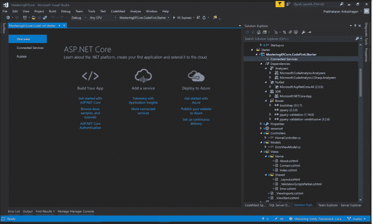

在 Views\Shared\_Layout.cshtml 中，下面突出显示的部分应修改为所需的应用程序名称：

```
<!DOCTYPE html>
<html>
<head>
<meta charset="utf-8" />
<meta name="viewport" content="width=device-width,
    initial-scale=1.0" />
<title>@ViewData["Title"] - MasteringEF Core.Web</title>
...
</head>
<body>
<nav class="navbar navbar-inverse navbar-fixed-top">
<div class="container">
<div class="navbar-header">
...
<a asp-area="" asp-controller="Home" asp-action="Index" class="navbar-brand">MasteringEF Core.Web</a>
...
<div class="container body-content">
...
<footer>
<p>&copy; 2017 - MasteringEF Core.Web</p>
</footer>
...
</body>
```

我们已经创建了一个不带身份验证的 .NET Core Web 应用程序，并探索了项目结构，这可能有助于我们理解 .NET Core 中的 MVC。如果展开依赖项，就会明显发现我们没有对 Entity Framework (EF) Core 的内置支持。我们将介绍识别和安装包的几种不同方法。

## 安装 Entity Framework

Entity Framework 包应作为 NuGet 包的一部分安装，可通过以下方式完成：

1. 转到“包管理器控制台”（工具 | NuGet 包管理器 | 包管理器控制台），选择要安装包的项目：

   在 PM 控制台中添加以下命令，以在所选项目上安装包：

   ```
   Install-Package Microsoft.EntityFrameworkCore.SqlServer
   ```

   包管理器控制台将打开，如下面的截图所示，请在此处使用上述命令安装包：

   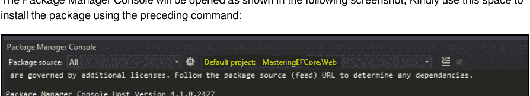

2. 转到“包管理”选项卡（可以从“工具”或“依赖项/项目”中进入）。
   - 若要为整个解决方案安装包，并使其对该解决方案中的所有项目可用，请转到“工具”|“NuGet 包管理器”|“管理解决方案的 NuGet 包...”，或在解决方案资源管理器中右键单击解决方案，然后选择“管理解决方案的 NuGet 包...”。
   - 若要按项目安装包，请右键单击目标项目中的“依赖项”，或右键单击目标项目，然后选择“管理 NuGet 包...”。

3. 搜索 Microsoft.EntityFrameworkCore.SqlServer，选择稳定版本 2.0.0 并安装该包。它也包含所有依赖包（关键依赖项，如 System.Data.SqlClient 和 Microsoft.EntityFrameworkCore.Relational）：

   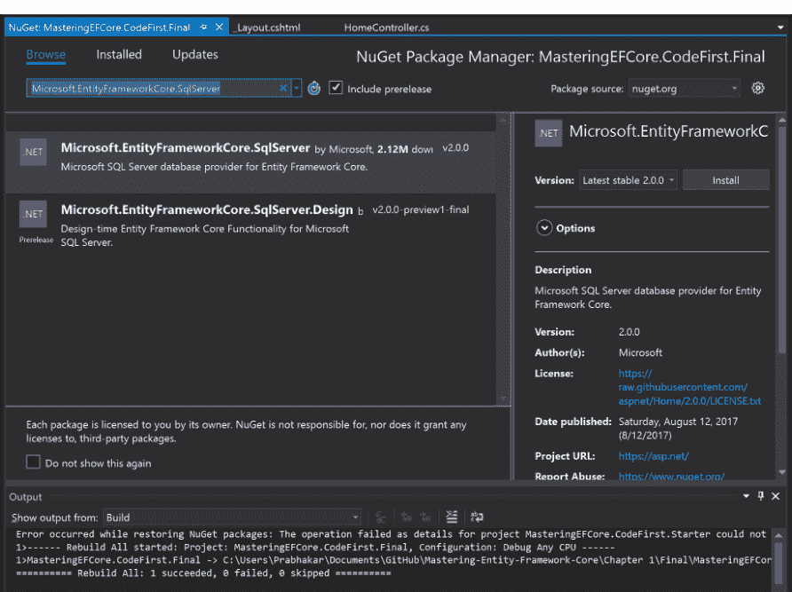

NuGet 包管理器窗口

到目前为止，我们已经了解了使用包管理器控制台的不同方式，并安装了与 EF Core 相关的包。在下一节中，我们将开始构建架构，然后使用 EF 来处理所创建的实体。

## 数据模型

在 .NET 世界中，如果我们在创建数据库之前很久就开始创建数据模型，那么我们有点偏离传统做法。没错，这被广泛称为 **Code-First（代码优先）方法**。让我们使用 code-first 为 Blogging 应用程序创建实体类，并将它们放入项目下的 Models 文件夹中。

### Blog 实体

创建一个 `Blog.cs` 类文件，并包含以下属性：

```
public class Blog
{
    public int Id { get; set; }
    public string Url { get; set; }
    public ICollection<Post> Posts { get; set; }
}
```

Entity Framework 会查找任何名为 Id 或 TypeNameId 的属性，并将它们标记为表的主键。Posts 属性是一个导航属性，包含与此 Blog 实体相关的 Post 项。对于导航属性，我们使用 `ICollection<T>` 还是 `IEnumerable<T>` 并不重要，EF 会为我们创建一个集合，默认是 `HashSet<T>`。我们也可以使用 `List<T>` 创建具体集合。

### Post 实体

创建一个 `Post.cs` 类文件，并包含以下属性：

```
public class Post
{
    public int Id { get; set; }
    public string Title { get; set; }
    public string Content { get; set; }
    public DateTime PublishedDateTime { get; set; }
    public int BlogId { get; set; }
    public Blog Blog { get; set; }
}
```

`BlogId` 属性是为相应的 `Blog` 导航属性创建的外键。你可能已经注意到，在这种情况下，我们有一个单项作为导航属性，而不是 `Blog` 实体中的列表。这就是关系类型发挥作用的地方，我们将在第 3 章 *关系 – 术语和约定* 中进行更深入的探讨。


EF 允许我们在实体中创建没有外键的单个导航属性。在这些情况下，EF 将使用 `Blog-Id` 模式（`Blog` 导航属性及其 `Id` 主键）在数据库表中为我们创建外键。EF 会针对 `Id` 主键自动为所有导航属性生成外键，但也允许我们以不同方式命名，并通过自定义特性对其进行修饰。

到目前为止，我们已经构建了应用程序所需的架构，但尚未在 EF 中进行配置，因此让我们看看如何使用数据库上下文将数据模型与 EF 连接/配置。

### 数据库上下文

EF 的主要入口点是任何继承 `Microsoft.EntityFrameworkCore.DbContext` 类的类。让我们创建一个名为 `BlogContext` 的类并继承该类。我们将把上下文和其他 EF 相关配置放在 `Data` 文件夹中。在项目中创建一个 `Data` 文件夹，并在该文件夹中创建 `BlogContext.cs`：

```
public class BlogContext: DbContext
{
    public BlogContext(DbContextOptions<BlogContext> options)
        : base(options)
    {
    }

    public DbSet<Blog> Blogs { get; set; }
    public DbSet<Post> Posts { get; set; }
}
```

EF 将 `DbSet<T>` 解释为数据库表；我们已经为博客系统的所有实体创建了 `DbSet<T>` 属性。我们通常以复数形式命名这些属性，因为该属性将持有实体列表，并且 EF 在数据库中创建表时将使用这些属性名。


为父实体创建 DbSet 就足够让 EF 识别出依赖实体并为我们创建对应的表。EF 在决定表名时会使用复数形式。

.NET 开发者和 SQL 开发者经常就表名的复数形式进行争论，并最终创建出使用两种不同约定的实体。作为框架，EF 也支持这些场景。我们可以使用 Fluent API 来覆盖默认的复数命名行为。参考以下 Fluent API 代码：

```csharp
public class BlogContext : DbContext
{
    ...
    protected override void OnModelCreating(ModelBuilder modelBuilder)
    {
        modelBuilder.Entity<Blog>().ToTable("Blog");
        modelBuilder.Entity<Post>().ToTable("Post");
    }
}
```

我们已经创建了一个数据库上下文并在其中配置了数据模型。你可能会注意到我们看不到任何指向数据库的连接字符串。它本可以使用带有硬编码连接字符串的 OnConfiguring() 方法来完成，但这不会是一个理想的实现。相反，我们将在下一节中使用 .NET Core 内置的依赖注入支持来配置它。

## 在服务中注册上下文（.NET Core DI）

ASP.NET 框架中的依赖注入支持来得太晚了，对于那些寻求 Ninject、StructureMap、Castle Windsor 等第三方工具庇护的 .NET 开发者/架构师来说。最终，我们获得了 ASP.NET Core 的支持。它具有第三方 DI 提供程序的大部分功能，但唯一的区别是配置应该在 Startup.cs 中间件内部进行。

首先，让我们在新的 appsettings.json 中配置连接字符串：

```json
"ConnectionStrings": {
    "DefaultConnection": "Server=(localdb)\\mssqllocaldb;Database=MasteringEFCoreBlog;Trusted_Connection=True;MultipleActiveResultSets=true"
},
```

```csharp
if (context.Blogs.Any())
{
    return;    // DB has been seeded
}
var dotnetBlog = new Blog {
    Url = "http://blogs.packtpub.com/dotnet" };
var dotnetCoreBlog = new Blog { Url =
    "http://blogs.packtpub.com/dotnetcore" };
var blogs = new Blog[]
{
    dotnetBlog,
    dotnetCoreBlog
};
foreach (var blog in blogs)
{
    context.Blogs.Add(blog);
}
context.SaveChanges();
var posts = new Post[]
{
    new Post{Id= 1,Title=".NET 4.7 Released",Blog = dotnetBlog,
        Content = ".NET 4.7 Released Contents", PublishedDateTime =
            DateTime.Now},
    new Post{Id= 1,Title=".NET Core 1.1 Released",Blog=
        dotnetCoreBlog,
        Content = ".NET Core 1.1 Released Contents", PublishedDateTime
            = DateTime.Now},
    new Post{Id= 1,Title="EF Core 1.1 Released",Blog=
        dotnetCoreBlog,
        Content = "EF Core 1.1 Released Contents", PublishedDateTime =
            DateTime.Now}
};
foreach (var post in posts)
{
    context.Posts.Add(post);
}
context.SaveChanges();
```

在 **Program.cs** 中，在 **Main()** 中通过依赖注入创建 **BlogContext** 来初始化 **DbInitializer** 并将其传递给 **DbInitializer.Initialize()**：

```csharp
public static void Main(string[] args)
{
    var host = BuildWebHost(args);
    using (var scope = host.Services.CreateScope())
    {
        var services = scope.ServiceProvider;
        try
        {
            var context = services.GetRequiredService<BlogContext>();
            DbInitializer.Initialize(context);
        }
        catch (Exception ex)
        {
            var logger = services.GetRequiredService<ILogger<Program>>();
            logger.LogError(ex, "An error occurred initializing the database.");
        }
    }
    host.Run();
}
```

最后一块拼图还缺失；我们需要在添加/操作数据模型时添加迁移，否则 EF 不知道数据库需要如何创建/更新。迁移可以使用 NuGet **Package Manager** 控制台执行：

```powershell
Add-Migration InitialMigration
```

前面的语句允许 EF 创建一个迁移文件，其中包含从 DbContext 中配置的模型创建的表。可以按如下方式完成：

```powershell
Update-Database
```

前面的语句将创建的迁移应用到数据库。此时我们几乎完成了 EF 配置。我们应该运行应用程序并验证数据库，检查适当的模式和种子数据是否已更新。

我们可以使用以下 SQL Server 对象资源管理器验证表是否包含种子数据：

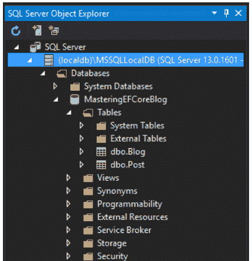

数据库创建成功

我们可以看到模式已正确创建在 MSSQLLocalDB 实例中，我们应该展开表并验证种子数据是否已更新。Blog 实体的种子数据已正确更新，这已通过以下截图验证：

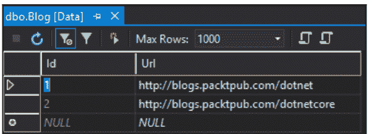

Blog 表已按配置的模式和种子数据创建

此时，Visual Studio 已包含用于脚手架 Controller 和 View 所需的工具，我们已准备好再次开始脚手架过程：

- 1. 右键单击 Controllers 文件夹并选择 Add | New Scaffolded Item
- 2. 在 Add Scaffold 对话框中，选择 MVC Controller with views, using Entity Framework，如下所示：

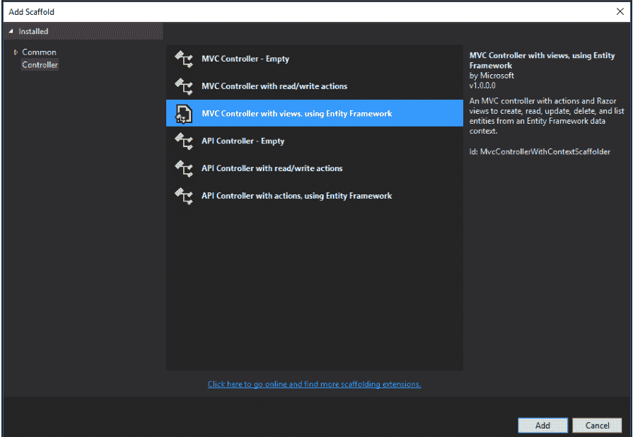

- 3. 在 **Add Controller** 对话框中，选择适当的 **Model** 和 **Data context class**（在我们的例子中为 *Blog* 和 *BlogContext*），以及自动生成的控制器名称 *BlogsController*：

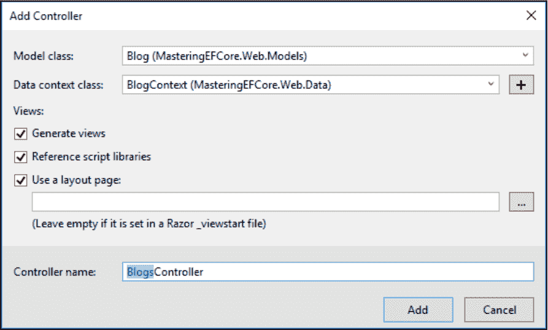

- 4. 点击 **Add**，如下所示：

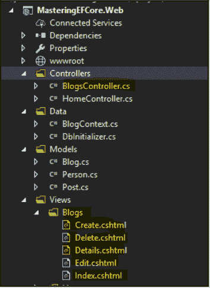

- 5. 脚手架代码包括 MVC **Controllers** 和 **Views** 中的 CRUD 操作。检查脚手架的 MVC 代码将超出本章范围，因此我们将仅关注 EF 脚手架部分：

```csharp
public class BlogsController : Controller
{
    private readonly BlogContext _context;
    public BlogsController(BlogContext context)
    {
        _context = context;
    }
    // GET: Blogs
    public async Task<IActionResult> Index()
    {
        return View(await _context.Blogs.ToListAsync());
    }
    ...
}
```

- 6. 在前面的代码块中，你可能会注意到在将 BlogContext（MasteringEFCoreBlog 数据库上下文）传递给控制器时使用了依赖注入，这也在 Index() 操作中使用了：

```html
<div class="navbar-collapse collapse">
<ul class="nav navbar-nav">
<li><a asp-area="" asp-controller="Home" asp-action="Index">Home</a></li>
<li><a asp-area="" asp-controller="Blogs" asp-action="Index">Blogs</a></li>
...
```

- 7. 我们需要在 Views\Shared\_Layout.cshtml 中更新导航，如前面的代码所示，否则我们将无法查看 Blogs 模块中的 CRUD 操作。准备就绪。让我们运行并查看 CRUD 操作的实际效果：

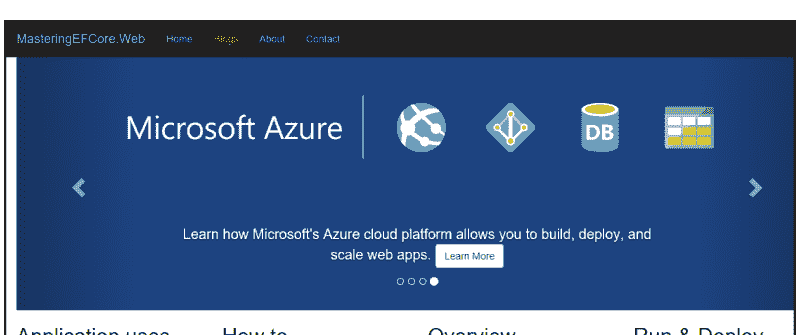

更新后的导航菜单包含 Blogs

前面的截图是 ASP.NET Core Web 应用程序的首页。我们在导航菜单中突出显示了 Blogs 超链接。Blogs 超链接将用户带到 Index 页面，该页面会列出所有博客条目：

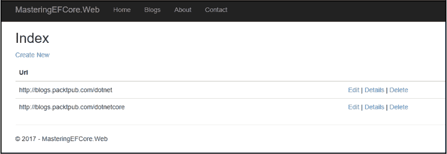

Blogs 列表

让我们尝试在系统中创建一个博客条目，如下所示：

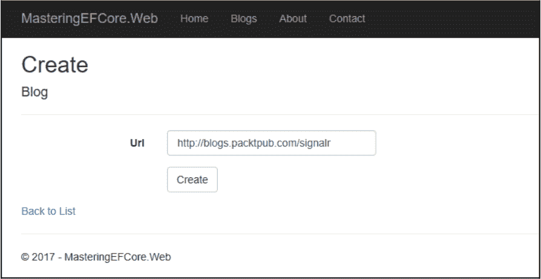

创建 Blog

**Create** 页面提供了创建实体所需填充的输入元素，因此让我们提供所需数据并验证它：

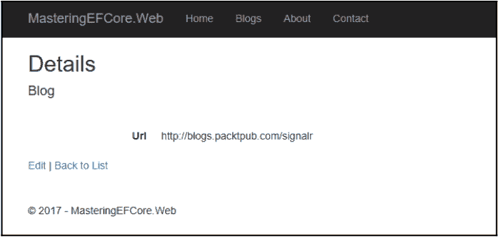

**Details** 页面显示实体，前面的截图显示了刚刚创建的实体。**Edit** 页面提供了所需输入元素并预先填充现有数据，可以通过使用和更新数据进行编辑：

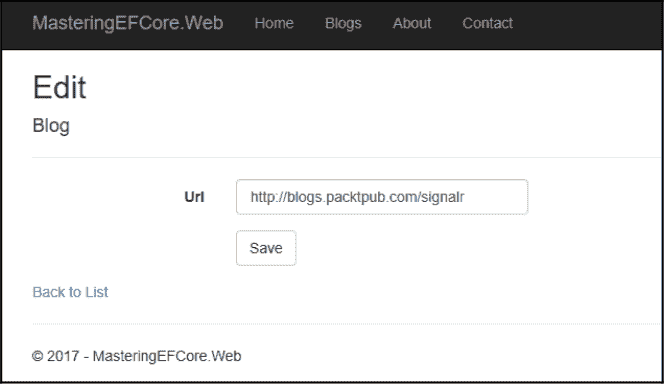


**删除**页面提供了一个确认视图，让用户可以确认是否要删除该项：

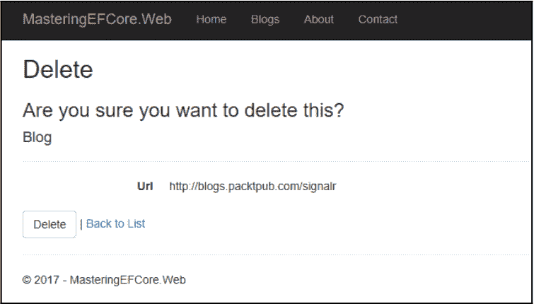

当用户在列表页面的项目行中选择**删除**超链接时，将显示此**删除**页面。我们不会直接从操作中删除博客，而是将用户路由到**删除**页面，在执行操作前获取确认。

我们已经了解了如何使用 EF Core 执行 CRUD 操作。由于探索 MVC 超出了本书的范围，我们只坚持分析与 EF 相关的脚手架。

### 小结

我们从实体框架开始，首先从高层次了解了它与传统方法相比有何不同。我们还研究了如何构建 .NET 环境，以及如何使用实体框架创建和配置 .NET Core Web 应用程序。我们探索了 NuGet 包和包管理器，它们将在整本书中被广泛使用。在本章中，我们还确定并安装了实体框架所需的包。使用 Code-First 方法，我们构建了架构，使用 EF 对其进行了配置，并使用架构和种子数据创建和填充了数据库。最后，我们使用脚手架工具（在过程中安装）在 MVC 应用程序中使用了构建的架构，并查看了控制器中数据库上下文的使用。Code-First 方法可用于构建新系统，但对于现有系统，我们需要不同的方法。这就是**Database-First**方法的用武之地。让我们在*第 2 章*《另一种方式——数据库优先方法》中探讨这一点。

## 另一种方式——数据库优先方法

在第 1 章《快速入门——实体框架核心简介》中，我们接触了**实体框架（EF）**的 Code-First 方法，但这种方法并非在所有场景中都有用。我们需要一种使用 EF Core 逆向工程现有数据库的机制，它指导我们执行迁移，并帮助我们保留模型更改，这些更改在迁移过程中不会丢失。

当 EF 首次发布时，它只支持数据库优先方法，这意味着我们只能在现有数据库上使用该框架。与前一章讨论的 Code-First 方法不同，当我们决定在现有系统中使用 EF 时，数据库优先方法将被广泛使用。

我们在这里将涵盖的主题有：

- 准备数据库
- 创建新项目
- 安装实体框架
- 逆向工程数据库
- 在服务中注册上下文（.NET Core DI）
- 执行 CRUD 操作

### 准备数据库

我们将使用*第 1 章《快速入门——实体框架核心简介》*中使用的同一博客系统。在这种情况下，我们将为现有数据库创建所需的 SQL 查询，然后使用数据库优先方法构建我们的博客系统。让我们编写博客系统所需的 `Blog` 和 `Post` 的 SQL 查询。

#### Blog 实体脚本

我们将创建 `Blog` 表，然后修改它以添加主键约束，最后向表中插入一些示例数据。完整的脚本可在 GitHub 仓库中获得，地址为 `https://github.com/PacktPublishing/Mastering-Entity-Framework-Core/blob/master/Chapter%202/Final/MasteringEFCore.DatabaseFirst.Final/dbo.Blog.sql`。

创建 `Blog` 表并插入数据所需的脚本如下所示：

```sql
// 为简洁起见，代码已移除
CREATE TABLE [dbo].[Blog] (
    [Id] INT            IDENTITY (1, 1) NOT NULL,
    [Url] NVARCHAR (MAX) NULL
);
GO
// 为简洁起见，代码已移除
INSERT INTO [Blog] (Url) VALUES
('http://blogs.packtpub.com/dotnet'),
('http://blogs.packtpub.com/dotnetcore'),
('http://blogs.packtpub.com/signalr')
GO
```

我们已经查看了 `Blog` 表的 SQL 脚本，现在让我们看一下 `Post` 表的脚本，它将引入一个非聚集索引和外键。

#### Post 实体脚本

我们将创建 `Post` 表和一个非聚集索引以获得更好的性能，然后修改它们以添加主键和外键约束，最后向表中插入一些示例数据。完整的脚本可在 GitHub 仓库中获得，地址为 `https://github.com/PacktPublishing/Mastering-Entity-Framework-Core/blob/master/Chapter%202/Final/MasteringEFCore.DatabaseFirst.Final/dbo.Post.sql`。

创建 Post 表并插入数据所需的脚本如下所示：

```sql
// 为简洁起见，代码已移除
CREATE TABLE [dbo].[Post] (
    [Id] INT IDENTITY (1, 1) NOT NULL,
    [BlogId] INT NOT NULL,
    [Content] NVARCHAR (MAX) NULL,
    [PublishedDateTime] DATETIME2 (7) NOT NULL,
    [Title] NVARCHAR (MAX) NOT NULL
);
GO
// 为简洁起见，代码已移除
INSERT INTO [Post] ([BlogId], [Title], [Content], [PublishedDateTime]) VALUES
(1, 'Dotnet 4.7 Released', 'Dotnet 4.7 Released Contents', '20170424'),
(2, '.NET Core 1.1 Released', '.NET Core 1.1 Released Contents', '20170424'),
(2, 'EF Core 1.1 Released', 'EF Core 1.1 Released Contents', '20170424')
GO
```


插入时间值时，我们应使用 YYYYMMDD 格式，例如 20170424，如果我们习惯使用 DD-MM-YYYY hh:mm:ss xm 格式，则需要执行显式转换，例如 `convert(datetime,'24-04-2017 01:34:09 PM',5)`，否则我们会收到消息：varchar 数据类型到 datetime 数据类型的转换导致值超出范围。

我们需要弄清楚如何使用 LocalDB 执行上述脚本：

1. 从“视图”菜单中打开 SQL Server 对象资源管理器。
2. 展开 SQL Server 和 (localdb)\MSSQLLocalDB。
3. 右键单击“数据库”，然后选择“添加新数据库”。
4. 在“创建数据库”对话框中，将数据库名称提供为 MasteringEFCoreDbFirst，数据库位置提供为你的项目路径，然后点击“确定”。
5. 展开“数据库”，右键单击 MasteringEFCoreDbFirst 数据库，然后选择“新建查询”。
6. 复制 `Blog.sql` 内容并将其粘贴到**新建查询**窗口中，然后点击执行图标或按 Ctrl+Shift+E：

   Blog 脚本的执行如下所示：

   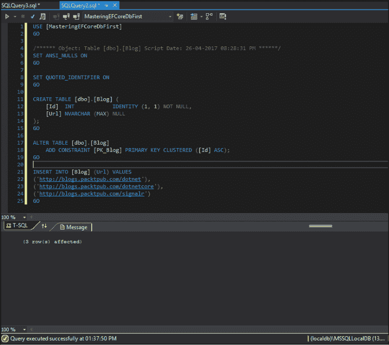

7. 复制 `Post.sql` 内容并将其粘贴到**新建查询**窗口中，然后点击执行图标或按 Ctrl+Shift+E：

   Post 脚本的执行如下所示：

   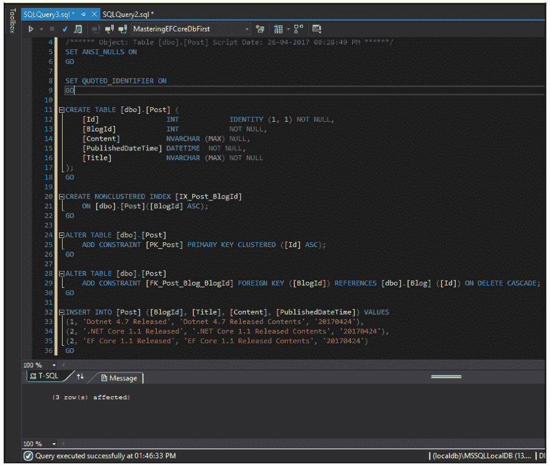

   在“新建查询”窗口上执行 Post.sql

我们已经为数据库优先方法准备好了数据库；现在让我们看看如何在现有数据库上利用实体框架。

### 创建新项目

我们已经在第 1 章《快速入门——实体框架核心简介》中详细了解了如何创建新项目。请参考创建项目的相关步骤，并使用以下项目信息：

项目名称：MasteringEFCore.DatabaseFirst

解决方案名称：MasteringEFCore

### 安装实体框架

实体框架包的包含和所涉及的步骤也在第 1 章《快速入门——实体框架核心简介》中进行了广泛讨论。因此，让我们关注逆向工程（数据库优先方法）所需的包。实体框架与 SQL Server 集成所需的基本包如下：

在 PM 控制台中添加以下命令以安装以下包：

```powershell
Install-Package Microsoft.EntityFrameworkCore.SqlServer
```

我们也可以使用 NuGet 包管理器窗口搜索并安装 Microsoft.EntityFrameworkCore.SqlServer 包：

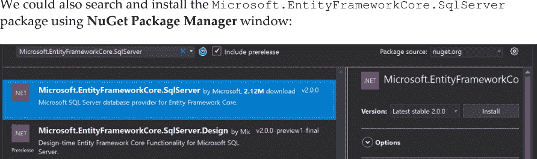

逆向工程（从数据库自动生成模型）所需的包列在下面。我们可以将以下命令添加到 PM 控制台以安装这些包：


```
Install-Package Microsoft.EntityFrameworkCore.Tools
Install-Package Microsoft.EntityFrameworkCore.SqlServer.Design
```

我们也可以使用 NuGet 程序包管理器窗口搜索并安装前面列出的程序包，如下所示：

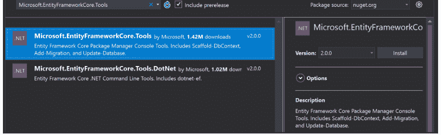

Microsoft.EntityFrameworkCore.Tools NuGet 程序包

安装 Microsoft.EntityFrameworkCore.Tools 程序包。此程序包将 Entity Framework 命令公开给 NuGet 程序包管理器控制台，我们可以使用它执行诸如脚手架数据库上下文之类的某些操作：

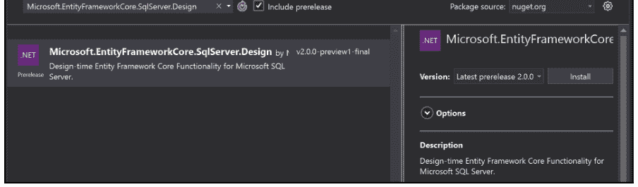

Microsoft.EntityFrameworkCore.SqlServer.Design NuGet 程序包

安装 `Microsoft.EntityFrameworkCore.SqlServer.Design` 程序包。此程序包让我们可以从 SQL Server 数据库脚手架模型。

> 在撰写本文时，`Microsoft.EntityFrameworkCore.SqlServer.Design 2.0.0` 仅作为预览版发布。

我们已安装了用于在 EF Core 中反向工程现有数据库实体的所需程序包。在下一节中，我们将开始反向工程以将 EF Core 配置为数据库。

## 反向工程数据库

反向工程可以在 **NuGet 程序包管理器**控制台上执行。我们已经了解了如何打开它，因此只需执行以下命令即可脚手架上下文和模型文件：

```
Scaffold-DbContext "Server=(localdb)\mssqllocaldb;Database=MasteringEFCoreDbFirst;Trusted_Connection=True;"
    Microsoft.EntityFrameworkCore.SqlServer -OutputDir Models
```

> 有时我们可能会收到 **The package could not be located** 的错误。解决方法是单独在另一个解决方案中打开项目。如果我们收到 **Unable to open the database** 错误，则在 SQL Management Studio 中提供访问权限（从工作室连接本地）将解决该问题。**SQL Server Management Studio (SSMS)** 是免费版本，可以从 `https://docs.microsoft.com/en-us/sql/ssms/download-sql-server-management-studio-ssms` 下载。

请参考以下屏幕截图：

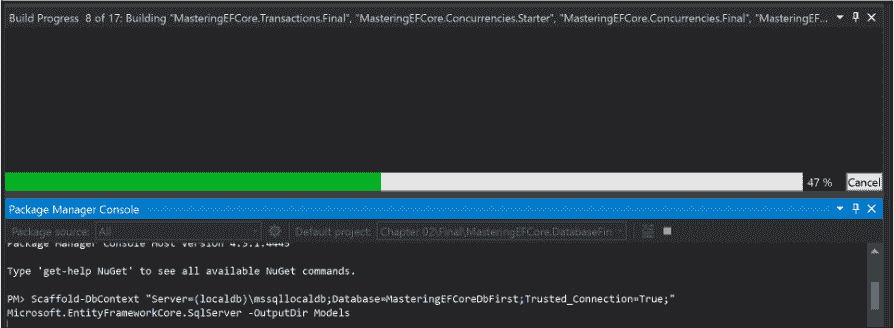

脚手架过程会生成数据库上下文文件和相应的数据模型（在我们的例子中，总共三个文件）。

## 配置数据上下文

自动生成的数据库上下文（在以下代码中呈现）将包括：

- 表/实体的虚拟属性，用于保存相应数据。
- OnConfiguring 方法，它将使用数据库配置 EF。
- OnModelCreating 方法，它将在创建数据库时确保某些约束和关系被构建。在我们的数据库优先方法中它将不会被使用，因为我们已经有了它们。

数据库上下文应包含以下配置：

```
public partial class MasteringEFCoreDbFirstContext : DbContext
{
    public virtual DbSet<Blog> Blog { get; set; }
    public virtual DbSet<Post> Post { get; set; }
    protected override void OnConfiguring(DbContextOptionsBuilder optionsBuilder)
    {
        if (!optionsBuilder.IsConfigured)
        {
            // Move this connection string to config file later
```

```
```csharp
optionsBuilder.UseSqlServer(@"Server=
    (localdb)\mssqllocaldb;Database=MasteringEFCoreDbFirst;
    Trusted_Connection=True;");
}
protected override void OnModelCreating(ModelBuilder modelBuilder)
{
    modelBuilder.Entity<Post>(entity =>
    {
        entity.HasIndex(e => e.BlogId).HasName("IX_Post_BlogId");
        entity.Property(e => e.Title).IsRequired();
        entity.HasOne(d => d.Blog).WithMany(p => p.Post)
            .HasForeignKey(d => d.BlogId);
    });
}
```
```

如果您注意到警告，我们需要删除使用依赖注入的部分，这将在 *Registering Context in Services (.NET Core DI)* 部分中执行。

## 使用 Blog 实体

我们在第 1 章 *Kickstart - Introduction to Entity Framework Core* 中详细讨论了 `Blog` 模型，但仍然，以下突出显示的部分对我们来说看起来很新：

- `Blog()` 构造函数初始化 `Post` 属性，这确保集合有一个具体的 HashSet 列表创建并准备好接受任何新项目
- `Post` 属性具有 `virtual` 关键字，这指示 EF 延迟加载导航属性 `Post`：

```
public partial class Blog
{
    public Blog()
    {
        Post = new HashSet<Post>();
    }
    public int Id { get; set; }
    public string Url { get; set; }
    public virtual ICollection<Post> Post { get; set; }
}
```

在 `Blog` 类中没有什么太多可探索的，所以，让我们继续到 `Post` 类。

## 使用 Post 实体

在第 1 章 *Kickstart - Introduction to Entity Framework Core* 中，甚至 `Post` 模型也被详细讨论了，除了我们有一个虚拟的 `Blog` 属性，它只是一个导航属性：

```
public partial class Post
{
    public int Id { get; set; }
    public int BlogId { get; set; }
    public string Content { get; set; }
    public DateTime PublishedDateTime { get; set; }
    public string Title { get; set; }
    public virtual Blog Blog { get; set; }
}
```

我们已经看到了第 1 章 *Kickstart - Introduction to Entity Framework Core* 中手动创建的模型与自动生成的模型之间的差异。让我们看看如何使数据库上下文配置更通用，而不是将连接字符串硬编码在代码中。

## 在服务中注册上下文（.NET Core DI）

`OnConfiguring(DbContextOptionsBuilder optionsBuilder)` 方法中显示的警告需要解决。因此让我们删除该方法（在以下代码中突出显示）并在 `Startup.cs` 文件中使用依赖注入执行配置。

## 重构 OnConfiguring() 方法

如果我们回顾一下我们如何配置数据库上下文，自动生成的代码使用了硬编码的连接字符串用于配置。为了避免它，我们应该有一个机制将数据库上下文选项传递给 DbContext 基类；让我们看看如何操作：

```
public partial class MasteringEFCoreDbFirstContext : DbContext
{
    public virtual DbSet<Blog> Blog { get; set; }
    public virtual DbSet<Post> Post { get; set; }
    protected override void OnConfiguring(DbContextOptionsBuilder optionsBuilder)
    {
        // Move this connection string to config file later
        optionsBuilder.UseSqlServer(@"Server=(localdb)\mssqllocaldb;Database=MasteringEFCoreDbFirst;Trusted_Connection=True;");
    }
}
```

还为 MasteringEFCoreDbFirstContext 类包含一个构造函数，该构造函数将通过 Startup 类中的依赖注入初始化 DbContext：

```
public MasteringEFCoreDbFirstContext(
    DbContextOptions<MasteringEFCoreDbFirstContext> options)
    : base(options)
    {
    }
```

我们已经了解了如何将选项传递给数据库上下文基类，现在我们将了解如何使用连接字符串配置选项。

## 重构 ConfigureServices 方法

我们将使用 ConfigureServices() 方法将数据库上下文框架服务包含到服务集合中。添加以下 using 语句以配置 DbContext 选项并将数据库上下文添加到服务列表：

```
using Microsoft.EntityFrameworkCore;
using MasteringEFCore.DatabaseFirst.Final.Models;
```

正如我们在第 1 章 *Kickstart - Introduction to Entity Framework Core* 中所做的那样，我们将上下文配置为服务并将 `DbContext`（使用 `UseSqlServer()` 通过 `DbContextOptionsBuilder` 创建）添加到服务集合：

```
public void ConfigureServices(IServiceCollection services)
{
    // Add framework services.
    services.AddDbContext<MasteringEFCoreDbFirstContext>(options =>
    options.UseSqlServer(Configuration.GetConnectionString(
        "DefaultConnection")));
    services.AddMvc();
}
```

我们已在框架中配置了数据库上下文，但如果我们仔细观察，会发现连接字符串来自配置。接下来，我们将了解配置如何包含在 `appsettings.json` 中。

## appsettings.json 设置

应用程序设置，如我们之前探索的那样，基于 JSON，并且为了包含一个设置，我们需要添加一个 JSON 键值对。在我们的例子中，`ConnectionStrings` 是键，值又是定义 `DefaultConnection` 的 JSON 对象：

```
{
  "ConnectionStrings": {
    "DefaultConnection": "Server=(localdb)\mssqllocaldb;Database=MasteringEFCoreDbFirst;Trusted_Connection=True;MultipleActiveResultSets=true"
  },
  "Logging": {
    "IncludeScopes": false,
    "LogLevel": {
      "Default": "Warning"
    }
  }
}
```


在本节中，我们已在 ConfigureServices() 方法中配置了数据库上下文，并利用了 appsettings.json 使连接可配置。至此，所有必要的配置已完成，EF 已准备好使用数据库进行后续实现。让我们看看如何使用 EF 执行 CRUD 操作（我们在第1章《快速入门——实体框架核心介绍》中已经见过这些操作，但仍然会探讨一些之前未涉及的与渲染相关的部分）。

## 执行 CRUD 操作

我们已经了解了如何为 Blog 模型搭建控制器及其对应视图来创建 CRUD 操作，因此本节将为 Post 模型创建这些操作：

- 1. 右键单击 Controllers 文件夹，然后选择“添加”|“新建搭建项”。
- 2. 在“添加脚手架”对话框中，选择“使用实体框架的带有视图的MVC控制器”：

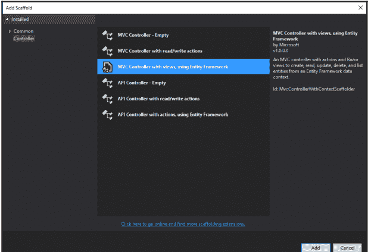

3. 在“添加控制器”对话框中，选择相应的模型类和数据库上下文类（在本例中为 Post 和 MasteringEF CoreDbFirstContext），以及自动生成的控制器名称 PostsController：

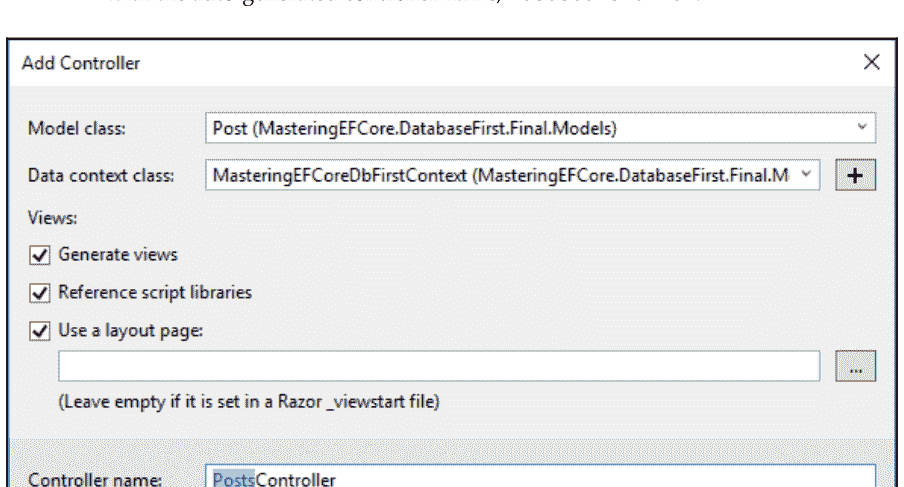

屏幕上会反映这些更改，我们可以看到博客 URL 而不是之前列出的 ID 被渲染出来：

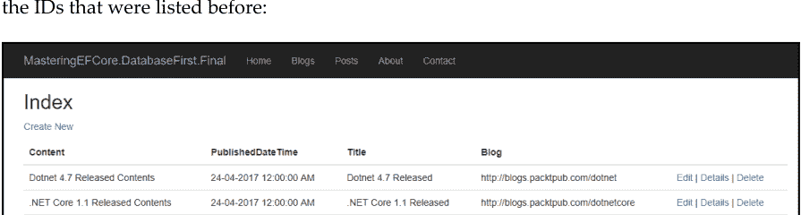

帖子列表视图

我们已经搭建了 CRUD 操作，并在 Post 索引操作中将博客 ID 的用法修改为 URL。让我们在其他操作中也进行同样的更新。

## 创建控制器操作

我们在上一节所做的更改需要在 SelectList 集合中更新，MVC 将使用该集合渲染下拉列表。默认情况下，MVC 脚手架提供的 SelectList（我们已对该行进行注释）的 Value 字段中具有 Id，需要将其修改为 Url，否则屏幕上只会显示数值（这是一个严重的安全问题，也不太用户友好）：

```
public IActionResult Create()
{
    //ViewData["BlogId"] = new SelectList(_context.Blog, "Id", "Id");
    ViewData["BlogId"] = new SelectList(_context.Blog, "Id", "Url");
    return View();
}
```

以下截图显示了映射到 BlogId 控件的 Url，但还有一些额外的问题需要修复。BlogId 应该只是 Blog 或博客 URL。

我将把这部分留作练习，请对与 BlogId 列关联的所有标签进行修改：

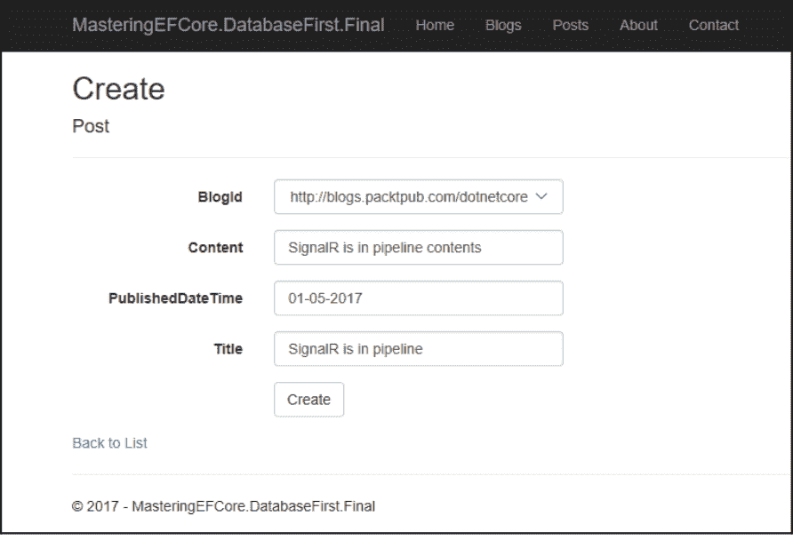

帖子创建视图

同样的更改也需要应用于 Create 的 Post 操作：

```
[HttpPost]
[ValidateAntiForgeryToken]
public async Task<IActionResult>
Create([Bind("Id,BlogId,Content,PublishedDateTime,Title")]
    Post post)
{
    ...
    ViewData["BlogId"] = new SelectList(_context.Blog, "Id", "Url",
        post.BlogId);
    return View(post);
}
```

以下截图显示了映射到 BlogId 控件的 URL，作为练习的一部分，请按照你在“创建控制器操作”一节中所做的字面更改，对 BlogId 标签进行修改：

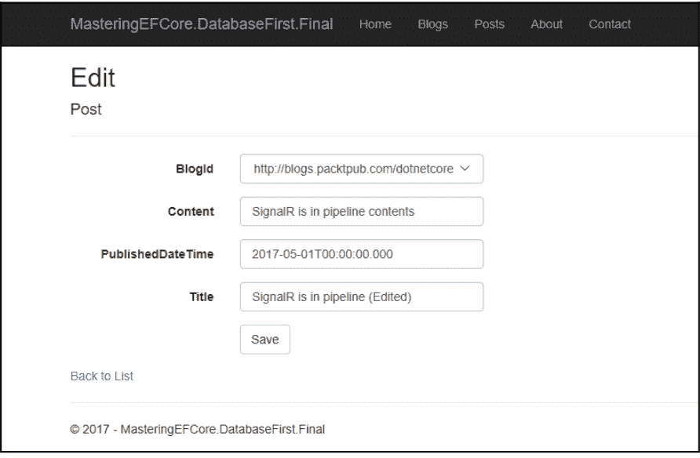

编辑帖子

同样的更改也需要应用于 Edit 的 Post 操作：

```
[HttpPost]
[ValidateAntiForgeryToken]
public async Task<IActionResult> Edit(int id,
[Bind("Id,BlogId,Content,PublishedDateTime,Title")] Post post)
{
...
ViewData["BlogId"] = new SelectList(_context.Blog, "Id", "Url",
post.BlogId);
return View(post);
}
```

这些更改反映在屏幕上显示的更新项中：

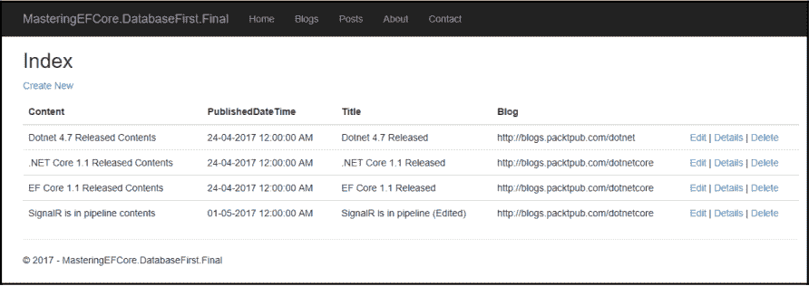

我们已在 Post **Edit**（HTTP、Get 和 Post）操作中将对博客 ID 的引用更新为博客 URL。让我们在剩余的 **DELETE** 操作中也进行更新。

## 删除视图

在 `Delete` 视图中，也应显示 `Blog.Url` 而不是博客 ID：

```
```html
<dl class="dl-horizontal">
    ...
    <dd>
        @Html.DisplayFor(model => model.Blog.Url)
    </dd>
</dl>
```
```

这些更改反映在删除确认屏幕上，现在显示博客 URL 而不是博客 ID：

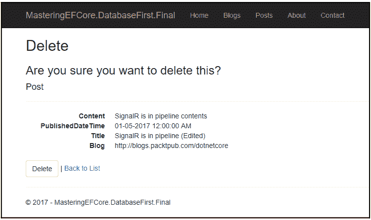

删除帖子

Post 列表页面不显示已删除的项，这确保了数据已从表中删除：

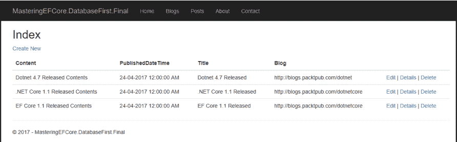

删除帖子后的列表视图

我们已经发现了第1章 *快速入门——实体框架核心介绍* 中涵盖的 CRUD 操作中某些缺失的部分，因为数据库优先方法中需要解决的具体更改并不多。

## 小结

我们已经学会了如何在具有实时数据库的现有系统上利用实体框架（为了说明目的，我们创建了 SQL 脚本来创建和模拟现有数据库）。我们探索了公开反向工程数据库所需 API 的 NuGet 包（包括数据库上下文和相应的数据模型）。最后，我们使用脚手架工具（在过程中安装）在 MVC 应用程序中使用了现有数据库，并且还看到了对自动生成的代码所做的更改（第1章 *快速入门——实体框架核心介绍* 中未涵盖）。数据库优先方法只是一种用于构建现有系统的机制（在现有系统中利用 EF）。到目前为止，我们已经使用了关系（新的或现有的），但尚未弄清楚实体框架支持的关系。让我们在第3章 *关系——术语与约定* 中探讨它们。
