# 3 理解关系术语
关系——术语与约定

在第2章《另一个方向——数据库优先方法》中，我们使用实体框架的数据库优先方法重新设计了现有数据库。现在让我们开始理解关系中使用的术语和约定。

如果我们不给实体一个身份，实体就毫无用处。我们将在本章探讨的关系术语将为实体提供身份，这不仅描述了它们，还帮助我们创建不同实体之间的关系。

本章将涵盖的主题如下：

- - 理解关系术语：
- - 数据模型
- - 主体实体
- - 主体键
- - 依赖实体
- - 外键
- - 导航属性
- - 关系中的约定：
- - 完全定义的关系
- - 无外键属性
- - 单一导航属性
- - 外键
- - 反向属性

## 理解关系术语

到目前为止，我们已经创建并使用了数据模型或实体，但尚未弄清楚它们是如何关联的。让我们理解它们是如何关联的以及用于这些关系的术语。

## 数据模型

我们将重新审视在第1章《快速入门——实体框架核心介绍》（使用代码优先方法）中创建和使用的数据模型，这些模型可用于理解关系术语。出于说明目的，我们将对这些对象进行调整，以理解系统中未使用的不同术语。

## Blog 实体

我们使用代码优先方法创建的 Blog 实体/数据模型如下所示：

```
public class Blog
{
    public int Id { get; set; }
    public string Url { get; set; }
    public ICollection<Post> Posts { get; set; }
}
```

我们将使用 Blog 模型来理解以下内容：

- - 主体实体
- - 主体键
- - 导航属性

## Post 实体

我们使用代码优先方法创建的 Post 实体/数据模型如下所示：

```
public class Post
{
    public int Id { get; set; }
    public string Title { get; set; }
    public string Content { get; set; }
}
```


```
public DateTime PublishedDateTime { get; set; }
public int BlogId { get; set; }
public Blog Blog { get; set; }
}
```

我们将使用 Post 模型来理解以下概念：

-   依赖实体
-   外键
-   导航属性
-   引用导航属性
-   反向导航属性

在数据模型部分，我们已经在相应模型中捕捉了关键的关系术语，现在我们将逐一详细讨论它们。

## 主体实体

在关系中充当父级的实体被称为主体实体。在数据库世界中，该实体持有主键，供依赖实体在建立关系时使用。请看下图：

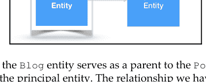

在我们的博客系统中，`Blog` 实体充当 `Post` 实体的父级，因此我们可以得出结论：`Blog` 是主体实体。我们在这两个实体之间建立的关系可以称为 **关联（Association）**。请看下图：


在我们的博客系统中，`Person` 实体充当 `User` 实体的父级，因此我们可以得出结论：`Person` 是主体实体。我们在这两个实体之间建立的关系可以称为 **包含（Containment）**。请看下图：

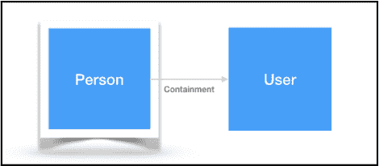

我们已经了解了主体实体；接下来在下一节中探讨使用主体实体构建的关系的键。

## 主体键

父实体需要一个唯一键来与子实体关联，用于此目的的键被称为**主体键**。在我们的博客系统中，`Blog` 实体的 `Id` 属性将是博客条目的唯一键/主体键，依赖的 `Post` 实体将使用它来与 `Blog` 实体建立关系：

```
public class Blog
{
    public int Id { get; set; }
    public string Title { get; set; }
    public string Subtitle { get; set; }
    public string Url { get; set; }
    public string Description { get; set; }
    public DateTime CreatedAt { get; set; }
    public DateTime ModifiedAt { get; set; }
    public int CreatedBy { get; set; }
    public int ModifiedBy { get; set; }
    public ICollection<Post> Posts { get; set; }
}
```

**Blog** 表的设计如下所示。在表设计中，高亮显示的 `Id` 字段将是该表的唯一主键：

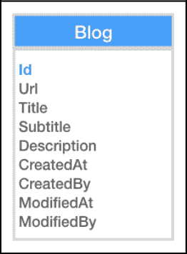

除了主键之外，非主键也有可能用于构建关系，这种键被称为**备用键**。在我们的博客系统中，**Blog** 实体的 **Url** 属性可以作为构建关系的备用键：

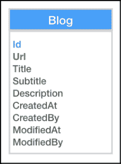

我们已经了解了主体键，它定义了使用主体实体构建的关系；接下来在下一节中探讨依赖实体。

## 依赖实体

无法独立存在（始终依赖其父级）的实体最终会成为子实体。在关系中，这被称为依赖实体。请看下图：

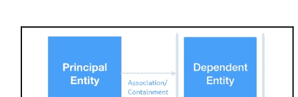

在我们的博客系统中，`Post` 实体依赖于 `Blog` 实体（帖子是为相应的博客创建的，因此没有博客条目，帖子就不存在），因此我们可以得出结论：`Post` 是依赖实体。在数据库世界中，该实体持有一个外键，该外键将在关系中保存对主体实体的引用。如下图所示：

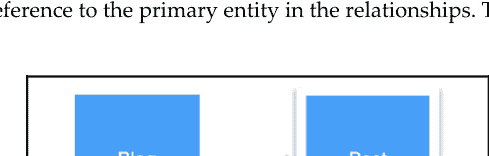

在我们的博客系统中，`User` 实体依赖于 `Person` 实体，因此我们可以得出结论：`User` 是依赖实体。如下图所示：

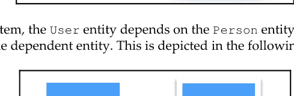

我们已经了解了依赖实体；接下来在下一节中探讨使用依赖实体构建的关系的键。

## 外键

子实体需要一个唯一键来与父实体关联。该键通常保存主体键的值，以标记其与父实体的关系，称为**外键**。在我们的博客系统中，`Post` 实体的 `BlogId` 属性保存了对父实体唯一键/主体键的引用，以表示与 `Blog` 实体的关系：

```
public class Post
{
    public int Id { get; set; }
    public string Title { get; set; }
    public string Content { get; set; }
    public string Summary { get; set; }
    public DateTime PublishedDateTime { get; set; }
    public string Url { get; set; }
    public long VisitorCount { get; set; }
    public DateTime CreatedAt { get; set; }
    public DateTime ModifiedAt { get; set; }
    public int CreatedBy { get; set; }
    public int ModifiedBy { get; set; }
    public int BlogId { get; set; }
    public Blog Blog { get; set; }
    public int AuthorId { get; set; }
    public User Author { get; set; }
    public int CategoryId { get; set; }
    public Category Category { get; set; }
    public ICollection<TagPost> TagPosts { get; set; }
    public ICollection<Comment> Comments { get; set; }
}
```

## 集合导航属性

我们可以从其名称推断出它的实际作用：它持有一组依赖实体（或对依赖项列表的引用），并且始终持有对多个项目的引用。在我们的博客系统中，`Blog` 实体的 `Posts` 属性可以被视为集合导航属性：

```
public class Blog
{
    ... // code removed for brevity
    public ICollection<Post> Posts { get; set; }
}
```

`Blog` 和 `Post` 类图如下所示。在设计中，`Blog` 实体中高亮显示的 `Posts` 字段将是集合导航属性：


我们已经了解了持有子集合的属性；接下来在下一节中探讨依赖实体如何持有对其父实体的引用。

## 引用导航属性

我们可以从其名称推断出它的实际作用。是的，它持有对其父实体的引用，并且始终持有对单个项目的引用。在我们的博客系统中，`Post` 实体的 `Blog` 属性可以被视为引用导航属性：

```
public class Post
{
    ... // code removed for brevity
    public int BlogId { get; set; }
    public Blog Blog { get; set; }
}
```

`Blog` 和 `Post` 类图如下所示。在设计中，`Post` 实体中高亮显示的 `Blog` 字段将是引用导航属性：

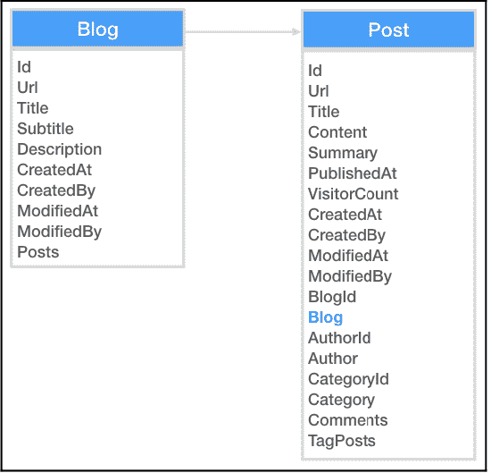

我们已经了解了持有对其父实体引用的属性，而这对于反向导航属性是什么造成了一些困惑。

## 反向导航属性

你猜对了，这有点棘手，因为它总是指关系的另一端。在我们的博客系统中，`Post` 实体的 `Blog` 属性可以被视为 `Blog` 实体 `Posts` 属性的反向导航属性：

```
public class Post
{
    ... // code removed for brevity
    public Blog Blog { get; set; }
}
```

反之亦然，这意味着 `Blog` 实体的 `Posts` 属性也可以被视为 `Post` 实体 `Blog` 属性的反向导航属性：

```
public class Blog
{
    ... // code removed for brevity
    public ICollection<Post> Posts { get; set; }
}
```

`Blog` 和 `Post` 类图如下所示。在设计中，`Post` 实体中高亮显示的 `Blog` 字段和 `Blog` 实体中的 `Posts` 字段将是反向导航属性：

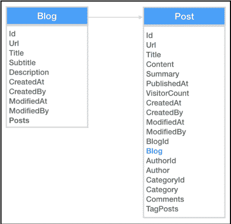


Blog 和 Post 类的类图如下所示。在设计中，高亮的属性将是导航属性：

- Post 实体中的 Blog 字段和 Blog 实体中的 Posts 字段将是反向导航属性
- Post 实体中的 Blog 字段将是引用导航属性
- 前述两个导航属性完成了关系，因此它被称为完全定义的关联

下图说明了 Blog 和 Post 实体之间完全定义的关联：

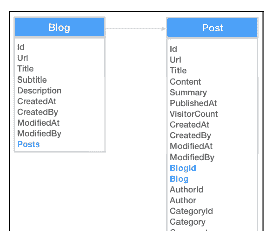

我们迄今为止使用的数据模型具有完全定义的关联。我们将在后面的章节中调整这些数据模型以说明其他约定。

## 完全定义的关联 - 内部原理

EF Core 在以下场景的基础上内部使用机制在实体之间创建关联：

- 如果两个实体具有指向彼此的导航属性；EF 将把它们配置为反向导航属性

在下面的代码中，Blog 实体的 Posts 属性和 Post 实体的 Blog 属性将被配置为反向导航属性：

```
public class Blog
{
    // Code removed for brevity
    public ICollection<Post> Posts { get; set; }
}
public class Post
{
    // Code removed for brevity
    public Blog Blog { get; set; }
}
```

下图说明了基于导航属性创建的关联：

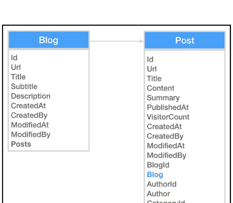

- 如果命名约定使用主实体名称与主键属性名称，EF 将认为该属性是外键：

在下面的代码中，主实体 `Blog`，其主键为 `Id`，将在 `Post` 实体中具有外键 `BlogId`：

```
public class Blog
{
    public int Id { get; set; }
    // Code removed for brevity
}
public class Post
{
    // Code removed for brevity
    public int BlogId { get; set; }
}
```

下图说明了如何在 `Post` 实体中创建外键：

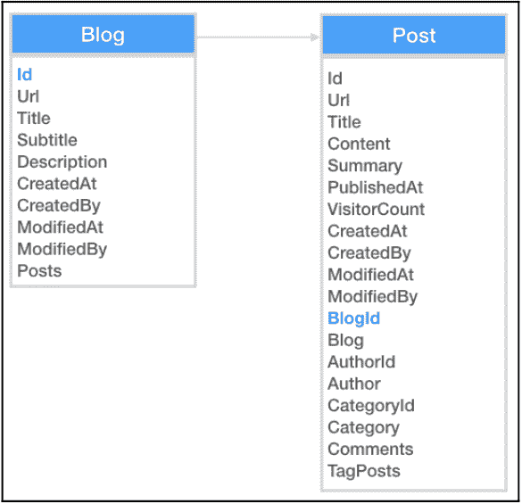

- 如果主实体主键与从实体引用键匹配，EF 将创建外键关联。

在下面的代码中，`Blog` 实体的主键 `BlogId` 将在 `Post` 实体中具有外键 `BlogId`：

```
```csharp
public class Blog
{
    public int BlogId { get; set; }
    // code removed for brevity
}
public class Post
{
    // code removed for brevity
    public int BlogId { get; set; }
}
```
```

下图说明外键与其匹配的主实体的标识符相关：

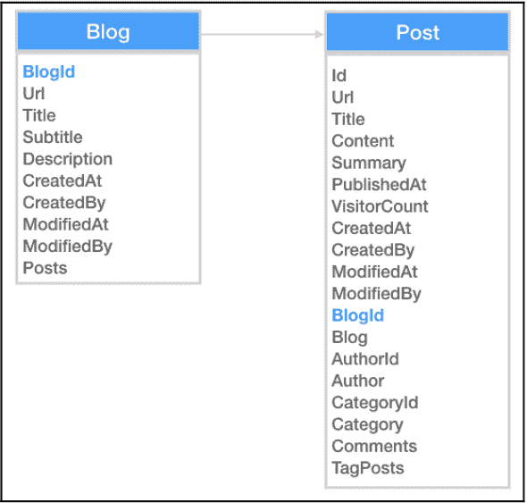

- EF 将创建外键

在下面的代码中，Post 实体的 SomeBlog 导航属性与 Blog 实体的主键 Id 将在 Post 实体中具有外键 SomeBlogId：

```
public class Blog
{
    public int Id { get; set; }
    // code removed for brevity
}
public class Post
{
    // code removed for brevity
    public Blog SomeBlog { get; set; }
    public int SomeBlogId { get; set; }
}
```

下图说明外键基于从实体导航属性名称：

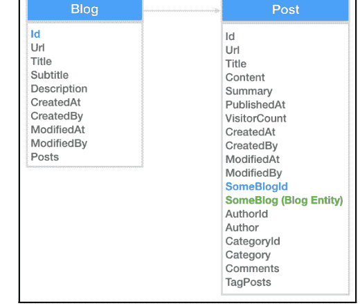

我们已经使用 EF 在识别关联时期望的不同命名约定探索了完全定义的关联；让我们在接下来的章节中了解其他约定。

## 无外键属性

我们通常使用完全定义的关联创建实体，但这不是 Entity Framework 所期望的。在关联中，外键不是必需的，但建议有一个：

下面的代码在 Post 实体中不包含外键，关联仍然形成：

```
public class Blog
{
    // code removed for brevity
    public ICollection<Post> Posts { get; set; }
}
public class Post
{
    // code removed for brevity
    // Foreign key BlogId was removed from here
    public Blog Blog { get; set; }
}
```

下图说明了在没有外键的情况下，关联是如何构建的：

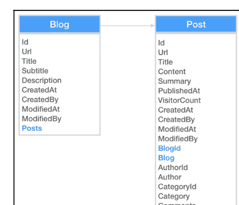

我们已从 Post 实体中删除了 BlogId 外键，它仍然按预期工作。

## 无外键属性 - 内部原理

即使没有外键，关联也能工作，因为 Entity Framework 会为我们创建影子属性。它遵循导航属性与主键名称的命名约定：

在下面的代码中，Post 实体中的外键由框架注入：

```
public class Blog
{
    ... // code removed for brevity
    public ICollection<Post> Posts { get; set; }
}
public class Post
{
    ... // code removed for brevity
    public int BlogId { get; set; } // shadow property created by EF
    public Blog Blog { get; set; }
}
```

下图说明外键由框架注入：

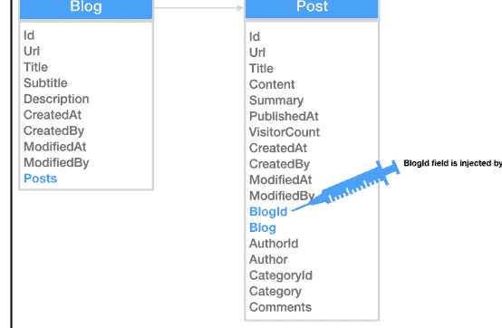

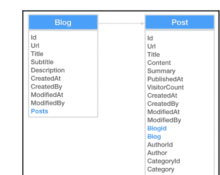

我们已从 Post 实体中删除了 Blog 导航属性，它仍然按预期工作。

## 外键

我们可以使用不同的命名约定为外键命名，并且仍然可以将该外键映射到导航属性（使用 ForeignKey 数据注释即可）。在关联中，从实体中不需要导航属性，这意味着在主实体上仅有一个导航属性就足够了：

在下面的代码中，自定义外键映射到导航属性：

```
public class Blog
{
    ... // code removed for brevity
    public ICollection<Post> Posts { get; set; }
}
public class Post
{
    ... // code removed for brevity
    public int BlogSomeId { get; set; }
    [ForeignKey("BlogSomeId")]
    public Blog Blog { get; set; }
}
```

下图说明自定义外键映射到导航属性：

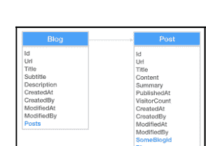

我们已将外键修改为 BlogSomeId 并将其配置为 Post 实体的 Blog 导航属性，它仍然按预期工作。

## 反向属性

如果实体中有多个导航属性，使用反向属性来配对关系中的导航属性是有意义的。即使我们有完全定义的关联，由于自定义命名约定不属于 EF 的任何发现机制，我们仍然需要反向属性来配对导航属性的情况也会出现：

在下面的代码中，自定义外键和导航属性在反向导航属性中进行了配置：

```
public class Blog
{
    ... // code removed for brevity
    [InverseProperty("SomeBlog")]
    public ICollection<Post> SomePosts { get; set; }
}
public class Post
{
    ... // code removed for brevity
    public int SomeBlogId { get; set; }
    public Blog SomeBlog { get; set; }
}
```

下图说明自定义外键和导航属性在反向导航属性中进行了配置：

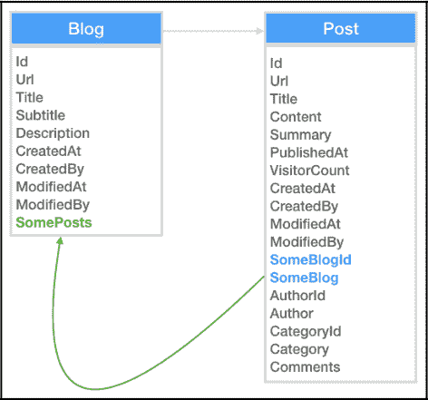

我们在 `Blog` 实体中引入了 `SomeBlog` 反向属性，它与 `Post` 实体的 `SomeBlog` 导航属性配对。

## 总结

在本章中，我们介绍了 Entity Framework 中用于关联的术语和约定。我们从完全定义的关联开始，从那里开始修剪关联，但仍然使关联工作。最后，我们自定义并配对了导航属性与自定义属性，并且仍然使关联工作。本章介绍了我们对关联的了解（我们也瞥见了 Fluent API），但我们没有机会了解不同的关联。让我们在第 4 章 *构建关联 - 了解映射* 中探索它们。


