# 4 构建关系 — 理解映射

在第 3 章《关系 — 术语和约定》中，我们学习了在关系中使用的术语和约定；让我们开始在构建关系时使用它们。我们到目前为止只使用了 Blog 和 Post 实体，这对博客系统没有任何好处。让我们将它们扩展到 Comment、Tag 等其他实体，我们也将利用它们来理解关系。

关系从最初的 Entity Framework (EF) 版本就引入了，但对双向关系存在限制。在成熟的框架中，我们支持多重性，使得多个实体可以相互关联。

本章我们将涵盖的主题是：

- Relationships:
  - One-to-one
  - One-to-many
  - Many-to-many
- Fluent API:
  - Identifying navigation property and inverse navigation
  - Identifying single navigation property
  - Relationship-building techniques
  - Cascade delete

## Relationships

我们可以在 EF 中轻松地在实体关系中建立传统的 one-to-one、one-to-many 和 many-to-many 关系。让我们在本节中详细探讨它们。为了增加趣味性，让我们在理解关系的过程中设计博客系统的数据库：

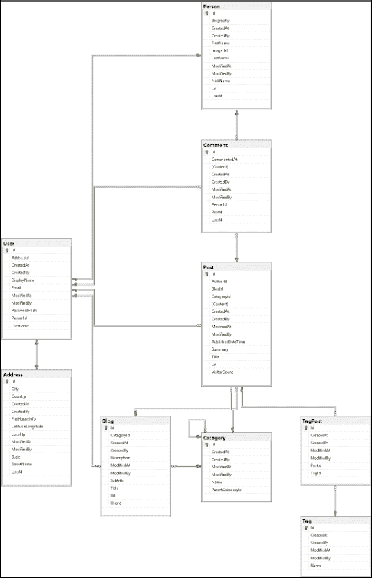

我们已经看到了博客系统的拟议设计；现在让我们学习关系以及如何使用相同的设计来构建它们。

### The one-to-one relationship

我们需要一个新的实体来解释 one-to-one 关系，因为现有实体没有提供解释的途径。所以让我们从拟议设计中选择 Address 实体，看看 one-to-one 关系是如何构建的：

说明 User 和 Address 实体之间 one-to-one 关系的代码如下所示：

```
public class User
{
    public int Id { get; set; }
    public string DisplayName { get; set; }
    public string Username { get; set; }
    public string PasswordHash { get; set; }
    public string Email { get; set; }
    public DateTime CreatedAt { get; set; }
    public DateTime ModifiedAt { get; set; }
    public int CreatedBy { get; set; }
    public int ModifiedBy { get; set; }
    public ICollection<Blog> Blogs { get; set; }
    public ICollection<Post> Posts { get; set; }
    public ICollection<Comment> Comments { get; set; }
    public int? AddressId { get; set; }
    public Address Address { get; set; }
    public int PersonId { get; set; }
    public Person Person { get; set; }
}

public class Address
{
    public int Id { get; set; }
    public string FlatHouseInfo { get; set; }
    public string StreetName { get; set; }
    public string Locality { get; set; }
    public string City { get; set; }
    public string State { get; set; }
    public string Country { get; set; }
    public string LatitudeLongitude { get; set; }
    public DateTime CreatedAt { get; set; }
    public DateTime ModifiedAt { get; set; }
    public int CreatedBy { get; set; }
```

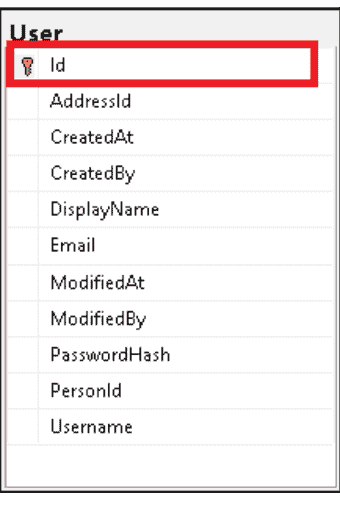

我们已经确定了该配置关系所需的字段，即 UserId 字段，它将允许实体配置关系。让我们在下一节中使用 Fluent API 构建关系。

### Building one-to-one relationships using the Fluent API

我们可以使用 Fluent API 中的 HasOne、WithOne 和 HasForeignKey 方法来配置关系。HasForeignKey 方法在 one-to-one 关系中需要是泛型的（一对多关系不需要此方法），因为我们需要显式标记依赖类型。在我们的例子中，我们为外键指定了 Address 实体：

```
protected override void OnModelCreating(ModelBuilder modelBuilder)
{
    modelBuilder.Entity<Blog>().ToTable("Blog");
    modelBuilder.Entity<Post>().ToTable("Post");
    modelBuilder.Entity<User>()
        .ToTable("User")
        .HasOne(x=>x.Address)
        .WithOne(x=>x.User)
        .HasForeignKey<Address>(x=>x.UserId);
    modelBuilder.Entity<Address>().ToTable("Address");
}
```

Fluent API 配置将为我们提供预期的关系，这反映在以下数据库图中。User 和 Address 实体之间现在建立了 one-to-one 关系，只是 AddressId 字段是可选的，因为在创建用户时它不是强制性的，但创建地址需要用户：

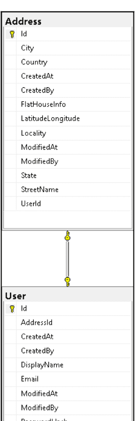

我们可以在博客系统中捕获更多属于 one-to-many 关系的关联。以下图表显示了 Person 和 User 实体之间的一对多关系：

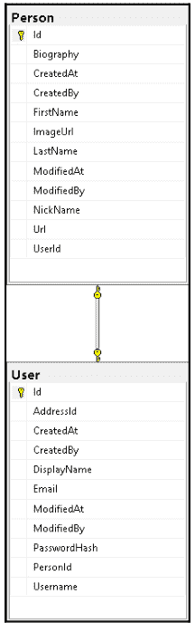

我们已经看到了 User 表设计；让我们看看 Person 表设计内容：

```
public class Person
{
    public int Id { get; set; }
    public string FirstName { get; set; }
    public string LastName { get; set; }
    public string NickName { get; set; }
    public string Url { get; set; }
    public string Biography { get; set; }
    public string ImageUrl { get; set; }
```

```
```csharp
public DateTime CreatedAt { get; set; }
public DateTime ModifiedAt { get; set; }
public int CreatedBy { get; set; }
public int ModifiedBy { get; set; }
public int? UserId { get; set; }
public User User { get; set; }
public ICollection<Comment> Comments { get; set; }
}
```
```

我们在本节中查看了 one-to-one 关系。让我们在下一节中探索 one-to-many 关系。

### The one-to-many relationship

到目前为止，`Blog` 和 `Post` 实体之间进行的说明都具有 one-to-many 关系。如果我们仔细观察，我们可能能够弄明白；`Blog` 实体是主实体，`Post` 实体是依赖实体，其中 `Blog` 实体可以包含一个或多个帖子（瞧！one-to-many 已经就位）：

```
```csharp
public class Blog
{
    public int Id { get; set; }
    public string Title { get; set; }
    public string Subtitle { get; set; }
    public string Url { get; set; }
    public string Description { get; set; }
    public DateTime CreatedAt { get; set; }
    public DateTime ModifiedAt { get; set; }
    public int CreatedBy { get; set; }
    public int ModifiedBy { get; set; }
    public ICollection<Post> Posts { get; set; }
}

public class Post
{
    public int Id { get; set; }
    public string Title { get; set; }
    public string Content { get; set; }
    public string Summary { get; set; }
    public DateTime PublishedDateTime { get; set; }
    public string Url { get; set; }
    public long VisitorCount { get; set; }
    public DateTime CreatedAt { get; set; }
    public DateTime ModifiedAt { get; set; }
    public int CreatedBy { get; set; }
```

```
public int ModifiedBy { get; set; }
public int BlogId { get; set; }
public Blog Blog { get; set; }
public int AuthorId { get; set; }
public User Author { get; set; }
public int CategoryId { get; set; }
public Category Category { get; set; }
public ICollection<TagPost> TagPosts { get; set; }
public ICollection<Comment> Comments { get; set; }
}
```

模型中前面完全定义的这种关系将提供以下关系。它不需要 Fluent API 配置，除非我们有很多导航属性：

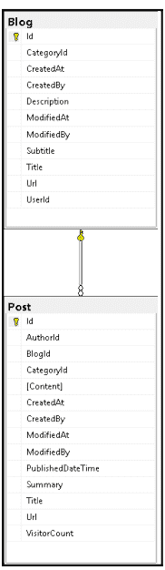

由于我们有一个 one-to-many 关系，并且很明显 Blog 是主实体而 Post 是依赖实体，因此 EF 不需要任何显式配置来定义关系的性质，因此它是通过隐式完成的。

我们可以在博客系统中捕获更多属于 one-to-many 关系的关联。以下图表显示了博客系统中其他一对多关系：

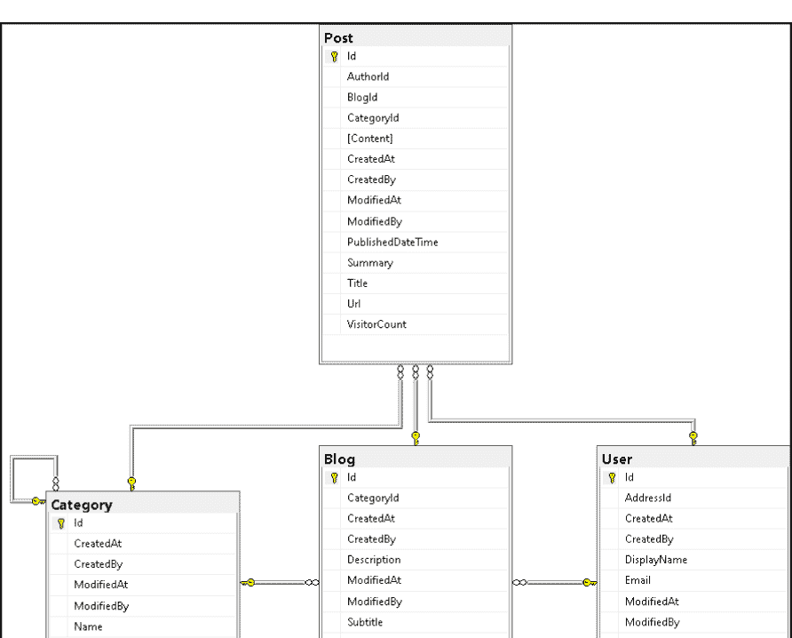


其他一对多关系是在以下实体之间：

- Blog 和 Post
- Blog 和 User
- Blog 和 Category

从前面的实体来看，我们已经看到了除 `Category` 类之外的所有表设计。让我们看看它的设计内容：

```
public class Category
{
    public int Id { get; set; }
    public string Name { get; set; }
    public DateTime CreatedAt { get; set; }
    public DateTime ModifiedAt { get; set; }
    public int CreatedBy { get; set; }
    public int ModifiedBy { get; set; }
    public int? ParentCategoryId { get; set; }
    public Category ParentCategory { get; set; }
    public ICollection<Category> Subcategories { get; set; }
    public ICollection<Blog> Blogs { get; set; }
    public ICollection<Post> Posts { get; set; }
}
```

到目前为止，我们在博客系统设计中已经看到了三种关系；下图显示了博客系统中另外一些一对多关系：

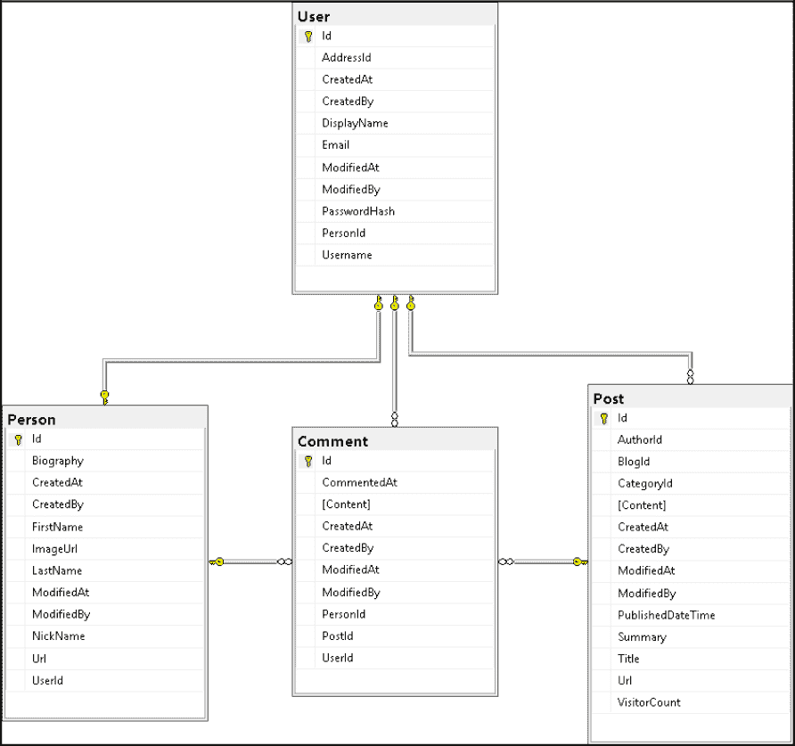

另外的一些一对多关系是在以下实体之间：

- Post 和 Comment
- User 和 Comment
- Person 和 Comment

从前面的实体来看，我们已经看到了除 `Comment` 之外的所有表设计。让我们看看它的设计内容：

```
public class Comment
{
    public int Id { get; set; }
    public string Content { get; set; }
    public DateTime CommentedAt { get; set; }
    public DateTime CreatedAt { get; set; }
    public DateTime ModifiedAt { get; set; }
    public int CreatedBy { get; set; }
    public int ModifiedBy { get; set; }
    public int PostId { get; set; }
    public Post Post { get; set; }
    public int? PersonId { get; set; }
    public Person Person { get; set; }
    public int? UserId { get; set; }
    public User User { get; set; }
}
```

我们遇到了具有一些不同关系的 `Comment` 实体。它具有自引用关系（坦率地说，它指向自身），它也属于一对多关系，唯一的区别是，在这种情况下，父实体和从属实体是相同的：

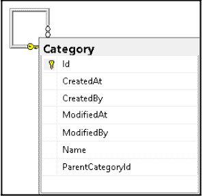

我们已经涵盖了博客系统设计中的一对多关系。让我们在下一节中探索多对多关系。

## 多对多关系

多对多关系是棘手的一种；我们需要了解这类关系是如何构建的。通常，我们将构建两个需要多对多关系的实体，创建一个将纯粹用于连接前两个实体的实体，然后在此实体（创建用于连接两个单独的一对多关系）和两个实体（最先创建）之间分别映射一对多关系：

```
public class Post
{
    public int Id { get; set; }
    public string Title { get; set; }
    public string Content { get; set; }
    public string Summary { get; set; }
    public DateTime PublishedDateTime { get; set; }
    public string Url { get; set; }
    public long VisitorCount { get; set; }
    public DateTime CreatedAt { get; set; }
    public DateTime ModifiedAt { get; set; }
    public int CreatedBy { get; set; }
    public int ModifiedBy { get; set; }
    public int BlogId { get; set; }
    public Blog Blog { get; set; }
    public int AuthorId { get; set; }
    public User Author { get; set; }
    public int CategoryId { get; set; }
    public Category Category { get; set; }
    public ICollection<TagPost> TagPosts { get; set; }
    public ICollection<Comment> Comments { get; set; }
}

public class Tag
{
    public int Id { get; set; }
    public string Name { get; set; }
    public DateTime CreatedAt { get; set; }
    public DateTime ModifiedAt { get; set; }
    public int CreatedBy { get; set; }
    public int ModifiedBy { get; set; }
    public ICollection<TagPost> TagPosts { get; set; }
}

public class TagPost
{
    public int Id { get; set; }
    public DateTime CreatedAt { get; set; }
    public DateTime ModifiedAt { get; set; }
    public int CreatedBy { get; set; }
    public int ModifiedBy { get; set; }
    public int TagId { get; set; }
    public Tag Tag { get; set; }
    public int PostId { get; set; }
    public Post Post { get; set; }
}
```

Post 和 Tag 实体需要多对多关系，为此创建了 TagPost 实体，其唯一工作就是连接 Post 和 Tag 实体。

下图说明了通过 TagPost 实体在 Post 和 Tag 实体之间的多对多关系：

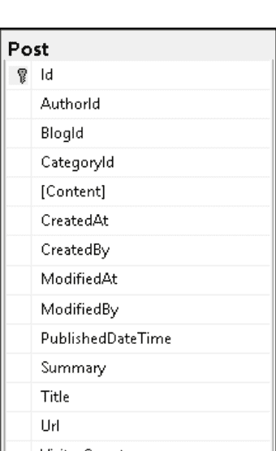

Tag 实体表图显示如下

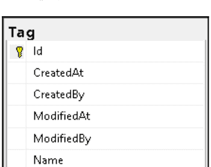

将包含 PostId 和 TagId 以形成多对多关系的 TagPost 实体显示如下

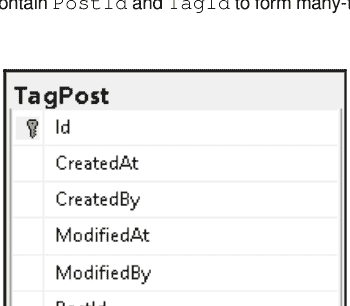

为了在 Post 和 Tag 实体之间建立多对多关系，我们创建了一个 TagPost（一种联结表）实体，纯粹是为了让 EF 能够连接 Post 和 Tag 实体。这是通过在 Tag 和 TagPost 以及 Post 和 TagPost 实体之间建立一对多关系来实现的。

### 使用 Fluent API 构建多对多关系

我们应该在 Fluent API 中配置关系，即在 Tag 和 TagPost 以及 Post 和 TagPost 实体之间建立两个不同的一对多关系。HasForeignKey 方法不需要是泛型的，因为一对多关系不需要显式标记从属类型：

Tag 和 Post 实体之间的多对多关系需要以下配置：

```
protected override void OnModelCreating(ModelBuilder modelBuilder)
{
    modelBuilder.Entity<Blog>().ToTable("Blog");
    modelBuilder.Entity<Post>().ToTable("Post");
    modelBuilder.Entity<User>()
        .ToTable("User")
        .HasOne(x=>x.Address)
        .WithOne(x=>x.User)
        .HasForeignKey<Address>(x=>x.UserId);
    modelBuilder.Entity<Address>().ToTable("Address");
    modelBuilder.Entity<Tag>().ToTable("Tag");
    modelBuilder.Entity<TagPost>()
        .ToTable("TagPost")
        .HasOne(x => x.Tag)
        .WithMany(x => x.TagPosts)
        .HasForeignKey(x => x.TagId);
    modelBuilder.Entity<TagPost>()
        .ToTable("TagPost")
        .HasOne(x => x.Post)
        .WithMany(x => x.TagPosts)
        .HasForeignKey(x => x.PostId);
}
```

Fluent API 配置将为我们提供预期的关系，这反映在以下数据库图中。多对多关系现在已通过 TagPost 实体在 Post 和 Tag 实体之间建立：

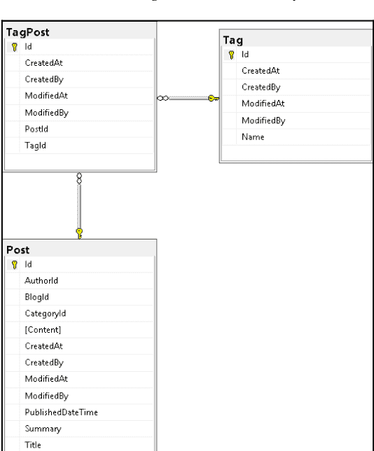

我们已在本节学习了多对多关系。让我们在下一节中探索更多关于 Fluent API 的内容。

## Fluent API

我们已经对 Fluent API 有了初步了解，没有它，关系永远无法完成（在某些情况下是强制性的）。

### 识别导航属性和反向导航

我们在一对一和多对多关系中使用了 Fluent API。我们将使用相同的方法来利用我们迄今为止看到的术语。HasOne 和 HasMany 方法允许我们识别从属实体中的导航属性，或简单地引用导航属性。

以下代码在 一对多关系中显式配置外键：

```
modelBuilder.Entity<TagPost>()
    .ToTable("TagPost")
    .HasOne(x => x.Tag)
    .WithMany(x => x.TagPosts)
    .HasForeignKey(x => x.TagId);
```

在下图中，高亮显示的 TagId 是关系外键所必需的：

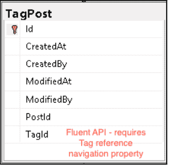

`HasOne` 方法标识 `TagPost` 实体中的 `Tag` 导航。`WithOne` 和 `WithMany` 方法允许我们识别主实体中的反向导航，或简单地集合导航属性。

下面显示了反向导航属性配置所需的代码：

```
modelBuilder.Entity<TagPost>()
    .ToTable("TagPost")
    .HasOne(x => x.Tag)
    .WithMany(x => x.TagPosts)
    .HasForeignKey(x => x.TagId);
```

下图说明我们需要反向导航属性来建立关系：

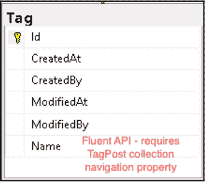

`HasOne` 方法标识 `Tag` 实体中的 `TagPosts` 反向导航。

我们已经从多对多关系中看到了 Fluent API 的识别和使用；让我们使用相同的方法来识别术语中的用法。

### 识别单个导航属性

在单个导航属性中，我们永远不会在从属实体中拥有导航属性，这使得我们很难识别引用导航属性。这就是 `HasMany` 发挥作用的地方，帮助我们识别关系：


以下代码包含实体及其单导航属性的配置，其中 Blog 实体包含导航属性，并且配置使用 HasOne() 来完成关系：

```csharp
public class Blog
{
    public int Id { get; set; }
    public string Url { get; set; }
    public ICollection<Post> Posts { get; set; }
}
public class Post
{
    public int Id { get; set; }
    public string Title { get; set; }
    public string Content { get; set; }
    public DateTime PublishedDateTime { get; set; }
    // Foreign key "BlogId" and navigation property "Blog" was
    removed here
}

// onModelCreating method implementation inside context class
modelBuilder.Entity<Blog>()
    .HasMany(x => x.Posts)
    .WithOne()
```

以下图表说明了使用单导航属性在实体之间建立的关系：

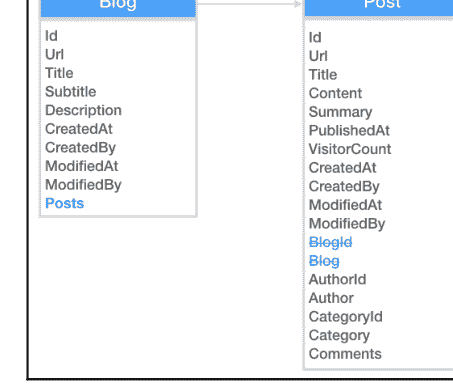

我们已将外键修改为 `SomeBlogId` 并针对 `Post` 实体的 `Blog` 导航属性进行配置，并且使用 Fluent API 进行配置。

## 使用主鍵构建关系

如果主鍵是主键，则不需要 Fluent API 配置，但如果我们必须针对备用键应用关系怎么办？那么，我们需要 Fluent API 来完成配置。我们可以通过我们提供的 `HasPrincipalKey` Fluent API 方法来实现同样的目的：

使用主鍵而不是主键在实体和配置中进行自定义外键映射所需的代码显示如下：

```csharp
public class Blog
{
    public int Id { get; set; }
    public string Url { get; set; }
    public ICollection<Post> Posts { get; set; }
}
public class Post
{
    public int Id { get; set; }
    public string Title { get; set; }
    public string Content { get; set; }
    public DateTime PublishedDateTime { get; set; }
    public int SomeBlogId { get; set; }
    [ForeignKey("SomeBlogId")]
    public Blog Blog { get; set; }
}

// onModelCreating method implementation inside context class
modelBuilder.Entity<Post>()
    .HasOne(x => x.Blog)
    .WithMany(x => x.Posts)
    .HasForeignKey(x => x.SomeBlogId)
    .HasPrincipalKey(x => x.Url); // not a valid
        relationship in real time
```

我们已使用修改后的外键 `BlogSomeId` 针对 `Blog` 中的备用键 `Url` 创建了一个关系。这是通过 `HasPrincipalKey` Fluent API 方法实现的。

## 使用 IsRequired 方法构建关系

我们可以使用相同的 Fluent API 和 IsRequired 方法将关系配置为必需或可选。我们可以使用相同的方法来定义关系是强制性的还是可选的：

```csharp
public class Blog
{
    public int Id { get; set; }
    public string Url { get; set; }
    public ICollection<Post> Posts { get; set; }
}
public class Post
{
    public int Id { get; set; }
    public string Title { get; set; }
    public string Content { get; set; }
    public DateTime PublishedDateTime { get; set; }
    public int BlogSomeId { get; set; }
    [ForeignKey("BlogSomeId")]
    public Blog Blog { get; set; }
}

// onModelCreating method implementation inside context class
modelBuilder.Entity<Blog>()
    .Property(x => x.Url)
    .IsRequired();
modelBuilder.Entity<Post>()
    .HasOne(x => x.Blog)
    .WithMany(x => x.Posts)
    .IsRequired();
```

第一个配置将 Blog 实体上的 Url 属性应用为强制/必需字段，第二个配置强制关系为必需。

## 级联删除

我们到目前为止创建的关系允许我们使用关系构建数据，并且删除机制也需要配置。如果我们尝试删除主实体行会发生什么？这会对依赖元素没有任何作用还是也会删除它们？让我们看看执行这些操作的不同可用方式：

- **Cascade:** 如果我们删除主实体行，则依赖实体行也会被删除
  以下代码将配置为如果删除主行，则依赖行也会被删除：

```csharp
public class Blog
{
    public int Id { get; set; }
    public string Url { get; set; }
    public ICollection<Post> Posts { get; set; }
}
public class Post
{
    public int Id { get; set; }
    public string Title { get; set; }
    public string Content { get; set; }
    public DateTime PublishedDateTime { get; set; }
    public int BlogSomeId { get; set; }
    [ForeignKey("BlogSomeId")]
    public Blog Blog { get; set; }
}

// onModelCreating method implementation inside context class
modelBuilder.Entity<Post>()
    .HasOne(x => x.Blog)
    .WithMany(x => x.Posts)
    .OnDelete(DeleteBehavior.Cascade);
```

这强制 EF 在删除 Blog 元素时删除 Post 元素。

- **SetNull:** 如果我们删除主实体行，则依赖实体行的外键将被设置为 null 值：
  以下代码将配置为如果删除主行，则依赖行将被设置为 null：

```csharp
public class Blog
{
    public int Id { get; set; }
    public string Url { get; set; }
    public ICollection<Post> Posts { get; set; }
}
public class Post
{
    public int Id { get; set; }
    public string Title { get; set; }
    public string Content { get; set; }
    public DateTime PublishedDateTime { get; set; }
    public int BlogSomeId { get; set; }
    [ForeignKey("BlogSomeId")]
    public Blog Blog { get; set; }
}

// onModelCreating method implementation inside context class
modelBuilder.Entity<Post>()
    .HasOne(x => x.Blog)
    .WithMany(x => x.Posts)
    .OnDelete(DeleteBehavior.SetNull);
```

这强制 EF 在删除 `Blog` 元素时将 `Post` 实体元素的 `Blog` 列设置为 null 值：

- **Restrict:** 如果我们删除主实体行，则依赖实体的行保持不变：
  以下代码将配置为即使删除主行，依赖行也会保留其值：

```csharp
public class Blog
{
    public int Id { get; set; }
    public string Url { get; set; }
    public ICollection<Post> Posts { get; set; }
}
public class Post
{
    public int Id { get; set; }
    public string Title { get; set; }
    public string Content { get; set; }
    public DateTime PublishedDateTime { get; set; }
    public int BlogSomeId { get; set; }
    [ForeignKey("BlogSomeId")]
    public Blog Blog { get; set; }
}

// onModelCreating method implementation inside context class
modelBuilder.Entity<Post>()
```

它可以通过卸载项目文件并手动在 `.csproj` 文件内容中包含 `DotNetCliToolReference` 代码块，然后重新加载项目并恢复 NuGet 包来解决。这应该可以解决与包相关的问题：

```xml
<ItemGroup>
    <DotNetCliToolReference Include=
        "Microsoft.EntityFrameworkCore.Tools.DotNet" Version="2.0.1" />
</ItemGroup>
```

转到 `Developer Command Prompt for VS 2017`（在开始菜单中搜索该命令），并执行以下 .NET CLI 命令以添加迁移：

```bash
dotnet ef migrations add
```

以下屏幕截图添加了迁移 "Models with relationship"，并且执行日志显示 `Done`。要撤消此操作，请使用 `ef migrations remove`，这意味着数据迁移成功：

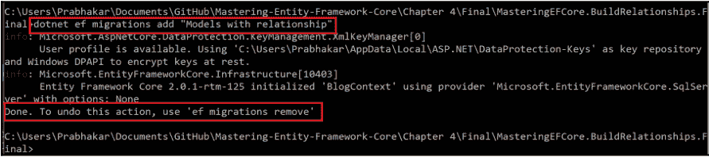

数据库更新可以使用以下 .NET CLI 命令执行：

```bash
dotnet ef database update
```

以下屏幕截图确认数据库已成功更新，并显示 `Done` 成功消息，如以下屏幕截图所示：

```text
CONSTRAINT [PK_TagPost] PRIMARY KEY ([Id]),
CONSTRAINT [FK_TagPost_Post_PostId] FOREIGN KEY ([PostId]) REFERENCES [Post] ([Id]) ON DELETE CASCADE,
CONSTRAINT [FK_TagPost_Tag_TagId] FOREIGN KEY ([TagId]) REFERENCES [Tag] ([Id]) ON DELETE CASCADE
);
Info: Microsoft.EntityFrameworkCore.Database.Command[20101]
Executed DbCommand (2ms) [Parameters=[], CommandType='Text', CommandTimeout='30']
CREATE UNIQUE INDEX [IX_Address_UserId] ON [Address] ([UserId]);
Info: Microsoft.EntityFrameworkCore.Database.Command[20101]
Executed DbCommand (1ms) [Parameters=[], CommandType='Text', CommandTimeout='30']
CREATE INDEX [IX_Blog_AuthorId] ON [Blog] ([AuthorId]);
Info: Microsoft.EntityFrameworkCore.Database.Command[20101]
Executed DbCommand (1ms) [Parameters=[], CommandType='Text', CommandTimeout='30']
CREATE INDEX [IX_Post_BlogId] ON [Post] ([BlogId]);
Info: Microsoft.EntityFrameworkCore.Database.Command[20101]
Executed DbCommand (24ms) [Parameters=[], CommandType='Text', CommandTimeout='30']
CREATE INDEX [IX_Post_UserId] ON [Post] ([UserId]);
Info: Microsoft.EntityFrameworkCore.Database.Command[20101]
Executed DbCommand (1ms) [Parameters=[], CommandType='Text', CommandTimeout='30']
CREATE INDEX [IX_TagPost_PostId] ON [TagPost] ([PostId]);
Info: Microsoft.EntityFrameworkCore.Database.Command[20101]
Executed DbCommand (1ms) [Parameters=[], CommandType='Text', CommandTimeout='30']
CREATE INDEX [IX_TagPost_TagId] ON [TagPost] ([TagId]);
Info: Microsoft.EntityFrameworkCore.Database.Command[20101]
Executed DbCommand (36ms) [Parameters=[], CommandType='Text', CommandTimeout='30']
INSERT INTO [__EFMigrationsHistory] ([MigrationId], [ProductVersion])
VALUES (N'20171123090841_Models with relationship', N'2.0.1-rtm-125');
Done.
C:\Users\Prabhakar\Documents\GitHub\Mastering-Entity-Framework-Core\Chapter 4\Final\MasteringEFCore.BuildRelationships.Final>
```

我喜欢一开始愚弄人们，然后再提供解决方案，这样可以确保他们永远不会忘记它。让我打破僵局，迁移问题可以通过简单地移除和添加 Microsoft.EntityFrameworkCore.Tools NuGet 包来解决。

是的，我们已在数据迁移问题的上下文中探索了 .NET CLI 命令，并且还学习了如何使用 CLI 和包更新来解决它，本节就是这样。

## 摘要

在本章中，我们学习并构建了 EF 支持的不同类型的关系。我们从常规的一对一、一对多和多对多关系开始，然后应用了一些 Fluent API 方法来实现关系。然后，我们介绍了在第 3 章《关系 - 术语和约定》中看到的术语上 Fluent API 的不同用法。最后，我们看到了如果主实体被删除，依赖实体上的删除操作的行为。这些部分处理了关系，但从未涉及验证，除非必要。让我们在下一章中探索它们。


