# 5 了解验证 – 探索内置验证

## 了解验证 – 探索内置验证

在本章中，我们学习并构建了 EF 支持的各种关系。我们从常规的一对一、一对多和多对多关系开始，然后应用了一些 Fluent API 方法来实现关系。随后，我们在第三章《关系 – 术语和约定》中看到的术语上介绍了 Fluent API 的不同用法。最后，我们看到了如果主实体被删除，依赖实体的删除操作的行为。这些部分处理的是关系，但从未涉及验证，除非必要。让我们在下一章中探索它们。

我们已经探索了不同类型的内置关系，利用 Fluent API 方法创建关系。我们还查看了 Fluent API 在导航属性上的使用，使用 isRequired() 强制某些字段，使用 HasPrincipalKey() 和 HasForeignKey() 方法实现主外键等等。

在本章中，我们将针对数据安全提出以下问题：

- 在将数据发送到网络之前应该对数据做什么？
  - 向数据添加某些规则/条件（在模型中定义）
  - 在客户端和服务器端验证模型（开箱即支持）
- ASP.NET 中如何处理验证？
  - 我们从基于 JavaScript 的验证开始，然后执行了控件驱动的验证，最后从 MVC 开始使用数据模型驱动的验证
  - 我们将探索 MVC 如何通过数据模型处理验证
- 我们是否需要显式使用 HTML5 验证？
  - 不需要，因为渲染 MVC 引擎会将数据模型驱动的验证内部转换为 HTML5 data-attribute 驱动的验证

本章将涵盖所有内置验证，列示如下：

- 内置验证
- `Required` 字段验证
- `EmailAddress` 字段验证
- `Compare` 字段验证
- `Url` 字段验证
- `MinLength` 字段验证
- `MaxLength` 字段验证
- `RegularExpression` 字段验证

## 深入内置验证

数据安全在任何应用程序的开发中都起着至关重要的作用，因为几乎一切都围绕数据展开。因此，确保我们将有效数据存储在数据库中至关重要，确保从用户传递到应用程序服务器的数据能够安全传输；到达服务器的数据也应包含有效数据（可能具有有效的数据类型、长度等）。

我们最初在 ASP.NET Web Forms 中使用 JavaScript 执行验证；遗憾的是，最初的许多 ASP.NET 开发人员仅使用 JavaScript 进行验证。然后我们转向控件驱动的验证，它将所有脚本封装在接受验证所需参数的 ASP 控件中。最后，我们接触到数据模型驱动的验证，它允许开发人员通过数据注释配置验证，自动处理客户端（使用 jQuery unobtrusive validation）和服务器端（使用 MVC model binder validation）。

**Entity Framework (EF)** 允许我们使用注释/属性验证实现同样的功能，这减少了与安全相关的许多编码（由于此要求，客户端和服务器端验证得以简化）。EF 为我们提供了一些内置验证：

- Required
- EmailAddress
- Compare
- Url
- MinLength
- MaxLength
- RegularExpression

上述列表简要涵盖了大多数验证器。如果您想查看验证器的完整列表，请访问 `https://msdn.microsoft.com/en-us/library/system.componentmodel.dataannotations(v=vs.110).aspx`。让我们详细查看每个列出的验证器。

## Required 字段验证

我们将从 `Required` 内置验证开始，该验证允许验证器检查字段是否有值。required 验证对于确保在将数据传输到服务器进行进一步处理之前，必填字段已被用户填写或更新是必要的。

以下步骤将帮助我们理解验证的工作方式：

1. `Required` 字段验证器使用数据注释添加到模型中。
2. MVC 引擎使用此配置在客户端和服务器端执行验证。
3. 当 MVC 引擎生成带有输入字段的表单视图时，它还会为每个输入字段脚手架一个 `<span>` 元素以保存错误消息。
4. 当我们运行应用程序并在具有 `aria-required` 字段验证的输入字段中未提供任何值的情况下提交表单时，验证错误将被添加到模型状态错误列表中。
5. 错误将显示在表单每个元素关联的 `<span>` 中。

如果字段为 NULL 或 ""（空）或包含空白，则验证错误将被捕获在 `Required` 数据注释中。


字段值的 数据类型 可以是任何类型。那么为什么验证器要检查空字符串呢？很简单。因为大多数数据类型是由模型绑定器从字符串转换为其适当类型，所以框架很容易使用 `String` 作为默认数据类型来检查值是否存在。

`Required` 属性/数据注释可以添加到如下所示的 `Blog` 代码中；应包含 `DataAnnotations` 引用以配置验证。以下屏幕截图显示了允许我们导入所需命名空间的 intelli-sense（使用 Ctrl + . 触发）：

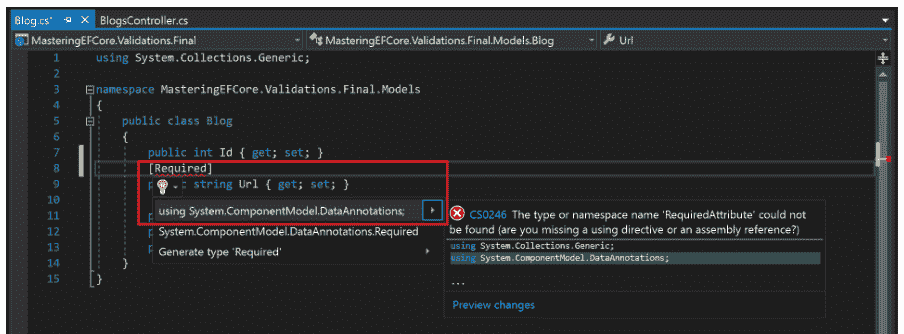

添加 Required 验证所需的源代码如下所示；它使用内置验证并抛出默认错误消息：

```
public class Blog
{
    public int Id { get; set; }
    [Required]
    public string Url { get; set; }
    public ICollection<Post> Posts { get; set; }
    public int AuthorId { get; set; }
    public User Author { get; set; }
}
```

脚手架的 HTML 代码具有 data-attribute 驱动的验证，该验证由 jQuery validate unobtrusive 库使用，以下屏幕截图中突出显示的脚手架 HTML 内容由该库使用：

```
<form action="/Blogs/Create" method="post" novalidate="novalidate">
  <div class="form-group">
    <label class="control-label" for="Url">Url</label>
    <input name="Url" class="form-control input-validation-error" id="Url" aria-required="true" aria-describedby="Url-error" type="text" data-val-required="The Url field is required." data-val="true" value="" />
    <span class="text-danger field-validation-error" data-valmsg-replace="true" data-valmsg-for="Url">...</span>
  </div>
  <div class="form-group">...</div>
  <div class="form-group">...</div>
  <input name="__RequestVerificationToken" type="hidden" value="CfdJ8DLg-LbAetFJsIxRp6SZ1z-oUwc6FnIJwIAD_KayOildb55oDB_ZOx2nE6J2uwQVRIensHgY Ehw d8E8kSBKDmwNKYtucHwpCLS9THwY7aRaBxBwMJ54goCFkdbo-F7J4wdLx cOb5KpoC0fSN g6EAQOs" />
</form>
```

上述方法将强制 EF 在验证期间字段包含无效数据时发出标准验证错误消息，**The Url field is required**。脚手架的 `<span>` 元素用于填充验证错误，如以下屏幕截图所示：

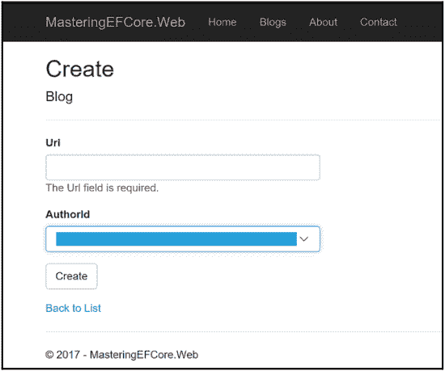

我们也可以使用 `ErrorMessage` 字段执行自定义错误消息验证；配置如下所示突出显示：

```
public class Blog
{
    public int Id { get; set; }
    [Required]
    public string Url { get; set; }
    public ICollection<Post> Posts { get; set; }
    [Required(ErrorMessage = "Author is required, kindly pick one!")]
    public int AuthorId { get; set; }
    public User Author { get; set; }
}
```

上述配置将使用自定义错误消息在 `data-val-required` 属性中，而不是标准验证错误消息：


```html
<form action="/blogs/Create" method="post" novalidate="novalidate">
  <div class="form-group">...</div>
  <div class="form-group">
    <label class="control-label" for="AuthorId">AuthorId</label>
    <select name="AuthorId" class="form-control" id="AuthorId"
      data-val-required="Author is required, kindly pick one!"
      data-val="true"></select>
  </div>
  <div class="form-group">...</div>
  <input name="__RequestVerificationToken" type="hidden" value="CfDJ8DLg-LbAetFJsIxRp6SZI-zb4jVCS7PjXp-ZauwW1pO_dluOlPRtCOIvEXWfB1cyBOfpUrgKnNqg-29zwdcYBb0aJoYqPzY21zYWSqURiNIFD7A9WNeXwPw0mBvidhCONWnaikpz1PhyIqwkqtTEzo" />
</form>
```

对于 `<select>` 字段，MVC 脚手架引擎不会包含用于显示错误信息的 `<span>` 元素，因此请包含以下部分：

```html
<form asp-action="Create">
    <div asp-validation-summary="ModelOnly" class="text-danger">
    </div>
    // Code removed for brevity
    <div class="form-group">
        <label asp-for="AuthorId" class="control-label"></label>
        <select asp-for="AuthorId" class="form-control"
            asp-items="ViewBag.AuthorId"></select>
        <span asp-validation-for="AuthorId" class="text-danger">
        </span>
    </div>
    // Code removed for brevity
</form>
```

上述方法将强制 EF 在验证期间字段包含无效数据时发出自定义错误信息，**Author is required, kindly pick one!**，如下图所示：

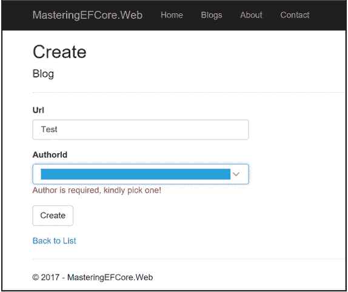

一旦用户开始在字段中输入任何值，显示的错误信息将被清除。

> 客户端验证逻辑基于 jQuery validate 库工作，并在用户输入值时通过使用 jQuery validate unobtrusive 库即时执行。

我们已通过在 `Blog` 实体中配置来探索了 `Required` 字段验证；让我们在下一节中为博客系统的剩余实体配置验证。

验证错误可以在以下情况下在 EmailAddress 数据注释中捕获：

- 如果字段没有 @ 符号后跟一个或多个字符（例如 a 或 a@），则会向用户报告验证错误
- 在提供 @ 符号后跟一个或多个字符后，如果我们引入一个 . （句点），则验证引擎将期望字段值后跟一个或多个字符，如果不满足则会抛出验证错误（例如 a@a.）

EmailAddress 属性/数据注释可以按如下方式配置：

```
public class User
{
    // Code removed for brevity
    [EmailAddress]
    public string Email { get; set; }
}
```

如前一节所示，脚手架生成的 HTML 代码遵循相同的基于数据属性的验证方法。以下截图中突出显示的部分说明验证是使用基于数据属性的验证执行的：

```
<form action="/Users/Create" method="post" novalidate="novalidate">
  <div class="form-horizontal">
    <h4>User</h4>
    <hr />
    <div class="form-group">...</div>
    <div class="form-group">...</div>
    <div class="form-group">...</div>
    <div class="form-group">
      <label class="col-md-2 control-label" for="Email">Email</label>
      <div class="col-md-10">
        <input name="Email" class="form-control valid" id="Email" aria-invalid="false" aria-describedby="Email-error" type="email" data-val="true" data-val-email="Provide a valid email address" value="" />
        <span class="text-danger field-validation-valid" data-valmsg-replace="true" data-valmsg-for="Email"></span>
      </div>
    </div>
  </div>
</form>
```

上述方法将强制 EF 在验证期间字段包含无效数据时发出标准验证错误信息，**The Email field is not a valid e-mail address.**，如下图所示：

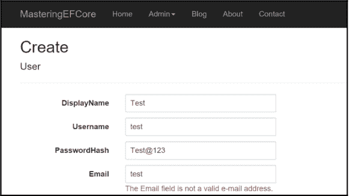

我们可以看到，在 @ 符号后提供值后，错误就会被移除，即使电子邮件尚未完成，如下图所示：

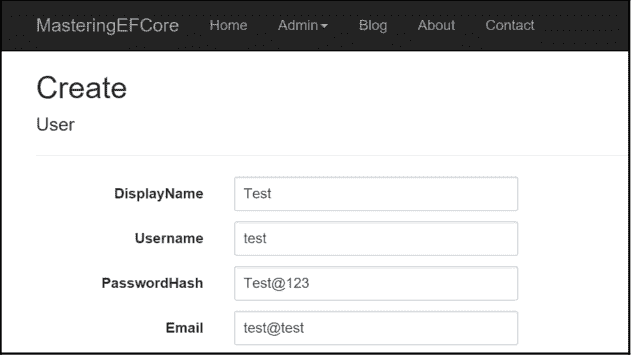

我们可以按如下方式为每个模型字段配置自定义错误信息：

```
public class User
{
    // Code removed for brevity
    [Required(ErrorMessage = "Email is required")]
    [EmailAddress(ErrorMessage = "Provide a valid email address")]
    public string Email { get; set; }
    // Code removed for brevity
}
```

上述方法将强制 EF 在验证期间字段包含无效数据时发出自定义错误信息，**Provide a valid email address**，如下所示：

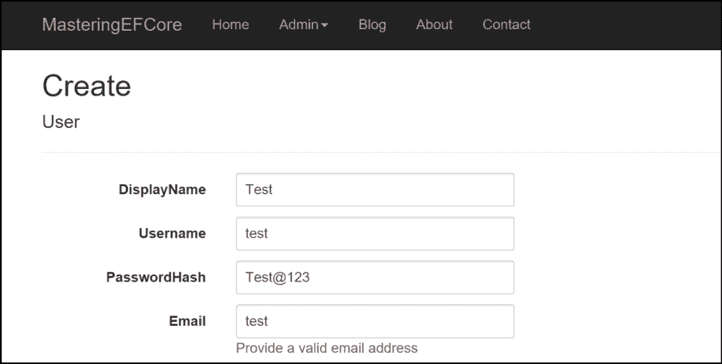

自定义错误仍然有效或可用于抛出无效域名验证错误：

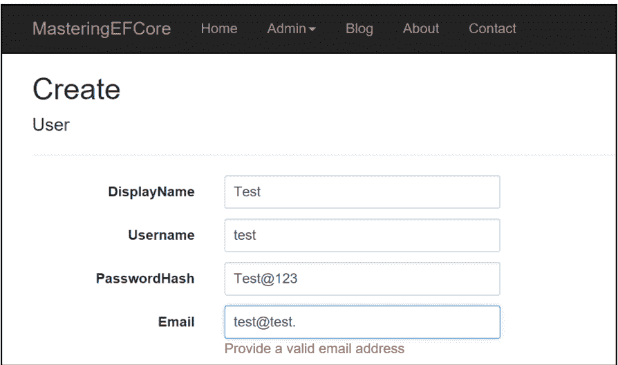

一旦用户开始在字段中输入有效的电子邮件值，显示的错误信息将被清除。

有效电子邮件值的判定是通过检查值的 @ 符号；神秘的是，它在用户完成电子邮件的合法域名（gmail.com 或 yahoo.com）之前就清除了验证（test@somedomain）。一旦再次提供 . 值，它就会显示错误信息，要求用户提供任何域名扩展值，例如 .com 或 .net（即使我们提供 .abc 也能完美工作）。

## 将 EmailAddress 验证纳入博客系统模型

我们将更新博客系统模型以在视图模型中容纳 EmailAddress 字段验证：

```
public class RegistrationViewModel
{
    // Code removed for brevity
    [Required(ErrorMessage = "Email is required")]
    [EmailAddress(ErrorMessage = "Provide a valid email address")]
    public string Email { get; set; }
    [Required(ErrorMessage = "Email is required")]
    [EmailAddress(ErrorMessage = "Provide a valid email address")]
    public string ConfirmEmail { get; set; }
}
```

我们已详尽地研究了 EmailAddress 字段验证；让我们在下一节中探索 Compare 验证。

## Compare 字段验证

我们将在本节中探索 Compare 验证，并且由于除模式外的所有内置验证的步骤都是通用的，我们将在其他验证部分仅涵盖验证模式。Compare 验证将避免 UI 与服务之间的往返，提供客户端验证以比较密码、电子邮件，甚至是银行账号等敏感信息，这些信息需要此 Compare 验证。

验证错误可以在以下情况下在 Compare 数据注释中捕获：

- 如果字段为 NULL 或为空或空白
- 如果字段具有与配置字段值不匹配的值

Compare 属性/数据注释可以按如下方式配置：

```
public class RegistrationViewModel
{
    // Code removed for brevity
```

```
[Required(ErrorMessage = "ConfirmPassword is required")]
[Compare("Password")]
public string ConfirmPassword { get; set; }
}
```

我们可以验证如果 Password 和 ConfirmPassword 字段不匹配，则标准验证错误信息 'ConfirmPassword' and 'Password' do not match. 会出现：

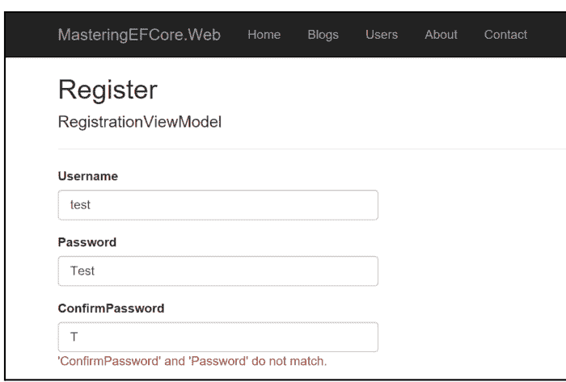

我们可以按如下方式为每个模型字段配置自定义错误信息：

```
public class RegistrationViewModel
{
    // Code removed for brevity
    [Required(ErrorMessage = "ConfirmPassword is required")]
    [Compare("Password", ErrorMessage = "Password does not match")]
    public string ConfirmPassword { get; set; }
}
```

我们也可以得出结论，compare 验证同样会使用自定义验证错误信息。我们的测试场景将发出 Password does not match 验证错误信息，如下所示：

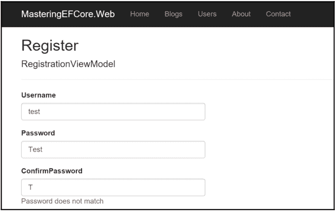

一旦用户开始在字段中输入有效的密码值，显示的错误信息将被清除。

## 将 Compare 验证纳入博客系统模型

我们将更新博客系统模型以在视图模型中容纳 Compare 字段验证：

```
public class LoginViewModel
{
    [Required(ErrorMessage = "Username is required")]
    public string Username { get; set; }
    [Required(ErrorMessage = "Password is required")]
    public string Password { get; set; }
    [Required(ErrorMessage = "ConfirmPassword is required")]
    [Compare("Password", ErrorMessage = "Password does not match")]
    public string ConfirmPassword { get; set; }
}
```


我们已经全面地研究了 Compare 字段验证。让我们在下一节中探索 Url 验证。

## Url 字段验证

我们将研究 Url 验证，它应该如何配置，以及它如何与 MVC 引擎配合工作。它对 URL 值执行基本的语法检查，而不是验证 URL 本身，因此最好有一个一致的机制来执行，例如验证，以在系统之间保持统一的行为。Url 验证是基于以下模式进行的 -

<protocol>://<domain-name>.<extension>。让我们详细探索该模式：

- **Protocol:** 它应该是 HTTP、https 或 FTP
- **Domain name:** 它应为一个或多个字符
- **Extension:** 它应为两个或多个字符（例如，http://a.bc 是有效的，因为它遵循了前面的模式）

Url 属性/数据注释可以用以下方式使用：

```csharp
public class Blog
{
    // Code removed for brevity
    [Required(ErrorMessage = "Url is required")]
    [Url]
    public string Url { get; set; }
}
```

**Url** 验证将以下值报告为错误 **The Url field is not a valid fully-qualified http, https, or ftp URL.** 因为该值仅包含协议并且不满足 URL 模式：

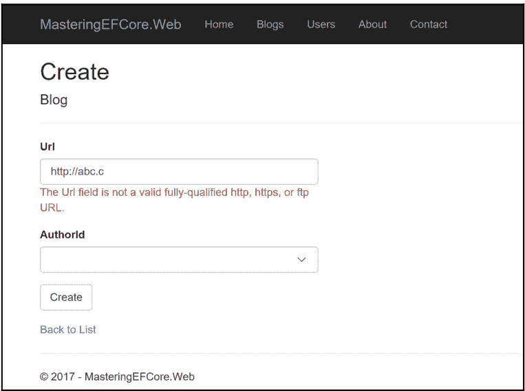

如果字段值正确遵循 URL 模式，则错误将被移除，我们可以在以下屏幕截图中看到字段值似乎是有效的（遵循模式）：

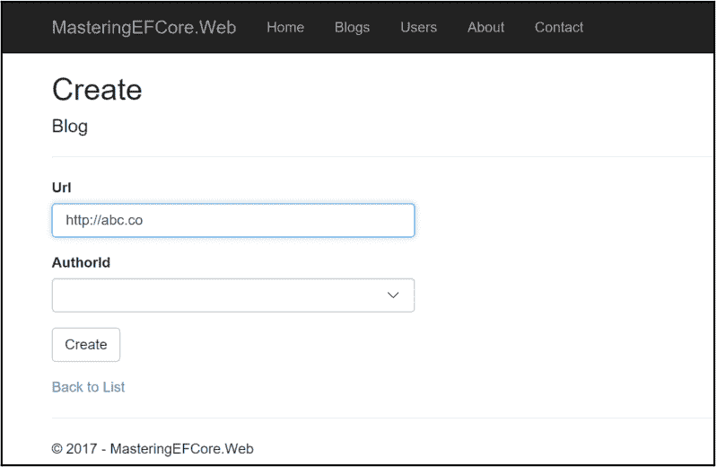

我们可以按如下方式为每个模型字段配置自定义错误消息：

```csharp
public class Blog
{
    // Code removed for brevity
    [Required(ErrorMessage = "Url is required")]
    [Url(ErrorMessage = "Provide a valid url")]
    public string Url { get; set; }
}
```

上述方法将强制 EF 在验证期间如果字段包含无效数据时发出自定义错误消息，**Provide a valid url**，如下所示：

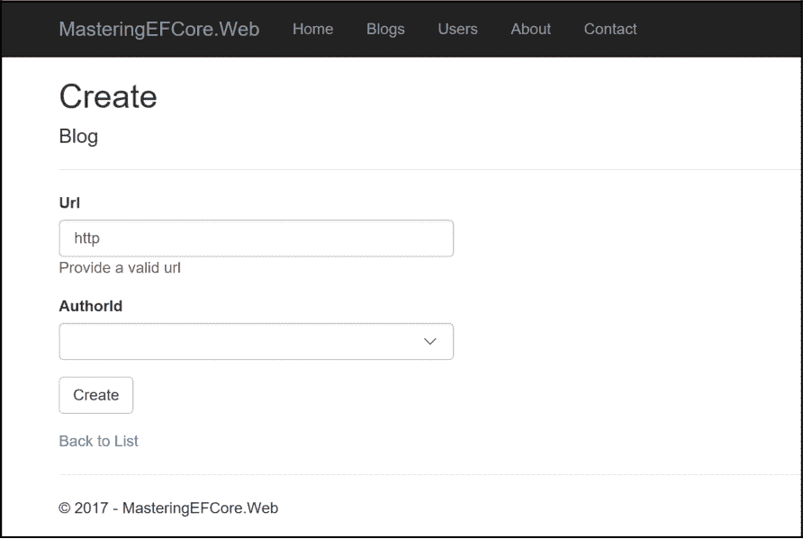

一旦用户开始在字段中输入有效的 URL 值，显示的错误消息将被清除。

### 将 Url 验证纳入博客系统模型

我们将更新我们的博客系统模型以适应 Url 字段验证，数据模型驱动的 Url 验证在以下实体中执行：

```csharp
public class Blog
{
    // Code removed for brevity
    [Required(ErrorMessage = "Url is required")]
    [Url(ErrorMessage = "Provide a valid url")]
    public string Url { get; set; }
}
```

```csharp
public class Post
{
    // Code removed for brevity
    [Url(ErrorMessage = "Provide a valid url")]
    public string Url { get; set; }
}

public class Person
{
    // Code removed for brevity
    [Url(ErrorMessage = "Provide a valid url")]
    public string Url { get; set; }
    [Url(ErrorMessage = "Provide a valid image url")]
    public string ImageUrl { get; set; }
}
```

我们已经全面地看到了 Url 字段验证；让我们在下一节中探索 `MinLength` 验证。

## MinLength 字段验证

`MinLength` 验证有助于为某些字段创建约束，例如用户名、邮政编码等。我们将在本节开始研究 `MinLength` 验证。

在以下情况下，可以在 `MinLength` 数据注释中捕获验证错误：

- 如果字段为 `NULL` 或为空或空白。
- 如果字段值的长度小于配置的长度。例如，如果 `MinLength` 配置为 6，则如果字段中提供的字符数少于 6，则会抛出最小长度验证错误。

`MinLength` 属性/数据注释可以按如下方式配置：

```csharp
public class RegistrationViewModel
{
    [Required(ErrorMessage = "Username is required")]
    [MinLength(6)]
    public string Username { get; set; }
    // Code removed for brevity
}
```

如果字段值不满足最小长度要求，则会抛出验证错误 **The field Username must be a string or array type with a minimum length of '6'**，而错误消息的字段名和长度基于字段名和配置，如下所示：

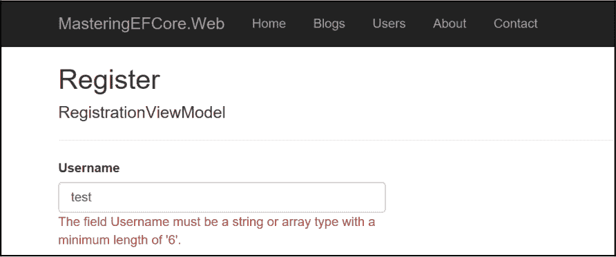

一旦满足长度约束，错误消息将从用户界面中移除，如下所示：

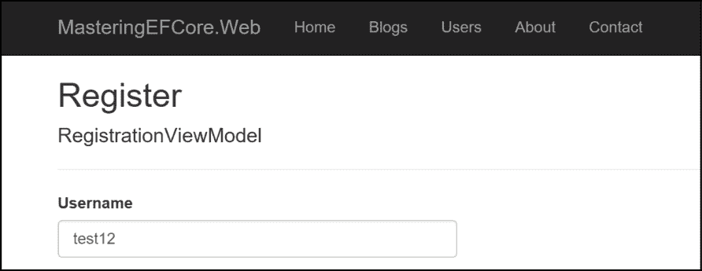

我们可以按如下方式为每个模型字段配置自定义错误消息：

```csharp
public class RegistrationViewModel
{
    [Required(ErrorMessage = "Username is required")]
    [MinLength(6, ErrorMessage = "Username needs minimum 6 characters")]
    public string Username { get; set; }
    // Code removed for brevity
}
```

上述方法将强制 EF 在验证期间如果字段包含无效数据时发出自定义错误消息，**Username needs minimum 6 characters**，如下所示：

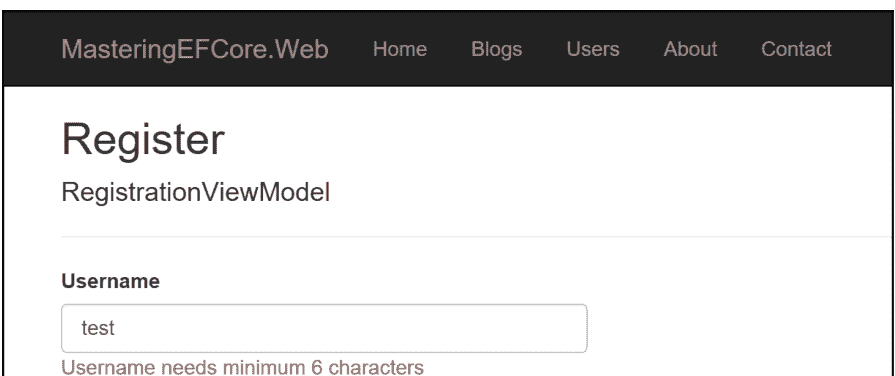

我们已经全面地研究了 `MinLength` 字段验证；让我们在下一节中探索 `MaxLength` 验证。

## MaxLength 字段验证

`MaxLength` 验证有助于为某些字段创建约束，例如用户名、邮政编码等。我们将在本节研究 `MaxLength` 验证。

如果字段值的长度大于配置的长度，则可以在 MaxLength 数据注释中捕获验证错误。例如，如果最大长度配置为 30，则如果字段中提供的总字符长度大于 30，则会抛出最大长度验证错误。

MaxLength 属性/数据注释可以按如下方式配置：

```csharp
public class RegistrationViewModel
{
    [Required(ErrorMessage = "Username is required")]
    [MinLength(6, ErrorMessage = "Username needs minimum 6 characters")]
    [MaxLength(30)]
    public string Username { get; set; }
    // Code removed for brevity
}
```

如果字段值不满足最大长度要求，则会抛出验证错误，The field Username must be a string or array type with a maximum length of '30'，而错误消息的字段名和长度基于字段名和配置，如下：

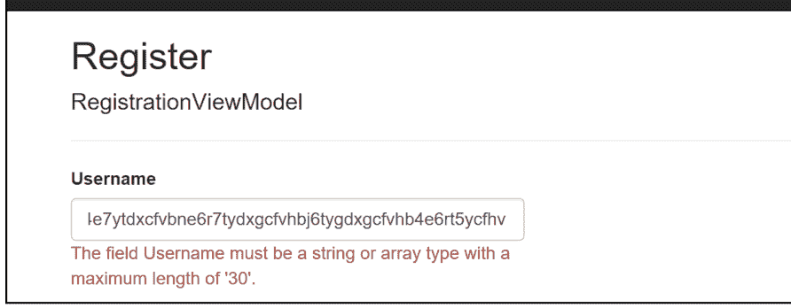

我们可以按如下方式为每个模型字段配置自定义错误消息：

```csharp
public class RegistrationViewModel
{
    [Required(ErrorMessage = "Username is required")]
    [MinLength(6, ErrorMessage = "Username needs minimum 6 characters")]
    [MaxLength(30, ErrorMessage = "Username cannot exceed 30 characters")]
    public string Username { get; set; }
    // Code removed for brevity
}
```

上述方法将强制 EF 在验证期间如果字段包含无效数据时发出自定义错误消息，Username cannot exceed 30 characters，如下所示：

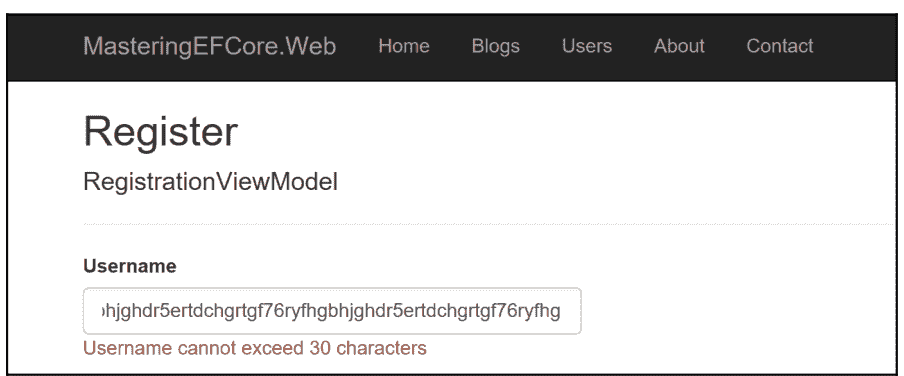

我们已经全面地研究了 MaxLength 字段验证；让我们在下一节中探索 RegularExpression 验证。

## RegularExpression 字段验证

正则表达式验证是用于大多数验证的唯一解决方案，例如电子邮件、电话号码、邮政编码、用户名、密码等。大多数与正则表达式一起使用的模式被封装到单独的验证中。尽管如此，使用范围很广并且需要一种方法来定义自定义验证。这就是 RegularExpression 验证派上用场的地方。让我们在本节研究正则表达式。

如果字段值不遵循定义的正则表达式模式，则引擎会返回验证错误。例如，如果正则表达式配置为仅包含字母表中的字母，则任何其他字符的包含都会抛出验证错误。

RegularExpression 属性/数据注释可以按如下方式配置：

```csharp
public class Person
{
    public int Id { get; set; }
    [Required(ErrorMessage = "First Name is required")]
    [RegularExpression("^[a-zA-Z]+$")]
    public string FirstName { get; set; }
    // Code removed for brevity
}
```

如果字段值与正则表达式不匹配，则会抛出验证错误，The field Username must match the regular expression '^[a-zA-Z]+$'，如下所示：

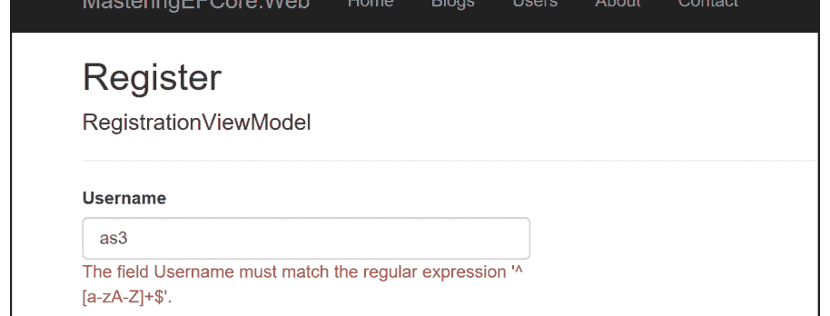

我们可以按如下方式在每个模型字段上配置自定义错误消息：

```csharp
public class Person
{
    public int Id { get; set; }
    [Required(ErrorMessage = "First Name is required")]
    [RegularExpression("^[a-zA-Z]+$", ErrorMessage = "Only alphabets were allowed")]
}
```


```
public string FirstName { get; set; }
// Code removed for brevity
}
```

前述方法将强制 EF 在验证期间如果字段包含无效数据时发出自定义错误消息，**仅允许字母**，如下所示：

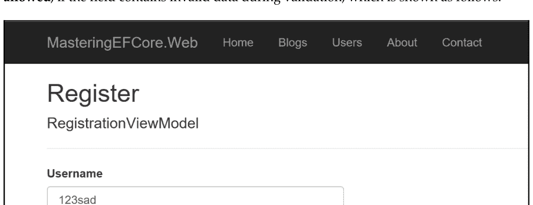

我们在本章中已全面研究了 RegularExpression 字段验证和其他内置验证。我们也在构建博客系统的过程中为其构建了验证。

## Summary

本章中我们探索了 EF 提供的各种内置验证。我们从使用广泛的 Required 字段验证器开始，然后研究了电子邮件地址验证器，接着我们涵盖了其他验证器，如 compare、MinLength、MaxLength 和 RegularExpression 字段验证器。最后，我们为本书中正在构建的博客系统配置了这些字段验证器。本章仅涉及内置验证，但从未讨论客户端验证是如何执行的或自定义验证如何处理。让我们在第 6 章《Save Yourself – Hack Proof Your Entities》中探索这一点以及其他一些内容。
