# 6 客户端验证
Save Yourself – Hack Proof Your Entities

在第 5 章《Know the Validation – Explore Inbuilt Validations》中，我们了解了 Entity Framework Core 中可用的内置验证。我们通过从验证过去是如何处理的、框架如何处理它、所需的配置以及框架执行的渲染开始，详细探索了每一个验证。

在本章中，我们将针对数据安全提出以下关注点：

- 在我们将数据发送到网络之前应该对数据做什么？
- 你能大胆猜测在我们将数据发送到网络之前应该执行什么吗？
- 如果有人入侵客户端验证？或者脚本停止工作怎么办？
- 我们可以通过引入服务器端验证来保护自己。
- 除了客户端和服务器端验证之外，我们还需要什么额外的东西吗？
- 是的，通常的服务器端验证会查找任何错误，并且所有模型属性的验证器都将被手动验证所考虑。
- 希望我们也有自定义验证的实现？
- 是的，我们确实有创建自定义验证器的 provision 以及 .NET Core 的数据属性方法用于自定义验证器。
- 该死，我们应该已经涵盖了几乎所有内容。猜猜我们没有留下任何其他东西？
- 除了一件事——远程验证。例如，可以使用远程验证从客户端检查用户名可用性，而无需添加任何客户端代码。

在解决这些关注点之后，我们对本章将涵盖的内容有了大致的了解：

- 客户端验证
- 如果客户端脚本停止工作会产生的后果
- 服务器端验证
- 手动验证
- 自定义验证
- 为自定义验证创建客户端逻辑
- 远程验证

### Client-side validation

客户端验证对于现代 Web 应用程序来说真是一个福音。有很多实例证明 jQuery 在开发和用户体验方面都有帮助。客户端验证是我们节省客户端/浏览器与服务器之间多次往返以执行基本验证的最大优势。

jQuery、jQuery Validate 和 jQuery Validate Unobtrusive 库帮助我们在客户端（浏览器）端执行这些基本验证，而不是依赖服务器执行相同的操作。关于在客户端验证模型存在多次讨论甚至争论，这引发了安全考虑。以下各节将解决这个问题。

启用客户端验证的任务只是为 MVC 提供一个部分来在用户界面中注入验证错误，这与验证相关属性无关（因为它将存在于模型中）：

```
```html
<div class="form-group">
    <label asp-for="Title" class="col-md-2 control-label"></label>
    <div class="col-md-10">
        <input asp-for="Title" class="form-control" />
        <span asp-validation-for="Title" class="text-danger"></span>
    </div>
</div>
```
```

MVC 模板引擎将生成带有 data- 属性的 HTML 标签，这对于内置验证和自定义验证的行为都相同。之前提到的带有 Required 验证的 Title 字段的渲染 HTML 内容显示如下：

```
<div class="form-group">
<label class="col-md-2 control-label" for="Title">Title</label>
<div class="col-md-10">
<input class="form-control" type="text" data-val="true" data-val-required="Title is required" id="Title" name="Title" value="" />
<span class="text-danger field-validation-valid" data-valmsg-for="Title" data-valmsg-replace="true"></span>
</div>
</div>
```

验证是在用户尝试提交表单时执行的，这将最终使用客户端验证填充错误消息。此外，当我们尝试编辑消息时，Unobtrusive Validation 库会介入并在用户再次提交表单之前尽早执行验证。

我们已经看到了客户端验证的作用；现在，让我们在下一节中看看如果 JavaScript 停止工作会发生什么。

### Validating data without client-side scripting

我们生活在一个将开源、性能导向的单页应用程序（减少服务器往返）视为专业应用程序的世界。微软对超越服务器端开发感到过于舒适。后来，他们主要开始尝试客户端验证，这要归功于 MVC2。现在，随着 MVC Core，他们又回来了！

这就引出了一个价值百万美元的问题——客户端编程真的安全吗？黑客破坏客户端验证并进入服务器需要多长时间？在当今世界，即使是一个刚刚开始学习如何入侵的菜鸟也能在几分钟内做到这一点。说实话，我们无法控制客户端，我们也不能盲目信任从客户端接收到的数据（它可能被任何人使用 Fiddler、REST Client 等工具入侵/注入）。

既然我们知道接收到的数据可能不真实，为什么我们仍然需要客户端验证？很简单。我们需要更好的用户体验，我们不能简单地忽略一种能够帮助我们实现这一目标的机制。不仅是真实性，如果有人在客户端禁用 JavaScript，那么我们可能会处理未经过验证的（未验证的）从客户端接收到的不安全数据。

JavaScript 可以通过浏览器设置禁用。以下屏幕截图显示了如何使用 Chrome 设置（内容 | JavaScript）执行此操作：

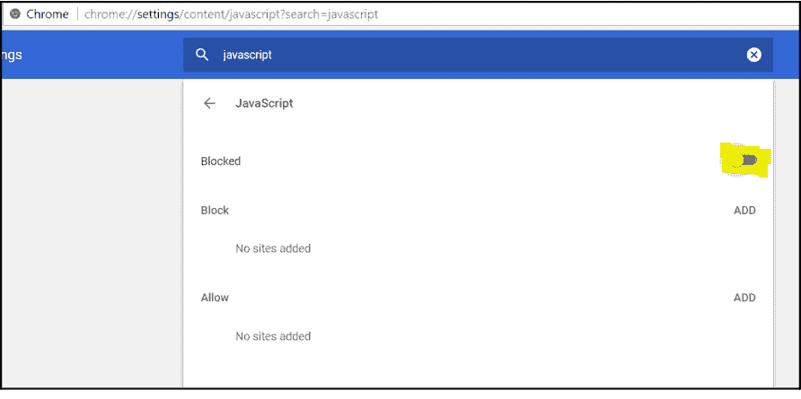

它将使用户能够在没有客户端验证的情况下提交任何表单，因此以下表单将在 **Title**、**Content**、**Summary** 等没有值的情况下提交也不会有任何问题：

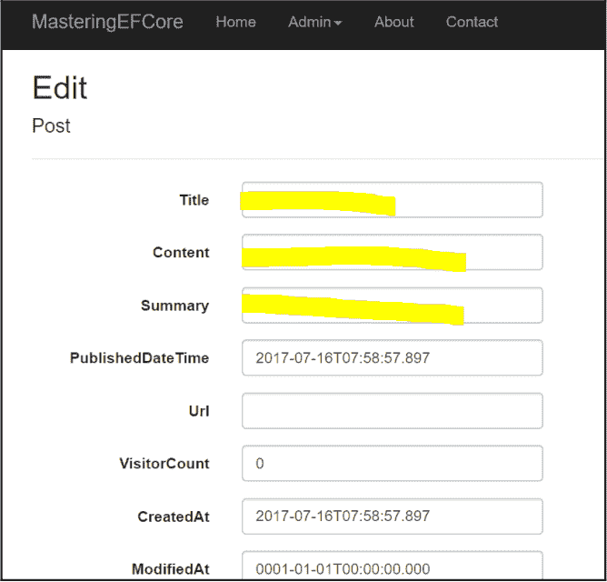

```
return RedirectToAction("Index");
}
else
{
    ViewBag.Message = "Error occurred while validating the user";
}

return View(user);
}
```

前述实现说明了我们如何执行手动验证，并且它执行以下操作：

- 将数据从 **Registration View Model** 映射到 **User Data Model**
- 我们应该始终怀疑映射的数据可能无效
- 在我们将数据持久化回数据存储之前，手动验证映射的数据始终更安全
- 如果我们有任何验证错误，我们将通过 `ViewBag` 消息将信息发布给用户

在我们触发 `TryValidateModel` 之前，模型的 `IsValid` 属性将为 false，并且稍后它将根据验证进行更新。我们已经看到了如何执行手动验证，现在我们将进入下一节的自定义验证。

### Custom validation

框架中公开的内置验证可能解决了我们大多数技术验证问题，但可能存在一些业务需求/要求，需要在内置验证之上提供额外的 provision。

自定义验证可以在两个级别执行：

- 字段级别
- 类级别

字段级自定义验证器可以使用以下方式创建：

- 从 `ValidationAttribute` 基类型继承自定义验证类
- 重写 `IsValid` 方法并处理你的业务验证
- `IsValid` 方法接受两个参数——value 和 `validationContext`


- `value` 字段是实际应用该特性的字段值
- `validationContext` 字段将持有包含该字段的模型的 `ObjectInstance`

在我们的博客系统中，我们可以对发布日期进行业务验证；该验证需要禁止用户将文章发布到过去的日期。我们将自定义验证特性命名为 `FutureOnly`，并在重写的 `IsValid` 方法中执行如下验证：

```csharp
public class FutureOnlyAttribute : ValidationAttribute
{
    protected override ValidationResult IsValid(object value,
        ValidationContext validationContext)
    {
        var post = (Post) validationContext.ObjectInstance;
        return post.PublishedDateTime.CompareTo(DateTime.Now) < 0
            ? new ValidationResult("Publishing Date cannot be in past, kindly provide a future date")
            : ValidationResult.Success;
    }
}
```

```csharp
public class Post
{
    public int Id { get; set; }
    [Required(ErrorMessage = "Title is required")]
    public string Title { get; set; }
    [Required(ErrorMessage = "Content is required")]
    public string Content { get; set; }
    public string Summary { get; set; }
    [FutureOnly]
    public DateTime PublishedDateTime { get; set; }
    [Url(ErrorMessage = "Provide a valid url")]
    public string Url { get; set; }
    public long VisitorCount { get; set; }
    public DateTime CreatedAt { get; set; }
    public DateTime ModifiedAt { get; set; }
    public int CreatedBy { get; set; }
    public int ModifiedBy { get; set; }
    [Required(ErrorMessage = "Blog is required")]
    public int BlogId { get; set; }
    public Blog Blog { get; set; }
    [Required(ErrorMessage = "Author is required")]
    public int AuthorId { get; set; }
    public User Author { get; set; }
    [Required(ErrorMessage = "Category is required")]
    public int CategoryId { get; set; }
    public Category Category { get; set; }
    public ICollection<TagPost> TagPosts { get; set; }
    public ICollection<Comment> Comments { get; set; }
}
```

前面的实现将验证发布日期是否仅允许未来日期；如果遇到任何过去日期，它将抛出**发布日期不能是过去的时间，请提供一个未来日期**验证错误。

让我们在 `FutureOnly` 特性字段中提供一个无效值，看看验证是如何执行的：

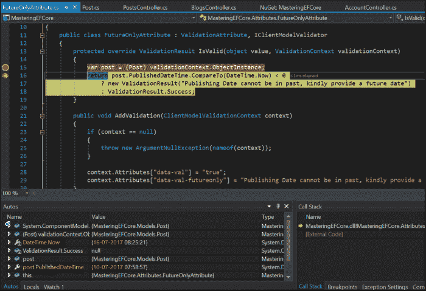

`IsValid` 参数处理传入 `value` 和 `validationContext` 两个参数的实际值；如前所述，两者都将包含用户提供的值。我们在实现中使用了 `validationContext`，很明显所提供的值是过去的日期（与当前日期相比），因此验证错误会被抛出；如下所示：

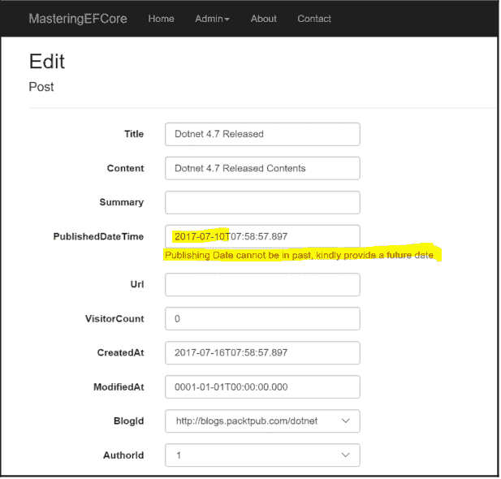

可以通过以下方式创建类级自定义验证器：

- 继承验证对象接口 `IValidatableObject`
- 实现 `Validate` 方法并处理你的业务验证
- 如果存在验证错误，`Validate` 方法必须产出这些错误

在我们的博客系统中，我们可以移除模型中包含的 `FutureOnly` 特性，并用类级验证替代。业务验证将在模型绑定期间自动触发，并且如同字段级验证一样，会更新模型状态和错误集合。使用 `IValidatableObject` 的业务验证如下所示：

```csharp
public class Post : IValidatableObject
{
    public int Id { get; set; }
    [Required(ErrorMessage = "Title is required")]
    public string Title { get; set; }
    [Required(ErrorMessage = "Content is required")]
    public string Content { get; set; }
    public string Summary { get; set; }
    public DateTime PublishedDateTime { get; set; }
    [Url(ErrorMessage = "Provide a valid url")]
    public string Url { get; set; }
    public long VisitorCount { get; set; }
    public DateTime CreatedAt { get; set; }
    public DateTime ModifiedAt { get; set; }
    public int CreatedBy { get; set; }
    public int ModifiedBy { get; set; }
    [Required(ErrorMessage = "Blog is required")]
    public int BlogId { get; set; }
    public Blog Blog { get; set; }
    [Required(ErrorMessage = "Author is required")]
    public int AuthorId { get; set; }
    public User Author { get; set; }
    [Required(ErrorMessage = "Category is required")]
    public int CategoryId { get; set; }
    public Category Category { get; set; }
    public ICollection<TagPost> TagPosts { get; set; }
    public ICollection<Comment> Comments { get; set; }

    public IEnumerable<ValidationResult> Validate(ValidationContext validationContext)
    {
        var post = (Post)validationContext.ObjectInstance;
        if (post.PublishedDateTime.CompareTo(DateTime.Now) < 0)
            yield return
                new ValidationResult("Publishing Date cannot be in past, kindly provide a future date", new [] { "PublishedDateTime" });
    }
}
```

```csharp
// One way to consume manual business validation
var results = new List<ValidationResult>();
var isBusinessValid = Validator.TryValidateObject(post,
    new ValidationContext(post, null, null), results, false);
```

`IValidatableObject` 实现同样执行业务验证，并在遇到任何业务验证问题时，将验证错误**发布日期不能是过去的时间，请提供一个未来日期**添加到错误集合中。

同样的场景也出现在之前的 `FutureOnly` 特性验证中。提供过去的日期会在 `Validate` 方法中被验证。两种方法的唯一区别在于：前者一次性实现并应用于所有适用字段，而后者需要在类级别对每个字段分别实现。通俗地说，如果我们需要为验证增加一个字段，就需要在 `Validate` 方法中再次对该字段执行验证：

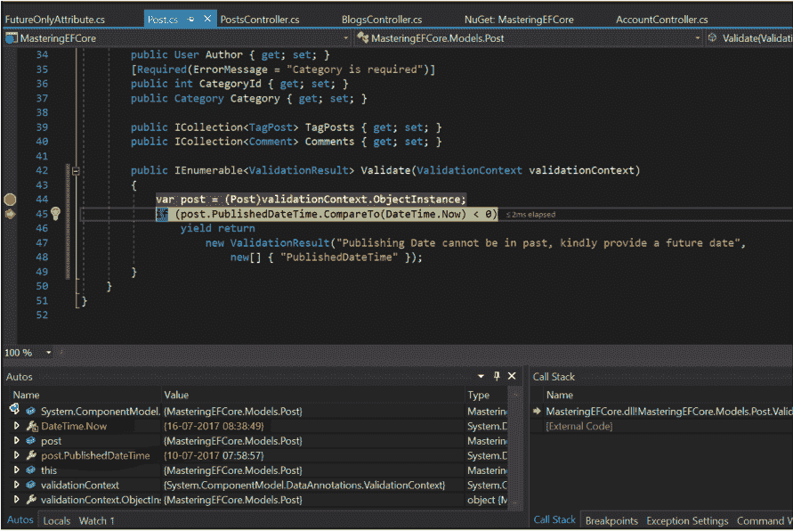

我们已经探讨了在服务端执行的自定义验证；接下来，让我们在下一节中探讨可以在客户端使用的自定义验证。

## 为自定义验证创建客户端逻辑

我们在本章创建的自定义验证器也应该提供客户端验证支持。默认情况下，EF 仅执行服务端验证（开箱即用），但客户端验证应手动执行。框架提供了在上下文特性中注入自定义验证及其错误的机制。但是，我们需要自行执行/实现客户端验证。

可以通过 `IClientModelValidator` 配置 `FutureOnly` 自定义验证特性以支持客户端验证，这要求我们实现 `AddValidation` 方法。我们应该在上下文特性中注入所需的自定义验证值；所需实现如下所示：

```csharp
public class FutureOnlyAttribute : ValidationAttribute,
    IClientModelValidator
{
    protected override ValidationResult IsValid(object value,
        ValidationContext validationContext)
    {
        var post = (Post) validationContext.ObjectInstance;
        return post.PublishedDateTime.CompareTo(DateTime.Now) < 0
            ? new ValidationResult("Publishing Date cannot be in past, kindly provide a future date")
            : ValidationResult.Success;
    }

    public void AddValidation(ClientModelValidationContext context)
    {
        if (context == null)
        {
            throw new ArgumentNullException(nameof(context));
        }
        context.Attributes["data-val"] = "true";
        context.Attributes["data-val-futureonly"] = "Publishing Date cannot be in past, kindly provide a future date";
    }
}
```


上下文属性除非我们在元素的上下文中手动配置，否则不会具有自定义属性；下面的屏幕截图显示上下文不具有这些自定义属性：

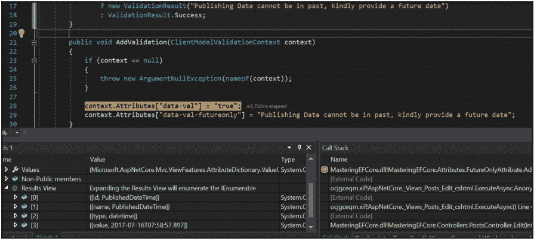

MVC 渲染引擎将使用客户端验证所需的数据属性渲染 HTML 内容，并且我们在 AddValidation 中注入的值已作为属性添加到元素上下文中：

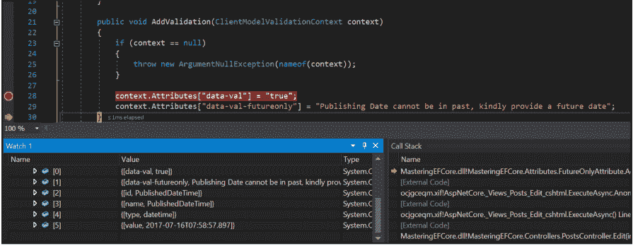

此注入的数据属性将在实现客户端验证时被利用，用于验证的渲染 HTML 代码如下所示突出显示：

```
<div class="form-group">
    <label class="col-md-2 control-label" for="PublishedDateTime">PublishedDateTime</label>
    <div class="col-md-10">
        <input name="PublishedDateTime" class="form-control valid" id="PublishedDateTime" aria-invalid="false" aria-required="true" aria-describedby="PublishedDateTime-error" type="datetime" value="" data-val-required="The PublishedDateTime field is required." data-val="true" data-val-futureonly="Publishing Date cannot be in past, kindly provide a future date">
        <span class="text-danger field-validation-valid" data-valmsg-replace="true" data-valmsg-for="PublishedDateTime"></span>
    </div>
</div>
```

客户端验证应通过在 jQuery validator 中配置它们来执行，这也需要一个无侵入式适配器。以下提供了 FutureOnly 自定义字段验证所需的实现，它将在 PublishedDateTime 中处理，该字段使用 FutureOnly 自定义验证：

```
@section Scripts {
    @(await Html.RenderPartialAsync("_ValidationScriptsPartial"));
    <script>
    (function ($) {
        jQuery.validator.addMethod('futureonly',
            function (value, element, params) {
                return (new Date($(params[0]).val())) > (new Date());
            });
        jQuery.validator.unobtrusive.adapters.add('futureonly',
            [ 'element' ],
            function (options) {
                var element = $(options.form).find('input#PublishedDateTime')[0];
                options.rules['futureonly'] = [element];
                options.messages['futureonly'] = options.message;
            });
    })(jQuery);
    </script>
}
```

前述实现将使 JavaScript 引擎在页面加载期间将无侵入式验证嵌入到自定义属性元素中，从而使应用程序能够执行客户端验证。我们可以在下面的屏幕截图中验证客户端验证在将数据发送到网络之前执行：

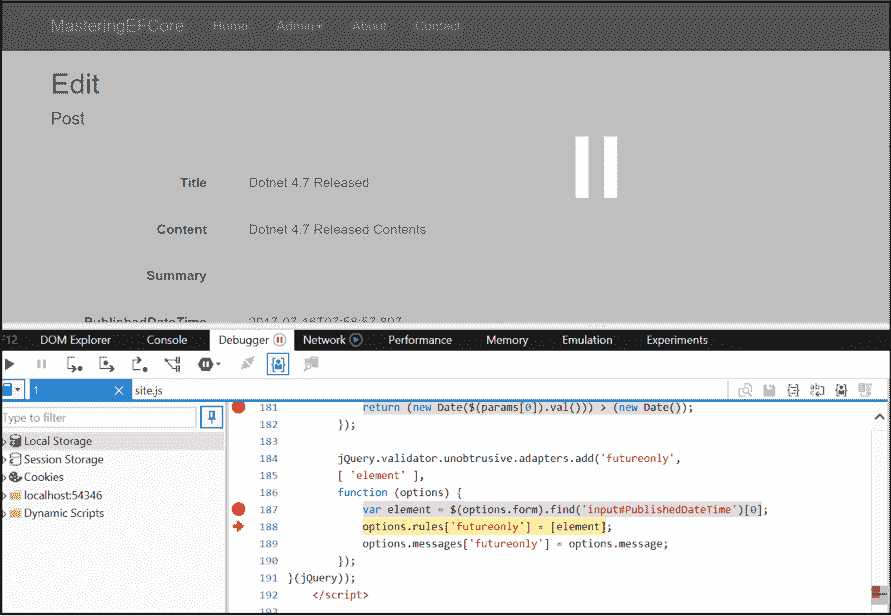

当用户移动到其他控件时，无侵入式验证会启动，它使用自定义 JavaScript 实现验证控件，如下所示：

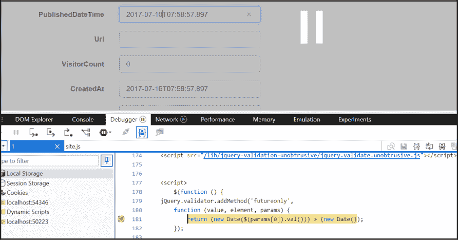

验证结果要么允许用户继续其输入操作，要么显示错误并阻止用户提交表单（而不到达服务器）。在以下示例中，它是一个无效日期，自定义错误消息已填充到错误集合中，并在视图中显示，如以下屏幕截图所示：

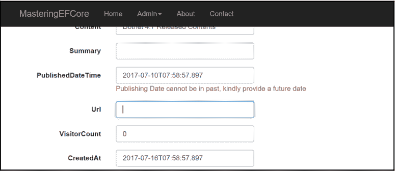

我们探索了自定义验证器客户端验证所需的完整配置和实现；现在，让我们探索我们可用的远程验证功能，它将在自定义验证之外执行一些操作。

## 远程验证

我们迄今为止所做的验证是在模型级别配置的，当我们说模型时，它发生在自己的域内。我们可能有跨模型操作的需要。Entity Framework 没有提供实现相同功能的规定，因为它是数据驱动的，并且在 Entity Framework 中不可用模型外部所需的验证。为了填补这一空白，MVC 提供了使用 RemoteAttribute 实现相同功能的规定，它允许用户使用遵循特定模式实现的控制器操作。

远程验证需要以下边界条件：

- RemoteAttribute 需要两个属性——controller 和 action
- 配置的字段名应用作 action 参数名
- action 应返回 Json 数据
- 返回的数据必须具有布尔值

博客系统有一个类似的要求，需要远程验证：

- 验证应在不提交整个表单的情况下执行
- 用户名可以在用户输入值时即时验证
- 远程验证应将值与数据库进行核对并响应用户名是否可用

RemoteAttribute 应在如下所述的用户模型中实现：

- 在 Users 控制器中创建一个名为 IsUsernameAvailable 的 action。
- action 应具有参数名为 username 且类型为 String。
- 对 username 值在 users 表上执行验证并将结果捕获到布尔变量中。
- 在 `Json` 方法中返回布尔值作为 data 参数。这在以下代码片段中显示：

```
public async Task<IActionResult> IsUsernameAvailable(string username)
{
    var usernameAvailable =
        await _context.Users.AnyAsync(x =>
            x.Username.Equals(username,
                StringComparison.OrdinalIgnoreCase));
    return Json(data: !usernameAvailable);
}
```

- 在 `User` 模型中针对 `Username` 属性配置 `RemoteAttribute`。
- 验证应传递参数，controller 为 `Users` 且 action 为 `IsUsernameAvailable`。

以下代码将在 `User` 实体中配置远程验证：

```
public class User
{
    public int Id { get; set; }
    [Required(ErrorMessage = "Display Name is required")]
    public string DisplayName { get; set; }
    [Required(ErrorMessage = "Username is required")]
    [Remote(action: "IsUsernameAvailable", controller: "Users")]
    public string Username { get; set; }
    [Required(ErrorMessage = "Password is required")]
    public string PasswordHash { get; set; }
    [Required(ErrorMessage = "Email is required")]
    [EmailAddress(ErrorMessage = "Provide a valid email address")]
    public string Email { get; set; }
    public DateTime CreatedAt { get; set; }
    public DateTime ModifiedAt { get; set; }
    public int CreatedBy { get; set; }
    public int ModifiedBy { get; set; }
    public ICollection<Blog> Blogs { get; set; }
    public ICollection<Post> Posts { get; set; }
    public ICollection<Comment> Comments { get; set; }
    public int? AddressId { get; set; }
    public Address Address { get; set; }
    public int PersonId { get; set; }
    public Person Person { get; set; }
}
```

由于我们依赖外部功能来验证模型字段，因此明智的做法是对远程验证执行单元测试。让我们通过提供一个可用的用户名来验证代码是否符合成功场景（您可以在以下屏幕截图中看到，高亮的 watch 控制台窗口显示用户名“prabhakaran”仍然可用）：

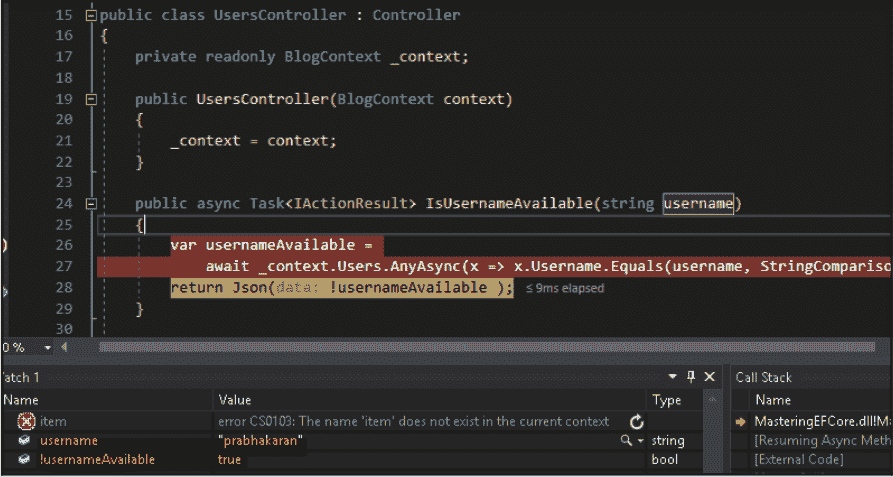

有效的用户名不会在 **创建用户** 屏幕上抛出任何验证错误。我们可以看到屏幕上的用户名，然后高亮到下一个字段，仍然没有验证错误；这意味着用户名可用（在 **Username** 字段中显示内容是老式的 EF！）。这在以下屏幕截图中显示：

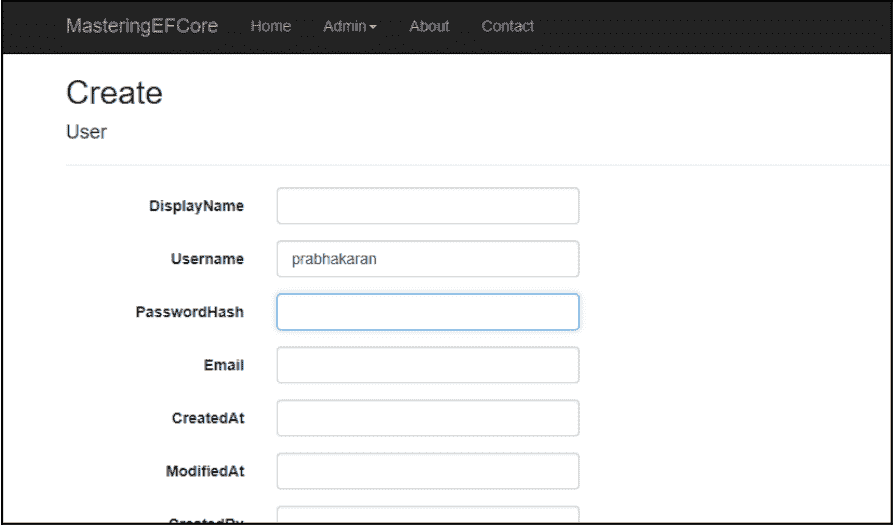

让我们通过提供一个不可用的用户名来验证代码是否符合失败场景（您可以在以下屏幕截图中看到，高亮的 watch 控制台窗口显示用户名“prabhakar”不可用）：

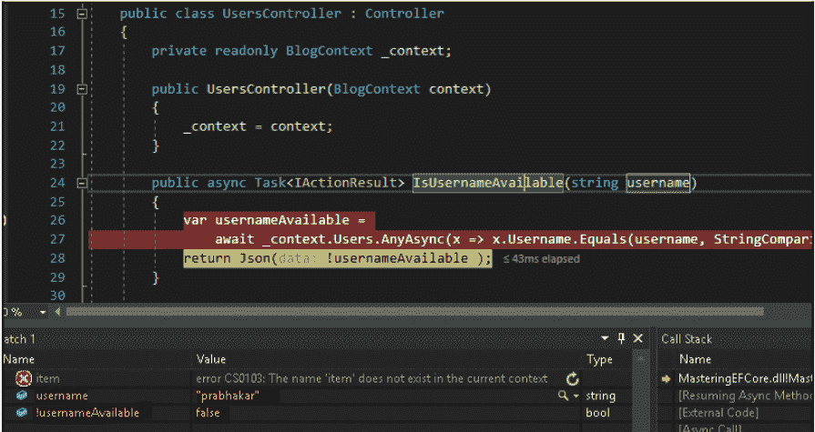


这个无效用户名会在创建用户界面中抛出验证错误。我们可以看到，文本框中提供的用户名在数据库中不存在，相应的验证错误会显示在文本框旁边：

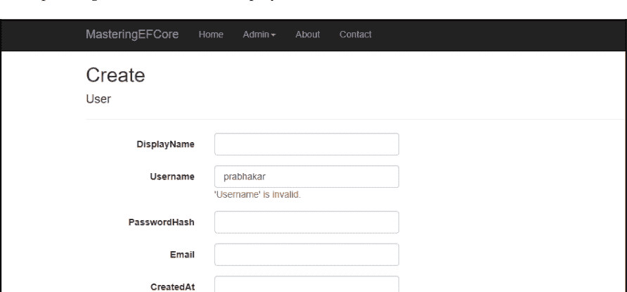

最后一件事，在边界情况下，我们提到参数名应该与为远程验证配置的字段名匹配。我们需要知道如果出现偏差会发生什么吗？如果参数名与配置的名称不同该怎么办？那么，值绑定将不会发生，值反而会是 null。

到目前为止，我们还没有讨论过赋值，那么就把它作为一个任务，完成如下图所示的正确验证：

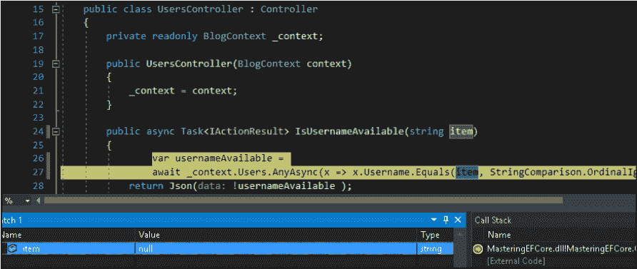

本章我们学习了远程验证，这也结束了我们在框架内置验证之外可以执行的自定义验证。

## 总结

本章我们学习了 Entity Framework 和 MVC 提供的自定义验证。我们从客户端验证开始，它彻底改变了用户体验，然后我们研究了如果有人入侵并绕过客户端验证会发生什么。我们通过在服务端应用第二层验证解决了这些问题。我们看到了手动验证的必要性，而不是让框架开箱即用地替我们完成；我们随后执行了一些内置验证之外所需的自定义验证。我们还通过 `IClientModelValidator` 将相同的验证应用到了客户端。最后，我们执行了一个远程验证，它甚至不是 Entity Framework 的一部分，而是 MVC 框架中提供的。

到目前为止，我们只通过数据上下文访问数据，从未编写过任何纯 SQL 查询。在一些合理的场景中，我们需要绕过数据上下文以获得更好的性能，或者避免框架执行繁重的任务。我们将在第 7 章《*使用原始 SQL – 在 LINQ 中利用 SQL 查询*》中解决这个问题。

## 7 使用原始 SQL – 在 LINQ 中利用 SQL 查询

我们已经了解了自定义验证、如何利用客户端验证、当有人入侵系统并绕过客户端验证时如何响应，以及在服务端增加额外的安全层。最后，我们执行了来自 MVC 框架的远程验证。

在本章中，我们将讨论以下与数据安全相关的问题：

- 在 **Entity Framework (EF)** 中，我们有控制 SQL 查询的机制吗？
  - 我们可以直接从 EF 执行内联 SQL 查询。
- 如果有人入侵系统并执行 SQL 注入会怎样？SQL 查询真的会带来这些安全问题吗？
  - 我们可以使用参数化查询来避免 SQL 注入。
- 如果我们走纯 SQL 查询这条路，还能利用 LINQ 查询吗？
  - 是的，我们仍然可以在 LINQ 查询中利用它们。
- 我们能在没有 `DbSet` 类或 **普通旧 CLR 对象 (POCO)** 对象的情况下执行查询吗？
  - 是的，我们确实有这样的机制，可以在没有 `DbSet` 或 POCO 对象的情况下执行查询。

解决了这些问题之后，我们对本章将要介绍的内容就有了清晰的认识：

- 基本的原始 SQL 查询
- 构建参数化查询
- 与 LINQ 组合使用
- 在没有 DbSet 类或 POCO 对象的情况下执行 SQL 查询

### 基本的原始 SQL 查询

将 SQL 查询从框架中抽象出来的主要目的是，无论应用程序中使用何种数据源，都可以执行实现。我们可能会认为创建原始 SQL 查询必定违背了 EF Core 存在的初衷。有一些合理的需求可能需要原始 SQL，而不是让 Entity 替我们完成工作。

原因可以是任何东西，比如通过 LINQ 查询无法实现的功能，或者 Entity 生成的查询未能优化性能。原因可以是任何东西，但归根结底，我们都在为一个结果而工作，一个性能更优的优化结果。只要理由比 API 的使用更充分，我们甚至可能愿意采取极端措施，不与框架/API 保持一致。

我们可以使用原始模式从 EF 执行基本 SQL 查询、存储过程或函数。框架通过 DbSet 中的 FromSql 方法为我们提供了这一机制，让我们可以使用 EF 执行原始 SQL。它还允许我们基于 SQL 查询创建 LINQ 查询；因为 FromSql 是从 DbSet 类型公开的，所以这成为可能。

让我们扩展博客系统，将博客控制器的执行改为使用原始 SQL 查询，我们将从一个使用原始 SQL 查询的 Index 操作开始，如下所示：

```csharp
public async Task<IActionResult> Index()
{
    return View(await _context.Blogs.FromSql("Select * from dbo.Blog").ToListAsync());
}
```

上述实现会在视图中产生以下输出，并且与现有的渲染视图没有太大区别：

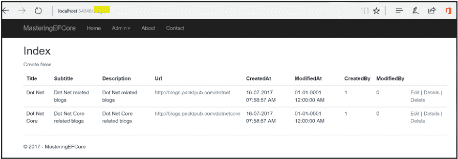

我们将创建一个新的操作，只是为了演示在 EF 中使用原始 SQL 查询执行存储过程（SP）GetLatestBlogs。下面列出了使用 FromSql 实现 SP 的代码：

```csharp
public async Task<IActionResult> LatestBlogs()
{
    return View("Index", await _context.Blogs.FromSql("EXEC [dbo].[GetLatestBlogs]").ToListAsync());
}
```

上述实现会在视图中产生以下输出。它所做的只是在现有的 Index 视图中渲染 SP 的结果：

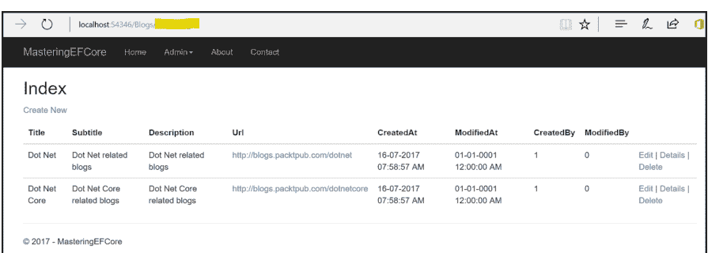

FromSql 只有在返回的数据是所访问的 DbSet 类型时才能执行原始 SQL 查询。在前面的示例中，我们使用了 Blogs 和 DbSet，它期望查询返回 blogs，而其他实体不会被框架接受。

让我们尝试返回一个不同于为 DbSet 配置的类型，看看 EF 会有什么行为：

```csharp
public async Task<IActionResult> Index()
{
    return View(await _context.Blogs.FromSql("Select * from dbo.Post").ToListAsync());
}
```

由于返回的数据与它试图映射的类型不匹配，上述查询将触发一个无效操作：

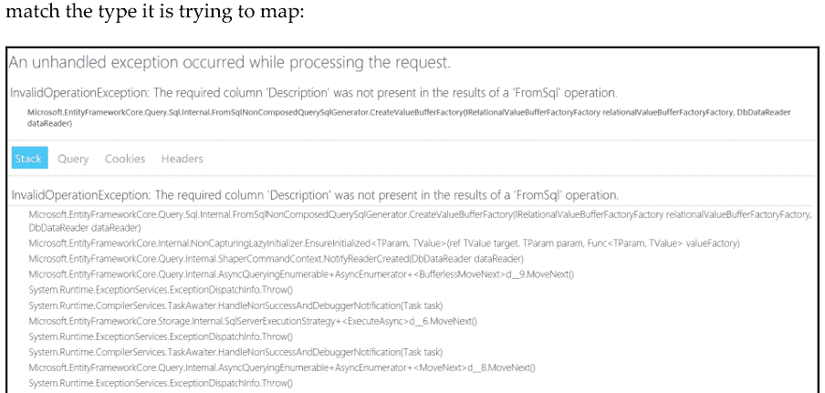

从上面显示的错误来看，很明显这里发生了一些超出类型不匹配的问题，因为错误没有指明任何关于类型不匹配的信息。


`FromSql` 要求从数据库返回的列名与映射对象中可用的列名匹配。如果对象中存在不匹配，框架将抛出一个无效操作异常。

如果我们需要在原始 SQL 查询中使用 `FromSql` 消费匿名类型，那么在 EF Core 2.0 之前我们肯定无法实现，相关信息可以在以下共享链接 `https://github.com/aspnet/EntityFramework/issues/1862` 中看到，其中写道：

> “这是我们仍在努力在 2.0 中实现的功能，但时间安排很紧，而且我们很可能会把它推迟到 2.0 之后的下一个次要版本。” —— Diego Vega.
>
> “遗憾的是，我们没有时间在 2.0 版本中实现这一点。我们将其视为 2.0 之后的高优先级。” —— Arthur Vickers

上述回复来自 Entity Framework GitHub 仓库的所有者和成员，因此这是官方的说法：我们今年可能无法获得这个功能。

让我们尝试限制从数据库返回的列，看看是否会对应用程序产生影响。`SELECT` 语句被调整为只选择 `Blog` 实体中的部分列：

```csharp
public async Task<IActionResult> Index()
{
    return View(await _context.Blogs.FromSql("Select [Id],[Title],[Subtitle],[Description],[Url] from dbo.Blog").ToListAsync());
}
```


该框架不支持未向数据模型的所有属性/字段提供数据的内联查询。在 SQL 查询满足所有字段之前，它会开始抛出错误，如下所示：

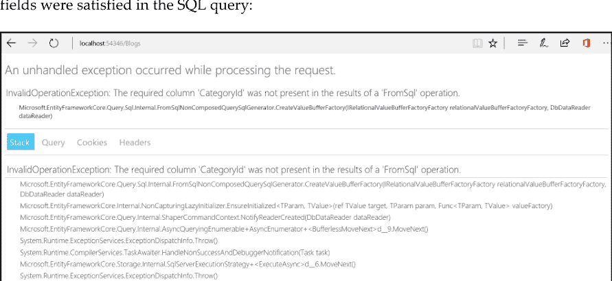

到目前为止，我们已经见过不带任何参数的查询或存储过程（SP），在实时应用程序中只有少数场景会使用它们。我们将在下一节探讨接受参数的内联查询，并了解如何安全地利用它们。

## 构建参数化查询

构建和执行无参数查询的用途较少，而任何应用程序中的大多数用途都基于参数/条件。在平面/原始查询中引入参数会使我们面临 SQL 注入的威胁。我们该如何保护应用程序免受此类威胁？在现实世界的应用程序中，我们不能忽视它们，因为有些应用程序严重依赖内联查询。

SQL 注入是黑客用来攻击任何系统的一种技术，它会在安全方面从根本上动摇系统。攻击者可以通过将用户输入盲目嵌入内联 SQL 查询来实施攻击。

最常见的注入值是 `OR 1 = 1`，它会导致返回整个记录集，而不是使用输入值进行过滤。例如，在我们的博客系统中，如果黑客试图检索用户信息，他可以篡改以下查询（假设系统中存在这样的查询）：

```
SELECT * FROM USERS WHERE Id = ' + userId + '.userId
```

考虑到应用程序传入的 `userId` 为 5，该查询可以构造如下：

```
SELECT * FROM USERS WHERE Id = 5
```

上述查询只显示/返回 Id 为 5 的一个用户。

如果黑客注入前面提到的值，查询将变为如下：

```
SELECT * FROM USERS WHERE Id = 5 OR 1 = 1
```

上述 SQL 注入会返回所有用户的信息，而不是仅返回 ID 为 5 的用户。这是一个简单的 SQL 注入示例。


参数化查询是用于保护我们免受此类威胁的机制。它们确保 SQL 注入不会发生，使用参数化查询时，前面提到的注入问题也不会出现：

```
public async Task<IActionResult> Details(int? id)
{
    if (id == null)
    {
        return NotFound();
    }

    var blog = await _context.Blogs.FromSql("Select * from dbo.Blog WHERE Id = {0}", id).FirstOrDefaultAsync();
    if (blog == null)
    {
        return NotFound();
    }

    return View(blog);
}
```

除了直接在 FromSql 方法中将输入值作为参数传递外，我们还可以使用 SqlParameter 对象来构造参数，这同样可以确保查询免受 SQL 注入。以下代码演示了在 EF Core 中执行参数化查询：

```
public async Task<IActionResult> Details(int? id)
{
    if (id == null)
    {
        return NotFound();
    }

    var blog = await _context.Blogs.FromSql("Select * from dbo.Blog WHERE Id = @id", new SqlParameter("id", id)).FirstOrDefaultAsync();
    if (blog == null)
    {
        return NotFound();
    }

    return View(blog);
}
```

以下屏幕截图像往常一样显示一个博客项，其之前的状态没有任何变化。唯一的区别在于它是通过参数化查询呈现的：

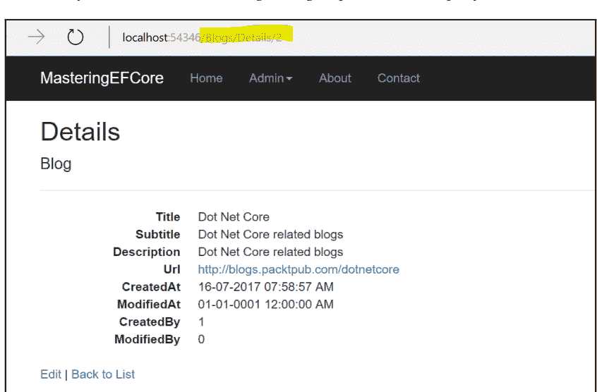

如果我们尝试通过以下任一方式注入值，由于我们处理的是以整数形式公开的标识符，系统仍然会由模型绑定器本身处理注入。让我们访问以下路径：

```
http://localhost:54346/Blogs/Details/1OR1=1
```

```
http://localhost:54346/Blogs/Details?id=1OR1=1
```

尝试访问上述任一链接都会抛出以下错误：

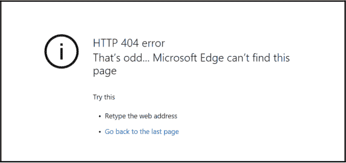

为了便于讨论，让我们将标识符的参数类型改为字符串，并再次向 `Details` 操作注入该值，以了解参数化查询实际上是如何处理 SQL 注入的。从下图中可以明显看出，参数化查询试图将该值转换为整数，但转换失败，执行被停止，从而保护应用程序免受 SQL 注入攻击：

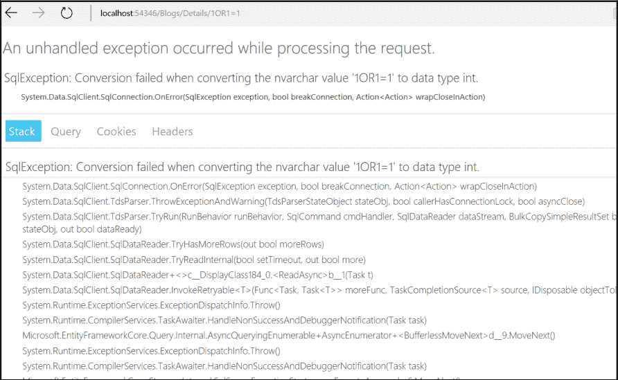

还是不相信？我也不相信。除非我们处理字符串列上的注入，否则我无法相信。为了演示，让我们对系统稍作修改，添加以下操作：在 Title 列中使用通配符搜索来过滤博客，从结果集中返回第一项，并最终在现有的 Details 视图中渲染它：

```
public async Task<IActionResult> GetBlogByTitle(string keyword)
{
    if (keyword == null)
    {
        return NotFound();
    }

    var blog = await _context.Blogs.FromSql("Select * from dbo.Blog WHERE Title like '%' + @keyword + '%',
    new SqlParameter("keyword", keyword)).FirstOrDefaultAsync();
    if (blog == null)
    {
        return NotFound();
    }

    return View("Details", blog);
}
```

尝试像之前一样注入值，访问以下路径：

```
http://localhost:54346/Blogs/GetBlogByTitle/keyword=core OR 1=1
http://localhost:54346/Blogs/GetBlogByTitle?keyword=core OR 1=1
```

系统仍然会处理注入，但这次是在数据库端处理，因为该值会被当作字符串值。查询无法返回任何记录，因此操作返回 NotFound()：

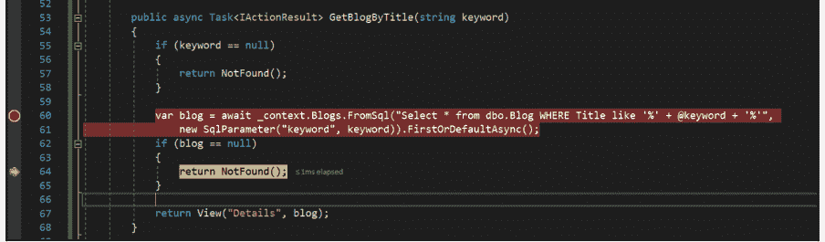


## 安全阀产品使用说明

### 1. 产品概述

本安全阀适用于压力系统，当系统压力超过设定值时，阀瓣自动开启，排放介质，保护设备安全；当压力恢复正常后，阀门自动关闭。该产品采用弹簧直接加载式结构，具有结构紧凑、密封可靠、启闭灵敏等特点。

### 2. 主要技术参数

| 项目 | 参数 |
|------|------|
| 公称通径 | DN25~DN100 |
| 公称压力 | 1.6MPa |
| 适用介质 | 空气、水、蒸汽 |
| 适用温度 | -20℃~+120℃ |
| 阀体材质 | 碳钢、不锈钢 |
| 排放压力 | ≤1.1倍整定压力 |
| 回座压力 | ≥0.85倍整定压力 |
| 密封性 | 零泄漏 |
| 连接方式 | 法兰、螺纹、焊接 |

### 3. 安装要求

- 安全阀应垂直安装于压力容器或管道的最高点。
- 安装前应清除管道内杂质，防止异物损伤密封面。
- 安全阀排放口应引至安全地点，避免介质喷出伤及人员。
- 安装位置应便于检修和日常维护。

### 4. 调试方法

1. 松开锁紧螺母，旋动调节螺杆，改变弹簧预紧力。
2. 升压至整定压力，观察阀瓣是否在设定值时开启。
3. 若开启压力不符，重新调节螺杆并再次升压校验。
4. 确认合格后，拧紧锁紧螺母并加铅封。

### 5. 维护保养

- 定期检查密封面有无损伤，如有划痕应及时研磨修复。
- 定期校验整定压力，确保在校验周期内运行。
- 阀体表面应有防锈涂层，室外安装应加装防护罩。
- 对长期不动作的安全阀，应定期进行手动排放试验。

### 6. 注意事项

- 严禁将安全阀作为截止阀使用。
- 严禁随意拆卸铅封或调整整定压力。
- 排放管道应有足够的支撑，避免附加载荷传递至阀体。
- 若发现泄漏或异常振动，应立即停机检修。

> 注意：安全阀应每年至少校验一次，由具有资质的检测机构进行。

## 使用 LINQ 进行组合

到目前为止，我们执行的都是平面 SQL 查询。这并不涉及 LINQ 查询。如果我们有一种机制可以借助平面查询与 LINQ to SQL 查询的组合，那么我们就能兼得两者之长。幸运的是，Entity Framework 提供了内置支持，平面 SQL 查询可以与 LINQ 查询组合使用，我们将在本节中详细讨论。

让我们注释掉 LatestBlogs() 中的当前实现，并使用与 LINQ 组合的平面查询来实现 SP。理想情况下，我们想要实现的是：使用 LINQ 查询获取表数据，并将结果与 LINQ 查询组合，以通过 LINQ 查询执行过滤和排序（这可能不是实际场景，但非常适合演示）：

```
public async Task<IActionResult> LatestBlogs()
{
    // return View("Index", await _context.Blogs.FromSql("EXEC [dbo].[GetLatestBlogs]").ToListAsync());
    var comparisonDateTime = DateTime.Now.AddMonths(-3);
    return View("Index", await _context.Blogs
        .FromSql("Select * from dbo.Blog")
        .Where(x => x.CreatedAt >= comparisonDateTime)
        .OrderByDescending(x => x.Id)
        .ToListAsync());
}
```

我们可以看到结果符合预期，与之前最新博客的结果集一致，如下图所示：

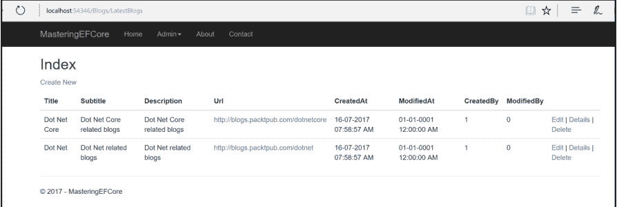


让我们进一步深入探究内部发生了什么，以及 Entity Framework 是如何处理这些查询的。我们可能会认为 EF Core 会检索博客条目并使用内存中的数据执行 LINQ 查询。下面的 **SQL Server Profiler** 跟踪将证明我们是错误的。如果我们仔细观察跟踪中突出显示的部分，就很明显 Entity Framework 是通过将 LINQ 查询翻译成所需的 SQL 查询并一次性在数据库中执行来实现 LINQ 到 SQL 查询的。很酷，对吧？下面的截图将说明参数化执行被翻译成 SQL 语句的情况：

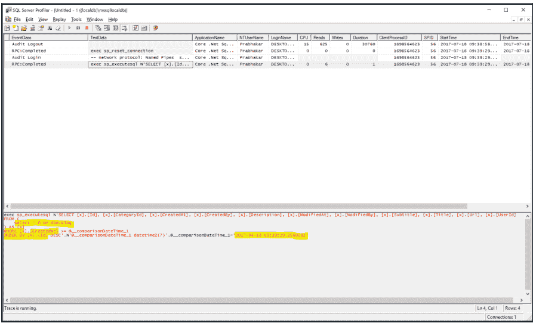

我们已经研究了如何使用 LINQ 组合扁平 SQL 查询的机制，但我们还没有介绍 `Include()` 数据，而这正是 Entity Framework 的一项强大功能。你猜对了，我们也可以对由 LINQ 查询组成的扁平 SQL 查询执行 `Include()` 操作。我们需要做的就是像往常一样在 `.ToList()` 调用之前加上 `.Include()` 方法，这会将 LINQ 查询翻译成 SQL 查询。下面的代码将使用 `.Include()` 功能：

```
public async Task<IActionResult> LatestBlogs()
{
    //return View("Index", await _context.Blogs.FromSql("EXEC [dbo].
        [GetLatestBlogs]").ToListAsync());
}
```

同样的操作也适用于第一个博客 Posts 数组中的第二个帖子项，这确保了 `Include()` 方法按预期工作，为博客项返回对应的帖子：

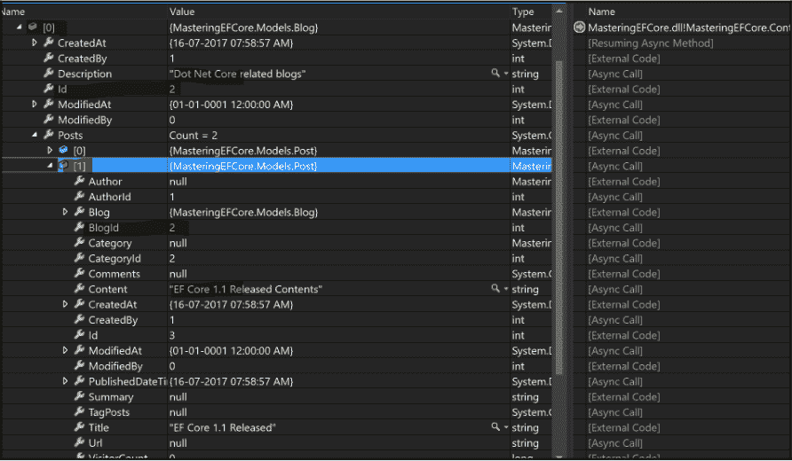

作为额外检查，我们可以验证第二个博客项及其对应的单个帖子，该帖子也被包含在内：

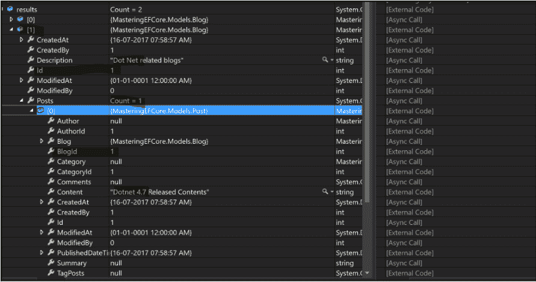

我们已经看到了 `Include()` 功能如何与使用 LINQ 组合的扁平 SQL 查询一起工作；让我们看看它是如何被翻译成 SQL 查询的（LINQ to SQL）。下面的截图显示我们执行了两个 SQL 语句，其中第一个语句与之前从 `Blog` 表检索数据的语句类似：

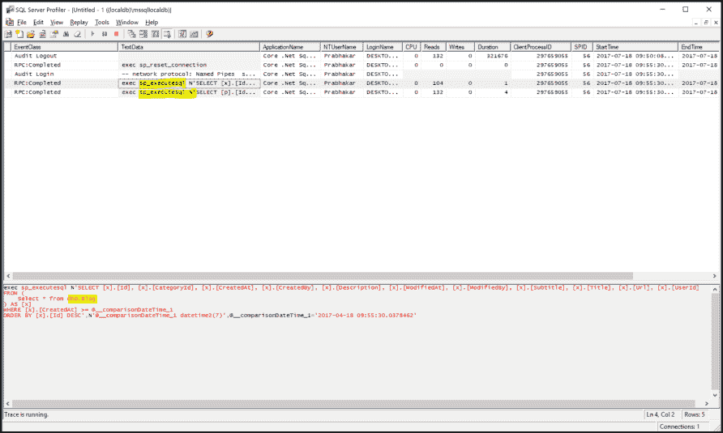

第二个语句为我们完成了任务，执行了将帖子表数据包含到 LINQ 查询中的所需代码。这在下面的截图中有所体现：

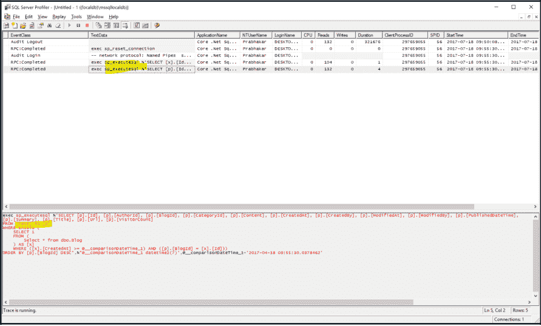

在本节中，我们已经了解了如何使用 LINQ 将扁平 SQL 查询消费为 SQL 查询，到目前为止我们已经看到了相对于 DBSet 或 POCO 对象的扁平 SQL 查询的执行。让我们研究一下在 *Executing SQL query without a DBSet or POCO* 部分是否可以匿名实现同样的功能。

## Executing SQL query without a DBSet or POCO

我们需要研究 Microsoft 是否支持在不需要 DBSet 或 POCO 对象的情況下匿名执行扁平 SQL。由于它是开源的，我们很容易调查这一点。我们可以直接进入 GitHub 仓库（https://github.com/aspnet/EntityFramework）中的源代码，调查他们是否对预期行为有任何实现。

Microsoft 确实为关系数据库提供了一个外观的几个扩展方法，可在 https://github.com/aspnet/EntityFramework/blob/0024373adae7e331ed217de2b4bd12be5eedf925/src/EFCore.Relational/RelationalDatabaseFacadeExtensions.cs 获取。

位于前述 GitHub 位置的扩展方法如下所示。我们需要捕获它，因为我们将在本节中讨论其实现：

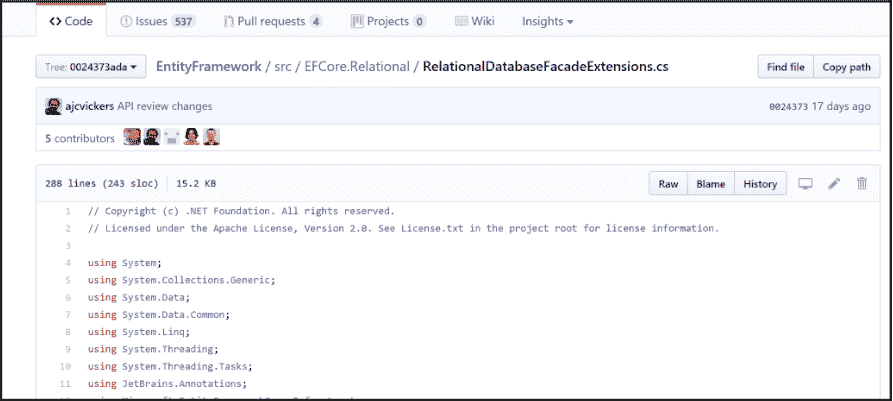

他们对原始 SQL 查询有实现，但这是一个有限的实现。它具有 `ExecuteSqlCommand`，仅支持 `ExecuteNonQuery` 功能，这意味着我们不能使用此方法来处理返回结果集的 SQL 查询：

```
```csharp
public static int ExecuteSqlCommand(
    [NotNull] this DatabaseFacade databaseFacade,
    RawSqlString sql,
    [NotNull] params object[] parameters);

// Note that this method doesn't start a transaction hence it doesn't use ExecutionStrategy
public static int ExecuteSqlCommand(
    [NotNull] this DatabaseFacade databaseFacade,
    [NotNull] FormattableString sql)
    => ExecuteSqlCommand(databaseFacade, sql.Format, sql.GetArguments());

// Note that this method doesn't start a transaction hence it doesn't use ExecutionStrategy
public static int ExecuteSqlCommand(
    [NotNull] this DatabaseFacade databaseFacade,
    RawSqlString sql,
    [NotNull] IEnumerable<object> parameters)
{
    Check.NotNull(databaseFacade, nameof(databaseFacade));
    Check.NotNull(sql, nameof(sql));
    Check.NotNull(parameters, nameof(parameters));

    var concurrencyDetector = databaseFacade.GetService<IConcurrencyDetector>();

    using (concurrencyDetector.EnterCriticalSection())
    {
        var rawSqlCommand = databaseFacade
            .GetRelationalService<IRawSqlCommandBuilder>()
            .Build(sql, parameters);

        return rawSqlCommand
            .RelationalCommand
            .ExecuteNonQuery(
                databaseFacade.GetRelationalService<IRelationalConnection>(),
                rawSqlCommand.ParameterValues);
    }
}
```
```

同样的实现也有异步版本，这告诉我们在计划扩展我们的需求时需要执行两个实现。下面的截图将显示异步实现：

```
154 RawSqlString sql,
155 CancellationToken cancellationToken = default(CancellationToken)
156 => ExecuteSqlCommandAsync(databaseFacade, sql, Enumerable.Empty<object>(), cancellationToken);
157
158 // Note that this method doesn't start a transaction hence it doesn't use ExecutionStrategy
159 public static Task<int> ExecuteSqlCommandAsync(
160 [NotNull] this DatabaseFacade databaseFacade,
161 RawSqlString sql,
162 [NotNull] params object[] parameters)
163 => ExecuteSqlCommandAsync(databaseFacade, sql, (IEnumerable<object>)parameters);
164
165 // Note that this method doesn't start a transaction hence it doesn't use ExecutionStrategy
166 public static async Task<int> ExecuteSqlCommandAsync(
167 [NotNull] this DatabaseFacade databaseFacade,
168 RawSqlString sql,
169 [NotNull] IEnumerable<object> parameters,
170 CancellationToken cancellationToken = default(CancellationToken)
171 {
172 Check.NotNull(databaseFacade, nameof(databaseFacade));
173 Check.NotNull(sql, nameof(sql));
174 Check.NotNull(parameters, nameof(parameters));
175
176 var concurrencyDetector = databaseFacade.GetService<IConcurrencyDetector>();
177
178 using (await concurrencyDetector.EnterCriticalSectionAsync(cancellationToken))
179 {
180 var rawSqlCommand = databaseFacade
181 .GetRelationalService<IRawSqlCommandBuilder>()
182 .Build(sql.Format, parameters);
183
184 return await rawSqlCommand
185 .RelationalCommand
186 .ExecuteNonQueryAsync(
187 databaseFacade.GetRelationalService<IRelationalConnection>(),
188 rawSqlCommand.ParameterValues,
189 cancellationToken);
190 }
```

EF Core 社区针对我们的需求创建了一个开放问题，可在 https://github.com/aspnet/EntityFramework/issues/1862#issuecomment-220787464 获取。

在前述问题线程中，用户 sirentek 为我们在 Microsoft 在框架中修复之前提供了一个变通方法。让我们实现匿名 SQL 查询执行所需的扩展方法：

- 1. 创建一个 DatabaseExtensions 静态类来保存扩展方法。
- 2. 实现 `ExecuteSqlQuery` 用于返回结果集的 SQL 查询，而 `ExecuteSqlCommand` 不返回任何内容。
- 3. 实现 `ExecuteSqlQueryAsync` 用于异步操作，与 Microsoft 的 `ExecuteSqlCommandAsync` 实现相匹配。

Microsoft 目前没有计划在 EF Core 2.0 中包含它们，甚至也不在当前时间。这与我们之前讨论的匿名类型支持类似：

```
public static class DatabaseExtensions
{
    public static RelationalDataReader ExecuteSqlQuery(this
        DatabaseFacade databaseFacade, string sql, params
        object[] parameters)
    {
        var concurrencyDetector =
            databaseFacade.GetService<IConcurrencyDetector>();
        using (concurrencyDetector.EnterCriticalSection())
        {
            var rawSqlCommand = databaseFacade
                .GetService<IRawSqlCommandBuilder>()
                .Build(sql, parameters);

            return rawSqlCommand
                .RelationalCommand
                .ExecuteReader(
                    databaseFacade.GetService<IRelationalConnection>(),
                    parameterValues: rawSqlCommand.ParameterValues);
        }
    }

    public static async Task<RelationalDataReader>
        ExecuteSqlQueryAsync(this DatabaseFacade databaseFacade,
        string sql,
        CancellationToken cancellationToken = default(CancellationToken),
        params object[] parameters)
    {
        var concurrencyDetector =
            databaseFacade.GetService<IConcurrencyDetector>();
        using (concurrencyDetector.EnterCriticalSection())
        {
            var rawSqlCommand = databaseFacade
                .GetService<IRawSqlCommandBuilder>()
                .Build(sql, parameters);

            return await rawSqlCommand
                .RelationalCommand
```


```csharp
.ExecuteReaderAsync(
    databaseFacade.GetService<IRelationalConnection>(),
    parameterValues: rawSqlCommand.ParameterValues,
    cancellationToken: cancellationToken);
}
}
```

下面的代码用法非常简单；它所做的只是将 ExecuteSqlQueryAsync 扩展方法所需的 SQL 查询传递进去，并以 DbDataReader 的形式返回结果集：

```csharp
var results = await _context.Database
    .ExecuteSqlQueryAsync(@"select b.Title as BlogTitle, p.* from
        Post p join Blog b on b.Id = p.BlogId");
while (results.DbDataReader.Read())
{
    Console.Write(
        $"Blog Title: '{results.DbDataReader["BlogTitle"]}', " +
        $"Post Title: '{results.DbDataReader["Title"]}'");
}
```

我们遍历了 DbDataReader，它会将帖子及其博客标题打印出来。下面的截图证明，使用我们自己的扩展方法，从 Entity Framework 的扁平 SQL 查询中返回了匿名类型：

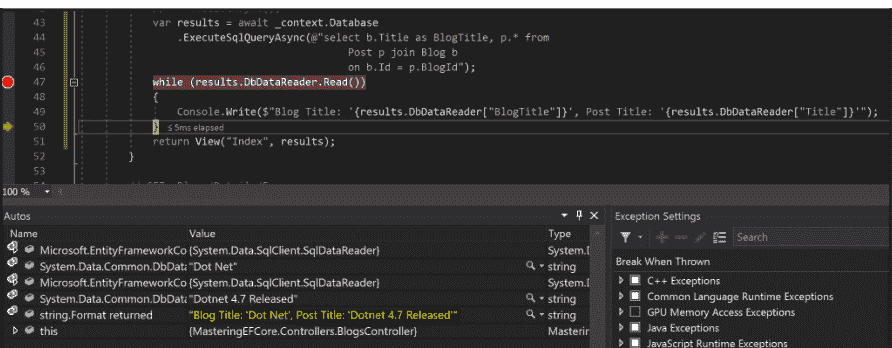

作为额外检查，让我们验证结果集中返回的第二项，以及它与 Post 表中可用的 .NET Core 条目是否匹配。下面的截图确认了帖子条目仅来自 .NET Core 博客：
