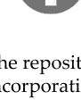
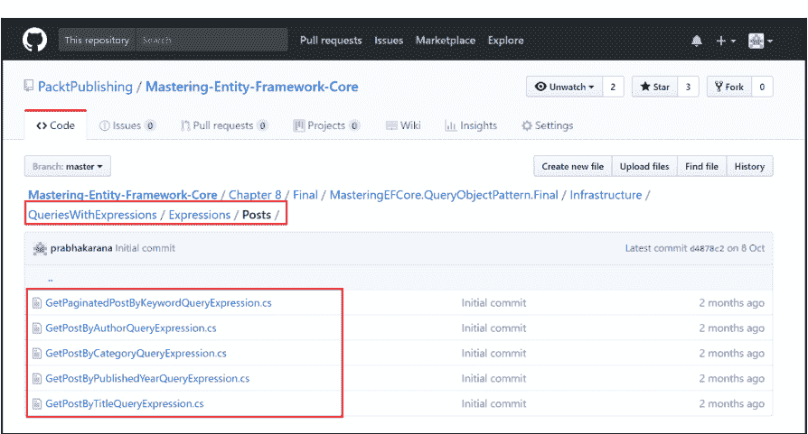
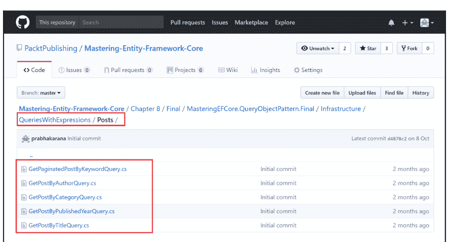

# 8 查询即所需 – 查询对象模式

## 查询即所需 – 查询对象模式

我们已经介绍了 Entity Framework（EF）中的原生 SQL 查询执行，在少数有效场景下，这可能是为了控制查询或提高性能所必需的。我们看到了一个简单的 SQL 查询、它可能带来的安全威胁，以及相应的解决方案。然后，我们介绍了在 Entity Framework 中执行原生 SQL 查询的不同方式。最后，我们创建了一个扩展方法，用于在没有 `DbSet` 和 POCO 模型的情况下执行原生 SQL 查询。

让我们讨论一下当前在对象关系映射（ORM）层中使用的仓储模式，审视其设计问题，我们将看到查询对象模式如何帮助我们高效地实现这一点。本章将讨论以下设计问题：

- 仓储模式最初是为了抽象 ORM 层，但最近仓储中包含的方法急剧增加，这违背了它的初衷：
  - 简化数据访问层的必要性催生了查询对象模式
- 我们一直在仓储中创建多个方法，这些方法仅因查询性质不同而有所区别：
  - 查询对象模式概括并改进了仓储方法
- 仅靠查询不足以简化数据访问层：
  - 将查询与通用命令组合，可将该模式扩展到所有 CRUD 操作
- 查询对象模式仍然不允许用户动态扩展查询：
  - 简单的查询对象在查询内部执行实现，而表达式树将实现委托给用户，从而为用户提供了所需的可扩展性

理想情况下，我们将涵盖以下主题：

- 查询对象简介
- 使用查询对象模式改进仓储
- 将查询与命令组合
- 使用表达式树增强查询

### 查询对象简介

查询对象模式可以通过引入查询类型并通过该类型处理查询来整合，而不是直接处理查询。请按照以下步骤将该模式整合到任何应用程序中：

1. 创建一个查询类型，其中包含查询所需的字段，如下所示：
   - 拥有一个参数化构造函数，强制只有在提供了必填字段值时才创建类型实例
   - 查询所需的必填字段必须包含在构造函数中

让我们创建一个按 Id 筛选帖子的查询类型；我们需要一个具有 Id 字段和填充 Id 字段的构造函数的查询类型：

```csharp
public class PostDetailQuery
{
    public PostDetailQuery(int? id)
    {
        this.Id = id;
    }
    public int? Id { get; set; }
}
```

查询类型已准备好实现；让我们继续下一步，创建处理器。

2. 创建一个查询处理器接口，强制该类型处理查询；在接口中创建 `Handle()` 方法，强制类型实现它。

处理器必须分两步创建：首先，应创建一个接口，其中包含处理执行所需的约定：

```csharp
public interface IPostDetailQueryHandler
{
    Task<Post> Handle(PostDetailQuery query);
}
```

约定已就绪；让我们使用具体的查询处理器类型来创建实现。

3. 创建一个使用数据上下文执行查询的查询处理器类型，通过构造函数注入数据库上下文

`BlogContext` 数据库上下文通过构造函数注入到处理器中，如下所示：

```csharp
public class PostDetailQueryHandler : IPostDetailQueryHandler
{
    private readonly BlogContext _context;
    public PostDetailQueryHandler(BlogContext context)
    {
        _context = context;
    }
}
```

数据上下文现在可用；让我们使用查询对象的上下文来执行查询：

- 使用数据上下文通过实际查询实现 `Handle()`

查询处理器实现使用了之前创建的查询类型，数据上下文利用查询对象中可用的数据创建筛选器并执行查询：

```csharp
public class PostDetailQueryHandler : IPostDetailQueryHandler
{
    // Code removed for brevity
    public async Task<Post> Handle(PostDetailQuery query)
    {
        return await _context.Posts
            .Include(p => p.Author)
            .Include(p => p.Blog)
            .Include(p => p.Category)
            .FirstOrDefaultAsync(x => x.Id == query.Id);
    }
}
```

现在查询处理器实现已完成，但应用程序中尚未在任何地方使用它。让我们看看如何在控制器中使用它。

4. 在控制器中使用查询处理器，通过构造函数注入查询处理器

PostDetailQueryHandler 类型通过构造函数，使用 .NET Core 支持的依赖注入（正如我们之前对 BlogContext 所做的那样），针对 IPostDetailQueryHandler 接口进行注入：

```csharp
public class PostsController : Controller
{
    private readonly BlogContext _context;
    private readonly IPostDetailQueryHandler
        _postDetailQueryHandler;

    public PostsController(BlogContext context,
        IPostDetailQueryHandler postDetailQueryHandler)
    {
        _context = context;
        _postDetailQueryHandler = postDetailQueryHandler;
    }
    // Code removed for brevity
}
```

查询处理器现在已在构造函数中可用；让我们使用它来执行所需操作。找到（控制器中）需要该查询的操作，并使用查询处理器来执行。

控制器中的 Details 操作需要基于帖子 Id 执行查询，因此让我们使用为此需求创建的 PostDetailQuery 来使用该查询。以下代码将在控制器中使用查询处理器：

```csharp
public async Task<IActionResult> Details(int? id)
{
    // Code removed for brevity
    var post = await _postDetailQueryHandler.Handle(new
        PostDetailQuery(id));
    // Code removed for brevity
}
```

前面的实现将根据传递给查询对象的 id 触发帖子筛选，从而将核心实现封装到查询类型中，满足查询对象模式：

- 最后，不要忘记在 `Startup.cs` 的 `ConfigureServices` 方法中支持依赖注入中的构造函数执行：

```csharp
services.AddScoped<IPostDetailQueryHandler, PostDetailQueryHandler>();
```

我们已经了解了如何创建查询对象和处理器，以及如何在控制器中使用它们。在*第 9 章，故障安全机制 – 事务*中，我们将了解如何通过使用查询对象来利用或改进仓储。

### 使用查询对象模式改进仓储

我们需要一个前提来解释查询对象模式的必要性，所以让我们创建这样一个需求，然后我们将研究查询对象。我们将在系统中为博客创建一个仓储，我们将看到它为应用程序带来的优点和缺点，最后，我们将了解什么是查询对象，以及它们如何帮助我们改进仓储。

### 仓储简介

我们一直在控制器中直接使用数据上下文执行 CRUD 操作；我们可以先在应用程序中引入仓储，之后，可以在仓储中实现查询对象。

让我们从创建仓储所需的接口开始。它包括基本检索、业务特定检索以及其余的 CRUD 操作。以下代码包含 `IPostRepository` 所需的方法：

```csharp
public interface IPostRepository
{
    IEnumerable<Post> GetAllPosts();
}
```


```csharp
Task<IEnumerable<Post>> GetAllPostsAsync();
Post GetPostById(int? id, bool includeData = true);
Task<Post> GetPostByIdAsync(int? id, bool includeData = true);
IEnumerable<Post> FindPostByTitle(string title);
IEnumerable<Post> FindPostByAuthor(string author);
IEnumerable<Post> FindPostByPublishedYear(int year);
IEnumerable<Post> FindPostByHighestVisitors();
IEnumerable<Post> FindPostByCategory(string category);
IEnumerable<Post> FindPost(string keyword, int pageCount,
    int pageSize);
int AddPost(Post item);
Task<int> AddPostAsync(Post item);
int UpdatePost(Post item);
Task<int> UpdatePostAsync(Post item);
int DeletePost(int? id);
Task<int> DeletePostAsync(int? id);
}
```

仓库实现首先从数据库上下文注入开始，在本例中是 `BlogContext`。接着，接口实现从 `FindPost` 开始，它接收 `keyword`、`pageCount` 和 `pageSize`，这三个参数被 LINQ 查询用于过滤帖子。`keyword` 被用作对 `Post` 实体中所有可用字段进行的通配符搜索：

```csharp
public class PostRepository : IPostRepository
{
    private readonly BlogContext _context;
    public PostRepository(BlogContext context)
    {
        _context = context;
    }

    public IEnumerable<Post> FindPost(string keyword, int pageCount,
        int pageSize)
    {
        return _context.Posts
            .Where(x =>
                x.Title.ToLower().Contains(keyword.ToLower())
                || x.Blog.Title.ToLower().Contains(keyword.ToLower())
                || x.Blog.Subtitle.ToLower().Contains(keyword.ToLower())
                || x.Category.Name.ToLower().Contains(keyword.ToLower())
                || x.Content.ToLower().Contains(keyword.ToLower())
                || x.Summary.ToLower().Contains(keyword.ToLower())
                || x.Author.Username.ToLower().Contains(keyword.ToLower())
                || x.Url.ToLower().Contains(keyword.ToLower()))
            .Skip(pageCount - 1).Take(pageSize);
    }
}
```

我们可以通过一个练习来涵盖控制器所需的其他实现（以及按类别、作者等筛选帖子的新操作），因为我们大多将控制器实现移植到仓库方法中；例如，`Get` 操作的动作实现就归入仓库的 `GetAllPosts` 方法。在本章中，由于我们正在处理一个需要进入下一节的练习，我们也会将解决方案收进去，以确保在进入下一节之前所有内容都已实现。

## 仓库练习的解决方案

我们可以为应用程序设计以下 URI，用于筛选帖子。我们确实需要提供按类别、作者、访问量等筛选帖子的功能，而这些 URI 应以 JSON 格式返回响应，供 AJAX 调用使用。以下操作将提供可供 AJAX 调用使用的 JSON 数据：

- `Posts/FindPostByAuthor`
- `Posts/FindPostByCategory`
- `Posts/FindPostByHighestVisitors`
- `Posts/FindPostByPublishedYear`
- `Posts/FindPostByTitle`

让我们先构建这些 JSON 端点，然后再将现有操作移植到仓库中。

要实现由 JSON 驱动的 HTTP 操作，需要执行以下步骤：

1. 设置合适的 HTTP 谓词，在本例中为 `[HttpGet]`。
2. 使用 `[Produces("application/json")]` 将返回类型设置为 JSON。
3. 方法实现非常直接：
   1. 定义具有合适返回类型和输入参数的控制器操作。
   2. 使用输入参数筛选数据上下文，并返回筛选后的数据。
4. 该操作的代码如下所示：

```csharp
[HttpGet]
[Produces("application/json")]
public IEnumerable<Post> FindPostByAuthor(string author)
{
    return _context.Posts
        .Where(x => x.Author.Username.ToLower().
            Contains(author.ToLower()));
}
```

仅此实现并不足够，因为我们偏离了常规的 MVC 内容协商。此操作要求我们返回 JSON，因此需要配置服务以支持这一点。此外，我们将忽略 `ReferenceLoopHandling`，以避免响应中包含不必要的数据。

在 `Startup.cs` 中，在 `ConfigureServices` 方法内添加以下配置：


```csharp
services.AddMvc().AddJsonOptions(options =>
{
    options.SerializerSettings.ContractResolver =
        new DefaultContractResolver();
    options.SerializerSettings.ReferenceLoopHandling =
        Newtonsoft.Json.ReferenceLoopHandling.Ignore;
});
```

其余 URI 也需要进行类似的更改；我们把它作为一个练习来做：

- `Posts/FindPostByCategory`
- `Posts/FindPostByHighestVisitors`
- `Posts/FindPostByPublishedYear`
- `Posts/FindPostByTitle`



其余 JSON 操作以及需要移植到仓库的其他操作都应遵循相同的模式。此练习的解决方案可在以下 Git 仓库中获取：https://goo.gl/DGBZMK

仓库实现现在要完整得多。在下一节中，我们将开始把查询对象模式整合到仓库中。

## 将查询对象模式整合到仓库中

在本章的*“查询对象简介”*一节中，我们探讨过的查询对象模式需要整合到仓库中。既然我们知道创建查询对象需要遵循的步骤，那就开始创建所需的类型吧。

### 在仓库中支持列表查询对象

我们已经见过 `GetAllPosts` 方法，它为所有实现包含了相关数据。由于我们正在创建一个可在多处使用的公共查询，因此需要将其作为筛选器包含在 `GetAllPostsQuery` 对象中：

```csharp
public class GetAllPostsQuery
{
    public GetAllPostsQuery(bool includeData)
    {
        this.IncludeData = includeData;
    }
    public bool IncludeData { get; set; }
}
```

`GetAllPostsQuery` 仅使用类型中的 `IncludeData` 筛选器，它不会从结果集中筛选任何数据，而只是排除/包含相关数据。以下代码将创建一个协定，强制使用者实现处理方法：

```csharp
public interface IPostQueryHandler<T> where T : class
{
    IEnumerable<Post> Handle(T query);
    Task<IEnumerable<Post>> HandleAsync(T query);
}
```

这个泛型查询处理器接口现在支持同步和异步两种操作，返回帖子列表。`GetAllPostsQueryHandler` 将执行具体的实现，以同步和异步方式生成帖子列表，如下面的代码所示：

```csharp
public class GetAllPostsQueryHandler :
    IPostQueryHandler<GetAllPostsQuery>
{
    private readonly BlogContext _context;
    public GetAllPostsQueryHandler(BlogContext context)
    {
        this._context = context;
    }

    public IEnumerable<Post> Handle(GetAllPostsQuery query)
    {
        return query.IncludeData
            ? _context.Posts.Include(p =>
                p.Author).Include(p => p.Blog).Include(p => p.Category).ToList()
            : _context.Posts.ToList();
    }

    public async Task<IEnumerable<Post>>
        HandleAsync(GetAllPostsQuery query)
    {
        return query.IncludeData
            ? await _context.Posts.Include(p => p.Author).Include(p
                => p.Blog).Include(p => p.Category).ToListAsync()
            : await _context.Posts.ToListAsync();
    }
}
```

`GetAllPostsQuery` 使用这个泛型查询处理器来返回所有帖子，并决定是否包含相关数据。`IPostRepositoryWithQueries` 将通过 `Get()` 和 `GetAsync()` 方法创建一个协定，用于检索帖子列表，代码如下：

```csharp
public interface IPostRepositoryWithQueries
{
    IEnumerable<Post> Get<T>(BlogContext context, T query)
        where T : class;
    Task<IEnumerable<Post>> GetAsync<T>(BlogContext context,
        T query) where T : class;
}
```

创建 `PostRepositoryWithQueries` 仓库是为了容纳查询对象，通过泛型方法接受任意查询类型并执行，从而减少之前在仓库中创建的多个方法。该仓库的具体实现如下所示，它会根据查询类型委托查询执行：

```csharp
public class PostRepositoryWithQueries : IPostRepositoryWithQueries
{
    private readonly BlogContext _context;

    public PostRepositoryWithQueries(BlogContext context)
    {
        _context = context;
    }

    public IEnumerable<Post> Get<T>(BlogContext context, T query)
        where T : class
```


```csharp
new GetAllPostsQuery(true));
}

// Code removed for brevity
}
```

We can see the controller started using the new repository through dependency injection and corresponding to the Get action being called using the appropriate query object. In the preceding scenario, we have been using the GetAllPostsQuery object that was passed on to the GetAsync method of the new repository. In the next section, let's explore the implementation required to return an individual post object from the repository.

## Single query object support in the repository

We have seen how a list of objects was returned from the repository in a generic fashion. Let's have a provision to return a single object from the repository:

```csharp
public interface IPostRepositoryWithQueries
{
    // Code removed for brevity
    Post GetSingle<T>(T query) where T : class;
    Task<Post> GetSingleAsync<T>(T query) where T : class;
}
```

The preceding code adds synchronous and asynchronous methods to return a single Post object from the repository, still retaining the generic implementation since it could be used by multiple query objects that might return individual Post objects:

```csharp
public class GetPostByIdQuery
{
    public GetPostByIdQuery(int? id, bool includeData)
    {
        this.Id = id;
        this.IncludeData = includeData;
    }

    public int? Id { get; set; }
    public bool IncludeData { get; set; }
}
```

The query type we have created now has one more filter by `Id`, apart from retaining `IncludeData` from the previous query type. The handler interface required to return a single `Post` type is defined below:

```csharp
public interface IPostQuerySingleHandler<T> where T : class
{
    Post Handle(T query);
    Task<Post> HandleAsync(T query);
}
```

We have a corresponding generic query handler to handle a single object from the handler implementation, which has synchronous and asynchronous support as well. The following code provides concrete implementation required for the `GetPostByIdQueryHandler` to filter Posts by identifier:

```csharp
public class GetPostByIdQueryHandler :
    IPostQuerySingleHandler<GetPostByIdQuery>
{
    private readonly BlogContext _context;

    public GetPostByIdQueryHandler(BlogContext context)
    {
        this._context = context;
    }

    public Post Handle(GetPostByIdQuery query)
    {
        return query.IncludeData
            ? _context.Posts.Include(p => p.Author)
                .Include(p => p.Blog)
                .Include(p => p.Category).SingleOrDefault(x =>
                    x.Id.Equals(query.Id))
            : _context.Posts
                .SingleOrDefault(x => x.Id.Equals(query.Id));
    }

    public async Task<Post> HandleAsync(GetPostByIdQuery query)
    {
        return query.IncludeData
            ? await _context.Posts.Include(p => p.Author)
                .Include(p => p.Blog)
                .Include(p => p.Category).SingleOrDefaultAsync(x =>
                    x.Id.Equals(query.Id))
            : await _context.Posts
                .SingleOrDefaultAsync(x => x.Id.Equals(query.Id));
    }
}
```

The query handler now ports the filter by id implementation to the handler; additionally, it includes/excludes related data based on the `IncludeData` filter:

```csharp
public class PostRepositoryWithQueries :
    IPostRepositoryWithQueries
{
    private readonly BlogContext _context;

    public PostRepositoryWithQueries(BlogContext context)
    {
        _context = context;
    }

    public Post GetSingle<T>(BlogContext context, T query)
        where T : class
    {
        //switch (typeof(T).Name)
        //{
        // case "GetPostByIdQuery":
        // var getPostByIdQueryHandler = new
        //GetPostByIdQueryHandler(context);
        // return getPostByIdQueryHandler.Handle(query as
        //GetPostByIdQuery);
        //}

        var getPostByIdQueryHandler = new
            GetPostByIdQueryHandler(context);
        return getPostByIdQueryHandler.Handle(query
            as GetPostByIdQuery);
    }

    public async Task<Post> GetSingleAsync<T>(BlogContext
        context, T query)
        where T : class
    {
        //switch (typeof(T).Name)
        //{
        // case "GetPostByIdQuery":
        // var getPostByIdQueryHandler =
        //     new GetPostByIdQueryHandler(context);
        // return await getPostByIdQueryHandler.HandleAsync(query
        //     as GetPostByIdQuery);
        //}

        var getPostByIdQueryHandler =
            new GetPostByIdQueryHandler(context);
        return await getPostByIdQueryHandler.HandleAsync(query
```

We have commented code in the repository implementations since, currently, it supports only one query handler for returning a single object and having a switch case doesn't make any sense. Once we start adding new implementations for handling single objects, we will be using commented code instead, which supports multiple queries through a single action:

```csharp
public class PostsController : Controller
{
    // Code removed for brevity

    // GET: Posts/Details/5
    public async Task<IActionResult> Details(int? id)
    {
        if (id == null)
        {
            return NotFound();
        }

        var post = await _repositoryWithQueries.GetSingleAsync(_context,
            new GetPostByIdQuery(id, true));
        if (post == null)
        {
            return NotFound();
        }

        return View(post);
    }

    // GET: Posts/Edit/5
    public async Task<IActionResult> Edit(int? id)
    {
        if (id == null)
        {
            return NotFound();
        }

        var post = await _repositoryWithQueries.GetSingleAsync(_context,
            new GetPostByIdQuery(id, false));
        // Code removed for brevity
    }
}
```

In the controller code, it is obvious that GetSingleAsync is used in multiple actions, but in the preceding highlighted usages one was including related data and the other was excluding it. We can also see the following code which provides the Delete action implementation along with including related data as it will be rendered in the Delete confirmation screen:

```csharp
// GET: Posts/Delete/5
public async Task<IActionResult> Delete(int? id)
{
    if (id == null)
    {
        return NotFound();
    }

    var post = await _repositoryWithQueries.GetSingleAsync(_context,
        new GetPostByIdQuery(id, true));
    if (post == null)
    {
        return NotFound();
    }

    return View(post);
}
```

We have explored how query objects need to be incorporated inside the repository and implemented this for one single and list operation. Let's again take the remaining implementations as an assignment and complete the repository incorporation.

## Solution to the repository with the queries assignment

The solution to the query objects' implementation to the remaining modules is available in the following Git repository path:

https://goo.gl/iZb1Pg

The solution to the query handler implementations to the remaining modules is available in the following Git repository path:

https://goo.gl/XbXCM6

The controller implementation with the remaining queries from the repository is listed as follows:

https://goo.gl/yV474G

In this section, we have incorporated query objects inside the repository. In the next section, we will see how we can compose queries with commands.

## Composing queries with commands

We will streamline the implementation while implementing commands in our repository. The following code will allow us to create an interface which enforces `IncludeData` to be set for all queries:

```csharp
public interface IQueryRoot
{
    bool IncludeData { get; set; }
}
```

We will use `IQueryRoot` as a base interface for the query handler, which returns generic return typed data. The following code extends the `IQueryRoot` and provides two interfaces to support synchronous and asynchronous operations:

```csharp
public interface IQueryHandler<out TReturn> : IQueryRoot
{
    TReturn Handle();
}
public interface IQueryHandlerAsync<TReturn> : IQueryRoot
{
    Task<TReturn> HandleAsync();
}
```

Let's keep creating multiple generic interfaces required for different queries that inherit the query handler with a configured return type, and additionally define the fields required in each query type.


> We will be using **Variant Generic Interfaces**. Even though they are out of scope, let's discuss them briefly to understand the code. The **covariant** generic interface expects the type to implement methods that have a return type specified in the generic type parameters using the `out` keyword. The **contravariant** generic interface expects the type to accept method arguments as the type specified in the generic type parameters using the `in` keyword.


```csharp
{
    string Title { get; set; }
}
```

让我们创建一个命令处理器，它的处理方式与查询处理器接口类似，用于编排查询执行。下面的命令处理器代码将创建一个通用接口，该接口提供具有通用返回类型的 handle 机制：

```csharp
public interface ICommandHandler<out TReturn>
{
    TReturn Handle();
}
public interface ICommandHandlerAsync<TReturn>
{
    Task<TReturn> HandleAsync();
}
```

让我们继续创建多个所需的通用接口，这些接口继承自命令处理器，用于不同的命令。下面的代码将使用命令创建 Post CRUD 操作所需的接口：

```csharp
public interface ICreatePostCommand<TReturn> :
    ICommandHandler<TReturn>, ICommandHandlerAsync<TReturn>
{
}
public interface IDeletePostCommand<TReturn> :
    ICommandHandler<TReturn>, ICommandHandlerAsync<TReturn>
{
}
public interface IUpdatePostCommand<TReturn> :
    ICommandHandler<TReturn>, ICommandHandlerAsync<TReturn>
{
}
```

我们需要一个 QueryBase，它允许通过构造函数注入数据库上下文，并且将被所有继承 QueryBase 的查询使用。下面的代码将创建 QueryBase，它使用 BlogContext，该上下文被所有访问数据上下文的查询使用：

```csharp
public class QueryBase
{
    internal readonly BlogContext Context;
    public QueryBase(BlogContext context)
    {
        this.Context = context;
    }
}
```

GetAllPostsQuery 继承 QueryBase 和 IGetAllPostsQuery，它强制开发者定义 IncludeData 字段并实现 Handle 和 HandleAsync 方法，这些方法从 QueryBase 类型消费数据上下文。下面的代码提供了 GetAllPostsQuery 的具体实现，该实现使用 QueryBase 类型：

```csharp
public class GetAllPostsQuery : QueryBase,
    IGetAllPostsQuery<GetAllPostsQuery>
{
    public GetAllPostsQuery(BlogContext context) : base(context)
    {
    }

    public bool IncludeData { get; set; }
    public IEnumerable<Post> Handle()
    {
        return IncludeData
            ? Context.Posts
                .Include(p => p.Author).Include(p =>
                    p.Blog).Include(p => p.Category)
                .ToList()
            : Context.Posts
                .ToList();
    }
    public async Task<IEnumerable<Post>> HandleAsync()
    {
        return IncludeData
            ? await Context.Posts
                .Include(p => p.Author).Include(p =>
                    p.Blog).Include(p => p.Category)
                .ToListAsync()
            : await Context.Posts
                .ToListAsync();
    }
}
```

我们可以用一项任务来实现之前使用新方法剩下的查询。

```csharp
});
return Context.SaveChanges();
}
public async Task<int> HandleAsync()
{
    Context.Add(new Post
    {
        Title = Title,
        Content = Content,
        Summary = Summary,
        BlogId = BlogId,
        AuthorId = AuthorId,
        CategoryId = CategoryId,
        PublishedDateTime = PublishedDateTime,
        CreatedAt = DateTime.Now,
        CreatedBy = AuthorId,
        Url = Title.Generate()
    });
    return await Context.SaveChangesAsync();
}
}
```

我们可以承担一项任务来实现 Update 和 Delete 命令，并继续在新的存储库中配置查询和命令。存储库所需的接口代码如下列出，它提供了查询单个或列表数据的功能，以及执行任何命令的功能；所有这些都是以通用方式实现的：

```csharp
public interface IPostRepositoryWithCommandsQueries
{
    IEnumerable<Post> Get<T>(T query) where T :
        IQueryHandler<IEnumerable<Post>>;
    Task<IEnumerable<Post>> GetAsync<T>(T query) where T :
        IQueryHandlerAsync<IEnumerable<Post>>;
    Post GetSingle<T>(T query) where T : IQueryHandler<Post>;
    Task<Post> GetSingleAsync<T>(T query)
        where T : IQueryHandlerAsync<Post>;
    int Execute<T>(T command) where T : ICommandHandler<int>;
    Task<int> ExecuteAsync<T>(T command) where T :
        ICommandHandlerAsync<int>;
}
```

为了适应新的存储库，控制器的更新如下所示：

```csharp
public class PostsController : Controller
{
    private readonly BlogContext _context;
    private readonly IPostRepositoryWithCommandsQueries
        _postRepositoryWithCommandsQueries;
    public PostsController(BlogContext context,
        IPostRepositoryWithCommandsQueries repositoryWithCommandsQueries)
    {
        _context = context;
        _postRepositoryWithCommandsQueries = repositoryWithCommandsQueries;
    }
}
```

执行 GetAllPostsQuery 的 Index 方法已更新，如下所示：

```csharp
// GET: Posts
public async Task<IActionResult> Index()
{
    return View(await _postRepositoryWithCommandsQueries.GetAsync(
        new GetAllPostsQuery(_context)
        {
            IncludeData = true
        }));
}
```

Create 命令取代了数据上下文的操纵，如下所示：

```csharp
public async Task<IActionResult> Create([Bind("Id,Title,
    Content,Summary,PublishedDateTime,Url,VisitorCount,CreatedAt,
    ModifiedAt,BlogId,AuthorId,CategoryId")] Post post)
{
    // code removed for brevity
    await _postRepositoryWithCommandsQueries.ExecuteAsync(
        new CreatePostCommand(_context)
        {
            Title = post.Title,
            Summary = post.Summary,
            Content = post.Content,
            PublishedDateTime = post.PublishedDateTime,
            AuthorId = post.AuthorId,
            BlogId = post.BlogId,
            CategoryId = post.CategoryId
        });
    // code removed for brevity
}
```

我们已经详尽地介绍了如何在存储库和控制器中创建和消费命令以及查询。让我们在下一节访问上一项作业所需的解决方案，以继续进行缺失的实现。

## 命令查询作业的解决方案

命令查询作业的解决方案从查询对象的实现开始，可在以下 Git 仓库路径中获取：

```text
https://goo.gl/RFKed5
```

剩余命令实现解决方案可在以下 Git 仓库路径中获取：

```text
https://goo.gl/6aW15n
```

命令和查询的控制器实现解决方案可在以下 Git 仓库路径中获取：

```text
https://goo.gl/ysNyc7
```

我们已经看到了组合命令与查询的详尽覆盖。在下一节中，让我们探索使用表达式树增强查询。

## 使用表达式树增强查询

表达式树是一种机制，允许开发者创建查询中过滤器所需的表达式。在 .NET 中，我们有 `Func<T, TResult>` 来包装 `Where` 谓词并在多个地方使用它。我们可以使用相同的机制创建表达式树并在查询对象中利用它们。

通用的 `IQueryExpression` 接口提供了通过 `Func` 创建表达式的机制，下面的代码创建了 `AsExpression()` 的契约。

```csharp
public interface IQueryExpression<T>
{
    Expression<Func<T, bool>> AsExpression();
}
```

具体的表达式类使用具体的方法及其接口对应方法实现 IQueryExpression，并将 Where 谓词包装在 AsExpression 方法内部，该方法返回一个 Func 对象。下面的代码提供了使用表达式方法对 Post 实体所有字段进行通配符搜索：

```csharp
public class GetPaginatedPostByKeywordQueryExpression :
    IQueryExpression<Post>
{
    public string Keyword { get; set; }
    public Expression<Func<Post, bool>> AsExpression()
    {
        return (x => x.Title.ToLower().Contains(Keyword.ToLower())
        || x.Blog.Title.ToLower().Contains(Keyword.ToLower())
        || x.Blog.Subtitle.ToLower().Contains(Keyword.ToLower())
        || x.Category.Name.ToLower().Contains(Keyword.ToLower())
        || x.Content.ToLower().Contains(Keyword.ToLower())
        || x.Summary.ToLower().Contains(Keyword.ToLower())
        || x.Author.Username.ToLower().Contains(Keyword.ToLower())
        || x.Url.ToLower().Contains(Keyword.ToLower()));
    }
}
```

表达式树在查询对象中使用，如下所示。很明显，表达式对象被构造并用作 LINQ 查询中 Where 条件的一个参数。下面的 GetPaginatedPostByKeywordQuery 实现使用通配符搜索所需的表达式：

```csharp
public class GetPaginatedPostByKeywordQuery : QueryBase,
    IGetPaginatedPostByKeywordQuery<GetPaginatedPostByKeywordQuery>
{
    // Code removed for brevity
    public IEnumerable<Post> Handle()
    {
        var expression = new GetPaginatedPostByKeywordQueryExpression
        {
            Keyword = Keyword
        };
        return IncludeData
            ? Context.Posts.Include(p => p.Author).Include(p =>
                p.Blog).Include(p => p.Category)
            .AsQueryable()
            .Where(expression.AsExpression())
            .Skip(PageNumber - 1).Take(PageCount)
            .ToList()
            : Context.Posts
            .AsQueryable()
```


```
```csharp
.Where(expression.AsExpression())
.Skip(PageNumber - 1).Take(PageCount)
.ToList();
}
public async Task<IEnumerable<Post>> HandleAsync()
{
    var expression = new GetPaginatedPostByKeywordQueryExpression
    {
        Keyword = Keyword
    };
    return IncludeData
        ? await Context.Posts.Include(p => p.Author).Include(p
            => p.Blog).Include(p => p.Category)
            .AsQueryable()
            .Where(expression.AsExpression())
            .Skip(PageNumber - 1).Take(PageCount)
            .ToListAsync()
        : await Context.Posts
            .AsQueryable()
            .Where(expression.AsExpression())
            .Skip(PageNumber - 1).Take(PageCount)
            .ToListAsync();
}
}
```

此处，控制器代码保持不变，因为它与表达式树的实现无关，这属于查询对象的职责，且控制器的使用不会因这一改动而受影响。

# 表达式树作业的解决方案

其余查询所需的表达式具体类的解决方案可在以下 Git 仓库路径中获取：

https://goo.gl/gE6ZBK

上述仓库路径中共享了与作者、类别、发布年份和标题相关的查询表达式，如下图所示：



使用表达式实现其余查询的解决方案可在以下 Git 仓库路径中获取：

```
https://goo.gl/2tz9d9
```

上述仓库路径中共享了使用表达式实现的作者、类别、发布年份和标题相关查询，如下图所示：



表达式树已被整合到命令和查询中，我们看到了它在代码复用方面带来的巨大差异。

# 小结

我们探讨了如何创建查询对象，并应用了能够在查询与命令之间实现清晰分离的模式。我们从简单的查询对象开始，然后创建了封装完整 CRUD 操作的仓库，接着在仓库中利用了查询对象。之后，我们创建了命令和对象，并将其整合到仓库中。最后，我们创建了表达式树来简化和复用查询执行中的条件及 Where 谓词。

我们一直在处理一个无法从任何故障中恢复的应用程序。在第 9 章“故障安全机制——事务”中，我们将重新审视该应用程序，并使用事务处理任何故障中的代码。
