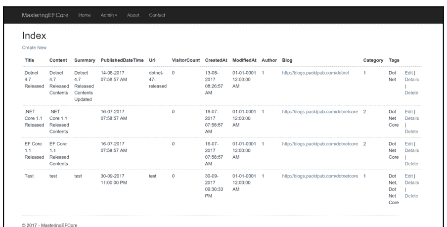
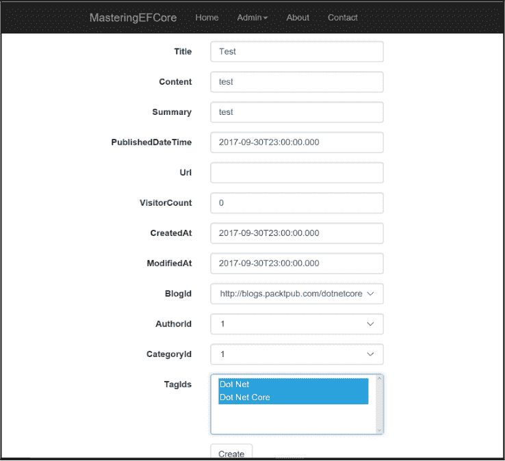
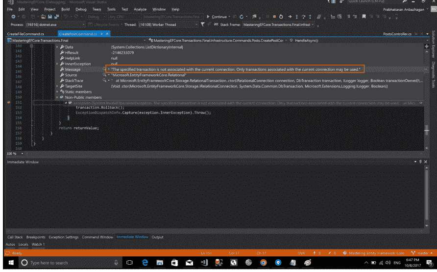
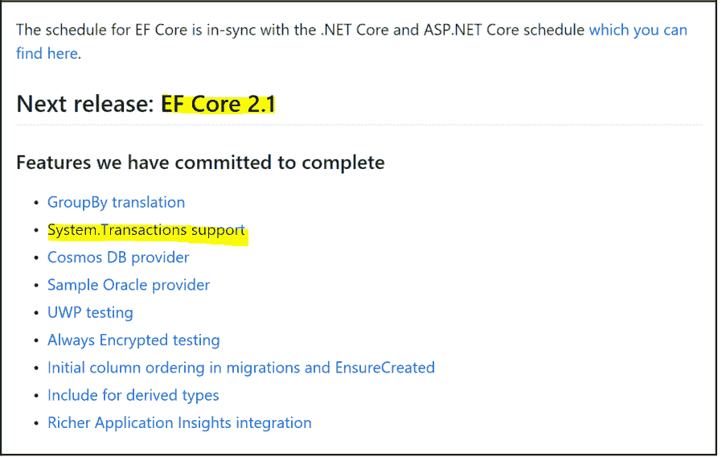
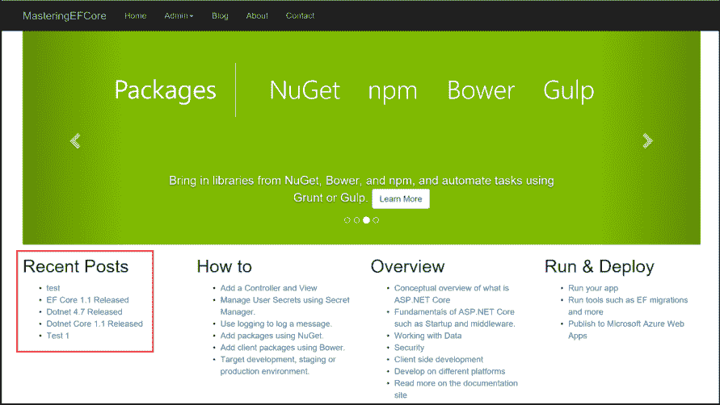
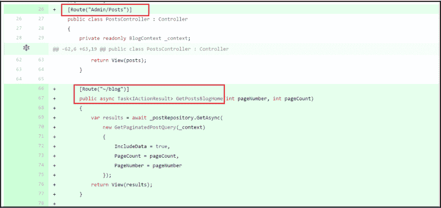
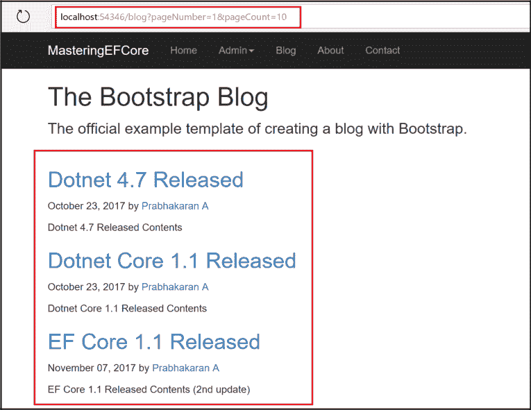
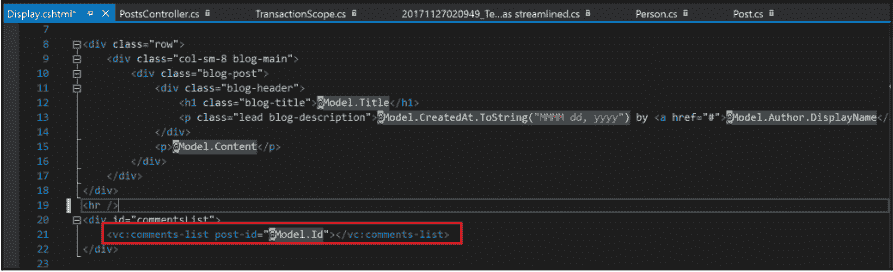
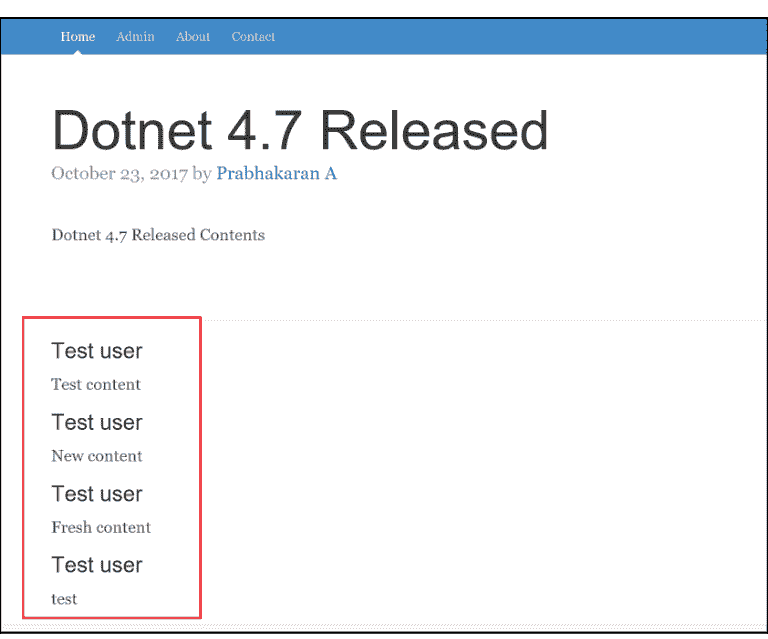
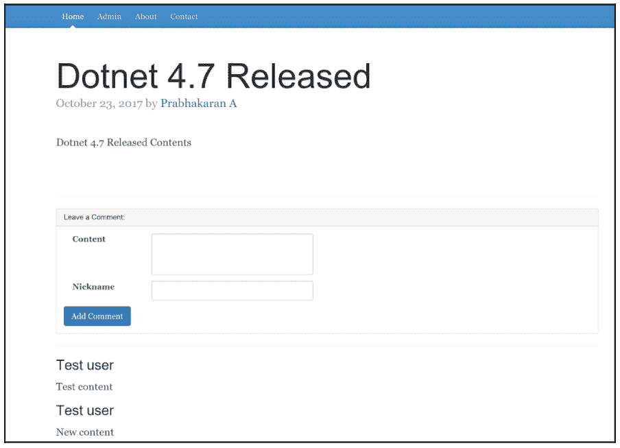

# 9 故障安全机制——事务

# 故障安全机制——
事务

我们应用了查询对象模式，将查询对象与仓库隔离，从而将查询逻辑保持在单一位置。我们创建了一个简单的查询对象，然后设计了一个仓库来演示如何在仓库中容纳查询对象。接着，我们从查询转向命令，使用类似的模式执行真实的事务。最后，我们使用表达式树来简化和配置查询执行中的条件。

让我们讨论如何使用事务处理故障场景、如何在上下文之间访问事务，以及如何在不同的数据访问技术之间使用事务：

+   - 是否存在任何执行多项数据操作活动并处理故障以维持原子性的复杂系统？
+     - 事务允许我们在故障场景中处理原子性。
+   - 我们是否需要在简单应用程序中处理事务？
+     - 不需要。仅当所有更改都通过 `SaveChanges` 提交时，EF 中的默认行为才会处理事务。
+   - 如果我们需要在复杂系统中的多个上下文之间维持事务怎么办？
+     - 我们确实有在多个数据库上下文之间维持事务的机制。

+   - 如果我们需要在复杂系统中的多种技术（EF 和 ADO.NET）之间维持事务怎么办？
+     - 我们确实有在 EF 和 ADO.NET 数据操作之间维持事务的机制。

以下主题将涵盖在多种场景下处理事务的内容：

+   - 事务的默认行为
+   - 创建简单事务
+   - 创建跨上下文事务
+   - 在多种技术之间利用事务

# 事务的默认行为

EF 开箱即用地支持事务，我们只需执行一次 `SaveChanges()`；只有在事务成功执行时它才会保存更改，否则事务将自动回滚。

让我们探讨如何在博客系统中实际利用默认事务行为：

+   - 我们需要两个在单个 Web 请求中更新的实体
+   - 这两个实体都应添加到数据上下文中或在其上更新
+   - 通过一次 `SaveChanges()`，两个实体都将在数据存储中更新

在博客系统中，让我们添加支持，以便在文章中添加一个或多个标签，并同时了解与文章中的标签集成相关的默认事务支持。

# 在博客系统中添加标签支持

本节将介绍在 `Post` 实体中合并标签支持所需的字段。让我们从在 `Post` 模型中包含持久化标签信息所需的字段开始，如下所示：

```
public class Post
{
    // 为简洁起见，代码已省略
    [NotMapped]
    public ICollection<Tag> Tags { get; set; }
}
```

```
[NotMapped]
public ICollection<int> TagIds { get; set; }
[NotMapped]
public string TagNames { get; set; }
}
```

文章列表视图所需的标签信息如下所列：

+   - `Tags`：此标签信息是与文章关联的标签的筛选列表
+   - `TagNames`：此标签信息是以逗号分隔的字符串形式的筛选标签名称

让我们在 `GetAllPostsQuery` 对象中加入所需代码，以将筛选后的标签列表展平为名为 `TagNames` 的字符串。展平后的字符串值将使用 `string.Join()` 进行展平，如下列代码所示：

```
public class GetAllPostsQuery : QueryBase,
    IGetAllPostsQuery<GetAllPostsQuery>
{
    // 为简洁起见，代码已省略
    public IEnumerable<Post> Handle()
    {
        // 为简洁起见，代码已省略
        posts.ForEach(x =>
        {
            var tags = (from tag in Context.Tags
                        join tagPost in Context.TagPosts
                        on tag.Id equals tagPost.TagId
                        where tagPost.PostId == x.Id
                        select tag).ToList();
            x.TagNames = string.Join(", ",
                tags.Select(y => y.Name).ToArray());
        });
        return posts;
    }

    public async Task<IEnumerable<Post>> HandleAsync()
    {
        // 为简洁起见，代码已省略
        posts.ForEach(x =>
        {
            var tags = (from tag in Context.Tags
                        join tagPost in Context.TagPosts
                        on tag.Id equals tagPost.TagId
                        where tagPost.PostId == x.Id
                        select tag).ToList();
```

```
x.TagNames = string.Join(", ",
    tags.Select(y => y.Name).ToArray());
});
    return posts;
}
}
```

标签将显示在文章索引视图中，如下所示：



我们已经看到了博客系统中对标签的支持。在下一节中，让我们探讨默认事务行为如何工作。

# 利用默认事务行为

本节我们将见证 EF 事务的默认行为；让我们继续添加对标签的支持，并看看事务如何自行介入。

单个 `Post` 添加/编辑视图所需的更改如下所列：

+   - `Tags`：此标签信息是与 `Post` 关联的标签的筛选列表
+   - `TagIds`：此标签信息是筛选后的标签 ID 列表
+   - `TagNames`：此标签信息是以逗号分隔的字符串形式的筛选标签名称

让我们在 `GetPostByIdQuery` 对象中加入所需代码，以将筛选后的标签列表、标签 ID 列表和标签名称展平为字符串。这些值将使我们能够在添加/编辑 `Post` 时预选标签：

```
public class GetPostByIdQuery : QueryBase,
    IGetPostByIdQuery<GetPostByIdQuery>
{
    // 为简洁起见，代码已省略
    private Post IncludeTags(Post post)
    {
        int idValue = Id ?? 0;
        post.Tags = (from tag in Context.Tags
                     join tagPost in Context.TagPosts
                     on tag.Id equals tagPost.TagId
                     where tagPost.PostId == idValue
                     select tag).ToList();
        post.TagIds = post.Tags.Select(x => x.Id).ToList();
        post.TagNames = string.Join(", ",
            post.Tags.Select(x => x.Name).ToArray());
        return post;
    }
}
```

在创建/编辑 `Post` 时选择的标签必须持久化到不同的实体 `Tag` 中。让我们看看这在 `CreatePostCommand` 对象中是如何与 `Post` 持久化一起发生的。如果我们注意一下，`Post` 持久化没有任何变化，但 `Tag` 持久化需要具体的 `Post` 对象才能持久化标签。我们需要 `PostId`，它只有在调用 `SaveChanges()` 后才可用，但我们需要在调用 `SaveChanges()` 之前建立这种关联；我们稍后再讨论这一点。在持久化 `Tag` 和 `Post` 后，我们只调用一次 `SaveChanges()` 或 `SaveChangesAsync()`；这确保了持久化在单个事务中发生（EF 默认行为）。


通常，我们会执行两次 SaveChanges()，一次用于 Post，另一次用于 Tag 对象。第一次 SaveChanges() 会插入 Post 并允许我们获取自动生成的 PostId，该 PostId 将用于 Tag 行的创建。我们可以通过只进行一次 SaveChanges() 调用并将整个 Post 对象传递给 Tag 对象来利用默认事务，EF 确保在 Post 行创建后填充 PostId。

EF 确保即使其中任何一个事务失败，变更也会回滚，因为 EF 默认会为我们兜底，我们需要确保只进行一次 SaveChanges() 以利用此事务行为。以下实现对 Post 和 Tag 实体执行写操作，但仅有一次 SaveChanges() 确保事务得以维护：

```csharp
public class CreatePostCommand : CommandBase,
    ICreatePostCommand<int>
{
    // Code removed for brevity
    public ICollection<int> TagIds { get; set; }
    public int Handle()
    {
        Post post = new Post
        {
            // Code removed for brevity
        };
        Context.Add(post);
        foreach (int tagId in TagIds)
        {
            Context.Add(new TagPost
            {
                TagId = tagId,
                Post = post
            });
        }
        return Context.SaveChanges();
    }

    public async Task<int> HandleAsync()
    {
        Post post = new Post
        {
            // Code removed for brevity
        };
        Context.Add(post);
        foreach (int tagId in TagIds)
        {
            Context.Add(new TagPost
            {
                TagId = tagId,
                Post = post
            });
        }
        return await Context.SaveChangesAsync();
    }
```

标签将在 Posts **Add** 视图中列出，显示如下：



`UpdatePostCommand` 和 `DeletePostCommand` 对象也需要进行类似的更改；让我们将其作为作业来完成。


该作业的解决方案可在 Git 仓库中获得，链接如下：
https://goo.gl/feBh9g
https://goo.gl/q5fXRi

我们尚未涵盖之前功能所需的 Controller 和 View 的更新。尽管这似乎超出了范围，但让我们快速介绍一下。Posts 列表视图所需的视图更改（包括 Tags 列）显示如下：

```html
// Code removed for brevity
<table class="table">
  <thead>
    <tr>
      // code removed for brevity
      <th>
        @Html.DisplayNameFor(model => model.Tags)
      </th>
      // Code removed for brevity
    </tr>
  </thead>
  <tbody>
    @foreach (var item in Model) {
    <tr>
      // Code removed for brevity
      <td>
        @Html.DisplayFor(modelItem => item.TagNames)
      </td>
      // Code removed for brevity
    </tr>
    }
  </tbody>
</table>
// Code removed for brevity
```

为 Create 屏幕填充标签下拉列表所需的 Tags 列表以 MultiSelectList 对象的形式持久化在 ViewData 中，这允许用户将多个标签映射到单个帖子。设置 MultiSelectList 字段数据的代码如下所示：

```csharp
public IActionResult Create()
{
  // Code removed for brevity
  ViewData["TagIds"] =
    new MultiSelectList(_context.Tags, "Id", "Name");
}
```

标签在视图中作为 `select` 控件填充，数据源来自 `ViewBag`。此外，我们需要确保启用了 `multiple` 属性；否则，控件将不允许用户选择多个标签。`multiple` 属性的设置如下所示：

```html
<form asp-action="Create">
    <div class="form-horizontal">
        // Code removed for brevity
        <div class="form-group">
            <label asp-for="TagIds" class="col-md-2 control-label"></label>
            <div class="col-md-10">
                <select asp-for="TagIds" class="form-control"
                        asp-items="ViewBag.TagIds" multiple="multiple"></select>
            </div>
        </div>
        // Code removed for brevity
    </div>
</form>
```

在 `Post` 操作中，我们仍然持久化 `MultiSelectList`，但这次我们将选定的 `TagIds` 与源数据一起传递。这确保了如果在重新填充视图时出现模型错误，标签控件将使用模型中的值预先选中。`TagIds` 字段应包含在视图模型白名单中，最后 `MultiSelectList` 使用 `TagIds` 填充，如以下代码所示：

```csharp
public async Task<ActionResult>
Create([Bind("Id,Title,Content,Summary,PublishedDateTime,Url,VisitorCount,CreatedAt,ModifiedAt,BlogId,AuthorId,CategoryId,TagIds")] Post post)
{
    // Code removed for brevity
    ViewData["TagIds"] = new MultiSelectList(_context.Tags, "Id",
        "Name", post.TagIds);
    return View(post);
}
```

对帖子的 `Update` 和 `Delete` 操作也需要进行类似的更改。让我们将其作为作业来完成；该作业的解决方案可在 Git 仓库中获得。这结束了本节中事务的默认行为；让我们在下一节中探索创建简单事务。

## 创建一个简单事务

我们已经看到了如果多次持久化发生在单个 SaveChanges() 内的事务的默认行为，如果我们有一个业务需求需要多次 SaveChanges()，并且仍然需要维护事务范围怎么办？我们有明确定义事务并将所需更改引入此范围的机制；EF 在 Context 中公开了 Database 类型，该类型具有 BeginTransaction() 功能。

让我们尝试在 CreatePostCommand 类型中实现上述功能，同时仍然维护事务范围。我们可以通过使用 BeginTransaction() 函数检索事务对象来实现相同目的；检索到的对象可用于提交或回滚更改。以下代码在持久化 Post 和 Tag 对象后提交更改：

```csharp
public class CreatePostCommand : CommandBase, ICreatePostCommand<int>
{
    // Code removed for brevity
    public int Handle()
    {
        int returnValue;
        using (var transaction = Context.Database.BeginTransaction())
        {
            // Code removed for brevity
            Context.Add(post);
            returnValue = Context.SaveChanges();
            foreach (int tagId in TagIds)
            {
                Context.Add(new TagPost
                {
                    TagId = tagId,
                    Post = post
                });
            }
            returnValue = Context.SaveChanges();

            transaction.Commit();
        }
        return returnValue;
    }

    public async Task<int> HandleAsync()
    {
        int returnValue;
        using (var transaction = Context.Database.BeginTransaction())
        {
            // Code removed for brevity
            Context.Add(post);
            returnValue = await Context.SaveChangesAsync();
            foreach (int tagId in TagIds)
            {
                Context.Add(new TagPost
                {
                    TagId = tagId,
                    Post = post
                });
            }
            returnValue = await Context.SaveChangesAsync();

            transaction.Commit();
        }
        return returnValue;
    }
```

同样，事务也支持 Update 和 Delete 操作；相关代码如下所示：

```csharp
public class UpdatePostCommand : CommandBase, ICreatePostCommand<int>
{
    // Code removed for brevity
    public int Handle()
    {
        int returnValue;
        using (var transaction = Context.Database.BeginTransaction())
        {
            // Code removed for brevity
            returnValue = Context.SaveChanges();
            UpdateTags();
            returnValue = Context.SaveChanges();
            transaction.Commit();
        }
        return returnValue;
    }

    public async Task<int> HandleAsync()
    {
        int returnValue;
        using (var transaction = Context.Database.BeginTransaction())
        {
            // Code removed for brevity
            returnValue = await Context.SaveChangesAsync();
            UpdateTags();
```


returnValue = await Context.SaveChangesAsync();
transaction.Commit();
}
return returnValue;
}
// Code removed for brevity
}

删除操作所需的代码如下：

```
public class DeletePostCommand : CommandBase, ICreatePostCommand<int>
{
    // Code removed for brevity
    public int Handle()
    {
        int returnValue;
        using (var transaction = Context.Database.BeginTransaction())
        {
            DeletePost();
            returnValue = Context.SaveChanges();
            DeleteTag();
            returnValue = Context.SaveChanges();
            transaction.Commit();
        }
        return returnValue;
    }

    public async Task<int> HandleAsync()
    {
        int returnValue;
        using (var transaction = Context.Database.BeginTransaction())
        {
            DeletePost();
            returnValue = await Context.SaveChangesAsync();
            DeleteTag();
            returnValue = await Context.SaveChangesAsync();
            transaction.Commit();
        }
        return returnValue;
    }
    // Code removed for brevity
}
```

## 科普天文学的现状与思考

孙正凡 (上海科学技术出版社)

天文科普是科学传播的重要组成部分。近年来,随着我国航天事业的发展和天文学研究的进步,社会公众对天文学的兴趣日渐浓厚,天文科普事业也迎来了新的机遇和挑战。

天文学是一门观测科学,离不开大型观测设备的支撑。但普通公众接触天文学,更多是通过媒体和科普活动。当前天文科普工作中存在的主要问题,一是专业天文学家参与科普的积极性不足,二是科普内容同质化现象比较突出,三是缺乏系统性的科普人才培养机制。

针对上述问题,我认为应当从以下几个方面入手改进天文科普工作:第一,鼓励更多的天文学家利用业余时间参与公众科普;第二,结合科技热点和新闻事件,及时开展有针对性的科普活动;第三,探索天文科普的新形式,让公众能够参与真实的天文数据处理,提升参与感和获得感。

令人欣喜的是,新一代天文从业者已经充分认识到科普的重要性,在做好科研工作的同时,积极投身于面向公众的天文知识传播。这种自觉的科普意识,正是天文科普事业持续发展的希望所在。

参考文献:
[1] 刘慈欣. 三体[M]. 重庆出版社, 2008.
[2] 卡尔·萨根. 宇宙[M]. 吉林人民出版社, 1998.
[3] 卞毓麟. 星星离我们有多远[M]. 湖南教育出版社, 2000.

我们需要命令接口 `ICreateFileCommand` 来定义 `CreateFileCommand` 执行所需的处理程序。我们将使用现有的 `ICommandHandler` 和 `ICommandHandleAsync` 作为基类型，如下所示：

```
public interface ICreateFileCommand<TReturn> :
    ICommandHandler<TReturn>, ICommandHandlerAsync<TReturn>
{
}
```

由于 `CommandBase` 使用博客上下文，我们需要一个单独的带有博客文件数据上下文的 `CommandFileBase`；`BlogFilesContext` 被 `CommandFileBase` 所使用，如下面代码所示：

```
public class CommandFileBase
{
    internal readonly BlogFilesContext Context;
    public CommandFileBase(BlogFilesContext context)
    {
        Context = context;
    }
}
```

`CreateFileCommand` 类型执行文件持久化，它维护事务，也使用通过构造函数传递给它的事务；通过构造函数共享的事务及其用法如下面代码所示：

```
public class CreateFileCommand : CommandFileBase,
    ICreateFileCommand<int>
{
    private readonly DbTransaction _dbTransaction;
    public CreateFileCommand(BlogFilesContext context) : base(context)
    {
    }
    public CreateFileCommand(BlogFilesContext context, DbTransaction
        dbTransaction)
        : this(context)
    {
        _dbTransaction = dbTransaction;
    }
    public Guid Id { get; set; }
    public string ContentType { get; set; }
    public string ContentDisposition { get; set; }
    public byte[] Content { get; set; }
    public long Length { get; set; }
    public string Name { get; set; }
```

```csharp
public string FileName { get; set; }
public int Handle()
{
    int returnValue = 0;
    using (var transaction = _dbTransaction != null
        ? Context.Database.UseTransaction(_dbTransaction)
        : Context.Database.BeginTransaction())
    {
        try
        {
            AddFile();
            returnValue = Context.SaveChanges();
            transaction.Commit();
        }
        catch (Exception exception)
        {
            transaction.Rollback();
            ExceptionDispatchInfo.Capture
                (exception.InnerException).Throw();
        }
    }
    return returnValue;
}
private void AddFile()
{
    File file = new File()
    {
        Id = Guid.NewGuid(),
        Name = Name,
        FileName = FileName,
        Content = Content,
        Length = Length,
        ContentType = ContentType
    };
    Context.Add(file);
}
public async Task<int> HandleAsync()
{
    int returnValue = 0;
    using (var transaction = _dbTransaction != null
        ? Context.Database.UseTransaction(_dbTransaction)
        : Context.Database.BeginTransaction())
    {
        try
        {
            AddFile();
            returnValue = await Context.SaveChangesAsync();
            transaction.Commit();
```

```
}
catch (Exception exception)
{
    transaction.Rollback();
    ExceptionDispatchInfo.Capture(
        exception.InnerException).Throw();
}
}
return returnValue;
}
```

Update 和 Delete 操作也需要类似的更改；让我们将其作为一个任务来完成。

该任务的解决方案在 Git 仓库中可用，文件持久化的核心实现可在 https://goo.gl/CUxFs9 获取。
文件持久化的具体实现可在 https://goo.gl/1fEbCa 获取。

`CreatePostCommand` 接收文件以及帖子内容。它创建事务并执行帖子持久化，并将其事务传递给文件命令，文件命令在其中持久化文件并重用事务，如下面代码中突出显示的那样：

```
public class CreatePostCommand : CommandBase, ICreatePostCommand<int>
{
    // Code removed for brevity
    public CreatePostCommand(BlogContext context, BlogFilesContext blogFilesContext)
        : this(context)
    {
        _blogFilesContext = blogFilesContext;
    }
    // Code removed for brevity
    public ICollection<int> TagIds { get; set; }
    public File File { get; set; }
    public int Handle()
    {
        // Code removed for brevity
    }
    public async Task<int> HandleAsync()
    {
        int returnValue = 0;using (var transaction =
            Context.Database.BeginTransaction())
```

```
{
    try
    {
        CreateFileCommand createFileCommand =
        new CreateFileCommand(_blogFilesContext,
        transaction.GetDbTransaction())
        {
            Id = Guid.NewGuid(),
            Name = File.Name,
            FileName = File.FileName,
            Content = File.Content,
            Length = File.Length,
            ContentType = File.ContentType,
            ContentDisposition = File.ContentDisposition
        };
        returnValue = await createFileCommand.HandleAsync();
        Post post = new Post
        {
            // Code removed for brevity
            FileId = File.Id
        };
        // Code removed for brevity
        foreach (int tagId in TagIds)
        {
            Context.Add(new TagPost
            {
                TagId = tagId,
                Post = post
            });
        }
        returnValue = await Context.SaveChangesAsync();
        transaction.Commit();
    }
    catch (Exception exception)
    {
        transaction.Rollback();
        ExceptionDispatchInfo.
            Capture(exception.InnerException).Throw();
    }
    return returnValue;
}
```

Update 和 Delete 操作也需要类似的更改；让我们将其作为一个任务来完成。

该任务的解决方案可在 Git 仓库中获取，地址为 https://goo.gl/FDP1q4。

Create 操作支持文件上传功能，文件内容被传递给创建命令以将文件内容持久化到文件上下文。以下代码在控制器的 Create 操作中提供了文件上传支持：

```
public async Task<IActionResult> Create([Bind("Id,Title,Content,Summary," + "PublishedDateTime,Url,VisitorCount,CreatedAt,ModifiedAt,BlogId," + "AuthorId,CategoryId,TagIds")] Post post, IFormFile headerImage)
{
    if (ModelState.IsValid)
    {
        Models.File file = null;
        if (headerImage != null ||
            headerImage.ContentType.ToLower().StartsWith("image/"))
        {
            MemoryStream ms = new MemoryStream();
            headerImage.OpenReadStream().CopyTo(ms);
            file = new Models.File()
            {
                Id = Guid.NewGuid(),
                Name = headerImage.Name,
                FileName = headerImage.FileName,
                Content = ms.ToArray(),
                Length = headerImage.Length,
                ContentType = headerImage.ContentType
            };
        }
        await _postRepository.ExecuteAsync(
            new CreatePostCommand(_context, _filesContext)
            {
                // Code removed for brevity
                TagIds = post.TagIds,
                File = file
            });
        return RedirectToAction("Index");
    }
    // Code removed for brevity
}
```


更新和删除操作也需要进行类似的更改；我们将其作为一项作业来完成。


该作业的解决方案可在 Git 仓库 https://goo.gl/HWZXkC 中获取。

我们已经了解了文件上传功能，并在上下文持久化之间共享了数据库事务；现在让我们看看它是否按预期工作。

## 事务范围的限制

EF Core 在涉及两个不同连接之间的多个数据上下文时存在一个限制。如果我们尝试执行当前代码，将会收到以下错误，提示消息：“指定的事务未与当前连接关联。只能使用与当前连接关联的事务”：



为了支持不同数据上下文（甚至不同连接）之间的事务，需要显式的 `TransactionScope`；它在当前的 EF 中仍然不可用。


EF 中可用的 `TransactionScope` 尚未得到 EF Core 的支持。它最初计划在 EF Core 2.0 中发布，但最终未包含在该框架中。现在，微软 EF 团队目前计划在 2018 年上半年推出 v2.1 框架，`System.Transactions` 应该会成为该版本的一部分。

我们必须密切关注后续更新的发布；以下截图确认了事务将在 EF Core 2.1 版本中得到支持：



EF Core 事务范围的局限性绝不应阻碍我们的开发。因此，在下一节中，让我们创建自己的自定义 `TransactionScope`，它将实现相同的功能。

## 自定义事务范围支持

可以通过定义一个接口来创建事务范围，该接口要求我们实现 Commit() 或 Rollback()。自定义事务接口所需的契约如下代码所示：

```
public interface ITransactionScope
{
    void Commit();
    void Rollback();
}
```

数据库事务被维护/记录在一个事务列表中，该列表随后用于对整组事务对象执行 Commit() 或 Rollback()。为了在 using 语句中使用 TransactionScope，我们还需要继承并实现 IDisposable。维护 Commit() 和 Rollback() 的自定义 TransactionScope 实现如下代码所示：

```
public class TransactionScope : ITransactionScope, IDisposable
{
    // Flag: Has Dispose already been called?
    private bool disposed = false;
    public TransactionScope()
    {
        Transactions = new List<IDbContextTransaction>();
    }
    ~TransactionScope()
    {
        Dispose(false);
    }
    public List<IDbContextTransaction> Transactions { get; set; }
    public void Commit()
    {
        Transactions.ForEach(item =>
        {
            item.Commit();
        });
    }
    public void Rollback()
    {
        Transactions.ForEach(item =>
        {
            item.Rollback();
        });
    }
    public void Dispose()
    {
        Dispose(true);
        GC.SuppressFinalize(this);
    }
    protected virtual void Dispose(bool disposing)
    {
        if (disposed)
            return;
        if (disposing)
        {
            // Free any other managed objects here.
            //
        }
        // Free any unmanaged objects here.
        //
        disposed = true;
    }
}
```

我们已经了解了博客系统的文件实现/支持，我们可以开始创建一个允许执行持久化的仓库。目前，让我们在仓库中支持 Execute() 和 ExecuteAsync()，接口所需的契约定义如下代码所示：

```
public interface IFileRepository
{
    int Execute<T>(T command) where T : ICommandHandler<int>;
    Task<int> ExecuteAsync<T>(T command)
        where T : ICommandHandlerAsync<int>;
}
```

FileRepository 的具体实现将使用博客文件上下文，并调用为持久化操作创建的文件命令，控制器则使用该仓库来实现相应功能，如下代码所示：

```
public class FileRepository : IFileRepository
{
    private readonly BlogFilesContext _context;
    public FileRepository(BlogFilesContext context)
    {
        _context = context;
    }
    public int Execute<T>(T command) where T : ICommandHandler<int>
    {
        return command.Handle();
    }
    public async Task<int> ExecuteAsync<T>(T command)
        where T : ICommandHandlerAsync<int>
    {
        return await command.HandleAsync();
    }
}
```

只有在 ConfigureServices() 中为 FileRepository 提供支持时，才能进行仓库注入，它会将具体对象注入到任何需要的地方。以下配置会将具体对象注入到任何需要该类型的地方：

```
public void ConfigureServices(IServiceCollection services)
{
    // Code removed for brevity
    services.AddScoped<IFileRepository, FileRepository>();
}
```

我们可以在下面的 PostsController 中看到代码实现，它通过构造函数使用依赖注入来使用 FileRepository：

```
public class PostsController : Controller
{
    // Code removed for brevity
    private readonly IFileRepository _fileRepository;
    public PostsController(BlogContext context, BlogFilesContext filesContext, IPostRepository repository, IFileRepository fileRepository)
    {
        // Code removed for brevity
        _fileRepository = fileRepository;
    }
}
```

注入的仓库随后将用于文章的 CRUD 操作。我们的主要焦点是自定义 TransactionScope 的用法，其中添加了多个事务。当文件仓库和文章仓库都成功执行时，我们提交事务范围，否则回滚更改。自定义事务范围实现所需的代码突出显示如下：

```
public async Task<IActionResult> Create([Bind("Id,Title,Content,Summary," + "PublishedDateTime,Url,VisitorCount,CreatedAt, ModifiedAt,BlogId," + "AuthorId,CategoryId,TagIds")] Post post, IFormFile headerImage)
{
    if (ModelState.IsValid)
    {
        // Code removed for brevity
        var transactions = new TransactionScope();
        try
        {
            transactions.Transactions.Add
                (_filesContext.Database.BeginTransaction());
            await _fileRepository.ExecuteAsync(
                new CreateFileCommand(_filesContext)
                {
                    // Code removed for brevity
                    Id = file.Id
                });
            transactions.Transactions.Add(
                _context.Database.BeginTransaction());
            await _postRepository.ExecuteAsync(
                new CreatePostCommand(_context)
                {
                    // Code removed for brevity
                    FileId = file.Id
                });
            transactions.Commit();
        }
        catch (Exception exception)
        {
            transactions.Rollback();
            ExceptionDispatchInfo.Capture(
                exception.InnerException).Throw();
        }
        return RedirectToAction("Index");
        // Code removed for brevity
    }
}
```

更新和删除操作也需要进行类似的更改；我们将其作为一项作业来完成。


该作业的解决方案可在以下 Git 仓库提交中获取：
https://goo.gl/yLubPh

我们已经了解了不同上下文之间的事务范围及其局限性，并创建了我们自己的自定义事务范围。在下一节中，我们将添加一些早就应该完成的功能。让我们为解决方案添加一个日期选择器，没有它，我们总是难以进行重复测试。

## 为博客系统添加日期选择器支持

我们可以通过导入 moment 和 datetimepicker 来为系统添加日期选择器，这需要样式表和 JavaScript。所需的库已包含在 _Layout.cshtml 中，如下所示：

```
// Code removed for brevity
<head>
// Code removed for brevity
<environment names="Development">
    // Code removed for brevity
    <link rel="stylesheet" href="~/lib/eonasdan-bootstrap-datetimepicker/build/css/bootstrap-datetimepicker.css" />
</environment>
<environment names="Staging,Production">
    // Code removed for brevity
    <link rel="stylesheet" href="~/lib/eonasdan-bootstrap-datetimepicker/build/css/bootstrap-datetimepicker.min.css" />
</environment>
</head>
<body>
    // Code removed for brevity
    <environment names="Development">
        // Code removed for brevity
        <script src="~/lib/moment/moment.js"></script>
        <script src="~/lib/eonasdan-bootstrap-datetimepicker/src/js/bootstrap-datetimepicker.js"></script>
    </environment>
    <environment names="Staging,Production">
        // Code removed for brevity
        <script src="~/lib/moment/min/moment.min.js"></script>
        <script src="~/lib/eonasdan-bootstrap-datetimepicker/build/js/bootstrap-datetimepicker.min.js"></script>
    </environment>
</body>
```

在输入控件上添加了 datepicker 类，这需要实现 datepicker，并在 JavaScript 代码中执行日期选择器的初始化。在本节，在处理文件上传功能时，我们包含了 input file 类型，它允许我们从 UI 将文件内容上传到控制器操作：

```
// Code removed for brevity
<form asp-action="Create" enctype="multipart/form-data">
<div class="form-horizontal">
    // Code removed for brevity
</form>
```


```
<div class="form-group">
    <label class="col-md-2 control-label">Header Image</label>
    <div class="col-md-10">
        <input type="file" id="headerImage" name="headerImage" />
    </div>
</div>
// Code removed for brevity
<div class="form-group">
    <label asp-for="PublishedDateTime" class="col-md-2 control-label"></label>
    <div class="col-md-10">
        <input asp-for="PublishedDateTime" class="form-control datepicker" />
        <span asp-validation-for="PublishedDateTime" class="text-danger"></span>
    </div>
</div>
// Code removed for brevity
<div class="form-group">
    <label asp-for="TagIds" class="col-md-2 control-label"></label>
    <div class="col-md-10">
        <select asp-for="TagIds" class="form-control" asp-items="ViewBag.TagIds" multiple="multiple"></select>
    </div>
</div>
// Code removed for brevity
</div>
</form>
// Code removed for brevity
@section Scripts {
    // Code removed for brevity
    <script>
        // Code removed for brevity
        $('.datepicker').datetimepicker();
    </script>
}
```

我们已经在 Post 视图中看到了 datepicker 的集成以及文件上传输入类型的包含。在下一节中，我们将看到如何在多种技术之间维护事务。

## 在多种技术之间利用事务

为了说明多种技术之间的事务，让我们实现博客系统中的一些缺失功能。这样一来，书籍结束时我们将拥有一个成熟、可部署的博客系统，同时在过程中学习相关概念。本节可以考虑的功能有：

- Recent Posts (anonymous)
- Post View (anonymous)
- Comments list to a blog post
- Adding comments to a blog post

让我们看看在当前章节中将如何使用这些功能。

## 为博客系统添加最近文章支持

最近文章功能可以通过执行以下步骤添加到系统中：

- 1. 创建一个 IGetRecentPostQuery 查询对象接口。
- 2. 创建一个 GetRecentPostQuery 具体查询对象。
- 3. 创建一个 RecentPostsViewComponent 视图组件。
- 4. 在 Shared | Components | RecentPosts 下创建 Default.cshtml 视图。
- 5. 使用视图组件名称及其参数执行组件调用。

为了减少代码占用并在向博客系统添加功能时保持简洁，让我们从 Git 仓库提交中维护和共享代码。前面列出的实现已完成并可在以下 Git 仓库提交中找到：

```
https://goo.gl/kcWD3P
```

我们将使用 **View** 组件来渲染最近文章。它是一个新概念，用来替代 ASP.NET MVC Core 中的子操作，详细解释超出了本范围，请参考以下官方文档了解更多信息：

https://docs.microsoft.com/en-us/aspnet/core/mvc/views/view-components

以下截图将 **Recent Posts** 作为视图组件渲染：



我们已经看到了将最近文章包含到系统所需的更改。在下一节中，让我们重点关注匿名文章如何被列出以及如何显示单个匿名文章。

## 匿名文章列表和单个博客文章

匿名文章列表和单个博客文章 **View** 功能可以通过执行以下步骤添加到系统中：

- 1. 将当前文章列表路由更改为 admin 路由。
- 2. 同样将当前显示文章路由更改为 admin 路由。
- 3. 创建一个 `IGetPaginatedPostQuery` 查询对象接口。
- 4. 创建一个 `GetPaginatedPostQuery` 具体查询对象。
- 5. 创建一个用于匿名列出博客的 action，`GetPostsBlogHome()`。
- 6. 创建一个用于匿名显示博客的 action，`Display()`。
- 7. 专门为博客创建一个布局，因为大多数网站在着陆页和博客之间使用不同的布局。
- 8. 在 Posts 视图文件夹下创建视图 `GetPostsBlogHome.cshtml`。
- 9. 同样在 Posts 视图文件夹下创建视图 `Display.cshtml`。
- 10. 提供适当的超链接及其更新。

前面列出的实现已完成并可在以下 Git 仓库提交中找到：

https://goo.gl/VPVUBg

我们需要向匿名用户展示文章，并仅让授权用户查看编辑文章的管理视图。为了实现此功能，我们修改了 posts 控制器的路由，使其包裹在 `Admin` 内部，并使用特性路由将匿名文章列表移动到根目录（波浪号 `~` 符号用于重新定义 API 路由），如下图所示：



匿名文章列表视图将使用前面列出的 action 进行消费，该 action 将被渲染，如下图所示，在高亮配置的 `~/blog` 路由中：



我们已经看到了包含匿名文章列表所需的更改，显示单个博客文章所需的类似更改也在同一仓库提交页面中可用。在下一节中，让我们重点关注评论如何被列出。

## 列出评论

评论列表功能可以通过执行以下步骤添加到系统中：

- 1. 创建一个仓库接口，`ICommentRepository`。
- 2. 创建一个仓库对象，`CommentRepository`。
- 3. 创建一个查询对象接口，`IGetCommentsByPostQuery`。
- 4. 创建一个具体查询对象，`GetCommentsByPostQuery`。
- 5. 在 Startup 文件中配置 `CommentRepository` 注入。
- 6. 创建一个 **View** 组件，`CommentsListViewComponent`。
- 7. 在
   **Shared | Components | CommentsList** 下创建 **View**，`Default.cshtml`。
- 8. 在 `_ViewImports.cshtml` 中包含当前库以支持自定义标签助手。
- 9. 使用自定义标签助手 `<vc:comments>` 添加组件。

前面列出的实现已完成并可在以下 Git 仓库提交中找到：

https://goo.gl/HqzNF

**View** 组件渲染的评论列表显示在以下截图中：



在匿名博客中使用 View 组件渲染的评论列表显示在以下截图中：



我们已经看到了将 Post 评论包含到系统所需的更改。在下一节中，让我们重点关注评论如何被添加。

## 使用外部数据库事务添加评论

评论列表功能可以通过执行以下步骤添加到系统中：

- 1. 从 `Startup` 文件注入 `IConfigurationRoot`。
- 2. 在 `ICommentRepository` 接口中添加 `Execute` 方法。
- 3. 在 `CommentRepository` 具体类型中添加 `Execute` 方法。

```
```csharp
{
    connection.Open();
    using (var transaction = connection.BeginTransaction())
    {
        try
        {
            using (SqlCommand sqlCommand = new SqlCommand(
                "INSERT INTO Person(Nickname) " +
                "output INSERTED.ID VALUES (@Nickname)", connection))
            {
                sqlCommand.Parameters.AddWithValue("@FirstName",
                    Nickname);
                sqlCommand.Transaction = transaction;
                int personId = (int)sqlCommand.ExecuteScalar();

                var options = new DbContextOptionsBuilder<BlogContext>()
                    .UseSqlServer(connection)
                    .Options;
                using (var context = new BlogContext(options))
                {
                    Comment comment = new Comment
                    {
                        Content = Content,
                        PostId = PostId,
                        CreatedAt = DateTime.Now,
                        ModifiedAt = DateTime.Now,
                        CommentedAt = DateTime.Now,
                        PersonId = personId,
                        CreatedBy = personId,
                        ModifiedBy = personId
                    };

                    context.Database.UseTransaction(transaction);
                    context.Comments.Add(comment);
                    returnValue = context.SaveChanges();
                }
                transaction.Commit();
                if (connection.State == System.Data.ConnectionState.Open)
                    connection.Close();
                return returnValue;
            }
        }
        catch (Exception exception)
        {
            transaction.Rollback();
            ExceptionDispatchInfo.Capture(
                exception.InnerException).Throw();
        }
    }
}
```
```


```
}
}
    return returnValue;
}
// Code removed for brevity
}
```

前面列出的实现已在以下 Git 仓库提交中完成并提供：

https://goo.gl/1CJDLv

为博客文章添加评论所需的实现已包含在上述共享的 Git 仓库提交中，**添加评论**视图的 **View** 组件渲染效果如下图所示：



在本节中，我们看到了在多种技术之间创建并维护的事务，这完成了多种技术之间事务的实现。

## 总结

我们探讨了如何利用 EF 中的默认事务行为，该行为仅在通过单个 `SaveChanges()` 执行多个操作时才能被利用。然后我们创建了一个简单事务，它允许我们在多个 `SaveChanges()` 提交之间维护事务。接着，我们创建了跨上下文事务，识别了它们的局限性，并通过我们在本章中构建的自定义 `TransactionScope` 克服了这些局限性。最后，我们创建了一个在多种技术之间维护的事务，前提是它共享连接和事务对象。不同的事务处理方式确保如果出现任何问题，它们都将得到处理，确保我们在单个或多个不同数据上下文之间，甚至在不同技术之间构建了故障安全机制。

到目前为止，我们一直在处理单个用户的情况，尚未考虑如果存在并发用户会发生什么。在*第10章，使其真实——处理并发*中，我们将重新审视应用程序，并处理到目前为止我们所执行的所有事务中的并发问题。
