# 10 使其真实——处理并发

我们已经探讨了事务，没有事务，现实世界中的交易是不可能实现的。我们从默认行为开始，然后继续创建事务。之后，我们了解了事务如何在上下文之间共享，最后我们通过了解外部事务如何处理作为总结。

让我们识别与现实世界中的并发相关的问题，我们将看到如何使用 EF Core 框架来处理它们：

-   在现实世界的应用程序中，同一数据存储可能会被不同模块同时访问。EF Core 如何处理这些持久化操作？
    -   EF Core 有一些并发技术，帮助我们创建故障安全机制。
-   EF Core 通过何种机制公开并发技术？
    -   它通过常用的技术——数据注释和 Fluent API——来公开它们。
-   我们是否需要为支持并发而在设计中添加任何内容？
    -   这是一个悖论；既是也不是。如果我们将某一列标记为进行并发检查，则不需要更改架构；否则，我们需要引入时间戳/日期行版本列。
-   我们是否有办法在数据模型中不包含这样的列，但仍然支持并发令牌？
    -   是的，这完全可行。在`第3章，关系——术语和约定`的*无外键属性*部分中，我们讨论了阴影属性。同样的概念可以应用到这里，EF Core 在上下文中进行内部并发检查，而无需在数据模型中公开它们。
-   没有什么是绝对安全的。即使我们构建了处理并发的机制，如果遇到这种冲突，我们有什么控制手段？行动项目是什么？我们如何确保应用程序真正故障安全？
    -   我们可以捕获并发问题，并处理当前值、原始值和数据库值来解决它们。

本章将包含的章节如下：

-   在 EF 中处理并发
-   引入并发令牌
-   通过阴影属性实现并发令牌
-   基于时间戳/行版本的并发令牌
-   处理并发冲突

### 在 EF 中处理并发

想象一下，如果我们是被指派在博客系统中开发/处理并发的开发人员，我们的起点会是什么？分析会为我们提供关于处理并发需要什么的答案。最重要的是，它将帮助我们理解并发冲突以及如何处理它。

我们将探讨并发冲突是如何发生的，以及需要采取什么措施来处理它。最后，我们将看到 EF Core 团队是如何处理它的。

### 理解并发冲突

我们需要设想在一般情况下我们会在哪里遇到这个问题，当用户试图更新过期数据时，这意味着自从对象被填充以来，数据库中的底层数据已经发生了变化。那么我们就有一个需要在上线之前解决的问题。如果我们不处理并发，那么最后更新的用户将保留其更改，覆盖其他用户更新的数据。

在现实世界的应用程序中，没有单个用户会在单个时间点访问应用程序，多个用户使用应用程序，这会使得数据存储的持久化变得复杂。

让我们看看此类应用程序中出现的一些场景：

-   两个用户同时尝试更新同一个实体
-   如果其中一个用户在第一次持久化中成功，那么我们最终会被第二个用户覆盖同一个实体

这就是我们的兴趣点，可以称之为**并发冲突**。要重现该问题，请在两个选项卡中打开**编辑帖子**页面。假设第一个选项卡中的第一个用户正在更新帖子信息，例如编辑博客帖子的**标题**和**内容**：

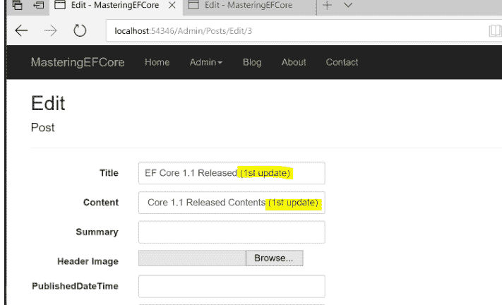

第二个选项卡中的另一个用户尝试修改**帖子内容**，该用户并不知道另一个用户（来自第一个选项卡）在**帖子标题**和内容中所做的更改：

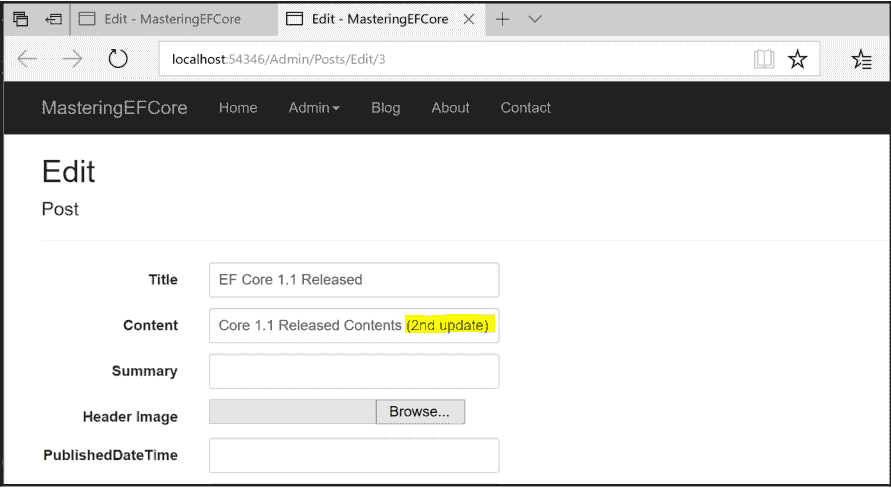

**帖子**列表显示第一个用户所做的更改已被第二个用户覆盖：

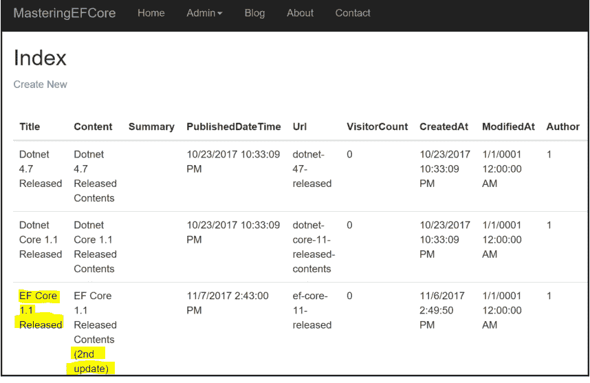

第一个用户提交的更改不应在不考虑数据库中更新数据的情况下被新数据移除/覆盖。这是一个并发问题，我们将在下一节中进一步讨论。

### 乐观并发

乐观并发允许并发冲突发生，应用程序应做出适当的响应，如下表所示：

-   跟踪实体的每个属性/列的更改，这允许我们在不影响数据库中过期数据的情况下持久化更改，前提是两个更改发生在不同的属性上
-   通过突出显示数据存储中的当前值并允许用户重新查看其数据以进行进一步持久化，从而阻止更改被更新
-   用最新更改覆盖，并忽略数据存储中已更新的数据

乐观并发可以应用于更注重性能的应用程序，并且仅在冲突期间用户才会花费额外时间。这确保了在大多数情况下时间被明智地花费，因为我们的常规操作没有额外开销。乐观并发方法的权衡在于，我们将处理冲突并将适当的数据存储到数据库的任务留给了开发人员和用户。

我们已经了解了乐观并发；让我们在下一节中探讨悲观并发。

### 悲观并发

顾名思义，我们在数据存储上执行锁，以防止用户更新过期数据，但代价是性能。是的，由数据存储管理这些锁会消耗更多资源，这反过来又会影响性能。这可以通过以下方式实现：

-   在从数据存储读取/向数据存储更新数据时，我们将请求一个锁，用于其他只读或更新访问：
    -   锁定一行以进行只读访问将允许其他用户获得只读锁，但不能获得更新锁
    -   锁定一行以进行更新访问将不允许任何其他用户获得只读或更新锁

悲观并发可以应用于用户对数据非常具体，并且不会为了性能而妥协数据处理方式的应用程序中。持久化的数据将始终是有效的，或者换句话说，我们可能永远不会遇到冲突，但代价是巨大的性能。每次持久化都会涉及额外开销，以确保我们永远不会遇到数据持久化冲突。在大多数场景中，我们永远不会为了性能而妥协，因此采用这种方法的情况非常罕见。


- 如果并发列包含有效数据，就可以执行更新

下面的流程图可以直观地展示该算法：

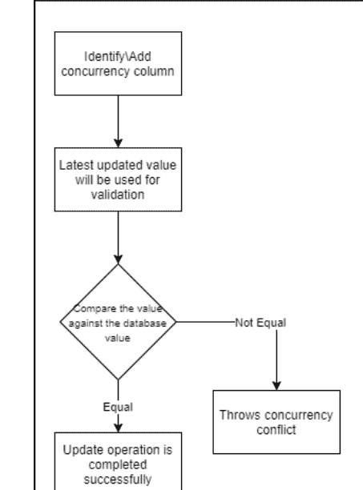

让我们将上述算法可视化，以解决我们在更新帖子时遇到的并发冲突：

- **Post** 实体将 `Timestamp` 列标识并配置为并发检查列
- 并发实现要求 `Timestamp` 列是有效的：
  - 我们发送给框架进行更新的 **Post** 模型将包含：
    - 作为字节数组的当前 `Timestamp` 值
    - 在显示更新界面前从数据库中获取的原始 `Timestamp` 值

- 给定行的 `Timestamp` 原始值应与数据库中现有的 `Timestamp` 值匹配
- 如果值不匹配，则应抛出并发异常
- 如果值匹配，则更新被视为有效，框架允许更新数据存储

接下来，我们将探讨微软团队实际实现并发令牌机制的方式：

- EF Core 引入了一个自定义的 `Timestamp` 特性。开发人员应将某一列标记为并发列
- 框架会特别处理该列，将上下文中从并发列加载的数据标记为并发令牌的原始值
- 当用户尝试更新记录时，框架会将原始值与数据库中的当前值进行比较
- 如果值不匹配，框架就会抛出并发异常
- 如果两个值匹配，框架则允许更新

前面讨论的并发令牌机制与本节使用的流程图一致。并发是通过 `Post` 模型的 `Timestamp` 属性处理的，如下所示：

```
public class Post
{
    // Code removed for brevity
    [Timestamp]
    public string Timestamp { get; set; }
}
```

我们已经详尽地学习了什么是并发冲突、如何处理并发冲突，以及微软在 EF Core 中如何支持并发。在下一节中，我们将学习如何在应用程序中配置和使用它们。

## 基于非时间戳的并发令牌

我们之前获得的关于并发令牌以及 EF Core 框架实现方式的知识，将有助于在本节介绍并发令牌。

仅仅介绍并发令牌的用法内容会比较单薄，所以我们将在博客系统中实现它们，观察实际效果。毕竟，仅讨论算法和场景是不够的。为了理解和掌握这一主题，我们需要实际操作一下，那就开始吧。

并发令牌可以通过以下方式进行配置：

- 数据注解
- Fluent API

在接下来的两节中，我们将看到如何在博客系统中使用这两种方法进行配置。

## 通过数据注解配置非时间戳令牌

数据注解配置非常简单；本章“并发令牌简介”一节中已经介绍过该注解，这对我们来说并不陌生。下面来看看如何配置 `ConcurrencyCheck` 特性：

```
public class Post
{
    // Code removed for brevity
    [ConcurrencyCheck]
    public string Url { get; set; }
    // Code removed for brevity
}
```

上述配置会让 EF Core 将 Url 列视为并发检查列；对此列进行的任何后续更新都会限制用户执行并行更新。

我们已经在不同标签页中尝试编辑帖子时看到了并发冲突，这类似于对实时并发冲突的一种模拟。既然已经处理了并发，那么现在来看看它如何阻止用户将值持久化到数据存储中。

下图中高亮显示的帖子的 Url 值为 **test-1**，如果该值被更改，框架将拒绝任何其他新的持久化操作：

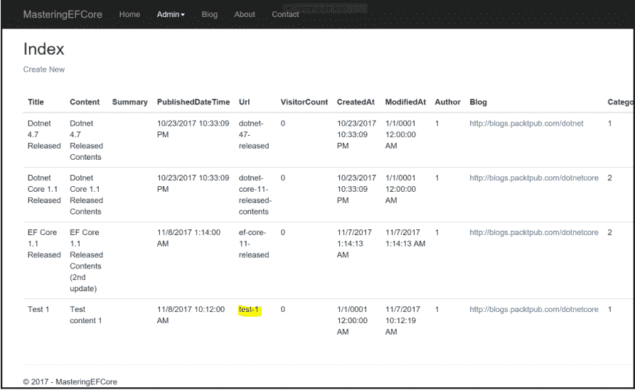

我们还是沿用相同的模拟方式：打开同一个博客编辑页面的两个标签页；第一个标签页使用相同的 URL 更新帖子数据，这将允许持久化。下图显示了来自第一个用户的数据填充和更新情况：

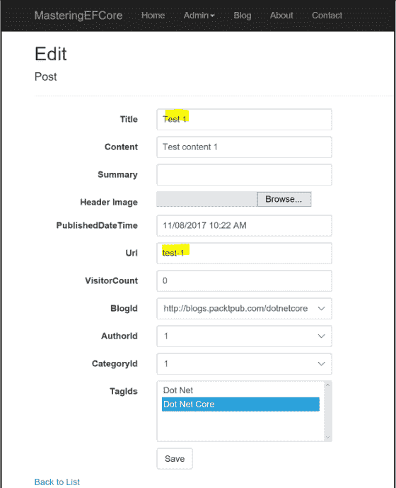

从下图中可以看到，Url 值没有发生变化。这确保我们要更新的记录仍然存在，从而允许 EF 持久化该实体：

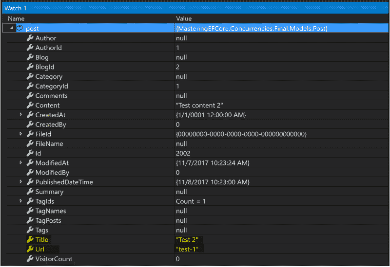

第二个标签页将尝试更改 **Url** 值，这会导致 EF Core 停止将帖子数据持久化到数据存储中，并抛出错误**数据库操作预期影响 1 行，但实际影响了 0 行：**

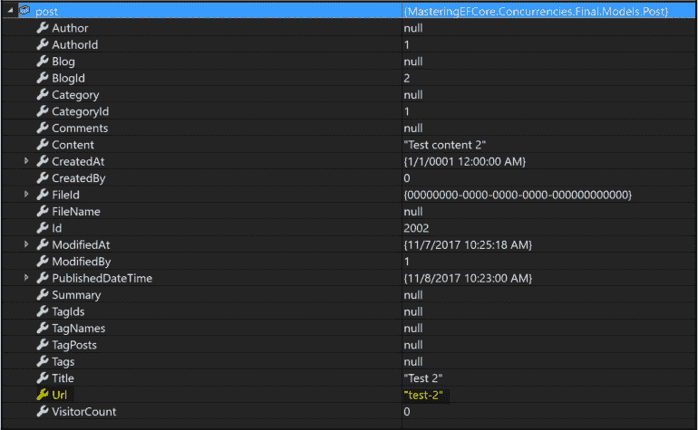

可以看到，抛出的错误与解释一致，提示本应更新 1 行，但记录已不存在：

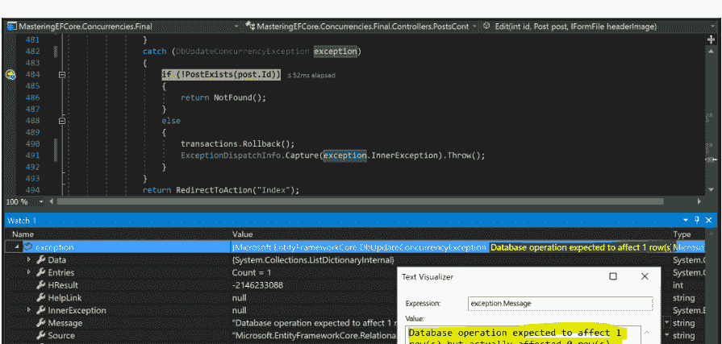

EF 会在内部执行一项操作，以确定更新是否有效；这就是为什么它会提示预期影响 1 行，但实际影响了 0 行。

EF 会将更新转换为 SQL 查询，其中包含 where 子句，包括标识列和并发检查列。如果值已更改，那么更新操作显然找不到任何可用记录（而该记录本应存在），因此它会直接响应：预期更新 1 行，但实际影响了 0 行。

我们已经了解了非时间戳并发的工作原理以及注解配置。在下一节中，让我们看看如何通过 Fluent API 配置相同的并发令牌。

## 通过 Fluent API 配置非时间戳令牌

Fluent API 配置之所以可行，是因为微软提供了一系列扩展方法，使我们可以针对模型的相应属性执行适当的功能。在我们的博客系统中，我们将通过 `IsConcurrencyToken()` 方法来配置 Post 实体的 Url 属性，使其作为并发令牌，如下代码所示：

```
protected override void OnModelCreating(ModelBuilder modelBuilder)
{
    // Code removed for brevity
    modelBuilder.Entity<Post>()
        .ToTable("Post")
        .Property(x=>x.Url)
        .IsConcurrencyToken();
    // Code removed for brevity
}
```

上述配置会让 EF Core 将 Url 列视为并发令牌；与数据注解配置一样，对此列进行的任何后续更新都将限制用户执行并行更新。

我们已经详尽地了解了这种并发令牌的工作方式，下面进入下一节，探讨基于时间戳的并发令牌。

## 基于时间戳的并发令牌

我们已经在*“并发令牌简介”*一节中探讨过基于 `Timestamp` 的并发令牌。我们可以直接进入配置部分，使用相同的场景，看看如何使用 `Timestamp` 并发令牌处理冲突。

与我们处理非时间戳并发令牌的方式一样，基于时间戳的并发令牌也可以通过以下方式配置：

- 数据注解
- Fluent API

我们将在博客系统中演示如何使用这两种方法进行配置，然后在实践中观察它们的效果。

## 通过数据注解配置时间戳令牌

我们已经了解了数据注解配置的工作方式。对于基于时间戳的令牌，我们需要一个字节数组类型属性，并使用 Timestamp 数据注解进行标记。这是我们唯一需要进行的配置；其余工作由 EF 完成：

```
public class Post
{
    // Code removed for brevity
    [Timestamp]
    public byte[] Timestamp { get; set; }
}
```

上述配置会让 EF Core 将 Timestamp 列视为并发列；对此列进行的任何后续更新都将限制用户执行并行更新。

由于我们要为实体引入一个新列，相关命令也需要一并更新。在我们的场景中，需要为 UpdatePostCommand 类型新增字节数组类型的 Timestamp 属性及其用法，如下代码所示：

```
public class UpdatePostCommand : CommandBase, ICreatePostCommand<int>
{
    // Code removed for brevity
    public byte[] Timestamp { get; set; }
    // Code removed for brevity
    public async Task<int> HandleAsync()
    {
        var post = new Post
        {
            // Code removed for brevity
            Timestamp = Timestamp
        };
        // Code removed for brevity
    }
}
```


新列应包含在 PostController 的 Edit 方法中：

```csharp
public async Task<IActionResult> Edit(
    int id, [Bind("Id,Title,Content,Summary," + "PublishedDateTime, Url,VisitorCount,CreatedAt,ModifiedAt,BlogId,AuthorId," + "CategoryId,TagIds,FileId,Timestamp")] Post post, IFormFile headerImage)
{
    // Code removed for brevity
    if (ModelState.IsValid)
    {
        var transactions = new TransactionScope();
        try
        {
            Models.File file = null;
            if (headerImage == null || (headerImage != null && !headerImage.ContentType.ToLower().StartsWith("image/")))
            {
                await _postRepository.ExecuteAsync(
                    new UpdatePostCommand(_context)
                {
                    // Code removed for brevity
                    Timestamp = post.Timestamp
                });
                return RedirectToAction("Index");
            }
            // Code removed for brevity
            transactions.Transactions.Add
                (_context.Database.BeginTransaction());
            await _postRepository.ExecuteAsync(
                new UpdatePostCommand(_context)
                {
                    // Code removed for brevity
                    Timestamp = post.Timestamp
                });
            transactions.Commit();
        }
        catch (DbUpdateConcurrencyException exception)
        {
            // Code removed for brevity
        }
        return RedirectToAction("Index");
    }
    // Code removed for brevity
}
```

最后，应将 `Timestamp` 列配置为隐藏列，就像我们对标识列所做的那样。这是必需的，因为 UI 应在 `Post` 上保留时间戳值：

```html
// Code removed for brevity
<form asp-action="Edit">
    <div class="form-horizontal">
        // Code removed for brevity
        <input type="hidden" asp-for="Timestamp" />
        // Code removed for brevity
    </div>
</form>
// Code removed for brevity
```

我们还没有完成；我们已经更新了实体，但还应该更新数据库。因此，我们需要按以下截图所示更新架构，方法是添加迁移并更新数据库：

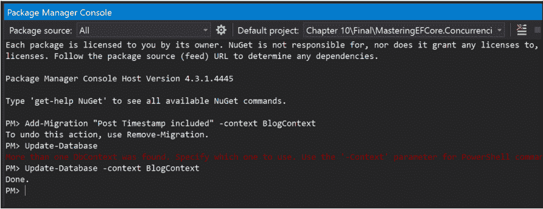

让我们回到同一个场景，该场景将有两个标签页，并将尝试同时执行更新。下面的 Post 列表页面截图突出显示了用户为了测试将修改的现有值：

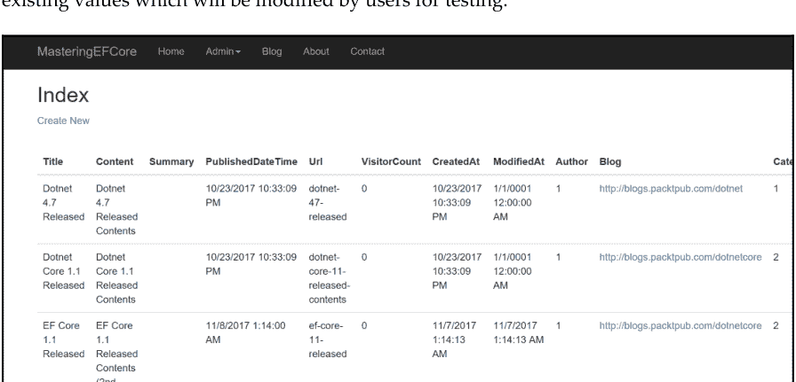

在第一个标签页中，我们保留该值并执行更新，该更新将更新这些值，因为 EF 会允许一次更新发生，不论更新了哪些列的值（除了 `Timestamp`，用户不应更新它）：

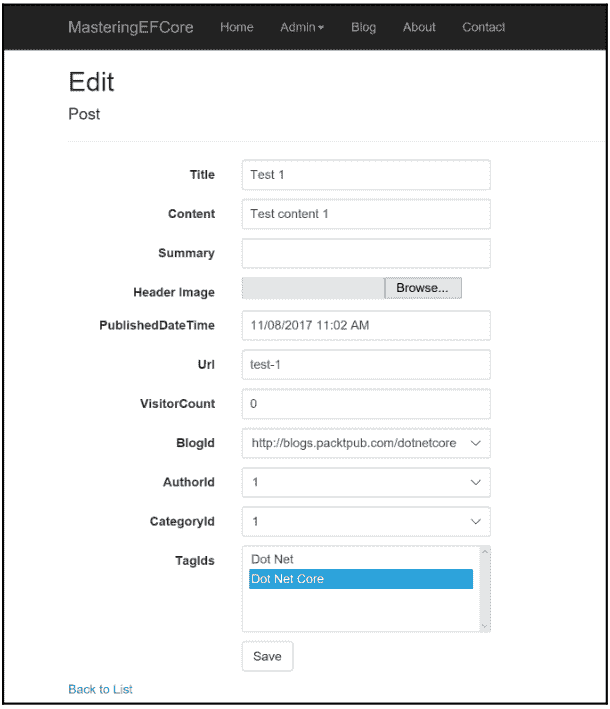

**Post** 实体数据将毫无问题地持久化，因为 `Timestamp` 值不会更改，并且与数据库中的值匹配。

如果并发检查列的值被更改，非基于时间戳的并发令牌会阻止更新发生；而基于时间戳的并发令牌将跟踪对实体执行的更改，并且如果时间戳值与数据库值匹配，则允许持久化该更改。在持久化之前，它会递增时间戳值。

第一个标签页的操作按预期正常工作；我们可以看到被修改的列已更新为新值，这确认数据在以下截图中已正确更新：

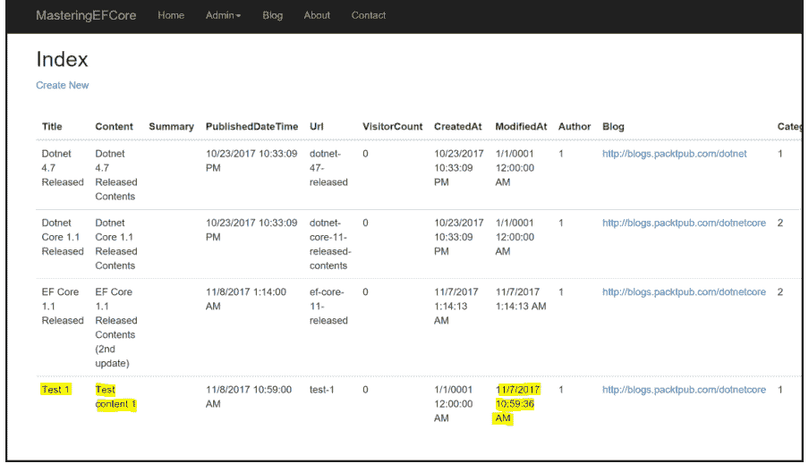

第二个标签页将尝试更新 `Post` 实体，但无论在此 `Edit` 操作期间更新了哪一列，它都会失败。这种行为是符合预期的，因为 `Timestamp` 值在上一次更新期间已更改，这使得 `Timestamp` 值过期。以下截图中的数据由第二个用户更新，并会被发布到服务：

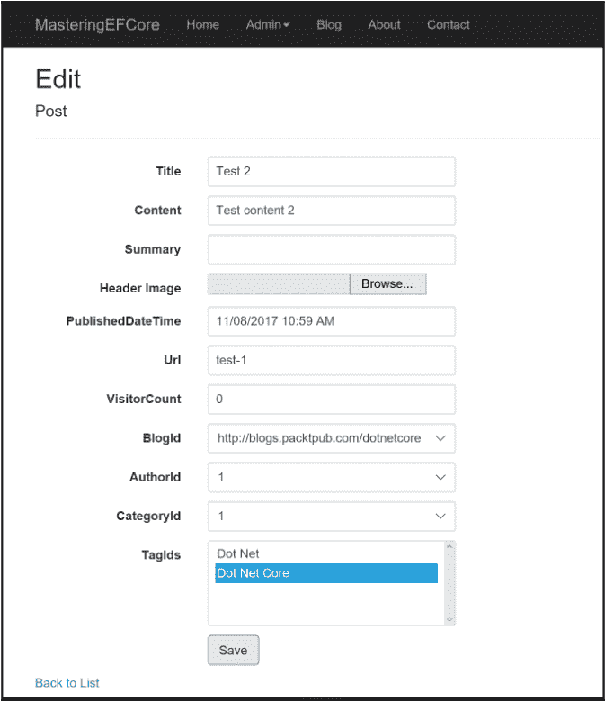

从以下错误中我们可以看到发生了并发冲突，EF 已抛出错误，这限制用户持久化过期的记录。由于数据过期，数据更新被限制，这一点在以下图片中已突出显示：

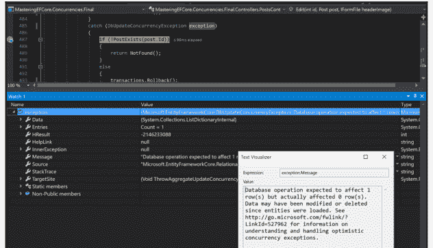

我们已经详尽地了解了基于时间戳的并发令牌是如何工作的，以及如何使用数据注解对其进行配置。在下一节中，让我们看看如何使用 Fluent API 配置相同的令牌。

## 通过 Fluent API 配置时间戳令牌

Fluent API 配置之所以成为可能，是因为 Microsoft 已针对模型中的任意属性公开了此类功能。在我们的博客系统中，我们将通过使用 `IsConcurrencyToken()` 以及 `ValueGeneratedOnAddOrUpdate()` 来启用该属性，从而将 Post 实体的 Timestamp 配置为并发令牌。以下代码将添加一个名为 Timestamp 的新属性，如本节所述：

```csharp
public class Post
{
    // Code removed for brevity
    public byte[] Timestamp { get; set; }
}
```

我们重新审视了 Post 类型，并加入了用于 Fluent API 配置的 byte 数组时间戳属性。以下配置代码将强制该属性值在持久化期间被添加或更新，并将其标记为并发令牌：

```csharp
protected override void OnModelCreating(ModelBuilder modelBuilder)
{
    // Code removed for brevity
    modelBuilder.Entity<Post>()
        .ToTable("Post")
        .Property(x=>x.Timestamp)
        .ValueGeneratedOnAddOrUpdate()
        .IsConcurrencyToken();
    // Code removed for brevity
}
```

前面的配置将让 EF Core 将 Timestamp 列视为并发令牌，并且对该列的任何进一步更新都将限制用户执行并行更新，就像数据注解配置中那样。

我们已经详尽地了解了这个并发令牌是如何工作的，所以让我们进入下一节，探讨如何处理并发冲突。

## 处理并发冲突

我们已经看到了如何配置并发令牌，以及每当出现并发冲突时它抛出的错误。在本节中，我们将讨论可用于处理并发冲突的不同方法。

前面的配置将让 EF Core 将 ModifiedAt 列视为并发检查列，并且对该列的任何进一步更新都将限制用户执行并行更新。

我们已经看到了可用于处理冲突的方法；让我们详细讨论它们。

### 应用乐观并发

乐观并发将允许用户尝试更新实体。EF 会处理额外的操作，以确认是否存在任何并发冲突。该操作不会像悲观并发那样损害性能，但它确实以不同的方式处理并发。

处理乐观并发的不同方法如下：

- 数据库胜出
- 客户端胜出
- 用户特定的自定义解决方式

在下一节中，我们将逐一进一步研究每种方法。

### 数据库胜出

**数据库胜出**方法将允许系统/应用程序丢弃客户端/UI 更改，并使用从数据库加载的最新数据覆盖更新操作。

以下代码展示了在数据库胜出方法中如何处理并发冲突。它使用 `Reload()` 从数据库重新加载条目，丢弃客户端数据而以数据库为准，然后执行 `SaveChanges()` 操作以持久化来自数据库的更新更改。以下代码处理 Post 持久化中的数据库优先并发：

```csharp
public async Task<IActionResult> Edit(int id, [Bind("Id,Title,Content, Summary," + "PublishedDateTime,Url,VisitorCount,CreatedAt, ModifiedAt, BlogId,AuthorId," + "CategoryId,TagIds,FileId, Timestamp")] Post post, IFormFile headerImage)
{
    if (id != post.Id)
    {
        return NotFound();
    }
    if (ModelState.IsValid)
    {
        var transactions = new TransactionScope();
        try
        {
            // Code removed for brevity
        }
        catch (DbUpdateConcurrencyException dbUpdateConcurrencyException)
        {
            if (!PostExists(post.Id))
            {
                return NotFound();
            }
            else
            {
                try
```


{
    dbUpdateConcurrencyException.Entries.Single().Reload();
    await _context.SaveChangesAsync();
    return RedirectToAction("Index");
}
catch (Exception exception)
{
    ExceptionDispatchInfo.Capture
        (exception.InnerException).Throw();
}
}
}
// Code removed for brevity
}

我们已经了解了数据库优先（database wins）方式如何处理并发冲突。在下一节中，我们将探讨客户端优先（client wins）方式如何处理并发冲突。

## 客户端优先

**客户端优先**方式允许系统/应用程序使用客户端/界面中的更改覆盖数据库中的更改，并将数据更新到数据库中。

以下代码展示了客户端优先方式如何处理并发冲突。它只是更新数据库中的原始值，从而避免并发冲突。它还允许系统/应用程序将客户端/界面中的更改持久化到数据库中，而不会出现任何问题：

```
public async Task<IActionResult> Edit(int id, [Bind("Id,Title,Content,Summary," + "PublishedDateTime,Url,VisitorCount,CreatedAt,ModifiedAt,BlogId,AuthorId," + "CategoryId,TagIds,FileId,Timestamp")] Post post, IFormFile headerImage)
{
    if (id != post.Id)
    {
        return NotFound();
    }
    if (ModelState.IsValid)
    {
        var transactions = new TransactionScope();
        try
        {
            // Code removed for brevity
        }
    catch (DbUpdateConcurrencyException dbUpdateConcurrencyException)
```

```
```csharp
{
    if (!PostExists(post.Id))
    {
        return NotFound();
    }
    else
    {
        try
        {
            var entry = dbUpdateConcurrencyException.Entries.Single();
            entry.OriginalValues.SetValues(entry.GetDatabaseValues());
            await _context.SaveChangesAsync();
            return RedirectToAction("Index");
        }
        catch (Exception exception)
        {
            ExceptionDispatchInfo.Capture
                (exception.InnerException).Throw();
        }
    }
}
// Code removed for brevity
```
```

我们已经了解了客户端优先方式如何处理并发冲突。在下一节中，我们将探讨用户自定义解析方式如何处理并发冲突。


将“客户端优先”和“数据库优先”分别理解为“后进先出”和“先进先出”可能会有所帮助。这是对仓储实践中**FIFO（先进先出）**和**LIFO（后进先出）**的比喻。

## 用户自定义解析

**用户自定义解析**会在客户端/界面更改中突出显示数据库中的最新更改，并更新时间戳值，这样在下次调用`SaveChanges()`时，用户既可以将数据库中的最新更改考虑进来并更新到客户端/界面中，也可以直接忽略它们，继续保存客户端/界面中的更改。

以下代码展示了用户自定义解析方式如何处理并发冲突。它只是对冲突字段添加带有当前值的模型状态错误，这些错误会显示在客户端/界面中。以下代码将处理并发并根据验证错误更新模型状态错误：

```
public async Task<IActionResult> Edit(int id, [Bind("Id,Title, Content,Summary," + "PublishedDateTime,Url,VisitorCount, CreatedAt,ModifiedAt, BlogId,AuthorId," +"CategoryId,TagIds, FileId,Timestamp")] Post post, IFormFile headerImage)
{
    if (id != post.Id)
    {
        return NotFound();
    }
    if (ModelState.IsValid)
    {
        var transactions = new TransactionScope();
        try
        {
            // Code removed for brevity
        }
        catch (DbUpdateConcurrencyException dbUpdateConcurrencyException)
        {
            if (!PostExists(post.Id))
            {
                return NotFound();
            }
            else
            {
                try
                {
                    foreach (var entry in dbUpdateConcurrencyException.Entries)
                    {
                        if (entry.Entity is Post)
                        {
                            var postEntry = entry.GetDatabaseValues();
                            var postFromDatabase = (Post)postEntry.ToObject();
                            var postToBeUpdated = (Post)entry.Entity;
                            if (postFromDatabase.Title != postToBeUpdated.Title)
                            {
                                ModelState.AddModelError("Title", $"Current value: {postFromDatabase.Title}");
                            }
                            if (postFromDatabase.Content != postToBeUpdated.Content)
                            {
                                ModelState.AddModelError("Content", $"Current value:
```

```
{postFromDatabase.Content}");
}
ModelState.AddModelError(string.Empty, "The record was modified by another user" + " after the page was loaded.
The save operation was canceled and the" + " updated database values were displayed. If you still want to edit" + " this record, click the Save button again.");
post.Timestamp = (byte[])postFromDatabase.Timestamp;
ModelState.Remove("Timestamp");
}
else
{
throw new NotSupportedException("Don't know how to handle concurrency conflicts for " + entry.Metadata.Name);
}
}
catch (Exception exception)
{
ExceptionDispatchInfo.Capture(exception.InnerException).Throw();
}
}
}
// Code removed for brevity
}
```

自定义解析处理冲突的方式如下所示，它会在验证摘要中突出显示问题，同时展示每个冲突字段当前的值：

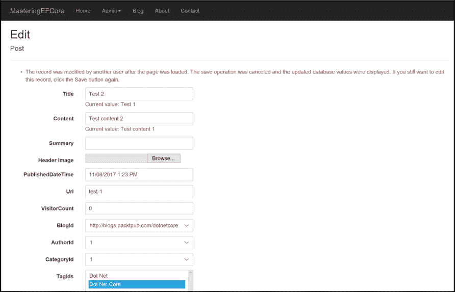

我们已经了解了用户自定义解析方式如何处理并发冲突。在下一节中，我们将探讨悲观并发如何处理冲突。

## 应用悲观并发

悲观并发允许用户阻止所有人访问实体，直到读/写操作完成。这可能会带来较差的性能，但它能确保没有人使用陈旧数据访问系统。以下代码将执行悲观锁，从而在数据存储层本身避免冲突：

```
```csharp
public async Task<IActionResult> Edit(int id,
    [Bind("Id,Url,Title,Subtitle,Description,CategoryId")] Blog blog)
{
    // Code removed for brevity
    if (ModelState.IsValid)
    {
        try
        {
```

前面查询中使用的 xlock 将确保无法对该实体执行其他读/写操作。让我们通过重构 Edit 方法（使用事务）来测试该功能，该方法在执行更新前也会使用 xlock：

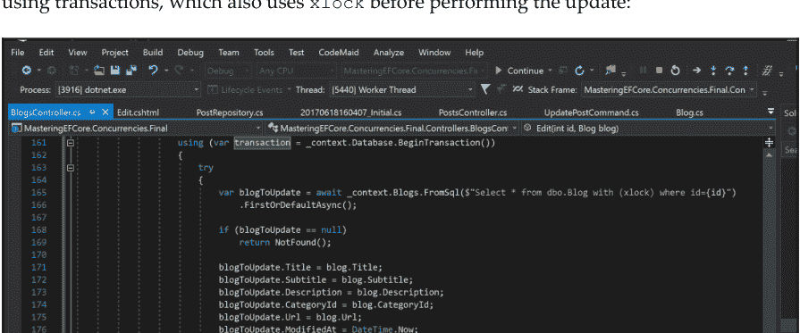

我们可以看到，就在`transaction.commit()`之前设置了一个断点，此时对`Blog`实体仍然持有一个活动的`xlock`。与此同时，如果我们尝试从`Blog`实体获取记录，操作将等待该锁释放，这正是下面的截图显示**正在执行查询...**直到它获得读取操作权限的原因：

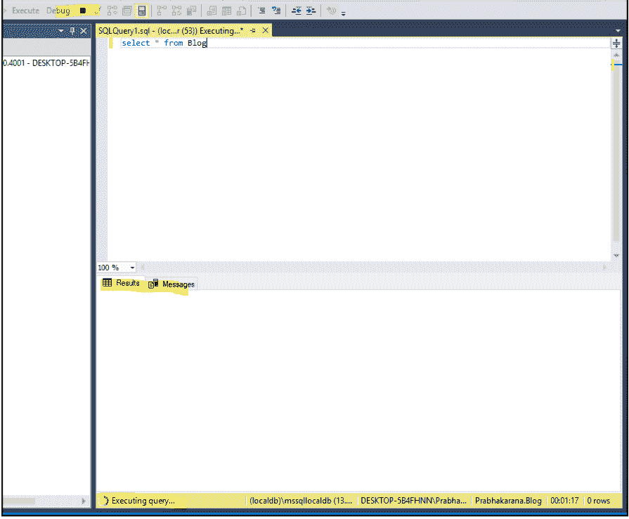

一旦事务提交，select 查询就会按预期执行并返回博客列表。这就是悲观锁的预期行为，我们已在代码中通过 xlock 实现了这一效果。在下面的截图中，之前持久化过程中正在加载的查询现在完全执行了，因为持久化之后锁已被释放：

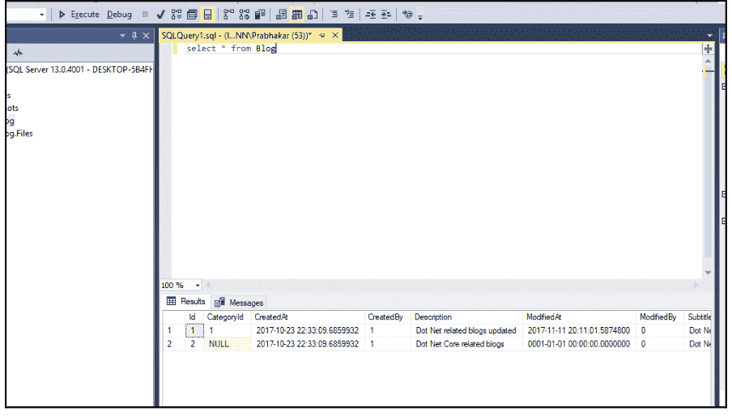

本节识别并解决了悲观并发冲突，这也结束了本章对并发处理方式的探讨。

## 总结

我们首先探讨了什么是并发冲突，以及微软在 Entity Framework 实现中如何处理它们。我们了解了并发令牌实现如何解决我们的问题，然后开始使用带有非时间戳方式的并发令牌。之后，我们使用基于时间戳的并发令牌来捕获冲突。最后，我们找到了使用乐观和悲观两种方法处理这些并发冲突的方式。我们可以根据自己的优先级进行选择；如果性能对项目至关重要，则选择乐观并发；如果业务用户对数据非常在意并愿意在性能上做出权衡，则选择悲观并发。我们构建博客系统是为了演示本书涵盖的某些特性，而不是为了提供更好的性能。我们可能通过肌肉记忆使用了某些能带来更好性能的方法，但现在正是探索框架中所有可用选项来提升应用程序性能的时候。让我们在第 11 章“性能——一切都关乎执行时间”中探讨它们。


