# 11 性能 – 一切都关乎执行时间

我们创建了事务以确保只有在所有事务都成功的情况下才会提交事务。我们从识别冲突开始，使用 Entity Framework (EF) 内置/默认的事务来解决它们，然后使用简单的事务。随后我们介绍了使用时间戳和非时间戳字段处理事务。最后，我们创建了能够处理不同数据上下文和不同技术的事务。

让我们讨论我们在 EF 或任何其他数据访问层实现中常见的性能问题，以及解决这些性能问题的方法。

在本章中，我们将介绍以下内容：

- `AsNoTracking()` 方法
- 更改检测
- 异步操作
- 返回的无用数据量
- N + 1 `Select` 问题
- 数据多于所需
- 数据类型不匹配
- 缺失索引

### AsNoTracking() 方法

EF 的跟踪行为取决于更改跟踪器中是否存在条目；这是默认行为。我们可以覆盖此行为以在某些不需要跟踪的场景中实现性能改进；例如，只读操作，如显示帖子列表、显示帖子信息等。这种跟踪是 EF 在 `SaveChanges()` 执行期间确定需要持久化的更改的关键。

#### 跟踪是如何工作的？

如前一节所述，任何返回实体（在数据上下文中注册）的查询都将成为跟踪的一部分。并且如所提及的持久化方式，对这些实体进行的更改将被跟踪，并在 `SaveChanges()` 执行期间持久化。

让我们看一下以下代码，说明框架中跟踪的工作方式：

```
public async Task<IActionResult> Edit(int id,
    [Bind("Id,FirstName,LastName,NickName,Url,Biography,ImageUrl")] Person person)
{
    // Code removed for brevity
    var personToUpdate = await _context.People.SingleOrDefaultAsync(
        item => item.Id.Equals(person.Id));
    // Code removed for brevity
    personToUpdate.Biography = person.Biography;
    personToUpdate.Comments = person.Comments;
    personToUpdate.FirstName = person.FirstName;
    personToUpdate.ImageUrl = person.ImageUrl;
    personToUpdate.LastName = person.LastName;
    personToUpdate.ModifiedAt = DateTime.Now;
    personToUpdate.NickName = person.NickName;
    personToUpdate.PhoneNumber = person.PhoneNumber;
    personToUpdate.Url = person.Url;
    personToUpdate.User = person.User;
    _context.Update(personToUpdate);
    await _context.SaveChangesAsync();
    // Code removed for brevity
}
```

从数据上下文检索到的 `personToUpdate` 将成为跟踪的一部分，因为它返回的是在数据上下文中注册的 `Person` 实体。以下代码注册 `Person` 实体以在框架中启用跟踪：

```
public class BlogContext : DbContext
{
    // Code removed for brevity
    public DbSet<Person> People { get; set; }
    // Code removed for brevity
}
```

由于实体是数据上下文的一部分，EF Core 将跟踪对返回项进行的任何更改，而不管其用途如何，这可能是只读的，也可能执行写操作。

#### 无跟踪查询

在博客系统中，Person 索引屏幕将加载数据存储中可用的人员列表，这不会执行任何写操作。在此用例中，代码不需要任何跟踪，因为一旦数据在 View 中呈现，作用域就完成了。在这里进行跟踪是一种开销。

以下代码将允许我们在执行查询中禁用跟踪：

```
public async Task<IActionResult> Index()
{
    var people = await _context.People
        .AsNoTracking()
        .ToListAsync();
    // Code removed for brevity
}
```

跟踪可以使用 `AsNoTracking()` 禁用，如前述查询中在 LINQ 查询的数据上下文导航属性上使用。这指示 EF Core 我们不需要开销的跟踪操作，因为我们不打算对结果集进行任何更改。

应生成模拟数据以说明应用程序中的性能影响；本章中我们使用的生成模拟数据的脚本可在以下 Git 提交中找到：
https://goo.gl/Fq2YMF

请使用此脚本在表中模拟数千/数百万条记录。前述提交中的文件包含用于 Person、User 和 Post 表模拟的脚本。这是为了帮助您评估 DB 中的性能。

在优化之前，前一个查询在包含一百万条记录的表中执行耗时 **170,294ms**，如下图所示：

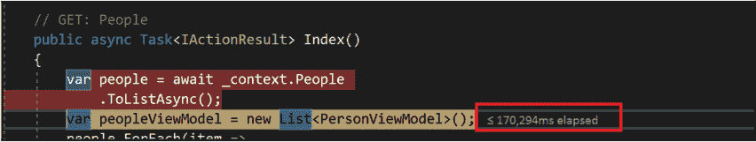

优化后的 LINQ 查询仅耗时 **59,017ms** 执行，总执行时间提高了 65%，如下图所示：

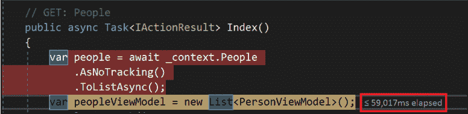

此优化只是性能改进的第一步；应用程序性能仍有大量改进空间，我们将在本章的其他部分探讨其各个方面。


我们插入到 `Person` 表中的一百万条记录会影响前面说明的 `Index()` 操作，该操作将返回人员列表；它会抛出超时错误而不是呈现列表。我们可以通过处理第 8 章 *Query Is All We Need – Query Object Pattern* 中实现的分页来避免此问题，该问题可在以下 Git 仓库路径的 `GetPaginatedPostByKeywordQuery.cs` 中找到：https://goo.gl/SwvVcC。

这里也可以使用相同的 `Skip()` 和 `Take()` 方法来避免超时问题，一个快速修复是限制为 100 条记录，如下所示，未来应为分页查询。

```
var people = await _context.People.Take(100)
    .AsNoTracking()
    .ToListAsync();
```

如果整个控制器不需要跟踪，我们可以使用 `ChangeTracker` 类型的 `QueryTrackingBehavior` 在上下文级别禁用它。由于博客系统在每个请求上初始化上下文，我们可以使用 `QueryTrackingBehavior` 在构造函数中禁用跟踪，如以下代码所示：

```
public PeopleController(BlogContext context)
{
    _context = context;
    _context.ChangeTracker.QueryTrackingBehavior =
        QueryTrackingBehavior.NoTracking;
}
```

我们已经看到如何通过两种方法在查询级别或上下文级别禁用跟踪。请明智地使用它们，以避免遇到更新/删除问题，因为这些操作需要跟踪。

### 投影

EF Core 还有另一种内置支持，可为投影（匿名类型或自定义类型投影实体）提供跟踪。在以下示例中，我们将 `Person` 模型投影为 `PersonViewModel`，它将包含类型和额外的 `NoOfComments` 字段。在这种情况下，EF Core 将跟踪对 `PersonViewModel` 的 `Person` 属性所做的更改，因为它是数据上下文的一部分，而 `NoOfComments` 将不会被跟踪。以下代码提供了上述讨论的投影：

```
public async Task<IActionResult> Index()
{
    return View(await _context.People
        .AsNoTracking()
        .Select(item =>
            new PersonViewModel
            {
                Person = item,
                NoOfComments = item.Comments.Count
            }).ToListAsync());
}
```

还有一种投影永远不会执行任何跟踪。如果投影仅采用字段而不是实体本身，则不会跟踪对投影实体的更改。让我们通过引入一个 **About** 面板来实际查看它们，该面板将在显示作者信息的公共帖子中显示。创建了一个组件来显示作者详细信息，其 View 实现创建了一个投影，仅从 `Person` 实体中获取 `Name` 和 `Biography`。由于它没有投影整个实体，因此 `AboutViewModel` 将不会被跟踪。

以下投影确保数据永远不会被跟踪，因为它不包含在数据上下文中注册的任何实体：

```
public class AboutViewComponent : ViewComponent
{
    private readonly BlogContext _context;
    private readonly IPersonRepository _repository;
    public AboutViewComponent(IPersonRepository repository,
        BlogContext context)
    {
        _repository = repository;
        _context = context;
    }

    public IViewComponentResult Invoke(int id)
```


```csharp
{
    var aboutViewModel = _context.People
        .Where(item => item.Id.Equals(id))
        .Select(item => new AboutViewModel
        {
            Name = item.FirstName,
            Biography = item.Biography
        }).SingleOrDefault();

    return View(aboutViewModel);
}
```

我们已经了解了跟踪的工作方式、如何禁用它，并探讨了 EF Core 中的投影及其跟踪行为。在下一节中，让我们研究如何修改更改检测行为。

## 更改检测

在进行批量插入（例如从其他来源导入数据或从另一个博客系统迁移内容）时，我们可能会遇到性能问题。在这些场景中，如果启用了 `AutoDetectChangesEnabled`，则可能会遇到性能问题，因为 EF Core 的 `ObjectStateManager.DetectChanges()` 会在每次插入操作时执行代价高昂的操作。

为了说明问题，我们可以在 `CreatePost` 代码中部分处理批量插入/更新的更改检测，该代码将执行批量标签插入。我们可以通过在添加实体之前禁用 `AutoDetectChangesEnabled`，并在调用 `SaveChanges()` 之前重新启用来解决此问题。下面这个被突出显示的小小改动将大大缩短执行时间：

```csharp
public class CreatePostCommand : CommandBase,
    ICreatePostCommand<int>
{
    // Code removed for brevity
    public int Handle()
    {
        // Code removed for brevity
        Context.ChangeTracker.AutoDetectChangesEnabled = false;
        foreach (int tagId in TagIds)
        {
            Context.Add(new TagPost
            {
```

```csharp
Post = post
});
}
Context.ChangeTracker.AutoDetectChangesEnabled = true;
// Code removed for brevity
}
// Code removed for brevity
}
```

我们已经了解了 `DetectChanges()` 如何影响批量插入/更新操作的性能以及该问题的解决方案。在下一节中，让我们重点关注异步操作。

## 异步操作

我们可以称之为肌肉记忆，因为我们可以看到异步操作已经就位；我们以异步方式执行所有操作。尽管已经介绍过了，但让我们重申一下在博客系统中如何处理异步操作，并看看使用 `async/await` 语法糖实现异步操作时的简洁性。

异步执行帮助我们并行支持多个请求，而不会将线程锁定在长时间运行的过程上。为了理解如何正确管理线程，让我们了解以下执行过程：

- 到达 ASP.NET 管道的请求会被分配给一个线程，由该线程负责执行
- 在请求完成之前，该线程会被占用
- 如果操作以同步方式执行任何长时间运行的过程，则该线程会被阻塞，直到过程执行完成。如果线程池中的所有线程都被占用，则无法再为其他请求提供服务
- 如果长时间运行的过程以异步方式实现，那么一旦操作触发，线程会被释放回线程池，释放的线程将被分配给新的请求
- 一旦长时间运行的过程完成，将分配一个新的线程来完成该请求的执行

由于我们已经有了异步实现，我们将从控制器一直到数据上下文执行来检查它们。让我们看一下文章控制器的 `Index` 操作，它使用 `async` 关键字进行修饰，这也要求返回类型包装在 `Task<>` 泛型类型中。异步方法应使用 `await` 关键字调用，如以下代码所示：

```
public async Task<IActionResult> Index()
{
    var posts = await _postRepository.GetAsync(
    new GetAllPostsQuery(_context)
    {
        IncludeData = true
    });
    // Code removed for brevity
}
```

让我们深入研究并调查这个 `GetAsync()` 是如何实现的。它是一个泛型实现，使用 async/await 关键字调用 `HandleAsync()`，如下所示：

```
public async Task<IEnumerable<Post>> GetAsync<T>(T query)
    where T : IQueryHandlerAsync<IEnumerable<Post>>
{
    return await query.HandleAsync();
}
```

`HandleAsync()` 方法在 `GetAllPostsQuery`（在我们的场景中）中实现，它使用 EF Core 的异步 `ToListAsync()` 方法，从而封装了我们的异步实现。这确保数据库执行以异步方式进行，并且在从数据存储返回数据后操作继续执行。以下代码对 `ToListAsync()` 方法执行异步操作，该方法将执行数据库操作：

```
public class GetAllPostsQuery : QueryBase,
    IGetAllPostsQuery<GetAllPostsQuery>
{
    // Code removed for brevity
    public async Task<IEnumerable<Post>> HandleAsync()
    {
        var posts = IncludeData
            ? await Context.Posts
            .Include(p => p.Author).Include(p => p.Blog)
            .Include(p => p.Category).Include(p=>p.TagPosts)
            .ToListAsync()
            : await Context.Posts
            .ToListAsync();
```

## 返回不必要的数据量

到目前为止，我们一直在奢侈地使用数据，而没有考虑使用量。一个很好的例子是删除操作，我们在所有 CRUD 操作中都能看到。如果我们看一下 Person 删除操作，可以看到整个 Person 实体是从上下文中返回的，并且它被用于删除操作。以下代码检索 Person 实体并使用该实体进行删除操作：

```
public async Task<IActionResult> DeleteConfirmed(int id)
{
    var person =
        await _context.People.SingleOrDefaultAsync(m => m.Id == id);
    _context.People.Remove(person);
    await _context.SaveChangesAsync();
    return RedirectToAction("Index");
}
```

前一种方法的缺陷在于，首先进行了数据库调用来检索整个 Person 对象，这是一个开销。之后，通过 Person 的 Id 执行所需的删除操作，而该 Id 在检索 Person 之前就已可用。以下截图突出显示了所讨论的两个查询：

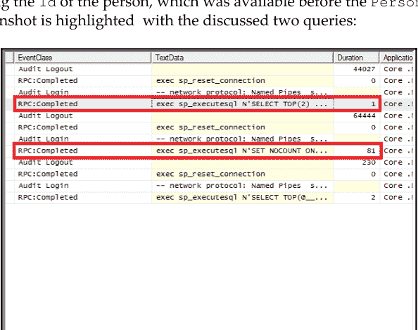

我们可以简化这种方法：省略 Person 检索，仅使用 Id 值创建 Person 对象，并将实体的状态更新为 Deleted，这样就能指示 EF Core 直接执行删除操作，而无需从数据存储检索对象。以下代码将查询简化为仅执行删除操作的查询：

```
[HttpPost, ActionName("Delete")]
[ValidateAntiForgeryToken]
public async Task<IActionResult> DeleteConfirmed(int id)
{
    Person person = new Person() { Id = id };
    _context.Entry(person).State = EntityState.Deleted;
    await _context.SaveChangesAsync();
    return RedirectToAction("Index");
}
```

可以看到，前一种方法无需进行任何 Person 检索，然而删除操作仍然成功执行，如下面的截图所示：

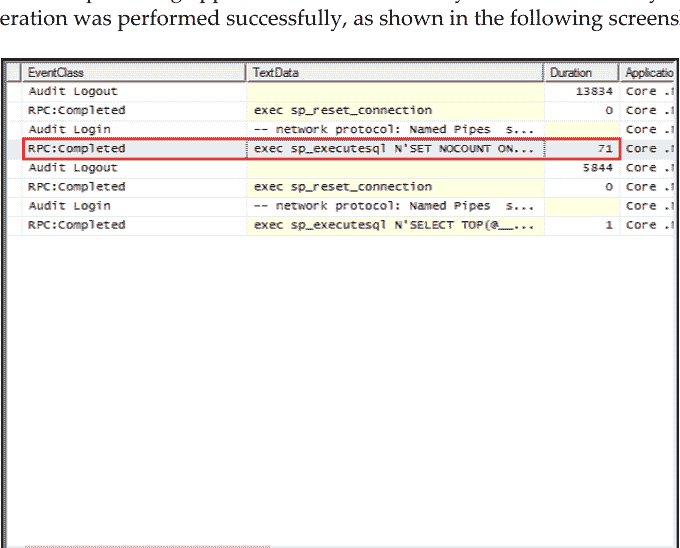

我们已经了解了避免从数据存储中检索不必要数据的方法。在下一节中，我们将探讨 `N + 1 Select` 问题。

## N+1 Select 问题

`N + 1 Select` 问题的出现是由于任何 ORM 框架在内部执行单个操作时会多次调用数据存储。该问题可概述如下：

- 1. 返回一个实体列表，该列表将被进一步迭代以执行一些附加操作。
- 2. 假设在迭代内访问了导航属性：
  - 每次迭代尝试访问该导航属性时，都会产生一次数据库访问
  - 对于第一步中返回的 N 个项目，将发生 N 次访问
- 3. 这使得应用程序执行 `N+1 Select` 操作（N 次迭代，1 次是获取列表的首次调用），而实际上这些操作本应在一次数据库调用中完成。

这种行为在任何 ORM 框架中通常被称为**懒加载**，它会仅在需要时加载后续/依赖数据。EF Core 尚不支持懒加载。这可以在 EF Core 的路线图中得到验证，该路线图将其列为**延伸目标**，如以下截图所示：

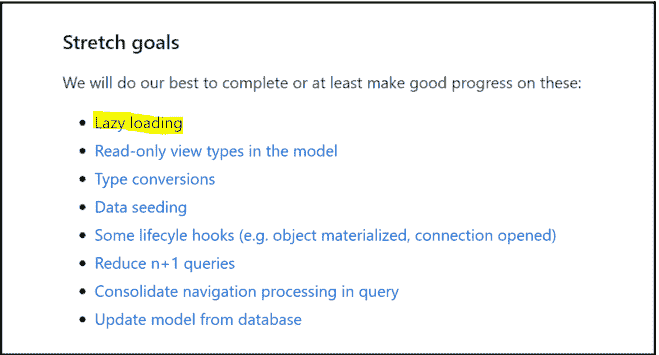


The issue (lazy loading support) created in the EF Core repository is also listed as follows:
https://github.com/aspnet/EntityFrameworkCore/issues/3797

尽管当前框架尚不支持该功能，但理想情况下应分析该问题并研究延迟加载的解决方案。为讨论起见，如果 EF Core 在未来支持延迟加载，以下实现将产生 N + 1 Select 问题，每当访问 Comments 导航属性时都会执行单独的数据存储调用。

以下高亮代码将触发单独的数据存储调用以填充 NoOfComments 属性：

```
var people = await _context.People
    .AsNoTracking()
    .ToListAsync();
var peopleViewModel = new List<PersonViewModel>();
people.ForEach(item =>
{
    peopleViewModel.Add(new PersonViewModel
    {
        Person = item,
        NoOfComments = item.Comments != null ?
            item.Comments.Count : 0
    });
});
```

在 EF Core 2.0 中，前述代码将返回导航属性 Comments 为 NULL，假设我们未访问该属性，因为它未被显式加载。以下截图将突出显示评论未被显式加载：

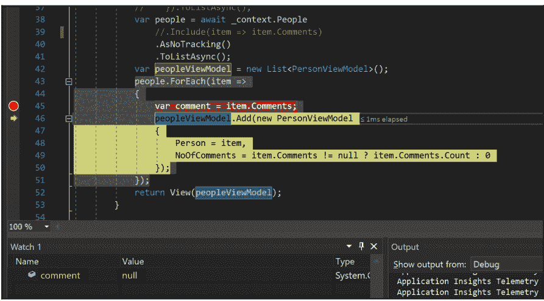

它会奇怪地执行额外的数据库调用以从数据存储中检索计数，即使导航属性返回为 NULL：

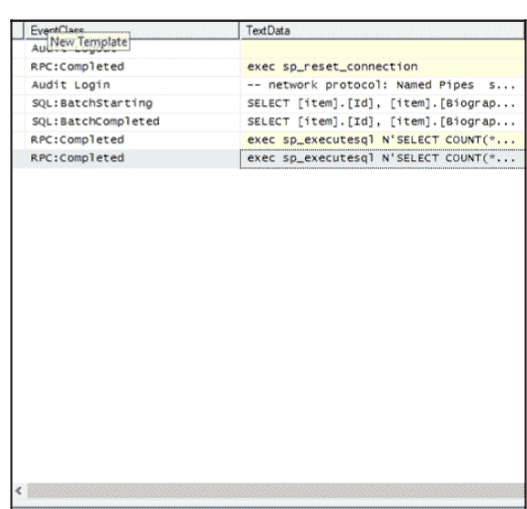

当我们在 LINQ 查询中包含 Comments 导航属性时，它将执行 Comments 实体的显式加载以满足其请求。以下代码将使 EF Core 执行评论的显式加载：

```
var people = await _context.People
.Include(item => item.Comments)
.AsNoTracking()
.ToListAsync();
var peopleViewModel = new List<PersonViewModel>();
people.ForEach(item =>
{
    var comment = item.Comments;
    peopleViewModel.Add(new PersonViewModel
    {
        Person = item,
        NoOfComments = item.Comments != null ?
        item.Comments.Count : 0
    });
});
```

我们可以在以下截图中看到为 Comments 实体显式加载所进行的执行：

| EventClass | TextData |
|---|---|
| Audit Logout |  |
| RPC:Completed | exec sp_reset_connection |
| Audit Login | -- network protocol: Named Pipes s... |
| SQL:BatchStarting | SELECT [item].[Id], [item].[Biograp... |
| SQL:BatchCompleted | SELECT [item].[Id], [item].[Biograp... |
| SQL:BatchStarting | SELECT [c1].[Id], [c1].[CommentedAt... |
| SQL:BatchCompleted | SELECT [c1].[Id], [c1].[CommentedAt... |
| RPC:Completed | exec sp_executesql N'SELECT COUNT(*... |
| RPC:Completed | exec sp_executesql N'SELECT COUNT(*... |

SELECT [c1].[Id], [c1].[CommentedAt], [c1].[Content], [c1].[CreatedAt],
FROM [Comment] AS [c1]
WHERE EXISTS (
    SELECT 1
    FROM [Person] AS [item]
    WHERE [c1].[PersonId] = [item].[Id])
ORDER BY [c1].[PersonId]

显式加载现在将为对博客文章发表评论的人员返回适当的评论。现在我们可以执行我们的操作，在列表页面中列出用户发表的评论数量，如以下高亮图像所示，评论可用：

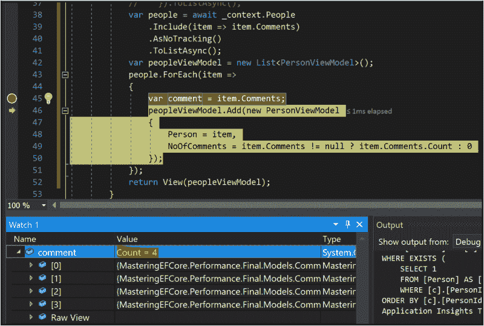

评论数量现在按预期在 People 列表页面中列出，如以下截图所示：

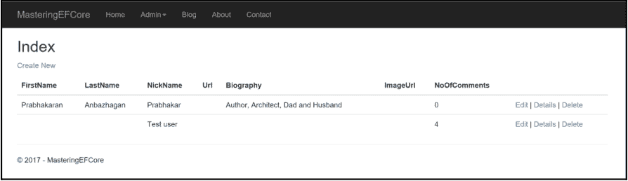

我们讨论了 N + 1 Select 问题，并看到了当前 EF Core 框架如何处理该场景以及我们可以提供的解决方案。在下一节中，我们将探讨如何将从服务或控制器返回的数据限制为仅视图所消耗的字段。

## More data than required

我们正在创建的 About 组件消耗 Person 实体，其中包含大量对组件不必要的信息，但仍然会被处理并返回到 View。我们可以在以下代码中看到，AboutComponent 消耗 GetPersonByIdQuery 并将整个 Person 实体返回给 View：

```
public IViewComponentResult Invoke(int id)
{
    var user = _repository.GetSingle(
        new GetPersonByIdQuery(_context)
        {
            IncludeData = true,
            Id = id
        });
    return View(user);
}
```

前述 View 组件仅渲染用户实体的 Name 和 Biography 属性。我们可以在以下视图组件代码中看到它们：

```
<h2>About @Model.Name</h2>
<p>
@Model.Biography
</p>
```

View 组件然后消耗数据仅渲染 Person 实体的 FirstName 和 Biography。很明显我们需要解决这个问题，因为我们正在向视图返回不必要的数据。

我们可以通过以下截图可视化渲染的视图，并看到它未消耗用户实体的任何其他属性：

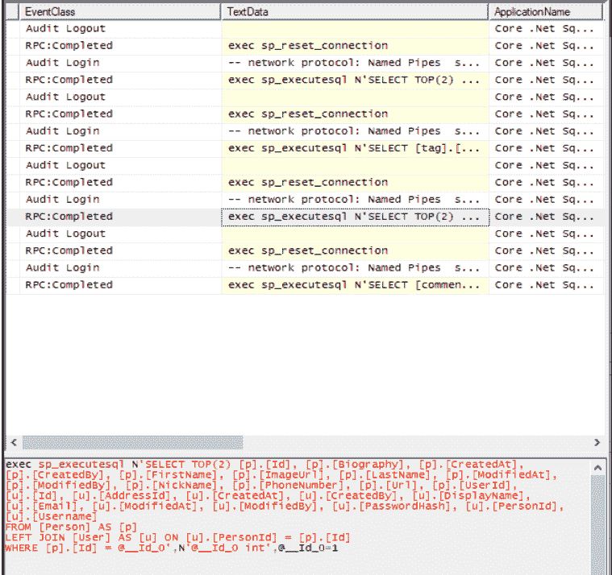

如果我们尝试分析数据存储调用，我们可以看到特定调用中包含大量列，而它只消耗两列数据：

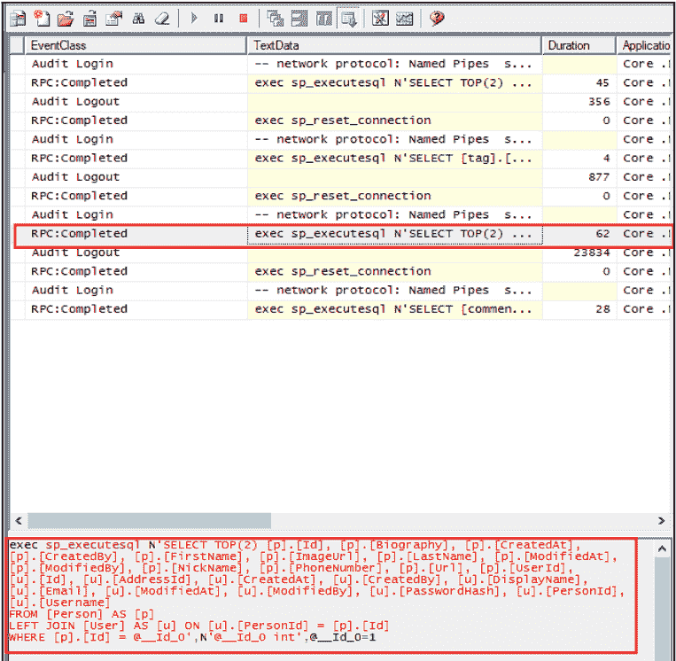

我们现在可以使用投影和 View 模型来缩小返回的数据范围，仅限制为 Name 和 Biography：

```
public IViewComponentResult Invoke(int id)
{
    var aboutViewModel = _context.People
        .Where(item => item.Id.Equals(id))
        .Select(item => new AboutViewModel
        {
```

```
Name = item.FirstName,
Biography = item.Biography
}).SingleOrDefault();

return View(aboutViewModel);
}
```

现在，分析器突出显示的数据库调用仅包含用于渲染数据库所需的两列，从而减少了从数据库检索的内容，如以下截图所示：

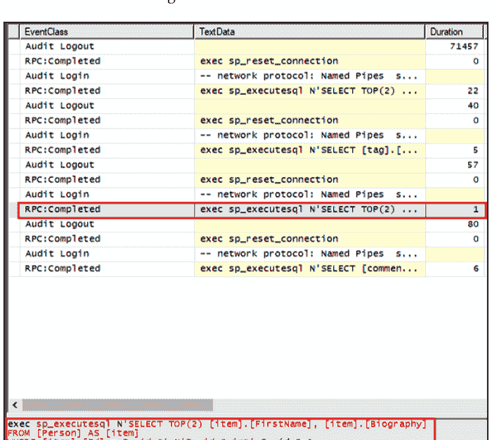

这解决了从数据存储返回过多数据的问题。在下一节中，让我们来看一下不匹配的数据类型。

## Mismatched data types

不匹配的数据类型会损害性能。这乍一看似乎很明显，但如果我们仔细观察，很明显我们应该解决这个问题。以下调整的 About 视图组件说明了使用 `PhoneNumber` 而不是 `Id` 检索数据：

```
var aboutViewModel = _context.People
    .Where(item => item.PhoneNumber.Equals("9876543210"))
    //.Where(item => item.Id.Equals(id))
    .Select(item => new AboutViewModel
    {
        Name = item.FirstName,
        Biography = item.Biography
    }).SingleOrDefault();
```

前述 LINQ 查询将被翻译成以下 SQL 查询；启用查询执行的 **Actual Execution** 计划，就会很明显这里出了问题。每当查询中存在不匹配的数据类型时，数据类型转换将强制执行索引扫描操作。在以下截图中，我们可以看到正在发生 **Clustered Index Scan** 而不是执行查找操作，这进一步影响了性能：

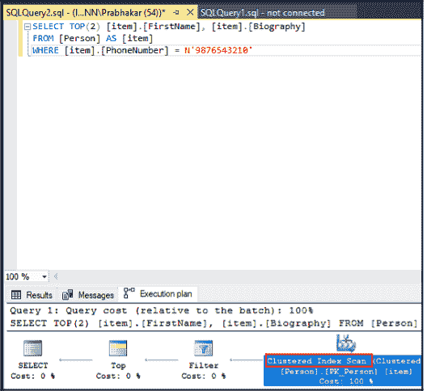

如果我们悬停在执行计划上，我们可以看到更多信息，例如记录数、操作成本、执行次数、受影响的行数等，可以在以下截图中可视化：

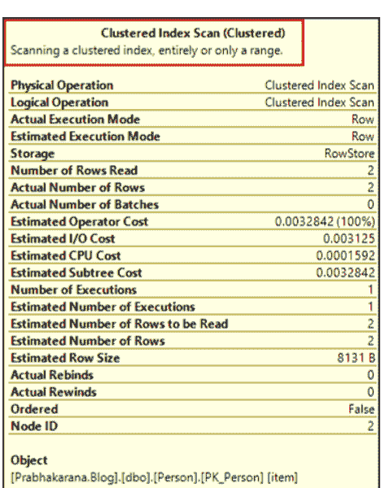

如果我们将查询更改为基于 Id，我们可以看到它神奇地使用查找而不是扫描操作。以下截图证明按预期执行了查找操作：

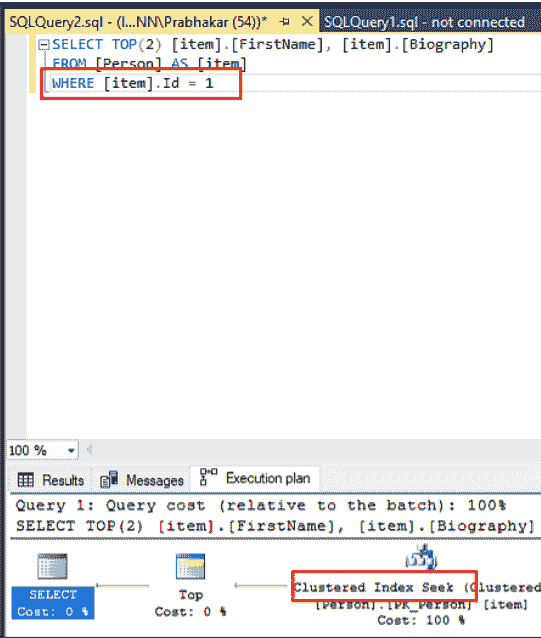

以下截图证实了我们的理论，即查找操作比扫描操作更快，因为查找中读取的行数为 1，而扫描中为 2。以下截图执行查找操作证实了关于行读取的讨论：

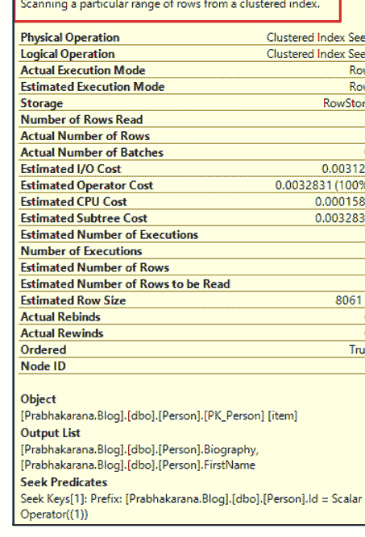

因此，修复模型的数据类型将避免这种数据类型转换并执行有效的数据过滤。在下一节中，让我们分析缺失的索引。


## 缺失索引

我们将使用`FirstName`和`LastName`过滤器修改**关于**视图组件，为此我们应在数据存储中建立一个索引。如果我们分析数据存储，在下面的截图中没有这样的索引；为了更好的性能，创建一个索引是明智的：

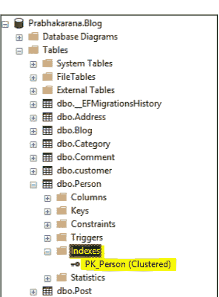

让我们开始着手改进SQL查询性能，起点是使用SQL探查器跟踪查询。因此，从SQL Server Profiler中右键复制**关于**视图组件LINQ查询转换后的SQL查询，粘贴到**SQL查询分析器**窗口中，并选择**在SQL Server Profiler中跟踪查询**，如下面的截图所示：

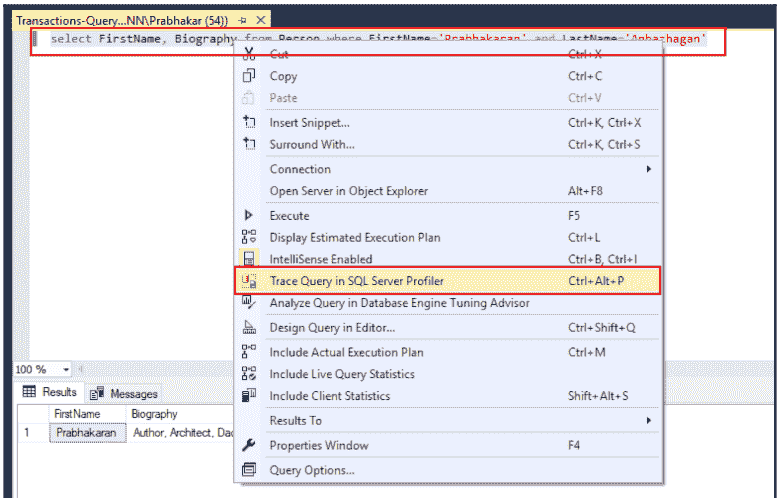

一旦探查器附加成功，在查询分析器窗口中执行查询，应显示以下结果，同时启用并查看实际执行计划：

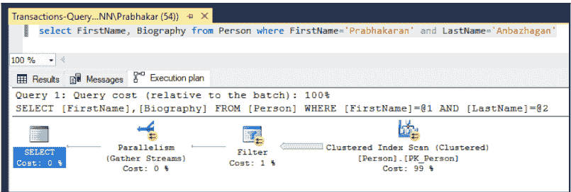

SQL探查器将捕获数据库中发生的任何操作。由于我们正在查询Person实体，它会捕获与该实体操作相关的所有查询，这从下面的截图中可以明显看出：

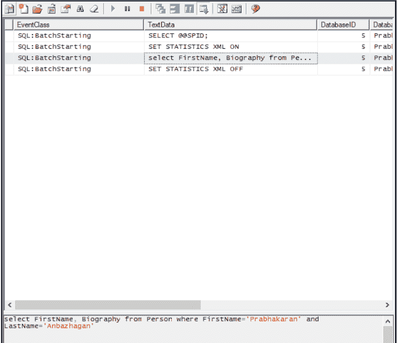

应使用优化顾问来优化查询，而优化顾问需要跟踪数据来执行分析，因此我们需要保存此探查器数据以进行性能优化分析，如下面的截图所示：

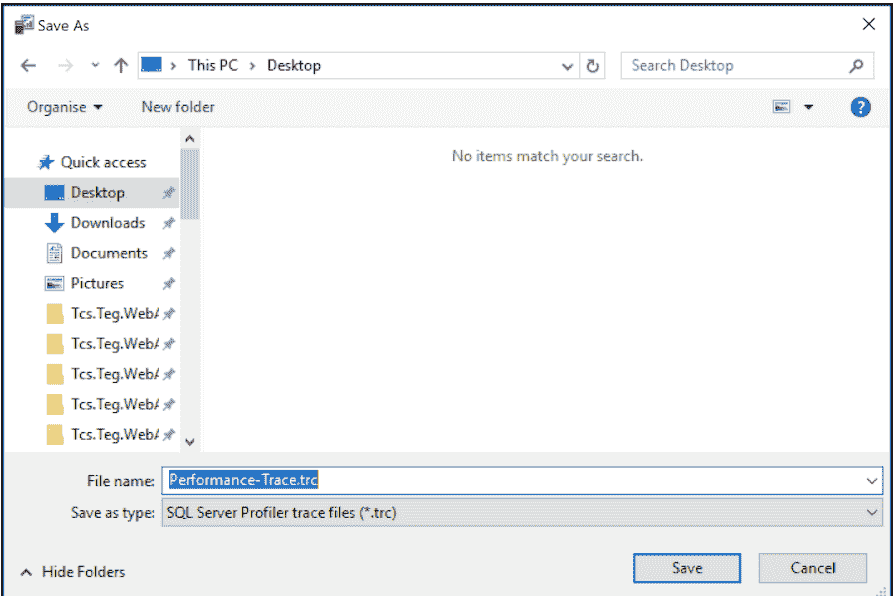

性能优化所需的数据现已就绪。下一步是在优化顾问中使用它。右键单击SQL查询，选择“在数据库引擎优化顾问中分析查询”以进行进一步操作，如下面的截图所示：

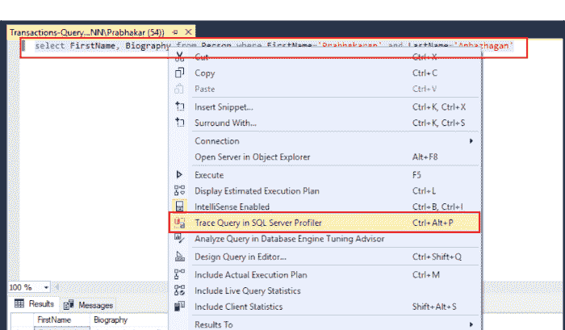

令人惊讶的是，它抛出了以下错误：参数类型“server type = Sql, server name = (localdb)\mssqlocaldb, timeout = 30, database = <DatabaseName>, protocol = NotSpecified, workstation = , integrated security = True”无法转换为参数类型“Microsoft.SqlServer.Management.Common.SqlConnectionInfo”。(mscorlib)，这意味着我们正在对SQL Express版本使用优化顾问，而这是不支持的：

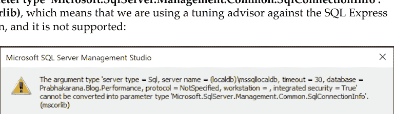

我们需要至少开发版才能使用优化顾问；让我们下载开发版（https://www.microsoft.com/en-in/sql-server/sql-server-downloads），如下面的截图所示，配置它，然后继续性能优化：

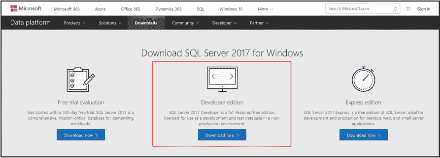

一旦安装了开发版并配置了数据库，从查询窗口打开优化顾问，它现在应该可以正常打开了。然后，使用以下详细信息创建一个新会话，例如**会话名称**、**工作负载**（文件类型）及其位置。选择**用于工作负载分析的数据库**，最后选择我们需要优化的数据库，如下面的截图所示：

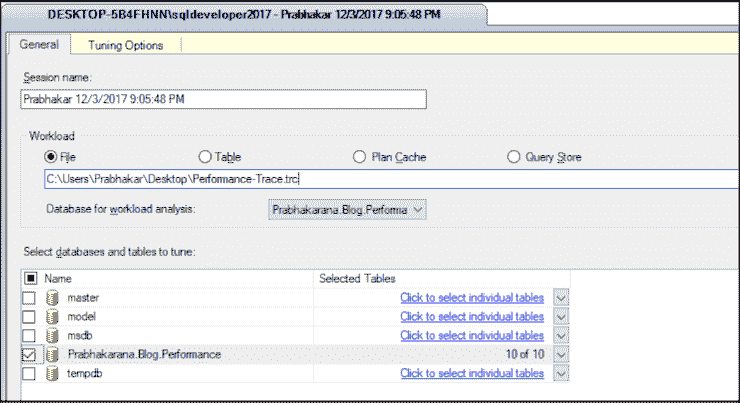

我们已经准备好开始分析了。单击“开始分析”按钮，如下面的截图所示，开始优化分析，该分析将在所选参数范围内执行优化分析：

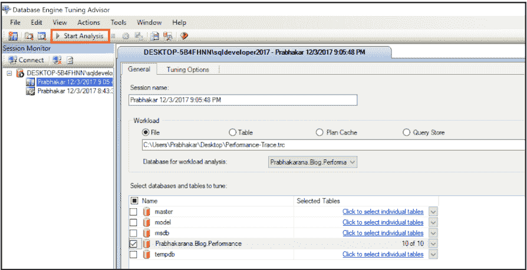

当分析完成时，我们可以在“进度”选项卡中看到打印出的成功消息，如下面的截图所示。我们关注的重点是生成建议：

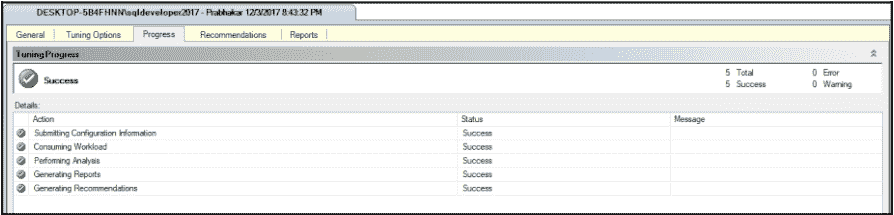

添加并更新到数据库的迁移将创建所需的非聚集索引，如下面的截图所示：

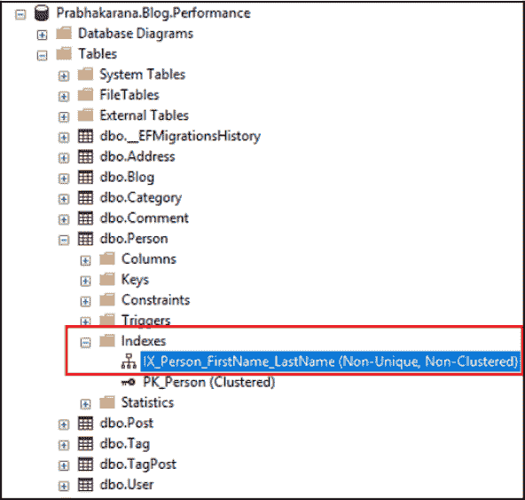

让我们在启用执行计划的情况下运行相同的查询。我们可以证明，该操作现在只需读取一行即可为我们检索记录，如下面的截图所示：

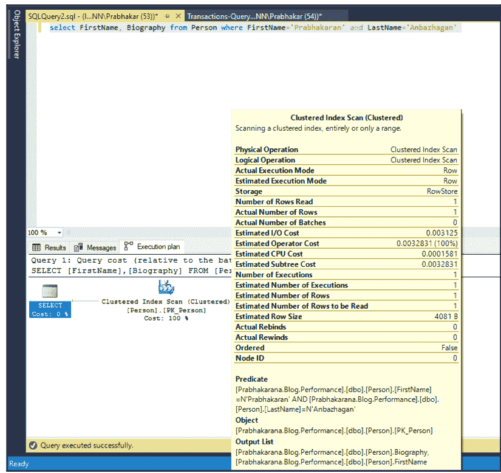

我们已经了解了如何创建优化检索查询所需的索引，这为我们的分析和解决方案画上了句号，以实现更好的性能。

## 总结

我们探讨了可能遇到的多个性能问题，以及解决这些问题所需的方案。我们从EF Core的跟踪行为及其投影行为开始，然后探讨了使用批量插入/更新检测更改，以及如何处理它们。我们通过支持异步操作增强了应用程序，这使我们能够有效地处理线程。然后，我们分析/修复了通过网络检索和传输的数据，从数据量和列一直到对数据存储进行的数据库调用次数。最后，我们了解了数据类型不匹配如何影响我们，以及缺失索引如何影响我们的检索性能，以及在这些场景中的改进方法。我们在本章中研究的性能改进措施将帮助我们把一个性能最差（10,000毫秒以上）的系统改进为性能最佳（<=1000毫秒）的系统，这将是大多数系统的性能**服务级别协议（SLA）**。到目前为止，我们只处理了数据存储中的单个租户。在*第12章，隔离——构建多租户数据库*中，我们将处理多租户数据库及其行级安全性。
