# 12 隔离——构建多租户数据库

## 隔离——构建多租户数据库

我们探讨了可能遇到的多个性能问题，以及解决这些问题所需的方案。我们从EF Core的跟踪行为及其投影行为开始，然后探讨了使用批量插入/更新检测更改问题，以及如何处理它们。我们通过支持异步操作增强了应用程序，这使我们能够有效地处理线程。然后，我们分析/修复了通过网络检索和传输的数据，从数据量和列一直到对数据存储进行的数据库调用次数。最后，我们了解了数据类型不匹配如何影响我们，以及缺失索引如何影响我们的检索性能，以及在这些场景中的改进方法。

在本章中，我们将讨论所需的身份验证实现，然后是行级安全性，最后是多租户。

本章将包含以下小节：

- 博客系统中的身份验证
- 行级安全性：
  - 筛选谓词
  - 阻止谓词
- 多租户：
  - 独立
  - 每租户数据库
  - 共享多租户
  - 深入多租户

## 博客系统中的身份验证

身份验证机制是在系统中支持行级安全性或多租户所需的基础，因此我们必须开始在应用程序中构建身份验证。有多种形式的身份验证可用，但我们将在博客系统中实现基于Cookie的身份验证。

以下代码块将在Startup.cs的ConfigureServices()方法中添加基于Cookie的身份验证作为服务：

```
public void ConfigureServices(IServiceCollection services)
{
    // Code removed for brevity
    services.AddAuthentication(o =>
    {
        o.DefaultAuthenticateScheme =
            CookieAuthenticationDefaults.AuthenticationScheme;
        o.DefaultChallengeScheme =
            CookieAuthenticationDefaults.AuthenticationScheme;
    })
    .AddCookie();
}
```

使用基于Cookie的身份验证服务所需的配置必须在Startup.cs的Configure()方法中执行，如下所示：

```
public void Configure(IApplicationBuilder app,
IHostingEnvironment env,
ILoggerFactory loggerFactory, BlogContext blogContext)
{
    // Code removed for brevity
    app.UseAuthentication();
}
```

通过将AuthorizeFilter添加到配置的Filters集合中，可以将身份验证全局应用于所有控制器。所需的配置应在Startup.cs的ConfigureServices()方法中执行，如下所示：

```
public void ConfigureServices(IServiceCollection services)
{
    // Code removed for brevity
    services.AddMvc(configuration =>
    {
        var authorizationPolicy = new AuthorizationPolicyBuilder()
            .RequireAuthenticatedUser()
```


我们可以通过启用匿名来解决此问题，使用以下代码片段将 `AllowAnonymous` 属性添加到 `Login` 操作方法中：

```
```csharp
[AllowAnonymous]
public IActionResult Login(string redirectUrl)
{
    ViewBag.RedirectUrl = redirectUrl;
    return View();
}
```
```

我们还需要使 `Login HttpPost` 操作为匿名，因为用户在向服务器发送登录凭据时不会经过身份验证，因此也将 `AllowAnonymous` 添加到以下操作中：

```
```csharp
[AllowAnonymous]
[HttpPost]
public async Task<IActionResult> Login(LoginViewModel
loginViewModel)
{
    // Code removed for brevity
    var claims = new List<Claim>
    {
        new Claim(ClaimTypes.Name, loginViewModel.Username)
    };

    var claimsIdentity = new ClaimsIdentity(
        claims,
        CookieAuthenticationDefaults.AuthenticationScheme);

    await HttpContext.SignInAsync(
        CookieAuthenticationDefaults.AuthenticationScheme,
        new ClaimsPrincipal(claimsIdentity));
    return RedirectToAction("Index", "Home");
}
```
```

与身份验证相关的实现已提交到 Git 仓库，并在以下 URL 中可用：

`goo.gl/XudiqY`

我们可以运行并查看博客系统中的身份验证和授权是如何工作的。从以下插图中，我们可以看到 **Register** 和 **Login** 功能已包含在内，其他管理员超链接已从用户处隐藏，最后，**Blog** 和 **Recent Posts** 已设为匿名，以便任何用户都可以查看博客文章。请参考以下屏幕截图：

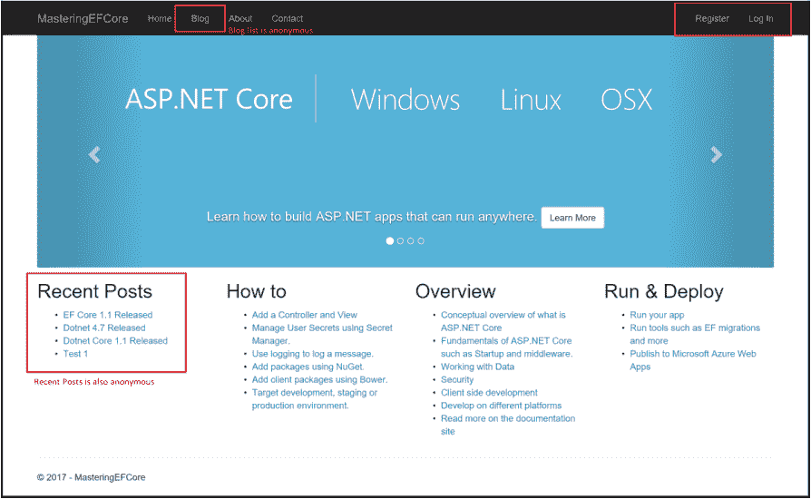

**Blog** 页面显示了系统中创建的博客文章列表，并且用户可以匿名阅读。以下图像显示了来自不同博客的帖子在同一页面上匿名列出，正如预期的那样：

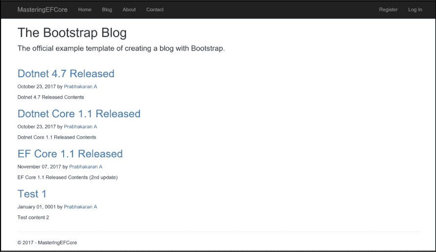

打开其中任何一篇帖子将显示以下博客帖子显示页面，该页面显示了帖子及其对应的评论、添加评论的 provision（甚至可以匿名），最后是一个 **About** 部分，向我们简要介绍作者：

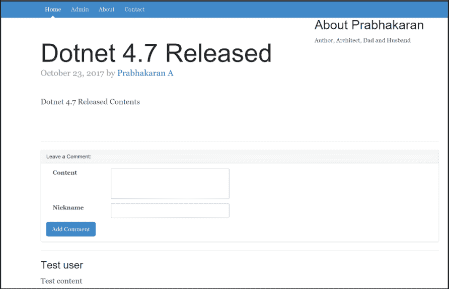

如果我们想访问 **Admin** 屏幕，我们需要登录系统。让我们使用以下 **Login** 屏幕来获取身份验证以访问系统的授权部分。身份验证成功后，系统将为用户生成一个 cookie，该 cookie 将由系统用于确保用户在其并发请求中经过身份验证：

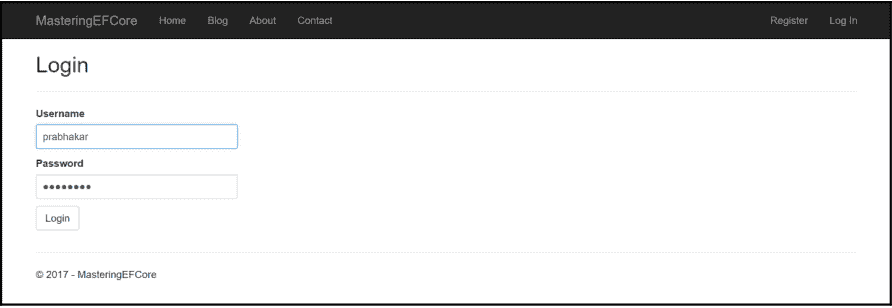

身份验证成功后，我们将看到屏幕上显示以下突出显示的模块，其中第一个是用户的 *Welcome* 消息，另一个是导航栏中可见的管理员链接：

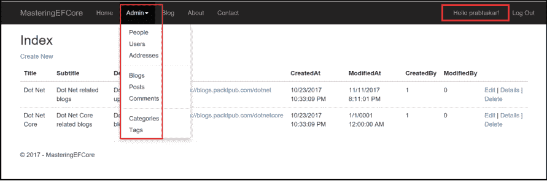

现在我们准备好了，系统现在可以支持行级安全性，这将在下一节中讨论。

## 行级安全性

**行级安全性 (RLS)** 将允许我们在单个数据库中维护所有用户的数据，但仍确保仅共享与用户相关的数据，而其他用户的内容保持隐藏。底层逻辑可以用任何方法实现，这取决于开发人员的创造力，但我们将坚持使用租户，因为我们将在系统中处理多租户。让我们使用以下代码片段创建一个 `Tenant` 类型，该类型可以容纳人员信息以及其租户 ID 和名称：

```
```csharp
public class Tenant
{
    public Guid Id { get; set; }
    public string Name { get; set; }
    public Person Person { get; set; }
}
```
```

我们包含了两个租户来测试我们实现中的行级安全性，并且我们使用了系统中可用的两个人员来将租户映射到他们；现在，按如下所示配置租户：

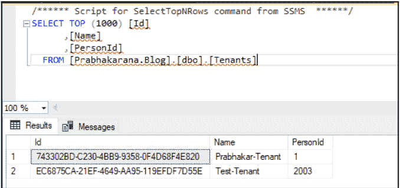

Person 实体中有三个条目，其中一个是匿名用户，另外两个是已注册用户，已注册用户的 id 为 1 和 2003，如以下屏幕截图所示，在创建租户时进行了配置：

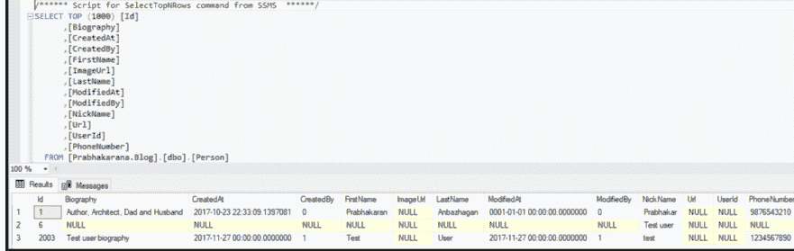

Blog 实体没有根据租户分隔内容的 provision。我们需要在 Blog 实体中支持租户；包含以下代码行以在 Blog 实体中具有 TenantId 属性以支持租户：

```
public class Blog
{
    // Code removed for brevity
    public Guid TenantId { get; set; }
}
```

应添加迁移并更新数据库以使博客实体支持租户。一旦您完成根据作者信息修改博客数据以包含适当的租户 ID，它应该在数据存储中具有以下数据：

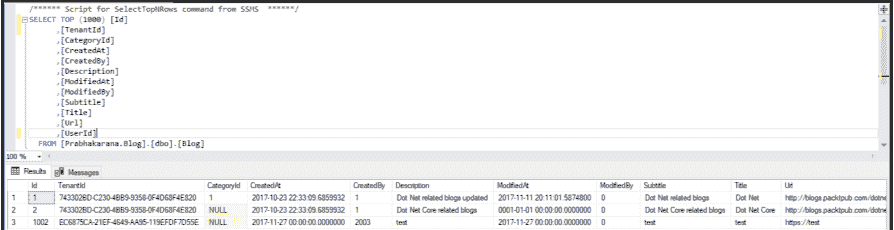

Post 实体也没有租户支持。我们应遵循相同的添加以下代码片段的方法来支持 Post 实体中的租户：

```
public class Post
{
    // Code removed for brevity
    public Guid TenantId { get; set; }
}
```

一旦迁移被添加到数据存储并更新，我们应该执行与我们对博客所做的相同的数据修改，这将使数据存储中具有以下帖子数据：

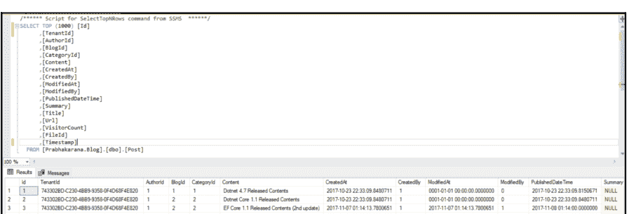

系统现在支持租户。让我们继续并执行所需的配置以确保租户信息得到正确维护。

### 过滤谓词

我们将从创建租户谓词开始，使用以下代码，该代码将允许用户根据给定的租户 id 执行读取操作，或在未提供租户 id 时返回所有数据：

```
```sql
CREATE FUNCTION dbo.TenantPredicate (@TenantId uniqueidentifier)
    RETURNS TABLE
    WITH SCHEMABINDING
AS
    RETURN SELECT 1 AS TenantPredicateResult
    WHERE (@TenantId = CAST(SESSION_CONTEXT(N'TenantId') AS uniqueidentifier))
    OR
    (SESSION_CONTEXT(N'TenantId') =
    convert(nvarchar(50),cast(cast(0 as binary) as uniqueidentifier)))
```
```

前面的 `TenantPredicate` 函数将接受租户 id 作为输入参数，如果租户 id 与会话中的租户 id 匹配，或为空时返回一个位值作为表。租户 id 将与授权用户匹配，而空租户 id 将用于为管理员或匿名用户显示所有帖子（匿名用户没有租户 id）。

一旦谓词创建后，我们就可以在创建安全策略时使用它们，并且由于我们处理的是过滤谓词，让我们为读取操作创建一个租户策略。以下代码片段将在博客和帖子上创建过滤谓词，并且每当对这些实体执行读取操作时，谓词就会启动并根据会话值验证和过滤数据：

```
```sql
CREATE SECURITY POLICY dbo.TenantPolicy
ADD FILTER PREDICATE dbo.TenantPredicate(TenantId) ON dbo.Blog,
ADD FILTER PREDICATE dbo.TenantPredicate(TenantId) ON dbo.Post
GO
```
```

`TenantId` 的会话上下文可以使用以下 SQL 查询设置，该查询将键和值传递给 `sp_set_session_context` 存储过程。代码在会话上下文中设置了 `Prabhakar-Tenant`，这意味着它将仅提供特定于该租户的数据，除非会话更改或清除：

```
```sql
EXEC sp_set_session_context @key=N'TenantId', @value='743302BD-C230-4BB9-9358-0F4D68F4E820'
```
```

一旦会话设置，任何读取操作都将根据会话租户配置产生结果。以下屏幕显示 `Prabhakar-Tenant` 已设置在会话中，然后检索到的帖子仅与该租户相关，这确保了过滤谓词按预期工作：

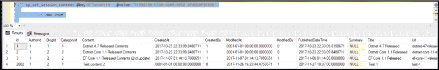

如果我们将租户更改为测试租户，则仅返回与测试租户相关的帖子，如下所示：

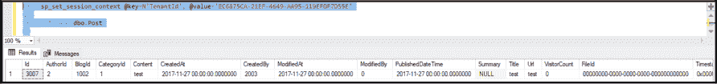

我们从配置到通过读取操作验证，探索了过滤谓词。现在，我们将在下一节中探索阻止谓词。

### 阻止谓词

阻止谓词在配置方面与过滤谓词相似，只是它限制用户对其他租户的数据执行写操作。如前所述，配置保持不变，只有一些更改，如以下代码片段所示，而不是允许匿名用户访问。我们将仅将其限制为管理员，如此处突出显示的那样：

```
CREATE FUNCTION dbo.TenantPredicate (@TenantId uniqueidentifier)
RETURNS TABLE
    WITH SCHEMABINDING
AS
    RETURN SELECT 1 AS TenantPredicateResult
    WHERE (@TenantId = CAST(SESSION_CONTEXT(N'TenantId') AS
    uniqueidentifier))
    OR
        -- Add administrator support once roles were implemented
```


## 多租户

与住在封闭社区的人们可以很容易地联系到多租户这个术语。我们会拥有多个家庭住在他们自己的公寓/家中（一个用户）内，而这些公寓/家位于一栋楼/一期（一个租户）中；一起，它们就构成了封闭社区，而这正是多租户。在软件术语中，一个系统支持一组按角色分组为租户的用户，其数据存储在单个或共享数据库中，并且仍然基于租户提供数据，这就叫做多租户。

多租户应用程序可分为以下几类：

- Standalone
- Database-per-tenant
- Shared multi-tenant

我们将在下一小节中分别探索其中的每一个应用程序。

### Standalone

独立模型处理的是一个独立的应用程序及其自己的数据库，将一切从不同租户中隔离出来，从数据库到应用程序。它帮助开发人员自定义应用程序并为不同客户拥有不同的模式，这将在基于产品的公司中广泛使用。如今，由于微服务架构，公司正转向这种方法。此外，需求也基于交易量和数据的敏感性而产生。

下图解释了独立模型，其中每个应用程序都有自己的数据库：

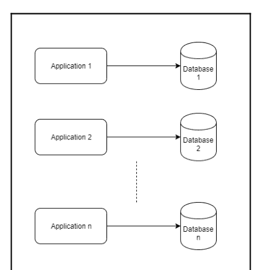

如果我们仔细观察，还有一件事：应用程序永远不会相互交互。在多租户术语中，每个应用程序实例都由一个租户拥有，并且租户拥有完整的数据库的所有权。金融机构将由于数据的敏感性和数据量而采用独立模型。对于开发人员来说，如果他们想进行自定义、对数据进行控制、在不影响其他人的情况下扩展应用程序或数据库等，提供对供应商的访问会变得容易，然而，从软件公司的角度来看，这仍然是一个昂贵的解决方案，因为它涉及多个数据库。

我们在本节中探讨了独立模型。现在，让我们进入下一节的数据库-per-tenant。

### Database-per-tenant

数据库-per-tenant 模型处理的是单个/共享应用程序，但拥有自己的数据库（租户拥有自己的数据库），仅隔离数据库。它将帮助开发人员为应用程序拥有单一代码库，将自定义保留在数据库中；如果他们没有将所有自定义都移到数据库中，那么每当系统包含任何新功能/产品支持时，他们最终就会影响每个供应商。数据库隔离将帮助公司对数据进行控制，即使代码库在供应商之间共享。

### Shared multi-tenant

共享多租户模型处理的是共享应用程序，并且所有租户共享单个数据库，仅隔离应用程序。它帮助开发人员快速部署功能，而不会影响其他供应商，同时仍将数据维护在单个数据库中。任何与模式相关的更改都将受到严格审查，因为它也会影响其他供应商，并使数据库与其它供应商紧密耦合。

下图解释了多租户模型，其中每个应用程序共享同一个数据库：

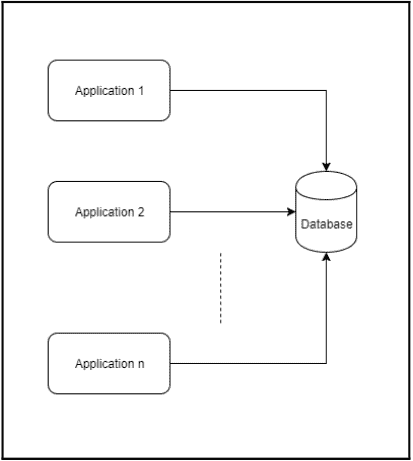

共享公共数据库的主要缺点是，如果其中一个供应商的数据量更大，它会影响所有消费供应商，迫使我们扩展数据库服务器。在多租户术语中，所有租户的多个应用程序实例共享一个数据库。拥有不同部门/模块共享单个数据库的公司将是这种模型的合适候选者。每个部门将被视为一个租户，它将拥有自己的用户，但仍在企业范围内共享单个数据库。快速部署任何功能会变得容易，但供应商自定义会变得困难，因为应用程序共享一个公共数据库。

我们在本节中探讨了多租户模型。现在，让我们进入下一节的多租户实现。

## 深入多租户

多租户的实现完全取决于本章中在行级安全部分构建的租户配置。Entity Framework Core 消除了处理系统中租户处理所需的任何自定义实现或任何第三方包的需求。EF Core 2.0 提供了查询过滤功能，允许我们在数据上下文级别根据配置的 ID 过滤租户。

在数据上下文中实现租户配置所需的代码如下所示：

```
public class BlogContext: DbContext
{
    // Code removed for brevity
    public Guid TenantId { get; set; }
    protected override void OnModelCreating(ModelBuilder modelBuilder)
    {
        modelBuilder.Entity<Blog>()
            .ToTable("Blog")
            .HasQueryFilter(item => item.TenantId.Equals(TenantId));
        modelBuilder.Entity<Post>()
            .ToTable("Post")
            .HasQueryFilter(item => item.TenantId.Equals(TenantId));
        // Code removed for brevity
    }
}
```

控制器实现所需的租户处理非常简单：

- 使用用户身份名称从数据存储中检索人员信息
- 从 Person 实体中检索租户 ID
- 然后将检索到的身份配置在数据上下文中，这将在相应的数据上下文操作中使用

以下代码遵循了上述实现步骤，用于从控制器在数据上下文中配置租户：

```
public class BlogsController : Controller
{
    // Code removed for brevity
    public async Task<IActionResult> Index()
    {
        SetTenantId();
        return View(await _context.Blogs.FromSql("Select * from dbo.Blog").ToListAsync());
    }

    private void SetTenantId()
    {
        if (this.User == null) return;
        var person = _context.People.FirstOrDefault(item =>
            item.User.Username.Equals(this.User.Identity.Name));
        if (person != null)
        {
            _context.TenantId = person.TenantId.HasValue ?
                person.TenantId.Value : Guid.Empty;
        }
        return;
    }
}
```

不要忘记删除上一节中包含的谓词，否则应用程序可能不会从 Blog 或 Post 实体中产生任何结果。执行以下 SQL 查询以从租户策略中删除谓词：

```
ALTER SECURITY POLICY dbo.TenantPolicy
DROP FILTER PREDICATE ON dbo.Blog,
DROP FILTER PREDICATE ON dbo.Post,
DROP BLOCK PREDICATE ON dbo.Blog,
DROP BLOCK PREDICATE ON dbo.Post
GO
```

在租户配置就位之前，**Blog** 列表页面看起来像以下屏幕截图，即使 Prabhakar-Tenant 租户的用户已登录，它也包含所有博客信息：

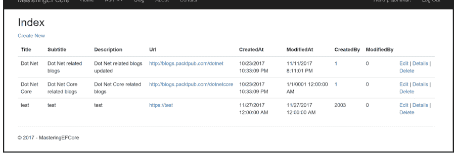

安全策略的创建也类似，如此处所示。唯一的区别将是策略中使用的谓词，在我们的例子中将是阻止谓词：

```
CREATE SECURITY POLICY dbo.TenantPolicy
ADD BLOCK PREDICATE dbo.TenantPredicate(TenantId) ON dbo.Blog,
ADD BLOCK PREDICATE dbo.TenantPredicate(TenantId) ON dbo.Post
GO
```

写操作应以类似的方式执行，其中会话上下文应首先使用租户 ID 设置，基于此执行写操作。以下插图显示会话上下文设置为 Prabhakar-Tenant 并执行写操作：

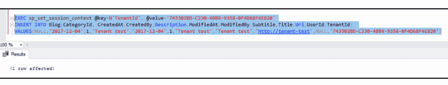

我们从未讨论过用户尝试在另一个租户中写入记录时的失败场景。以下屏幕截图显示，如果违反谓词，将返回错误，“The attempted operation failed because the target object 'Prabhakarana.Blog.dbo.Blog' has a block predicate that conflicts with this operation. If the operation is performed on a view, the block predicate might be enforced on the underlying table. Modify the operation to target only the rows that are allowed by the block predicate.”：

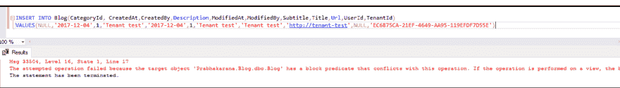

我们使用过滤和阻止谓词探讨了行级安全。现在，我们将进入下一节的多租户数据库。


## 阻止跨租户写操作

多租户实现并不像我们在行级安全性部分中处理的那样，限制用户执行跨租户更新。我们应该通过多租户实现为博客系统增加这种支持。当前代码库不允许我们扩展该行为。到目前为止，租户信息仅存储在实体中，这让我们无法在数据上下文中对它们进行通用验证。我们有一个强烈需求，要体验领域驱动设计（DDD），以便开始在我们的应用程序中使用EntityBase。以下实体代码包含Id和TenantId字段，分别代表实体标识符和拥有该实体的用户的租户标识符：

```csharp
public class EntityBase
{
    public int Id { get; set; }
    public Guid TenantId { get; set; }
}
```

EntityBase类应被那些需要作为租户实现一部分的实体所使用；这种强制将帮助我们处理跨租户更新。这并不会阻止用户不继承EntityBase就实现租户，只是它不会开箱即用地处理跨租户更新。Blog实体应继承EntityBase；这强制我们移除冗余的Id和TenantId字段，如下所示：

```csharp
public class Blog : EntityBase
{
    // Remove the Id and TenantId fields
    // Code removed for brevity
}
```

跨租户更新应该在BlogContext中处理，这将允许我们重写SaveChanges()方法。EntityBase类型是区分支持租户的实体与其他实体的关键。以下代码基于EntityBase过滤ChangeTracker条目，并将TenantId投影为一个去重列表（distinct list），这样我们就可以进行验证，如果过滤后的tenantIds中存在多个租户，则抛出异常：

```csharp
public class BlogContext : DbContext
{
    public override int SaveChanges()
    {
        ValidateMultiTenantPersistence();
        return base.SaveChanges();
    }
    // Override other save changes as well

    private void ValidateMultiTenantPersistence()
    {
        var tenantIds = ChangeTracker.Entries()
            .Where(item => item.Entity is EntityBase)
            .Select(item => ((EntityBase)item.Entity).TenantId)
            .Distinct();

        if (!tenantIds.Any()) return;
        if (tenantIds.Count() > 1 ||
            !(tenantIds.Count().Equals(1) &&
            tenantIds.First().Equals(TenantId)))
        {
            throw new MultiTenantException("Invalid tenant id(s) found: " + string.Join(",", tenantIds));
        }
    }
}
```

在前面的实现中，我们使用了一个自定义异常，但尚未实现它，所以现在让我们来实现。自定义异常应继承Exception类型，并且还应有能力包含要传递的错误消息，或构建错误消息所需的数据。在下面的代码片段中，我们接收由抛出它的消费代码注入的自定义错误消息：

```csharp
public class MultiTenantException : Exception
{
    public string ErrorMessage { get; private set; }
    public MultiTenantException(string errorMessage)
    {
        ErrorMessage = errorMessage;
    }
}
```

拼图的最后一块，TenantId，必须在消费数据上下文的控制器中设置，下面的代码将设置租户信息。用户信息使用已登录用户的身份获取。从数据存储中获取TenantId，最后在数据上下文中更新它：

```csharp
public async Task<IActionResult> Create(Blog blog)
{
    SetTenantId();
    blog.TenantId = _context.TenantId;
    // Code removed for brevity
}

private void SetTenantId()
{
    if (this.User == null) return;
    var person = _context.People.FirstOrDefault(item =>
        item.User.Username.Equals(this.User.Identity.Name));
    if (person != null)
    {
        _context.TenantId = person.TenantId.HasValue ?
            person.TenantId.Value : Guid.Empty;
    }

    return;
}
```

我们已经完成了跨租户更新处理，博客创建功能将让我们看到它们的实际效果。博客创建操作将从已登录用户`prabhakar`设置`TenantId`，该用户属于租户`Prabhakar-Tenant`，标识符为`{743302BD-C230-4BB9-9358-0F4D68F4E820}`，如以下截图所示：

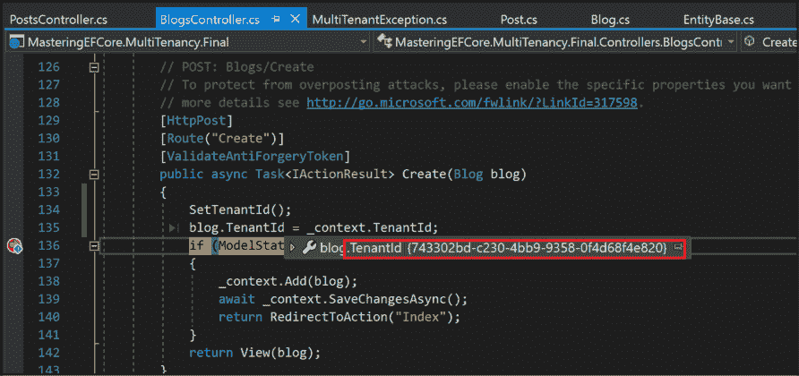

租户id实际上是不能被修改的，但为了演示，让我们修改租户信息，看看数据上下文如何处理该更新。在“即时窗口”中被修改的TenantId，从{743302BD-C230-4BB9-9358-0F4D68F4E820}（Prabhakar-Tenant）改为{EC6875CA-21EF-4649-AA95-119EFDF7D55E}（Test-Tenant），在以下截图中突出显示：

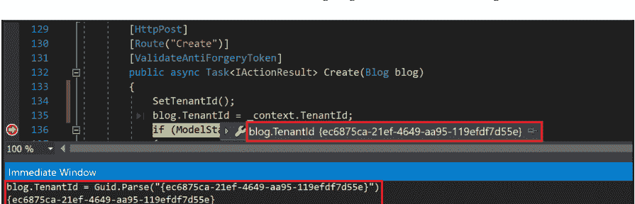

如果我们继续使用更新后的TenantId处理，由于Blog实体已标记为EntityBase，我们将得到以下突出显示的异常。这里之所以抛出异常，是因为从更改跟踪器中获取的TenantId与数据上下文中的TenantId不匹配：

```csharp
private void ValidateMultiTenantPersistence()
{
    var tenantIds = ChangeTracker.Entries()
        .Where(item => item.Entity is EntityBase)
        .Select(item => ((EntityBase)item.Entity).TenantId)
        .Distinct();

    if (!tenantIds.Any()) return;
    if (tenantIds.Count() > 1 || !(tenantIds.Count().Equals(1) && tenantIds.First().Equals(TenantId)))
    {
        throw new MultiTenantException("Invalid tenant id(s) found: " + string.Join(", ", tenantIds));
    }
}
```

从控制器抛出的异常将呈现为以下截图所示。由于ASPNETCORE_ENVIRONMENT设置为Development，它不会重定向到自定义错误页面；来自其他环境的用户将看到自定义错误屏幕，该屏幕会限制向用户呈现的信息：

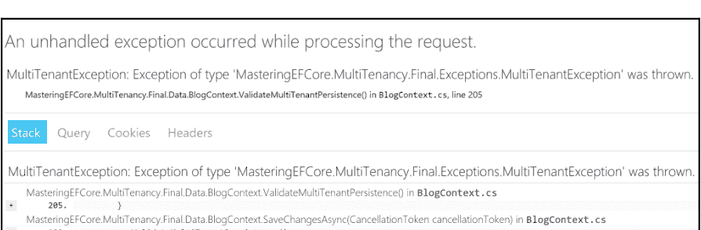

匿名页面会因查询过滤器而受影响，可以使用IgnoreQueryFilters()流畅API方法来处理。RecentPosts模块实现可以修复为以下代码：

```csharp
public class GetRecentPostQuery : QueryBase,
    IGetRecentPostQuery<GetRecentPostQuery>
{
    // Code removed for brevity
    public IEnumerable<Post> Handle()
    {
        var posts = IncludeData
            ? Context.Posts
              .IgnoreQueryFilters()
              // Code removed for brevity
            : Context.Posts
              .IgnoreQueryFilters()
              // Code removed for brevity
        // Code removed for brevity
    }
    // Code removed for brevity
}
```

同样的方法也可应用于`GetPostByUrlQuery`和`GetPaginatedPostQuery`，以匿名方式呈现帖子。

本节通过多租户实现和数据上下文验证处理了跨租户更新。这也使行为与我们在行级安全性部分所做的实现保持一致。

## 总结

我们先从身份验证实现开始，这是行级安全性和多租户的基础。然后，我们探讨了行级安全性，以及如何使用筛选谓词和阻止谓词来管理它们。最后，我们开始探索多租户及其不同模型，并深入研究了博客系统中的实现。我们的EF Core之旅至此已得出结论，并为博客系统构建了一个完整的生态系统。

我们通过构建博客系统探索了Entity Framework Core，系统中所包含的功能旨在覆盖相关主题。因此，理想情况下，我们可以利用迄今为止获得的知识来构建一个完整的博客生态系统。我们可以开发自己的.NET Core博客系统，它可以部署在任何操作系统上，这将大大节省托管成本，因为使用Linux操作系统有更便宜的托管方案。很高兴我能帮助您获取EF Core知识，其用例不仅限于博客系统，而是非常广泛，现在您可以使用EF Core ORM快速构建任何您心中所想的系统。祝编码愉快！


