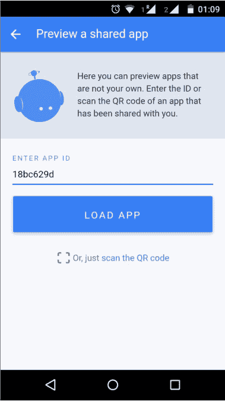

# Ionic 3 入门

多年来，Ionic 一直在不断演进；自从 Ionic v1 发布以来，这个框架一直处于持续开发和改进之中。最明智的举措之一是 Ionic 团队推出了基于 Angular 2 的 Ionic v2。最近，Ionic 3 也发布了，它基于 Angular 4 和 TypeScript 2.2。在本书中，我们将主要深入探讨 Ionic 2 和 Ionic 3 及其高级概念。我们将涵盖构建支持蓝牙信标的商场电商应用、与 Firebase 的集成，以及 Ionic 应用对 PWA 的支持等主题。我们将从对 iOS、Android 和 Windows 这三个平台的支持开始，并将演示基于物联网的应用程序，这会非常令人兴奋。

在本章中，我们将了解 Ionic 的所有基础内容，这些内容将有助于构建大规模、企业级的应用程序。过去 2-3 年我们一直在使用 Ionic 1.x，在这一过程中，我们看到了框架的巨大改进和多项功能的开发。Angular 2 发布后，框架又得到了更多改进，随后 Ionic 团队计划开发基于 Angular 2 的 Ionic 2。Ionic 3 和 Angular 4 在相似的路线上发展，并没有像我们从 Ionic v1 迁移到 v2 时那样的重大框架变更。借助 Ionic 3，你将看到性能的提升、代码复杂度的降低，以及构建可扩展应用能力的增强。Ionic 现在面向移动 Web 和桌面应用程序，这帮助开发者在任何地方运行相同的代码库。Ionic Native 是另一个例子，展示了 Ionic 团队如何日复一日地改进产品，让开发者的生活更加轻松。我们首先会了解 Angular 和 Ionic 的一些基础知识，以及 TypeScript 如何成为构建企业级应用的重要资产。Ionic CLI 和 Ionic Cloud 产品也在定期改进，我们可以利用它们加快开发速度，并高效地测试或分享我们的应用。在本章中，我们将涵盖：

- Angular 4、Ionic 3 和 TypeScript
- 安装与设置
- 目录结构和模块化
- 使用 SASS 进行主题定制
- Ionic CLI


# Angular 4、Ionic 3 和 TypeScript

我们中的许多人从 Angular 1 来到 Angular 2 或 4，肯定都会发现这是对应用程序的彻底重写，并且学习曲线陡峭。当我最初开始使用 Ionic 和 Angular 时也有同样的感受，但随着我逐步阅读 Angular 的概念，过去在 Angular 1 中面临的许多问题都自动解决了，无需任何额外努力。最初，你会怀念 Angular 1 中的旧控制器、服务、过滤器等概念，最重要的是导航和路由。但当你深入研究这些主题时，你会发现有相应的模块，如**组件**、**提供者**和**管道**，并且它们可以以类似的方式使用。导航和路由现在也用作在不同页面之间导航的推入（push）和弹出（pop）机制。在 Ionic 2 的初始测试版中，我们没有适当的基于 URL 的路由，因为用户无法直接进入应用中的特定页面。但在稳定的 Angular 路由器发布后，它被添加到了 Ionic 2 中，这为更好地支持渐进式 Web 应用（PWA）开辟了道路，使得相同的 Ionic 应用可以以移动 Web 应用的形式发布。Ionic 3 还增加了对响应式网格的支持，这将有助于我们构建桌面应用。懒加载（Lazy Loading）是另一个新增的重要功能，它减少了应用的初始加载时间。尽管如此，由于 Ionic 3 仍处于初期阶段，我们可以期待这些功能变得更加稳定。正如我们所知，Ionic 2 和 3 没有重大的框架变化，因此在本章中，我们首先会比较 Angular 1 和 2，以帮助用户理解差异以及如何迁移到最新的 Ionic 版本。

```
<strong>[(property-name)]="expression"</strong><br/><br/><strong> <input type="text" <br/> [(ngModel)]="model.name" /></strong>
```

我们仍然有双向数据绑定。不过，为了改善 Angular 的摘要循环和性能，默认情况下我们并不使用双向数据绑定。它使用单向绑定，当我们需要时，可以扩展为双向绑定。你可以参考 Angular 模板语法，以弄清 Angular 4 中所有其他语法及其用途。

**Ionic 缺乏 URL 导航**是 Ionic 论坛上正在进行的另一个讨论。这种说法在一定程度上也是正确的；因为 Angular 路由器当时不够稳定，Ionic 团队决定在初始测试版中移除它。目前，Angular 路由器已经稳定，并且将会保留在 Ionic 中。Ionic 团队深知，拥有合适的路由机制以及让开发者在转向 Ionic 3 时感到熟悉是多么重要。

**升级完全重写：** Angular 2 本身是被重写了，但你不必也重写自己的应用。最初开始时，我也有同样的感觉，以为我们必须重新开发现有应用。但有很多工具和文档（http://ionicframework.com/files/Ionic2Migration.pdf）可用于从 Ionic 1 平滑升级到 Ionic 2 或 3。你只需要小心，因为如果应用很复杂，你可能需要手动完成很多事情。但有一点是肯定的：如果你具有相应的专业知识和 Angular 2 的概念，升级应用肯定比从头构建同样的应用花费的时间少得多。这背后的原因之一是，你已经有了一个正在运行的应用，只需要以不同的方式重组各个部分，因为大多数应用逻辑是相同的。

就我个人而言，我在学习 Ionic 的过程中并没有过多考虑升级到新版本。相反，我将其视为新 Angular 版本中带来的改进概念，旨在简化学习和理解。

# 将 Ionic 1 映射到 Ionic 3

对于任何能够轻松理解 Angular 1 中各种概念与 Angular 4 中对应实现的开发者来说，生活将变得非常轻松。而且，我相信大多数问题都会自动得到解答。

## 控制器对应组件

组件是 Angular 和 Ionic 应用的支柱；你会发现几乎一切都是组件。你可以将 Angular 1 中的控制器与 Angular 4 中的组件进行对比。在控制器中，我们过去定义了大部分代码的逻辑部分，并将控制器注册到主模块。现在，以类似的方式，我们在 Angular 4 的组件中定义代码，如果需要，我们可以将其导出。

```
Component Class: // Angular & Ionic 1

angular.module('wedding.controllers', [])
.controller('LoginCtrl',
function($scope, CategoryService) {
// controller function and DI of CategoryService
}
);
```

```
// Angular 4 & Ionic 3

import {Component} from '@angular/core';
import {NavController} from 'ionic-angular';

@Component({
templateUrl: 'build/pages/catalog/categories.html'
})
export class CategoryPage {
// DI of NavController for navigation
constructor(private navCtrl: NavController) {
this.nav = navCtrl;
}
}
```

在 Angular 1 中，依赖注入是通过控制器函数参数实现的，而在 Angular 4 中，我们在构造函数内部传递它。许多其他东西，例如 IIFE 语法，在 Angular 1 中我们需要定义它以使控制器代码不污染全局命名空间，但在 Angular 4 中不再需要，因为 ES 2015 模块为我们处理了命名空间。此外，如你所见，我们导出了 CategoryPage 类，现在可以在任何需要该模块的地方导入它。另一个重大变化是 `$scope` 被 `this` 关键字取代。`$scope` 存在许多性能问题，而且在 Angular 1 中开发者已经减少了 `$scope` 的使用。

```
// Filter - Angular 1 <br/><td>{{movie.price | currency}}</td> <br/><br/>// Pipes in Angular 4 <br/><td>{{movie.price | currency:'USD':true}} <br/></td>
```

出于性能原因，过滤器（filter）和 orderBy 过滤器已从管道（Pipes）中移除，不过如果类似代码在多个模板中重复使用，你随时可以构建自定义管道。

## 服务对应提供者

服务和工厂（Factory）是 Angular 1x 的重要组成部分，我们通过它们与远程服务器通信以获取数据。我们过去在工厂函数中定义 API 调用，控制器调用这些函数来从服务器获取数据：

```
// Factory method in Angular 1x
angular.module('wedding.services', [])

// DI of $http for HTTP calls to servers
// $q for promises
.factory('CategoryService', function ($http, $q) {
var catalog  = {};

catalog.getCategories = function () {
    // here we will call APIs
}
})
```

现在你将看到我们如何将代码迁移到 Angular 4 的提供者。Angular 1 中工厂里的同一个 getCategories() 方法，将移到 Angular 4 的 categoryData() 类中：

```
// Provider in Angular 4
import { Injectable } from '@angular/core';
import { Http } from '@angular/http';

@Injectable()
export class CategoryData {

constructor(private http: Http) {}

getCategories() {

return new Promise(resolve => {
    // We're using Angular Http provider
    // to request the data,
    // then on the response it'll map the
    // JSON data to a parsed JS object.
    // Next we process the data and
    // resolve the promise with the new
    // data.

this.http.get('www.veloice.com/data.json').subscribe(res => {
    // we've got back the raw data, now
    // generate the core schedule data
    // and save the data for later
    // reference
    this.data = this.processData(res.json());
    resolve(this.data);
});
});
}
}
```

你会注意到 Provider 类有一个 @Injectable 装饰器。该装饰器让 Angular 4 知道这个特定的类可以被依赖注入器使用。

## TypeScript 来救援

TypeScript 基本上是 Javascript 的一个超集，是一种静态类型语言。TypeScript 所做的类似于 LESS 或 SASS 对 CSS 所做的工作。TypeScript 编译为 Javascript，并且语法几乎相同。任何来自面向对象世界的人都会对它非常熟悉，比如类、构造函数、继承和接口等概念。

许多开发者会对 ES5、ES6、TypeScript、AtScript 等这些关键字感到困惑。JavaScript 是一种社区驱动的语言，因此浏览器厂商会实现那些使用最广泛的功能。目前，ES5，即 ECMAScript 5，是 ECMA International 制定的一个标准。ES6 和 ES7 是 JavaScript 的未来标准，具有大量新特性。我们可以直接使用 Babel（一种转译器）来开发 ES6 和 ES7 应用。转译器是源到源编译器，以一种编程语言作为输入，并输出另一种语言中的等效代码。不过，推荐使用 TypeScript，因为 Ionic 社区中的大部分工作都基于 TypeScript。而且，你很容易获得资源和社区帮助。

当我们启动一个新的 Ionic 3 项目时，它会使用 TypeScript 创建项目，尽管在 Ionic 2 和 CLI v2 中，我们也有选项可以用 TypeScript 创建项目。如前所述，我们应该使用 TypeScript，因为随着项目规模变大，维护和理解会更容易。我想在这里澄清关于 Angular 4 的一个重要点：无论是 TypeScript 还是 ES6，只要你运行 Ionic 服务器，我们的应用文件夹就会被转译成 ES5，因为这是目前所有主流浏览器都支持的目标。

TypeScript 提供了许多新特性，我们主要会在 Ionic 或 Angular 应用中使用它们。其中一些如下所示：

- 类和模块支持
- 静态类型检查
- 与其他面向对象语言相似的语法
- ES6 特性，例如模板字符串支持
- 装饰器、注解支持和依赖注入
- 箭头函数


## 安装与设置

在学习 Ionic 3 的过程中，大多数开发者之前已经有了 Ionic 的安装经验。我们可以通过 NPM 包安装 `ionic`；目前 Ionic CLI v3 仍处于 beta 阶段，它彻底改变了 CLI 的工作方式，现在 Ionic 创建的默认项目基于 Ionic 3：

```bash
$ npm install -g ionic
```

建议使用 Node 6.x 版本和 npm 3.x 版本。这个 beta 版本同时支持 Ionic 1 和 Ionic 2 项目。现在让我们开始创建一个项目：

```bash
// will create Ionic 3x project
$ ionic start wedding-planner sidemenu
// will create Ionic 1x project
$ ionic start wedding-planner sidemenu --type ionic1
// move to project directory
$ cd wedding-planner

// run project with ionic serve
$ ionic serve
```

**接下来的步骤将是为应用添加所需的特定平台和插件：**

```bash
// For adding specific platforms
$ ionic cordova:platform add android

// running application on real device
$ ionic cordova:run android

// running inside an emulator
$ ionic cordova:emulate android
```

**接下来，我们将了解如何开始使用 Ionic 2 应用的代码库。你需要理解每个文件和文件夹的结构及其工作方式。**

## 目录结构与模块化

在 Ionic 1x 中，我们并没有最佳的目录或项目结构。随着 Ionic 和 Angular 的逐步演进，开发者倾向于采用模块化方式来组织文件和文件夹。在 Ionic 1x 中，管理文件和文件夹有许多不同方式。通常，你在 Ionic 1x 构建中看到的默认结构可以用于许多小型项目（我们不需要处理大量文件）；对于基于 Ionic 1x 的项目，主要遵循两种结构：**byFolderType** 和 **byFeatureType**。Ionic 3 的最大优点之一是项目结构以模块化方式设置，其中包含 pages、providers、pipes、theme 文件夹，以及它们各自的下级文件夹。下面我们来了解 Ionic 3 项目中的一些重要文件：

- `./src`

  这里存放着我们整个应用的代码库，它是最重要的部分：

- `./node_modules`

  这里存放着运行应用所需的全部依赖和 NPM 包：

- `./platforms`

  这里包含应用所使用的特定平台文件夹条目。当我们运行 `ionic platform add` 命令时，你会看到在 `platform` 文件夹内创建了相应的文件夹：

- `./plugins`

  应用中使用到的所有插件都存放在这里：

- `./resources`

  整套图标和启动屏（splash screens）都在这个文件夹中，并按不同平台和设备进行了组织：

- `./www`

  这里存放着我们的 `index.html` 文件；`src` 文件夹中的代码库编译后，bundle、文件、图片以及 SASS 编译生成的 CSS 文件都会被放入 `www` 中：

- `./www/index.html`

  这是我们的应用（也可以说是每个混合应用）的入口点。我们主要在此文件中声明运行应用所需的脚本和样式表。与 Ionic 1 中使用 ng-app 类似，在 Ionic 3 中我们要检查 `index.html` 文件中的 `<ion-app></ion-app>`：

- `./package.json`

  该文件定义了项目元数据以及将添加到 `node_modules` 文件夹中的依赖。它还包含应用所使用的 Cordova 平台和插件信息：

- `./ionic.config.json`

  该文件包含项目专属设置，如名称、ID、代理（proxies）以及其他信息：

- `./src/app/main.ts`

  这是我们进入代码库的起点，同时我们也会在这个文件中引导启动（bootstrap）应用：

- `./src/app/app.module.ts`

  在这个文件中，我们声明应用中使用的页面、指令和 providers：

- `./src/app/app.component.ts`

  我们在这里设置根页面，并且根组件会首先被调用，它控制着整个应用，类似于 Ionic 1 中 `app.js` 文件的作用。不过，这个 `component` 与应用中其他组件并无不同；它只是在 `app` 文件夹中声明。在后续章节中开始构建应用时，我们将更深入地了解如何处理所有这些文件和代码库。

## 自定义

现在 SASS 的基础设置已经准备好了；同时，在运行 `ionic serve` 时，你可以为每个组件或页面在不同文件中添加所有自定义样式和 SASS 相关的修改。让我们先从修改 `variable.scss` 文件中默认存在的一个颜色变量开始：

```scss
/*
To customize the look and feel of
    Ionic, you can override the variables
For example, you might change some of
    the default colors:

$colors: (
    primary:    #387ef5,
    secondary:  #32db64,
    danger:     #f53d3d,
    light:      #f4f4f4,
    dark:       #222,
    favorite:   #69BB7B,
    twitter:    #53ACEB,
    github:     #000000,
    instagram:  #235D8D
);

// Fastest way to change the theme of
    your Ionic app is to set new value
    for primary color
```

你可以看到，我们添加了 Twitter 和 GitHub 等自定义颜色。我们还可以通过提供 base 和 contrast 属性来进一步自定义：

```scss
$colors: (
    facebook:(
        base: #3b5998,
        contrast: #ffffff
    )
)
```

现在你可以将此颜色键用作许多组件的属性，例如 `buttons`：

```html
<button facebook>Share on Facebook</button>
```

SASS 非常强大，它能加快 CSS 开发流程。它就像 CSS 的瑞士军刀，可以用最少的代码完成很多事情，并且只需做一些改动就能轻松改变应用的整个外观和体验。关于如何使用 SASS 有非常多的示例，但由于我们更专注于 Ionic 开发，我建议你抽时间阅读一些优秀的 SASS 文档和 Ionic 3 主题文档，这样可以获得更详细的信息。

**$ ionic resources**

Ionic 会自动裁剪、调整大小，并从源图片中为每个平台创建图标和启动屏，同时会针对手机、平板等不同设备生成不同尺寸。所有这些都是在 Ionic 的调整大小和裁剪服务器上生成的，无需在本地机器上安装库或插件，因此不会带来任何额外负担。

**$ ionic resources --icon**

**$ ionic resources --splash**

如果没有为源文件提供合适的尺寸，那么它只会创建小于源图片尺寸的资源。例如，平板或高分辨率屏幕所需的资源可能不会生成。

## 平台特定资源

Ionic 支持为各种平台和设备构建图标和启动屏资源。要构建资源，我们只需将源图片放到 resources 文件夹中，并命名为 `icon.png` 和 `splash.png`。这样，你就能获得每个平台所需的图标和启动屏，例如 iOS 使用原生圆角图标，Android 图标则使用透明背景。

总结步骤如下：

- 将文件添加到 resources 文件夹，并命名为 `icon.png` 和 `splash.png`。（也可以使用 `.psd` 和 `.ai` 格式）。
- 确保图标的最小尺寸要求为 192x192 px，启动屏为 2208x2208 px。
- 从 CLI 运行 `ionic resources` 命令。


> 不同平台对图标样式有不同的处理方式，例如 iOS 会自动添加圆角，因此我们建议 `Ionic` 源文件不要带圆角。此外，使用 `ionic resources` 命令至少需要 Cordova 3.6 或更高版本。


```
$ ionic serve [options]
$ ionic serve --lab
```

## 添加平台

`ionic platform` 命令用于添加和移除平台：

```
$ ionic cordova:platform <action> <PLATFORM>
[options]
$ ionic cordova:platform add android
$ ionic cordova:platform remove ios
Running applications on devices
```

## 在设备上运行应用

`ionic run` 命令有助于在已连接的设备上运行应用：

```bash
$ ionic cordova:run [options] <PLATFORM>
$ ionic cordova:run android
    There is also an option of Emulate. Emulate an
    Ionic
    project on a simulator or emulator.
$ ionic cordova:emulate [options] <PLATFORM>
```

Ionic CLI 中可用任务的数量一直在增加。要了解所有最新任务及其详细信息，最好的方法是使用 `ionic --help`：

```bash
$ ionic --help
```

这会列出所有任务及其对应的选项和标志。你可以轻松地在测试项目上尝试所有这些任务，这将有助于你更深入地理解它们。

## 上传与分享 Ionic 应用

在开发应用时，你现在可以将应用分享给测试团队或朋友进行审查。Ionic 平台提供了这个功能，最棒的是你甚至不需要在本地构建，然后给大家发送 APK 文件。上传和分享应用并不只是几个简单步骤。Ionic for organization（Ionic 企业版）是另一项服务，可用于组织员工之间的协作。

```
`$ ionic upload`
```

上传命令的参数或标志：

-   - `[--deploy]`：将快照部署到特定通道
-   - `[--note]`：用于说明上传描述的注释

## 生成组件

`ionic generate` 命令可以创建新的管道（pipe）、组件（component）、页面（page）、指令（directive）和提供者（provider）。同时，它还会在 `app.module.ts` 中创建条目；例如，如果你创建了一个提供者，它会被导入到 `app.module.ts` 并注入到 providers 中。一旦你创建了页面、组件、指令或管道，你会看到一个包含对应 TypeScript 文件的文件夹生成，你可以从中开始编写逻辑：

```
ionic generate [type] [name]
```

-   - `[--type]`：生成器的类型，如页面、指令和管道
-   - `[--name]`：生成的组件名称

```bash
// Some example commands
$ ionic generate pipe NumberPipe
$ ionic generate page About
```

## Ionic 分享

在构建应用时，你可以直接在 Ionic View 应用中测试它，只要输入应用 ID，它就会自动从 `ionic.io` 服务器（你上传应用的地方）下载你的应用：

```bash
$ ionic share <email>
```



完成上传并将应用分享给具有特定电子邮件地址的用户后，你发出邀请的人将收到一封包含应用查看链接的电子邮件。你也可以直接在 Ionic View 应用中测试你的应用，该应用可在 Google Play 商店和 Apple Store 中获取。你还可以直接分享你的应用 ID 来开始构建应用，从而在 Ionic View 应用中直接进行测试。上面的截图展示了如何添加应用 ID 并测试应用。

## 总结

我们已经介绍了 Ionic 的入门部分，并讨论了在构建大型应用时需要注意的各个方面。现在我们知道了在项目中组织文件和文件夹是多么重要。我们还讨论了各种设置，例如通过 SASS 定制应用、为不同平台自动创建图标和启动屏幕，以及上传/分享应用。在本章后面，我们继续介绍了许多 Ionic CLI 命令，这些命令有助于我们快速开发和调试应用。Ionic CLI 正在日益发展，许多新功能和任务不断涌现。我们都应该定期更新 Ionic CLI 并查看新功能，以便在下一个应用中使用它们。我们现在已经准备好更深入地探索 Ionic 及其组件。在[第 2 章](#) *Ionic 组件*中，我们将熟悉各种 Ionic 组件，并进入真正的应用构建阶段，届时会使用列表、虚拟滚动、本地化、导航和许多其他组件。这将帮助我们构建需要处理多项任务的复杂应用。UI 定制是我们将关注的另一个方面，因为几乎每个应用都有不同的设计，我们可以通过对现有 Ionic 组件稍加调整来轻松实现。另一个我们将关注的重要方面是 Ionic 社区构建的自定义模块，我们可以直接在应用中使用它们。
