# Ionic 组件

在本章中，我们将介绍构建大型应用所需的各种 Ionic 组件和 API。Ionic 提供了各种内置的 JavaScript 组件，我们可以巧妙地加以利用。Ionic 还提供了许多我们不太了解的 API，在这里我们将学习如何在应用中高效使用这些 API，以提高应用性能并使其达到生产就绪状态。

我们还将从名为 vPlanet Commerce 的电子商务应用开始；这是我其中一个产品创意，旨在将电子商务商店带向移动端。我们将在本书后面为该应用添加渐进式 Web 应用支持，从而形成一个完整的方案。为了让本章更有趣，我会根据电子商务应用在构建过程中的需求，集成不同的 Ionic 组件和 API。这样你就能获得一个完整的电子商务应用。

本章将涵盖以下主题：

-   - 构建 vPlanet Commerce
-   - Ionic 3 组件
-   - Ionic API 和自定义模块
-   - 使用 Ionic 3 实现懒加载

## 构建 vPlanet Commerce

我们一直在讨论构建电子商务应用，现在就开始吧。如前所述，它名为 vPlanet Commerce。vPlanet Commerce 是一个电子商务应用，将展示集成在应用中的各种 Ionic 组件，以及社区构建的一些第三方组件。进入第 3 章 *Ionic Native 和插件*后，我们将集成 Ionic Cloud 服务，如身份验证（auth）、Ionic DB、部署（deploy）等。这将帮助我们完善应用，并使其看起来像专业应用。让我们使用 `sidemenu` 模板从零开始创建应用：

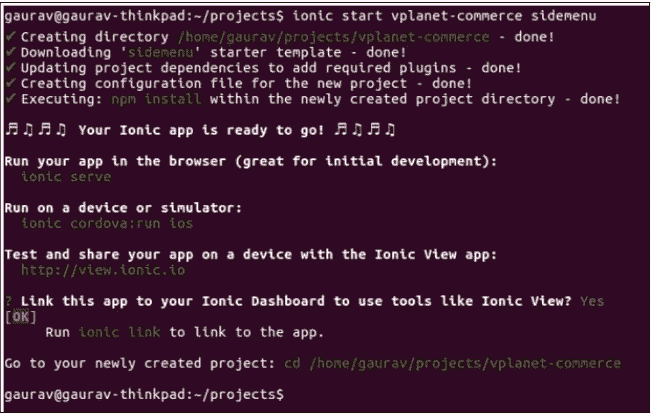

现在你已经有了基于侧边菜单模板的基础应用。我采取的下一步是参考 ionic-conference-app 来构建应用的初始组件，这与 walkthrough 相同。

让我们通过 CLI 创建一个 `walkthrough` 组件来生成命令：

```bash
$ ionic g page walkthrough
```

当我们开始使用 `walkthrough` 组件时，需要添加逻辑，使其仅在用户首次安装应用时显示：

```typescript
// src/app/app.component.ts
// Check if the user has already seen the walkthrough
    this.storage.get('has Seen Walk Through').then((has
    Seen Walk Through) => {
        if (has Seen Walk Through) {
            this.rootPage = HomePage;
        } else {
            this.rootPage = WalkThroughPage;
        }
        this.platformReady();
    })
```


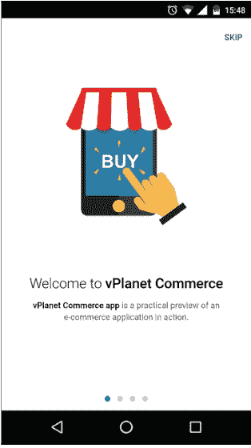

因此，我们在检查用户是否首次看到引导流程时存储一个布尔值。我们做的另一件重要事情是为登录和注销创建事件，这样当用户登录到应用程序时，我们可以相应地更新菜单项或执行任何其他数据操作：

// src/app/app.component.ts

export interface PageInterface {
  title: string;
  component: any;
  icon: string;
  logsout?: boolean;
  index?: number;
  tabComponent?: any;
}
export class vPlanetApp {
  loggedInPages: PageInterface[] = [
    { title: 'account', component: AccountPage, icon: 'person' },
    { title: 'logout', component: HomePage, icon: 'log-out', logsOut: true }
  ];
  loggedOutPages: PageInterface[] = [
    { title: 'login', component: LoginPage, icon: 'log-in' },
    { title: 'signup', component: SignupPage, icon: 'person-add' }
  ];

  listenToLoginEvents() {
    this.events.subscribe('user:login', () => {
      this.enableMenu(true);
    });

    this.events.subscribe('user:logout', () => {
      this.enableMenu(false);
    });
  }

  enableMenu(loggedIn: boolean) {
    this.menu.enable(loggedIn, 'loggedInMenu');
    this.menu.enable(!loggedIn, 'loggedOutMenu');
  }

  // For changing color of Active Menu
  isActive(page: PageInterface) {
    if (this.nav.getActive() &&
this.nav.getActive().component === page.component) {
    return 'primary';
}
  return;
}
}

接下来我们有多个 app.template.html，并且我们根据用户是否已登录或已注销拥有多个 <ion-menu> 项：

// src/app/app.template.html
<ion-split-pane>
<!-- logged out menu -->
<ion-menu id="loggedOutMenu" [content]="content">

<ion-header>
<ion-toolbar>
<ion-title>{{'menu' | translate}}</ion-title>
</ion-toolbar>
</ion-header>

<ion-content class="outer-content">

<ion-list>
<ion-list-header>
{{'navigate' | translate}}
</ion-list-header>
<button ion-item menuClose *ngFor="let p of appPages" (click)="openPage(p)">
<ion-icon item-left [name]="p.icon" [color]="isActive(p)"></ion-icon>
{{ p.title | translate }}
</button>
</ion-list>

<ion-list>
<ion-list-header>
{{'account' | translate}}
</ion-list-header>
<button ion-item menuClose *ngFor="let p of loggedOutPages" (click)="openPage(p)">
<ion-icon item-left [name]="p.icon" [color]="isActive(p)"></ion-icon>
{{ p.title | translate }}
</button>
<button ion-item menuClose *ngFor="let p of otherPages" (click)="openPage(p)">
<ion-icon item-left [name]="p.icon" [color]="isActive(p)"></ion-icon>
{{ p.title | translate }}
</button>
</ion-list>
</ion-content>

</ion-menu>

<!-- logged in menu -->
<ion-menu id="loggedInMenu" [content]="content">

<ion-header>
<ion-toolbar>
<ion-title>Menu</ion-title>
</ion-toolbar>
</ion-header>

<ion-content class="outer-content">

<ion-list>
<ion-list-header>
{{'navigate' | translate}}
</ion-list-header>
<button ion-item menuClose *ngFor="let p of appPages" (click)="openPage(p)">
<ion-icon item-left [name]="p.icon" [color]="isActive(p)"></ion-icon>
{{ p.title | translate }}
</button>
</ion-list>

<ion-list>
<ion-list-header>
{{'account' | translate}}
</ion-list-header>
<button ion-item menuClose *ngFor="let p of loggedInPages" (click)="openPage(p)">
<ion-icon item-left [name]="p.icon" [color]="isActive(p)"></ion-icon>
{{ p.title | translate }}
</button>
<button ion-item menuClose *ngFor="let p of otherPages" (click)="openPage(p)">
<ion-icon item-left [name]="p.icon" [color]="isActive(p)"></ion-icon>
{{ p.title | translate }}
</button>
</ion-list>

</ion-content>

</ion-menu>
```

由于我们的应用主要从 `app.template.html` 开始，因此我们在此处声明 rootPage。最近发布了 `SplitPane` 组件，它有助于创建多视图布局，这对于在不同设备和屏幕尺寸上运行同一应用程序非常有帮助：

```
<!-- main navigation -->
<ion-nav [root]="rootPage" #content swipeBackEnabled="false" main></ion-nav>
</ion-split-pane>
```

让我们现在看看我们的应用中将有哪些页面、服务和过滤器。与其将其列为项目符号列表，了解它的最佳方式是通过 `app.module.ts` 文件，该文件包含所有声明、导入、`entrycomponents` 和提供者：

// src/app/app.module.ts

import { BrowserModule } from '@angular/platform-browser';
import { NgModule, ErrorHandler } from '@angular/core';
import { IonicApp, IonicModule, IonicErrorHandler, DeepLinkConfig } from 'ionic-angular';
import { TranslateModule, TranslateLoader, TranslateStaticLoader } from 'ng2-translate/ng2-translate';
import { HttpModule, Http } from '@angular/http';
import { CloudSettings, CloudModule } from '@ionic/cloud-angular';
import { Storage } from '@ionic/storage';
import { vPlanetApp } from './app.component';

import { AboutPage } from '../pages/about/about';
import { PopoverPage } from '../pages/popover/popover';
import { AccountPage } from '../pages/account/account';
import { LoginPage } from '../pages/login/login';
import { SignupPage } from '../pages/signup/signup';
import { WalkthroughPage } from '../pages/walkthrough/walkthrough';
import { HomePage } from '../pages/home/home';
import { CategoriesPage } from '../pages/categories/categories';
import { ProductsPage } from '../pages/products/products';
import { ProductDetailPage } from '../pages/product-detail/product-detail';
import { WishlistPage } from '../pages/wishlist/wishlist';
import { ShowcartPage } from '../pages/showcart/showcart';
import { CheckoutPage } from '../pages/checkout/checkout';
import { ProductsFilterPage } from '../pages/products-filter/products-filter';
import { SupportPage } from '../pages/support/support';
import { SettingsPage } from '../pages/settings/settings';
import { SearchPage } from '../pages/search/search';
import { UserService } from '../providers/user-service';
import { DataService } from '../providers/data-service';
import { OrdinalPipe } from '../filters/ordinal';

// 3rd party modules
import { Ionic2RatingModule } from 'ionic2-rating';

// import ionic native packages
import { SplashScreen } from '@ionic-native/splash-screen';
import { Deeplinks } from '@ionic-native/deeplinks';
import { TextToSpeech } from '@ionic-native/text-to-speech';
import { AppRate } from '@ionic-native/app-rate';
import { GoogleAnalytics } from '@ionic-native/google-analytics';
import { Camera } from '@ionic-native/camera';
import { CallNumber } from '@ionic-native/call-number';
import { SocialSharing } from '@ionic-native/social-sharing';
import { Push } from '@ionic-native/push';

export function createTranslateLoader(http: Http) {
  return new TranslateStaticLoader(http, './assets/i18n', '.json');
}

// Configure database priority
export function provideStorage() {
  return new Storage(['sqlite', 'indexeddb', 'localstorage'], { name: 'vplanet' })
}

const cloudSettings: CloudSettings = {
  'core': {
    'app_id': 'f8fec798'
  }
};

// Deeplink Configuration
export const deepLinkConfig: DeepLinkConfig = {
  links: [
    { component: HomePage, name: 'Home Page', segment: '' },
    { component: CategoriesPage, name: 'Categories Page', segment: 'categories' },
    { component: ProductsPage, name: 'Categories Product Page', segment: 'categories/:categoryId' },
    { component: ProductDetailPage, name: 'Product Details Page', segment: 'products/:productId' },
    { component: WishlistPage, name: 'Wishlist Page', segment: 'wishlist' },
    { component: ShowcartPage, name: 'Showcart Page', segment: 'cart' },
    { component: SupportPage, name: 'Support Page', segment: 'feedback' },
    { component: SettingsPage, name: 'About Page', segment: 'settings' },
    { component: AboutPage, name: 'About Page', segment: 'about' },
    { component: LoginPage, name: 'Login Page', segment: 'login' },
    { component: SignupPage, name: 'Signup Page', segment: 'signup' },
    { component: AccountPage, name: 'Account Page', segment: 'account' }
  ]
};

@NgModule({


```ts
declarations: [
  vPlanetApp,
  AboutPage,
  AccountPage,
  LoginPage,
  PopoverPage,
  SignupPage,
  WalkThroughPage,
  HomePage,
  CategoriesPage,
  ProductsPage,
  ProductsFilterPage,
  ProductDetailPage,
  SearchPage,
  WishlistPage,
  ShowcartPage,
  CheckoutPage,
  SettingsPage,
  SupportPage,
  OrdinalPipe,
],
imports: [
  BrowserModule,
  HttpModule,
  IonicModule.forRoot(vPlanetApp, {locationStrategy: 'hash'}, deepLinkConfig),
  Ionic2RatingModule,
  TranslateModule.forRoot({
    provide: TranslateLoader,
    useFactory: createTranslateLoader,
    deps: [Http]
  }),
  IonicStorageModule.forRoot({
    useFactory: provideStorage
  }),
  CloudModule.forRoot(cloudSettings)
],
bootstrap: [IonicApp],
entryComponents: [
  vPlanetApp,
  AboutPage,
  AccountPage,
  LoginPage,
  PopoverPage,
  SignupPage,
  WalkThroughPage,
  HomePage,
  CategoriesPage,
  ProductsPage,
  ProductsFilterPage,
  ProductDetailPage,
  SearchPage,
  WishlistPage,
  ShowcartPage,
  CheckoutPage,
  SettingsPage,
  SupportPage
],
providers: [
  SplashScreen,
  Deeplinks,
  TextToSpeech,
  AppRate,
  GoogleAnalytics,
  Camera,
  CallNumber,
  SocialSharing,
  Push,
  {provide: ErrorHandler, useClass: IonicErrorHandler},
  { provide: Storage, useFactory: provideStorage },
  UserService,
  DataService
]
})
export class AppModule {}
```

此外，我建议你查看本章中 vPlanet Commerce 应用的代码，这将有助于你很好地了解我们在应用程序中将使用哪些页面和组件。由于本章主要针对各种 Ionic 组件，我们将在应用程序中使用大量这些组件。

## Ionic 组件

在构建应用程序时，我们可以有效地使用许多 Ionic JavaScript 组件。最好的做法是寻找应用程序中需要的功能。让我们从我们的电子商务应用程序的首页开始，首页上将有一个带有横幅的图片滑块。

### Slides

Slides 组件是一个多节容器，可用于多种场景，例如教程视图或横幅滑块。`<ion-slides>` 组件包含多个 `<ion-slide>` 元素，可以左右拖动或滑动。Slides 提供了多种配置选项，可传递给 ion-slides，例如 autoplay、pager、direction: vertical/horizontal、initial slide 和 speed。

使用 slides 非常简单，我们只需将它们包含在我们的 home.html 中；home.ts 文件中不需要任何依赖即可包含它：

```html
// Banner Slider in src/pages/home/home.html

<ion-slides pager #adSlider (ionSlideDidChange)="logLengthTrackEvent()" style="height: 250px">
  <ion-slide *ngFor="let banner of banners">
    
  </ion-slide>
</ion-slides>

// Defining banners image path

export class HomePage {

  products: any;
  banners: String[];

  constructor() {
    this.banners = [
      'assets/img/banner-1.webp',
      'assets/img/banner-2.webp',
      'assets/img/banner-3.webp'
    ]
  }
}
```

正如前面的代码所示，ion-slides 可用的属性有很多，例如 pager、autoplay、direction 等：

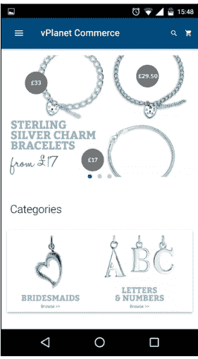

如果查看前面的截图，你可以看到我们使用了白色背景的横幅。实际上，作为一个建议，尝试在应用程序内部使用与横幅相同的背景颜色。这样横幅在低分辨率或高分辨率的手机和平板上都会显示得很好。

### Lists

列表是许多应用程序中最常用的组件之一。在列表中我们可以显示信息行。我们将在应用程序内部多次使用列表，例如在 `categories` 页面上，我们显示多个子类别：

```html
// src/pages/categories/categories.html
<ion-content class="categories">
  <ion-list-header *ngIf="!categoryList">Fetching Categories ....</ion-list-header>
  <ion-list *ngFor="let cat of categoryList">
    <ion-list-header>{{cat.name}}</ion-list-header>
    <ion-item *ngFor="let subCat of cat.child">
      <ion-avatar item-left>
        
      </ion-avatar>
      <h2>{{subCat.name}}</h2>
      <p>{{subCat.description}}</p>
      <button ion-button clear item-right (click)="goToProducts(subCat.id)">View</button>
    </ion-item>
  </ion-list>
</ion-content>
```

我们在这里使用了一个带有所属类别顶部标题的头像列表。可用的列表类型有很多，例如多行、缩略图和滑动列表。我们将在本章后面在 showcart 页面上集成滑动列表：

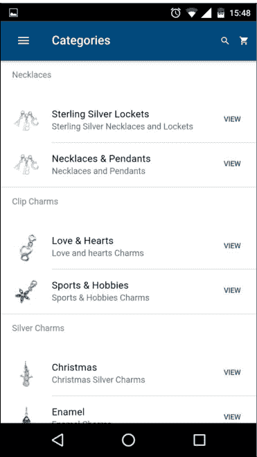

正如你所见，前面的截图显示了类别页面上头像列表的外观。我们应该确保在计划在应用程序中使用列表之前查看文档，因为这有助于我们可视化哪种类型的列表可以在各种不同的应用程序中得到最佳利用。

### Loading and Toast

Loading 组件可用于指示某些活动，同时阻止任何用户交互。使用 Loading 组件最常见的情况之一是向服务器的 HTTP 调用，因为我们知道从服务器获取数据需要时间，在此期间为了良好的用户体验我们可以显示一些内容显示 Loading ...，或 Login wait ...，用于登录页面。

Toast 是一个提供反馈的小弹出窗口，通常在用户执行某些操作时使用。Ionic 3 现在将其 toast 组件作为其库的一部分提供；之前我们必须使用原生的 Cordova 插件来实现 toasts，现在也可以使用。

Loading 和 toast 组件都具有 `create` 方法。我们在创建这些组件时必须提供选项：

```ts
// src/pages/login/login.ts
import { Component } from '@angular/core';
import { NgForm } from '@angular/forms';
import { NavController, LoadingController, ToastController, Events } from 'ionic-angular';
import { SignupPage } from '../signup/signup';
import { HomePage } from '../home/home';

import { Auth, IDetailedError } from '@ionic/cloud-angular';

import { UserService } from '../../providers/user-service';

@Component({
  selector: 'page-user',
  templateUrl: 'login.html'
})
export class LoginPage {
  login: { email?: string, password?: string } = {};

  submitted = false;

  constructor(public navCtrl: NavController,
    public loadingCtrl: LoadingController,
    public auth: Auth,
    public userService: UserService,
    public toastCtrl: ToastController,
    public events: Events) { }

  onLogin(form: NgForm) {
    this.submitted = true;

    if (form.valid) {
      // start Loader
      let loading = this.loadingCtrl.create({
        content: "Login wait...",
        duration: 20
      });
      loading.present();

      this.auth.login('basic', this.login).then((result) => {
          // user is now registered
          this.navCtrl.setRoot(HomePage);
          this.events.publish('user:login');
          loading.dismiss();
          this.showToast(undefined);
        }, (err: IDetailedError<string[]>) => {
          console.log(err);
          loading.dismiss();
          this.showToast(err)
        });
    }
  }

  showToast(response_message: any) {
    let toast = this.toastCtrl.create({
      message: (response_message ? response_message : "Log In Successfully"),
      duration: 1500
    });
    toast.present();
  }

  onSignup() {
    this.navCtrl.push(SignupPage);
  }
}
```

正如前面的代码所示，在代码层面创建 loader 和 toast 几乎相似。创建时提供的选项也相似；我们在这里在登录时使用了 loader，之后使用 toast 来显示所需消息。


*设置 duration 选项是好的，因为如果 loader 被 dismiss 或在代码中未正确处理，那么我们将阻止用户对应用进行任何进一步交互。在向服务器的 HTTP 调用中，我们可能会遇到连接问题或失败情况；在这种情况下可能会导致用户被阻塞。*


## 标签页与分段控件

标签页是在不同视图之间切换并在较高层级组织内容的最简单方式。另一方面，分段控件是一组按钮，可以将其视为特定组件内部的局部切换标签，主要用于筛选。借助标签页，我们可以在页脚构建一个快速访问栏，在其中放置菜单选项，例如首页、收藏和购物车。这样，我们就能一键访问这些页面或组件。另一方面，我们可以在账户组件中使用分段控件，将显示的数据划分为三个分段：个人资料、订单和钱包。

```html
// src/pages/account/account.html
<ion-header>
  <ion-navbar>
    <button menuToggle>
      <ion-icon name="menu"></ion-icon>
    </button>
    <ion-title>Account</ion-title>
  </ion-navbar>
  <ion-toolbar [color]="isAndroid ? 'primary' : 'light'" no-border-top>
    <ion-segment [(ngModel)]="account" [color]="isAndroid ? 'light' : 'primary'">
      <ion-segment-button value="profile">
        Profile
      </ion-segment-button>
      <ion-segment-button value="orders">
        Orders
      </ion-segment-button>
      <ion-segment-button value="wallet">
        Wallet
      </ion-segment-button>
    </ion-segment>
  </ion-toolbar>
</ion-header>

<ion-content class="outer-content">
  <div [ngSwitch]="account">

    <div padding-top text-center *ngSwitchCase="'profile'">
      
      <h2>{{username}}</h2>

      <ion-list inset>
        <button ion-item (click)="updatePicture()">Update Picture</button>
        <button ion-item (click)="changePassword()">Change Password</button>
        <button ion-item (click)="logout()">Logout</button>
      </ion-list>

    </div>

    <div padding-top text-center *ngSwitchCase="'orders'">
      // Order List data to be shown here
    </div>

    <div padding-top text-center *ngSwitchCase="'wallet'">
      // Wallet statement and transaction here.
    </div>

  </div>
</ion-content>
```

标签页有许多可用属性，例如 `mode`、`color`、`tabsPlacement` 和 `tabsLayout`。同样，我们也可以在配置层级配置一些标签页属性；你可以在 https://ionicframework.com/docs/v2/api/config/Config/ 找到哪些属性可以全局配置或针对特定平台配置。

## 警报

警报是 Ionic 提供的组件，用于显示触发警报、确认、提示或某些特定操作。可以从 `ionic-angular` 导入 `AlertController`，它允许我们以编程方式在应用内创建并显示警报。这里需要注意的一点是，这些是 JavaScript 弹出窗口，而不是原生平台弹出窗口。有一个名为 `cordova-plugin-dialogs` 的 Cordova 插件（https://ionicframework.com/docs/v2/native/dialogs/），如果你需要原生对话框 UI 元素，可以使用它。

目前，在 Ionic 应用中可以显示五种类型的警报：基本警报、提示警报、确认警报、单选警报和复选警报。

在 `src/pages/products/products.html` 中，单选警报用于对产品进行排序：

```html
<ion-buttons>
  <button ion-button full clear (click)="sortBy()">
    <ion-icon name="menu"></ion-icon>Sort
  </button>
</ion-buttons>

// onClick we call sortBy method
// src/pages/products/products.ts
import { NavController, PopoverController, ModalController, AlertController } from 'ionic-angular';

export class ProductsPage {

  constructor(
    public alertCtrl: AlertController
  ) {}

  sortBy() {
    let alert = this.alertCtrl.create();
    alert.setTitle('Sort Options');

    alert.addInput({
      type: 'radio',
      label: 'Relevance',
      value: 'relevance',
      checked: true
    });
    alert.addInput({
      type: 'radio',
      label: 'Popularity',
      value: 'popular'
    });
    alert.addInput({
      type: 'radio',
      label: 'Low to High',
      value: 'lth'
    });
    alert.addInput({
      type: 'radio',
      label: 'High to Low',
      value: 'htl'
    });
    alert.addInput({
      type: 'radio',
      label: 'Newest First',
      value: 'newest'
    });

    alert.addButton('Cancel');
    alert.addButton({
      text: 'OK',
      handler: data => {
        console.log(data);
        // Here we can call server APIs with sorted data
        // using the data which user applied.
      }
    });

    alert.present().then(() => {
      // Here we place any function that
      // needs to be called as the alert is opened.
    });
  }
}
```

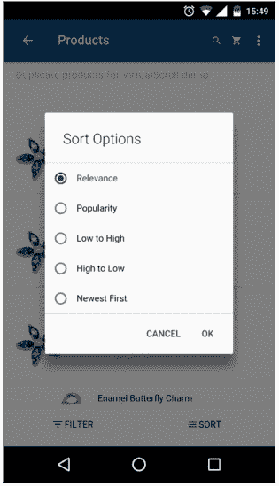

这里是“取消”和“确定”按钮。我们在此处使用它来根据相关性、价格或其他排序值对产品进行排序。

我们还可以准备自定义警报，在其中指定多个选项。如前一个示例所示，我们有五个单选选项；同样，我们甚至可以添加一个文本输入框来接收一些输入并提交。除此之外，在创建警报时，请记住 `AlertController` 组件（https://ionicframework.com/docs/v2/api/components/alert/AlertController/）中所有警报都存在警报、输入和按钮选项属性。

以下是一些警报选项：

- `title: // string`：警报的标题
- `subTitle: // string (可选)`：弹出窗口的副标题
- `Message: // string`：警报的消息
- `cssClass: // string`：自定义 CSS 类名
- `inputs: // array`：警报的输入集合
- `buttons // array (可选)`：按钮数组

```html
// src/pages/home/home.html
<br/><br/>
<ion-card>
  <br/>
  
  <br/>
  <ion-card-content>
    <br/>
    <ion-card-title no-padding>
      <br/>
      {{prdt.productName}}
      <br/>
    </ion-card-title>
    <br/>
    <ion-row no-padding class="center">
      <br/>
      <ion-col>
        <br/>
        <b>{{prdt.price | currency }} &nbsp; </b>
        <span class="discount">{{prdt.listPrice | currency}}</span>
        <br/>
      </ion-col>
      <br/>
    </ion-row>
    <br/>
  </ion-card-content>
  <br/>
</ion-card>

<ion-badge width="25">4.1</ion-badge>
```

## Ionic API 与自定义模块

到目前为止，我们已经使用了多个 Ionic 组件。为了支持这些组件，我们为 checkbox、toggle、item 等类提供了组件 API，这些 API 展示了如何使用它们。在使用组件时，我们已经使用了许多 API。现在，我们将进一步研究所有可用于我们电子商务应用的有用 API。此外，另一个重要方面是使用自定义模块，通过添加本地化、创建自定义管道等进一步增强应用。

## 复杂网格

我们将从许多开发者在 Ionic 网格系统中构建应用时常见的难题之一开始。Ionic 网格系统基于 flexbox（http://www.w3.org/TR/css3-flexbox/），这是一个所有设备都支持的 CSS3 特性。网格包含三个组件：网格（grid）、行（row）和列（col）。关于网格系统，有几点需要特别注意：

- `ion-grid` 和 `ion-col` 默认有 5px 的内边距，但 `ion-row` 没有内边距和外边距。
- 可以添加 `no-padding` 属性来移除该内边距。
- 使用十二列布局，类似于 Bootstrap 网格系统中的布局。
- 在 `ion-col` 中使用 `column` 属性来设置宽度，例如 `<ion-col col-3>`，默认为 `col-12`。此外，默认情况下，列在所有设备和屏幕上都占据行内相同的宽度。
- 有五个网格层级：`col-xs`、`col-sm`、`col-md`、`col-lg` 和 `col-xl`，它们对应不同的屏幕尺寸。
- `offset` 是一个用于设置偏移的属性，该属性会增加 * 列的左边距，例如 `<ion-col offset-1>`
- 我们可以在行中对齐列，例如 `align-self-center` 可使列居中。更多属性详情请查看 https://ionicframework.com/docs/api/components/grid/Col/。
- 类似地，我们还有行属性，默认情况下列会拉伸以填满行的整个高度。更多属性详情请查看 https://ionicframework.com/docs/api/components/grid/Row/。

在应用设计中，我们必须使用网格来设计不同的布局。最简单的布局可以使用 `width` 和 `offset` 属性构建。我们已经为电子商务应用的主页构建了一个布局，其中一行有两张卡片：

```html
<ion-grid no-padding>
  <ion-row>
    <ion-col no-padding col-6 col-md-3 *ngFor="let product
    of products;">
      <ion-card>
        
        <ion-card-content>
          <ion-card-title no-padding>
            {{product.productName}}
          </ion-card-title>
          <ion-row no-padding class="center">
            <ion-col>
              <b>{{product.price | currency }} &nbsp; </b><span
                class="discount">{{product.listPrice |
                currency}}</span>
            </ion-col>
          </ion-row>
        </ion-card-content>
      </ion-card>
    </ion-col>
  </ion-row></ion-grid>
```

借助新的网格系统，开发者的生活变得非常轻松。以前，仅仅为了在一行中排列两张卡片并进行迭代，我们不得不在行和列上使用多个 `*ngFor` 进行迭代。现在，这个网格系统的灵感高度源于我们都非常熟悉的 Bootstrap 网格系统。因此，在小型屏幕上我们一行有两张卡片，而在中号及以上屏幕上，我们一行将有四张卡片：


| 商品 | 价格1 | 价格2 |
| --- | --- | --- |
| 纯银 ... | USD5.28 | USD6.28 |
| 纯银 ... | USD6.63 | USD7.95 |
| 9K金CZ Cr... | USD15.20 | USD22.25 |
| 9K金CZ Cr... | USD7.60 | USD11.25 |

```
// src/filters/ordinal.ts

import { Pipe, PipeTransform } from '@angular/core';

@Pipe({name: 'ordinal'})

export class OrdinalPipe implements PipeTransform { 
 transform(value: number, args: string[]): any { 

 if (!value) return value;

 if(isNaN(value) || value < 1) { 
 return value;
 } else { 
 var lastDigit = value % 10;

 if(lastDigit === 1) { 
 return value + 'st' 
 } else if(lastDigit === 2) { 
 return value + 'nd' 
 } else if (lastDigit === 3) { 
 return value + 'rd' 
 } else if (lastDigit > 3) { 
 return value + 'th' 
 } 
 } 
 } 
}

// using pipe in template

<p> {{ data.value | ordinal }} </p>

import { OrdinalPipe } from './filters/ordinal';

@NgModule({ 

 declarations: [ 
 . 
 . 
 . 
 OrdinalPipe, 
 Settings 
 ] 

})

<p>{{ data.created_at | date | uppercase }}</p>
```

```typescript
// src/pages/login/login.ts
import { NavController, LoadingController, ToastController, Events } from 'ionic-angular';

constructor(public navCtrl: NavController, public loadingCtrl: LoadingController, public auth: Auth, public userService: UserService, public toastCtrl: ToastController, public events: Events) { }

this.auth.login('basic', this.login).then((result) => {
  // user is now registered
  this.navCtrl.setRoot(HomePage);
  this.events.publish('user:login');
  loading.dismiss();
  this.showToast(undefined);
}, (err: IDetailedError<string[]>) => {
  console.log(err);
  loading.dismiss();
  this.showToast(err)
});

<ion-buttons end>
  <button ion-button (click)="goToCart()">
    <ion-icon ios="ios-cart" md="md-cart"></ion-icon>
  </button>
</ion-buttons>

// src/pages/categories/categories.ts
import { NavController, PopoverController } from 'ionic-angular';
import { ShowcartPage } from '../showcart/showcart';

export class CategoriesPage {
  constructor(public navCtrl: NavController) { }

  goToCart() {
    this.navCtrl.push(ShowcartPage);
  }
}
```

这里你可以看到我们已经推送了 ShowcartPage 组件。我们还可以将数据作为 push 函数的下一个参数传递到下一页，并在下一页使用 navParams 类及其 get 方法来获取数据。

## 从覆盖组件进行导航

最近，在从弹出框导航到页面时，我遇到了一个问题。每次我点击弹出框内的链接并直接推送下一个组件，应用就会冻结。我们将实现弹出框组件，并在其中导航到 SettingsPage 和 SupportPage：

```
// src/pages/popover/popover.ts
import { Component } from '@angular/core';
import { ViewController, NavController, App, ModalController } from 'ionic-angular';

import { SupportPage } from '../support/support';
import { SettingsPage } from '../settings/settings';

@Component({
  template: ` 
    <ion-list>
      <button ion-item
      (click)="goToPage('SettingsPage')">Settings</button>
      <button ion-item
      (click)="goToPage('SupportPage')">Support</button>
      <button ion-item
      (click)="close('http://ionicframework.com/docs/v2/getting-started')">Learn Ionic</button>
    </ion-list>
  `;
})
export class PopoverPage {

  classes: any;

  constructor(
    public viewCtrl: ViewController,
    public navCtrl: NavController,
    public app: App,
    public modalCtrl: ModalController
  ) {

    this.classes = {
      'SettingsPage': SettingsPage,
      'SupportPage': SupportPage
    }

  }

  goToPage(page:any) {
    // Navigating from Overlay Components
    // https://ionicframework.com/docs/v2/api/navigation/NavController/
    // If you simply push it will freeze the UI
    this.viewCtrl.dismiss();
    this.app.getRootNav().push(this.classes[page]);
  }

  close(url: string) {
    window.open(url, '_blank');
    this.viewCtrl.dismiss();
  }
}
```

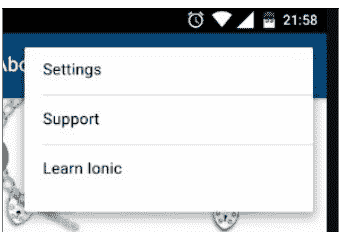

如你所见，我们没有直接推送 Page 组件，而是先通过 getRootNav() 方法获取应用中 rootNav 的引用。

## 生命周期事件与导航守卫

生命周期事件在 Ionic 1 中就已经存在，原生平台也有结构完善的生命周期，这让我们能够在导航的各阶段执行操作。目前有六个页面事件和两个导航守卫可用：

- ionViewDidLoad: 页面加载完成时
- ionViewWillEnter: 页面即将进入时
- ionViewDidEnter: 页面完全进入时
- ionViewWillLeave: 页面即将离开时
- ionViewDidLeave: 页面结束离开时
- ionViewWillUnload: 页面即将被销毁时
- ionViewCanEnter: 视图进入前运行
- ionViewCanLeave: 视图退出前运行

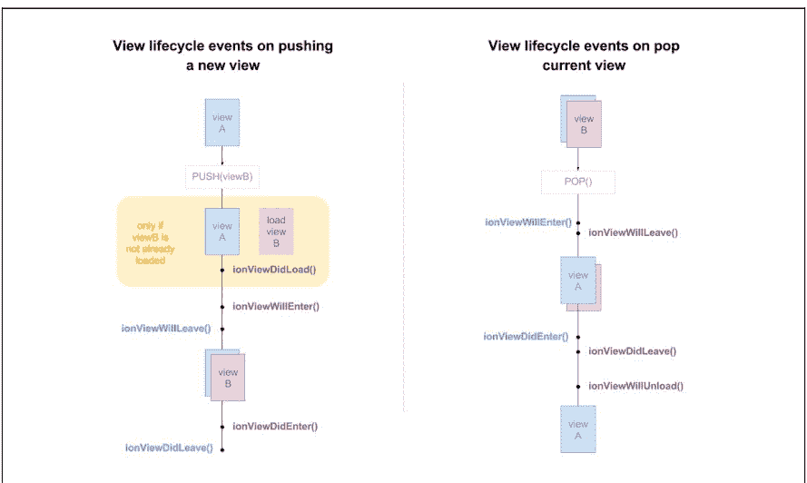

ionViewCanEnter 和 ionViewCanLeave 是两个导航守卫，用于控制视图的进入和离开。例如，如果我们正在填写表单，不小心点击了某个按钮或菜单项，用户已填写的数据会立即被清除。为了保护数据，我们可以像在 support 页面上那样应用 ionViewCanLeave：

```typescript
// src/pages/support/support.ts

// If the user enters text in the support question and
// then navigates
// without submitting first, ask if they meant to leave
// the page
ionViewCanLeave(): boolean | Promise<boolean> {
// If the support message is empty we should just
// navigate
if (!this.supportMessage ||
this.supportMessage.trim().length === 0) {
return true;
}

return new Promise((resolve: any, reject: any) => {
let alert = this.alertCtrl.create({
    title: 'Leave this page?',
    message: 'Are you sure you want to leave this page? Your support message will not be submitted.'
});
alert.addButton({ text: 'Stay', handler: reject });
alert.addButton({ text: 'Leave', role: 'cancel',
handler: resolve });

alert.present();
});
}
```

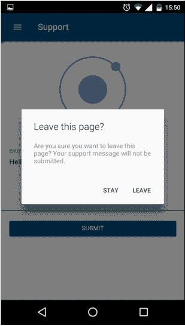

导航对于我们构建的任何应用来说都是重要组成部分，因此我个人的建议是，认真阅读并理解导航组件的所有重要主题，无论大小。我最初犯的一个错误是没有通读全部文档，由于之前提到的冻结问题，这几乎浪费了我一整天。你可以通过 [https://ionicframework.com/docs/v2/api/navigation/NavController/](https://ionicframework.com/docs/v2/api/navigation/NavController/) 查看导航 API。

## 国际化与本地化

当我们需要构建一款影响世界各地用户生活的全球化应用时，我们必须考虑国际化与本地化等多个方面。我们将把它集成到我们的电商应用中，以便添加多语言支持。

我们首先安装 `ng2-translate` npm 模块：

```
npm install ng2-translate --save
```

接下来，我们将在 `app.module.ts` 中引入所需模块和方法：

```
// /src/app/app.module.ts
import { TranslateModule, TranslateLoader, TranslateStaticLoader } from 'ng2-translate/ng2-translate';

export function createTranslateLoader(http: Http) {
  return new TranslateStaticLoader(http, './assets/i18n', '.json');
}

@NgModule({
  imports: [
    IonicModule.forRoot(vPlanetApp),
    TranslateModule.forRoot({
      provide: TranslateLoader,
      useFactory: createTranslateLoader,
      deps: [Http]
    }),
    CloudModule.forRoot(cloudSettings)
  ]
})

export class AppModule {}
```

我们创建了一个独立函数 `createTranslateLoader`，在其中定义了 `i18n/` 文件夹，该文件夹包含每种语言的 JSON 文件。现在我们可以使用该模块了，并在 `app.component.ts` 中初始化 `TranslateService`，以确定使用哪种语言：

```
import {TranslateService} from 'ng2-translate/ng2-translate';

@Component({
  templateUrl: 'app.template.html',
  providers: [TranslateService]
})

export class vPlanetApp {

  constructor(
    public translate: TranslateService
  ) {

    this.initializeTranslateServiceConfig();

  }

  // We are using the user default language
  // and set that default locale

  initializeTranslateServiceConfig() {
    var userLang = navigator.language.split('-')[0];
    userLang = /(en|es)/gi.test(userLang) ? userLang :
    'en';
    this.translate.setDefaultLang('en');
    this.translate.use(userLang);
  }
}
```


现在我们可以像使用管道一样在模板中使用它。因为我们在电商应用中有循环渲染的侧边菜单列表项，所以我们首先会在侧边菜单上实现翻译：

```
<ion-list>
    <ion-list-header>
        {{'navigate' | translate}}
    </ion-list-header>
    <button ion-item menuClose *ngFor="let p of appPages" (click)="openPage(p)">
        <ion-icon item-left [name]="p.icon" [color]="isActive(p)"></ion-icon>
        {{ p.title | translate }}
    </button>
</ion-list>
```

一旦设置了区域设置，它就会从 `/assets/i18n` 文件夹中的 JSON 文件提取对应的标签。目前我们在该应用中只实现了 `en` 和 `es` 两种区域设置，但我们可以通过为电商应用想要支持的每种语言添加更多 `locale.json` 文件来轻松扩展：

```
// es.json
{
    "menu": "Menú",
    "home": "Casa",
    "navigate":"Navegar",
    "categories":"Categorías",
    "cart":"Carrito de compras",
    "wishlist":"Lista de deseos",
    "about": "Acerca de",
    "categories":"Categorías",
    "login": "Iniciar sesión",
    "logout":"Cerrar sesión",
    "account":"Cuenta",
    "signup":"Regístrate",
    "popular":"Productos Populares",
    "settings":"Ajustes",
    "feedback":"Realimentación"
}
```

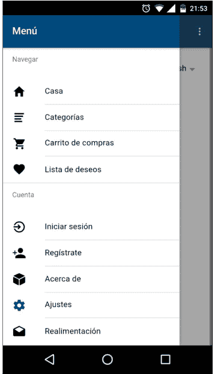

上面是一个 `es.json` 示例，其中我们放置了不同的标签，用于进行内容翻译。接下来，如果你想翻译 TypeScript 文件中的任何 JavaScript 值，可以使用 `translateService` 及其 `get` 方法，它会订阅 observable 并返回翻译后的字符串：

```
translateService.get('HELLO').subscribe(
  value => {
    // value returned is translated
    console.log(value);
  }
)
```

最初设置和翻译该模块可能会花费一些时间，因为涉及多个部分，开发人员在设置时可能会忽略一些要点。为应用添加国际化功能将产生巨大的影响，并拓宽你能够吸引的用户群；这有助于你在 Play Store 上获得更好的评分。

## ItemSliding 和下拉刷新

在现代应用中，动画和手势是必不可少的，它们能够在用户使用应用功能时提升用户体验。你会在大多数 iOS 应用中找到 `ItemSliding` 功能，而下拉刷新通常用于获取最新数据，就像 Facebook 应用一样，你会用它来获取最新的信息流。

`ItemSliding` 是一个可滑动的列表，可以向左或向右滑动以显示操作按钮。我们将在收藏夹页面使用可滑动列表，在该页面中，我们可以对产品执行从列表中删除或添加到购物车的操作：

```
// src/pages/wishlist/wishlist.ts
<ion-content>
  <ion-list>
    <ion-list-header>
      4 Items in your Wishlist (Swipe for options).
    </ion-list-header>

    <ion-item-sliding *ngFor="let product of products">
      <ion-item>
        <ion-avatar item-left>
          
        </ion-avatar>
        <h2>{{product.name}}</h2>
        <h3>{{product.price | currency}}</h3>
        <p>{{product.rating}} stars and 420 reviews</p>
      </ion-item>
      <ion-item-options side="right">
        <button danger>
          <ion-icon name="trash"></ion-icon>
          Remove
        </button>
        <button secondary>
          <ion-icon name="cart"></ion-icon>
          Add Cart
        </button>
      </ion-item-options>
    </ion-item-sliding>
  </ion-list>
</ion-content>
```

让我们来看看 `itemSliding` 上可用的一些属性：

- 滑动方向可以是向右或向左；两者都会显示操作按钮。我们可以使用 `<ion-item-options side="right">` 来设置右滑选项
- 在滑动列表项时，可以使用 `IonDrag` 和 `ionSwap` 事件来监听或调用某些函数
- 图标可以放在按钮文本的上方或左侧，例如 `<ion-item-options icon-left>`
- 也可以导入 `ItemSliding` 类来访问 `close()` 方法

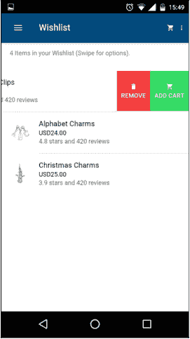

如你所见，上面的截图展示了 `itemSliding` 列表的外观。下拉刷新是另一个组件，主要用于我们需要刷新现有内容并从后端服务器获取新数据时。`refresher` 模块会检测垂直滑动，并在调用 `refresh` 函数时显示加载图标。虽然我们在应用中没有确切的用例需要使用它，但实现 `refresher` 非常简单：

```html
<ion-content>
    <ion-refresher (ionRefresh)="updateFeed($event)">
        <ion-refresher-content
            pullingText="Updating Feed"
            refreshingSpinner="circles"
            refreshingText="Updating...">
        </ion-refresher-content>
    </ion-refresher>
    <h4>User Feed</h4>
</ion-content>
```

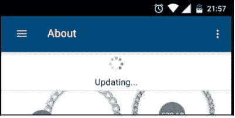

`ion-refresher` 组件具有 `ionRefresh` 属性，当刷新器被垂直拉动到一定程度时会调用该属性。之后，正如你在 `ion-refresher-content` 中看到的，有多组属性实际上充当着刷新器的配置设置，具有多种选项：

```typescript
import { Http } from '@angular/http';

export class FeedPage {
    constructor(public http: Http) {}

    updateFeed(refresher) {

        // Calling a web service to fetch new feeds
            result
            this.http.get('path/to/data.json')
                .map(res => res.json())
                .subscribe(data => {
                    // After the callback we will
                        complete the refresher
                        // and update the data inside the view.
                        refresher.complete();
                });
        }
}
```

在我们调用 `ionRefresh` 函数后，一旦从服务器获取到数据，就需要关闭刷新过程。当来自服务器的异步请求完成时，会调用 `complete()` 方法。我们必须确保调用此方法，否则加载图标将不会消失。

## 虚拟滚动和无限滚动

虚拟滚动和无限滚动是两个重要的组件，它们同样广泛应用于不同的应用中，以处理列表中大量的项目。虚拟滚动用于实现一次渲染可能会过长而无法完成的列表，例如包含数千个联系人的联系人列表。如果我们尝试加载整个列表并进行渲染，将会阻碍我们应用的性能，并且在向下滚动列表时会感到卡顿。让我们来看看如何在我们的产品页面中实现虚拟滚动：

```
// src/pages/products/products.html
<ion-content class="products">
<ion-list>
<ion-item>
<ion-note item-left>
Duplicate products for VirtualScroll demo
</ion-note>
</ion-item>
</ion-list>
<ion-grid [virtualScroll]="products" approxItemHeight="40px">
<ion-row *virtualItem="let product" (click)="goToProductDetail(product)">
<ion-col width-33>
// Important to use ion-img rather than img tag
// this will lazy load the images as we scroll downwards
// Also, image sizes should not vary after its loaded
<ion-img class="v-img" [src]="product.image">
</ion-img>
</ion-col>
<ion-col width-67>
<p>{{ product.name }}</p>
<ion-badge item-right>4.1</ion-badge> 340 ratings
<p class="price"> {{ product.price | currency: 'INR' }} </p>
</ion-col>
</ion-row>
</ion-grid>
</ion-content>
```

在使用虚拟滚动组件时，需要注意的一些重要点是：在列表加载后，我们不应进行任何 DOM 操作或更改数据集，因为这需要重置或刷新整个列表，这是一项对内存消耗很大的操作。为了虚拟滚动能够流畅工作，需要指定列表内项目的近似宽度和高度。默认值为 40px。


高度，虽然不一定要给出确切数字，但接近确切高度会更好。

无限滚动是指在用户滚动到指定距离后，页面内容会被动态追加。在无限滚动中，会调用一个函数来异步获取新数据并追加到列表中：

```html
<ion-content>
  <ion-list>
    <ion-item *ngFor="let product of products">
      {{product.name}}</ion-item>
  </ion-list>

  <ion-infinite-scroll
    (ionInfinite)="getNewProducts($event)">
    <ion-infinite-scroll-content></ion-infinite-scroll-content>
  </ion-infinite-scroll>
</ion-content>
```

`ionInfinite` 属性用于调用 `getNewProducts()` 函数，该函数最终会获取新数据：

```typescript
export class ProductsPage {

  constructor() {}

  getNewProducts(infiniteScroll) {
    // Call an HTTP function or service
    // fetches new data and append to the products array list.
    // Make sure to call complete method to close the loader icon.
    infiniteScroll.complete();
  }
}
```

正如你所看到的，虚拟滚动和无限滚动在模板及其方法方面几乎是相同的。你可以在两个组件中找到相似的属性，在其中可以声明 `loadingText` 和 `loadingSpinner`。如果需要，我们可以进一步使用自定义的 SVG 和 CSS 动画来定制虚拟滚动和无限滚动的设计。

## Ionic 评分

Ionic 评分是一个用于可视化评分条的第三方模块。我们将在应用的商品详情页中使用这个模块。该模块以 NPM 模块的形式提供，因此集成起来非常快速简单：

```bash
$ npm install --save ionic2-rating
```

```typescript
// src/app/app.module.ts

import { Ionic2RatingModule } from 'ionic2-rating';

imports: [
    IonicModule.forRoot(vPlanetApp),
    Ionic2RatingModule,
    TranslateModule.forRoot({
        provide: TranslateLoader,
        useFactory: createTranslateLoader,
        deps: [Http]
    }),
    CloudModule.forRoot(cloudSettings)
],

// src/pages/product-detail/product-detail.html
<rating [(ngModel)]="rate" readOnly="false" max="5"></rating>
```

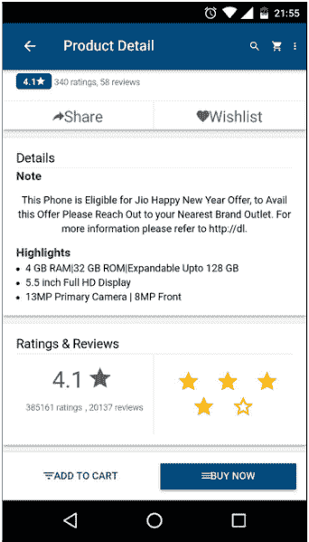

Ionic 社区在过去三年中发展迅速；GitHub 上有多个第三方组件可用，你可以在应用中间巧妙地使用它们，就像我们在电商应用中使用 ionic-rating 插件一样。其中一些组件包括：

-   [Ionic 评分](https://github.com/andrucz/ionic2-rating)
-   [图片缓存和加载器](https://github.com/zyra/ionic-image-loader)
-   [强制安装](https://github.com/NextFaze/ionic-manup)
-   [地理围栏](https://github.com/tsubik/ionic2-geofence)
-   [手风琴组件](https://github.com/mahmoudissmail/ionic2Accordion)
-   [日历组件](https://github.com/twinssbc/Ionic2-Calendar)

寻找这些优秀代码的最佳方式是在 GitHub 上搜索并查看星标数最高的 Ionic 项目。我一直在使用这种技巧来了解开发者们在 Ionic 上默默做着什么或正在研究什么。大多数情况下，这些项目都采用 MIT 许可证，因此你可以在应用中自由使用它们。

## 使用 Ionic 3 实现懒加载

懒加载是 Ionic 3 最近发布的一个备受期待的功能。懒加载将改善应用的启动时间，减少打包体积，并消除在每个类中包含相同组件路径的麻烦，从而简化设置 Ionic 路由的过程。让我们看看需要做哪些更改，以及你的应用将如何改进。另外，在第 5 章“身份验证、授权与安全”中，应用演示将实现懒加载。

目前，懒加载组件存在一些已知的缺陷，Ionic 团队正在积极解决。此外，设置懒加载会覆盖 `IonicModule.forRoot` 中定义的 `DeepLinkConfig`。我们将为每个组件引入 `IonicPageModule`，并在每个页面组件中添加一个新的 `module.ts` 文件。请务必持续关注 Ionic 博客以及任何可能带来更多缺陷修复和新功能的新版本。

以前，我们在 `app.module.ts` 中一次性导入所有页面，而现在我们只初始化加载 `app.component.ts`。因此，像 `HomePage` 这样的所有组件都从 declarations 和 entryComponents 中移除。接下来，在我们的 `src/pages/home` 目录中，我们引入了另一个文件 `home.module.ts`，类似于我们在 `app.module.ts` 中的文件。现在，如果你使用 Ionic CLI 生成一个页面，你会发现创建了四个文件：

```text
home.html

home.module.ts

home.scss

home.ts

// src/pages/home/home.ts

import { Component } from '@angular/core';

import { IonicPage, NavController } from 'ionic-angular';

@IonicPage()

@Component({
    selector: 'page-home',
    templateUrl: 'home.html',
})

export class HomePage {
    constructor(public navCtrl: NavController) {}

    moveTo(data: any) {
        this.navCtrl.push("ContactPage", data);
    }
}
```

此外，现在如果我们想导航到（push）或返回（pop）任何其他组件，不再需要导入它。我们可以直接将其作为字符串处理；在构建过程中，会生成知道如何处理该字符串的深层链接。该字符串实际上是对 `@IonicPage` 装饰器的 `name` 属性的引用，该属性默认为类名字符串。如果我们将该 `name` 属性改为其他值，还需要更新在其他地方使用的引用。你可以在这里（http://ionicframework.com/docs/v2/nightly/api/navigation/IonicPage/）找到关于 `IonicPage` 及其支持字段的更多信息。

## 小结

Ionic 组件和相关资源是任何 Ionic 应用的基础。通过智能使用组件和可用的第三方组件，我们可以获得更好的性能，并使我们的应用对用户更友好。在正确的位置选择正确的组件是很讲究的，最有趣的部分是我们必须从最终用户的角度以及最终用户对应用体验的角度去思考。我们必须确保用户不会感觉自己处于一个不同的世界，不会脱离原生体验，这种情况经常发生。我们可以在本章中涵盖尽可能多的重要组件和重点，但更建议的是持续关注社区动态，并寻找可以轻松用于应用的可用资源。接下来，我们将转向应用内插件的集成。由于几乎每个应用都使用某种插件，因此正确集成插件对于生产级应用至关重要。相机、GPS、文件系统和网络插件是常用的插件。我们将集成这些常用插件，以及一些许多开发者在集成时遇到问题的复杂插件。Ionic 团队已经发布了一个很棒的项目——Ionic Native，它简化了 Cordova 插件的使用流程。Ionic Native 是一个基于许多插件的包装库，因此我们可以轻松地将其集成到基于 Angular 的 Ionic 应用中。
