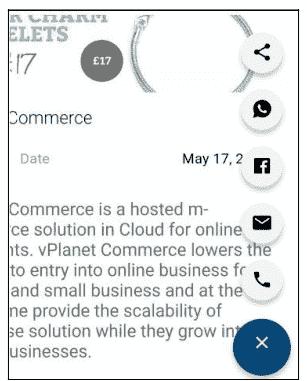
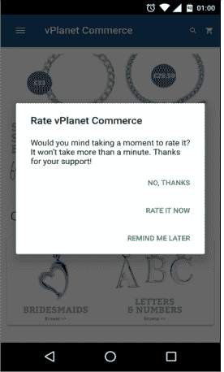
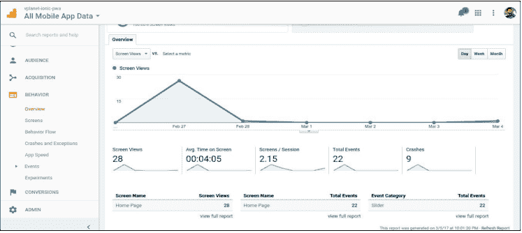
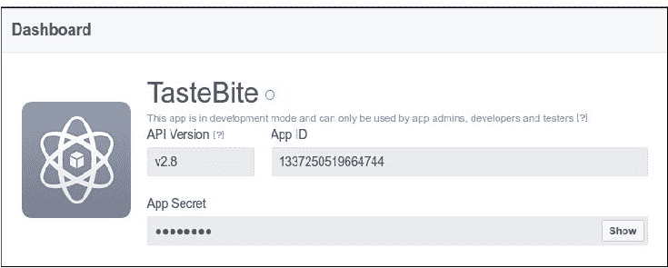
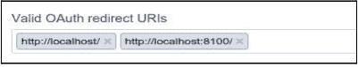
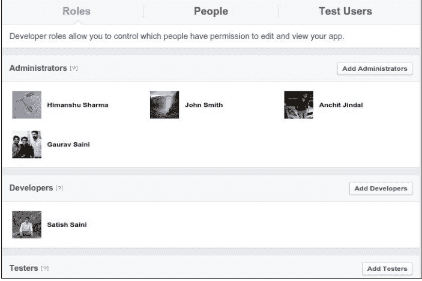
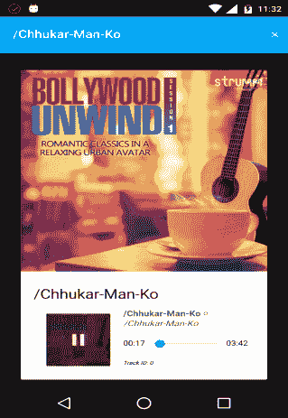

# Ionic Native 和插件

现在我们已经了解了 Ionic 中的一些高级组件和 API。构建混合移动应用的另一个重要部分是 Cordova 插件。插件在原生 API 和 JavaScript 之间建立了桥梁，帮助我们使用相机、GPS、文件等原生 API。插件由特定平台的原生库代码和用于调用相应原生平台方法的 JavaScript 接口组成。Ionic 依赖 Cordova 来构建、调试和发布应用。在本章中，我们将涵盖有关 Cordova 插件、Ionic Native 以及一些常见和高级插件的几乎所有内容。起初，Ionic 团队推出了基于 Angular 1.x 的 ngCordova，但后来我们有了支持 Ionic 1、2 和 3 应用的 Ionic Native。ngCordova 绑定于 Ionic 1，而 Ionic Native 与框架无关：

-   Cordova 以及插件的工作原理
-   Ionic Native
-   常用 Cordova 插件（相机、GPS、通讯录）
-   构建音乐播放器
-   Cordova 与 PhoneGap 的对比


## Cordova 与插件的工作原理

Cordova 是一个使用 HTML、CSS 和 JavaScript 在单一代码库中构建原生移动应用的平台。Cordova 提供对多个平台和插件的支持。Cordova 插件允许 Cordova 的 Web 视图与原生平台通信，而我们的 Ionic 应用运行在 Web 视图中，因此我们可以访问平台 API，如相机、地理位置等。

### 什么是 Cordova？

关于 Cordova，官方描述如下：

> *Apache Cordova 是由 Apache 组织维护的一个项目。Cordova 是一组设备 API，允许移动应用开发者通过 JavaScript 访问相机或加速度计等原生设备功能。结合 Ionic 等框架，只需使用 HTML、CSS 和 JavaScript 即可开发智能手机应用。*

我们都可能在自己的应用中使用过 Cordova，也了解一些 Cordova 官方支持的常见插件。下面我将列出一些有助于理解 Cordova 的常见要点：

- Cordova 是一个应用容器
- Cordova 帮助为每个平台构建原生应用
- Cordova 提供对原生设备 API 的访问，例如相机、通讯录、GPS 等
- 还可以编写和支持自定义插件
- Cordova 是 Adobe PhoneGap 背后的引擎
- Cordova 开源且免费使用

如前所述，Cordova 官方支持多个平台和插件。我们可以看到许多新插件正在涌现，例如用于指纹、热点等功能的插件，我们可以利用它们来构建高级混合应用。大多数第三方插件都支持 iOS 和 Android 平台，因为这两个平台在设备市场中占据主要份额。最近，一些第三方 Cordova 插件也开始支持诸如蓝牙信标等新兴技术。在本书的后续内容中，我们将构建一个应用程序并使用这项技术。

### 构建和使用 Cordova 插件

开发者使用 CLI 命令在项目中构建或添加 Cordova 插件。你也可以通过 plugman 发布自己的插件并与社区共享。我们还将快速了解如何构建和发布插件。

```
<?xml version="1.0" encoding="utf-8"?>
<plugin xmlns="http://www.phonegap.com/ns/plugins/1.0" id="cordova-eddyblue" version="1.0.0">

<name>Custom Plugin</name>
<description> Cordova custom bluetooth plugin 
</description>
<author>Gaurav Saini</author>
<license>Apache 2.0</license>

<keywords>Eddystone, Beacons</keywords>


<engines>
<engine name="cordova" version=">=3.4.0" /> <!-- Needs cordova version greater than 3.4.0 -->
</engines>

<!-- Javascript module and file path -->
<js-module src="www/eddyblue.js" name="eddyblue">
<clobbers target="eddyblue" />
</js-module>

<!-- android platform -->
<platform name="android">

<config-file target="res/xml/config.xml" parent="/*">
<feature name="Scan">
<param name="android-package" 
value="com.eddyblue.plugin.scan"/>
</feature>
</config-file>

<source-file src="src/android/Eddyblue.java" target-dir="src/com/eddyblue/plugin/"/>
</platform>

<!-- ios platform -->
<platform name="ios">

<config-file target="config.xml" parent="/widget">
<feature name="Scan">
<param name="ios-package" value="HWPEddyblue" 
/>
</feature>
</config-file>

<header-file src="src/ios/HWPEddyblue.h" target-dir="Eddyblue"/>
<source-file src="src/ios/HWPEddyblue.m" target-dir="Eddyblue"/>
</platform>

</plugin>
```

```
module.exports = {
  scan: function (name, successCallback, errorCallback) {
    cordova.exec(successCallback, errorCallback, "Scan", "start", [name]);
  }
};
```

```
package com.eddyblue.plugin;

import org.apache.cordova.*;
import org.json.JSONArray;
import org.json.JSONException;

public class Scan extends CordovaPlugin {

 @Override
 public boolean execute(String action, JSONArray data, CallbackContext callbackContext) throws JSONException {

 if (action.equals("start")) {
 String message = "data to be sent";
 callbackContext.success(message);
 return true;
 } else {
 return false;
 }
 }
}
```

我们现在已经简要介绍了插件的工作原理。你现在可以轻松地与社区共享你的插件，并使用 plugman 将其添加到注册表中。有关插件开发的更多细节，你可以参阅 Cordova 官方文档，它会提供进一步的指导。

## Ionic Native

开发混合应用的开发者已经在 Ionic 1 中使用 ngCordova 一段时间了。现在，随着使用 ES6 和 TypeScript 构建的 Ionic 3 的出现，我们需要一个面向 ES6 或 TypeScript 的包装库，这正是 Ionic Native 的作用。它是基于 Cordova API 构建的 ES5/ES6/TypeScript 包装器集合，便于集成到 Ionic 应用中。Ionic 团队最初是应社区成员的功能请求而启动这个项目的。它最初只是一个实验，但由于插件集成时常常面临文档缺失和 API 混乱的问题，它获得了大量支持。这些 AngularJS 包装器简化了集成过程，并且也符合 Angular 的语法。目前，Ionic Native 支持大约 120+ 个 Cordova 插件，而且数量还在不断增加。

### 安装 Ionic Native

我们可以将 Ionic Native 添加到任何现有的 Ionic 项目中。在任何使用 Ionic 3 创建的入门项目中，你都会默认找到 `ionic-native`。如果由于某种原因需要安装它，推荐的方式是通过 NPM 包：**$ npm install @ionic-native/core --save**

如果你使用 ES6/TypeScript 构建 Ionic 3 应用，则无需在 `index.html` 文件中包含任何脚本标签。只需在文件中导入特定的 `ionic-native` 包即可：

```typescript
import { SplashScreen } from '@ionic-native/splash-screen'
import { StatusBar } from '@ionic-native/status-bar';
```

如果你使用的是 Ionic 1，则需要在 `index.html` 文件中添加 `ionic.native.js` 文件：

```html
<script src="ionic.native.js"></script>
```

我们必须将大多数插件调用包装在设备就绪事件中。因此，要检查设备是否已完全加载应用且插件可用，请使用 `Splashscreen` 插件的以下代码：

```typescript
constructor(platform: Platform, private
  splashScreen: SplashScreen, statusBar: StatusBar)
  {
    this.platform.ready().then(() => {
      // platform is ready to use available plugins.
      this.statusBar.styleDefault();
      this.splashScreen.hide();
    });
  }
```

### 在浏览器中测试插件

目前 Cordova 插件最大的问题之一是我们无法在浏览器中测试应用。Ionic 团队一直专注于改进 Ionic 工具，以便我们可以直接在浏览器中模拟应用的大部分功能。不过，对于当前的开发，有一个非常好的 Chrome 插件——Cordova mocks，它由 Paolo Bernasconi 创建，他是之前 ngCordova 项目的核心贡献者之一。安装该插件后，你就可以像在手机上测试一样开始测试应用。目前，此扩展支持大约十二个插件。这个 Chrome 插件在某些情况下可能很有效，可以帮助你在浏览器中测试受支持的插件。

### 常用的 Cordova 插件

每当你启动一个新的 Ionic 项目并添加平台时，你会看到有一些默认安装的插件。当你添加 Android 或 iOS 平台时，Ionic 会安装以下提到的插件：

- ionic-plugin-keyboard
- cordova-plugin-console
- cordova-plugin-device
- cordova-plugin-splashscreen
- cordova-plugin-whitelist
- cordova-plugin-statusbar

让我们开始了解上述插件及其用途吧。


## 设备插件

设备插件在获取所有设备相关的硬件和软件信息方面非常有帮助。设备对象在全局作用域中可用，但仅在设备就绪后可用。

Ionic Native 通过 devices 支持此插件，它有六个静态成员来访问数据：

- `Device`: 返回包含 Cordova、model、platform、UUID 和 version 的对象，例如，`Device.uuid`
- `cordova`: 返回包含特定 Cordova 版本的字符串
- `Model`: 返回包含设备型号名称的字符串
- `platform`: 返回包含操作系统名称的字符串
- `uuid`: 返回包含设备的 **通用唯一标识符** (**UUID**) 的字符串
- `version`: 返回包含操作系统版本的字符串
- `isVirtual`: 检查设备是否在模拟器上运行
- `serial`: 获取硬件序列号
- `manufacturer`: 获取设备的制造商

```typescript
import { Device } from '@ionic-native/device';

constructor(platform: Platform, private device: Device)
{
  this.platform.ready().then(() => {
    console.log(this.device.version);
  });
}
```

## 启动画面插件

启动画面插件用于在应用程序启动时显示和隐藏启动画面。使用 Ionic 应用程序时，您将获得默认的 Ionic 启动画面。您可以使用 Ionic CLI 命令 Ionic resources 在向相应资源文件夹添加新屏幕后轻松更改它。

启动画面由 Ionic Native 支持，它有两个方法：

- `this.splashScreen.show()`: 显示启动画面
- `this.splashScreen.hide()`: 隐藏启动画面

URL blocked by whitelist: http://maps.google.com

```xml
<access origin="*" /> // Allow all URLs
```

```xml
<!-- Allow links to google.com -->
<allow-navigation href="http://google.com/*" />

<!-- Wildcards are allowed for the protocol, as a
     prefix to the host, or as a suffix to the path
     example maps.google.com, mail.inbox.com -->
<allow-navigation href="*://*.google.com/*" />
```

```xml
<allow-intent href="http://*/*" />
<allow-intent href="https://*/*" />
<allow-intent href="sms:*" />
<allow-intent href="tel:*" />

<!-- Allow all unrecognized URLs to open installed apps
     *NOT RECOMMENDED* -->
<allow-intent href="*" />
```

"No Content-Security-Policy meta tag found. Please add one when using the cordova-plugin-whitelist plugin."

```xml
<!-- Allow requests to gauravsaini.me -->
<meta http-equiv="Content-Security-Policy" content="default-src 'self' gauravsaini.me">

<!-- Enable all requests, inline styles, and eval() -->
<meta http-equiv="Content-Security-Policy" content="default-src *; style-src 'self' 'unsafe-inline'; script-src 'self' 'unsafe-inline' 'unsafe-eval'">

<!-- Allow XHRs via https only -->
<meta http-equiv="Content-Security-Policy" content="default-src 'self' https:">

<!-- Allow iframe to https://cordova.apache.org/ -->
<meta http-equiv="Content-Security-Policy" content="default-src 'self'; frame-src 'self' https://maps.google.com">
```

```
}});
    console.log('Clicked to update picture');
  }
}
// src/pages/account/account.html


```

对于从图库获取图像，您可以将 sourceType 更改为 photolibrary。传递给 getPicture 方法的选项有多种。让我们检查一下我们可以使用的所有选项：

- quality: 保存图像的质量，可以在 0-100 范围内或默认为 50。
- destinationType: DATA_URL(base64 编码)、FILE_URL(file URI) 和 NATIVE_URL。
- sourceType: photolibrary、camera 和 savephotoalbum。
- allowEdit: 允许在选择图像前进行简单编辑。
- encodingType: JPEG 或 PNG。
- targetWidth: 缩放图像的宽度（像素）。宽高比保持不变。（数字）
- targetHeight: 缩放图像的高度（像素）。宽高比保持不变。（数字）
- mediaType: 要选择的媒体类型为 picture、video 或 all media，它仅在 PictureSourceType 为 photolibrary 或 savephotoalbum 时有效。
- correctOrientation: 在捕获期间旋转图像以校正设备的方向。（布尔值）
- saveToPhotoAlbum: 在捕获后将图像保存到设备的照片库中。（布尔值）
- popoverOptions: iOS 专用选项，指定 iPad 上的弹出框位置。
- cameraDirection: 选择使用的摄像头为前置或后置，默认为后置。

在 destinationType 为 FILE_URL 的情况下，要从临时存储中删除相机拍摄的照片，请使用以下代码：

```
this.camera.cleanup().then(...); // only for FILE_URI
```

通过更改 sourceType 从图库中选择的照片不会被降质，即使指定了 quality 参数也是如此。为了避免常见的内存问题，请将 camera.destinationType 设置为 FILE_URI 而不是 DATA_URL。

## 地理位置插件

地理位置插件利用设备的 **全球定位系统 (GPS)** 并获取位置信息，例如经度和纬度。它还尝试从其他来源获取设备位置，包括 Wi-Fi 网络和移动网络 IP 地址，尽管准确性不会很高。此插件由 Apache Cordova 官方支持，它有一个全局可访问的对象 `navigator.geolocation`，该对象同样需要在使用其功能时有 `deviceready` 事件可用。

让我们通过以下方式开始安装插件：

```bash
$ ionic cordova:plugin add cordova-plugin-geolocation
$ npm install @ionic-native/geolocation --save
```

此插件中主要有三个方法可用：

- `getCurrentPosition`
- `watchPosition`
- `clearWatch`

`getCurrentPosition` 返回当前位置的位置：

```javascript
let options = {
  timeout :3000,
  enableHighAccuracy: true,
  maximumAge : 1000
};

this.geolocation.getCurrentPosition(options).then(( position) => {
  // on success
  let coordinates = position.coords.latitude
  +","+position.coords.longitude
}).catch((err) => {
  // on error
  console.log(err.message);
});
```

正如您从前面的示例中看到的，我们向 `getCurrentPosition()` 函数传递了选项。类似的选项也提供给 `watchPosition()` 函数。`watchPosition()` 监视位置变化，当设备检索到新位置时，回调会使用包含最新位置数据的 position 对象执行：

```javascript
let watchOptions = {
  timeout : 3000,
  enableHighAccuracy: false // may cause errors if true
};
let watch = this.geolocation.watchPosition(watchOptions);

watch.subscribe((position) => {
  let lat = position.coords.latitude
  let long = position.coords.longitude
});

// Clearing the watch
watch.clearWatch()
```

**此外，我们可以轻松清除 watch 方法；这将停止监视设备位置的变化**

## 社交分享插件

与社交媒体分享内容是推广应用程序及其内容的绝佳营销工具，有助于您获得新用户。因此，拥有一个分享插件将是我们应用程序的非常有益的功能。您可以使用此插件通过 Facebook、Twitter、电子邮件、SMS、WhatsApp 等分享图像、文本、消息。它使用 Native share 插件来分享内容，并会自动显示您设备上所有可用的分享选项：

```bash
$ ionic cordova:plugin add cordova-plugin-x-socialsharing
$ npm install @ionic-native/social-sharing --save
```

SocialSharing 有多个方法可在我们的应用程序中使用。最常用的方法是 SocialSharing.share，它会打开默认的平台对话框，其中包含所有可用的分享应用程序：

```typescript
// src/pages/about/about.ts

import { SocialSharing } from '@ionic-native/social-sharing';

export class AboutPage {

  constructor(public popoverCtrl: PopoverController, private socialSharing: SocialSharing) { }

  shareViaFacebook() {
    // recommended to use canShareVia before using shareVia
    this.socialSharing.canShareVia("facebook", "Veloice:Intelligent Business Telephony", "Real time Voice", "http://veloice.com/images/banner.png").then(() => {
      this.socialSharing.shareViaFacebook("Veloice:Intelligent Business Telephony", "http://veloice.com/images/banner.png");
    }).catch(() => {
      alert("Cannot share on Facebook");
    });
  }

  shareViaWhatsApp() {
    // recommended to use canShareVia before using shareVia
    this.socialSharing.canShareVia("whatsapp", "Veloice:Intelligent Business Telephony", "Real time Voice", "http://veloice.com/images/banner.png").then(() => {
      this.socialSharing.shareViaWhatsApp("Veloice:Intelligent Business Telephony", "http://veloice.com/images/banner.png");
    }).catch(() => {
      alert("Cannot share on Whatsapp");
    });
  }

  shareViaEmail() {
    // recommended to use canShareVia before using shareVia
    this.socialSharing.canShareViaEmail().then(() => {
      this.socialSharing.shareViaEmail(
        'Veloice:Intelligent Business Telephony', // Message
        'Veloice', // Email Subject
        ['toperson@xyz.com', 'tosecond@xyz.com'], // TO: must be null or an array
        ['cc@xyz.com'], // CC: must be null or an array
        null, // BCC: must be null or an array
        ['http://veloice.com/images/banner.png'] // FILES: can be null, a string, or an array
      );
    }).catch(() => {
      alert("Cannot share on Email");
    });
  }

  share() {
    this.socialSharing.share("Veloice:Intelligent Business Telephony", "Real time Voice", "http://veloice.com/images/banner.png", "http://veloice.com");
  }

}
```


```html
// src/pages/about/about.html

<ion-fab right bottom>
  <button ion-fab><ion-icon name="help"></ion-icon></button>
  <ion-fab-list side="top">
    <button (click)="callNow()" ion-fab><ion-icon name="call"></ion-icon></button>
    <button (click)="shareViaEmail()" ion-fab><ion-icon name="mail"></ion-icon></button>
    <button (click)="shareViaFacebook()" ion-fab><ion-icon name="logo-facebook"></ion-icon></button>
    <button (click)="shareViaWhatsApp()" ion-fab><ion-icon name="logo-whatsapp"></ion-icon></button>
    <button (click)="share()" ion-fab><ion-icon name="share"></ion-icon></button>
  </ion-fab-list>
</ion-fab>
```



之前列出的是分享插件提供的所有方法。你可以在代码中看到，我们在使用的 `shareViaFacebook` 方法时，将其包裹在 `canShareVia` 方法周围，以预先检查 Facebook 应用是否已安装。同样，我们也可以将其用于 Twitter、Instagram 和 WhatsApp。分享通过 SMS 和电子邮件的示例也存在，因此我们也可以直接使用这些方法进行分享。分享插件还支持通过数组进行多张图片分享。`SaveToPhotoAlbum` 方法也在插件核心代码中可用，但到目前为止 Ionic Native 尚未为其提供任何包装器。因此你需要这样使用它：

```javascript
window.plugins.socialsharing.saveToPhotoAlbum(
  ['http://veloice.com/icon.png', 'www/veloice.jpg'],
  onSuccess, // optional success function
  onError // optional error function
);
```

我们现在已经涵盖了一些最常用的插件。我们将继续查看需要详细示例的更复杂的插件，例如 Facebook 和 SQLite。我们的主要重点是继续紧密地坚持 Ionic Native 并充分利用它。

```typescript
// src/pages/about/about.ts

import { CallNumber } from '@ionic-native/call-number';

constructor(private call: CallNumber) { }

callNow() {
  this.call.callNumber("+919989887765", true)
    .then(() => console.log('Launched dialer!'))
    .catch(() => console.log('Error launching dialer'));
}
```

## Text to speech

`text-to-speech` 插件的功能如其名，它将文本合成为语音。该插件在 iOS 上使用 `AVSpeechSynthesizer`，在 Android 上使用 `android.speech.tts.TextToSpeech` 包。让我们开始安装 `cordova` 插件和相应的 `npm` 包：

```bash
$ ionic cordova:plugin add cordova-plugin-tts
$ npm install @ionic-native/text-to-speech --save
```

我们在应用程序中使用它来朗读 `push notification` 消息，每当服务器发送 `push` 消息时：

```typescript
// src/app/app.component.ts

import { TextToSpeech } from '@ionic-native/text-to-speech';
constructor(private tts: TextToSpeech) { }
push.on('notification', function(data) {
  this.tts.speak({text: data.message,
    locale: 'en-GB', rate: 0.75})
    .then(() => console.log('Success'))
    .catch((reason: any) => console.log(reason));
});
```

## AppRate

AppRate 插件用于提示用户现在、稍后或永不为应用评分。每个应用程序都需要此插件来获取客户的评论和评分：

```bash
$ ionic cordova:plugin add cordova-plugin-apprate
$ npm install @ionic-native/app-rate --save
```

AppRate 集成起来非常容易，因为显示提示和其他设置的逻辑都由插件管理。我们只需要相应地设置首选项即可：

```typescript
// src/app/app.component.ts

import { AppRate } from '@ionic-native/app-rate';

platformReady() {
  // Call any initial plugins when ready
  this.platform.ready().then(() => {
    Splashscreen.hide();

    if (this.platform.is('cordova')) {
      // App rate plugin
      AppRate.preferences.customLocale = {
        title: "Rate vPlanet Commerce",
        message: "Would you mind taking a moment to rate it? It won't take more than a minute. Thanks for your support!",
        cancelButtonLabel: "No, Thanks",
        laterButtonLabel: "Remind Me Later",
        rateButtonLabel: "Rate It Now"
      };
      AppRate.preferences.storeAppURL = {
        android: 'market://details?id=com.vPlanetcommerce.demoionicpwa'
      };
      AppRate.promptForRating(false);

      // Initiate Push
      this.initPushNotification();
    }
  });
}
```



如果我们将 `promptForRating()` 设置为 false，则它不会立即提示。它将使用 `usesUntilPrompt` 首选项，该首选项在显示对话框之前计算应用程序的运行次数。你可以参考官方文档了解更多选项：https://ionicframework.com/docs/v2/native/app-rate/。

## Google Analytics

分析是任何成功应用程序的关键；它有助于了解哪些屏幕访问量最大，哪些产品最受用户关注。我们可以跟踪用户在使用应用程序时所做的许多不同事件：

```bash
$ ionic cordova:plugin add cordova-plugin-google-analytics
$ npm install @ionic-native/google-analytics --save
```

让我们首先在 `app.component.ts` 中初始化插件，在这里我们将设置 GoogleAnalytics 跟踪 ID，这将使我们开始：

```typescript
// src/app/app.component.ts
import { GoogleAnalytics } from '@ionic-native/google-analytics';
constructor(private ga: GoogleAnalytics) { }
platformReady() {
  // Call any initial plugins when ready
  this.platform.ready().then(() => {
    Splashscreen.hide();

    // Google Analytics
    return this.ga.startTrackerWithId("UA-92660667-1")
      .then(() => {
        console.log('Google analytics is ready now');
        return this.ga.enableUncaughtExceptionReporting(true)
      }).then((_success) => {
        console.log("startTrackerWithId success")
      }).catch((_error) => {
        console.log("enableUncaughtExceptionReporting", _error)
      });
  });
}
```

下一步是将 Analytics 插件集成到页面中，以便我们可以跟踪活动：

```typescript
// src/pages/home/home.ts

import { GoogleAnalytics } from '@ionic-native/google-analytics';

constructor(public platform: Platform, private ga: GoogleAnalytics) {
  this.platform.ready().then(() => {
    this.ga.trackView("Home Page");
  });
}

trackEvent() {
  let active = this.slider.getActiveIndex();
  this.platform.ready().then(() => {
    this.ga.trackEvent("Slider", "Slider-Changed", "Label", active);
  });
}
```



我们已初始化 `trackView()` 方法并传入我们所在的特定页面名称。此外，如果有人手动更改滑块的幻灯片，我们也会跟踪事件。同样，我们可以在应用程序内跟踪购买的交易。还有多种方法可供根据需求使用。有关最新更新的方法，请查看插件的官方文档：[https://ionicframework.com/docs/v2/native/google-analytics/](https://ionicframework.com/docs/v2/native/google-analytics/)。

## Ionic deeplinks

Ionic deeplinks 插件处理 Android 和 iOS 的自定义 URL 方案和通用应用链接。我们需要确保不要将其与处理基于 URL 注册和显示视图的 deeplinker API 混淆。我们需要认为导航不是由 URL 控制的；它们主要用作面包屑。这在我们将 Ionic 应用转换为 PWA 时主要很有用，因为 Web 应用需要 URL 用于 SEO 和直接导航目的。

我们将同时使用 deeplink 插件和 DeepLinker API，分别用于在原生应用程序和 Web 应用程序中直接打开自定义 URL。让我们先看看如何安装 deeplink 插件：

```bash
$ ionic cordova plugin add ionic-plugin-deeplinks --variable URL_SCHEME=vplanet --variable DEEPLINK_SCHEME=https --variable DEEPLINK_HOST=vplanetcommerce.com --variable ANDROID_PATH_PREFIX=/

$ npm install @ionic-native/deeplinks --save
```

我们使用 deeplink 插件和 DeepLinker API 在应用程序中分别用于在原生应用程序和 Web 应用程序中直接打开自定义 URL。让我们先看看如何安装 Deeplink 插件：

```typescript
// src/app/app.component.ts
import { Deeplinks } from '@ionic-native/deeplinks';
constructor(private deeplinks: Deeplinks) { }
this.platform.ready().then(() => {
  Splashscreen.hide();

  // Convenience to route with a given nav
  this.deeplinks.routeWithNavController(this.nav, {
    '/about-us': AboutPage,
    '/categories': CategoriesPage,
    '/wishlist': WishlistPage,
    '/cart': ShowcartPage,
    '/login': LoginPage,
    '/settings': SettingsPage,
    '/categories/:categoryId': ProductsPage,
    '/products/:productId': ProductDetailPage
  }).subscribe((match) => {
    // match.$route - the route we matched
    // match.$args - the args passed in the link
    // match.$link - the full link data
    console.log('Successfully routed', match);
  }, (nomatch) => {
    console.warn('Unmatched Route', nomatch);
  });
})
```

让我们看看如何为 Web 应用程序配置 `DeepLinkConfig`。如前所述，这些只是用作面包屑，尽管使用相同的 `NavController` 实例 `push` 和 `pop` 操作在应用程序内部进行导航：

```typescript
// src/app/app.module.ts

import { IonicApp, IonicModule, IonicErrorHandler, DeepLinkConfig } from 'ionic-angular';
import { APP_BASE_HREF } from '@angular/common';

imports: [
  IonicModule.forRoot(vPlanetApp, {locationStrategy: 'hash'}, deepLinkConfig),
  Ionic2RatingModule,
  TranslateModule.forRoot({
```


```
provide: TranslateLoader,
useFactory: createTranslateLoader,
deps: [Http]
})
],
providers: [
{ provide: ErrorHandler, useClass: IonicErrorHandler},
{ provide: Storage, useFactory: provideStorage },
{ provide: APP_BASE_HREF, useValue: '/'},
UserService,
DataService
]

// Deeplink Configuration
export const deepLinkConfig: DeepLinkConfig = {
links: [
{ component: HomePage, name: 'Home Page', segment: '' },
{ component: CategoriesPage, name: 'Categories Page', segment: 'categories' },
{ component: ProductsPage, name: 'Categories Product Page', segment: 'categories/:categoryId' },
{ component: ProductDetailPage, name: 'Product Details Page', segment: 'products/:productId' },
{ component: WishlistPage, name: 'Wishlist Page', segment: 'wishlist' },
{ component: ShowcartPage, name: 'Showcart Page', segment: 'cart' },
{ component: SupportPage, name: 'Support Page', segment: 'feedback' },
{ component: SettingsPage, name: 'About Page', segment: 'settings' },
{ component: AboutPage, name: 'About Page', segment: 'about' },
{ component: LoginPage, name: 'Login Page', segment: 'login' },
{ component: SignupPage, name: 'Signup Page', segment: 'signup' },
{ component: AccountPage, name: 'Account Page', segment: 'account' }
]
};
```

现在，类似于你用唯一 URL 打开特定链接的方式，你也可以通过自定义 URL 方案访问特定视图。这样我们的应用程序就可以通过 vplanet://wishlist 访问，它将直接打开应用程序的 wishlistPage。

## Facebook 连接

Facebook 插件是社交集成中最受欢迎且使用最广泛的插件之一。借助 Ionic Native 和改进的文档，现在在你的应用程序中集成 Facebook Connect 插件变得非常容易。Facebook 插件允许你在 Cordova 应用程序中使用与在 Web 应用程序中相同的 JavaScript 代码。该插件最好的地方在于它使用原生的 Facebook 应用为用户执行单点登录。如果未安装 Facebook 原生应用，则登录会优雅地降级为使用标准对话框式身份验证。目前该插件仅支持 iOS 和 Android。在安装此插件之前，你需要通过 developers.facebook.com 创建一个 Facebook 应用，然后复制 appId 和 appName，在添加插件时需要用到：



我们现在准备为 Facebook 安装插件，该插件需要 APP_ID 和 APP_NAME：

```
$ ionic cordova:plugin add cordova-plugin-facebook4 --variable APP_ID="419376571536241" --variable APP_NAME="chatApp"
```

除此之外，还需要对特定平台进行一系列需求检查。对于 Android，你需要在 res/values/facebookconnect.xml 文件中用你的 fb_app_id 配置项目：

```
<resources>
    <string name="fb_app_id">419376571536241</string>
    <string name="fb_app_name">chatApp</string>
</resources>
```

对于 iOS，你需要更改以下内容：

- 将 FacebookAppID 更改为项目 Info.plist
- 将 URL 方案更改为 fb<YOUR APPID>：例如，fb 419376571536241

你现在就可以使用 $cordovaFacebook 模块提供的 Facebook 插件方法了。以下是我们使用 Ionic Native 提供的一些方法：

- login(permissions): 一个字符串数组，例如 ['public_profile', 'email']
- showDialog(options): 一个包含三个键的 JSON 对象；method、link 和 caption
- api(path, permissions): 一个 Facebook API 路径查询，例如 api("me", ["public_profile"])
- getLoginStatus(): 检查用户是否已登录
- getAccessToken(): 获取当前登录会话的访问令牌
- logout(): 从 Facebook 注销

要在浏览器中进行测试，你仍需要在应用程序配置中做一些更改：

```
let appID = 419376571536241;
let version = "v2.0"; // 或留空，默认是 v2.0

constructor() {
  Facebook.browserInit(appID, version);
}
```



此外，你还必须设置重定向 URL，其外观如下。由于 Ionic 服务器运行在 8100 端口，你可以给出 http://localhost:8100 作为重定向 URL：



## 构建音乐播放器

我们现在将构建一个媒体播放器应用程序，其中你将拥有音频和视频流以及下载选项，将文件保存到你的手机。我们将主要集成用于通过 `ionic-audio` 包进行音频流的媒体插件，使用 `StreamingMedia` 插件播放视频，并使用 `FileTransfer` 插件将文件下载到本地系统目录。让我们先创建一个应用程序

```
gaurav@gaurav-thinkpad:~/projects$ ionic start jingle-app tabs --v2
Creating an Ionic 2.x app in /home/gaurav/projects/jingle-app based on the tabs template.

Downloading: https://github.com/driftyco/ionic2-app-base/archive/master.zip
Downloading: https://github.com/driftyco/ionic2-starter-tabs/archive/master.zip
Installing npm packages (may take a minute or two)...

♫♫♫♫ Your Ionic app is ready to go! ♫♫♫♫♫

Some helpful tips:

Run your app in the browser (great for initial development):
  ionic serve

Run on a device or simulator:
  ionic run [android,browser]

Share your app with testers, and test on device easily with the Ionic View companion app:
  http://view.ionic.io
gaurav@gaurav-thinkpad:~/projects$
```

我们将使用 tabs 模板：

我们只需要添加 **ionic platform add android** 平台，我们就可以准备好集成插件并构建我们的 jingle 应用程序。

## 媒体、流媒体和传输插件

我们将从一个简单的音乐播放器应用程序开始，它将演示不同插件的使用，但这里的可能性是无穷无尽的。你可能会考虑构建一个音乐推荐应用程序，根据你的输入、情绪或其他因素播放音乐，尽管为此你需要准备一个良好的后端应用程序来支持推荐。正如我们已经决定了应用程序的主要功能，我们现在需要主要安装三个 Cordova 插件，我们现在就安装它们：

```
$ ionic cordova:plugin add cordova-plugin-media
$ ionic cordova:plugin add cordova-plugin-file-transfer
$ ionic cordova:plugin add cordova-plugin-streaming-media
```

下一步将是安装它们各自的 NPM 包和 ionic-audio 模块，我们将用于音频播放器：

```
$ npm install @ionic-native/media @ionic-native/filetransfer @ionic-native/streaming-media ionic-audio --save
```

让我们集成 ionic-audio 模块，该模块会根据环境自动在 WebAudioProvider 和 CordovaMediaProvider 之间切换，这在测试应用程序时非常有帮助，因为我们可以轻松地在浏览器本身中验证应用程序：

```
// src/app/app.module.ts
import { IonicAudioModule, AudioProvider, WebAudioProvider, audioProviderFactory } from 'ionic-audio';
import { NgModule, ErrorHandler, CUSTOM_ELEMENTS_SCHEMA } from '@angular/core';
import { IonicApp, IonicErrorHandler, IonicModule } from 'ionic-angular';

@NgModule({
  imports: [
    IonicModule.forRoot(MyApp),
    IonicAudioModule.forRoot({ provide: AudioProvider,
      useFactory: audioProviderFactory })
  ],
  schemas: [ CUSTOM_ELEMENTS_SCHEMA ]
})
```

我们有三个标签视图，HomePage、MusicPage 和 VideoPage。音频播放器集成在 MusicPlayerPage 上。我们将注入 AudioProvider 来控制音频播放器及其功能：

```
// app/pages/music-player/music-player

import { AudioProvider } from 'ionic-audio';

export class MusicPlayerPage {

  source: string;
  img: string;
  singleTrack: any;
  allTracks: any[];
  selectedTrack: number;

  constructor(
    public platform: Platform,
    public navParams: NavParams,
    public viewCtrl: ViewController,
    private _audioProvider: AudioProvider) {
```


```
this.source = this.navParams.get('url');
this.img = this.navParams.get('img');

this.singleTrack = {
  src: this.source,
  artist: this.source.slice(25,-4),
  title: this.source.slice(25,-4),
  art: this.img,
  preload: 'metadata' // tell the plugin to preload metadata such as duration for this track, set to 'none' to turn off
};

ngAfterContentInit() {
  // get all tracks managed by AudioProvider so we can
  // control playback via the API
  this.allTracks = this._audioProvider.tracks;
}

playSelectedTrack() {
  // use AudioProvider to control selected track
  this._audioProvider.play(this.selectedTrack);
}

pauseSelectedTrack() {
  // use AudioProvider to control selected track
  this._audioProvider.pause(this.selectedTrack);
}

onTrackFinished(track: any) {
  console.log('Track finished', track)
}
}

// src/pages/music-player/music-player.html

<ion-content padding>
  <ion-card>
    
    <ion-card-content>
      <ion-card-title>
        {{ source | trimurl }}
      </ion-card-title>

      <audio-track #track [track]="singleTrack">
        <ion-item [audioTrack]="track">
          <ion-thumbnail item-left>
            
            <audio-track-play light [audioTrack]="track">
              <ion-spinner></ion-spinner>
            </audio-track-play>
          </ion-thumbnail>

          <div item-content style="width:100%">
            <p><strong>{{track.title}}</strong> ◦ <em>{{track.artist}}</em></p>
            <audio-track-progress-bar duration progress [audioTrack]="track"></audio-track-progress-bar>
            <em style="font-size:.5em">Track ID: {{track.id}}</em>
          </div>
        </ion-item>
      </audio-track>
    </ion-card-content>
  </ion-card>
</ion-content>
```



我们为 `ionic-audio` 插件添加了一个相应的组件。接下来，我们将能够通过 `FileTransfer` 插件下载歌曲：

```
// src/pages/music/music.ts
import { Transfer, TransferObject } from '@ionic-native/filetransfer';

declare var cordova: any;

@Component({
  selector: 'page-music',
  templateUrl: 'music.html'
})
export class MusicPage {

  constructor(private transfer: Transfer);

  download(song) {
    const fileTransfer: TransferObject = this.transfer.create();
    let url = song.url;

    fileTransfer.download(url,
      cordova.file.externalRootDirectory +
      song.name).then((entry) => {
      alert('download complete: ' + entry.toURL());
    }, (error) => {
      // handle error
    });
  }
}
```

请确保在 `@Component` 装饰器之前声明 `cordova` 变量。此外，我们需要创建一个 `Transfer()` 方法的实例，然后将 URL 和路径传递给它，它将在此路径下保存文件。目前我们设置了 `rootDirectory` 作为文件保存的位置。

接下来，我们将使用 Streaming 插件在应用程序内播放视频。Streaming 插件使用原生媒体播放器，它非常流畅，而不是在 `HTMLAudioElement` 内播放：

```
// src/pages/video-player/video-player
import { Component } from '@angular/core';
import { NavController, NavParams } from 'ionic-angular';
import { StreamingMedia, StreamingVideoOptions } from '@ionic-native/streaming-media';

@Component({
  selector: 'page-video-player',
  templateUrl: 'video-player.html'
})

export class VideoPlayerPage {

  source: string;

  constructor(public navCtrl: NavController, public navParams: NavParams) {

    this.source = this.navParams.get('url');

    // Playing a video.
    let options: StreamingVideoOptions = {
      successCallback: () => { console.log('Video played') },
      errorCallback: (e) => { console.log('Error streaming') },
      orientation: 'landscape'
    };

    StreamingMedia.playVideo(this.source, options);
  }

  ionViewDidLoad() {
    console.log('ionViewDidLoad VideoPlayerPage');
  }

}
```

我们可以进一步扩展音乐播放器，增加更多功能，例如将歌曲添加为收藏、创建播放列表，甚至添加音乐控制插件，该插件将显示带有播放/暂停、上一首和下一首操作的媒体通知。随着 Cordova 插件的快速发展，可用的可能性是无限的。

到目前为止，我们主要关注的是 Ionic Native 封装器提供的功能，而不是官方插件。这样做是为了利用开发以及与现有 Ionic 应用程序集成的便利性。我建议大家都查阅官方插件文档，以查看任何新的改进和变化。此外，有时官方仓库的位置可能会发生变化，所以这样我们总能保持更新。Ionic 框架发布后，混合开发一直在稳步发展，Cordova 插件的开发也是如此，因此最好始终查看官方插件文档以了解新功能。

## Cordova 与 phonegap

关于 Cordova 和 phonegap，一直存在很多困惑和疑问。此外，许多人询问在 Ionic 中应该使用哪一个。虽然 Ionic 使用 Cordova，但我们肯定也可以使用 phonegap。许多人仍然不了解 Cordova，因为 phonegap 早于 Cordova 出现。让我们快速回顾一下它的历史：phonegap 是由 Nitobi 于 2009 年创建的。后来在 2011 年，Adobe 收购了 Nitobi 以及 phonegap 平台的权利。该平台的开源核心代码被捐赠给 Apache 组织以进行进一步开发。phonegap 也是免费且开源的。起初，Cordova 和 phonegap 之间几乎没有区别，但慢慢地 Adobe 开始在 phonegap 周围构建一套专有服务。PhoneGap Build 就是这些服务之一。Cordova 是驱动 phonegap 的引擎，类似于 webkit 是 Chrome 浏览器的引擎。关于使用哪个平台一直存在长期争论，开发者之间也存在利益冲突。许多人批评 phonegap 是 Cordova 的修补版本，只是利用 phonegap 的远程构建等功能。最终，这与 Ionic 无关，并且独立于这场争论。作为开发者，你可以自由使用其中任何一个。

如果你仍然想使用 phonegap 并利用其内置服务，那么在使用 phonegap 构建项目时可以轻松选择它。Ionic CLI 命令使用 Cordova，因此你需要安装和使用 Cordova。

## 总结

Cordova 插件将不断演进，我们需要确保跟上所引入的最新功能。随着 Ionic 进入市场，过去几年混合应用程序和插件的开发显著增加。这是因为更多人对其感兴趣，并且为了跟上最新技术，开发者开发了许多自定义插件。一个类似例子是蓝牙信标，以及开发者为了支持其不同格式而开发的多个插件。我们现在已经涵盖了插件开发，这是开发复杂混合应用程序的另一个重要方面。我们现在可以利用插件的力量来构建需要访问原生 API 的高级混合应用程序。在本章稍后部分，我们继续介绍了许多 Ionic CLI 命令，这些命令帮助我们快速开发和调试应用程序。Ionic CLI 日新月异，许多新功能和任务即将推出。我们都应该定期更新 Ionic CLI 并查看新功能，以便在下一个应用程序中加以利用。

在第4章，*Ionic 平台与服务*中，我们将介绍 Ionic 服务和工具。在过去两年中，Ionic 发展了很多，Ionic 团队构建了非常实用的工具，加速了开发时间。Ionic CLI 是最常用和最重要的工具之一。Ionic 作为一个平台提供 Ionic Push、Ionic Deploy、Ionic Analytics 和 Ionic Lab，以及 Creator 和 Playground 帮助快速构建原型。Ionic 团队正在非常努力地为我们带来所有这些很棒的东西，帮助我们为用户创新应用程序。


