# Ionic 平台和服务

到目前为止，我们已经查看了构建企业级应用几乎所有的关键组件。Ionic 平台是一套精美的工具和服务，能加快开发流程并将构建、测试、调试和部署应用等一切工作流线化到单一平台上。随着 Ionic 团队持续改进 Ionic 平台和工具，你在不久的将来会看到更多内容。我们将涵盖 Ionic 提供的几乎所有服务和工具，以便你能利用你的项目：

- Ionic Cloud
- Ionic Auth
- Ionic DB
- Ionic push
- Ionic deploy
- Ionic package
- Ionic View, Creator, and Playground

## Ionic Cloud

Ionic 最初是一个名为 Ionic framework 的框架，现在随着 Ionic.io 和相关工具与服务的推出，它已成为一个完整的平台。Ionic.io 或 Ionic Cloud Platform 提供了丰富且专注于混合应用的后端服务和工具，使开发过程更轻松，并帮助以快速的速度构建企业级应用。目前 Ionic 平台已脱离 beta 阶段，他们已在一些付费订阅模式下推出服务，这是维持和为 Ionic 团队产生收入所必需的。但 Ionic framework 将始终保持开源；只是后端服务会有一些定价计划。开始使用 Ionic 平台非常简单，只需注册一个账户即可。之后，你将能够共享、上传并使用平台提供的所有其他服务。

### 安装 Ionic Cloud

设置 Ionic Cloud 非常简单；我们需要安装 Ionic Cloud npm 包并关联 Ionic 账户，这只是使用 Ionic 服务所必需的。我们将把云服务集成到我们现有的 vPlanet-commerce 应用中。最近，Ionic CLI v3 已推出，目前处于 beta 阶段，它改变了很多东西并更改了命令：

```bash
$ npm install @ionic/cloud-angular --save
$ ionic login
$ ionic link
```

> 请务必不要混淆 Ionic CLI v3 和 Ionic v3，它们完全不同。Ionic CLI 包含用于开发 Ionic 应用的主要工具。

**要将基于 Ionic 2 或 3 的项目更新为与 Ionic CLI v3 兼容，我们必须运行以下命令。**

```bash
$ npm install --save-dev @ionic/cli-build-ionic-angular@beta @ionic/cli-plugin-cordova@beta
```

现在，当你将项目链接到现有项目或创建新项目时，请确保你已登录到 Ionic Cloud，它会要求输入 Ionic 账户的用户名和密码，你可能已在 `ionic.io` 创建。之后你可以将你的快照上传到 Ionic Cloud。

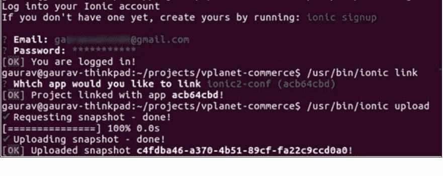

下一步是在我们的 `app.module.ts` 中导入 `cloudSettings`：

```typescript
// src/app/app.module.ts

import { CloudSettings, CloudModule } from '@ionic/cloud-angular';

const cloudSettings: CloudSettings = {
  'core': {
    'app_id': 'f8fec798'
  }
};

@NgModule({
  declarations: [ ... ],
  imports: [
    IonicModule.forRoot(vPlanetApp),
    Ionic2RatingModule,
    TranslateModule.forRoot({
      provide: TranslateLoader,
      useFactory: createTranslateLoader,
      deps: [Http]
    }),
    CloudModule.forRoot(cloudSettings)
  ],
  bootstrap: [IonicApp],
  entryComponents: [ ... ],
  providers: [ ... ]
})
```

我们现在已成功将 vPlanet-Commerce 应用上传到 ionic.io。我们现在准备开始使用 Ionic 服务，例如 Push、Deploy、DB 等。你可以在 Dashboard (https://apps.ionic.io/apps) 上找到所有你的应用：

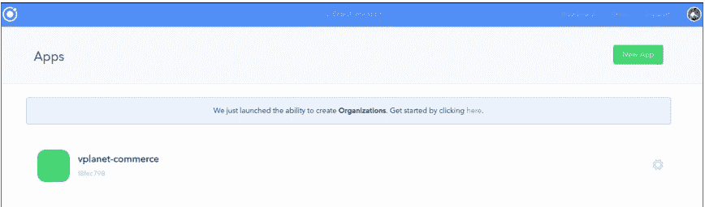

你可以在 Settings 选项卡内找到有关应用的所有信息。点击你的特定项目后，你将能够看到有关特定项目的详细信息。目前，我们的 vPlanet-Commerce 应用使用的是免费计划，提供约 5000 次部署、10,000 条推送通知和 100 次包构建。你可以随时升级计划，当你看到应用用户增加且流量增长时。最好的地方在于，我们将从用于用户登录和注册流程的 Auth 开始，集成每一个 Ionic Cloud 服务。Ionic DB 作为我们的应用数据库、推送通知、Package 和 Deploy：

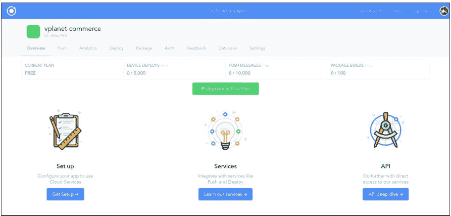

另外，还有一个重要点需要注意，当你完成 Ionic Cloud 的设置后，你会在 .io-config.json 中找到 app_id 和 api_key，而一些其他应用详情则在 ionic.config.json 中：

```json
// .io-config.json
{"app_id":"f8fec798", "api_key":"5b22exxxxxxxxxxxxxxxxxxxxxxxxxxxxxxxx68e"}

// ionic.config.json
{
  "name": "vplanet-commerce",
  "app_id": "f8fec798",
  "v2": true,
  "typescript": true
}
```

完成本章后，你将几乎处于书籍的中段，在 halfway 你现在就能使用 Ionic 构建应用、集成各种 Ionic 组件、Cordova 插件并能够集成 Ionic Cloud 服务，最后将应用部署到 Play Store。

```typescript
}
}

showToast(response_message:any) {
    let toast = this.toastCtrl.create({
        message: (response_message ? response_message : "Log In Successfully"),
        duration: 1500
    });
    toast.present();
}

onSignup() {
    this.navCtrl.push(SignupPage);
}
}
```

我们已将其与一个登录表单集成，该表单以对象形式获取数据，我们将其传递给 this.auth.login() 方法，如前面的代码所示。这将返回 token 和各种其他数据，默认情况下存储在本地存储中。在下面的截图中，你可以看到主要保存了三个键/值对，ionic_auth、ionic_insights_session 和 ionic_user：

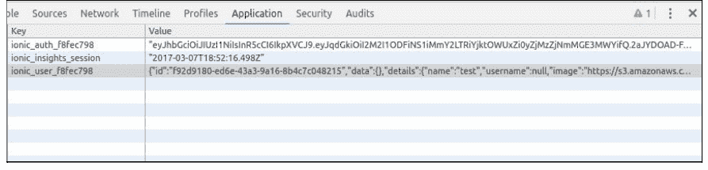

接下来，我们将其与一个登录表单集成，该表单以对象形式获取数据，我们将其传递给 this.auth.login() 方法，如前面的代码所示。这将返回 token 和各种其他数据，默认情况下存储在 Local Storage 中。在前面的截图中，你可以看到主要三个键/值对。用户数据主要存储在 ionic_user 中，你会在其中找到用户名、电子邮件和其他详细信息。现在让我们看看如何在我们的应用中注册新用户。我们将在 SignupPage 中集成它：

```typescript
// src/pages/signup/signup.ts

import { Component } from '@angular/core';
import { NgForm } from '@angular/forms';
import { NavController } from 'ionic-angular';
import { LoginPage } from '../login/login';
import { Auth, UserDetails, IDetailedError } from '@ionic/cloud-angular';

@Component({
    selector: 'page-user',
    templateUrl: 'signup.html'
})
export class SignupPage {

    signup: {name?: string, email?: string, password?: string} = {};

    details: UserDetails = {
        "name": this.signup.name,
        "email": this.signup.email,
        "password": this.signup.password
    };

    submitted = false;

    constructor(
        public navCtrl: NavController,
        public userService: UserService,
        public auth: Auth) {}

    onSignup(form: NgForm) {
        this.submitted = true;

        if (form.valid) {
            // registering new user
            this.auth.signup(this.signup).then(() => {
                // user is now registered
                this.navCtrl.push(LoginPage);
            }, (err: DetailedError<string[]>) => {
                for (let e of err.details) {
                    if (e === 'conflict_email') {
                        alert('Email already exists.');
                    } else {
                        // handle other errors
                    }
                }
            });
        }
    }
}
```


## Ionic DB

Ionic DB 是 Ionic Cloud 服务中最新增加的功能。IonicDB 用于安全地将应用程序数据远程存储。它与 Auth 集成得很好，因此用户可以安全地存储数据并实时检索。我们将在应用程序中从 IonicDB 获取数据，因为我们已经安装并配置了云客户端，所以可以直接集成。IonicDB 的一些重要特性如下：

- JSON 风格文档存储
- 实时数据更新
- 身份验证和权限管理读写权限。

我们将从在仪表板中为应用程序创建数据库并添加特定集合开始。集合是一组文档，通过存储在 id 字段中的唯一键来标识。你也可以将集合类比为关系数据库中的表。我们将创建一些初始集合：categories、parent_categories、popular_products 和 products，这些将在应用程序的不同视图中使用。你还会发现 user 集合，这是在我们集成 Auth 时自动创建的：

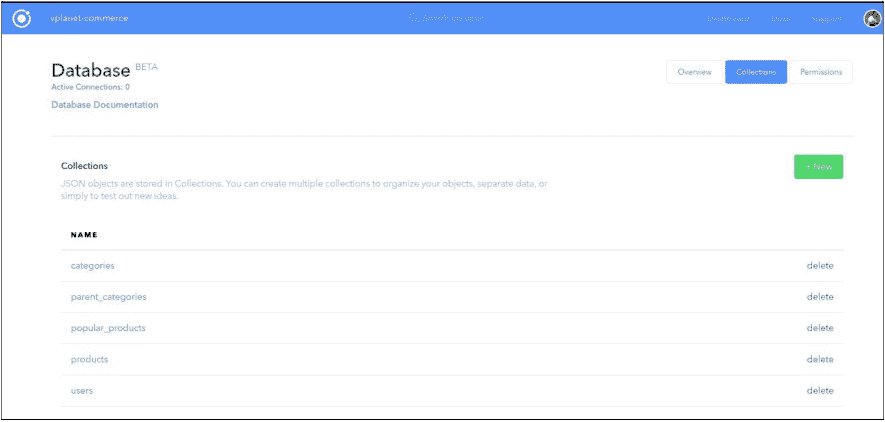

我们将在应用程序的多个视图中使用 Ionic DB，因此我们创建了一个 DataService 提供者，它将直接与 Ionic DB 通信，并将数据返回给调用该服务的视图。这将帮助我们避免大量代码重复。在开始之前，让我们先了解一下 Ionic DB 的工作原理以及它是如何获取数据的：

```
// src/providers/data-service.ts

import { Injectable } from '@angular/core';
import { Storage } from '@ionic/storage';
import { Database } from '@ionic/cloud-angular';
import { Observable } from 'rxjs/Observable';

import 'rxjs/add/operator/map';
import 'rxjs/add/operator/catch'

@Injectable()
export class DataService {

  cartItems: any[];

```

```
loading: any;

constructor(public db: Database) {
    // Establish Initial connection
    this.db.connect();
}

public getCategories(): Observable<any> {
    const categories:any = this.db.aggregate({
        name: "testing",
        categories: this.db.collection('categories'),
        parent_categories:
            this.db.collection('parent_categories')
    })
    return categories.fetch();
}

public getPopularProducts(): Observable<any> {
    const popular_products:any =
        this.db.collection('popular_products');
    return popular_products.order("price",
    "ascending").fetch();
}
}
```

在从 IonicDB 集合获取数据之前，我们需要与数据库建立初始连接，之后我们才能创建集合。你可以从前面的代码中看到，我们在构造函数中建立了连接，之后我们声明了多个从数据库获取数据的函数。

集合支持多种读写操作。在我们的 getPopularProducts() 函数中，我们使用了 order() 方法，它按价格从低到高检索产品。在某些场景下，我们需要查询多个集合并将结果合并为单个 JSON 响应。在 categoriesPage 上，我们同时获取 categories 和 parent_categories。因此，我们可以准备一棵树在 UI 端相应地显示。aggregate() 方法将多个数据库查询的结果合并为一个结果。你可能已经注意到，这里我们使用了 fetch() 方法，而不是我们在 getPopularProducts() 函数中使用的 watch() 方法。watch() 和 fetch() 的区别在于，watch() 会实时更新数据：

```
// src/pages/home/home.ts

import { DataService } from '../../providers/data-service';

export class HomePage {
    constructor(public data: DataService) {
        this.data.getPopularProducts().subscribe((popular) => {
            this.products = this.arrayToMatrix(popular, 2);
            console.log(this.products)
        }, (error) => {
            console.error(error);
        });
    }
}

// src/pages/categories/categories.ts

this.data.getCategories().subscribe((data) => {
    for (var i = 0; i < data.categories.length; ++i) {
        let p_id = data.categories[i].parent_id;
        for (var j = 0; j < data.parent_categories.length;
            ++j) {
            if(data.parent_categories[j].id == p_id)
            {
                data.parent_categories[j].child.push(data.categories[i])
            }
        }
    }
    this.categoryList = data.parent_categories;

```

```
}, (error) => {
    console.error(error);
});
```

所有读写操作都返回 RxJS observable。subscribe 是 observable 上的一个方法，它接收三个函数作为参数：

- next(result)：接收集合数据的回调方法
- error(error)：接收错误数据的回调方法
- complete()：当结果集迭代完成时执行的回调

如果你想停止接收数据流，可以调用 unsubscribe() 方法。我们在移动应用程序中主要使用读取方法从数据库检索数据。不过，我们也有多种写操作，也可以用于以用户为中心的应用，比如待办事项应用。

让我们也看看一些写操作以及如何使用它们。虽然在我们的 vPlanet 应用程序中没有使用写操作，但让我们演示如何为待办事项应用使用一些写操作：

```
const todoItems = this.db.collection("items");

// Insert a todo item document

let dateTime = new Date().toLocaleString();

todoItems.insert({
  id: "1",
  user: this.user.id,
  text: "Prepare project presentation",
  status: "pending"
  timestamp: dateTime
});

// Update todo item

let dateTime = new Date().toLocaleString();

todoItems.update({
  id: "1",
  user: this.user.id,
  text: "Prepare project presentation",
  status: "completed"
  timestamp: dateTime
});
```

现在我们对 IonicDB 的读写操作有了很好的了解。IonicDB 仍在积极开发中，因此你可能会遇到一些问题，但到目前为止，我在开发 vPlanet 应用程序的过程中一直很顺利。

## 身份验证与权限

Ionic DB 集成了现有的认证服务，默认情况下该服务是禁用的，因为在我们的 vPlanet 应用程序中，我们不需要启用认证，因为大多数数据应该是公开可访问的。对于待办事项应用，我们需要在 IonicDB 中启用认证，这将要求用户在使用 Ionic Auth 登录后才能连接到数据库。这样，用户只有通过认证后才能访问数据。要启用认证，我们需要更新 `app.module.ts` 中的一些设置：

```
```typescript
// src/app/app.component.ts

const cloudSettings: CloudSettings = {
  'core': {
    'app_id': 'APP_ID'
  },
  'database': {
    'authType': 'authenticated'
  }
};
```
```

另外，重要的一点是，确保仅在调用登录方法之后或用户已经过认证之后才建立数据库连接：

```
```typescript
if(this.auth.isAuthenticated()){
  // Connect DB after checking user authentication
  this.db.connect();
} else {
  // Need to login
  this.auth.login('basic', details).then( () => {
    // Now it is safe to connect
    this.db.connect();
  });
}
```
```

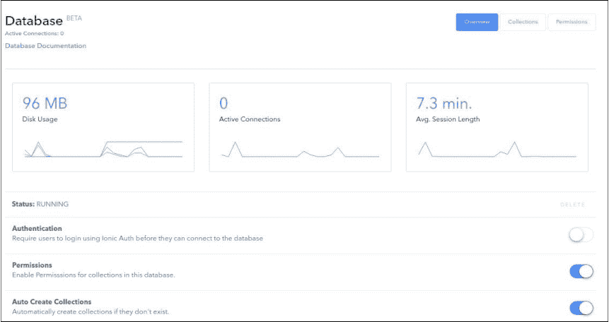

权限允许你限制对数据库集合的访问。我们可以控制用户能读取和写入哪些数据。权限基于白名单机制，当从仪表板启用权限后，默认情况下我们将无法访问数据。我们需要为每个集合创建权限，并将其定义为默认组或认证组。默认组权限适用于所有用户，无论他们是否经过认证。认证组权限仅适用于经过认证的用户。让我们回到待办事项应用演示，现在我们还有另一个关注点，即只有数据是


与用户相关的数据应由该用户访问。由一个用户登录创建的待办事项不应对其他用户有权限。因此基本上应根据当前用户进行过滤。为此我们使用自定义权限，例如，在插入项目时我们指定了与该项目关联的 `userId`：

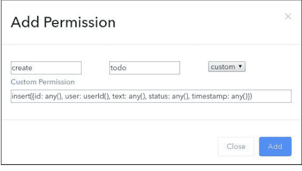

因此现在在获取项目时我们将传递当前的 `userId`，这将在当前用户上下文中检索数据：

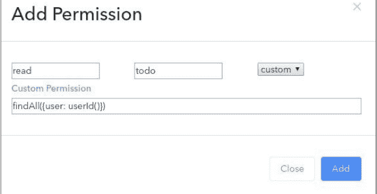

```javascript
todoItems.findAll({user:this.user.id}).watch().subscribe( (items) => {
  // this will only fetch items that
  // login user have created
  console.log(items);
})
```

我们在这里尝试触及 IonicDB 可用的每个可能部分并附带一些示例代码。这将真正简化初始学习曲线，并让你直接开始使用 IonicDB 构建应用程序。使用 IonicDB 我们也可以将其集成到我们的后端 NodeJS 应用程序中。

## Ionic push

Ionic push 允许你向用户的设备发送消息和警报。即使应用程序关闭也可以触发推送通知。推送通知现在已经存在很长时间，并且在每个应用程序中都很常见。你们中的许多人可能已经在过去整合 GCM 和 APNS 时拥有良好的经验。所以这里我们的主要兴趣是如何从 Ionic push 服务使用这些服务。Ionic push 允许你从单个界面或 API 向两个平台发送通知。使用 Ionic push 服务我们可以发送通知到：

- 目标用户
- 安排通知
- 发送上下文内容
- 将媒体附加到通知
- 在自定义逻辑上自动发送通知
- 使用后台通知触发应用事件

在我们能够从 Ionic push 服务发送通知之前，我们需要设置 FCM 项目和 API 密钥。我们可以在 firebase 控制台设置和云消息传递选项卡中找到 FCM 服务器密钥和发送者 ID：

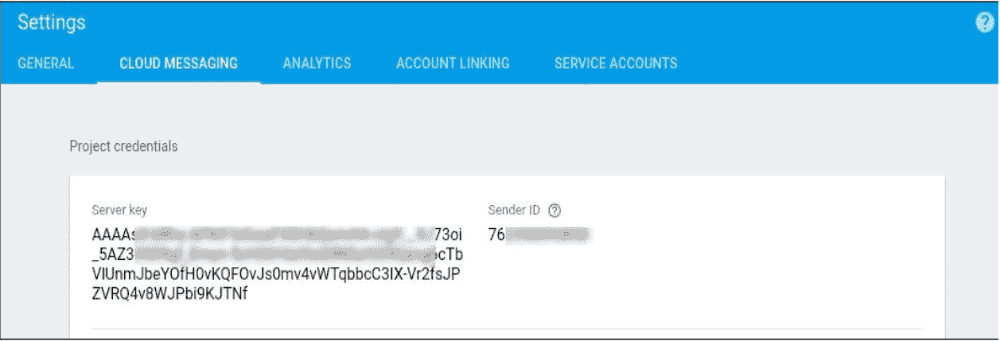

- 下一步是生成 keystore 文件，我们将在为应用程序创建安全配置文件时与其他详细信息一起上传。在创建 keystore 时它会先要求 Keystore 密码，并在输入其他详细信息后要求别名的 Key 密码。只要确保你记住这一点，因为在创建安全配置文件时需要它：

```
keytool -genkey -v -keystore vplanet.keystore -alias vplanet-alias -keyalg RSA -keysize 2048 -validity 10000
```

- 现在我们已准备好创建安全配置文件。来自 Firebase 控制台的 FCM 服务器密钥，附加生成的 vplanet.keystore 文件，别名及其各自的密码：

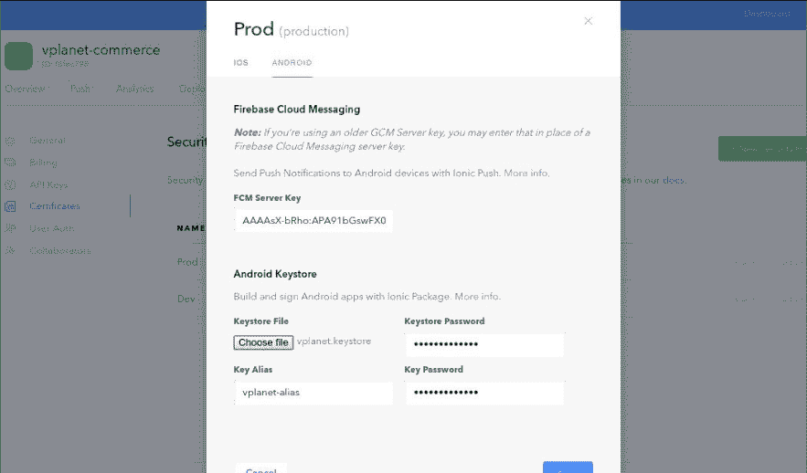

- 我们将使用 phonegap 的 push 插件接收推送通知。在安装插件时你需要传递 `SENDER_ID`，你可以在 Firebase 控制台设置中的同一位置获取它：

```bash
// Install Cordova Push Plugin
$ionic cordova:plugin add phonegap-plugin-push@1.9.4 --variable
    SENDER_ID=76xxxxxxxxx --save

// NPM package
$ npm install @ionic-native/push --save
```

我们现在需要在代码中的 `app.module.ts` 中更新我们的云配置：

```typescript
// src/app/app.module.ts

const cloudSettings: CloudSettings = {
  'core': {
    'app_id': 'f8fec798'
  },
  'push': {
    'sender_id': '76xxxxxxxxx',
    'pluginConfig': {
      'ios': {
        'badge': true,
        'sound': true
      },
      'android': {
        'iconColor': '#343434'
      }
    }
  }
};
```

我们现在必须注入 push 并将其集成到我们的应用程序中。我们将调用 `Push.init()`，它将创建 Push 类的实例。我们将使用此 push 实例来监听注册和通知事件：

```typescript
// src/app/app.component.ts

import { Push } from '@ionic-native/push';

platformReady() {
  // Call any initial plugins when ready
  this.platform.ready().then(() => {
    this.initPushNotification();
```

```javascript
}

initPushNotification() {
  console.log("calling push");
  let push = Push.init({
    android: {
      senderID: "762350093850"
    },
    ios: {
      alert: "true",
      badge: false,
      sound: "true"
    },
    windows: {}
  });

  push.on('registration', (data) => {
    console.log("device token ->", data.registrationId);
    //TODO - send device token to server
  });

  let self = this;

  push.on('notification', function(data) {
    TextToSpeech.speak({text: data.message, locale: 'en-IN', rate: 0.75})
      .then(() => console.log('Success'))
      .catch((reason: any) => console.log(reason));

    if (data.additionalData.foreground) {
      // if application open, show alert
      alert(data.message);
    }
    //if user NOT using app and push notification comes
    // for demo purpose for every push message we push
    // to AboutPage
    // Although you can apply logic and according to API
    // data
    // you can push to specific page
    self.nav.push(AboutPage, {message: data.message});

    push.finish(function() {
      console.log("processing of push data is finished");
    }, function() {
      console.log("something went wrong with push.finish for ID = " + data.additionalData.notId)
    }, data.additionalData.notId);
  });
}
```

现在我们需要在发送推送通知之前注册设备。由于我们使用 Ionic auth，建议在登录后调用 `register()` 方法，以便将 Push 令牌保存到已认证用户：

```typescript
// src/pages/login/login.ts

this.auth.login('basic', this.login).then((result) => {
  // user is now registered
  // Push Notification register
  this.push.register().then((data: PushToken) => {
    return this.push.saveToken(data);
  }).then((data: PushToken) => {
    console.log('Token saved:', data.token);
  });
}, (err: IDetailedError<string[]>) => {
  console.log(err);
  loading.dismiss();
  this.showToast(err)
});
```

同样，我们将在用户注销时注销设备：

```javascript
logout() {
    this.auth.logout();
    this.push.unregister();
    this.events.publish('user:logout');
    return true;
}
```

让我们从仪表板发送推送通知；发送消息时有多个选项可用。发送通知时有三个步骤和多个选项可用：

- 活动名称、通知主题、消息、负载（键/值对）和设备选项
- 针对特定用户细分或所有用户
- 安排推送立即发送、稍后发送或基于某些触发器发送。还有要发送通知的哪个配置文件

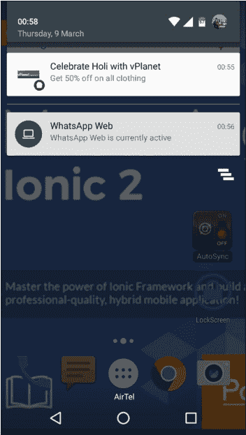

下一步可以是将 Push API 集成到我们的后端代码库中，如果需要的话。这样就可以有多种可能性和条件来发送通知。只要确保你不要向用户的设备发送太多通知，因为很多时候这就是用户卸载应用程序的原因。

## Ionic deploy

Ionic deploy 服务为你提供实时部署的访问权限，这有助于你将 HTML、CSS 和 JS 等网络资源直接发布给用户，而无需每次都上传到 Play Store。使用这种实时部署方法你将有许多优势：

- 按需实时更新
- 节省应用商店审批时间
- 通过将不同快照上传到不同渠道进行 A/B 测试

在开始之前，让我们安装 deploy 插件，它将在 Android 和 iOS 设备上更新你的应用程序：

```
$ ionic cordova:plugin add ionic-plugin-deploy -save
```

我们将在 `app.component.ts` 中注入 `Deploy` 方法，因此每次打开应用程序时都会检查新更新：// src/app/app.component.ts

```typescript
import { AlertController } from 'ionic-angular';
import { Deploy } from '@ionic/cloud-angular';

constructor(
public deploy: Deploy,
public alertCtrl: AlertController
) {

// checks if new snapshot available
this.deploy.check().then((snapshotAvailable: boolean) => {
if (snapshotAvailable) {
let alert = this.alertCtrl.create({
title: 'Update Available !',
message: 'Do you want to update the application now ?',
buttons: [
{
text: 'Later',
role: 'cancel',
handler: () => {
console.log('Cancel clicked');
}
},
{
text: 'Update',
handler: () => {
this.deploy.download().then(() => {
```


```
this.deploy.extract()
}).then(() => {
this.deploy.load()
});
}
}
]
});
alert.present();
});
}
}
```

check() 方法用于检查是否有可用更新。如果有可用更新，我们会显示一个提示对话框，询问用户是现在还是稍后更新应用程序。

下一步是使用 NOTE 和 CHANNEL_TAG 部署快照。可用于部署的渠道主要有三个：production、staging 和 dev。如果需要，我们可以创建更多渠道，默认情况下部署服务会检查 production 快照。如果需要更改，我们需要按如下方式设置 channel 属性：`this.deploy.channel = 'staging';`

如果发现无效渠道，则会回退到 production 渠道。另外，请确保在调用 check() 方法之前更新 channel 属性：

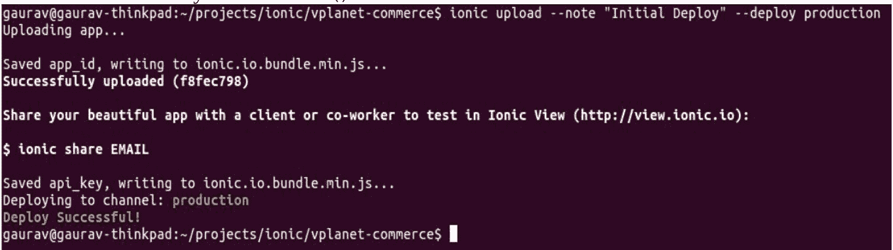

值得一提的是，每当我们打包代码时，代码也会上传到服务器。但要让部署生效，我们需要传递渠道标签：

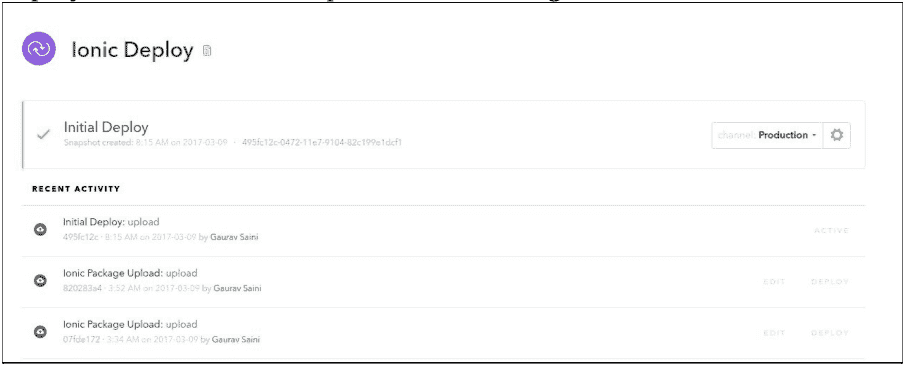

我们可以通过做一些小的 HTML 更改，然后将其上传到服务器来测试部署。只需确保运行 Ionic server，以便 `src` 文件夹被转译并复制到 `www` 文件夹。

## Ionic package

Ionic package 是另一种云服务，可简化不同平台的原生构建流程。基本上，`ionic package` 在云端构建 Cordova 应用。对于需要在 Windows 或 Linux 上构建 iOS 应用的人来说，这是一个绝佳的选择。使用 `ionic package` 服务的一些优点如下：

- 将构建版本发送给他人
- 为不支持的平台构建应用
- 生成 `.apk` 和 `.ipa` 文件，可直接上传到应用商店

由于我们已经设置了安全配置文件和凭据，我们现在就可以直接开始。这里我们为 `PLATFORM_TAG` Android 和 `PROFILE_TAG` prod 构建应用：

```
gaurav@gaurav-thinkpad:~/projects/ionic/vplanet-commerce$ ionic package build android --profile prod --release
The resources folder already exists. We will not overwrite your files unless you pass the --force argument.
Running with the force flag will overwrite your resources directory and modify your config.xml file
Preparing your resources...
splash ios Default-Portrait@ipadpro.png (2048x2732) skipped, source image splash.png (2208x2208) too small
splash ios Default-Landscape@ipadpro.png (2732x2048) skipped, source image splash.png (2208x2208) too small
Uploading your project to Ionic...
Submitting your app to Ionic Package...
Your app has been successfully submitted to Ionic Package!
Build ID: 5
We are now packaging your app.
```

现在，你可以从可用的包构建列表中查看构建状态，并通过 ID 下载它们：

```
$ ionic package list
```

| id | 状态 | 平台 | 模式 | 开始时间 | 完成时间 |
|----|--------|----------|------|---------|----------|
| 5 | 成功 | android | 发布 | Mar 9th, 2017 3:52:54 | Mar 9th, 2017 3:53:46 |
| 4 | 成功 | android | 调试 | Mar 9th, 2017 3:35:00 | Mar 9th, 2017 3:35:48 |
| 3 | 失败 | android | 调试 | Mar 9th, 2017 3:21:46 | |
| 2 | 失败 | android | 调试 | Mar 9th, 2017 3:14:12 | |
| 1 | 失败 | android | 调试 | Mar 9th, 2017 2:59:09 | |

显示你最新的 5 个构建。

要下载，你只需指定 `BUILD_ID`：

```
$ ionic package download 4
```

很多时候，我们在添加 cordova 插件时没有使用 `--save` 标志，因此没有在 `config.xml` 中生成条目。为了确保 Ionic package 服务知道你需要的插件，请执行 `ionic plugin save`，这样所有插件条目都会写入 `config.xml` 中。

> 注意：Ionic CLI 3 beta 发布后，package、upload、setup、share 等许多命令已被移除。这些命令在 Ionic CLI v2 中可以正常工作，但如果你计划升级，请在 v3 中寻找替代命令。另外，由于 v3 仍处于测试阶段，我们并不完全清楚这些命令的替代方案。


## Ionic View、Creator 和 Playground

到目前为止，我们已经介绍了几乎所有重要的 Ionic 服务，但仍有一些对 Ionic 应用非常有用的 Ionic 工具。其中一些工具包括 Ionic View、Creator 和 Playground。让我们看看这些工具如何帮助我们。

### Ionic View

Ionic View 可以让你轻松地与应用团队成员或客户分享应用，而无需在 iOS 上使用 TestFlight 或在 Android 上进行 beta 测试。我们可以轻松地与任何人分享应用，无需复杂的 beta 配置。第一步是上传我们的应用，系统会要求输入你的 Ionic 账户登录凭据：

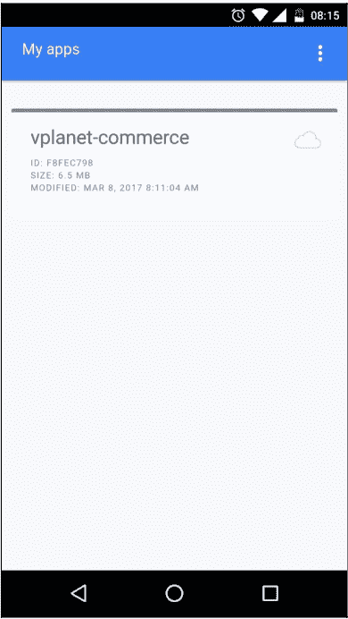

现在你可以在门户中看到 ID 为 f8fec798 的应用。你可以使用 Ionic share 命令分享你的应用；一旦你将应用分享给某个账户，他们就可以下载和预览你的应用。目前，大约支持 27 个插件，你可以在 https://docs.ionic.io/tools/view/ 查看。

> 有可能你的应用在 Ionic View 中无法完全正常工作，因为许多原生插件不受支持。

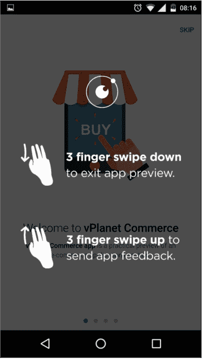

与我共享应用的合作者或账户将能够在其应用列表中看到该应用，并可以直接点击预览应用。这里还有多个选项可用，如清除数据、同步最新版本或删除应用：

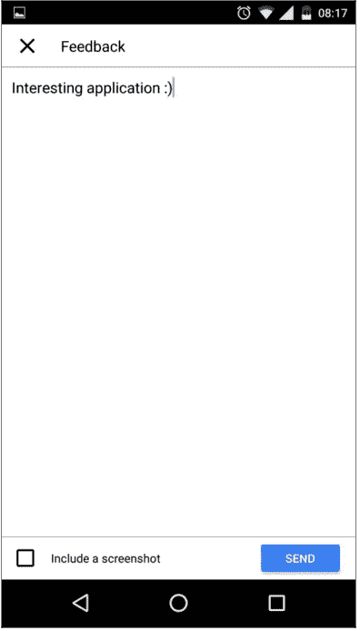

### Ionic Creator 和 Playground

还有另外两个 Ionic 平台提供的工具：Ionic Creator 和 Playground。Ionic Creator 是用于原型设计和制作 UI 线框图的好工具，可以让我们快速可视化应用的外观。目前，在免费计划下，我们只能拖放组件、创建页面/视图、预览、分享和下载代码。不过，Ionic 团队已经推出了许多专业功能，可在付费计划中使用，例如代码编辑、主题化和打包 Creator 应用。

这里，我们尝试使用 Ionic Creator 为货币转换器应用制作一个线框原型：

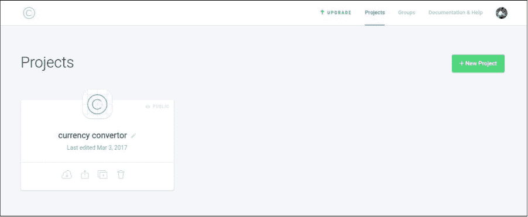

我们从组件部分添加了三个选项卡。通过简单的拖放 UI，我们可以轻松添加项目。在右侧，你会看到特定页面或组件的属性，这些属性是从左侧选择的。例如，如果我们点击左侧的 List Page，它将显示页面的属性，如标题、路由 URL、背景颜色以及左/右页眉按钮。同样，每个组件都有不同的属性。有些组件和属性仅在专业版中可用：

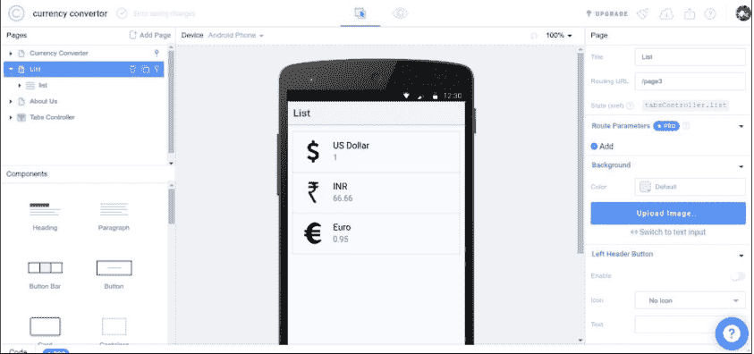

让我们看看预览应用时的效果。有四种设备选项可用于预览：iPhone、iPad、Android 手机和 Android 平板：

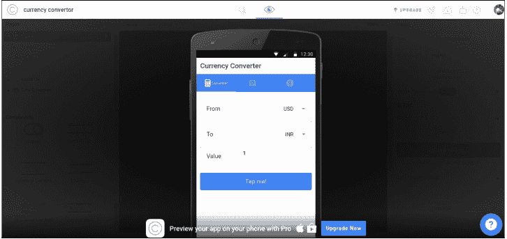

Ionic Playground 是一个简单的 HTML、CSS 和 JavaScript 编辑器，它使得与全世界任何人分享 Ionic 演示变得非常容易。你可以将 Playground 视为 Ionic 的 jsfiddle 或 plnkr。我们可以分叉并预览正在开发的应用。Playground 对 Ionic 开发者的教育和培训可以产生很大影响。出于调试目的，我们也可以使用 Playground；另一个用例是快速原型和演示。目前，Ionic Creator 和 Playground 都基于 Ionic 1，而我们的主要关注点是 Ionic 3，因此我们不会过于详细地讨论这些主题。你可以在 http://docs.usecreator.com/ 了解更多关于 Ionic Creator 的信息，并在 http://play.ionic.io/ 开始使用你的第一个 playground 应用。

Ionic 生态系统包括 Ionic Market、Ionic Jobs、Ionic Forum、Ionic Shop 和 Ionic Showcase。让我们简要了解一下这一切是如何运作的：

- **Ionic Market：** 在这里你可以找到许多免费和付费的 Ionic 主题和插件。如果你构建了一些对其他开发者有用的有趣主题或插件，你也可以在 Ionic Market 上提交你的作品。
- **Ionic Jobs：** 查找 Ionic 职位列表的最佳场所。
- **Ionic Forum：** 在这里你可以与其他开发者互动、提问，并分享你的演示和想法。这是消除疑惑和查看你是否遇到类似问题的最佳场所。
- **Ionic Showcase：** 你可以在这里提交已投入生产的工作，并分享应用商店链接和截图。


## 摘要

随着 Ionic 团队正在开发的服务和工具数量不断增加，你可以看到 Ionic 作为一个社区和产品都在以良好的速度发展。我们已经讨论了 Ionic 生态系统的所有服务，从 Ionic Cloud 服务开始，再到可用于快速原型制作的工具。将这些服务结合起来会非常有帮助；认证和 Ionic DB 一起可以为你的应用提供更多定制化的选择。

IonicDB 等 Ionic 服务是一个很有意思的补充。有计划称 Ionic 未来会随时推出新的测试工具。下一件大事将是使用 Electron 将同一代码库部署为桌面应用，从而实现平台连续性。

在第5章 *认证、授权与安全* 中，我们将探讨 Ionic 应用的一些安全方面。从一些常见的安全实践，到在我们的应用中集成认证和授权，以及如何保护我们的私有视图免遭未经认证用户的访问。我们将探讨安全地存储敏感数据以及通过网络读写数据，以免被他人截获。此外，我们还会看到在将应用发布到应用商店之前应考虑的一些基本安全要点。
