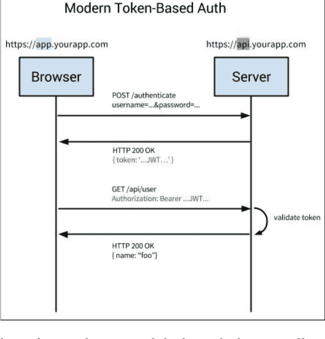
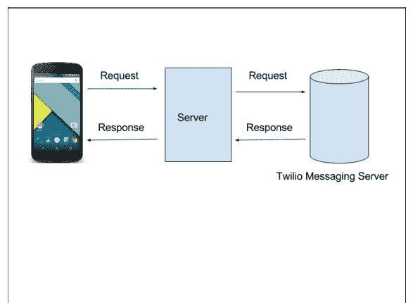
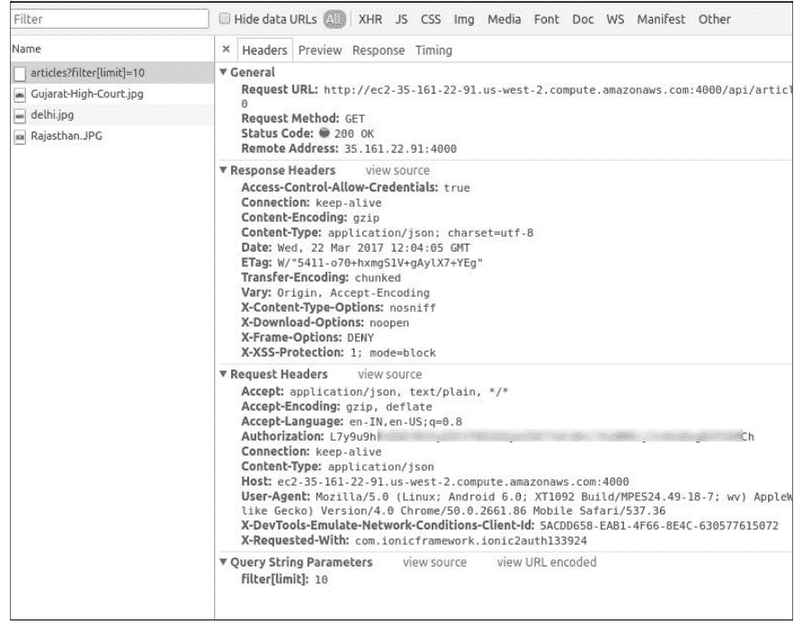

# 认证、授权与安全

现在我们将探讨构建企业应用的另一个重要方面：安全性。许多应用包含用户敏感内容，我们不希望将所有内容暴露给所有人。这正是认证和授权发挥作用的地方。不过，在本章中，我们将更侧重于 Ionic 的 Angular 部分，因为大部分工作将是用 Angular 编写代码。

此外，Ionic 社区提供了大量关于此主题及其用法的信息，因此我们将探讨所有这些内容。本章另一个重要部分是保护应用程序的安全，因为在将应用部署到生产环境之前，我们必须考虑许多事项，确保没有人能轻易进入你的代码。

在对混合应用的安全性及其与原生应用的区别进行研究时，我发现了这样一句话：“无论你使用原生代码还是混合代码，如果一个人足够执着，他们仍然可以绕过并看到你的源代码。”最终，我们能在多大程度上增加其被攻击的难度，取决于我们自己，同时还要注意不要在代码库中分享或放置敏感信息。我们将在本章中探讨所有这些内容：

- 认证
- 保护 Ionic 应用
- 在 Ionic 中演示授权

## 认证

Angular 是 Ionic 的核心，与认证和授权相关的大部分工作将在代码中处理。对于前端应用，实现服务器端认证主要有两种方式。你可以将 Ionic 应用视为 Angular 前端应用。我们将介绍的所有内容都可以视为通用内容，既可用于 Web，也可用于基于 Ionic 的混合应用。通常我们处理认证主要有两种方式：

- 基于令牌（Token）
- 基于 Cookie

### 基于令牌的认证

基于令牌的认证是许多 Web 应用中较新的认证方式。在这种方式下，当用户通过传递其用户令牌向服务器证明其有效性时，认证即成功，服务器会验证该令牌。在开始基于令牌的方式之前，让我们快速了解使用这种方式的一些好处：

- 无状态
- 移动端友好
- 性能
- 更安全
- 基于标准的 JWT
- 使用基于令牌的方式还有其他许多好处，例如你可以通过 CDN 提供所有静态资源（HTML、CSS 和 JS），而服务器端只是一个 API，这将提高性能



在基于令牌的方式中，你首先需要获取一个有效令牌，在许多应用中，通常可以通过登录请求的响应获得。以 Facebook Connect API 为例，每次通过 Facebook 登录时，响应中都会返回一个令牌。该令牌将来会被用来从 Facebook 获取一组用户信息；Facebook 使用该令牌验证用户身份，验证通过后提供相关信息。

对于 Ionic 应用，我们可以将该令牌存储在本地存储或会话存储中供以后使用。我们需要扩展默认的 HTTP 类，以便为 Ionic 应用发出的每个传出的请求设置授权头。你可以看到基于令牌的认证使用起来非常简单；你不需要担心如 CSRF 等安全问题，因为你没有依赖 Cookie。

以前几乎所有 Web 应用都基于 Cookie，并通过 Cookie 处理用户会话。它们要求服务器在每个请求上验证用户的 Cookie。随着我们转向现代的基于令牌的认证方式，仍有一些应用使用基于 Cookie 的认证方式。虽然我们可以在 Ionic 应用中实现同样的基于 Cookie 的认证，但不建议这样做。这里我们将主要介绍基于令牌的方式，并在应用中演示它。

## CORS

**跨域资源共享（CORS）** 的设计初衷是跨域访问资源。跨域策略不适用于 Cordova，因此在设备上测试时我们无需过多考虑。但在浏览器中运行同一个应用时，如果从跨域访问资源，可能会出现 CORS 错误。当你运行 `ionic serve` 命令时，就会看到这个问题。有四种方法可以绕过它：

- 禁用 Chrome 安全策略
- 浏览器扩展
- 代理服务器
- 最简单且方便的方法是在 Google Chrome 中使用以下标志运行应用：`--disable-web-security`：

```
$ google-chrome --disable-web-security
$ chromium-browser --disable-web-security
```

对于 chromium 浏览器，你也可以运行同样的命令。请确保在运行此命令前已关闭正在运行的 google-chrome 或 chromium。当你启用禁用 Web 安全策略打开浏览器时，会在浏览器中看到一条警告消息：“您正在使用一个不受支持的命令行标志：--disable-web-security。稳定性和安全性将受到影响。”

另一种方法是安装允许/禁用 CORS 的浏览器扩展。通常，这些插件在开启时会内部更改任何 XHR 请求的响应头。有许多可用的扩展，例如 **CORS toggle** 和 **Force CORS**。

## 为 Ionic 应用设置代理服务器

搭建代理服务器会花费一些时间，并且仅在你想要运行 `ionic serve` 和 `ionic run -l` 时才需要。我们将看到 Ionic CLI 如何提供一个易于配置的代理服务器。

这里的代理服务器将充当中介，处理从客户端到服务器的所有请求。它会接收客户端请求，向服务器发出新请求，然后在收到服务器响应后，将响应转发回客户端。由于服务器是向你的目标地址发送新请求，因此不存在来源（origin），也就不需要 CORS。需要特别注意，浏览器会添加 Origin 头。

要设置代理服务器，我们需要进行以下更改：

- 在 `ionic.config.json` 中设置代理
- 设置 Angular 常量
- 在 Angular 服务中使用常量

让我们从在 `ionic.config.json` 文件中设置代理配置开始。代理配置在 proxies 数组中包含两个重要属性：`path` 和 `proxyUrl`。你可以在该数组中配置多个代理：

```
{
  "name": "ionic2-auth",
  "app_id": "",
  "v2": true,
  "proxies": [
    {
      "path": "/api",
      "proxyUrl": "http://api.yourwebsite.com/api"
    }
  ]
}
```

现在，你在 `ionic.config.json` 中指定了：每当访问 `http://localhost:8100/api` 时，它将代表你代理到 `http://api.yourwebsite.com/api` 的请求。这将解决 CORS 问题。为了设置 API 端点，我们创建了 `constants` 文件，并在其中声明了一个常量 `API_URL`：

```
// src/providers/constants.ts
// While deploying application we switch to real URL
export const API_URL: string =
  'http://localhost:8100/api';
```

构建应用时，我们可以将其替换为真实的 `API_URL`，也就是我们提到的 `proxyUrl`：

```
// src/providers/data-service.ts

import { Injectable } from '@angular/core';
import { HttpClient } from './http-client';
import { Observable } from 'rxjs/Observable';
import 'rxjs/add/operator/map';
import { API_URL } from './constants';

export class DataService {
  constructor(public http: HttpClient, public storage: Storage) {}

  login(data): Observable<any> {
    return this.http.post(API_URL + '/login', data).map(res => res.json());
  }
}
```


## CSRF

**跨站请求伪造 (CSRF)** 许多服务器都具有此安全功能。我们也可以在基于 Ionic 的应用程序中保留此功能。CSRF 是一种攻击，当恶意代码在用户已通过身份验证时，主要使用用户自己的 cookie 在受信任的网站上执行不需要的操作时就会发生。为了防止 Angular 和 Ionic 中的 CSRF，你需要使用特定的 cookie 名称设置正确的 CSRF 头。这将阻止黑客嗅探你的 cookie 会话数据并冒充已认证用户发起请求。

这将为不在 `allowedMethods` 中的任何请求类型设置 CSRF 请求头，使其等于 CSRF cookie 的当前值。

因此，要在 Angular 中启用基于 cookie 的身份验证，你必须处理另一件重要的事情，将 AJAX 的 `withCredentials` 标志设置为 true。该标志设置在低级的 AJAX 对象上，但在 Angular 中我们必须使用我们的 `Http` 方法进行配置。

**示例代码片段**

```typescript
import { Http, Headers, RequestOptions } from '@angular/http';

sendData() {
  let headers = new Headers();
  headers.append('X-CSRF-Token', token.token);
  let options = new RequestOptions({ headers: headers,
    withCredentials: true });
  this.http.post("URL", <stringified_data>, options)
}
```

虽然许多开发者在重新启动应用程序时遇到 cookie 过期的情况，如果你遇到类似问题，请确保你的 cookie 已设置过期时间。实际上，浏览器会在关闭时清除没有过期时间的 cookie。

## 保护 Ionic 应用程序

通过身份验证和授权，你已经保护了所有数据，但在构建企业级 Ionic 应用程序时，仍有一些安全事项需要确保。这里我们将围绕 Cordova 来保护我们的应用程序。由于安全是一个深奥且复杂的话题，最重要的是保持更新并尝试使用最新版本的 Cordova 和 Ionic。通常，如果在 Cordova 中发现某些安全漏洞，你很快就会看到补丁并得到修复。

## 白名单

域名白名单是一种安全模型，用于控制对外部域的访问。Cordova 提供可配置的安全策略来定义要访问哪些站点。对于 Cordova 4.0 及更高版本，我们应使用 `cordova-plugin-whitelist`，因为它提供更好的安全性和配置设置。目前 `cordova-plugin-whitelist` 支持 Android 4 以上。对于我们的平台，我们必须在 `config.xml` 文件中配置安全：`<access origin="*" />`

在创建项目时，默认情况下所有域名都被列入白名单，这意味着你将可以访问所有域名。此外，域名白名单在 Android API 10 及以下不可用。因此，这也是需要注意的重要事项，即将你的 `min-target-sdk` 设置在 10 以上。此外，Ionic 本身支持 Android 4.4 以上版本。它可以在旧设备和 SDK 上运行，但可能会有性能和其他问题。此外，我们在 Android 4.4 以下设备的市场份额并不大。因此，为了构建面向未来的应用程序，我们可以忽略一部分市场份额，以使你的应用程序更安全、性能更好。随着新技术的出现，例如 BLE 支持的应用程序，甚至许多原生应用程序也只支持最新版本。

我们已经在 [第 3 章，*Ionic Native 和插件*] 中介绍过白名单插件，因此你已经了解如何轻松配置各种设置并列入白名单资源。插件中的新内容安全策略使你能够控制哪些网络请求（图像、XHR 等）允许通过 webview 直接发出：

```
<!-- Allow everything but only from the same origin and foo.com -->
<meta http-equiv="Content-Security-Policy" content="default-src 'self' foo.com">
```

```
<!-- Allows XHRs only over HTTPS on the same domain. -->
<meta http-equiv="Content-Security-Policy" content="default-src 'self' https:">
```

```
<!-- Allow iframe to https://cordova.apache.org/ -->
<meta http-equiv="Content-Security-Policy" content="default-src 'self'; frame-src 'self' https://cordova.apache.org">
```

你可以在白名单插件的官方文档中找到各种其他配置示例，如上所述：https://cordova.apache.org/docs/en/latest/reference/cordova-plugin-whitelist/。

## 启用 SSL

如果你通过网络向服务器传输安全数据，这是最重要的要点之一，在将应用程序上传到各种商店之前，你应该使其生产就绪并为所有安全请求启用 SSL。由于大多数 Ionic 应用程序使用 REST API 向服务器获取或发布数据，我们应该确保所有安全请求都是 HTTPS。同时，如果你的应用程序没有任何关键数据，那么对于这种情况也可以使用 HTTP。

对于生产应用程序，不建议使用自签名证书。如果你想引入 SSL，请确保你的服务器具有由知名证书颁发机构正确签名的证书。原因在于接受自签名证书会绕过证书链验证，这会使任何服务器证书都被设备视为有效。这会使通信暴露于中间人攻击。数据将被加密，但中间人可以用中间人的密钥解密它。你可以将其视为一个普通的 Web 应用程序，在其中你始终确保所有安全信息以加密形式发送到服务器，以便没有人能在中间窃取它。为了确保这一点，购买由知名证书颁发机构颁发的 SSL 证书非常重要。

## 应用程序外的敏感数据

在我们的应用程序中，可能有一些外部 API 用于获取第三方内容到我们的应用程序中。对于此，你将获得一些特定于你账户的 `secret_keys`，当你访问他们的服务器时会使用它们。在这里，我们必须确保不要将这些密钥放在你的 Ionic 应用程序中，因为有人可以很容易地从你的代码库中提取出来。

这里最好的方法是，在你的服务器上进行代理请求或在你的服务器端代码中进行自定义请求，该请求会将密钥添加到 API 调用中。因此，你将调用你的服务器，然后你的服务器会将请求连同 `secret_key` 一起传递给第三方服务。在响应中，相同的响应可以从第三方服务通过服务器传递回客户端：



如果例如你有用户特定的密钥，那么你必须要求用户首先在你的应用程序中登录，这将验证用户，然后来自你的服务器的下一个 API 调用可以获取相应的 `user_keys`，然后可用于与他们的第三方服务器进一步通信。此外，请确保你的应用程序中没有任何业务逻辑，你可以在服务器端轻松处理。不要假设你的源代码是安全的，因为基于 Cordova 的 Ionic 应用程序是由打包在原生容器中的 HTML 和 JavaScript 资源构建的。任何人都可以逆向工程进入你的代码，因此我们永远不会在你的代码中放置任何敏感信息。

同样，对于 BaaS 服务，如 Ionic Cloud 和 Firebase，你必须将密钥放在客户端以直接调用这些平台 API。尽管如此，如果我们有适当的访问控制并通过身份验证和登录保护保护了应用程序，那么只有经过身份验证的用户才能向 API 发出请求。这将防止黑客试图耗尽你账户的 API 调用次数。


## 安全存储

在 Ionic 应用中，许多开发者严重依赖通过 Cordova 插件使用 localStorage 或 SQLite。很多时候，我们必须存储机密信息，如用户名、密码、令牌、证书或任何其他敏感信息。在这种情况下，我们可以使用 secure storage 原生插件，它在 iOS 上使用钥匙串（keychain）加密数据，而在 Android 上，该插件会加密数据并将其存储在 SharedPreference 中。在 Ionic 应用内部，localStorage 会将数据沙箱化，仅对你的应用可见。其他任何应用都无法从外部访问这些数据。如果你将 SQLite 用作应用数据库，可以利用 SQLcipher 插件来加密 SQLite 中的数据：

```bash
$ ionic cordova:plugin add cordova-plugin-secure-storage
$ npm install --save @ionic-native/secure-storage
```

下面看一个示例，即存储用户的手机号码：

```typescript
import { SecureStorage, SecureStorageObject } from '@ionic-native/secure-storage';

constructor(private secureStorage: SecureStorage) { }

this.secureStorage.create('user_data')
.then((storage: SecureStorageObject) => {

storage.get('mobile_number')
.then(
data => console.log(data),
error => console.log(error)
);

storage.set('mobile_number', '+917813123123')
.then(
data => console.log(data),
error => console.log(error)
);

storage.remove('mobile_number')
.then(
data => console.log(data),
error => console.log(error)
);
});
```

同样，尽管你在加密数据方面做了这么多工作，我们仍必须注意：绝不应在应用存储中保存密码和其他关键信息。即使在原生应用中也不推荐这样做，因为如果攻击者足够执着，他们仍然可以解密你的数据。

## 通用安全要点

大多数移动操作系统都提供硬件级加密。这为设备在锁定时提供了额外的保护。因此，我们必须确保始终使用最新的 SDK，而 Ionic 2 仅支持 Android 4.4 及更高版本。除此之外，还有一些适用于 iOS 和 Android 的安全存储插件，它们分别使用 keychain（iOS）和 AES 加密（Android）。另一个插件是 PrivacyScreenPlugin，可用于在 Android 和 iOS 的应用切换器中隐藏敏感信息。用户将在任务切换器中看到启动屏幕，如果没有检测到该插件，则会显示黑屏。

逆向工程是许多开发者的另一个担忧，他们认为自己的应用代码很容易被提取出来，与某些恶意代码重新打包进应用中，然后再次上传到 Play Store。虽然这种做法在原生应用中同样可行，但在 Ionic 应用中，我们可以通过在运行时下载 JavaScript，并在应用关闭时将其删除来绕过这一安全问题。不过，我们需要思考是否真的需要这样做，因为这也会带来性能问题。另一方面，用 Java 或 Objective-C 实现这一点并动态存储代码库非常困难。

混淆、精简和压缩是在 Ionic 应用中保护代码的几种方法。我们可以使用许多开源工具在将源代码打包到各个应用商店之前对其压缩和混淆。一些流行的工具包括 YUI compressor 和 UglifyJS，它们可用于混淆你的 JavaScript 资源。此外，你应该始终压缩所有 JavaScript 和 CSS 资源，这将提高 Ionic 应用的性能，并减小 APK 文件的大小。还有一些企业级工具可用，例如 Jscrambler，它使用专有解决方案进行各种压缩和混淆。

以下是在发布应用之前，你可以针对安全方面关注的几个要点：

- 任何敏感的业务逻辑都应在服务器端执行
- 使用 uglify 混淆和压缩你的 JavaScript 资源，或使用 Jscrambler
- 不要使用低于 4.0 的 Android 操作系统
- 对外部链接使用 InAppBrowser
- 验证 HTML 表单的用户输入
- 不要缓存敏感数据
- 不要使用 eval()，除非你清楚自己在做什么
- 不要认为你的源代码始终是安全的
- 尽量在 iOS 上使用 keychain 插件

需要指出的是，安全是一个关键主题，开发者应始终关注 Cordova 的最新改进，以便在下次向应用商店发布应用时改进我们的应用。同时，确保不要牺牲性能。

### 在 Ionic 中演示授权

现在，让我们构建一个同时处理身份验证和授权的 Ionic 应用。授权是指决定谁被允许做什么的规则。身份验证和授权是保护应用安全的核心部分：

*身份验证* = *登录* + *密码*（你是谁）

*授权* = *权限*（允许你做什么）

在本节中，我们将了解如何保护 Ionic 应用中需要登录才能访问的视图。我们将处理以下要点：

- `HomePage` 将是公开的
- `ArticlesPage` 受保护，只有登录后才能访问
- 菜单也会根据认证状态动态更新
- 一旦用户登录，`LoginPage` 将不可访问
- 登录后，每次请求都会传递 Authorization 头

让我们从创建应用开始，我将其命名为 `ionic2-auth`：

```bash
$ ionic start ionic2-auth sidemenu -v2
$ ionic platform add android
$ npm install @ionic/storage --save
$ ionic generate page articles
$ ionic generate page home
$ ionic generate page login
```

我们将使用所有最新的库和当前的 Ionic 版本。此外，我们现在有了分屏（split pane）和响应式网格，这使得 Ionic 应用更接近支持桌面应用。我们主要使用三个视图：可公开访问的 `HomePage`、受保护的 `ArticlesPage` 以及 `LoginPage`。我们已将 `HomePage` 设置为 rootPage，因为它是公共视图。接下来，让我们看看动态菜单和登录/登出事件，这些将在 `app.component.ts` 中处理：

```typescript
// src/app/app.component.ts

import { Component, ViewChild } from '@angular/core';
import { Nav, Platform, MenuController, Events } from 'ionic-angular';
import { StatusBar, Splashscreen } from 'ionic-native';
import { ArticlesPage } from '../pages/articles/articles';
import { LoginPage } from '../pages/login/login';
import { HomePage } from '../pages/home/home';
import { DataService } from '../providers/data-service';
import { Storage } from '@ionic/storage';

@Component({
  templateUrl: 'app.html'
})
export class MyApp {
  @ViewChild(Nav) nav: Nav;

  rootPage: any = HomePage;

  pages: Array<{title: string, component: any}>;

  constructor(public platform: Platform,
    public storage: Storage,
    public data: DataService,
    public menu: MenuController,
    public events: Events
) {

  this.initializeApp();
  // used for an example of ngFor and navigation
  this.pages = [
    { title: 'Home', component: HomePage },
    { title: 'Articles', component: ArticlesPage }
  ];

  this.listenToLoginEvents();

  // decide which menu items should be hidden
  // by current login status stored in indexedDB
  this.data.isAuthorised().then((status) => {
    this.enableMenu(status === true);
  });
}
}

initializeApp() {
  this.platform.ready().then(() => {
    // Okay, so the platform is ready and our plugins
    // are available.
    // Here you can do any higher level native things
    //     you might need.
    StatusBar.styleDefault();
    Splashscreen.hide();
  });
}

login() {
  this.nav.push(LoginPage);
}

logout() {
  this.events.publish('user:logout');
}

openPage(page) {
  // Reset the content nav to have just this page
  // We wouldn't want the back button to show in this
  // scenario
  // Make sure to catch the error here else
  // you will get error
  this.nav.setRoot(page.component).catch(() => {
    console.log("Page didnt load")
  })
}

listenToLoginEvents() {
  this.events.subscribe('user:login', (result) => {
    this.enableMenu(true);
    this.storage.set('user', result);
  });

  this.events.subscribe('user:logout', () => {
    this.enableMenu(false);
    this.storage.remove('user');
    this.nav.setRoot(HomePage).catch(() => {
      console.log("Page didnt load")
    })
  });
}

enableMenu(loggedIn: boolean) {
  this.menu.enable(loggedIn, 'loggedInMenu');
  this.menu.enable(!loggedIn, 'loggedOutMenu');
}
}
```


我们在这里使用了 Events 类来处理我们的登录和登出事件，这是一个发布-订阅事件系统。一旦用户在 `LoginPage` 上登录成功，它就会调用登录事件。我们已将用户对象存储在 Ionic storage 中，因此之后进行 HTTP 请求时，我们可以使用它在请求中发送授权头。此外，我们还使用 `enableMenu()` 函数在这里启用特定的菜单：

```html
// src/app/app.html

<ion-split-pane>
  <ion-menu id="loggedOutMenu" [content]="content">
    <ion-header>
      <ion-toolbar>
        <ion-title>Menu</ion-title>
      </ion-toolbar>
    </ion-header>

    <ion-content>
      <ion-list>
        <button menuClose ion-item *ngFor="let p of pages"
          (click)="openPage(p)">
          {{p.title}}
        </button>
        <button menuClose ion-item (click)="login()">
          Login
        </button>
      </ion-list>
    </ion-content>
  </ion-menu>

  <ion-menu id="loggedInMenu" [content]="content">
    <ion-header>
      <ion-toolbar>
        <ion-title>Menu</ion-title>
      </ion-toolbar>
    </ion-header>

    <ion-content>
      <ion-list>
        <button menuClose ion-item *ngFor="let p of pages"
          (click)="openPage(p)">
          {{p.title}}
        </button>
        <button menuClose ion-item (click)="logout()">
          Logout
        </button>
      </ion-list>
    </ion-content>
  </ion-menu>

  <!-- Disable swipe-to-go-back because it's poor UX to
       combine STGB with side menus -->
  <ion-nav [root]="rootPage" main #content
    swipeBackEnabled="false"></ion-nav>
</ion-split-pane>
```

在前面的代码中是我们的 `app.html` 页面，我们在这里有 `rootPage`，并且也使用了 split pane 功能。你可以看到我们在同一侧有多个 ion-menus，我们可以根据传入的 id 来启用和禁用它们。让我们查看我们的 `LoginPage` 和 `ArticlesPage`，在那里我们调用了 API 请求并保护了路由：

```typescript
// src/pages/login/login.ts

onLogin(form: NgForm) {
  this.submitted = true;

  if (form.valid) {
    // start loader
    let loading = this.loadingCtrl.create({
      content: "Login wait...",
      duration: 20
    });
    loading.present();
    this.data.login(this.login).subscribe((result) => {
        this.events.publish('user:login', result);
        this.navCtrl.setRoot(HomePage);
        loading.dismiss();
        this.showToast(undefined);
    })
  }
}

ionViewWillEnter() {
    //Check if already authenticated
    this.data.isAuthorised().then(res => {
    if(res)
        this.navCtrl.setRoot(HomePage);
    else
        console.log("Please Login");
    })
}
```

在这里你可以看到我们调用了服务方法进行登录，之后我们发布了 user: Login 事件，以便根据认证状态更新我们的应用程序。生命周期事件方法 ionViewWillEnter() 也被使用，在其中我们检查用户是否已授权，如果已授权则我们不会路由到 HomePage。Nav Guards 用于控制进入和离开视图，我们将在 ArticlesPage 上使用它：

```
// src/pages/articles/articles.ts
export class ArticlesPage {
    articles: Array<any>;
    constructor(
        public navCtrl: NavController,
        public navParams: NavParams,
        public toastCtrl: ToastController,
        public data: DataService) {
    }

    ionViewDidLoad() {
        console.log('ionViewDidLoad ArticlesPage');
        /*
        Fetching Data after View Loaded
        Don't put this request in constructor
        As, it will call the API irrespective of
        what ionViewCanEnter will return
        */
        this.fetchArticles();
    }

    fetchArticles() {
        this.data.getArticles().subscribe(articles => {
            this.articles = articles;
        })
    }

    ionViewCanEnter() {
        console.log("in ionViewCanEnter")
        var self = this;
        return new Promise((resolve, reject) => {
            self.data.isAuthorised().then(res => {
                if(!res) {
                    let toast = self.toastCtrl.create({
                        message: "Please Login to access this view",
                        duration: 1500
                    });
                    toast.present();
                    reject(true);
                } else {
                    resolve(true);
                }
            })
        });
    }
}
```

在这里在 `ionViewCanEnter()` 方法内部我们检查用户是否已授权，并据此拒绝或解析 promise。你会看到当用户未 `loggedIn` 时我们将无法访问 `ArticlePage`。在这种情况下，我们的 API 甚至不会被调用，因为我们已在 `ionViewDidLoad()` 方法内部调用了 `fetchArticles()` 方法，而该方法只有在 `ionViewCanEnter` 被解析时才会被调用：

```
// src/providers/data-service.ts
import { Injectable } from '@angular/core';
import { HttpClient } from './http-client';
import { Observable } from 'rxjs/Observable';
import 'rxjs/add/operator/map';

import { Storage } from '@ionic/storage';
import { API_URL } from './constants';

@Injectable()
export class DataService {

  constructor(public http: HttpClient, public storage: Storage) {}

  login(data): Observable<any> {
    return this.http.post(API_URL + '/users/login', data).map(res => res.json());
  }

  getArticles(): Observable<any> {
    return this.http.get(API_URL + '/articles?filter[limit]=10').map(res => res.json());
  }

  isAuthorised(): Promise<any> {
    return this.storage.get("user").then((val) => {
      console.log(val)
      if(val) {
        return true;
      }
    })
  }
}
```

在 `data-service.ts` 内部我们放置了各种 API 和 `isAuthorised()` 方法，该方法检查 Ionic storage 中的用户数据并据此返回。此外，我们还将在这里使用 `http-client` provider 来封装我们的 HTTP API 调用。我们使用它在成功登录后为每个请求设置授权头：

```
// src/providers/http-client.ts
import { Injectable } from '@angular/core';
import { Http, Headers } from '@angular/http';
import { Storage } from '@ionic/storage';
import { Observable } from 'rxjs/Rx';

@Injectable()
export class HttpClient {

  constructor(public http: Http, public storage: Storage) {}

  buildHeaders(){
    let headers = new Headers({
      'Accept': 'application/json',
      'Content-Type': 'application/json; charset=utf-8'
    })

    return this.storage.get("user").then(
      (u) => {
if(u){
    headers.append('Authorization', u.id);
    return headers;
}
}
)
}

get(url) {
    return Observable
        .fromPromise(this.buildHeaders())
        .switchMap((headers) => this.http.get(url, {
            headers: headers }));
}

post(url, data) {
    return Observable
        .fromPromise(this.buildHeaders())
        .switchMap((headers) => this.http.post(url, data,
        { headers: headers }));
}
}
```



在这里我们有 get() 和 post() 方法，它们返回 observable，后者进一步使用 fromPromise() 方法，该方法将另一个现有 promise 包装为 observable 序列。在此之后我们使用了 switchMap() 方法，它确保 response/json 以我们想要的正确顺序返回，因为我们希望基于 headers 设置它并据此将其设置为 Http 方法。

Observable 在这里是从 rxjs/Rx 引入的，而不是从 rxjs/Observable 引入的。这样我们就可以自动获得对 fromPromise 方法的访问权限，否则它会报错。

对于构建 headers，我们的 buildHeaders() 方法检查 Ionic storage，如果 token 存在则将其附加到 authorization headers。我们已经涵盖了保护应用程序的所有重要方面。我们可以随时根据后端返回的角色进一步扩展它。这里的另一个不错的补充可以是扩展 `HTTP` 类以添加对 `401` 请求的拦截器，以便在用户 token 过期时将其从应用程序中注销。


## 摘要

在保护应用程序安全时，最重要的是正确保护你的服务器端 API。这样我们不会丢失任何关键数据，他人的数据也不会被公开分享。然而，当我们考虑保护代码库时，在原生的以及混合移动开发中，没有任何东西是100%安全的。不过，我们的目标应该是尽可能接近这个数字。首先限制你的暴露面，并确保不要把敏感数据和逻辑放在客户端。你应该确保尽力保护你的混合移动应用。但是，如果有人执意要破解，他们仍然可以绕过这些保护。

我们已经介绍了 Ionic 应用程序内部和外部的一些重要安全概念。现在我们将进一步把 Ionic 应用与 BaaS 服务（如 Firebase 和 Ionic Cloud）集成。如果你的 Ionic 应用需求非常简单，并且没有太多服务器逻辑，你可以使用这些服务快速构建一个 Ionic 应用，而无需搭建任何服务器端代码库。我们将构建一个 **TasteBite** 应用，对菜品和餐厅进行综合评分，以便用户了解所在城市的名菜是什么，以及在哪里能品尝到做得最好的菜品。
