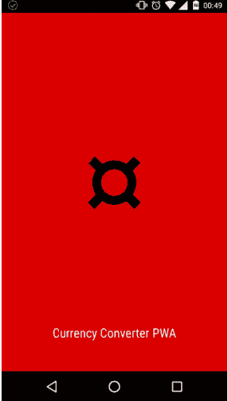
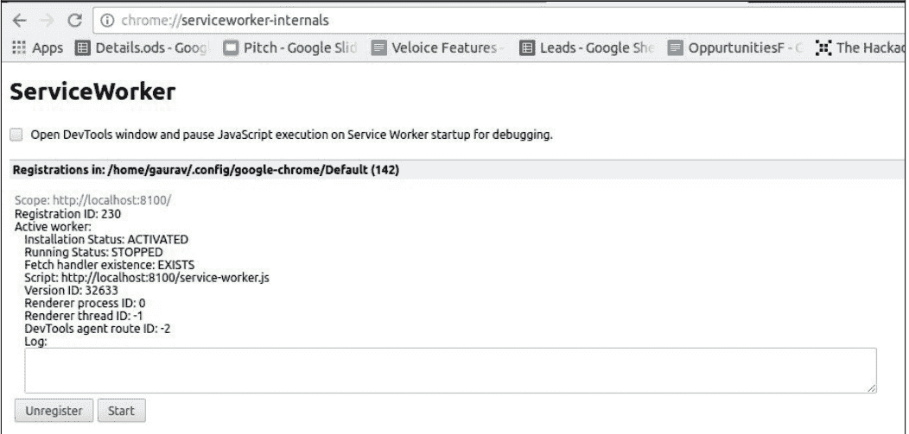
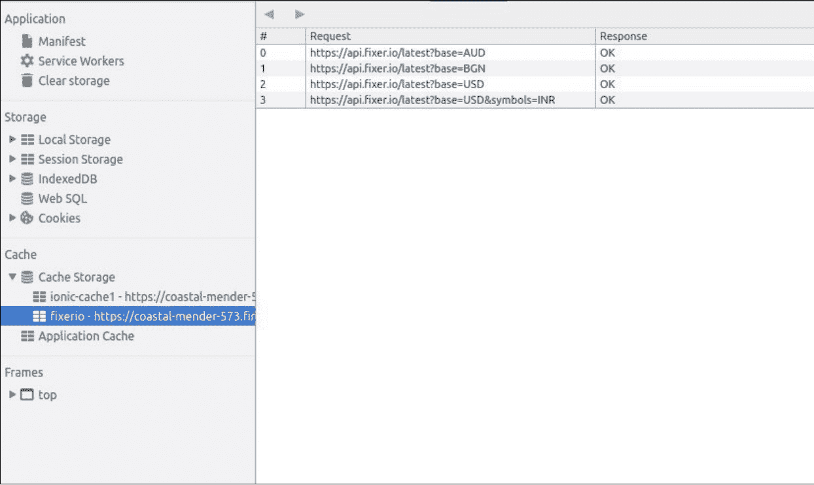
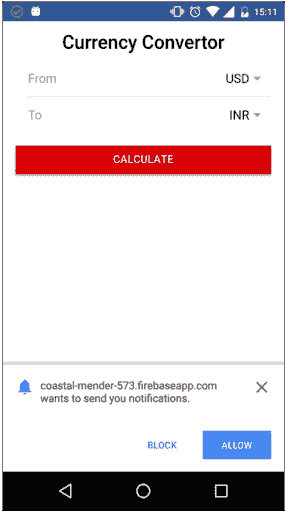
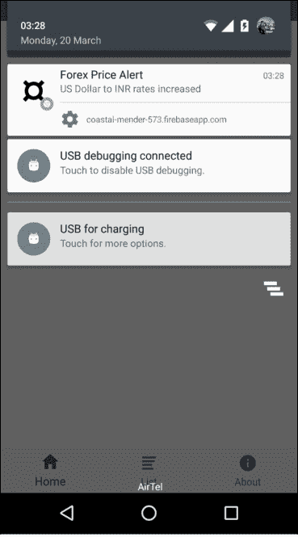
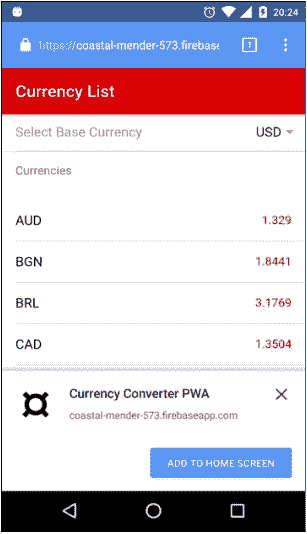

# Ionic + PWA = Magic

在移动应用之后出现的下一个大事物是面向移动网络的渐进式网络应用。**渐进式网络应用 (PWA)** 最初由 Google 于 2015 年启动，我们已经可以看到许多大型公司推出了面向移动网络的 PWA 版本。在 PWA 之前，许多开发者和公司对移动网络失去了兴趣，只专注于原生应用，但 Google 变得严格，开始惩罚那些带有下载原生应用横幅或不具备移动友好性的网站的站点。在此之后，开发者也开始着手移动网络，同时 Google Chrome 推出了对 PWA 的支持，而 Flipkart 最初与 Chrome 团队密切合作推出了其渐进式网络应用。

一切都关乎提供出色的用户体验，无论是原生应用还是 PWA，最终用户并不关心，只要他们拥有流畅的体验即可。我们将在本章中探讨以下主题：

- What and why PWAs?
- Ionic supports PWA
- Offline currency converter PWA
- Future of PWAs

## What and why PWA?

PWAs 是一种新型的网络应用。它们结合了原生应用的优势与网络的低摩擦特性。渐进式网络应用起初是简单的网站，但随着用户与其交互，它们会逐步获得超能力。它们从网站转变为更强大的东西，例如传统的原生应用。

PWAs 具有以下特点：

- **Reliable**: PWAs 即时加载，即使在糟糕的网络条件下也不会显示恐龙。当应用从用户主屏幕启动时，服务工作者（稍后会讨论）使渐进式网络应用能够即时加载，而不管网络状态如何。
- **Portable**: 原生应用的可移植性有许多策略（包括混合应用），但与这些策略不同，PWAs 不会改变你的部署和打包模型。
- **Engaging**: PWAs 在设备上感觉像是一个自然的应用，具有出色的用户体验。它们可安装，可以添加到用户主屏幕，而无需任何应用商店。它们提供与原生应用相同的全屏体验，甚至可以通过网络推送通知重新吸引用户。
- **Fast**: PWAs 速度快，对交互做出快速响应并具有流畅的动画。用户总是期望网站快速流畅。根据一项调查，如果网站加载时间超过三秒，53% 的用户会放弃该网站。

## Advantages of PWA

PWAs 相对于原生应用具有某些优势，它是未来数年内将上网的数十亿用户的未来。现在我们将谈论其优势以及它们对移动用户为何至关重要：

- **Install prompt**: 安装横幅非常关键，它们会增加与应用的互动。目前，开发者无法控制这一点，而是由 Chrome 决定何时提示用户显示添加到主屏幕的选项。
- **Works offline**: 许多地区的互联网连接可能非常糟糕，这就是为什么我们需要为应用提供离线支持。PWAs 有助于我们获得更好的用户体验和参与度。Cache APIs 和 IndexedDB 是实现 PWA 离线访问的两种推荐方法。
- **Lightweight**: 渐进式网络应用只是网页，非常轻量且安装快速。PWAs 不会占用大量安装空间，并且会实时更新，因为它们无需通过 Play Store 审核。
- **Linkable and discoverable**: 我们可以轻松分享 URL，并且由于 manifest 和服务工作者注册范围而被识别为应用。此外，还允许搜索引擎找到它。
- **Web push notifications**: 服务工作者也有助于处理网络推送通知，这有助于重新吸引用户。PWA 仅通过 HTTPS 提供服务，因此确保了安全性。
- **Update on use**: 与通常的原生应用更新策略不同，PWAs 的更新方式与网页相同：使用它们即可获得最新版本。
- **Analyze before installation**: 你无需安装即可开始使用它们。它们只是简单的网页。用户在想要时选择安装。

## Disadvantages of PWA

PWA 的缺点如下：

- **Traffic through store**: PWA 缺少通过 Play Store 或应用商店进行主要搜索的重要流量。用户可以通过移动网络被重定向到 Play Store 下载原生应用，但对于 PWA 来说则不适用。
- **Plugin integration**: 诸如 Facebook 和 Google 登录之类的插件无法从其应用中获取数据，我们需要在网络上单独获取。
- **Promotion**: 随着公司制作自己的应用内浏览器，在社交媒体上推广 PWA 体验变得越来越困难。
- **Browser support**: 在某些设备上的某些浏览器中，PWAs 的完整支持不可用。

## Ionic supports PWA

Ionic 团队是渐进式网络应用的忠实粉丝，它利用现代网络 API 提供类似应用的体验。由于 Ionic 3 是用在网络浏览器中完美运行的网络技术构建的，这在你使用 Ionic 构建 PWA 时为你提供了巨大的优势，因为如果你知道如何构建 Ionic 3 应用，那么你就可以在短时间内轻松构建 PWA，你只需要添加服务工作者和一个网络清单文件。我们将构建一个具有 PWA 支持的离线货币转换器，并最终将其托管在 Firebase Hosting 上。

## What makes a web application a PWA?

简单来说，PWA 意味着最终会被安装到用户的主屏幕，这意味着他们会像使用原生应用一样访问它。因此用户期望与使用原生应用时相同的体验。由于 Ionic 3 旨在使用标准网络技术创建原生应用体验，因此这已经得到处理。

PWA 应该非常高效，因为 PWA 将与原生应用一起安装到主屏幕。Ionic 3 是从一开始就以性能为目标构建的，这意味着你几乎不必为此担心。由于 PWA 将安装在用户的主屏幕上，此过程需要你的应用的网络清单。值得庆幸的是，Ionic 3 CLI 附带了内置的清单文件。

大多数原生应用在启动时可离线工作并为用户提供有限的离线体验，因此 PWA 也可以为用户做到这一点。在服务工作者的帮助下，我们现在可以让我们的网络应用在离线时工作。


```html
<link rel="manifest" href="manifest.json">
```

```json
// src/manifest.json
{
  "name": "Currency Converter PWA",
  "short_name": "Currency",
  "start_url": "index.html",
  "display": "standalone",
  "icons": [{
    "src": "assets/logo.png",
    "sizes": "512x512",
    "type": "image/png"
  }],
  "background_color": "#db0000",
  "theme_color": "#000000",
  "gcm_sender_id": "124917710568"
}
```

-   fullscreen：使用所有可用的用户区域，且不显示用户代理Chrome。
-   display：定义开发者偏好的Web应用显示模式。
-   start_url：指定用户从设备启动应用时加载的URL。在我们的Ionic应用中，它始终是index.html。
-   short_name：用于没有足够空间显示Web应用完整名称的地方。
-   name：这是用户打开应用时在启动页（splashscreen）上看到的名称。
-   Standalone：应用在视觉和体验上都将像一个独立应用。这可以包括应用拥有不同的窗口、在应用启动器中拥有自己的图标等。
-   minimal-ui：应用在视觉和体验上像一个独立应用，但会有一组用于控制导航的最小UI元素。这些元素因浏览器而异。
-   Browser：应用在常规浏览器标签页或新窗口中打开，具体取决于浏览器和平台。这是默认情况。
-   Icons：用于应用各种不同位置的图标数组，例如，当我们将其添加到主屏幕时，该图标会与应用短名称一起放置。
-   background_color：Web应用的预期背景颜色。
-   theme_color：应用的默认主题颜色。
-   gcm_sender_id：用于发送Web推送通知，代表Firebase Cloud中的sender_id：



你可以看到，在实现了上述部分属性后，安装应用时启动画面的外观。

## 服务工作线程

在Ionic 3中使用服务工作线程非常简单，Ionic自带`service-worker.js`文件，该文件最初在`index.html`文件中被注释掉。我们只需取消注释该部分，你就会看到服务工作线程在浏览器中注册。

服务工作线程本质上充当代理服务器，位于Web应用与浏览器之间，以及浏览器与网络之间（当可用时）。它们旨在（除其他功能外）实现有效的离线体验、拦截网络请求，并根据网络是否可用以及服务器上是否有更新的资源来采取适当的行动。它们还允许访问推送通知和后台同步API。

服务工作线程具有生命周期和各种操作的事件。我们首先在页面上注册服务工作线程，成功的注册生命周期从install和activate事件开始。Ionic 3在`src`文件夹内的`index.html`文件中带有内置注册代码，只需取消注释即可。现在，你可以访问[chrome://serviceworker-internals/](chrome://serviceworker-internals/)并查看你的站点，来检查服务工作线程是否已启用：



正如你所看到的，我们在`localhost:8100`本地提供的应用已注册服务工作线程。不过，当我们部署PWA时，它必须通过安全方式提供服务（HTTPS且无证书错误）。Firebase托管和GitHub Pages通过HTTPS托管，因此它们可以作为托管PWA应用的最佳场所。

注册完成后，接下来就是安装事件以开始其工作。在install事件中，我们缓存所有静态文件。`event.waitUntil()`方法确保服务工作线程在其中的代码执行完成之前不会被安装。现在，`cache.addAll()`将静态资源缓存到缓存存储中：

```javascript
var cacheName = 'cache-v1';
// pre-cache our key assets
var files = [
  './build/main.js',
```

```javascript
caches.match(request).then((response) => {
    if (response) {
        return response;
    }

    //if request is not cached, add it to cache
    return fetch(request).then((response) => {
        var responseToCache = response.clone();
        caches.open(cacheName).then((cache) => {
            cache.put(request, responseToCache).catch((err) => {
                console.warn(request.url + ': ' + err.message);
            });
        });

        return response;
    })
});
```

> *在sw-toolbox支持之后，我们使用sw-toolbox路由方法来获取资源，并根据可用的不同策略对其进行缓存，我们将在演示中进一步看到。*

服务工作线程可以执行推送事件、创建用户通知、打开特定页面或运行一些后台脚本：

```javascript
self.addEventListener('push', (event) => {
console.log('Received a push message', event);

const title = 'Yay a message.';
const body = 'We have received a push notification.';
const icon = 'assets/icon.png';
const tag = 'simple-push-demo-notification-tag';

event.waitUntil(
    self.registration.showNotification(title, {
        body: body,
        icon: icon,
        tag: tag
    })
);
});
```

最近，Ionic增加了对sw-toolbox的支持，这是一个`service-worker`库，它减少了很多工作量。

### 服务工作线程工具箱（sw-toolbox）

它现在已内置到starter和conference应用中。这允许你使用高级API而不是原始Service Worker API来定制你的服务工作线程。我们的开箱即用配置将为你的应用提供良好的、不依赖网络的体验，但你可以轻松定制以适应应用独特的用例。

我们已经介绍了服务工作线程的各种事件及其工作原理。这里最重要的是使用Chrome开发者工具来调试服务工作线程，并查看服务工作线程的状态和可用缓存。如需进一步研究服务工作线程以及可以使用它们做什么，你可以查看Google和Mozilla提供的以下文档链接：

https://developer.mozilla.org/en-US/docs/Web/API/Service_Worker_API/Using_Service_Workers
https://developers.google.com/web/fundamentals/getting-started/primers/service-workers.

```javascript
localStorage.setItem('anonKey', subKey);
});
})
.catch(err => console.log('Error', err));
}
</script>
```

你可以在这里看到，成功注册后，我们从pushManager订阅推送通知。这将生成订阅端点，用于向所有用户发送通知。下一步是设置我们的`manifest.json`文件：

```json
{
  "name": "Currency Converter PWA",
  "short_name": "Currency",
  "start_url": "index.html",
  "display": "standalone",
  "icons": [{
    "src": "assets/logo.png",
    "sizes": "512x512",
    "type": "image/png"
  }],
  "background_color": "#db0000",
  "theme_color": "#000000",
  "gcm_sender_id": "124917710568"
}
```

我们在上一节中讨论了所有属性，这里我们将为用户通知添加`gcm_sender_id`。你可以从云消息中的**Firebase设置**获取`gcm_sender_id`。从那里复制服务器密钥，因为稍后发送Web推送通知时会需要它。

服务工作线程对于渐进式Web应用至关重要。以下是我们默认的`service-worker.js`，我们根据需求进行了一些进一步修改。Ionic默认不使用`sw-toolbox`库，但该库大大减少了代码和工作量：

```javascript
// src/service-worker.js

'use strict';
importScripts('./build/sw-toolbox.js');

var version = 1;

self.toolbox.options.debug = true;

self.toolbox.options.cache = {
  name: 'ionic-cache' + version
};

// pre-cache our key assets
self.toolbox.precache(
  [
  './build/main.js',
  './build/main.css',
  './build/polyfills.js',
  'index.html',
  'manifest.json',
  '/'
  ]
);
```

我们从设置缓存名称开始，使用指定的版本号命名。因此，只要有新更改，我们就会更改版本，并生成新的`cacheStorage`。接下来，我们使用`precache()`方法缓存所有静态资源，并传入所有静态文件路径。你会看到，我们添加了另一个默认文件中没有的资源，因为我们的应用在浏览器`localhost:8100`上运行，如果首次加载后离线，该资源将不会被缓存，你会看到错误。如果你不想添加这个，只需刷新页面两次，因为这样可以将它缓存。


请求也是如此。

现在我们已经缓存了静态资源，接下来看看我们如何对动态内容（如 API 调用）使用缓存策略。在 `HomePage` 和 `ListPage` 中，我们使用了两种类型的 API，因此我们希望采用不同的缓存策略。每次获取完整列表时，我们使用 `networkFirst` 策略，而对于单一货币汇率则使用 `cacheFirst` 策略。由于这两个请求具有不同的 API 路径，我们根据这些路径应用了条件判断。此外，我们为这些请求设置了不同的 `cacheStorage`，命名为 `fixerio`，它将来自 fixer.io 的所有请求作为其源：

```
self.toolbox.router.get('/(.*)', function(request, values, options) {
  if (!request.url.match("symbols")) {
    console.log("===entire currency list API===");
    return self.toolbox.networkFirst(request, values, options);
  } else {
    console.log("===specific conversion between two currencies===");
    return self.toolbox.cacheFirst(request, values, options);
  }
}, {
  cache: {
    name: 'fixerio',
    maxEntries: 10,
    maxAgeSeconds: 3600
  },
  origin: /.fixer.io$/
});

// dynamically cache any other local assets
self.toolbox.router.any('/*', self.toolbox.cacheFirst, {
  cache: {
    maxAgeSeconds: 3600
  }
});

// for any other requests go to the network, cache,
// and then only use that cached resource if your user goes offline
self.toolbox.router.default = self.toolbox.networkFirst;
```

另外，我们将其他任何本地资源缓存为 `cacheFirst`，而其他任何请求则使用 `networkFirst`，它会先访问网络，如果离线则从缓存获取：



您可以轻松地在 Chrome 开发者工具中调试 `cacheStorage` 和 `indexedDB` 数据。

接下来我们要做的重要事情是清除旧缓存，以防新版本的 Service Worker 创建新的 `cacheStorage`。因此我们在 Service Worker 激活期间执行此操作：

```javascript
// Deleting old caches
self.addEventListener('activate', function(event) {
  var expectedCacheNames = Object.keys(self.toolbox.options.cache.name).map(function(key) {
    return self.toolbox.options.cache.name[key];
  });
  event.waitUntil(
    caches.keys().then(function(cacheNames) {
      return Promise.all(
        cacheNames.map(function(cacheName) {
          if (expectedCacheNames.indexOf(cacheName) === -1) {
            console.log('Deleting out of date cache:', cacheName);
            return caches.delete(cacheName);
          }
        })
      );
    })
  );
});
```

我们已经完成了一些订阅推送通知的工作，现在需要添加一个 EventListener，以便在发送时立即显示通知。我们有以下代码：

```javascript
self.addEventListener('push', (event) => {
  console.log('Received a push message', event);

  const title = 'Yay a message.';
  const body = 'We have received a push notification.';
  const icon = 'assets/logo.png';
  const tag = 'simple-push-demo-notification-tag';
event.waitUntil(
  self.registration.showNotification(title, {
    body: body,
    icon: icon,
    tag: tag
  })
);
```



我们还需要请求权限，这将在 `application.component.ts` 中最初请求。这会弹出一个询问是否发送通知的弹出框，一旦您允许，就可以接收推送通知了：

```typescript
// src/application/application.component.ts

Notification.requestPermission().then(function(result) {
  if (result === 'denied') {
    console.log('Permission wasn\'t granted. Allow a retry.');
    return;
  }
  if (result === 'default') {
    console.log('The permission request was dismissed.');
    return;
  }
});
```

为了演示 Web 推送通知，我们将使用 curl 请求，这需要端点（我们可以从 `localstorage` 中获取，因为我们已经保存了它）以及我们从面板复制的 Firebase 密钥：

```bash
$ curl https://android.googleapis.com/gcm/send --header "Authorization: key=AABBHRWs_ug:APA91bEiHIEczZzLiMJAB_-icXkT7
```



我们现在已成功发送了 Web 推送通知，下一步是将此推送 API 集成到您的后端。我们还可以在通知中发送自定义负载，但这需要添加加密，并在客户端和服务器端进行更改。由于这不在当前主题范围内，我们跳过这一点，但您可以参阅 Google 文档了解更多信息（[https://developers.google.com/web/updates/2016/03/web-push-encryption](https://developers.google.com/web/updates/2016/03/web-push-encryption)）。

我们已经完成了 PWA 应用所需的主要更改，现在只需开始编写代码并集成汇率 API。让我们看看 `currencyService`：

```typescript
// src/providers/currency-service.ts

import { Injectable } from '@angular/core';
import { Http } from '@angular/http';
import 'rxjs/add/operator/map';
import { StorageService } from './storage-service';

@Injectable()
export class CurrencyService {

  constructor(public http: Http, public cache: StorageService) {
  }

  loadCurrencyList(base:String) {
    return new Promise (resolve => {
      let url = "https://api.fixer.io/latest?base=" + base;
      this.http.get(url).map(res => res.json()).subscribe(data => {
        this.cache.setObject('base_'+ base, data);
        resolve(data);
      }, error => {
        resolve("Data not found");
      })
    })
  }
}
```

为了根据基础货币获取货币列表，我们使用了 `loadCurrencyList()` 方法，它会调用 `fixer.io` API 返回结果，并通过 Service Worker 进行缓存。我们将此类型的请求过滤为 `networkFirst`，因此每次都会从服务器获取最新数据。如果设备离线，它将返回上次缓存的结果；如果请求未被缓存，则会进入错误块，我们将其解析为 `Data not found`。同时，我们也将数据存储在 `IndexedDB` 中：

```typescript
convert(from, to) {
  return new Promise(resolve => {
    this.http.get("https://api.fixer.io/latest?base=" + from +
      "&symbols=" + to).map(res => res.json()).subscribe(data => {
        resolve(data);
      }, error => {
        this.cache.getObject('base_' + from).then((value) => {
          if(value) {
            resolve(value);
          } else {
            resolve("Data not found in offline State");
          }
        })
      })
  })
}
```

在我们的 `HomePage` 上，我们获取一对一的货币转换率，为此我们使用 `convert()` 方法。这里我们采用 `cacheFirst` 策略，首先返回 `cacheStorage` 中的数据，如果没有找到，则调用 `fixer.io` API。如果我们没有缓存特定请求且处于离线状态，则会回退到错误块，在那里我们首先检查在获取完整列表时是否已将基础货币列表存储在 `IndexedDB` 中。如果存储中有该列表，那么我们可以轻松地在列表中找到第二种货币。

让我们看看 `ListPage` 类，我们将从那里调用 `CurrencyService`：

```typescript
// src/pages/list/list.ts

import { Component } from '@angular/core';
import { NavController, NavParams } from 'ionic-angular';
import { CurrencyService } from '../../providers/currency-service';

@Component({
  selector: 'page-list',
  templateUrl: 'list.html'
})
export class ListPage {

  baseCurrency:any = "USD";
  currencyList:any;
  queryText:'';

  constructor(
    public navCtrl: NavController,
    public navParams: NavParams,
    public currency: CurrencyService) {

    currency.loadCurrencyList(this.baseCurrency).then(val => {
      this.processData(val)
    });

  }

  processData(data:any) {
    console.log(data);
    let rates = data.rates;
    let arr = [];
    for (var key in rates) {
      if (rates.hasOwnProperty(key)) {
        arr.push({'name':key,'price':rates[key]});
      }
    }
}
```


```javascript
this.currencyList = arr;
}

setBaseCurrency() {
  this.currency.loadCurrencyList(this.baseCurrency).then(val => {
    if(typeof val === "object") {
      this.processData(val)
    } else {
      alert(val);
    }
  });
}
}
```

我们将 `baseCurrency` 初始设置为 **USD**，并根据用户选择的基础货币，调用 `CurrencyService` 的 `loadCurrencyList()` 方法获取数据。我们已经讨论了渐进式 Web 应用的大部分要点和代码片段。你可以找到包含章节的完整代码库并随意修改。我们知道，只有将应用托管在 HTTPS 上，它才能完全正常运作，因此我已使用 Firebase 托管部署了 `www` 文件夹：



你可以访问 [https://coastal-mender-573.firebaseapp.com/](https://coastal-mender-573.firebaseapp.com/) 查看已托管的应用程序。当你开始频繁使用该应用时，会发现一个提示，询问你是否将其添加到手机主屏幕。添加到主屏幕后，你会看到一个图标出现在主屏幕上，点击它会打开一个独立的全屏窗口，看起来就像原生应用一样。我必须说，你们看到这个时都应该感到兴奋，现在应该尝试自己构建一个 PWA 应用。实际开发应用会比仅仅阅读概念更能提升你的技能，让你占据优势。

## PWA 的未来

渐进式 Web 应用为我们提供了许多可能性，如安装、发送推送通知和离线支持等能力，这些弥补了移动 Web 与原生应用之间的差距。目前的问题是，iOS 和 Safari 尚不支持 Service Worker，该问题仍在考虑之中。有人推测在 2017 年下半年，它们可能会提供 Service Worker 支持，从而帮助启用 PWA 功能。

渐进式 Web 应用是改进移动 Web 的下一步。随着移动流量日益增长，这意义重大。此外，在过去一段时间里，我们看到许多网站强迫用户通过移动 Web 安装原生应用，这确实令人反感。印度著名的电商巨头之一 Flipkart 甚至曾一度通过横幅提示用户安装其原生应用，从而停用了其移动 Web 版本。后来，当他们意识到这个错误后，成为业界首批支持 PWA 的公司之一，在移动 Web 上发布了 Flipkart Lite 版本。

统计数据显示，过去一年美国智能手机应用下载量下降了 20%，这表明市场已经饱和，消费者需求正在发生变化。你可以在（https://developers.google.com/web/showcase/2016/flipkart）找到大量案例研究，其中包含 PWA 如何积极影响产品增长和用户参与度的关键见解。还有许多其他 PWA，如 MakeMyTrip、Housing 等。你会发现，它们帮助我卸载了原生应用，释放了设备空间，转而使用 PWA 版本。

## 总结

我个人认为，在 Ionic 中支持 PWA，并在最后一章讨论这个主题，是结束我们激动人心的旅程的最佳方式。你现在已经了解了 PWA 的强大功能，也可以将其扩展到普通 Web 应用中。此外，我们不能说 PWA 会取代原生应用，因为有些底层 API 只有在使用 Cordova 构建应用并使用 Cordova 插件时才能使用。

从 Ionic 团队最近的博客文章来看，似乎很快就会有对 Electron 的桌面支持。我建议每位用户或开发者订阅 Ionic 博客，这是了解 Ionic 最新动态的最佳方式。我已经竭尽全力确保每一章的内容都是最新的，但你可以看到这个项目发展得如此活跃，所以确保你也付出努力跟上最新进展。Ionic 论坛是另一个有用的资源，在过去三年学习 Ionic 的旅程中，它一直帮助着我。大多数时候，你会发现自己遇到的问题已经在论坛中被问过，很快就能得到答案。此外，你可以随时提问，但在此之前一定要做好功课；否则你的问题可能会得不到回答。我说的功课是指，搜索论坛中的现有讨论，查看 GitHub 上的问题，因为很多时候问题可能已经被标记，你不想浪费时间。大多数时候，我们遇到的问题可能与 Angular 相关，而不是专门针对 Ionic 组件或 API。因此，对于这类问题，请尝试在 Google 上使用关键字 Angular 而不是 Ionic 进行搜索，因为这样会得到更合适的结果。

