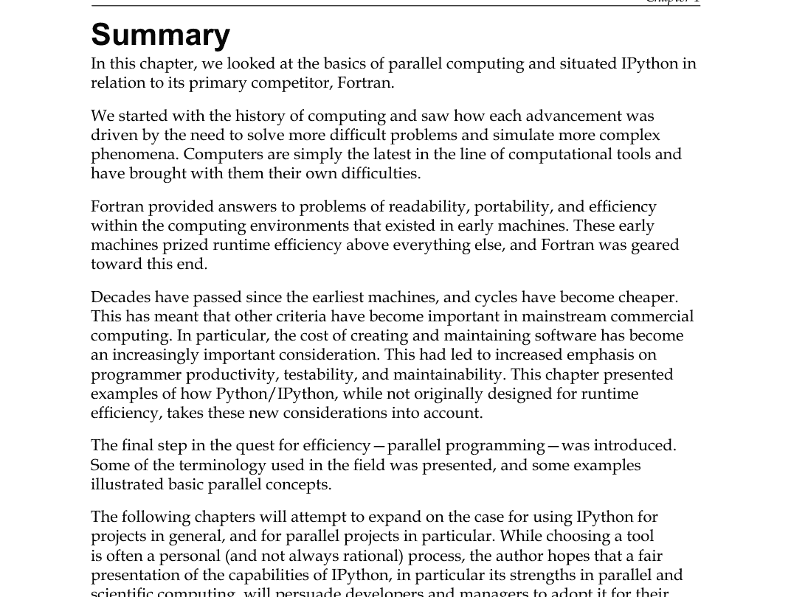
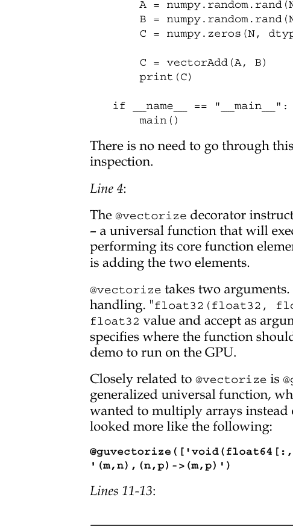
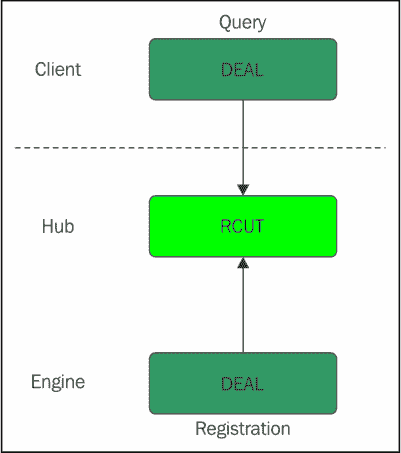
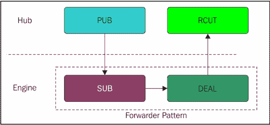
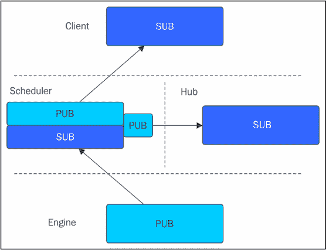

# FORTRAN 来救援——FORTRAN 所解决的问题

在计算机取得最初的成功（破解德国密码和计算对数）之后，该领域遇到了两个问题。首先，机器本身速度很慢——或者至少对于手头的新问题来说比期望的慢。其次，编写机器用来解决问题的指令（代码）花费的时间太长。

让机器本身更快主要是一个工程问题。底层基质从蒸汽和阀门发展到机电继电器，再到真空管，最后到集成电路。每一次基质的变化都提高了指令执行的速度。这种形式的进步虽然有趣，但超出了本书的范围。

一旦计算机发展到不再需要通过布线来设置程序，程序员就可以开始用编程语言以文本形式表达算法。虽然打字比布线快，但它也有自己的问题。Fortran 是最早成功解决这些问题的语言之一。

# 可读性

早期的语言通常不太人性化。编写（以及阅读）用这些语言编写的程序需要专门训练。程序员通常会在代码中添加注释，要么在代码本身中，要么在外部文档中，但问题更深层。语言本身就很晦涩难懂。

# 构建（和维护）软件的成本

如果开发者们都天赋相当、免费工作、开发时间不受限制、所有代码都没有错误，并且所有程序只需要运行一次然后就被丢弃，那么鉴于其效率和已有的库基础，Fortran 将是明显的赢家。

但商业软件并非如此开发。粗略来看，软件项目的成本可以分为以下几个部分：

- 需求和规格收集
- 开发
- 执行
- 测试和维护

# 需求和规格收集

在生成良好的需求和规格的难度方面，IPython 和 Fortran 之间没有明显区别。这些活动与语言无关。虽然预先编写好的软件包的可用性可能会影响规格的某些部分，但两种语言在将需求和规格转化为可运行系统方面具有同等能力。

# 开发

如前所述，Python 代码往往更简洁，从而带来更高的程序员生产力。再加上越来越多的开发者已经熟练掌握 Python，在缩短开发时间方面，Python 显然是赢家。

# 执行

如果在目标系统上运行成本很高（许多超级计算机就是如此），或者程序运行时间很长（某些大规模模拟如天气预报就是如此），那么 Fortran 的运行时效率是无与伦比的。当程序的开发工作基本完成，大部分时间都花在等待其运行完成上时，这一考量尤其重要。


## 恶性结节和良性结节



**良性结节**：形态规则、边界清晰、内部回声均匀

**恶性结节**：形态不规则、边界模糊、内部回声不均匀

乳腺结节的发病率逐年增高，超声检查是发现乳腺结节的主要手段之一。良性结节和恶性结节的超声征象有较大区别。良性结节多表现为形态规则、边界清晰、内部回声均匀；恶性结节多表现为形态不规则、边界模糊、内部回声不均匀。

## 使用多处理器

鉴于线程对于CPU密集型代码的局限性，也许可以通过使用多处理器来找到解决方案。CPU密集型算法与线程的问题在于存在一个隐式共享资源：CPU。使用多处理器可以缓解这一限制——每个函数调用都可以拥有自己的CPU，最多可达物理CPU数量。每个CPU将独立并行工作，而不是成为瓶颈。我们将在以下章节中探讨IPython为使用多处理器提供的工具。

## IPython并行架构

`IPython.parallel`包已迁移到`ipyparallel`项目。虽然这不是重大变化，但这引入了对ZeroMQ消息传递库的依赖。

## 概述

ipyparallel架构是串行IPython架构的自然扩展。客户端与解释器的解耦使得多个解释器和客户端可以并行运行的架构成为可能。

## 组件

IPython架构由四个组件组成：

-   IPython引擎
-   IPython控制器/客户端
-   IPython中心
-   IPython调度器

## IPython引擎

IPython引擎是一个Python实例，它通过网络连接接受Python命令和对象。在不同处理器上运行引擎的能力使IPython中的分布式计算成为可能。

## IPython控制器

IPython控制器为使用一组引擎提供了接口。它由一个中心（hub）和一组调度器（schedulers）组成。控制器为希望与引擎交互的用户提供了单一联系点。

## 让数据更重要

## 从大数据到富数据



数据不仅仅关乎数量；
更关乎丰富性。

> 市场即对话，数据的价值通过其使用而创造，而非通过其积累。

给定一个用于处理数据的函数func，以及一个用于确定向每个引擎发送哪些数据的子集函数，这将把所有并行调用的结果放入results列表中。

虽然不如Hadoop强大或复杂，但这些机制提供了一种轻量级替代方案，适用于较小数据集的探索性分析。

## MIMD

多指令多数据流（Multiple Instruction Multiple Data，MIMD）范式描述了一种多个处理器可以在不同数据流上执行不同指令的情况。它可以被看作是SIMD的一种稍加通用的形式，其中每个处理单元不必与其他所有处理单元保持同步。实际上，该术语通常指（更通用的）MPMD范式，这将在后面讨论。

## MPMD

多程序多数据流（Multiple Program Multiple Data，MPMD）范式是并行计算最通用的形式。在这种范式中，各个处理单元本质上是独立的程序，它们之间可能通信也可能不通信。这在异构环境中尤其方便，因为系统的不同部分可能需要各种专门的资源。

给定一个对先前示例稍作修改的程序，我们希望确保`useGPUs`函数仅在带有GPU的节点上执行：

```python
import numpy
from numba import vectorize

@vectorize(["float32(float32, float32)"], target="gpu")
def vectorAdd(a, b):
    return a + b

def useGPUs():
    N = 64

    A = numpy.random.rand(N).astype(numpy.float32)
    B = numpy.random.rand(N).astype(numpy.float32)
    C = numpy.zeros(N, dtype=numpy.float32)

    C = vectorAdd(A, B)
    print(C)
```

## 数据并行性

到目前为止，我们主要讨论了任务的分布方式，而将数据置于后台。同样，审视数据的获取方式以及如何将数据提供给任务，也很有启发性。毕竟，如果任务缺乏数据，就无法产生任何结果。

## 无数据依赖

这种情况是指每个任务要么不需要数据，要么可以独立生成数据（也许通过传感器读数或随机数生成器）。这通常发生在运行蒙特卡洛模拟时，其中每个模拟的唯一输入是一个随机数。


> **蒙特卡洛模拟**
>
> 在模拟中，参数的确切值通常是未知的。在这种情况下，蒙特卡洛方法需要多次运行模拟，每次运行对每个参数使用一个有效但随机选择的值。然后可以将各次运行的结果进行统计合并，以提供所需结果的估计值。

在此示例中，每次模拟实例同样可以生成自己的随机数，因此仅有的数据交换如下：

-   在运行开始时，将发送一些最少的配置数据（例如，步数或容差）
-   在运行结束时，当结果被收集时

考虑以下蒙特卡洛计算π的示例：

```python
def monteCarloPI(n):
    s = 0
    for i in xrange(n):
        x = random()
        y = random()
        if x*x + y*y <= 1:
            s+=1
    return 4.*s/n

def parCalcPI(view, n):
    p = len(view.targets)

    ar = view.apply(monteCarloPI, n)
    return sum(ar)/p
```

```python
for i in range(numFiles):
    filename = "infile" + i + ".txt"
    dv.targets = i % numEngines
    asyncResults.append(dv.apply(countWords, filename))

for r in asyncResults:
    results.append(r.get())
```

读者会认出这与前面描述的散播-聚集（scatter-gather）方法相似，主要区别在于各个引擎使用的数据主要不是原始调用中发送的数据，而是存储在单独文件中的数据。

这种数据并行形式的主要缺点与物理机器的底层架构有关。粗略地说，大多数HPC机器都有本地存储和远程存储。本地存储包括RAM和一个小硬盘。远程存储包括硬盘组和大量磁带。当进程在节点上启动时，该节点的远程存储实际上是空白的。这意味着该节点使用的任何文件都必须从远程存储读入本地存储。本地和远程存储通过网络连接，该网络由所有节点共享，无论运行在其上的进程属于谁。

如果像我们的小示例那样，大量节点同时尝试打开远程存储中的文件进行读取，那么连接本地和远程存储的网络将因需要将这些文件从远程存储传输到需要访问的各个节点而不堪重负。这本身并不是致命错误。然而，它会严重影响性能，并且是那种会让系统管理员发来愤怒邮件的事情。

为了避免这些问题，有必要既控制哪个任务访问哪个文件，也要控制文件的物理存储位置。这个问题超出了本书的范围——如果读者感兴趣，**Hadoop分布式文件系统（HDFS）**提供了一种有趣的方法。

前面的方法都有一个共同特征——数据只在控制器和引擎之间流动。更复杂的流将在后续章节中讨论。

## 应用引导

应用引导（Application steering）是对程序进行交互式操作以影响其行为的过程。它允许用户在应用程序执行期间对其进行监控和控制。本章已经介绍了IPython为支持某些基本形式的应用引导所提供的工具。本节将仅描述一些简单的应用。


从某种程度上说，ZeroMQ 会尝试从外部错误中恢复。例如，它会尝试以智能方式处理网络错误，甚至在合理时自动重试。尽管该框架无法处理可能发生的每一个错误，但任何确实导致调用无法成功完成的错误，很可能都需要发起调用的进程来处理。即使 ZeroMQ 其他什么都不做，仅凭这一特性就值得使用。

如果由于某种原因无法成功，在底层，这意味着每个 ZeroMQ 调用都会返回一个状态码或导致断言失败。ZeroMQ 的 Python 包装器往往会针对任何类型的错误事件抛出异常。下表总结了这些异常：

| 异常 | 条件 |
|---|---|
| ZMQError | 包装一个 ZeroMQ 错误编号 |
| ZMQVersionError | 当链接的 libzmq 版本未提供某个特性时抛出 |
| Again | ZeroMQ EAGAIN 错误的包装器 |
| ContextTerminated | ZeroMQ ETERM 错误的包装器 |
| NotDone | 等待消息时超时 |
| ZMQBindError | 当套接字无法绑定到端口时 |

完整细节可以在 `https://pymq.readthedocs.org/en/latest/api/index.html` 找到。每次对 ZeroMQ 的调用都应该包装在 try-catch 块中，并且鼓励大量使用断言。然而，尽管错误处理在生产环境中很重要，但它往往会扰乱原本简洁的代码。所有示例都将省略错误处理：

- **第 14 行：** 接收请求是一个阻塞语句。该进程将无限期等待先前指定端口上的连接。可以指定一个限制，使等待超时。
- **第 21 行：** 收到消息并完成（一些最少限度的）处理后，可以将响应发送回发起连接的进程。在底层，ZeroMQ 发送的是字节，而不是 Python 字符。如果客户端和服务器都是 Python（且可能是同一版本），以这种方式发送字符串应该没有问题。

跨语言和跨平台应用程序可能希望使用以下方式：

```
socket.send(b"World")
```

而不是使用下面这行代码：

```
socket.send("World")
```

# 发布者

这是一个发布者。它使用 PUB 套接字将时间和天气发送给任意数量的订阅者：

```
```python
import zmq
import random

context = zmq.Context()
socket = context.socket(zmq.PUB)
socket.bind("tcp://*:5678")

while True:
    topic = "load"
    socket.send(topic + " " + str(random.random()))

    topic = "weather"
    messagedata = "dark and stormy night"
    socket.send(topic + " " + messagedata)

    time.sleep(1)
```
```

# 订阅者

该订阅者使用 SUB 套接字来监听上述发布者。但它只对天气感兴趣：

```
```python
import zmq

context = zmq.Context()
socket = context.socket(zmq.SUB)
socket.connect("tcp://localhost:5678")
socket.setsockopt_string(zmq.SUBSCRIBE, "weather")

while True:
    wtr = socket.recv_string()
    print("the weather is: " + wtr)
```
```

# 广播

使用 MPI 时，广播似乎并不适用：毕竟，每个进程都运行相同的代码，那么一个进程怎么能知道另一个进程不知道的信息呢？一个不对称的例子来自 I/O 的使用。考虑一个程序，它接收用户输入，然后在每个进程中根据该输入执行操作。如果每个进程都独立地向用户请求输入，那将是疯狂的。0 号进程（rank 0）应该收集输入，然后将其发送给所有其他进程，例如：

```
```python
from mpi4py import MPI

comm = MPI.COMM_WORLD
rank = comm.Get_rank()

if rank == 0:
    data = input("Please enter random number seed")
else:
    data = None

# mpi4py wants to send an object, so we will leave the
# input in that format
data = comm.bcast(data, root=0)
```
```

# 归约

当所有进程执行各自独立的操作时，将它们的计算结果合并起来可能很有用。例如，在计算函数的黎曼积分时，将工作分配到多个进程上可能会高效得多。然后所得结果就是每个进程中计算出的值之和，例如：

```
```python
import numpy

import sys
from mpi4py import MPI

comm = MPI.COMM_WORLD
rank = comm.Get_rank()

# integrate from in [0, 4] using 8 rectangles
a = 0
b = 4
```
```

## ZeroMQ 与 IPython

ZeroMQ 不仅仅是一个用于并行环境的消息库：IPython 已经转向使用 ZeroMQ 作为其内部消息传递基础设施。在本节中，我们将从 ZeroMQ 底层机制的角度，提供有关 IPython 运行的更多细节。

为此，我们将介绍一些额外的套接字类型，描述它们如何交互以支持 IPython 的某些并行组件，最后介绍一些使用这些组件的用例。虽然本节无法涵盖 IPython 并行架构的所有细节，但希望这些示例能让用户对底层机制有一个基本的了解。

### ZeroMQ 套接字类型

ZeroMQ 支持大量不同类型的套接字，截至目前（版本 4.2.0）共有 14 种。上一节概述了一些重要的类型，但要讨论 IPython 架构，至少需要对一些高级套接字类型有初步了解：

- **DEALER：** 这类似于 REQ 套接字，但它是异步的。每条发送的消息都会以轮询（round-robin）方式在所有已连接对等节点间发送，每条接收的消息都会从所有已连接对等节点公平排队。它与 ROUTER、REP 和 DEALER 套接字兼容。
- **ROUTER：** 这类似于 REP 套接字，但它是异步的。它会跟踪所有已连接的对等节点。路由器发送的每条消息都包含消息来源的身份标识。这使得套接字能够根据消息来源进行路由。当 ROUTER 连接了多个 REQ 和 REP 套接字时，需要将消息发送到正确的端点。

### IPython 组件

*第 3 章“迈向 IPython 并行计算”* 概述了 IPython 的主要架构组件。在本节中，我们将提供更多细节，重点介绍每个组件如何使用消息传递来执行其任务。

ZeroMQ 追求最小化配置：客户端和引擎只需知道 Hub 的 ROUTER 套接字的 IP 地址和端口即可连接。一旦建立了这个初始连接，建立进一步连接所需的任何信息都会发送过去。此外，客户端还可以利用此连接向 Hub 查询关于引擎的状态信息。这样就形成了一个简单的连接架构：客户端和引擎都使用 DEAL 套接字，而 Hub 使用 ROUT 套接字：



# 心跳

Hub 还负责检查哪些引擎仍在响应。为此，它会定期向每个引擎发送一条消息。然后引擎会以相同的消息进行响应，并带有前缀表示哪个引擎作出了响应。如果某个引擎没有响应，Hub 将尝试终止它。




## IOPub

stdout/stderr 通过 PUB 套接字被捕获并发布。Client 和 Hub 都会收到一份副本：


