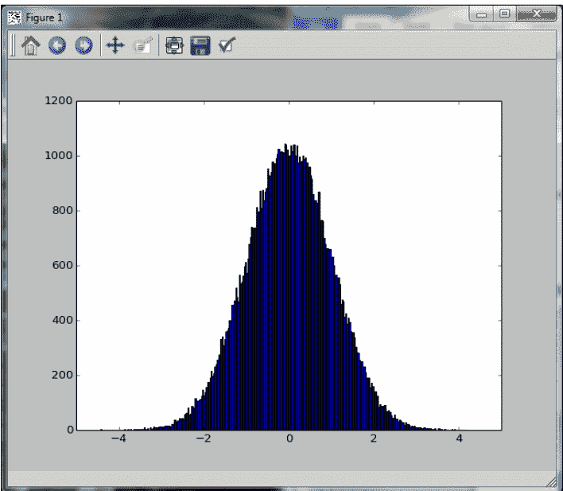
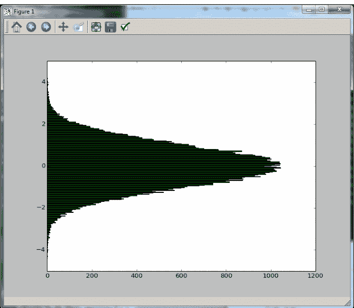

## 使用 rpy2.robjects

rpy2 可以作为标准模块导入，并从 IPython 的命令行中使用。有多种使用方式，开发者也可以基于 rpy2.interface 构建自己的使用方式。rpy2.robjects 模块是进行常规开发时的一种常用选择。

### 基础知识

导入 rpy2.robjects 模块时，会加载一个单例对象 r。这是 R 进程的入口点。下面是一个示例：

```python
In [5]: import rpy2.robjects as robjects

In [6]: robjects.r
Out[6]: <rpy2.robjects.R at 0x2ad3d0960a90>
```

R 会话中的元素可以作为 robjects.r 对象的属性访问：

```python
In [7]: robjects.r.mtcars
Out[7]:
<DataFrame - Python:0x2ad3d0dfd6c8 / R:0x262cef0>
[Float..., Float..., Float..., ..., Float..., Float..., Float...]
  mpg: <class 'rpy2.robjects.vectors.FloatVector'>
    <FloatVector - Python:0x2ad3d0dfdb08 / R:0x2daf890>
[21.000000, 21.000000, 22.800000, ..., 19.700000, 15.000000, 21.400000]
  cyl: <class 'rpy2.robjects.vectors.FloatVector'>
    <FloatVector - Python:0x2ad3d0e03488 / R:0x345abaa0>
[6.000000, 6.000000, 4.000000, ..., 6.000000, 8.000000, 4.000000]
  disp: <class 'rpy2.robjects.vectors.FloatVector'>
    <FloatVector - Python:0x2ad3d0e03988 / R:0x33ed340>
[160.000000, 160.000000, 108.000000, ..., 145.000000, 301.000000, 121.000000]
  ...
  mpg: <class 'rpy2.robjects.vectors.FloatVector'>
    <FloatVector - Python:0x2ad3d0e03fc8 / R:0x38dfd40>
[1.000000, 1.000000, 1.000000, ..., 1.000000, 1.000000, 1.000000]
  cyl: <class 'rpy2.robjects.vectors.FloatVector'>
    <FloatVector - Python:0x2ad3d0e06508 / R:0x2847ca0>

[4.000000, 4.000000, 4.000000, ..., 5.000000, 5.000000, 4.000000]

disp: <class 'rpy2.robjects.vectors.FloatVector'>

<FloatVector - Python:0x2ad3d30e06a08 / R:0x3bc0b60>

[4.000000, 4.000000, 1.000000, ..., 6.000000, 8.000000, 2.000000]
```

在大多数情况下，使用 Rmagic 可以完成的操作，都可以通过 robjects.r 完成：

```python
In [18]: %R

   ....: letters
   ....:

[1] "a" "b" "c" "d" "e" "f" "g" "h" "i" "j" "k" "l" "m" "n" "o" "p" "q"
[1] "r" "s"
[20] "t" "u" "v" "w" "x" "y" "z"
```

```python
In [19]: robjects.r.letters

Out[19]:

<StrVector - Python:0x2ad3d8887f48 / R:0x4735690>
['a', 'b', 'c', ..., 'x', 'y', 'z']
```

不过，两者并不完全对应。下面尝试访问 mtcars 数据框中的 wt 列时，就可以说明这一点：

```python
In [8]: robjects.r.mtcars$mpg
   File "<ipython-input-8-d46a62a01451>", line 1
     robjects.r.mtcars$mpg
                      ^
SyntaxError: invalid syntax
```

此时需要使用数值索引：

```python
In [17]: robjects.r.mtcars[5]

Out[17]:

<FloatVector - Python:0x2ad3d887efc8 / R:0x31b0650>
[2.620000, 2.875000, 2.320000, ..., 2.770000, 3.570000, 2.780000]
```

我们求出特征值和特征向量：

```python
In [13]: %octave mat = [1 2 3; 4 5 6; 7 8 9]; [vect, vals] = eig(mat)

vect =

   -0.231971  -0.785830   0.408248
   -0.525322  -0.086751  -0.816497
   -0.818673   0.612328   0.408248

vals =

Diagonal Matrix

    1.6117e+01             0             0
             0   -1.1168e+00             0
             0             0   -1.3037e-15
```

## 容易混淆的问题

请注意，这里的语法和语义可能比较棘手。Octave 语言中 `eig` 函数的定义规定了以下行为：

-   `lambda = eig(A)` 返回 A 的特征值，并将其存储在向量 lambda 中。
-   `[V, lambda] = eig(A)` 还会在 V 中返回特征向量，但此时 lambda 是一个矩阵，其对角线包含特征值。以下关系成立（存在舍入误差）：`A = V*lambda*inv(V)`。

`[a, b]` 表示法和多个返回值无法无缝转换到 IPython 中。

因此，下面的代码在一定程度上能够按预期工作（人们自然也会认为 x 应该是一个包含两个元素的向量）：

```python
In [14]: x = %octave mat = [1 2 3; 4 5 6; 7 8 9]; eig(mat)

ans =

    1.6117e+01
   -1.1168e+00
   -1.3037e-15

In [15]: x
```

## “一带一路”倡议下中国中小企业国际电子商务平台可行性研究

**冯宇**  
北京交通大学经济管理学院，中国北京  
电子邮箱：fengyu@bjtu.edu.cn

*本文分析了“一带一路”倡议下中国中小企业开展国际电子商务的可行性和战略路径。在分析当前形势与现存问题的基础上，本文提出了合作型电子商务平台框架，并探讨了成功的关键因素。*

**关键词：**“一带一路”倡议；中小企业；国际电子商务；可行性研究；合作型平台

### 1. 引言

随着“一带一路”倡议的持续推进，中国中小企业正面临拓展国际市场的新机遇。然而，由于资源有限且缺乏经验，这些企业在跨境电子商务领域往往会遇到困难。本研究旨在探讨建立一个符合中国中小企业需求的国际电子商务平台的可行性。

作为一种新兴商业模式，国际电子商务可以帮助中小企业克服地理障碍、降低交易成本并改善市场准入。“一带一路”沿线国家的发展为此类平台提供了有利的政策环境和市场需求。

### 2. 文献综述

现有研究已经广泛考察了中小企业对电子商务的采用、“一带一路”倡议对贸易的影响，以及跨境平台的设计。然而，很少有研究关注这两个主题的结合。本文通过同时研究宏观层面的政策支持和微观层面的企业需求，填补了这一空白。

- 宏观层面：政策协调、基础设施互联互通、贸易便利化
- 微观层面：中小企业能力、技术采用、物流整合
- 平台层面：商业模式、服务生态系统、风险管理

### 3. 可行性分析

本节从政策、市场、技术和资本等角度评估拟议平台的可行性。结果表明，尽管存在挑战，但在“一带一路”背景下，建立国际电子商务平台的整体环境是有利的。

```text
retval = quad("myFunc", 0, pi)
disp("hello")
endfunction

function y = myFunc(x)
    y = sin(x) * sqrt(abs(cos(x)))
endfunction
```

我们可以使用以下 IPython 命令来运行它：

```python
In [1]: from oct2py import octave

In [2]: octave.addpath("/nfs/02/wit0096/Packt/chap06/")

In [3]: octave.myIntegrate( )
Out[3]: 1.3333333333333326
```

这样就可以轻松地对复杂函数进行积分。

## Hy

有时，只有函数式编程语言才能满足需求。在机器学习和人工智能领域尤其如此，因为 Lisp 和 Scheme 在这些领域拥有悠久的传统。Hy 是 Lisp 的一种方言，可以将表达式转换为 Python 的抽象语法树格式。

抽象语法树是对程序结构的高级表示，与源代码无关。Python 解析器会将所有 Python 程序转换为抽象语法树，之后解释器会在生成可执行字节码的过程中，对这棵树执行进一步操作。由于 Hy 前端接受 Hy 代码作为输入，并输出与 Python 解释器兼容的抽象语法树，因此 Hy 代码会与 Python 代码在同一个解释器中运行。

从实际应用角度看，Hy 程序可以调用任意 Python 库，而 Python 代码也可以调用 Hy 代码。

它以 MIT（Expat）许可证发布，主页地址为 `http://docs.hylang.org/en/latest/`。

> “Hy 是一种嵌入 Python 的出色 Lisp 方言。
>
> 由于 Hy 会将其 Lisp 代码转换为 Python 抽象语法树，因此你可以用 Lisp 的形式，随时使用 Python 的整个精彩世界！”


关于 Hy 的括号，奇怪之处在于它们位于函数名之前、参数之后，而不是位于函数名之后并包围参数。这是 Lisp 及其所有方言的标准语法。这种形式创建的语法单元称为*表达式*，每个表达式都具有相同的形式：

```
(<function> <arguments>)
```

在 Hy 中，一切都是表达式，所以会有大量括号。起初可能看起来不太习惯，但这种简洁的语法使表达式求值变得简单：
- 将函数应用于参数，返回表达式的值
- 永远只存在一个函数

## 算术运算的位置不同寻常

将 1 和 1 相加的代码如下：

```
(+ 1 1)
```

这遵循标准表达式语义：先是函数，后是参数（在这里是先运算符，后操作数）。人们使用中缀表示法并不是 Hy 的错——一致性是编程语言的一种美德。这种表示法的一个附带好处是算术运算符可以接受任意数量的操作数：

```
(* 1 2 3 4)
```

这将返回 24。

但是，这不应与栈算术的前缀版本混淆。表达式：

```
(* + + 1 2 3 4)
```

是一个语法错误。它违反前面列表中的第二条规则，因为在一对括号内包含了多个函数。

## 函数组合无处不在

可以用括号修复前面的示例：

```
(* (+ (+ 1 2) 3) 4)
```

```
if curr % 2 == 1:
    curr = 3 * curr + 1
else:
    curr = curr/2
    return tmp
....:
```

```
In [21]: %hylang (f 35)
Out[21]: 13
```

Python 的内置函数和库也是如此：

```
In [28]: %hylang
....: (setv f (open "hy1.hy"))
....: (print (.read f))
....:
```

这将打印该文件的内容：

```
%hylang
(import math)
(defn safe-sqrt [x]
  (if (< x 0)
    (math.sqrt (- 0 x))
    (math.sqrt x)
  )
)
```

Hy 与 Python 的互操作方式多到无法在此一一列举，包括列表推导式、对象和异常。可以说，如果你已经熟悉 Python，并且有兴趣扩展到函数式语言，Hy 是一个不错的选择。

## Matplotlib

Matplotlib 是一个基于 Python 的 2D 绘图库。它与 Python 配合良好，与 IPython 配合更佳。它包含 `pyplot` 模块，提供类似 MATLAB 的功能。Matplotlib 的功能既可以通过编程方式访问，也可以在 IPython 命令行中以交互方式访问。为了便于说明，本节中的示例将在命令行中运行。

## 启动 matplotlib

Matplotlib 应该随大多数主流 IPython 发行版一同安装。如果你的发行版未包含它，标准的包安装过程（例如 `pip install` 或 `sudo apt-get`）应该就足够了。

有两种启动 matplotlib 的方式：`matplotlib-only` 或 `pylab`。

区别在于，使用 `matplotlib-only` 模式会激活 `matplotlib` 的交互支持，但不会向命名空间导入任何内容。`pylab` 模式会执行更多导入并更改命名空间。

安装后，可以通过命令行或使用 `%matplotlib` 魔法命令启动 `matplotlib-only` 模式，如下所示：

```
(Ipython) -bash-4.1$ ipython --matplotlib
Python 3.4.3 |Anaconda 2.0.1 (64-bit) | (default, Oct 19 2015, 21:52:17)
Type "copyright", "credits" or "license" for more information.

IPython 4.0.1 -- An enhanced Interactive Python.
?          -> Introduction and overview of IPython's features.
%quickref  -> Quick reference.
help       -> Python's own help system.
object?    -> Details about 'object', use 'object??' for extra details.
Using matplotlib backend: Qt4Agg

In [1]:
```

## 初始图形

与其他新模块一样，值得检查一切是否正常。在 IPython 命令行中，输入以下命令：

```
In [2]: x = randn(90000)
```

```
In [3]: hist(x, 300)
Out[3]:
```

此时，我的命令行打印了两类内容：
- 两个数组和一个列表（`hist` 调用的返回值）
- 一个堆栈跟踪（当我删除位于 ~/.cache/matplotlib/fontList*.cache 的 matplotlib 字体缓存后，它就消失了）

更重要的是，它生成了以下图形：



作为第一个 matplotlib 示例，这段代码值得进一步说明：
- **第 1 行：** `numpy.random.randn` 函数创建一个包含 90,000 个浮点数的一维数组；它们遵循均值为 0、方差为 1 的正态分布。
- **第 2 行：** `hist` 函数接受一个数组作为参数，计算并绘制该数组的直方图。它接受许多可选参数；在本例中，我们提供了要使用的箱数。

## 修改图形

让第一个图形运行起来很容易，但它还可以改进。改变事物的第一种方法是更改/添加构造函数的参数。例如，假设我们执行以下命令：

```
In [11]: hist(x, 300, orientation="horizontal", color="green")
```

结果如下：



matplotlib2.gif

```
Out[49]: <matplotlib.text.Text at 0x2b15e5bdc7f0>
```

```
In [53]: ion
Out[53]: <function matplotlib.pyplot.ion>
```

```
In [54]: plot()
Out[54]: []
```

这将导致对图表的更改被延迟到调用 plot( ) 时，届时它们会同时发生。

## Bokeh

Bokeh 是一个 Python 交互式可视化库，面向现代 Web 浏览器进行呈现。其目标是提供以 D3.js 风格优雅、简洁地构建新颖图形，并将这一能力扩展到对超大规模或流式数据集的高性能交互。Bokeh 可以帮助任何希望快速轻松创建交互式绘图、仪表盘和数据应用程序的人。

就我们的目的而言，Bokeh 可用于生成将在 Web 浏览器中查看的图形。虽然以这种方式使用时，它不支持像 Matplotlib 那样的命令行交互性，但生成持久图像并易于远程查看的能力对于报告等目的非常重要。此外，Bokeh 使用 HTML、JavaScript 和 CSS 生成网页的能力意味着图形本身可以像这些工具所能实现的那样具有交互性。

使用 Bokeh 服务器时支持命令行驱动的交互式方法，但这超出了当前章节的范围。

## 启动 Bokeh

可以使用 pip 将 Bokeh 作为标准 IPython 模块安装：

```
pip install bokeh
```

安装后，可以通过标准 import 语句访问 bokeh 库：

```
In [1]: import bokeh
```

Bokeh 目前处于持续变化中。这些示例中使用的版本不包含 %bokeh 或 %%bokeh 魔法命令，尽管以后可能会有。

## 交互式绘图

Bokeh 的一个重要特性是允许用户与完成的绘图进行交互。这通过两种方式实现：
- Bokeh 内置功能
- 与浏览器中的 JavaScript 交互的能力

我们的示例将涉及第一种选项。

## 一个交互式绘图示例

以下代码并排显示两个图形，并允许用户在一个图形中选择一组点，查看相应点在另一个图形中的位置。该代码引入了一些新概念，下面将进行讨论：

```
In [2]: import numpy as np
```

```
In [3]: import bokeh.plotting as bp
```

```
In [4]: import bokeh.models as bm
```

```
In [5]: bp.output_file("bokeh4.html")
```

```
In [6]: x = np.linspace(-2 * np.pi, 2 * np.pi, 100)
```

```
In [7]: y0 = np.cos(x)
```

```
In [8]: y1 = np.sin(x)
```

```
In [9]: mySource = bm.ColumnDataSource(data=dict(x=x, y0=y0, y1=y1))
```

```
In [10]: myTools = "box_select,lasso_select,help"
```

```
In [11]: left = bp.figure(tools=myTools, width=300, height=300,
title="Left")
```


关于 ggplot2 的更多信息，请参见项目主页 http://ggplot2.org/ 和文档 http://docs.ggplot2.org/current/index.html。

## 安装 ggplot2 和 pandas

ggplot2 是一个可选的 R 包。你的 R 安装中可能已经包含了它。如果没有，可以在 IPython 中使用 R magic 轻松安装：

```
In [12]: %%R
    ...: install.packages("ggplot2")
```

pandas 是用于 Python 的数据分析库。它包含许多有用的工具，包括非常有用的 DataFrame 类。它随 Anaconda 发行版一起安装，也可以使用 pip 安装：

```
pip install pandas
```

## 使用 DataFrame

DataFrame 很方便，因为它们是 R 数据框在 Python 中的对应物。R 到处都使用数据框。下面是一个简单的例子：

```
In [10]: %%R
    ....: x=c(1, 2, 3, 4)
    ....: y=c(2, 3, 5, 7)
    ....: df = data.frame(x, y)
```

```
In [11]: %%R
    ....: head(df)
    ....:
      x y
1 1 2
2 2 3
3 3 5
4 4 7
```

注意，即使在多次调用 `%%R` 之间，df 也保持其值。内置的 mtcars 数据是 R 中的一个数据框。

|    | mpg | cyl | disp | hp | drat | wt | qsec | vs | am | gear | carb | kpg |
|---|---|---|---|---|---|---|---|---|---|---|---|---|
| Mazda RX4 | 21.0 | 6 | 160 | 110 | 3.90 | 2.620 | 16.46 | 0 | 1 | 4 | 4 | 33.79622 |
| Mazda RX4 Wag | 21.0 | 6 | 160 | 110 | 3.90 | 2.875 | 17.02 | 0 | 1 | 4 | 4 | 33.79622 |
| Datsun 710 | 22.8 | 4 | 108 | 93 | 3.85 | 2.320 | 18.61 | 1 | 1 | 4 | 1 | 36.69304 |
| Hornet 4 Drive | 21.4 | 6 | 258 | 110 | 3.08 | 3.215 | 19.44 | 1 | 0 | 3 | 1 | 34.43996 |
| Hornet Sportabout | 18.7 | 8 | 360 | 175 | 3.15 | 3.440 | 17.02 | 0 | 0 | 3 | 2 | 30.09473 |
| Valiant | 18.1 | 6 | 225 | 105 | 2.76 | 3.460 | 20.22 | 1 | 0 | 3 | 1 | 29.12913 |

## 初始图形

现在我们准备尝试使用 ggplot2 绘制第一个图形。

首先我们来看代码。由于这是使用 ggplot2 的第一个图形，后面会描述重要的代码行：

```
In [1]: %load_ext rpy2.ipython

In [2]: from rpy2.robjects import pandas2ri

In [3]: pandas2ri.activate()

In [4]: from rpy2.robjects import r

In [5]: import pandas

In [6]: from rpy2.robjects.lib import ggplot2

In [7]: df_cars = pandas2ri.ri2py(r['mtcars'])

In [8]: wt = df_cars['wt']

In [9]: mpg = df_cars['mpg']

In [10]: type(mpg)
Out[10]: pandas.core.series.Series

In [11]: df_wtVsMpg = pandas.DataFrame()

In [12]: df_wtVsMpg['wt'] = wt

In [13]: df_wtVsMpg['mpg'] = mpg

In [14]: p = ggplot2.ggplot(df_wtVsMpg)

In [15]: type(p)
Out[15]: rpy2.robjects.lib.ggplot2.GGPlot

In [16]: p.plot()
```

code6.py

- **第 2-3 行：** 这些行导入并激活了在 IPython/R 之间传输数据的新方法。这是自 v0.16.0 以来推荐的方法，此时 `pandas.rpy` 接口已被弃用，并标记为在未来的某个版本中移除。
- **第 7 行：** 这一行实际上将 R 的 `mtcars` 数据框导入为 pandas DataFrame。
- **第 8-10 行：** 这些行展示了 DataFrame 可以像 Python 字典一样被访问，以及结果类型。
- **第 11-13 行：** 这里，我们从空的 DataFrame 开始，并动态添加列。

即使 display 确实返回了一个值，情况也好不了多少。首先，不清楚它能返回什么有意义的值。也许返回 true 表示“成功”，返回 false 表示“失败”？至少可以测试那个值。然而，这并不能解决根本问题——也许 display 返回了 true，但字符实际上并没有被显示。

从这段简短离题话中得到的启示是，当被测代码的编写方式使得编写有意义的测试更容易时，测试的效果更好。这样做的技巧可以写满一整本书（也确实如此）。幸运的是，科学和工程代码重视数学建模，往往自然地分解为可测试的函数。
