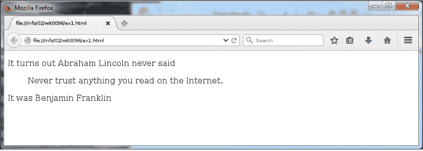
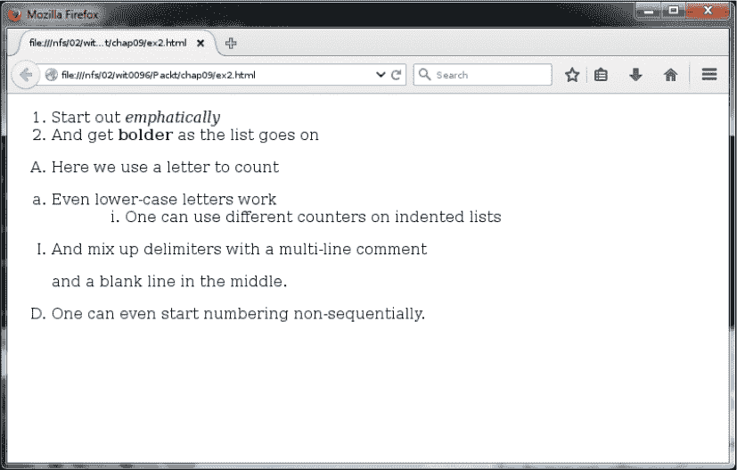
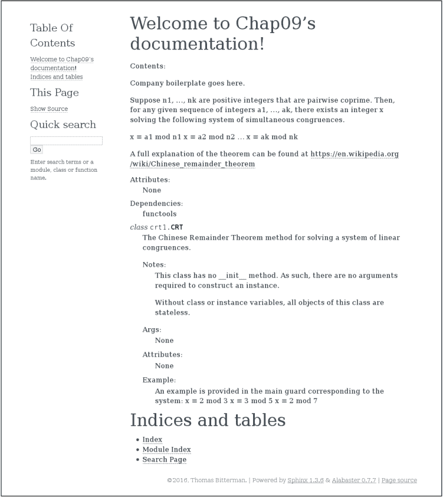
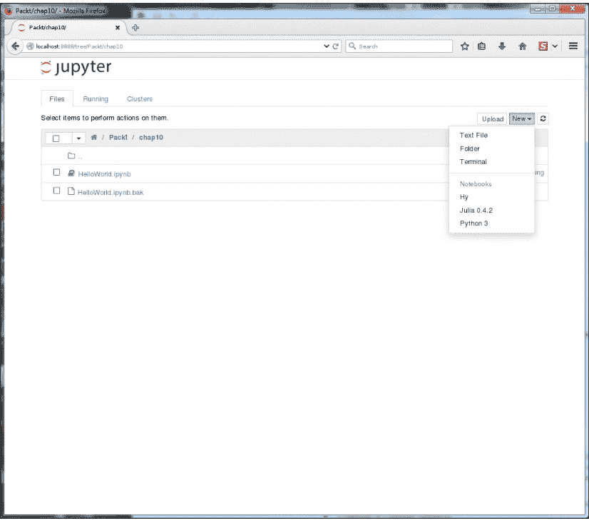
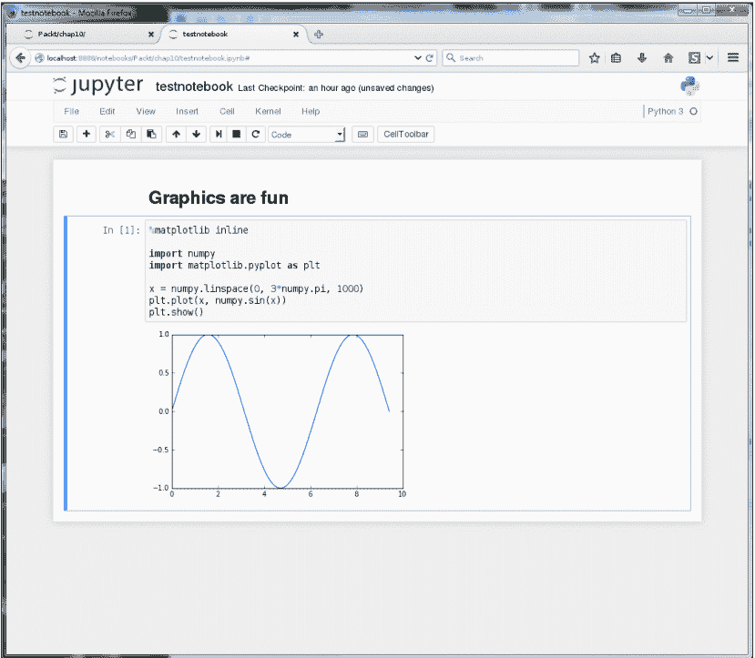
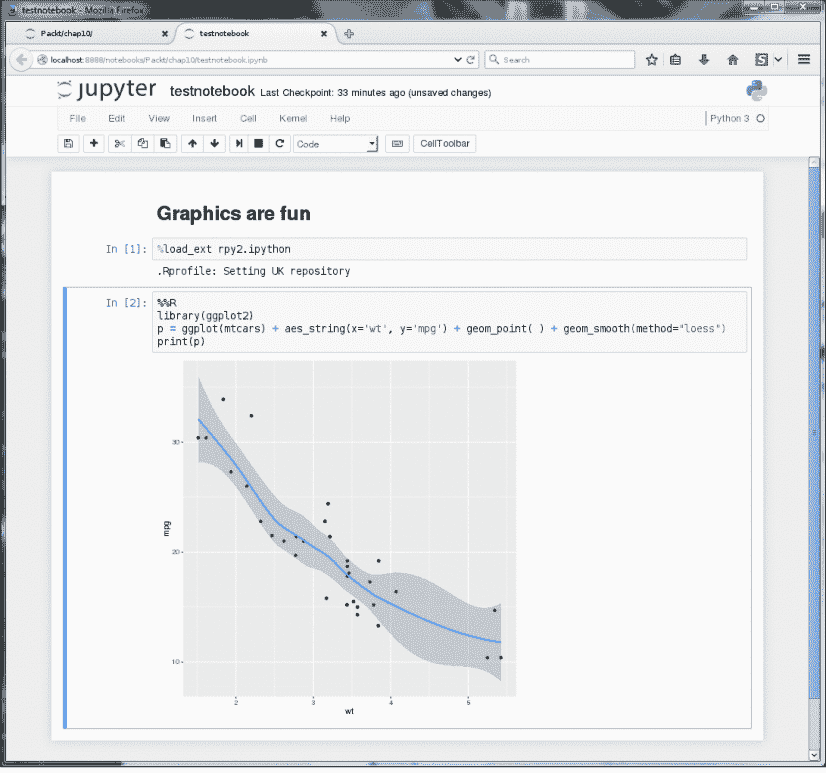

## 文档

本章将涵盖以下主题：

- 内联注释
- 文档字符串
- reStructuredText
- Docutils
- Sphinx

### 内联注释

我们将使用“内联注释”一词来指代所有面向维护编码人员、且除阅读源代码的人之外任何人都看不到的注释。

内联注释以 `#` 符号开头，一直延续到行尾。它们不能出现在字符串字面量中。内联注释中的任何字符都不会被解释。

Python 不支持块注释。关于三重双引号（`"""`）可用于注释掉多行的说法并不可信。虽然这通常也能奏效，但实际发生的是 Python 将所包含的行视为一个多行字符串。作为一个字符串，其中的行不会被解释，而是创建了一个字符串字面量。由于这个新字面量未赋值给任何变量，它会被立即回收。

除了这种奇怪的行为之外，三重双引号还用于文档字符串。将两者混用可能会造成混淆，而这正是我们首先要避免的。

#### 使用内联注释

Python 风格的“官方”指南是 PEP 0008（见 `https://www.python.org/dev/peps/pep-0008/`）。在一定程度上，代码可以说成是自文档化的，本指南提供了一组关于风格一致性的标准建议，有助于推进这一目标。其中关于注释的部分尤其包含一些有用的建议：

- 注释应与代码保持一致。如果代码发生变化，请确保注释能够反映这些变化。
- 使用完整的句子进行注释。


- 块注释应与它们所适用的代码保持相同的缩进级别。每一行应以 # 符号和一个空格开头。
- 注释很少应与代码写在同一行。

## 函数注解

函数注解和类型提示可以被视为一种内联注释的类型。函数注解起源于 PEP 3107，该 PEP 提供了为 Python 函数添加任意元数据注解的语法。从定义（https://www.python.org/dev/peps/pep-3107/）中：

> "由于 Python 的 2.x 系列缺乏标注函数参数和返回值标准方式的手段，出现了各种工具和库来填补这一空白。(...) 本 PEP 旨在提供一种单一、标准的方式来指定此信息，减少到目前为止因机制和语法差异过大而造成的混乱。"

### 语法

函数注解适用于两类事物：参数和返回值。

### 参数

对于参数，注解由冒号表示，其方式类似于用等号标记默认值，如此示例所示：

```python
def foo(x: "int >= 0"):
```

注解和默认值都可以按顺序放置来同时指示，如下所示：

```python
def foo(x: "int >= 0" = 0):
```

非正式地，参数可以这样描述：

```text
identifier [: expression] [= expression]
```

这里，注解和默认值都是可选的。

### 返回值

函数返回值可以通过在参数列表后跟 -> 和一个表达式来注解。以下是示例：

```python
def foo(x: "int >= 0" = 0) -> "seemingly random integer":
    return 42
```

### 语法

类型提示使用相同的语法并适用于与函数注解相同的事物。主要扩展是它们允许注解为一个类。完整规则集很复杂，但以下提示应涵盖最常见的情况：

- 内置类
- 用户定义类
- `types` 模块中的类型
- 抽象基类
- 特殊构造，包括 `None`、`Any`、`Union`、`Tuple` 和 `Callable`

PEP 的很大一部分致力于特殊情况和复杂类型，包括泛型、协变和逆变、前向引用以及存根文件。

### 语义

与 PEP 3107 一样，类型提示没有关联的标准语义。其目标是提供第三方工具可以使用的标准。在类型提示具有语义的程度上，其语义是由使用它们的工具提供的，而不是由 Python 语言本身提供的。从定义中：

> "本 PEP 旨在提供类型注解的标准语法，使 Python 代码更容易进行静态分析和重构，可能的运行时类型检查，以及（也许在某些上下文中）利用类型信息进行代码生成。"

形成该标准的重要工具是 mypy（http://mypy-lang.org/）。mypy 的目的是为 Python 提供静态类型检查器。虽然在文档和调试中静态类型检查的优点可以争论，但拥有该选项是很好的。

## 文档字符串

Python 文档字符串是一个字符串字面量。它可以作为模块中的第一个语句出现，也可以作为函数、方法或类定义后的第一个语句出现。文档字符串成为该对象的 __doc__ 特殊属性。其目的是提供一种更自由的方式来记录程序的一部分。

### 示例

以下代码为一个简化的早期测试套件提供了文档字符串：

```python
"""
This is an abbreviated version of my random number generator test
suite.

It uses the pytest framework.  It does not do much in this form.
"""

import numpy as np
import scipy.stats
import random

class TestRandoms( ):
    """
    This is the main class.

    Normally it would hold all the tests, plus and setup and
    tearDown fixtures.
    """
    def test_builtin(self):
        """
        Test the built-in random number generator on 10000
        numbers.
        """
        num_tests = 10000
        vals = [0 for i in range(10)]
        for i in range(num_tests):
            tmp = random.randint(0, 9)
            vals[tmp] = vals[tmp] + 1

        chi2, p = scipy.stats.chisquare(self.vals)
        assert p > 0.05

def foo( ):
    """ I just needed a function outside of a class as an
example"""
    pass
```

code1.py

### 文档

文档字符串可以通过使用 Python 内置的 help 函数来访问。结果以标准帮助方式显示（即如同用 less 查看文本文件），如下所示：

```text
In [4]: import code1

In [5]: help(code1)
Help on module code1:

NAME
    code1 - This is an abbreviated version of my random number generator test suite.

DESCRIPTION
    It uses the pytest framework.  It does not do much in this form.

CLASSES
    builtins.object
        TestRandoms

    class TestRandoms(builtins.object)
    |   This is the main class.
    |
    |   Normally it would hold all the tests, plus and setup and teardown fixtures.
    |
    |   Methods defined here:
    |
    |   test_builtin(self)
    |       Test the built-in random number generator on 10000 numbers.
    |
    |   --------------------------------------------------------------------------
    |
    |   Data descriptors defined here:
    |
    |   __dict__
    |       dictionary for instance variables (if defined)
    |
    |   __weakref__
    |       list of weak references to the object (if defined)

FUNCTIONS
    foo()
        I just needed a function outside of a class as an example

FILE
    /nfs/02/wit0096/Packt/chap09/code1.py
```

可以通过命名它们来访问各个部分的文档字符串。

这里，我们访问类的 `help`：

```text
In [6]: help(code1.TestRandoms)
Help on class TestRandoms in module code1:

class TestRandoms(builtins.object)
 |  This is the main class.
 |
 |  Normally it would hold all the tests, plus and setup and teardown
    fixtures.
 |
 |  Methods defined here:
 |
 |  test_builtin(self)
 |      Test the built-in random number generator on 10000 numbers.
 |
 |  ----------------------------------------------------------------------
 |  Data descriptors defined here:
 |
 |  __dict__
 |      dictionary for instance variables (if defined)
 |
 |  __weakref__
 |      list of weak references to the object (if defined)
```

```python
self.assertEqual(f(i), ans[i])
```

```python
def foo():
    """
    An independent function.

    I needed another function to illustrate the docstring for a
    function that was not a member of a class.
    """
    pass
```

code2.py

它产生以下（简略）输出：

```text
In [10]: import code2

In [11]: help(code2)

Help on module code2:

NAME
    code2 - This is my hailstone unit test suite.

DESCRIPTION
    It uses the unittest framework.  Admittedly, it does not do much.

CLASSES
    unittest.case.TestCase(builtins.object)
        TestHailStones

        class TestHailStones(unittest.case.TestCase)
        |   The main class for testing the hailstone sequence generator.
        |
        |   Method resolution order:
        |       TestHailStones
        |       unittest.case.TestCase
        |       builtins.object

addTypeEqualityFunc(self, typeobj, function)

Add a type specific assertEqual style function to compare a type.

This method is for use by TestCase subclasses that need to register
their own type equality functions to provide nicer error messages.

Args:
    typeobj: The data type to call this function on when both values
        are of the same type in assertEqual().
    function: The callable taking two arguments and an optional
        msg= argument that raises self.failureException with a
        useful error message when the two arguments are not equal.

assertAlmostEqual(self, first, second, places=None, msg=None, delta=None)
```

注意 `unittest.TestCase` 类的文档无需额外努力即可包含在内。

### 推荐元素

PEP 0257 记录了与文档字符串相关的约定。从标准（https://www.python.org/dev/peps/pep-0257/）中：

> "本 PEP 的目标是标准化文档字符串的高级结构：它们应包含什么内容，以及如何表述（而不涉及文档字符串内的任何标记语法）。PEP 包含约定，而非法律或语法。"

虽然开发者没有必须遵循这些指南的要求，但第三方工具（如 Docutils 和 Sphinx）可能依赖它们从文档字符串中提取特性。


与任何允许存在不同形式的标准一样，有若干团体提倡不同的版本：

- Google 在 https://google.github.io/styleguide/pyguide.html#Comments 中给出了其 Python 风格指南的意见
- numpy 在 https://github.com/numpy/numpy/blob/master/doc/HOWTO_DOCUMENT.rst.txt#docstring-standard 提出了自己的建议
- Epydoc 则倾向于在 http://epydoc.sourceforge.net/manual-docstring.html 使用文档字符串

最终，你的团队应选择一种既适合自己、也适合其用于生成文档的工具（或多种工具）的多行文档字符串语法。

## 语义

多行文档字符串应提供足够的信息，使感兴趣的人能够使用它所记录的对象。仅仅描述其名称和用途是不够的。潜在用户应通过阅读文档字符串了解以下内容：

- API
- 输入
- 功能
- 输出（或各项输出）
- 错误条件
- 与系统其他部分的关系
- 示例用法

## API

这对于类和模块很重要。模块的文档字符串应描述该模块导出的所有类、异常和函数。类的文档字符串应描述其公共接口和实例变量。描述应该简短（一行就足够了）——更详细的内容将由各个部分的文档字符串提供。

## 输入

这些对于脚本（命令行参数和选项）和函数（参数）尤其重要。用户应能够指定完整、有效的输入，这意味着需要描述：

- 输入的名称
- 它们的类型
- 它们的取值范围
- 可选与必需

## 功能

这些对于脚本和函数很重要。用户无需被过多告知用于实现结果的机制，就能理解输入与输出之间的关系。这意味着要用通俗易懂的语言描述函数的功能。如果函数实现了某个简单的数学表达式，这里是包含它的好地方。这可能是注释中最难写的一部分。

## 输出

这些对于脚本和函数很重要。应列出输出的数量和类型。任何副作用也应加以描述。

## 错误条件

应列出可能导致错误的各种条件。错误分为两类：静默错误和显式错误。

显式错误是指导致抛出异常或设置错误码的错误。所有抛出的异常都应记录在文档中。任何用于指示错误的变量或数据结构（例如 `errno`）也应记录在文档中。

静默错误是指代码看似正常运行，但实际上产生了无效结果的情况。例如，许多数值算法只对一部分本来合法的输入产生有意义的结果。

无论哪种情况，都应向用户提供足够的信息，以便：

- 避免错误条件（在可能的情况下）
- 检测错误条件（无论是通过捕获异常还是检查错误码）
- 从错误中恢复（例如，重试，或使用替代方法）

## 与系统其他部分的关系

这主要对类、模块和公共接口很重要。面向对象的系统由大量相互交互的部分组成。其中一些部分位于系统内部，一些位于外部。文档字符串应描述当前部分与其他部分的关系。

## 文档

一种重要的关系是依赖关系。一个部分可以在逻辑上（通过继承或组合）、功能上（例如，通过被导入），或时间上（也许，一个部分执行另一个部分正常运作所需的设置）依赖于另一个部分。所有依赖关系都应记录在文档中。

另一种重要关系是作为同一模式的一部分。设计模式正变得越来越重要，并决定了各种机制的存在。如果某个类是某个模式实现的一部分，这一点应记录在文档中。

## 示例用法

尽管英文描述很有用，但几个示例仍然无可替代。在某些操作系统中，唯一有用的文档就是示例形式的。

## 示例

我们将从 Rosetta Code 中选取一个例子，即中国剩余定理的 Python 实现（http://rosettacode.org/wiki/Chinese_remainder_theorem#Python）。我们的实现将做两处修改。第一，它将使用一个类，而不是展示的函数，以便能够演示完整的注释约定。第二，它将从 Python 2.7 升级到 Python 3：

```
'''Company boilerplate goes here.
```

假设 n1, ..., nk 是两两互质的正整数。那么，对于任意给定的整数序列 a1, ..., ak，存在一个整数 x 满足下面的同余方程组。

```
x ≡ a1 mod n1

x ≡ a2 mod n2

…

x ≡ ak mod nk
```

该定理的完整解释可在 https://en.wikipedia.org/wiki/Chinese_remainder_theorem 查看。

- **属性：**
  
  - 无

**依赖项：**

```
functools

"""

import functools

class CRT:
    """The Chinese Remainder Theorem method for solving a system of linear congruences.

    This class has no __init__ method. As such, there are no arguments required to construct an instance. Without class or instance variables, all objects of this class are stateless.

    Args:
        None

    Attributes:
        None

    Example:
        An example is provided in the main guard corresponding to the system:
            x ≡ 2 mod 3
            x ≡ 3 mod 5
            x ≡ 2 mod 7
    """

    def chinese_remainder(self, n, a):
        """Use the existence construction form of the CRT to compute the solution.

        First, calculate the product of all the modulos (b1, n2, ..., nk) as prod
        For each i, calculate prod/n_i as p
        Sum up each ai * the multiplicative inverse of ni mod p

        Args:
            n: a list of modulos (n1, n2, ..., nk)
```

```
a: a list of congruences (a1, a2, ..., ak)

Returns:
    The smallest integer solution to the system of congruence equations defined
    by a and n.

Error conditions:
    When len(n) == len(a), a solution always exists.
    When len(a) > len(n), any additional a's are ignored.
    When len(n) > len(a), behavior is deterministic but erroneous.
    """
    sum = 0
    prod = functools.reduce(lambda a, b: a*b, n)

    for n_i, a_i in zip(n, a):
        p = prod / n_i
        sum += a_i * self.__mul_inv(p, n_i) * p
    return int(sum % prod)

def __mul_inv(self, a, b):
    """Calculate the multiplicative inverse of b mod a."""
    b0 = b
    x0, x1 = 0, 1
    if b == 1:
        return 1
    while a > 1:
        q = a / b
        a, b = b, a%b
        x0, x1 = x1 - q * x0, x0
    if x1 < 0:
        x1 += b0
    return x1

if __name__ == '__main__':
    n = [3, 5, 7]
```

```
a = [2, 3, 2]
crt = CRT()
print(crt.chinese_remainder(n, a))
```

结果如下：

```
In [22]: help(CRT)
```

```
Help on class CRT in module __main__:

class CRT(builtins.object)
 |  The Chinese Remainder Theorem method for solving a system of linear congruences.
 |
 |  Notes:
 |      This class has no __init__ method. As such, there are no arguments required
 |      to construct an instance.
 |
 |      Without class or instance variables, all objects of this class are stateless.
 |
 |  Args:
 |      None
 |
 |  Attributes:
 |      None
 |
 |  Example:
 |      An example is provided in the main guard corresponding to the system:
 |          x = 2 mod 3
 |          x = 3 mod 5
 |          x = 2 mod 7
 |
 |  Methods defined here:
```

| chinese_remainder(self, n, a)
|     使用 CRT 的存在性构造形式来计算解。
|     首先，将所有模数（n1, n2, ..., nk）的乘积计算为 prod
|     对于每个 i，将 prod/n_i 计算为 p
|     将每个 ai 与 ni 对 p 的乘法逆元相乘后求和
|     参数：
|         n: 模数列表（n1, n2, ..., nk）
|         a: 同余式列表（a1, a2, ..., ak）
|     返回：
|         由 a 和 n 所定义的同余方程组的最小整数解。
|     错误条件：
|         当 len(n) == len(a) 时，解总是存在。
|         当 len(a) > len(n) 时，多余的 a 会被忽略。
|         当 len(n) > len(a) 时，行为是确定的，但结果是错误的。
|     ---------------------------------------------------------------
| 在此定义的数据描述符：
| __dict__
|     实例变量的字典（如果已定义）
| __weakref__
|     对象弱引用的列表（如果已定义）

请注意，私有方法 __mul_inv 的文档字符串并未包含在内。


## reStructuredText

关于前面的示例，可以说很多（尤其是注释行比代码还多），但很难说最终效果在美学上是令人愉悦的。特别是与使用 Javadoc 的程序输出相比，这份文档看起来相当朴素。为了弥补这一缺陷，人们决定需要一种更精细的规范和生成文档的方式。

### 历史与目标

Zope 的 Jim Fulton 发明了 StructuredText 作为一种简单的标记语言。它与 WikiWikiWebMarkup 类似，但更简单。规范和实现方面的问题促使 David Goodger 创建了一个修订版本，称为 reStructuredText。他为该语言设定的目标如下：

- 可读
- 不突兀
- 无歧义
- 不令人意外
- 直观
- 简单
- 可伸缩
- 强大
- 语言中立
- 可扩展
- 输出格式中立

这导致了 PEP 0287（https://www.python.org/dev/peps/pep-0287/）的发布。

### 用户

任何文档系统都有三类用户：开发人员、自动化文档生成软件和读者。它们各自有不同的需求和限制。

开发人员必须编写文档。作为一个群体，开发人员讨厌打字，更讨厌输入任何不是代码的内容。任何强迫他们编写大段注释的尝试都会导致标准失败。因此，如果文档可以从代码生成，就应该如此。任何额外的注释都应该易于使用标准键盘和最少量的额外标记来创建。

文档生成软件将开发人员编写的文本转换成供外部读者阅读的文档。这通常包括将开发人员使用的标记语言转换为更易读的格式。例如，开发人员编写的 Javadoc 可以自动转换为读者可以在浏览器中查看的 HTML。这种转换可以同时添加美观属性（例如颜色和格式）和功能属性（例如超链接）。重要的是，对于文档生成软件而言，开发人员使用的标记必须足够强大且结构化，以支持这种转换。

读者阅读这种转换的最终结果。读者可能是开发人员，也可能不是，但他们期望文档在结构上组织良好。文档应该易于阅读，并且应该易于找到所需内容。请注意，读者通常无法访问原始源，即使原始标记可用，他们也可能无法阅读。

开发人员和读者之间的这种划分存在一种重要的紧张关系。简而言之，读者希望获得尽可能多的文档，并且以结构化的形式呈现。开发人员则会尽可能少地编写文档，并尽可能少地使用结构。

### 解决方案

reStructuredText 采用的解决方案是使用一个两步过程：一种简单的标记语言，再加上强大的文档生成软件。标记语言是 reStructuredText，软件是 Docutils。基本过程很简单：

1. 开发人员使用 reStructuredText 约定以纯文本形式编写文档字符串。
2. 对生成的代码+注释文档应用 Docutils，以外部格式（例如 HTML 或 LaTeX）生成文档。
3. 读者在适当的查看器中阅读生成的文档。

稍后我们将介绍 Sphinx，这是一个建立在 reStructuredText 和 Docutils 之上并对其进行扩展的文档生成程序。

### 概述

reStructuredText 的基本语法是常规文本，并针对某些用法附带了特殊约定。这与 HTML 等语言形成对比，在 HTML 中，元数据通过尖括号与文本关联。例如，在 HTML 中，项目符号列表可能如下所示：

```html
<ul>
  <li>Python</li>
  <li>Java</li>
  <li>Ruby</li>
</ul>
```

而在 reStructuredText 中，它看起来如下：

- Python
- Java
- Ruby

一个重要的区别是，虽然 HTML（及其近亲，如 XML）允许嵌套标签，但 reStructuredText 不允许嵌套标记。虽然这通常不是问题，但偶尔也会遇到。

下面列出了一些更重要的用法。

#### 段落

段落是由一个或多个空行分隔的文本块。段落的左边缘应对齐。如果某个段落相对于其他段落缩进，则它被视为引用。

reStructuredText 如下所示：

> 事实证明，亚伯拉罕·林肯从未说过
>
> 永远不要相信你在互联网上读到的任何东西。
>
> 那是本杰明·富兰克林说的

这产生的 HTML 输出显示如下：



#### 文本样式

斜体文本应使用星号（*）括起来：

```
Use italics for *emphasis*.
```

粗体文本使用两个星号（**）：

```
Using a **goto** statement is a bold move in structured programming.
```

遗憾的是，没有简单的方法使文本同时变成斜体和粗体。

在大多数情况下，reStructuredText 很聪明，知道什么时候是标记，什么时候应该原样保留。例如，考虑这些字符串：

```
x = 5*6
x = 5*6*7
```

星号不会被解释为将 6 变为斜体。

用双反引号（``）包围文本会强制其成为等宽字面量——引号之间的所有特殊字符都保持原样，不被解释。否则会被解释为标记的单个字符可以使用反斜杠（\）进行转义。

#### 字面量块

如果需要将整个段落作为字面量块（即完全按原样，不解释段落中的标记字符或缩进），那么一个只包含两个冒号的段落表示后面的缩进或引用文本应按字面量处理。这在引用代码或解释标记约定时非常有用。

它产生的网页如下：



#### 项目符号列表

项目符号列表的工作方式与枚举列表类似，除了：

- 唯一允许的项目符号是 -、+ 和 *
- 没有分隔符

项目符号列表支持常见的缩进规则。

#### 定义列表

定义列表只是一系列术语-定义对。术语在第一行，定义在随后的缩进段落中。下面是一个示例：

```
do
    a deer, a female deer
re
    a drop of golden sun
mi
    a name i call myself
fa
```

它产生的网页如下：


#### 章节

上述标记对于大多数开发人员、大多数文档来说应该足够了。如果需要更深入的文档，reStructuredText 提供了使用章节标题将文档划分为章节的能力。这是通过创建一行完全由单个重复字符（下划线）组成的文本实现的。前一行成为章节标题（上划线）。下划线和上划线必须长度相同。所有使用相同下划线的章节处于同一级别。位于使用不同下划线的章节下方的任何章节都比该章节低一级。

下面是一个示例：

```
Chapter 1 Main Title
--------------------

Section 1.1 An Important Subject
```

## Docutils

Docutils 是一套工具，用于将包含 reStructuredText 的文本文件转换为其他格式，包括 HTML、XML 和 LaTeX。它旨在弥合用户想要阅读的内容（美观的格式）与程序员容易输入的内容（纯文本）之间的差距。Docutils 分为两大类：库（用于后台解析和操作）和前端工具（使用库生成特定输出格式）。

### 安装

可以使用 pip 安装 Docutils：

```
pip install docutils
```

这将安装许多脚本，包括重要的转换脚本。作者的安装中包括以下脚本：

- `rst2html.py`
- `rst2latex.py`
- `rst2man.py`
- `rst2odt_prepstyles.py`
- `rst2odt.py`
- `rst2pseudoxml.py`
- `rst2s5.py`
- `rst2xetex.py`
- `rst2xml.py`
- `rstpep2html.py`

### 用法

这些脚本可以在命令行中使用。它们从 `stdin` 读取输入，并将输出写到 `stdout`：

```
./rst2html.py <infile> > <outfile>
```


## 为源文件编写文档

遗憾的是，与 Javadoc 不同，Docutils 无法接受包含大量 Python 代码的 .py 文件，并自动从中提取文档字符串以生成文档。有一个名为 Epydoc 的工具可以做到这一点，但该项目自 2009 年以来一直处于不活跃状态。团队可以编写脚本来尝试仅提取文档字符串，但还有更好的解决方案。这将在下一节中概述。

## Sphinx

Sphinx 是一个文档生成工具。它最初用于生成 Python 文档，但目前已扩展到其他语言，尤其是 C/C++。它可以生成多种格式的输出，包括 HTML、LaTeX、ePub、man 页面和纯文本等。它接受 reStructuredText，并在 Docutils 套件的基础上构建，同时添加了一些标记。

## 安装与启动

可以使用 `pip` 安装 Sphinx：

```
pip install sphinx
```

安装完成后，会将多个脚本添加到路径中。我们要介绍的第一个脚本是 `sphinx-quickstart`。它会提示用户输入信息，然后创建源目录、配置文件和某些骨架文件：

```
bash-4.1$ sphinx-quickstart
Welcome to the Sphinx 1.3.6 quickstart utility.

Please enter values for the following settings (just press Enter to accept a default value, if one is given in brackets).

Enter the root path for documentation.
> Root path for the documentation [.] : docs

You have two options for placing the build directory for Sphinx output.
Either, you use a directory "_build" within the root path, or you separate
"source" and "build" directories within the root path.
```

## 文档

这将生成如下页面：



页面中缺少对 `chinese_remainder` 方法的文档，因此可以使用 automethod 指令将其添加到 `index.rst` 中：

```rst
.. toctree::
   :maxdepth: 2

.. automodule:: crt1
```

虽然这样很灵活，但可能繁琐且容易出错。一种解决方案是使用 `:members:` 属性，如下所示：

```
    .. toctree::
       :maxdepth: 2

    .. automodule:: crt1
       :members:
```

另一种方法是使用 `sphinx-apidoc` 工具。`sphinx-apidoc` 的作用是从源文件中提取文档字符串，并根据它们生成 `.rst` 文件。请参考以下示例：

```
bash-4.1$ sphinx-apidoc -o docs .
```

它会生成一组 `.rst` 文件：

```
Creating file docs/code1.rst.
Creating file docs/code2.rst.
Creating file docs/crt1.rst.
Creating file docs/hail1.rst.
Creating file docs/modules.rst.
```

这些文件本身没什么可看的，但它们可以输入到 Sphinx 或其他期望 reStructuredText 的文档工具中，以进行进一步处理。当使用本身无法提取文档字符串的工具时，这一点尤其方便。

## 总结

虽然内联注释和类型标注对于将在代码库上工作的开发人员很有用，但外部人员需要更全面的文档，并且需要一种比阅读源代码更具吸引力的格式（尤其是当他们无法访问源代码时）。对文档的需求必须与开发人员可以理解的、不愿花费大量时间和精力去编写代码以外任何东西的心理相平衡。

Python 的解决方案是采用轻量级标记语言 reStructuredText 和工具链（Docutils、Sphinx），将 reStructuredText 转换为外观更精美的格式（例如 HTML 或 LaTeX）。

第 3 章“迈入 IPython 进行并行计算”提供了一些细节，说明如何拆分内核和 REPL 协议，从而使并行架构得以出现。

本章将提供一些示例，展示 notebook 的强大功能，以及它与其他组件的关系。从 IPython notebook 到 Jupyter 项目的转变可能是最大的一次重组，被称为“大分裂”（The Big Split）。如需深入探讨“大分裂”的原因及其对各种包结构的影响，请参阅 https://blog.jupyter.org/2015/04/15/the-big-split/。

## 安装与启动

Jupyter 可以使用 pip 安装：

```
pip install jupyter
```

可以像这样启动：

```
(my_rpy2_zone)-bash-4.1$ ipython notebook
[I 10:38:27.193 NotebookApp] Serving notebooks from local directory: /nfs/02/wit0096
[I 10:38:27.193 NotebookApp] 0 active kernels
[I 10:38:27.193 NotebookApp] The Jupyter Notebook is running at: http://localhost:8888/
[I 10:38:27.193 NotebookApp] Use Control-C to stop this server and shut down all kernels (twice to skip confirmation).
/usr/bin/xdg-open: line 402: htmlview: command not found
console.error:
  [CustomizableUI]
  Custom widget with id loop-button does not return a valid node
console.error:
  [CustomizableUI]
  Custom widget with id loop-button does not return a valid node
1457711201438  addons.update-checker  WARN  Update manifest for {972ce4c6-7e08-4474-a285-3208198ce6fd} did not contain an updates property
```

注意，这会在 8888 端口启动一个 HTML 服务器（称为 Jupyter Notebook 应用）。它可能还会（取决于你的平台）启动指向 http://localhost:8888 的浏览器。如果没有，请手动启动浏览器并指向该地址。Jupyter 只能访问其启动目录（及其子目录）中的文件，因此请务必在其能够访问你的 notebook 文件的位置启动它。

## 创建 notebook

当然，没有人会用 JSON 编写 notebook——它只是用作持久化和交换的文本格式。可以使用仪表盘（Dashboard）创建 notebook。在界面的右上部分有一个下拉框，提供创建新 notebook 的选项：



## 使用 matplotlib

在 notebook 中使用 matplotlib 的关键是 `%matplotlib inline` 魔术命令。它应该是单元格中的第一行。例如：



第一个单元格（打印 **图形很有趣**）是 Markdown；第二个单元格创建了所示图表。

## 使用 R

使用 R 时，重要的是所有工作都应在 R 中完成（或者至少是实际显示图表的部分）。否则，图表将在单独的窗口中打开，而不是在 notebook 中。%%R 单元格魔术是完成这项工作的正确工具。特别是，应该打印图表，而不是使用 plot( ) 函数。例如：



IPython 不是这样的系统。2001 年，Fernando Perez 是科罗拉多大学博尔德分校的一名研究生。他不是计算机科学专业，而是一名需要编程并希望有更好工具的物理学研究生。作为一名物理学家，他对“更好”的想法与计算机科学家可能设想的不同。特别是，对早期 IPython 形成影响的是主要为数据分析和展示而设计的工具：Mathematica (http://www.wolfram.com/mathematica/) 和 Sage (http://www.sagemath.org/)。

Perez 曾表示，IPython“旨在成为一个高度可配置的工具，用于构建针对特定问题的交互式环境”，这为其历史和未来方向提供了一把钥匙。

最初的努力从两个方向入手。一方面，当时已经存在几个 Python 扩展——IPP（由 Janko Hauser 开发）和 LazyPython（由 Nathan Gray 开发）。另一方面，Perez 对自己应该实现什么有自己的想法。最终，IPython 诞生于 IPP、LazyPython 和 Perez 自己努力的代码合并。

此时开发速度放缓了。有人尝试过制作 notebook。也曾考虑过与 Sage 合并，但最终项目各自发展。2009 年，第一位全职开发者获得了资助。他的第一项任务是重构整个代码库，当时它仍然是 IPP、LazyPython 和 Perez 原始代码的大杂烩。虽然没有添加新功能，但在此后干净整洁的代码上，开发可以更容易地推进。

2010 年是重要的一年。第一个重大发展是转向基于 ZeroMQ 的架构。采用 ZeroMQ 带来了两项重要的架构进步：前端与解释器的分离，以及对并行性的支持。

分离前端和后端在多个方面意义重大。也许最重要的是，这意味着实现 notebook 变得更简单：Notebook 只是后端 Python 内核的另一个接口。另一方面，命令行界面可以自由连接到支持任何语言（不仅仅是 Python）的内核。IPython 正从“一个更好的 Python shell”转变为“一个多接口、多语言的平台”。此时工作进展迅速：2010 年剩余时间里，开发了命令行界面、Qt 控制台、与 Visual Studio 的 Python 工具集成，以及一个 Web notebook 原型。2011 年，该原型变成了完全可用的版本，IPython 0.12 发布。


