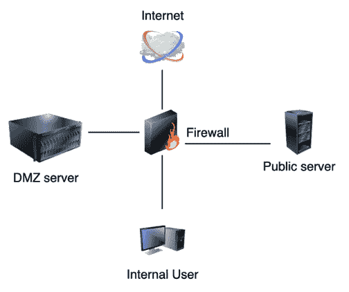
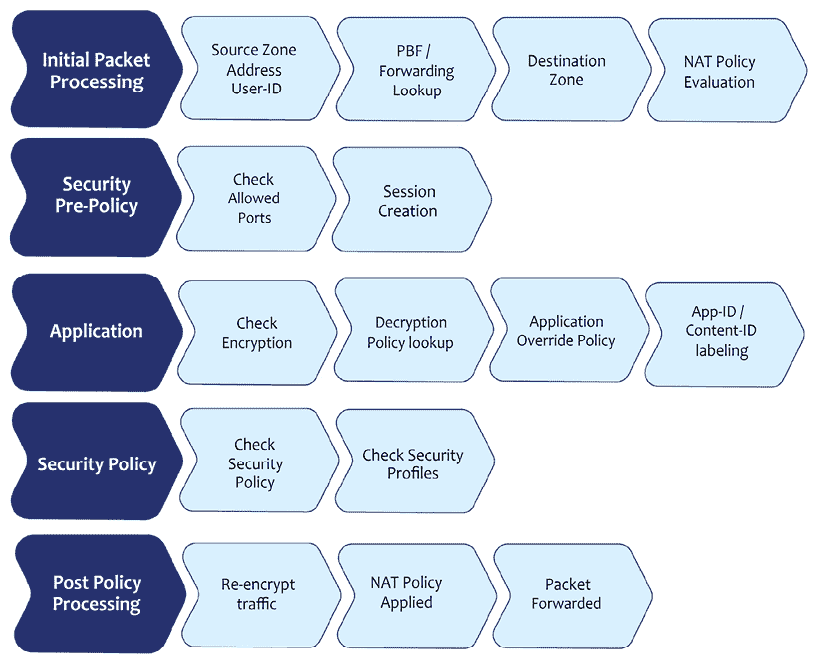
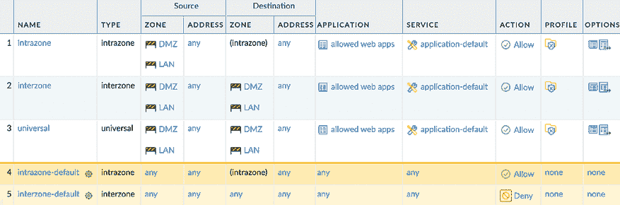
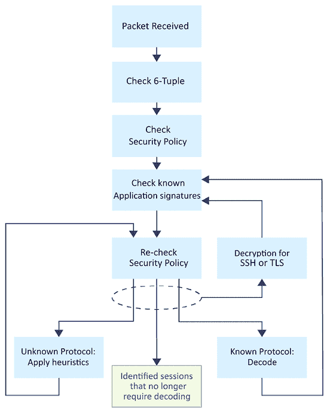
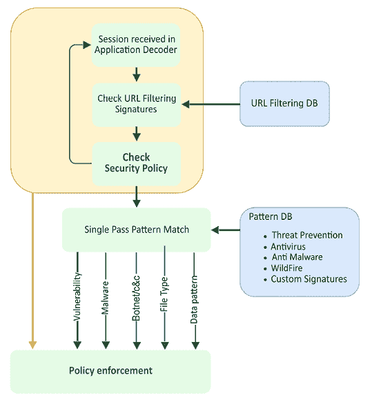
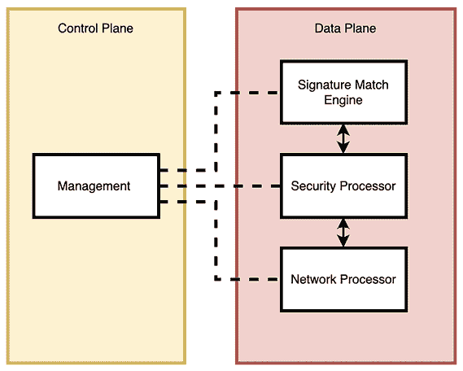

# 1 了解核心技术

欢迎阅读第一章！在本書中，我们将探索 Palo Alto Networks Strata 套件的方方面面。我们将首先学习防火墙的所有不同功能以及如何配置它们，然后再进入更复杂的功能和附加服务，帮助您完成部署。在此过程中，您将获得重要的知识要点，帮助您既理解技术，又通过 `PCNSE` 考试。

在本章中，我们将研究构成 Palo Alto Networks 防火墙的核心技术。我们将更仔细地查看安全区域如何控制安全、`Network Address Translation` (`NAT`) 和路由判决的制定方式。我们将回顾 `App-ID` 和 `Content-ID` 背后的机制，以便您更深入地了解数据包的处理方式以及防火墙如何做出安全决策，并且我们将回顾 `User-ID` 如何通过应用基于组或基于用户的访问控制来提供更强大的安全态势。

本章将涵盖以下主题：

* 了解基于区域的防火墙
* 了解 `App-ID` 和 `Content-ID`
* 管理平面和数据平面
* 使用 `User-ID` 对用户进行身份验证

到本章结束时，您将更好地了解核心技术是如何构建的，并且在我们开始构建配置时能够应用这些技能。如果您正在准备 `PCNSE` 考试，本章还将帮助您理解解决基于场景问题的所需基础知识。

## 技术要求

对于本章，不需要物理安装；仅对技术进行解释。充分理解 `UDP` 和 `TCP` 等基本网络协议对于充分受益于以下材料是必要的。如果您已经使用过 Palo Alto Networks 防火墙，将有所帮助，但不是必需的。一般来说，具备防火墙或 Web 代理的经验是推荐的，这样主题会更具体。

## 了解基于区域的防火墙

传统上，在将防火墙视为网络元素时，您最有可能想象的网络设计如 *图 1.1* 所示，围绕一个盒子有两到四个区域。大多数时候，位于北方的东西被认为是危险的，因为它代表互联网，东西两侧是有些灰色的区域，因为它们是 `demilitarized zones` (`DMZs`)，部分暴露于互联网，而南方是用户日常工作的快乐之地。中间的盒子是防火墙。所有这些区域都将在防火墙中定义为区域：



图 1.1：基本网络拓扑

实际上，由于网络分段、远程办公室通过各种不同的技术连接到总部，以及云厂商的采用，网络设计可能看起来复杂得多。

在 `route-based firewall` 中，区域只是帮助识别公司使用的全球网络包含哪些区域的架构或拓扑概念；它们通常由可以附加到子网对象的标签表示。它们在系统处理安全策略时所做的任何安全决策中都没有影响。

`zone-based firewall` 另一方面，将使用区域作为在状态表中内部分类源和目的地的手段。

下图说明了数据包处理的阶段，从新会话的第一个数据包进入防火墙的第一步，到数据包从防火墙发出的最后一步：



图 1.2：数据包处理阶段

让我们来看一下初始数据包处理的流程：

1. 当数据包首次接收时，会执行源区域查找。如果源区域关联了保护配置文件，则数据包会根据配置文件配置进行评估。如果第一个数据包是 `TCP` 数据包，它还将根据 `TCP` 状态进行评估，其中第一个数据包需要是 `SYN` 数据包，并且如果保护配置文件阈值达到，则会触发 `SYN` cookie。
2. 然后，通过检查 `policy-based forwarding` (`PBF`) 规则来确定目标区域，如果未找到结果，则会咨询路由表。
3. 最后，评估 `NAT` 策略，因为 `NAT` 规则操作可能会更改目标 IP，从而更改路由表中的目标接口和区域。这将需要二次转发查找以确定后 `NAT` 的出站接口和区域。

在 `initial packet processing` 中执行这些区域查找后，防火墙将继续进行 `security pre-policy` 评估。

在预策略评估中，使用 "`6-tuple`" 在建立或丢弃/拒绝会话之前将传入会话与规则库进行匹配。在此阶段，防火墙尚未考虑应用程序，因为这通常无法通过会话中的第一个数据包确定。六元组由以下元素组成：

* Source IP
* Source zone
* Destination IP
* Destination zone
* Destination port
* Protocol

区域附加到物理、虚拟或子接口。每个接口只能属于一个单一区域。可以创建区域以适应任何命名约定，并且在用途上可以非常具有描述性（`untrust`、`DMZ`、`LAN` 等），这确保了从管理角度来看，每个区域都易于识别。


## 区域与安全规则

最佳实践是在所有安全规则中使用区域，并且采用清晰的命名规范可以防止配置错误并使安全规则更易读。出于任何原因而物理分离但本应在拓扑上连接的网络（例如，分散在两栋建筑中的用户通过防火墙上的两个独立接口接入）可以合并到同一区域，从而简化策略。

需要注意的是，存在影响同区域或跨区域会话的隐含规则。这些规则可以在安全策略底部找到：

* **默认同区域连接**：从同一区域流向并返回的数据包将被隐式允许
* **默认跨区域连接**：从一个区域流向不同区域的数据包将被隐式阻止

安全规则可以设置为仅接受同一区域内的流量、仅不同区域之间的流量，或两者兼有。此设置可在规则 `Type` 中更改，默认设置为 `Universal`。如 *图 1.3* 所示，`Universal` 规则允许会话从 `Source` 字段中的所有区域流向 `Destination` 字段中的所有区域，从 `LAN` 到 `LAN` 和 `DMZ`，以及从 `DMZ` 到 `LAN` 和 `DMZ`。

设置为 `intrazone` 类型的规则仅允许会话在同一区域内流动，无论安全规则中是否添加了多个区域：从 `DMZ` 到 `DMZ` 以及从 `LAN` 到 `LAN`，但不允许从 `LAN` 到 `DMZ` 或从 `DMZ` 到 `LAN`。

设置为 `interzone` 类型的规则仅允许会话在不同区域之间流动：从 `DMZ` 到 `LAN` 以及从 `LAN` 到 `DMZ`，但不允许从 `DMZ` 到 `DMZ` 或从 `LAN` 到 `LAN`，即使两者都在源和目标中列出。

这意味着即使无法在源或目标中定义子网，你也可以完全控制允许流量在哪些接口之间流动，而对于传统防火墙而言，这意味着会话将被允许在任何地方流动。



图 1.3：不同安全规则类型和默认规则

现在我们已经看到了区域在做出安全决策时的重要作用，让我们来看一下确定区域时的预期行为。

## 确定区域时的预期行为

当数据包到达接口时，将会查阅 `PBF` 策略或路由表，以根据数据包报头中的原始 IP 地址确定目标区域。

让我们考虑以下路由表：

```
> show routing route
flags: A:active, ?:loose, C:connect, H:host, S:static, ~:internal, R:rip, O:ospf, B:bgp,
      Oi:ospf intra-area, Oo:ospf inter-area, O1:ospf ext-type-1, O2:ospf ext-type-2, E:ecmp, M:multicast
VIRTUAL ROUTER: default (id 1)
  ==========
destination       nexthop       metric flags  interface   
0.0.0.0/0         198.51.100.1  10A S    ethernet1/1                 
198.51.100.0/24   198.51.100.2  0      A C    ethernet1/1
198.51.100.2/32   0.0.0.0       0      A H                           
192.168.0.0/24    192.168.0.1   0      A C    ethernet1/2             
192.168.0.1/32    0.0.0.0       0      A H        
172.16.0.0/24     172.16.0.1    0      A
C    ethernet1/3                
172.16.0.1/32     0.0.0.0       0      A
H                                                                   
total routes shown: 7
```

假设 `ethernet1/1` 是外部接口，IP 地址为 `198.51.100.2`，区域设置为 `external`，`ethernet1/2` 是 `DMZ` 接口，IP 地址为 `192.168.0.1`，区域设置为 `DMZ`，而 `ethernet1/3` 是 `LAN` 接口，IP 为 `172.16.0.1`，区域设置为 `LAN`。默认路由经由接口 `ethernet1/1` 出站，下一跳为 `198.51.100.1`。以下几个场景会影响区域的确定方式：

* **场景 1**：从客户端 PC `172.16.0.5` 收到数据包，目标 IP 为 `1.1.1.1`。

防火墙迅速确定源区域为 `LAN`，路由查找确定目标 IP 不是已连接网络，因此需要遵循默认路由到互联网。目标区域必须是 `external`，因为出站接口是 `ethernet1/1`。

* **场景 2**：从客户端 PC `172.16.0.5` 收到数据包，目标 IP 为 `1.1.1.1`，但存在一条 PBF 规则强制所有发往 `1.1.1.1` 的流量到下一跳 IP `192.168.0.25`。

由于 `PBF` 覆盖路由表，目标区域将变为 `DMZ`，因为出站接口现在是 `ethernet1/2`。

* **场景 3**：从互联网 IP `203.0.113.1` 收到数据包，目标 IP 为 `198.51.100.2`。这是 `NAT` 对防火墙而言的典型示例：它接收到以其外部 IP 地址作为目标的数据包。

从 `NAT` 策略的角度来看，源区域将为 `external`，因为该 IP 不来自已连接网络且不存在静态路由，并且目标区域也将 *也* 为 `external`，因为该 IP 已连接到该接口。

然而从安全角度来看，一旦应用 `NAT`，目标区域将更改为后 NAT 目标 IP 所连接的区域（通常为 `DMZ`）。

### 重要说明

请记住，`NAT` 策略评估发生在初始区域确定之后，但在安全策略评估之前。这将导致出站 `NAT` 规则来自 `LAN` 并前往 `external`，但入站 `NAT` 规则匹配为来自 `external` 且也前往 `external`，而入站安全规则将使用适当的目标区域。请参阅 *图 1.2*。

在本节中，我们看到了第一轮安全决策在很大程度上依赖于区域，这也应反映在您今后创建的任何规则库中：尽可能在源和目标中使用区域，以完全控制流量的流动并防止意外行为。在下一节中，我们将了解第二轮会发生什么，这也使得 `next-generation firewall` (`NGFW`) 成为“下一代”。

## 了解 App-ID 和 Content-ID

`App-ID` 和 `Content-ID` 是两种相辅相成的技术，构成了核心检查机制。`App-ID` 依赖解码器根据协议和第 7 层应用来识别和分类流。这允许对允许或阻止的内容进行更精细的控制，同时确保应用程序按预期行为。`Content-ID` 依赖威胁防护引擎对威胁进行深度检查流，对 URL 类别进行分类并防止数据外泄。

## App-ID 如何提供更多控制

确定特定数据流中包含哪个应用程序是任何 `NGFW` 的基石。不能再假设使用 TCP 端口 80 和 443 的任何会话只是明文或加密的网页浏览。今天的应用程序主要使用这些端口作为其基础传输，许多恶意软件开发人员利用了这种向知名端口的汇聚，试图将恶意软件伪装成合法的网络流量，同时外泄敏感信息或向受感染主机下载更多恶意负载。

以下图像说明了 `App-ID` 在流中识别应用程序所采取的步骤：



图 1.4：App-ID 如何对应用进行分类

当收到数据包时，`App-ID` 将经历几个阶段来识别它到底是什么：

1. 首先，`6-Tuple` 会与安全策略进行核对，以验证某个源、目标、协议和端口组合是否被允许。如果所有不必要的端口都已关闭，则可以处理低垂的果实，并且 *不寻常* 的目标端口可以被拒绝。
2. 接下来，数据包将与已知应用程序签名和应用缓存进行核对，以查看会话是否可以快速识别。


3. 其后是对应用程序进行第二次安全策略检查，此时将 `App-ID` 添加到安全策略允许会话通过所需标识符集合中。
4. 如果在此时或未来的策略检查中确定应用程序为 `SSH`、`TLS` 或 `SSL`，则会执行二次策略检查以验证是否需要应用解密。如果存在解密策略，会话将经过解密，然后再次检查已知应用程序签名，因为封装在 `TLS` 或 `SSH` 内部的会话可能完全不同。
5. 如果在此步骤中应用程序未被识别（握手后最多 4 个数据包，或 2,000 字节），`App-ID` 将使用基础协议来确定使用哪个解码器更深入地分析数据包。
6. 如果协议已知，解码器将继续解码协议，然后再次将负载与已知应用程序签名进行匹配。结果可能是已知应用程序（如 `ssl` 或 `web-browsing`）或未知通用应用程序，如 `unknown-tcp`。此通用应用程序也可以通过安全策略进行控制以允许或阻止会话。
7. 然后会话将再次与安全策略进行匹配，以确定是否允许通过或需要被拒绝或丢弃。如果协议未知，`App-ID` 将应用启发式方法尝试确定会话中使用的协议。
8. 一旦确定使用了哪个协议，就会执行另一次安全策略检查。
9. 一旦应用程序被识别或所有选项均已耗尽，`App-ID` 将停止对数据包进行识别处理。

会话的整个生命周期中，已识别的应用程序可能会多次发生变化，因为通过逐个检查数据包从会话中学习到更多信息。例如，`TCP` 会话可能被识别为 `SSL`，即 `HTTPS` 应用程序，因为防火墙检测到 `SSL` 握手。然后解密引擎和协议解码器将被启动以解密会话并识别加密会话内部包含的内容。接下来，它可能检测到应用程序 `web-browsing`，因为解码器识别出典型的浏览行为，例如 `HTTP GET`。`App-ID` 然后可以应用已知的应用程序签名来识别 `flickr`。每次应用程序上下文发生变化时，防火墙都会快速检查该特定应用程序是否在其安全规则库中允许。

如果此时允许 `flickr`，则同一会话在用户尝试上传照片时可能会再次切换上下文，这将触发另一次安全策略检查。之前允许的会话现在可能被防火墙阻止，因为子应用程序 `flickr-uploading` 可能不被允许。

一旦 `App-ID` 进程确定了应用程序，应用程序解码器将持续扫描会话中的预期和异常行为，以防应用程序更改为子应用程序或恶意行为者试图通过现有会话隧道传输不同的应用程序或协议。

`App-ID` 签名和解码器会定期（通常每月 15^(th) 左右）更新，以应对现有应用程序或协议的更改，并为之前未知的应用程序或对现有应用程序的子应用程序添加新签名，以增加深度和控制（例如，Facebook 聊天、文件共享或游戏）。

因此，`App-ID` 不仅允许您控制哪些会话允许通过防火墙，还允许您控制这些应用程序的行为方式。在下一节中，我们将了解威胁如何被阻止以及恶意软件如何被拦截。

## Content-ID 如何确保安全

如果在安全规则中启用了适当的安全配置文件，`Content-ID` 引擎将应用 `URL filtering` 策略，并将持续且并行地扫描会话是否存在漏洞利用、病毒或蠕虫感染、可疑 DNS 查询、`command and control` (`C&C` or `C2`) 签名、DoS 攻击、端口扫描、畸形协议或与敏感数据外泄匹配的数据模式等威胁。`TCP` 重组和 `IP` 分片重组会执行以防止数据包级规避技术。在以下图像中，您可以看到单次模式匹配如何实现对多种威胁类型的同时扫描，以及 URL 过滤如何被添加到其中：



图 1.5：Content-ID 如何扫描数据包

所有这些并行发生，因为硬件和软件设计为每个数据包同时由 `App-ID` 解码器和 `Content-ID` 基于流的引擎处理，每个都在机箱上的专用芯片中或通过 `virtual machine` (`VM`) 中的专用进程处理。这种设计与串行处理相比降低了延迟，这意味着启用更多安全配置文件不会像其他防火墙和 IPS 解决方案那样带来性能的指数级成本。

### 内联评估

为了扩展我们刚刚讨论的基于签名的评估，防火墙还配备了 `Inline Machine Learning` (`ML`) 和 `Inline Cloud Analysis` 功能，使其能够独立评估动态内容，而无需等待签名更新即可开始阻止恶意内容。其中一些如下：

* `WildFire` 能够通过应用 `ML` 模型实时评估 `portable executable` (`PE`)、`executable and linked format` (`ELF`)、MS Office 文件、PowerShell 和 shell 脚本。
* 从 `PAN-OS` 11.2 开始，某些机箱（截至撰写时为 `PA-5400` 和 `PA-VM`）获得本地深度学习 AI，从而扩展 `ML` 功能。
* `URL Filtering` 可以利用本地和云端 Inline ML 分类来评估网站详情，以保护用户免受钓鱼变种和 JavaScript 漏洞利用的侵害。
* `Anti-Spyware` 可以利用实时的 Inline Cloud Analysis 访问五个分析引擎，用于通过 `HTTP`、`HTTP2`、`SSL`、unknown-UDP 和 unknown-TCP 的基于 `C&C` 的威胁。
* `Vulnerability Protection` 可以利用 Inline Cloud Analysis 来分析 SQL 和 PowerShell 代码注入。

所有云内联检测都需要防火墙具有活动互联网连接，因此如果您的部署互联网访问受限，请相应规划。

在本节中，您了解了所有 (`OSI`) 第 7 层内容检查组件如何协同工作，以提供有关哪些应用程序正在穿越防火墙的更多可见性，同时阻止任何恶意负载。

## 管理平面和数据平面

硬件和 `VM` 设计专注于实现并行处理的最佳性能，同时仍执行消耗处理能力和可能阻碍流通过系统速度的任务。因此，每个平台都被划分为所谓的 `planes`。

构成防火墙的两个主要平面是 `data plane` 和 `management` 平面，它们是执行特定功能的物理或逻辑板。虽然所有平台都有管理平面，但像 `PA-5200` 这样的大型平台还具有额外的 `control plane` 和两个到三个数据平面。最大平台具有可更换的硬件刀片（线路卡），每个线路卡最多有三个数据平面等效件，并且可容纳多达 10 个线路卡。像 `PA-220` 这样的小型平台只有一个硬件板，其职责在 CPU 核心之间虚拟划分。


## 平面概述
**管理平面** 是所有管理任务发生的地方。它提供系统使用的 Web 界面，用于允许配置、提供 URL 过滤阻止页面以及提供客户端 VPN 门户。它对 URL 过滤和 DNS 安全执行云查询，并将内容更新下载并安装到数据平面。它还执行路由的逻辑部分并与动态路由对等体和邻居通信。身份验证、`User-ID`、日志记录以及许多其他支持功能与处理数据包没有直接关系。

**控制平面** 承担促进多个数据平面与管理平面之间通信以及监控数据平面上进程的任务。

**数据平面** 负责处理流并执行与 NGFW 相关的所有安全功能。它扫描会话以查找模式和启发式信息。它维护 IPsec VPN 连接并具有硬件卸载以提供线速吞吐量。由于其架构以及使用互连的专用芯片，所有类型的扫描都可以并行进行，因为每个芯片同时处理数据包并报告其发现。

交换结构使平面之间能够通信，以便数据平面可以将查询请求发送到管理平面，而管理平面可以发送配置更新和内容更新。

下图说明了这些组件如何相互交互：



图 1.6：管理平面和数据平面

现在我们已经介绍了最基本的功能，并且你对硬件的组织方式有了坚实的把握，让我们来看一下基于身份的授权。根据身份或组成员身份识别用户并应用不同的安全策略的能力是 NGFW 的一个重要功能，因为它允许更动态的安全规则，而不依赖于静态访问列表，而是允许用户在校园内外漫游，同时仍然拥有所需的所有访问权限，而不会暴露内部资源。

## 使用 `User-ID` 对用户进行身份验证和授权

经常被忽视但在正确设置时非常强大的标准功能（无需额外许可）称为 `User-ID`。通过多种机制，防火墙可以了解谁在发起哪些会话，而不管其设备、操作系统或源 IP 如何。此外，可以设置安全策略，以便根据用户的个人 ID 或组成员身份授予用户访问权限或限制其功能。

`User-ID` 通过对谁访问某些资源进行精细控制来扩展功能，并提供可自定义的报告功能，用于取证或管理报告。

用户可以通过多种不同方法进行识别：
* **服务器监控**：
  * Microsoft Active Directory 安全日志读取，用于登录和身份验证事件
  * Microsoft Exchange Server 登录事件
  * Novell eDirectory 登录事件
* 拦截由下游代理服务器转发的 `X-Forwarded-For` (`XFF`) 头部
* **客户端探测** 使用 `NetBIOS` 和 `WMI` 探测
* **直接用户身份验证**：
  * `Captive Portal` 用于拦截 Web 请求并提供用户身份验证表单或使用 Kerberos 透明身份验证
  * `GlobalProtect` VPN 客户端集成
* 在 Citrix 或 Microsoft 终端服务器等多用户平台上的 **端口映射**，其中多个用户将源自同一源 IP
* 可扩展标记语言 (`XML`) API
* `syslog` 监听器，用于接收来自外部身份验证系统的转发日志

你会注意到有许多利用 `User-ID` 的方法，因此我们将在 *第 6 章*、*识别用户和控制访问* 中深入重新讨论此主题。

## 摘要

现在你完成了本章，你能够识别使用基于区域的防火墙与基于路由的防火墙的优势。你了解即使应用程序都使用相同的协议和端口，也如何识别它们，并且你了解深度数据包检测如何在单次并行处理中实现。最重要的是，你对数据包形成会话所经历的阶段有坚实的把握。如果这些信息看起来有点令人不知所措也没关系；我们将在接下来的两章中看到更多实际应用和影响。我们将更仔细地查看一旦你开始使用区域，安全和 `NAT` 规则的行为如何，以及如何通过简单地查看规则来预测预期行为。

如果你正在准备 `PCNSE` 考试，本章涵盖了 *规划和核心概念* 和 *部署和配置* 域的部分内容。请注意 *图 1.2* 关于数据包处理，记住路由查找和 `PBF` 构成了区域化的基础，并注意 `App-ID` 和 `Content-ID` 如何协同工作。

在下一章中，我们将学习如何从头开始设置防火墙并迅速投入运行。我们将浏览物理和虚拟组件以及如何配置它们以使流量能够通过，并在需要的地方应用 `NAT`。
