# 第 2 章：设置新设备

在本章中，我们将介绍如何访问即开即用的防火墙设备或干净部署的 **虚拟机** (`VM`) 的控制台和 Web 界面。你将学习如何许可、更新和升级防火墙，以便在开始构建安全策略时可以使用最新功能，并且始终将最新签名加载到设备上，以保护你的用户和基础设施免受恶意软件和漏洞利用的侵害。

我们将强化你的管理配置以确保严格的安全态势，并且我们还将查看不同类型的网络接口模式——聚合接口和路由。

在本章中，我们将涵盖以下主要主题：
* 访问用户界面
* 添加许可证并设置动态更新
* 升级防火墙
* 强化管理界面
* 了解接口类型

到本章结束时，你将能够快速设置新的防火墙、注册它，并在短时间内将其升级到理想的水平。你将能够应用最佳实践并利用强大的身份验证进行管理访问，并且你将能够快速识别适合防火墙需要放置在其中的任何给定网络拓扑的接口配置。

## 技术要求

对于本章，需要对网络设备有基本了解，因为我们将查看物理连接到设备、配置管理环境以及选择数据平面接口的部署模式。还需要具备在虚拟环境中部署虚拟设备的基本知识，包括将其连接到虚拟交换机或虚拟接口并在 hypervisor 上为其提供网络访问。

## 访问用户界面

如果你将防火墙部署在 `Azure` 或 `AWS` 等云提供商上，请查看 *第 14 章*、*基于云的防火墙部署*。

当从盒子中取出新设备或在本地 hypervisor 上设置 `VM`，例如 `VMware ESXi`、`Fusion`、`NSX`、`Hyper-V`、`KVM` 等时，需要完成的第一件事之一是使能够访问用户界面，无论是 Web 界面还是控制台连接。我们将在本节中介绍获得此访问权限的最常见方法。

你 *可能* 需要做的第一件事之一是连接控制台电缆以获得对 **命令行界面** (`CLI`) 的访问。较旧的型号仅带有一个 `RJ45` 控制端口，对于这些型号，你需要一个标准的 `DB9-to-RJ45` 控制台电缆，可选择通过串行到 USB 电缆进行补丁，以便现代笔记本电脑能够与端口接口。DB9 的针脚排列应如下所示：


## 控制台访问与配置

## 引脚参考

```
1 - Empty - Data Carrier Detect (DCD)
2 - 3 - Receive Data (RXD)
3 - 6 - Transmit Data - (TXD)
4 - 7 - Data Terminal Ready (DTR)
5 - 4 - Ground (GND)
6 - 2 - Data Set Ready (DSR)
7 - 8 - Request To Send (RTS)
8 - 1 - Clear to Send - (CTS)
9 - Empty - Ringing Indicator (RI)
```

幸运的是，也有 USB-to-RJ45 电缆可供使用，可以免去您费心查找正确引脚的麻烦：


图 2.1：RJ45 到 USB 控制台电缆

除了非常旧的型号外，其他型号还配备了 micro-USB 端口，可使用标准 USB-A 到 micro-USB 电缆建立控制台连接，如下图所示：

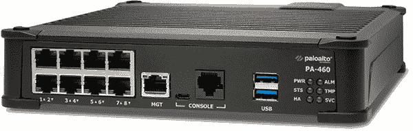

图 2.2：PA-460 RJ45 和 micro-USB 控制台端口

## 查找控制台端口

在所有情况下，您都需要找到计算机操作系统上正在使用的 `COM`（硬件接口）或 `TTY`（`TeleTYpewriter`）端口。

### Windows

在 Windows 机器上，第一次插入电缆时可能需要安装驱动程序。安装完成后，您需要找到分配给控制台电缆的虚拟 COM 端口号。在大多数情况下，您可以通过以下步骤确定此虚拟 COM 端口号：

1. 打开设备管理器。
2. 单击 开始 | 控制面板 | 硬件和声音 | 设备管理器（在“设备和打印机”下）。
3. 在设备管理器列表中，查看“端口”，找到分配给 USB 端口的虚拟 COM 端口。此条目看起来类似于 USB 转串口（`COM#`），其中 `COM#` 是在下一步中使用的编号。

接下来，您需要一个终端仿真客户端来连接控制台。您可以使用免费客户端，例如来自 https://www.chiark.greenend.org.uk/~sgtatham/putty/latest.html 的 `PuTTY`。

除了 `COM` 端口外，您可能还需要提供更多设置才能连接。如果被要求，请使用以下设置：

```
Bits per second: 9600
Data Bits: 8
Parity: none
Stop bits: 1
Flow control: none
```

### macOS 和 Linux

在 macOS 和 Linux 上，USB 串行连接通常会在 `/dev/` 目录中创建一个新的 `tty` 条目；USB 到 DB9 转接器可能会在 `/dev/` 目录中创建一个呼叫（`CU`）条目。

通过以下任一命令搜索来查找正确的设备：

```
ls /dev/tty.*
ls /dev/cu.*
```

您将找到 `/dev/cu.usbserialxxxxx` 或 `/dev/tty.usbmodemxxxxx`，其中 `xxxxx` 是串行设备名称。

确定适当的设备后，您可以使用设置为 `9600` 波特的 `screen` 命令连接到控制台端口：

```
screen /dev/tty.usbmodemxxxxx 9600
```

## 连接到控制台

现在，请将控制台电缆或 micro-USB 连接到您的笔记本电脑和设备。如果管理网络上有空闲端口，请将防火墙的 `MGT` 端口连接到交换机。如果您还没有可用的管理连接，则需要将笔记本电脑直接连接到 `MGT` 端口，以便在管理接口上设置 IP 后更轻松地访问。最后，插入电源线。

如果防火墙加载在 VM 或云实体中，请按“开始”按钮启动虚拟设备。

一旦您登录到控制台，您将看到操作系统启动，如果防火墙已连接到启用 DHCP 的管理网络，您将看到类似以下内容，其中 DHCP 地址已为您方便地列出：


图 2.3：PA-VM 启动后 DHCP 信息

如果您错过了此信息，您可以登录并使用以下命令查看 DHCP 信息：

```
admin@PA-440> show system info
hostname: PA-440
ip-address: 192.168.27.116
public-ip-address: unknown
netmask: 255.255.255.0
default-gateway: 192.168.27.1
ip-assignment: dhcp
```

如果由于某种原因您尚未从 DHCP 服务器收到 DHCP 地址，您可以通过使用 `request dhcp client management-interface renew` 命令从 CLI 发起 `renew` 操作。

### 重要说明

出厂设置设备或 VM 的默认用户名和密码如下：

`Username: admin`

`Password: admin`

第一次登录时，系统会要求您更改此默认密码。记住提交配置以保存新密码。

## 访问接口

现在您已访问用户界面，您需要立即做出一个重要决定：是否使用 `zero-touch provisioning`（`ZTP`）或不（我们将在第 7 章《通过 Panorama 管理防火墙》中稍后了解更多）。简而言之，`ZTP` 使设备能够自动接收中央管理 Panorama 系统的坐标（如果有），并立即从那里下载其配置。默认情况下，此选项在所有新设备上均已启用，并绑定到接口 `ethernet1/1`。如果您不需要此功能，则必须在开始使用此接口之前将其关闭。您可以通过发出命令 `set system ztp disable` 来实现，如下所示：

```
admin@PA-440> set system ztp disable
Executing this command will disable Zero Touch Provisioning (ZTP), and remove all logs and configuration. The system will restart in standard mode for regular configuration of the firewall. Are you sure you want to continue? (y or n)
```

如果您按下 Y 键，系统将重新启动并且 `ZTP` 将被禁用。如果您后来改变主意并想再次启用它，可以通过发出以下命令来实现：`set system ztp enable`。

系统重新启动后，请继续进行初始配置。

如果您的网络没有 DHCP 服务器，或您将防火墙直接连接到笔记本电脑，您需要手动设置 IP 地址。将以下内容复制并粘贴到文本文件中，并使用管理接口的适当 IP、其用于访问互联网的默认网关以及其用于解析域名的 DNS 服务器更改 `<IP>` 条目。以四段十进制格式输入子网掩码，而不是 CIDR（斜杠表示法子网，例如 `/16` 和 `/24`）：

```
configure
set deviceconfig system type static
set deviceconfig system ip-address <IP>
set deviceconfig system netmask <x.x.x.x>
set deviceconfig system default-gateway <IP>
set deviceconfig system dns-setting servers primary <IP>
set deviceconfig system dns-setting servers secondary <IP>
commit
```

您可以链接属于同一路径和类的 `set` 命令，这样您就不必在单独的 `set` 命令中设置每个属性；相反，您可以一次性添加所有所需设置。

在下一个示例中，我们进入配置模式，将管理接口从 DHCP 切换到静态配置，然后将管理接口的所有配置参数合并到一个 `set` 命令中。如果您尚未这样做，请先将默认密码更改为新密码，然后添加接口配置：

```
admin@PA-440> set password
Enter old password :
Enter new password :
Confirm password :
Password changed
admin@PA-440> configure
Entering configuration mode
[edit]
admin@PA-440# set deviceconfig system type static
[edit]
admin@PA-440# set deviceconfig system ip-address 192.168.27.5 netmask 255.255.255.0 default-gateway 192.168.27.1 dns-setting servers primary 1.1.1.1 secondary 1.0.0.1
[edit]
admin@PA-440# commit
Commit job 2 is in progress. Use Ctrl+C to return to command prompt
...........................................55%....75%.....98%.......................100%
Configuration committed successfully
[edit]
admin@PA-440#
```


运行 `commit` 作业后，如果 `admin` 密码已更改，您可能需要重新登录。

### 重要说明
`username@hostname>` 中的 `>` 提示符表示您处于 `operational` 模式，可以执行运行时命令。`username@hostname#` 中的 `#` 提示符表示您处于 `configuration` 模式，可以添加配置参数。

可以通过在命令前加上 `run` 从配置模式运行操作命令——例如，`user@host# run show clock`。

`commit` 作业完成后，您将能够通过 `https://<IP>` 连接到 Web 界面，或使用 SSH 客户端，例如 PuTTY 或 Linux 或 macOS 中的 `ssh` 命令。

您现在可以进入刚启动的防火墙并对其进行配置，因此我们可以进入下一步并获得对 Web 界面的访问权限。

## 连接到 Web 界面和 CLI
现在您的设备已拥有 IP 地址，您可以使用任何浏览器通过 `https://<IP>` 连接到其 Web 界面。

您将会看到不友好的错误消息，如以下屏幕截图所示。这是由于 Web 界面使用的是未被任何机构验证的自签名证书。目前可以安全地忽略：

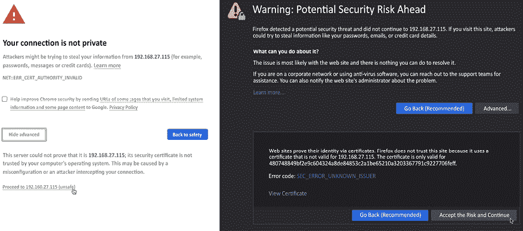

图 2.4：Chrome 和 Firefox 中的证书警告

SSH 客户端会向您提供一个稍微友好一点的问题：

```
tom$ ssh -l admin 192.168.27.115
The authenticity of host '192.168.27.115 (192.168.27.115)' can't be established.
RSA key fingerprint is SHA256:Qmre8VyePwwGlaDmm6JTYtjou42d1i/Ru6xZmmEk8Yc.
Are you sure you want to continue connecting (yes/no)?
```

SSH 连接提供的用户体验与控制台连接基本相同，但 SSH 更具响应性和安全性，并且您现在可以从管理网络的任何位置访问设备。

Web 界面为您提供全新的用户体验。系统提示输入用户名和密码时，请输入用户名 `admin`，默认密码为 `admin`，或您在终端上创建的密码，或您在云服务提供商上创建的用户名和密码。

登录后，您看到的第一个屏幕是仪表板，其中包含有关系统健康状况、配置更改以及哪些管理员已登录的一般信息。仪表板可以自定义，并且可以从预置小部件列表中添加额外的小部件，或者如果不相关则可以删除小部件。

目前，`General Information` 小部件包含最重要的信息，因为您需要物理设备的 `serial number`，或虚拟设备上的 `CPU ID` 和 `UUID`，如下图所示。`CPU ID` 和 `UUID` 将用于注册和激活 VM，而物理设备可以通过其 `serial number` 激活：

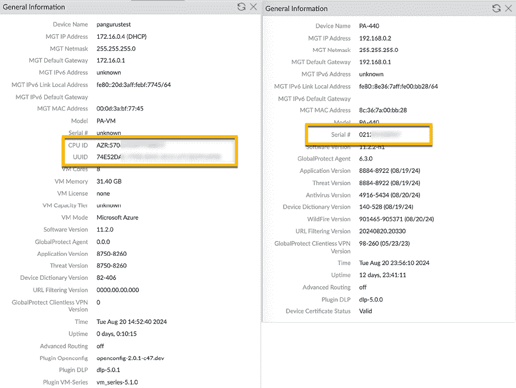

图 2.5：左侧为 PA-VM 设备，右侧为 PA-440 设备

现在我们已可以访问 Web 界面并收集系统的基本信息，可以继续注册防火墙并激活已购买的任何功能许可证。我们现在将了解如何执行注册和许可流程。

## 添加许可证并设置动态更新
在开始添加许可证之前，需要先注册设备。您需要记下设备的 `serial number`，或如果您没有支持门户账户，则需要销售订单号来创建新账户。销售订单号通常会在您下单后由您的分销商或经销商发送给您。

打开一个新标签页或浏览器并导航到 [`support.paloaltonetworks.com`](https://support.paloaltonetworks.com)。如果您还没有账户，则首先需要创建一个新账户，以便访问门户，从那里您可以管理所有设备、激活许可证、下载软件包和更新，并访问支持案例。如果您已有 `Customer Support Portal (CSP)` 账户，可以跳到 `Registering a new device`。

## 创建新账户
创建新账户时，系统会要求您提供电子邮件地址，并询问您是否要使用 `serial number` 或 `authorization` (`auth`) 代码进行注册，如下图所示。`serial number` 在注册硬件设备时需要；`auth` 代码用于注册 VM 设备：

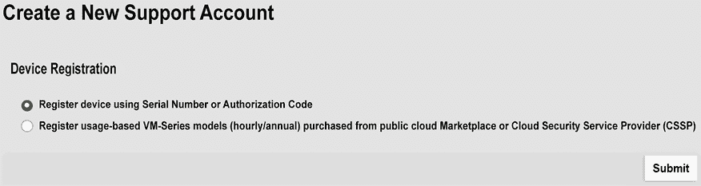

图 2.6：序列号或授权代码设备注册

另外，如果您在其中一个云服务提供商上设置了虚拟设备，您可以选择设备运行的提供商（如 Amazon Web Services、Azure、Google Cloud Platform 等）。

然后您需要提供一些基本信息，例如地址、密码、设备的 `serial number`、`auth` 代码，以及如果贵公司已有账户，则提供销售订单号或客户 ID：

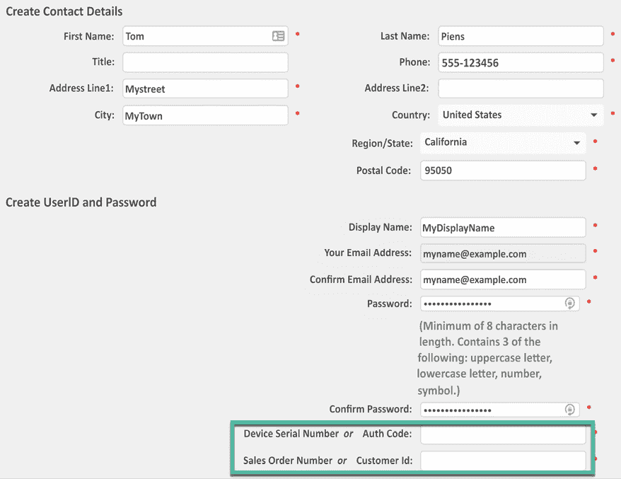

图 2.7：一般信息以及设备和销售订单详情

此账户创建步骤将同时注册您的第一台设备；您可以在下一节中继续注册更多设备。

## 注册新设备
确保您已登录支持门户上的账户，并在主页上点击 `Register a Device`：

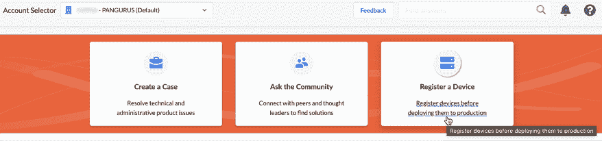

图 2.8：从支持门户主页注册设备

您将看到使用 `serial number` 或 `auth` 代码注册的选项。`serial number` 在注册硬件设备时需要，而 `auth` 代码用于注册 VM 设备：

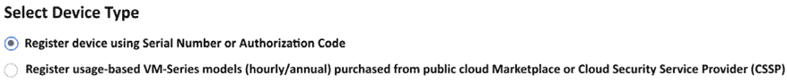

图 2.9：序列号或授权代码设备注册

`Register device using Serial Number or Authorization Code` 将要求您提供 `serial number`、一个友好的设备名称，以及如果您账户中已有多个“池”或设备组，则提供标签。它还将要求提供设备部署位置的地址详情，以便用于 `return merchandise authorization` (`RMA`) 目的。

如果您部署的是云实例，您可以选择注册基于使用量的 `VM-Series` 型号。系统会要求您提供 `serial number`、`CPUID` 和 `UUID`：

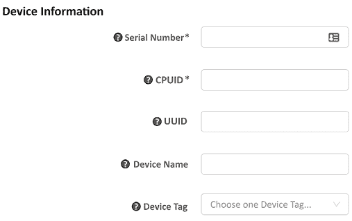

图 2.10：将云实例添加到资产中

现在设备已注册，是时候激活功能和支持许可证了。

## 激活许可证
设备注册后，您可以添加许可证。您将收到一个（捆绑包）或多个 `auth` 代码，需要在门户上或通过 `Device` | `Licenses` 选项卡输入，以激活许可证并在设备上开始使用该功能。激活许可证有多种方式，我们将在以下章节中介绍，但首先让我们先了解不同类型的许可证。

其中一些最常见的许可证包括以下内容：

*   `Support`：`Platinum 4h` (`PLAT`)、`Premium 24/7` (`PREM`)、`Standard 9/5` (`STD`)、`Partner-enabled 4h support` (`B4HR`) 或 `Regular Partner-enabled support` (`BND`)。支持许可证授予您访问支持组织的权限，允许您下载软件和应用 ID 更新，并在防火墙损坏时有权获得更换硬件。

*   `Threat Prevention` (`TP`)：防病毒、反间谍软件、威胁防护、每日更新。

*   `Advanced Threat Prevention` (`A-TP`) 为 SQL 和命令注入添加了内联云分析。

*   `PAN-DB URL filtering` (`URL4`) 是基础的基于云的 URL 类别查找许可证。该许可证将逐步淘汰，取而代之的是 `ADVURL`。

*   `Advanced URL filtering` (`ADVURL`) 是启用 `Machine Learning` (`ML`) 的 URL 过滤许可证，可添加实时分析未知 URL 的自动化机制。


* `GlobalProtect` (`GP`) 使 Android、iOS、Win10 UWP、Chrome OS 和 Linux 上的移动应用程序成为可能。它启用 `Host Information Profile` (`HIP`) 检查和无代理 VPN。它还允许基于主机应用程序或域名进行拆分隧道。
* `DNS security` (`DNS`)：动态 DNS 签名查找以及对恶意 DNS 请求的阻止或“sinkholing”。
* `Advanced DNS security` (`A-DNS`)：为命令和控制查询添加内联云分析。
* `WildFire` (`WF`)：实时威胁签名源、实时机器学习启用分析以及基于云的沙箱分析。
* `Advanced WildFire` (`A-WF`)：实时威胁签名源、实时机器学习启用分析以及基于云的沙箱分析。
* `Decryption port mirroring`：允许将解密的会话复制到另一台设备，通过专用的“port mirror”接口进行额外的 IDS 扫描。
* `Internet of Things` (`IOT`)：启用物联网设备的检测并生成规则库调整以保护易受攻击的物联网设备。
* `Data loss prevention` (`DLP`)：基于机器学习的数据丢失防护扫描。

随着 Palo Alto Networks 发布新产品，更多功能正在不断添加。

## 通过客户支持门户激活许可证

在 `CSP` 中，您可以在 `Assets` 选项卡下找到已注册的设备作为设备。有一个铅笔图标可用于激活授权码：

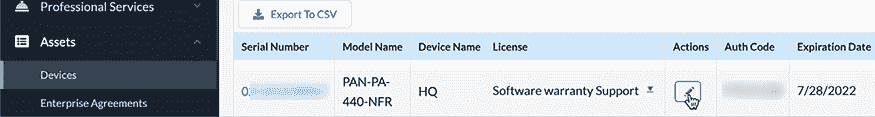

图 2.11：CSP 中的设备页面

您会注意到已经有一个软件保修支持许可证在有限时间内处于活动状态。这是一个临时支持许可证，如果您的设备到货时包装内已损坏，则允许启动 RMA。要添加实际的支持许可证和任何功能许可证，请单击 `Figure 2.11` 中显示的 `Actions` 列中的铅笔图标。这将调用弹出式功能激活窗口：

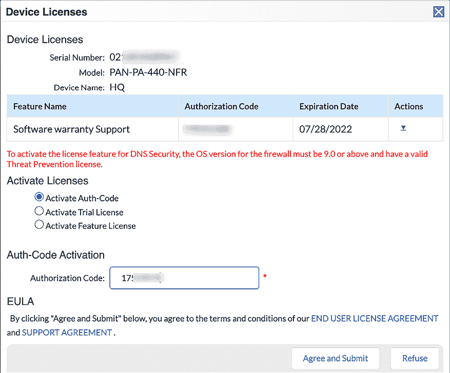

图 2.12：添加授权码以激活服务

添加所有许可证后，设备应如下所示：

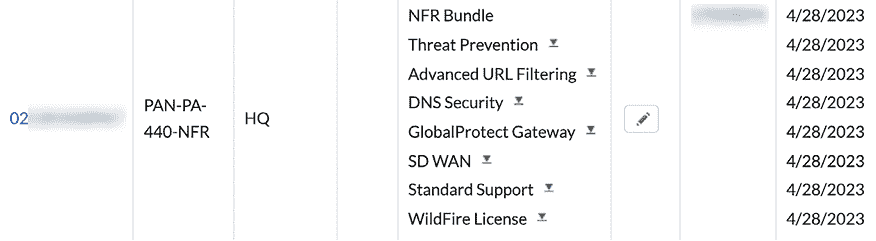

图 2.13：完全许可的设备

每个许可证旁边的下载图标可让您下载许可证密钥文件，以便将密钥上传到防火墙。如果您打算在没有互联网连接的情况下运行防火墙并希望能够上传签名文件并强制执行安全配置文件，则需要这样做。

除了通过支持门户激活许可证外，还可以直接从防火墙界面激活。

## 通过 Web 界面激活许可证

此过程要求管理界面具有互联网连接，并且能够通过 DNS 解析互联网域名。如果没有互联网连接，请参阅上一节了解如何下载许可证密钥。

要通过 Web 界面激活许可证，请导航到 `Device` | `Licenses`。如果您已在 CSP 中激活许可证然后继续下载许可证密钥文件，您可以单击 `Manually upload license key`。

如果您已在 CSP 上激活许可证并希望获取许可证，请单击 `Retrieve license keys from license server`。请确保防火墙已使用功能正常的默认网关和 DNS 服务器进行设置。

如果您想使用授权码激活新许可证，请单击 `Activate feature using authorization code`，您将看到一个弹出窗口，您可以在其中单独输入每个授权码：

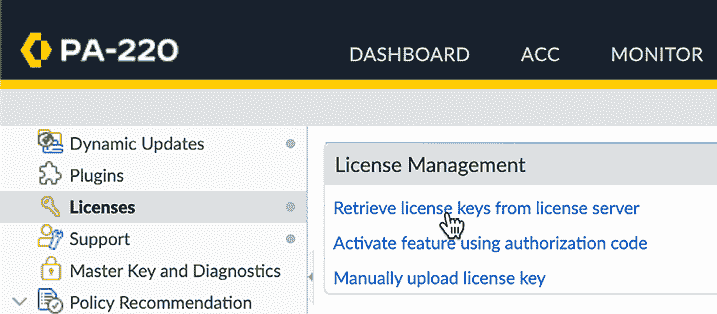

图 2.14：使用授权码激活许可证

每添加一个许可证，都会添加一个包含许可证信息的部分：

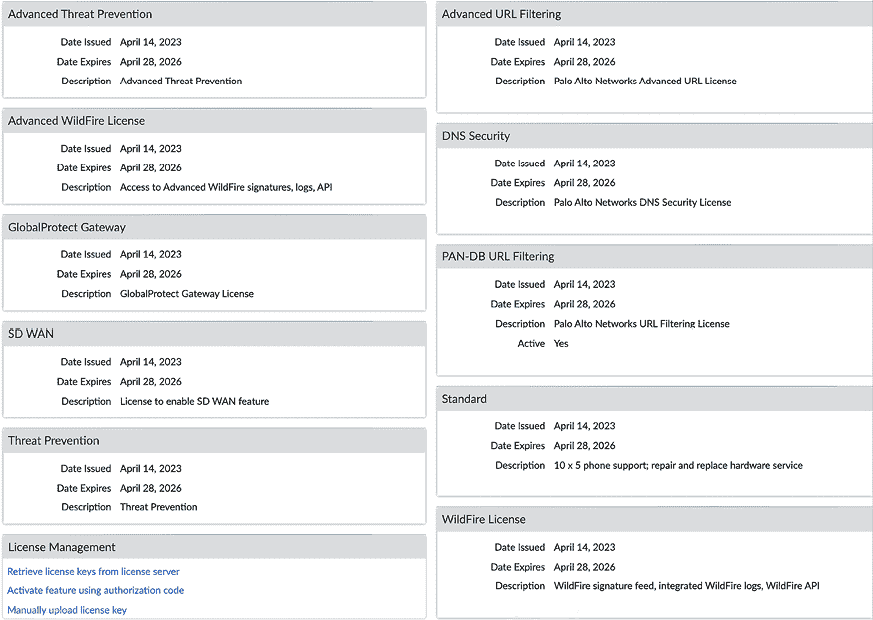

图 2.15：设备上的活动许可证

要激活支持许可证，您可能需要通过 `Support` 菜单项激活授权密钥：

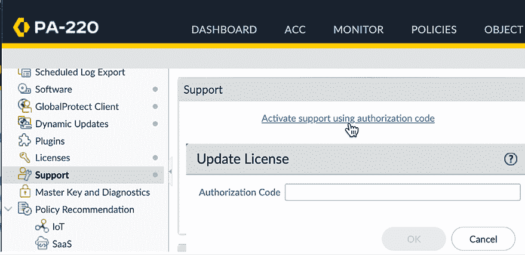

图 2.16：使用授权码激活支持

`Important note`

在硬件防火墙上，支持许可证更像是一份合同，而不是功能运行所需的许可证；如果出现问题，支持人员会接听您的电话，如果您的设备损坏，将发送替换设备，等等。这是唯一一个在功能开始运行之前不一定需要在设备上的许可证（即，所有基本功能在没有支持许可证的情况下也能工作）。

在 VM 防火墙上，支持许可证与 VM 的激活及其支持的 CPU 内核数量绑定，因此在 VM 系列上，您需要加载支持许可证。

在设备上激活所有许可证后，下一步是开始下载和安排对不同数据库的更新。

## 下载和安排动态更新

现在所有许可证都已激活，您可以设置动态更新并开始下载所有内容包。

导航到 `Device` 选项卡下的 `Dynamic Updates` 菜单，您可以在其中手动下载内容包并设置计划和安装首选项。第一次访问此菜单时，它可能看起来有点不对，因为可用的内容尚未加载到设备上。单击 `Check Now` 按钮以连接到更新服务器并获取系统可用的包，如图所示：

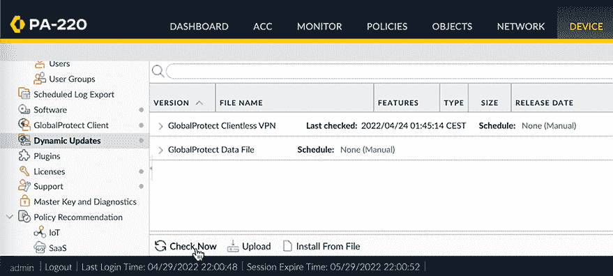

图 2.17：初始动态更新视图

获取更新后，您可能仍会注意到某些防病毒包缺失。这是因为设备首先需要使用所有应用 ID 和内容 ID 应用程序和解码器更新进行更新，然后才能将更多包加载到系统上。继续下载最新的 `Applications and Threats` 包：

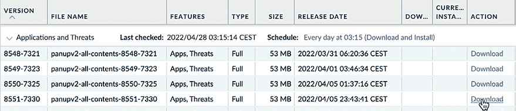

图 2.18：下载第一个应用程序和威胁包

`Important note`

如果未激活威胁防护许可证，则只能下载 `Applications` 包。这将通过包名称以 `panupv2-all-apps` 开头而不是 `panupv2-all-content` 以及 `FEATURES` 列仅列出 `Apps` 来指示。

包下载完成后，单击 `Install`。安装完成后，再次单击 `Check Now`，防病毒软件将可用。继续下载并安装最新的防病毒更新包。

`Important note`

URL 过滤和 DNS 安全没有更新包，因为 URL 会在云服务中查找然后存储在本地缓存中。

您现在可以通过单击 `Schedule` 后面的蓝色 `None (Manual)` 选项开始构建计划：

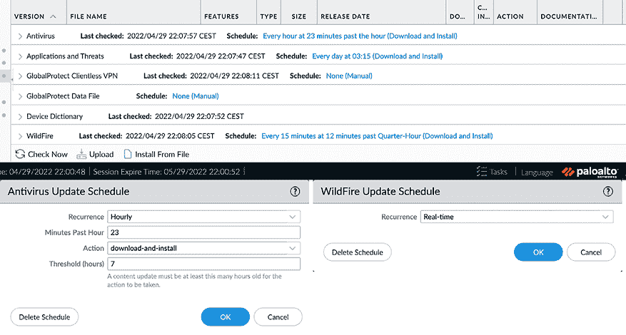

图 2.19：防病毒和 WildFire 计划

防病毒和 WildFire 计划看起来非常相似。它们都包含 `Recurrence` 参数，该参数告诉防火墙需要多频繁地检查更新。不过，两者的选项有所不同：

* `Antivirus` 的更新间隔选项为 `Weekly`、`Daily`、`Hourly` 或 `Manual`。
* `WildFire` 的更新间隔选项为 `Real-time`、`Every minute`、`15 minutes`、`30 minutes`、`1 hour` 或 `Never`。

当 `Recurrence` 设置为高于 1 分钟的任何值（15 或 30 分钟，或每小时）时，您还可以设置在该时间范围内实际检查应进行的分钟数。（例如，每小时过去 13 分钟，每刻钟 4 分钟等。）这有助于在出站互联网带宽受限的情况下防止与更新服务器的冲突更新连接。

`Action` 可以设置为仅 `download` 或 `download-and-install`。如果操作设置为 `download`，则需要手动安装。

`Threshold` 是防病毒更新与 `Applications and Threats` 共享的功能：

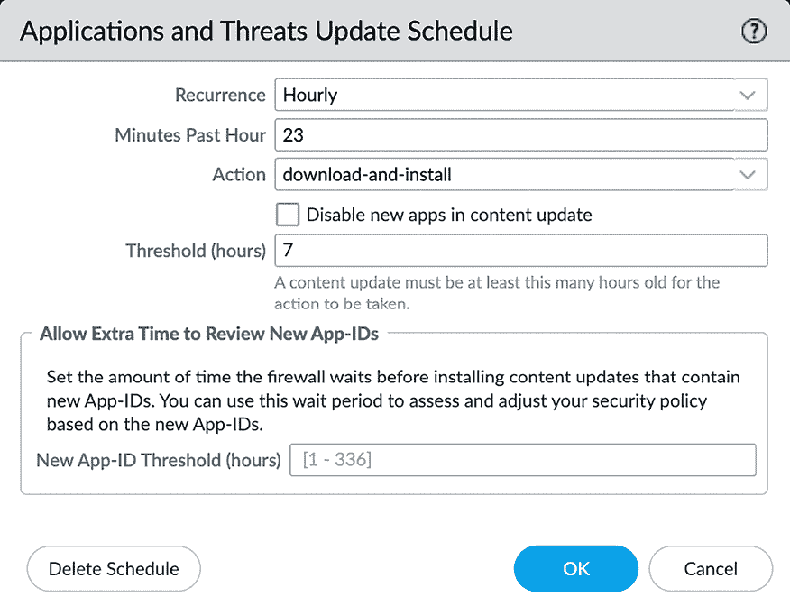

图 2.20：防病毒和 WildFire 计划


## 阈值
`Threshold` 是一个设置，用于将内容包的安装延迟设定小时数。当此阈值到期时，防火墙会检查是否有新的更新包。如果发现新包，则下载新包并将 `Threshold` 重置以进行另一次尝试。如果在第一次重置后又发现另一个更新包，计划将重置直至下一次完整发生。如果未检测到新包，则将按 `Threshold` 定义安装该包。

阈值延迟是一种防止安装有缺陷包的机制；如果厂商提供制作不佳的内容，则延迟以小时为单位设置，这应允许其他账户体验缺陷并将内容问题报告回支持团队。因此，内容可由管理员或厂商回滚。此阈值选项与公司对厂商错误风险的容忍度以及对组织新出现威胁的平衡相关。

### PCNSE 提示
根据 Palo Alto Networks 的最佳实践，以安全为先的方法是将阈值设置为 6 至 12 小时；然而，对于关键环境，阈值应为 24 小时。

`Application` 内容包还具有完全 `Disable new apps in content update` 的选项，或仅对应用 ID 启用单独的阈值以 `Allow Extra Time to Review New App-IDs`。其原因在于，今天被识别为网页浏览的内容，在明天安装 `Application` 内容包后可能会变成一个独特的应用程序。如果安全策略设置为仅允许之前已知的应用程序，这可能会导致用户突然无法访问该特定应用程序的问题。

`New App-ID Threshold` 设置允许您安排一个审查期，以查看在应用程序变为活动状态之前是否需要在安全策略中考虑任何应用程序。如果不需要操作，应用程序将自动变为活动状态。`Disable new apps in content update` 选项不会激活任何新应用程序，直到您手动审查并激活所有新应用程序为止。

### 重要说明
在撰写本文时，新应用程序的发布计划为每月第三个星期二。常规威胁包更新在星期二进行，但紧急更新会立即发送。

## 动态更新速查表
以下是安排动态更新的快速建议集：
1. 点击 `Check Now`。
2. 下载并安装最新的 `panupv2-all-contents` 或 `panupv2-all-apps` 包：
   * `panupv2-all-content` 包含所有应用 ID、间谍软件和漏洞更新。此包需要激活的 Threat Prevention 许可证才能成功安装。
   * `panupv2-all-apps` 仅包含应用 ID 更新，当设备上未激活 Threat Prevention 许可证时使用。
3. 点击 `Check Now`，这将使防病毒包可见。
4. 下载并安装最新的 `panup-all-antivirus` 包。
5. 设置 `Antivirus` 更新计划：
   * 每小时重复
   * 小时后 15 分钟
   * 下载并安装
   * 6 小时阈值
6. 如果您拥有 WildFire 订阅许可证，请将 `WildFire` 更新计划设置为 `Real-time`（高延迟互联网链路上的防火墙可设置为 1 分钟或 15 分钟更新间隔）。
7. 设置 `Applications and Threats` 更新计划：
   * 每 30 分钟
   * 半小时后 7 分钟
   * 下载并安装
   * 6 小时阈值
   * 如果新应用 ID 可以立即添加，请将 `Allow Extra Time to Review New App-IDs` 字段留空；如果安全团队希望在激活新应用程序之前进行审查，请设置为 48 小时阈值（或更长）

本节中的设置被视为最佳实践，因为它们确保动态更新的安排不会干扰其他计划任务，例如报告生成。阈值确保在经过一段时间后才应用更新，通过推迟实际安装然后在阈值时间重新检查可用的内容包来实现。如果由于错误或紧急更新而有新包可用，则下载新包并刷新阈值计时器。一旦再次达到阈值，流程就会重复，要么安装最新包，要么将更新推迟到下一次计划发生时间。不仅内容包需要频繁更新，而且新软件版本也会在固定时间发布以修复错误或引入新功能。现在让我们来看看升级防火墙所需的步骤。

## 升级防火墙
在本节中，您将学习如何升级防火墙以及需要采取哪些步骤以确保顺利进行。我们将回顾在准备维护窗口和提供应急计划时需要牢记的重要信息。深入的升级程序在第 8 章《Upgrading Firewalls and Panorama》中提供。

## 了解分区
在开始升级程序之前，有一些重要信息您需要了解。与大多数 Linux 系统一样，硬盘已被划分为特定段。这些段具有特定的用途。

其中几个重要的如下：
* `/` 是根分区，操作系统安装在此处
* `/opt/pancfg` 是存放配置文件和动态更新文件的位置
* `/opt/panrepo` 是下载的操作系统（PAN-OS）镜像的存储库
* `/opt/panlogs` 是存储 `logdatabase` 的分区

有一个隐藏的 `maint` 分区，只能在启动期间访问。该分区用于灾难恢复、恢复设备出厂设置以及磁盘问题。

可以使用以下命令查看磁盘空间使用情况：
```
admin@PA-440> show system disk-space
Filesystem      Size  Used Avail Use% Mounted on
/dev/mmcblk0p2   21G  5.9G   14G  31% /
none            7.8G   64K  7.8G   1% /dev
/dev/mmcblk0p5   32G   13G   18G  42% /opt/pancfg
/dev/mmcblk0p6   18G  9.6G  7.0G  58% /opt/panrepo
tmpfs           7.8G  3.8G  4.1G  48% /dev/shm
cgroup_root     7.8G     0  7.8G   0% /cgroup
/dev/mmcblk0p8   22G   11G  9.6G  53% /opt/panlogs
None
```

`/` 根分区的有趣之处在于它实际上是两个 `sysroot` 分区之一。系统已划分为两个操作系统专用分区，其中一次只挂载一个。升级程序将新的 PAN-OS 安装到非活动分区上。

这允许在不中断活动分区的情况下进行内联升级。一旦新的操作系统安装完成，GRUB 启动加载器将被配置为在下次启动时加载另一个 `sysroot` 分区，从而使新的 PAN-OS 处于活动状态：
```
admin@PA-440> debug swm status
Partition         State             Version
--------------------------------------------------------------------------------
sysroot0          RUNNING-ACTIVE    11.2.2-h1
sysroot1          REVERTABLE        11.2.0
maint             READY             11.2.2-h1
```

此机制还允许在升级失败且决定需要恢复到之前状态时顺利回滚。您可以通过触发 `> debug swm revert` 调试命令来指示启动加载器再次切换到之前的 `sysroot` 分区，并通过 `> request restart system` 重启系统。设备重新启动后，您将回到之前的 PAN-OS，并加载升级前的配置。

## 升级注意事项


## 升级规划

升级时，您需要规划当前位置、目标位置以及如何到达。您可以通过查看仪表板的**常规信息**部分并查找软件版本来确定当前位置。确定目标位置可能需要一些研究和考虑：

* 需要哪些功能？某个版本中是否有您需要的全新功能，还是您现有的功能运行良好？
* 代码分支是否“成熟”？新主要版本是否全新发布，新功能是否足以抵消早期采用者的风险？
* 是否存在优先于所需功能的未解决公告？计划升级到的版本中是否存在尚未修复的关键漏洞？
* 何时需要升级，何时升级是可选的？是否因漏洞或错误而必须直接升级，还是新版本中的功能会有所帮助？
* 您当前的 OS 代码分支是否即将达到生命周期终点？（您可以在此处查看生命周期终点日期：[`www.paloaltonetworks.com/services/support/end-of-life-announcements/end-of-life-summary`](https://www.paloaltonetworks.com/services/support/end-of-life-announcements/end-of-life-summary)）。

这些问题将帮助您确定哪些升级需要立即进行，哪些可以提前安排，可能在部署到生产环境之前进行更宽松的测试过程，甚至可以推迟到更成熟的维护版本可用时。让我们现在尝试回答这些问题。

### 需要哪些功能？

确定每个 PAN-OS 版本包含哪些功能需要最多的研究。您可以打开 [`docs.paloaltonetworks.com`](https://docs.paloaltonetworks.com) 并搜索 `Feature Guide`，它将返回主要 PAN-OS 版本的所有新功能指南。

### 代码分支是否“成熟”？

成熟度可以通过查看维护版本来估算。所有 PAN-OS 版本都由三个数字组成 – `PAN-OS X.Y.Z`（例如，`10.1.5`）：

* `X` 是主要软件版本的编号
* `Y` 是功能版本发布的编号
* `Z` 是维护版本的编号

`X` 会发生变化，当发布包含新功能且通常包含预期行为的某些更改以及可能的全新外观的新主要软件版本时。

每个新软件版本通常在发布后约 6 至 9 个月发布新的功能版本，主要包含一些新功能。维护版本会定期发布，间隔约 5 至 9 周，主要包含错误修复。

偶尔会出现以 `-hx` 结尾的 PAN-OS 版本名称，表示热修复。这是一种提前发布的维护版本，通常只包含一个或几个关键热修复（例如，`11.2.2-h1`）。

代码分支通常在 `x.y.4` 或 `x.y.5` 维护版本左右达到可靠的成熟度，此时可以相对安全地认为大多数关键错误已被发现并解决。

请查看发行说明中的已知问题，以便在存在任何注意事项时做好适当准备：[`docs.paloaltonetworks.com/pan-os/11-2/pan-os-release-notes.html`](https://docs.paloaltonetworks.com/pan-os/11-2/pan-os-release-notes.html)。

### 是否存在优先于所需功能的未解决公告？

有关应选择或避免哪些维护版本的公告可在 [`securityadvisories.paloaltonetworks.com/`](https://securityadvisories.paloaltonetworks.com/) 和 [`live.paloaltonetworks.com/t5/Customer-Resources/`](https://live.paloaltonetworks.com/t5/Customer-Resources/) 找到。

### 何时需要升级，何时升级是可选的？

每个主要版本都有一个基础映像，通常是 `x.y.0` 版本，其中包含 PAN-OS 映像的所有重要部分。

这使得后续的维护版本体积更小，仅包含关键更新。基础映像需要在安装维护版本之前下载到系统上。

从较低的主要版本升级时，并不需要安装基础映像即可安装维护版本。也不需要安装任何中间维护版本，除非发行说明明确提到存在需要中间步骤的问题。

例如，假设您的防火墙当前运行 `PAN-OS 11.0.4`，需要升级到 `PAN-OS 11.1.5`。您可以先下载 `PAN-OS 11.1.0` 基础映像，然后下载 `PAN-OS 11.1.5` 维护映像，然后直接安装并重启 `PAN-OS 11.1.5`。系统将直接从 `11.0.4` 升级到 `11.1.5`。

例如，如果您的防火墙当前运行 `PAN-OS 10.0.10`，并且您想升级到 `PAN-OS 11.1.5`，则需要先下载 `PAN-OS 10.1.0` 基础映像，并下载、安装并重启最新的维护版本（例如，`10.1.14`），然后才能安装 `PAN-OS 11.1.5`。

### 重要说明

在 `PAN-OS 10.1` 中，引入了一项新功能，允许在升级时跳过最多三个 PAN-OS 版本。将 `PAN-OS 9.1` 升级到 `PAN-OS 10.1` 时，您需要安装并重启到 `PAN-OS 10.0`。将 `PAN-OS 10.1` 升级到 `PAN-OS 11.1` 时，您可以直接升级到最新的 `11.1` 维护版本，无需安装 `10.2` 或 `11.0`。

您现在应该对何时以及为何需要升级以及如何决定升级到哪个版本有了良好的理解。在下一节中，我们将简要介绍通过不同方法进行的升级过程；有关更详细的升级过程，请参阅 *第 8 章*，*升级防火墙和 Panorama*。

## 通过 CLI 升级

使用 CLI，可以快速执行命令来执行任务。要通过 CLI 升级，您可以按照以下步骤操作：

1. 您首先需要检索可在系统上安装的可用软件映像。在检索到列表之前，您将无法下载任何映像：
```
admin@PA-440> request system software check
Version                          Size    Released on          Downloaded
-------------------------------------------------------------------------
11.2.2-h1                        749MB   2024/08/02 15:58:14  no      
11.2.1                           502MB   2024/07/08 12:04:42  no       
11.2.0-b3                        1228MB   2024/03/14 12:31:10  no       
11.2.0-b1                        1258MB   2024/02/06 14:20:41  no       
11.2.0                           1239MB   2024/05/02 10:15:34  no      
11.1.4-h1                        1015MB   2024/08/08 02:18:35  yes       
11.1.4                           946MB   2024/06/27 08:17:35  no       
11.1.3                           893MB   2024/05/14 15:14:14  no       
```

2. 接下来，您可以下载所需的 PAN-OS 版本。如果升级到新的主要版本，请记住先下载基础映像：
```
admin@PA-440> request system software download version 11.2.0
Download job enqueued with jobid 31
```

3. 您可以使用以下命令跟踪下载状态：
```
admin@PA-440> show jobs id 31
Enqueued            Dequeued ID Type   Status Result Completed
--------------------------------------------------------------
2024/08/22 23:24:15 23:24:15 31 Downld FIN    OK     23:25:31 
Warnings:
Details:Successfully downloaded
Preloading into software manager
Successfully loaded into software manager  
```

4. 随后进行维护版本：
```
admin@PA-440> request system software download version 11.2.2-h1
Download job enqueued with jobid 32
```


### 5. 安装软件
当软件成功下载后，您可以开始将其安装到系统上。系统会提示需要重启才能完成安装，并确认您是否确定要继续。输入 `Y` 继续安装：
```
admin@PA-440> request system software install version 12.2.2-h1
Executing this command will install a new version of software. It will not take effect until system is restarted. Do you want to continue? (y or n)
Software install job enqueued with jobid 32. Run `show jobs id 32` to monitor its status. Please reboot the device after the installation is done.
```

### 6. 跟踪安装
您可以通过 `show jobs` 命令跟踪安装进度：
```
admin@PA-440> show jobs id 32
Enqueued            Dequeued ID Type   Status Result Completed
--------------------------------------------------------------
2024/08/22 23:35:28 23:35:28 32 SWInstall FIN OK     23:38:59 
Warnings:
Details:Software installation successfully completed. Please reboot to switch to the new version.
```

### 7. 重启防火墙
为完成安装，请重启防火墙。如果您确定要继续重启，请在对话框中输入 `Y`。重启会导致所有会话中断，并且在防火墙完成 `autocommit` 作业之前不会接受新的会话：
```
admin@PA-440> request restart system
Executing this command will disconnect the current session. Do you want to continue? (y or n)
```

### 8. 自动提交作业
`autocommit` 作业在重启后立即运行，用于将配置加载到数据平面。软件升级后，此过程可能需要一段时间：
```
admin@PA-440> show jobs all
Enqueued            Dequeued ID Type   Status Result Completed
--------------------------------------------------------------
2021/12/31 23:44:27 1523:44:27 1  AutoCom FIN   OK      23:44:36 
```

如果您更喜欢通过 Web 界面升级防火墙，请遵循下一节中概述的流程。

## 通过 Web 界面升级
软件映像可以从 `Device` | `Software` 菜单下载和安装。首次访问此页面时，由于尚未加载任何存储库，您将看到错误消息：


图 2.21：首次访问软件页面时的错误消息

您可以忽略此警告；点击 `Close`，然后点击 `Check Now`。一旦存储库加载完成，您将看到所有可用的软件映像。如果您想安装某个维护版本并确保满足所有要求，从 PAN-OS 10.2 开始，您可以点击 `Validate` 按钮，系统将检查该版本可能有哪些要求以及您是否已下载它们。这将显示以下内容：

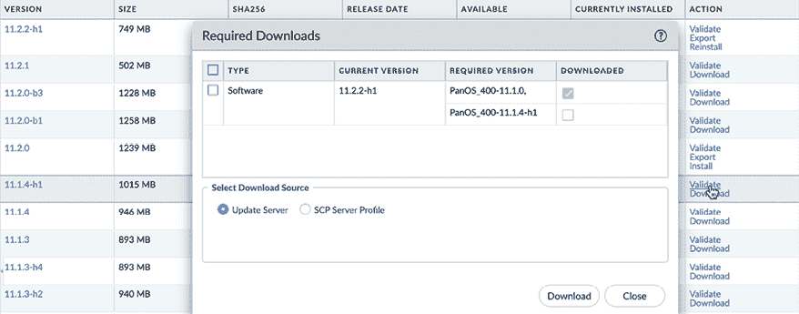
图 2.22：验证操作

点击要升级到的 PAN-OS 版本旁边的 `Download` 链接，并等待下载对话框完成：

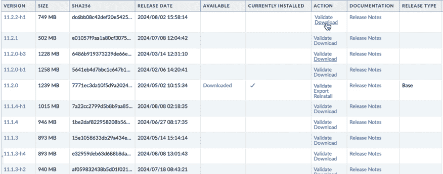
图 2.23：软件管理页面

新的 PAN-OS 软件包下载完成后，将在 `Software` 页面上列出，如图所示。点击映像旁边的 `Install` 链接开始安装：

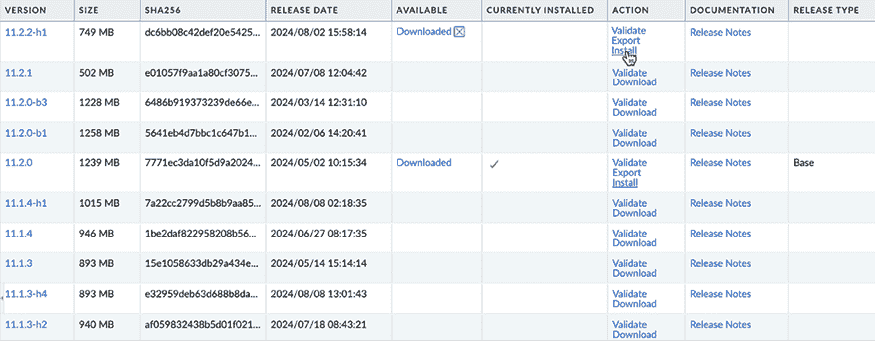
图 2.24：映像已下载并准备安装

安装结束时，系统会提示您重启。如果您想将实际升级推迟到以后，可以跳过重启。否则，请点击 `Yes`，如下所示：

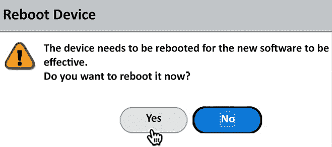
图 2.25：安装后重启对话框

如果在升级后返回 `Software` 页面，您可能会注意到并非所有 PAN-OS 选项都列出；这是由于一项新功能，可以过滤所有 `Preferred Releases` 和 `Base Releases`，这些选项默认启用。这些反映了 Palo Alto 推荐的软件版本或便于访问的基础映像。禁用这两个复选框将再次显示所有可用的操作系统版本。

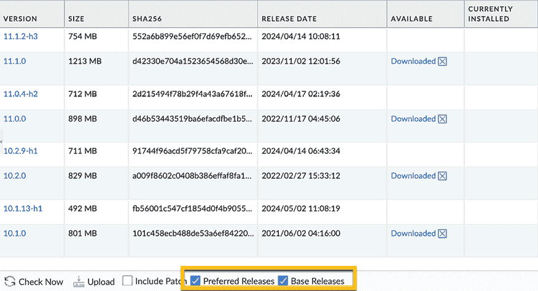
图 2.26：首选和基础版本筛选器

### 升级速查表
这是一份升级速查表，可帮助您准备和规划升级。这些步骤概述了一种稳健的方法，可在将防火墙投入生产之前达到稳定的 PAN-OS 版本：
1. 访问 [客户资源](https://live.paloaltonetworks.com/t5/Customer-Resources/) 获取版本建议。
2. 在 `Device` | `Software` 中，点击 `Check Now` 加载最新的 PAN-OS 映像列表。
3. 下载并安装当前版本的推荐映像。
4. 安装完成后，对话框会询问是否要重启设备。点击 `Yes`。
5. 等待设备重新启动并下载下一个主要版本的基础映像。
6. 下载并安装下一个主要版本的推荐维护版本。
7. 当对话框要求您重启设备时，点击 `Yes`。
8. 重复步骤 `5` 到 `7`，直到达到所需的版本或达到 PAN-OS 10.1，此时您可以跳过最多三个操作系统版本。

请记住，对于 HA 集群或 Panorama 环境，您需要执行以下操作：
* 在开始之前禁用 `High Availability` 配置中的抢占，并在两个成员都完成升级后重新启用
* 在开始之前检查两个成员的功能。升级后的设备在最低成员追上之前将无法正常工作（集群优先考虑软件版本最低的成员）
* 在升级任何设备之前，先升级 Panorama 集中管理

您现在已确保防火墙已完全设置好以取得成功，因为内容包会自动下载和安装，并且已安装适当的 PAN-OS 固件。接下来，我们将查看如何确保管理接口配置安全设置。

## 加固管理接口
管理接口必须保持安全，并且访问应仅限于需要访问的管理员。建议将物理管理接口放置在 `Out-of-Band` (`OoB`) 网络中，以限制对更广网络的暴露。如果需要从不同网络访问管理服务器，最好设置一台双宿堡垒主机来中介连接，要么只允许管理员登录并从那里使用服务，要么将其设置为（透明）代理，并记录所有会话，同时尽可能限制源用户和 IP 子网。管理员账户也需要设置，使其仅能访问所需的配置部分并使用外部身份验证。让我们详细了解这些不同的场景。

## 通过访问列表限制访问
管理接口本地访问列表可以通过导航到 `Device` | `Setup` | `Interfaces` 并点击 `Management Interface` 来编辑：

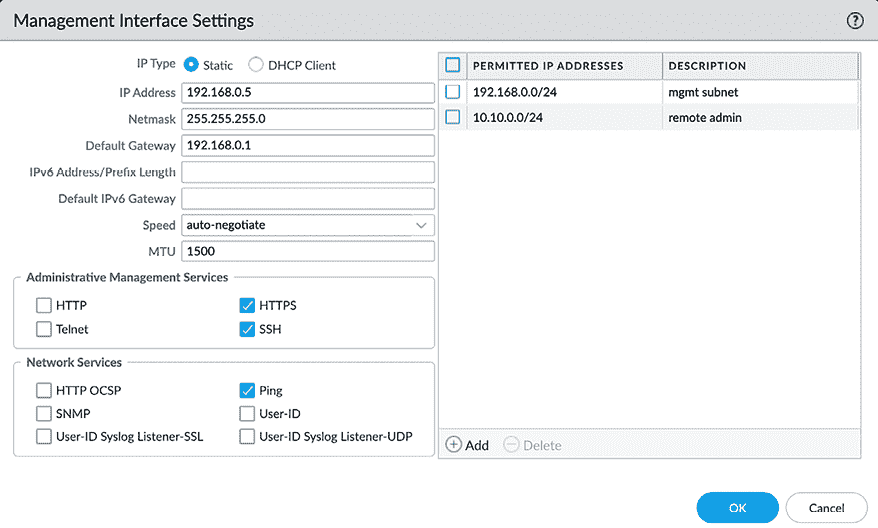
图 2.27：管理接口访问列表

关联的 CLI `configure` 模式命令如下：
```
admin@PA-440>configure
admin@PA-440>set deviceconfig system permitted-ip 192.168.0.0/24 description "mgmt subnet"
```

您还可以将接口管理配置文件（如下图所示）附加到接口上，这将在分配的数据平面接口的 IP 地址上启用所选服务（通常为 `SSH` 和 `HTTPS`）。如果未正确实施，这会带来重大风险，因此不建议这样做：

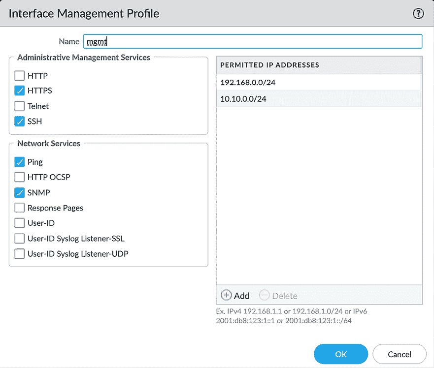
图 2.28：接口管理配置文件


## 接口管理配置文件

如果必须启用此配置文件，请确保它位于足够屏蔽的接口上，最好是环回接口，并且该接口具有与访问管理服务相关的安全策略。作为次要措施，还请在该配置文件上启用访问列表。

这些配置文件可在 **Network** | **Network Profiles** | **Interface Management Profile** 中进行配置，然后在所选接口的 **Advanced** 选项卡下，在 **Network** | **Interfaces** 中将其附加到接口：

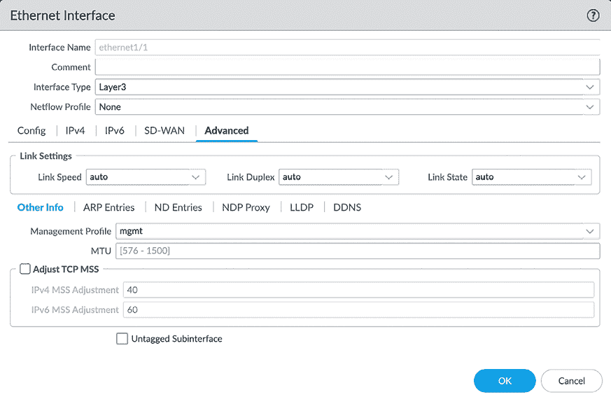

图 2.29：已附加到接口的接口管理配置文件

创建接口管理配置文件、将其服务设置为 HTTPS 和 SSH 并添加访问控制列表（ACL）的 CLI 命令如下：

```
### set network profiles interface-management-profile mgmt https yes ssh yes permitted-ip 10.15.15.37
```

后续的 ACL 项可通过以下命令设置：

```
### set network profiles interface-management-profile mgmt permitted-ip 192.168.0.5
```

作为最佳实践，切勿在面向互联网的接口上配置管理配置文件。

现在管理接口的访问已设置，让我们来看一下来自管理接口的访问。

## 从离线管理访问互联网资源

如果管理接口无法访问互联网，这会带来有趣的挑战，因为它将无法检索更新或执行云查找。一种变通方法是启用服务路由，将特定应用程序、服务或协议通过背板路由到指定的数据平面接口，从而允许管理平面访问互联网，而其物理接口没有超出其管理 LAN 的访问权限。

服务路由可从 **Device** | **Setup** | **Services** 菜单进行配置，您可以在其中单击 **Service Route Configuration** 以打开以下对话框：

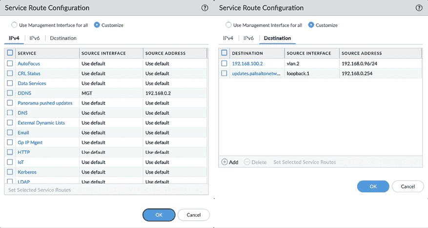

图 2.30：服务路由配置

以下是预定义服务路由用途的简要概述：

*   **AutoFocus**：直接连接到 AutoFocus 订阅服务，以便您可以直接从防火墙 Web 界面使用它
*   **CRL Status**：在处理证书时（例如在 TLS 握手期间）获取 **证书吊销列表** (**CRL**) 信息
*   **Data Services**：用于数据平面到 Palo Alto 云服务的数据上行链路，用于 IoT、DLP 和 SaaS 订阅服务
*   **DDNS**：使用 **动态域名系统** (**DDNS**) 更新接口 IP
*   **Panorama pushed updates**：从 Panorama 部署的内容和软件更新（这些更新由 Panorama 触发，但由防火墙发起）
*   **DNS**：系统 DNS 查找
*   **External Dynamic Lists**：获取已配置的 **外部动态列表** (**EDLs**) 的更新
*   **Email**：系统发出的电子邮件
*   **Gp IP Mgmt**：GlobalProtect IP 分配的外部 DHCP
*   **HSM**：**硬件安全模块** 是维护用于 SSL/TLS 解密的证书私钥的远程系统
*   **HTTP**：系统 HTTP 转发
*   **Kerberos**：Kerberos 身份验证
*   **LDAP**：**轻型目录访问协议** 连接
*   **MDM**：**移动设备管理器** 连接
*   **Multi-Factor Authentication**：**多因素身份验证** 服务器
*   **NetFlow**：网络统计的 NetFlow 收集器
*   **NTP**：**网络时间协议** 更新
*   **Palo Alto Networks Services**：来自 Palo Alto Networks 和 WildFire 沙箱连接的更新
*   **Panorama**：连接到 Panorama 管理服务器
*   **Panorama Log Forwarding**：发送到日志收集器的日志（仅用于 PA_5200 机箱）
*   **Proxy**：连接到系统代理
*   **RADIUS**：**远程身份验证拨入用户服务** 连接
*   **SCEP**：用于请求和分发客户端证书的 **简单证书注册协议** 连接
*   **SNMP Trap**：向 SNMP 服务器发送 SNMP 统计信息
*   **Syslog**：Syslog 消息服务器
*   **TACACS+**：**终端访问控制器访问控制系统 Plus** 身份验证
*   **UID Agent**：用户 ID 代理连接
*   **URL Updates**：URL 过滤实时查找服务
*   **VM Monitor**：虚拟机监控
*   **WildFire Private**：连接到私有 WildFire 服务器
*   **Ztp**：连接到 ZTP 服务

一旦将单选按钮从 **Use Management Interface for all** 设置为 **Customize**，您将能够为每个服务选择将使用哪个源接口。从 **Destination** 选项卡，您还可以添加需要从特定接口路由出去的特定 IP 地址或整个子网。目标接口使用的路由表将决定会话如何路由到目标，因此服务路由只能附加到 OSI 第 3 层接口。

设置服务路由的关联 CLI 配置命令如下：

```
#set deviceconfig system route service dns source interface ethernet1/8 address 192.168.0.15
```

如果您想查看所有可用服务的完整列表，请在输入 `service` 后按 `Tab` 键：

```
#set deviceconfig system route service <Tab>
  autofocus                    AutoFocus Cloud
  crl-status                   CRL servers
  ddns                         DDNS server(s)
  ...
```

这将启用通常无法通过管理网络访问的资源访问。在下一节中，我们将准备管理员帐户并根据需要提供访问权限。

## 管理员帐户

“admin” 帐户可能是互联网历史上被滥用最严重的帐户之一，因此您的下一个任务是将其删除并替换为命名帐户。最好不要使用默认的“admin”帐户，而是使用命名帐户，以便可以按用户跟踪更改并轻松授予个性化访问权限。

导航到 **Device** | **Administrators** 选项卡以查看本地管理员。创建新的管理员帐户时，有两种类型的帐户可供选择，**Dynamic** 和 **Role Based**，您可以通过设置 **Administrator Type** 切换按钮来选择：

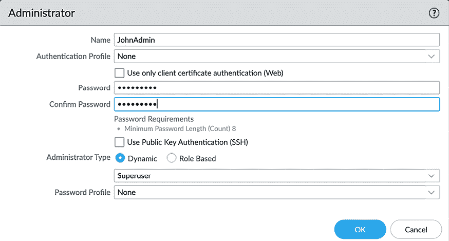

图 2.31：创建新的管理员帐户

首先，我们来看看动态帐户配置文件及其优势。

### 动态帐户

动态帐户可能为以下类型：

*   **Superusers** 可以执行所有操作。他们是唯一允许执行某些任务（如创建其他管理员帐户或创建技术支持文件）的用户。
*   **Device administrators** 可以执行除创建新用户或虚拟系统之外的所有操作。
*   具备虚拟系统功能的设备还具有 **virtual system administrators**，他们也是设备管理员，并被限制在一个或多个特定虚拟系统上。
*   还有只读版本，可以查看所有内容但不能进行更改。

您的第一个帐户需要是新的超级用户，以替换默认的 admin 帐户。

### 基于角色的管理员

一旦创建了所有必需的超级用户和设备管理员，就可以为仅需要有限功能的团队添加额外的基于角色的管理员。基于角色的管理员可以自定义到单个菜单项，以便他们可以执行任何操作或具有只读或无访问权限。

可以通过 **Device** | **Admin Roles** 菜单配置角色：

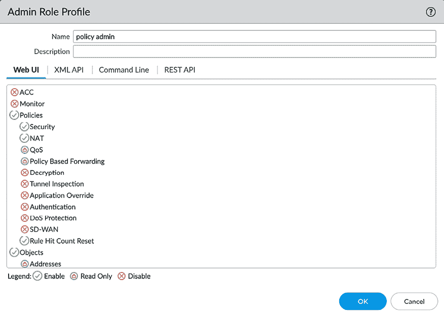

图 2.32：管理员角色配置文件

通过单击图标循环到所需的选项，将每个主题设置为以下选项之一：

*   红色叉号表示这些管理员将看不到菜单项
*   锁表示管理员将能够查看对象或菜单项，但不能进行任何更改
*   绿色复选标记表示管理员对该菜单项具有完全访问权限，并且可以对其中的对象或配置进行更改


## API 和命令行权限

在 `XML API`/`REST API` 选项卡中，每个角色可以被授予或拒绝访问某些 API 调用的权限：

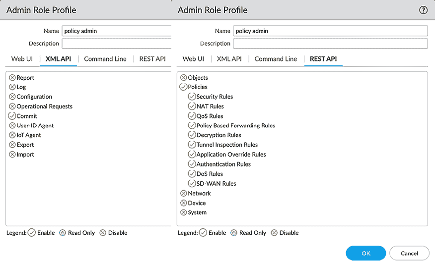

图 2.33：XML API/REST API

在 `Command Line` 选项卡中，每个角色可以被授予一定级别的访问权限或完全拒绝访问：

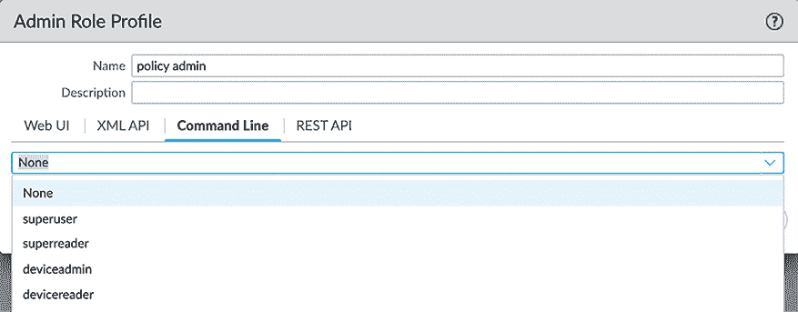

图 2.34：命令行权限

现在我们能够设置管理员账户，也应创建密码安全配置文件以防止密码管理不善。

## 密码安全

您需要通过前往 `Device` | `Password Profiles` 添加密码配置文件，以确保密码定期更改：

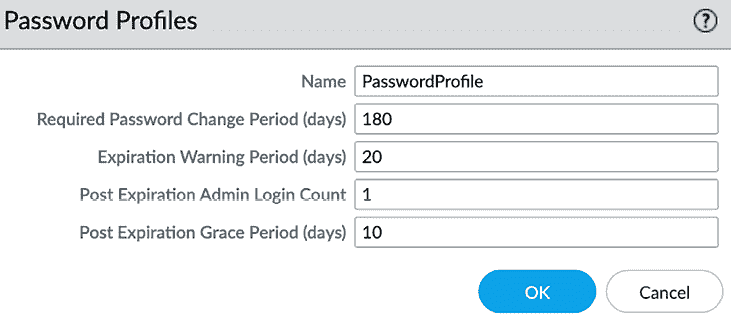

图 2.35：密码配置文件

`Password Profiles` 中的可配置设置如下：

* The change period indicates how long a password is valid
* 更改周期表示密码的有效时长
* The expiration warning pops up a warning when an admin logs on if their password is about to expire
* 到期警告在管理员登录时，如果密码即将过期则弹出警告
* The post-expiration login feature allows the admin to log on a certain number of times, even after their password has expired
* 过期后登录功能允许管理员在密码过期后仍可登录一定次数
* The post-expiration grace period indicates how long an admin will be able to log on after their account has expired before it is locked permanently and will require intervention from a different admin
* 过期后宽限期表示管理员在账户过期后仍可登录多长时间，之后账户将被永久锁定并需要其他管理员介入

此外，您还应通过 `Device` | `Setup` | `Management` | `Minimum Password Complexity` 为本地账户强制执行最小密码复杂度，以确保管理员不使用弱密码：

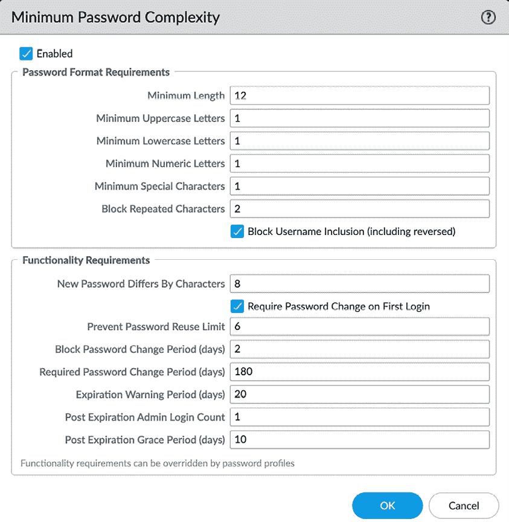

图 2.36：最小密码复杂度

NIST 提供了关于身份验证和生命周期管理的详尽指南，可在 [`pages.nist.gov/800-63-3/sp800-63b.html`](https://pages.nist.gov/800-63-3/sp800-63b.html) 找到。

现在让我们来看外部身份验证因素。

## 外部身份验证

最好使用 Kerberos、LDAP、RADIUS 或 SAML 等外部身份验证因素来在集中式系统中控制凭据，这使得管理员只需更改一次密码即可用于多个设备，或在他们离开组织时一次性被锁定在所有关键基础设施之外。

保留一个“应急”本地账户作为保障，以防管理界面完全失去对外部身份验证服务器的访问。此账户仅应在紧急情况下使用，并在账户用于登录时发送警报。有关如何设置在账户使用时发送警报的配置文件的说明，请参阅 *第 9 章*、*日志记录和报告*。

您首先需要从 `Device` | `Server Profiles` 菜单创建服务器配置文件。每种服务器类型都有自己的配置参数。以下配置文件可用：

* `TACACS+` (`Terminal Access Control Access Control System Plus`) is an authentication protocol developed by Cisco that is still used in many environments for terminal access authentication.
* `TACACS+` (`Terminal Access Control Access Control System Plus`) 是由 Cisco 开发的身份验证协议，至今仍在许多环境中用于终端访问身份验证。
* `LDAP` (`Lightweight Directory Access Protocol`) is probably one of the most commonly available protocols to authenticate against directory services and will work with Microsoft Active Directory, eDirectory, and custom LDAP servers.
* `LDAP` (`Lightweight Directory Access Protocol`) 可能是用于对目录服务进行身份验证的最常见协议之一，可与 Microsoft Active Directory、eDirectory 和自定义 LDAP 服务器配合使用。
* `RADIUS` (`Remote Authentication Dial-in User Service`) is an open standard authentication protocol that is widely used in remote access authentication.
* `RADIUS` (`Remote Authentication Dial-in User Service`) 是一种开放标准的身份验证协议，广泛用于远程访问身份验证。
* `Kerberos` is an authentication protocol that is mostly used for single sign-on and relies on a negotiation that does not require the exchange of passwords.
* `Kerberos` 是一种身份验证协议，主要用于单点登录，并依赖于无需交换密码的协商。
* `SAML` (`Security Assertion Markup Language`) uses an XML framework to exchange security information and is mostly used with cloud-based `identity providers` (`IdPs`). It integrates with `multi-factor authentication` (`MFA`) very easily.
* `SAML` (`Security Assertion Markup Language`) 使用 XML 框架交换安全信息，主要与基于云的 `identity providers` (`IdPs`) 配合使用。它能非常轻松地与 `multi-factor authentication` (`MFA`) 集成。
* Multi-factor profiles allow for several built-in MFA providers to be configured and added separately to an authentication profile.
* 多因素配置文件允许配置多个内置 MFA 提供程序并将其单独添加到身份验证配置文件中。

让我们来看一下这些配置文件的每个配置以及如何设置其基本配置。

### TACACS+ 服务器配置文件

TACACS+ requires you to choose between `Password Authentication Protocol` (`PAP`) and `Challenge-Handshake Authentication Protocol` (`CHAP`) and set the secret associated with connecting to the TACACS+ authentication server.

TACACS+ 要求您在 `Password Authentication Protocol` (`PAP`) 和 `Challenge-Handshake Authentication Protocol` (`CHAP`) 之间进行选择，并设置与连接 TACACS+ 身份验证服务器关联的密钥。

Optionally, you can set the profile so that it can only be used for administrator authentication, and set the profile to use a single session for all authentication events, rather than a new session per authentication event:

可选地，您可以设置配置文件使其仅用于管理员身份验证，并设置配置文件对所有身份验证事件使用单个会话，而不是每个身份验证事件使用新会话：

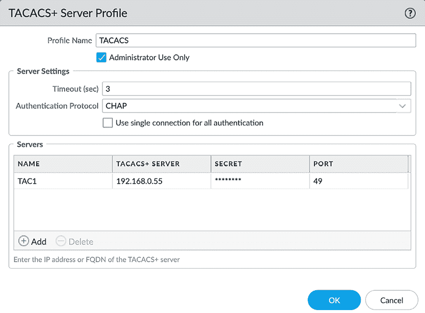

图 2.37：TACACS+ 服务器配置文件

While TACACS+ is somewhat rare, LDAP authentication is very common.

虽然 TACACS+ 有些罕见，但 LDAP 身份验证非常常见。

### LDAP 服务器配置文件

For an LDAP profile, you need to provide the type of the LDAP server, which can be `active-directory`, `E-directory`, `sun`, or `other`.

对于 LDAP 配置文件，您需要提供 LDAP 服务器的类型，可以是 `active-directory`、`E-directory`、`sun` 或 `other`。

You need to provide a `Base DN` value, which is the domain name (or the distinguished name) of the LDAP tree. The `Bind DN` field is for the user account that will be used to connect to the LDAP server and perform the request and its password. `Bind DN` can be fully qualified, as shown in the following screenshot, or be a `user principal name` (`UPN`) formatted as `user@domain`:

您需要提供 `Base DN` 值，即 LDAP 树的域名（或可分辨名称）。`Bind DN` 字段用于将用于连接到 LDAP 服务器并执行请求的用户账户及其密码。`Bind DN` 可以是完全限定的，如以下屏幕截图所示，或采用 `user principal name` (`UPN`) 格式为 `user@domain`：

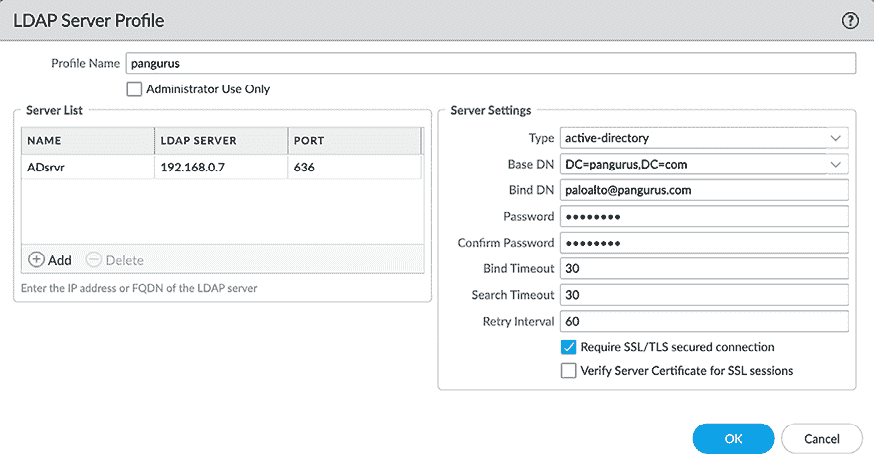

图 2.38：LDAP 服务器配置文件

One thing to remember is that when you configure the server IPs and you have `Require SSL/TLS secured connection` enabled, the default port for LDAPS is `636`, rather than `389`.

需要注意的是，当您配置服务器 IP 且启用了 `Require SSL/TLS secured connection` 时，LDAPS 的默认端口为 `636`，而不是 `389`。

If your LDAP server has an externally signed certificate, enable `Verify Server Certificate for SSL sessions` to ensure the authenticity of your server. For the certificate check to work, the LDAP server root and intermediary certificates need to be in the device certificate store in `Device` | `Certificate Management` | `Certificates` | `Device Certificates`. The server name in the profile must match the `fully qualified domain name` (`FQDN`) certificate and `Subject AltName` attribute for this check to pass.

如果您的 LDAP 服务器具有外部签名的证书，请启用 `Verify Server Certificate for SSL sessions` 以确保服务器的真实性。要使证书检查生效，LDAP 服务器根证书和中间证书需要在 `Device` | `Certificate Management` | `Certificates` | `Device Certificates` 中的设备证书存储中。配置文件中的服务器名称必须与 `fully qualified domain name` (`FQDN`) 证书和 `Subject AltName` 属性匹配，才能通过此检查。

### RADIUS 服务器配置文件

RADIUS is one of the most popular authentication methods and supports the following authentication protocols:

RADIUS 是最受欢迎的身份验证方法之一，支持以下身份验证协议：

* PEAP-MSCHAPv2: `Protected Extensible Authentication Protocol` (`PEAP`) with Microsoft CHAP v2 provides improved security over PAP or CHAP by transmitting both the username and password in an encrypted tunnel.
* PEAP-MSCHAPv2：`Protected Extensible Authentication Protocol` (`PEAP`) 与 Microsoft CHAP v2 通过在加密隧道中传输用户名和密码，提供比 PAP 或 CHAP 更高的安全性。
* PEAP with `Generic Token Card` (`GTC`): PEAP with GTC enables the use of one-time tokens in an encrypted tunnel.
* PEAP with `Generic Token Card` (`GTC`)：PEAP with GTC 允许在加密隧道中使用一次性令牌。
* EAP-TTLS with PAP: `Extensible Authentication Protocol` (`EAP`) with `Tunneled Transport Layer Security` (`TTLS`) and PAP is used to transport plain text credentials for PAP in an encrypted tunnel. EAP-TTLS uses certificates to secure the connection and should be the preferred protocol as it is the most secure.
* EAP-TTLS with PAP：`Extensible Authentication Protocol` (`EAP`) 与 `Tunneled Transport Layer Security` (`TTLS`) 和 PAP 用于在加密隧道中传输 PAP 的明文凭据。EAP-TTLS 使用证书保护连接，应为首选协议，因为它是安全性最高的。
* CHAP: Used if the RADIUS server does not support EAP or PAP or is not configured for it.
* CHAP：如果 RADIUS 服务器不支持 EAP 或 PAP 或未为其配置，则使用。
* PAP: Used if the RADIUS server does not support EAP or CHAP or is not configured for it.
* PAP：如果 RADIUS 服务器不支持 EAP 或 CHAP 或未为其配置，则使用。

Palo Alto Networks uses vendor code `25461`.

Palo Alto Networks 使用厂商代码 `25461`。

Like the other profiles, RADIUS can be set so that it is only used for administrator authentication. The `Allow users to change passwords after expiry` option is limited to GlobalProtect users if the profile is also used to authenticate GlobalProtect inbound connections.

与其它配置文件类似，RADIUS 可以设置为仅用于管理员身份验证。如果配置文件还用于身份验证 GlobalProtect 入站连接，则 `Allow users to change passwords after expiry` 选项仅限于 GlobalProtect 用户。

The `Make Outer Identity Anonymous` option ensures the admin username is not visible for anyone sniffing the authentication sessions if PEAP-MSCHAPv2, PEAP with GTC, or EAP-TTLS are used and the server supports this:

`Make Outer Identity Anonymous` 选项可确保如果使用 PEAP-MSCHAPv2、PEAP with GTC 或 EAP-TTLS 且服务器支持此功能，则任何嗅探身份验证会话的人都无法看到管理员用户名：

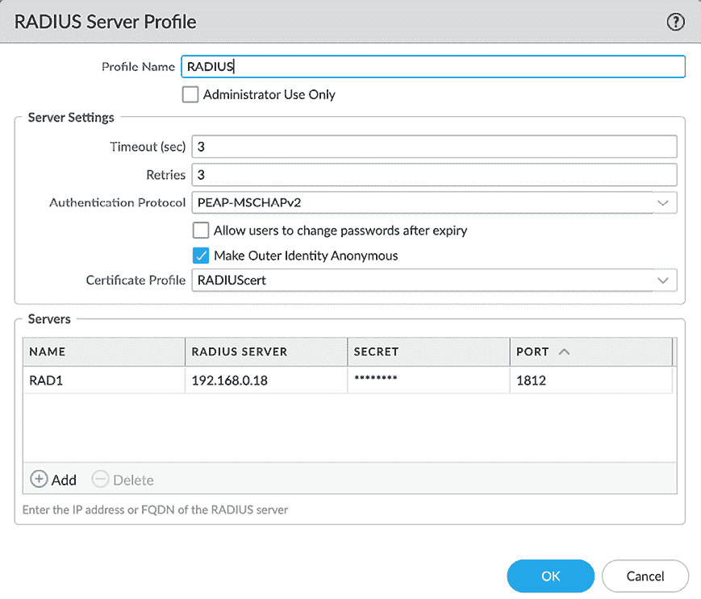

图 2.39：RADIUS 服务器配置文件


RADIUS 服务器配置文件的证书验证需要一个证书配置文件，该配置文件允许执行的检查比 TACACS+ 中仅在受信任证书存储中拥有根证书要多。可以使用多种机制来验证服务器的有效性，并且如果证书检查满足特定条件，可以采取行动，例如如果证书有效但已过期，则选择允许或阻止会话：

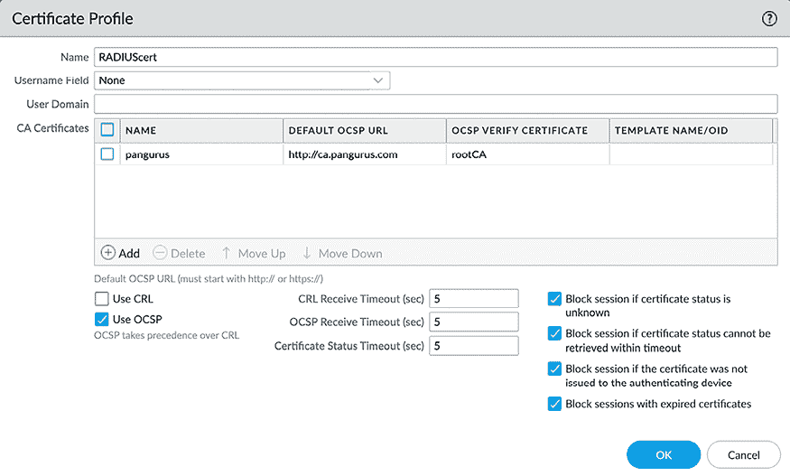

图 2.40：证书配置文件

## Kerberos 服务器配置文件
Kerberos 服务器配置文件配置起来非常简单，因为它只需要 IP 地址或 FQDN 以及端口号，但确实需要一些特定的配置设置：
* 防火墙需要在 **Device** | **Setup** | **Management** | **General Settings** 中设置域
* 防火墙需要从 **Device** | **Setup** | **Services** 同步到 **Network Time Protocol** (**NTP**) 服务器，以便其时钟与本地 `ActiveDirectory` 服务器保持同步
* 其 DNS 服务器需要设置为加入域的内部 DNS 服务器，而不是外部 DNS 服务器

下图显示了这一点：

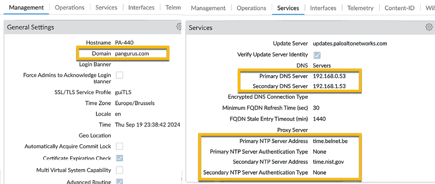

图 2.41：Kerberos 要求

随着单点登录的采用率不断上升，以及许多身份验证服务转向云端，SAML 身份验证的普及度也在不断提高。

## SAML 服务器配置文件
SAML 配置文件可实现针对外部 **single sign-on** (**SSO**) 提供商（如 PingID 和 Okta）的身份验证。

您的 IdP 应向您提供以下内容：
* 一个标识符，以便它可以证明身份验证会话是否源自您
* 根证书和中间证书，您可以将其加载到 **Device** | **Certificate Management** | **Device Certificates** 以验证 SSO 和 **single log-out** (**SLO**) 站点的身份
* 一个 SSO URL
* 一个 SLO URL

SAML HTTP 绑定提供 `post` 选项，该选项将 Base64 编码的 HTML 表单发送到 IdP，或 `redirect`，在这种情况下，防火墙将在 URL 参数中发送 Base64 编码和 URL 编码的 SSO 消息。

您可以使用用于签名请求的证书对发送到 IdP 的 SAML 消息进行签名，该证书可在身份验证配置文件中进行配置：

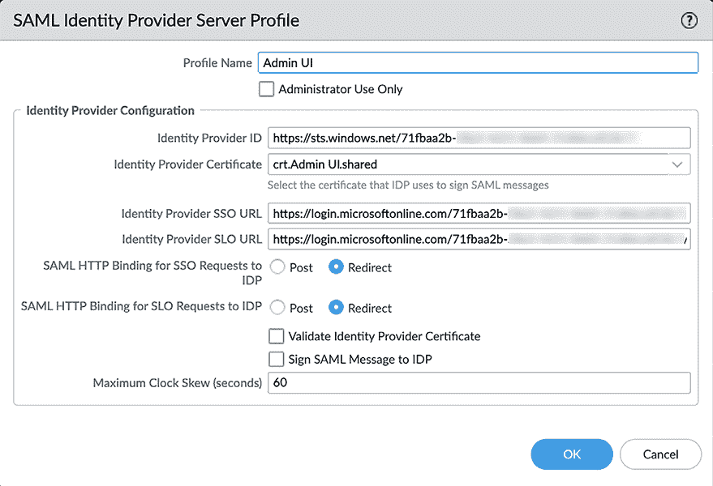

图 2.42：SAML 身份提供者服务器配置文件

## MFA 配置文件
强烈建议添加 MFA，因为普通密码需要每个管理员保持良好的卫生习惯，并且可能被无意中共享、窃取或猜测。如果您的常规身份验证不支持集成 SMS、推送消息、令牌等附加因素，您可以添加 MFA 配置文件并将额外配置文件添加到身份验证配置文件中。

目前，有四个 MFA 提供商可作为独立配置文件使用：Duo、Okta、RSA 和 PingID。要配置此配置文件，您需要从提供商处获取一些参数。

例如 API 主机等设置可能取决于您的地理位置，而密钥和密钥将是您帐户的唯一标识符：

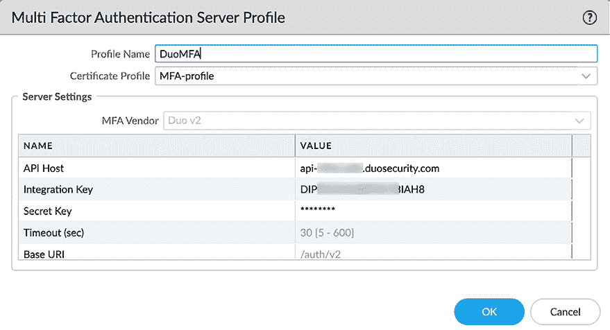

图 2.43：多因素身份验证服务器配置文件

设置好适当的服务器配置文件后，需要将其添加到身份验证配置文件中。

## 设置身份验证配置文件
现在，您的环境中已配置了适当的服务器配置文件，您可以继续设置身份验证配置文件，以便管理员登录。转到 **Device** | **Authentication Profile** 并创建新的身份验证配置文件。

**Authentication** 选项卡让您可以选择要为此配置文件使用的身份验证类型；这将与您在之前的步骤之一中配置的服务器配置文件相匹配。然后您可以添加其他参数，例如为 LDAP 登录属性设置 `sAMAccountName` 或 `userPrincipalName`。**Username Modifier** 让您可以控制最终用户输入的用户名如何被转换并发送到身份验证服务器。这允许您简单地转发用户输入的内容，或以 UPN 格式 (`user@domain`) 或传统的 `domain\user` 反斜杠格式添加用户域：
* `%USERINPUT%`
* `%USERDOMAIN%\%USERINPUT%`
* `%USERINPUT%@%USERDOMAIN%`

在多域林环境中可能需要这样做：

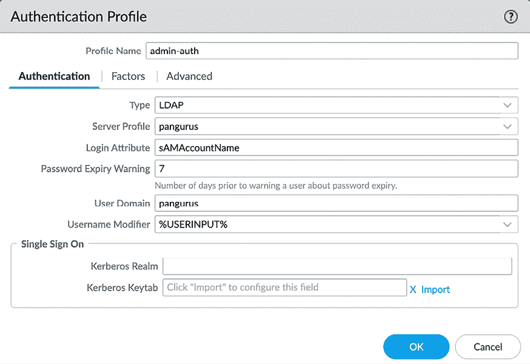

图 2.44：身份验证配置文件 LDAP 示例

在 **Factors** 选项卡中，您可以添加 MFA 策略的配置文件，以便用户登录后触发二次身份验证：

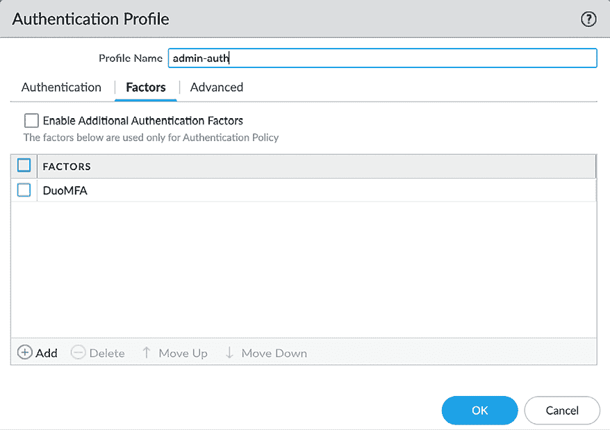

图 2.45：身份验证配置文件 MFA

**Advanced** 选项卡造成了一点“先有鸡还是先有蛋”的情况，因为它要求您告诉防火墙哪些用户名或用户组允许尝试身份验证，但用户列表只有在您正确设置用户 ID 后才会填充。如果您尚未设置用户 ID 组映射，请将用户设置为 **all**，直到您可以返回并将列表缩小到实际的管理员用户组或用户名。

出于安全目的，您应配置锁定策略，在多次登录失败后阻止登录一段时间：

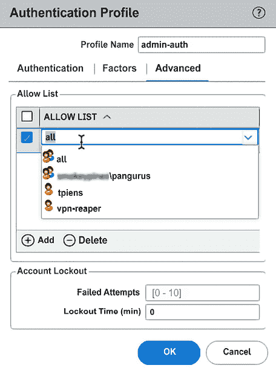

图 2.46：身份验证配置文件允许的用户

创建配置文件后，在创建管理员帐户时，您可以使用它代替静态密码。身份验证配置文件可以设置在管理员帐户中以替换静态密码：

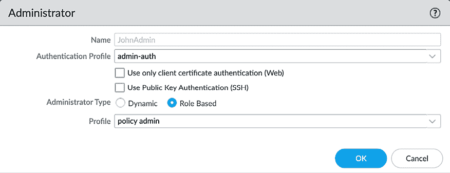

图 2.47：带有身份验证配置文件的管理员帐户

通过本节最后介绍的内容，您现在能够设置管理员帐户，这些帐户不仅限制为所需的访问权限（符合 RBAC 要求），而且还可以利用外部身份验证机制并添加 MFA 来加强管理员访问并防止未经授权的访问。在下一节中，我们将了解不同类型的接口。

## 了解接口类型
当您打开 **Network** | **Interfaces** 菜单时，您将看到各种物理接口。有几种不同的接口类型会导致接口以特定方式运行。我们首先介绍四种基本接口类型，然后再介绍更专业的接口类型：
* Virtual Wire (VWire) 是一组两个接口的“第 1 层”直通
* Layer 3 是路由接口
* Layer 2 是“交换”接口，依赖于 VLAN 标签而不是路由表
* Tap 是“嗅探”接口

让我们更详细地讨论它们。

## VWire
正如名称所示，VWire 旨在成为“线路上的一个凸起”。VWire 总是由两个物理接口组成——不多也不少。不会对 VLAN 标签进行低级干扰，也没有路由选项；数据包在流中被检查。

使用 VWire 接口可以轻松“插入防火墙”，而无需干扰现有的路由或交换环境。它可以轻松插入 ISP 路由器前面，或放置在蜜罐和网络之间以增加检测层。

开箱即用时，防火墙将在 `ethernet1/1` 上设置默认 VWire 作为外部接口，`ethernet1/2` 作为内部接口，并配有允许所有出站流量的安全规则。

在创建 VWire 接口之前，您首先需要将两个接口设置为 **Virtual Wire** 类型，并将它们分别分配到不同的区域：

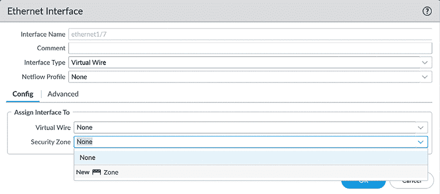

图 2.48：VWire 接口

现在，您可以通过转到 **Network** | **Virtual Wires** 并创建新的 VWire 配置文件，将两个接口连接到 VWire 配置文件。


## VWire 和 Layer 3 接口配置

如以下截图所示，您需要选择将用于形成 VWire 连接的两个接口。如果 VWire 接口放置在 trunk 链路上（包含 `VLAN/802.1Q` 标签的链路），您需要指明允许哪些标签。如果要允许所有标签，请设置为 `0-4094`。如果要添加单个标签或范围，可以添加整数或范围，以逗号分隔（例如，`5,15,30-70,100-110,4000`）。如果您想要能够阻止或以其他方式对组播流量应用安全策略，则需要勾选 **组播防火墙**。如果未勾选，组播将在 VWire 上转发，而不检查安全规则。启用 **链路状态透传** 会在其中一侧失去连接时使另一侧接口下线。

这确保客户端和服务器双方都能看到链路下线并相应响应：

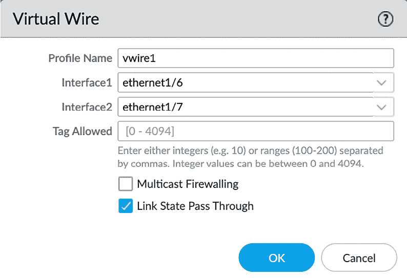

图 2.49：VWire 配置

## Layer 3 接口

Layer 3 接口是路由接口。这意味着它具有 IP 地址，可用作连接到它的内部客户端的默认网关，或用作路由设备的下一跳。在外部，它可以与 ISP 路由器通信并将流量转发到互联网。我们先来看一下该接口。

### 探索接口

在接口的 **配置** 选项卡中，您需要分配一个 **虚拟路由器** (`VR`) 和一个安全区域（我们将在本章后面了解更多关于 `VR` 的内容，所以暂时不用担心）。当流量需要在一个接口和另一个接口之间流动时，此区域将表示连接到它的子网：

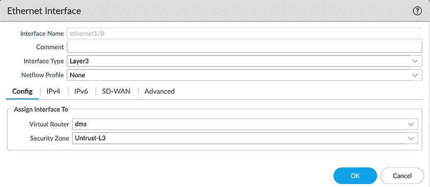

图 2.50：Layer 3 接口配置

IP 配置可以静态配置为 IP/子网。如果需要，可以添加多个 IP/子网以表示直接连接到接口的额外网络：

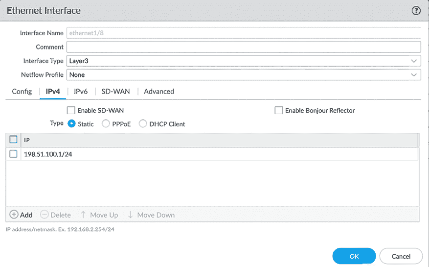

图 2.51：Layer 3 接口 IP

如果上游连接由宽带 ISP 通过电缆或 DSL 提供，Layer 3 接口也可以设置为 **以太网上点对点协议** (`PPPoE`) 客户端。在这种情况下，在 **常规** 选项卡中，可以配置 ISP 身份验证用户名和密码：

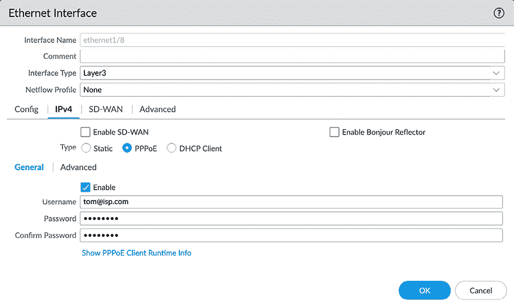

图 2.52：Layer 3 PPPoE

在 `PPPoE` | **高级** 选项卡中，您将身份验证协议设置为 `PAP`、`CHAP`、`auto` 或 `none`。如果 ISP 为您提供了静态 IP，您可以在此处配置它，并且如果 ISP 需要它们才能连接，您可以添加接入集中器和服务字符串。如果需要，您可以禁用将 ISP 接收到的默认路由添加到路由表。一些 ISP 要求 PPPoE 客户端处于被动状态，因为它们会发起连接。您可以在此处启用此功能：

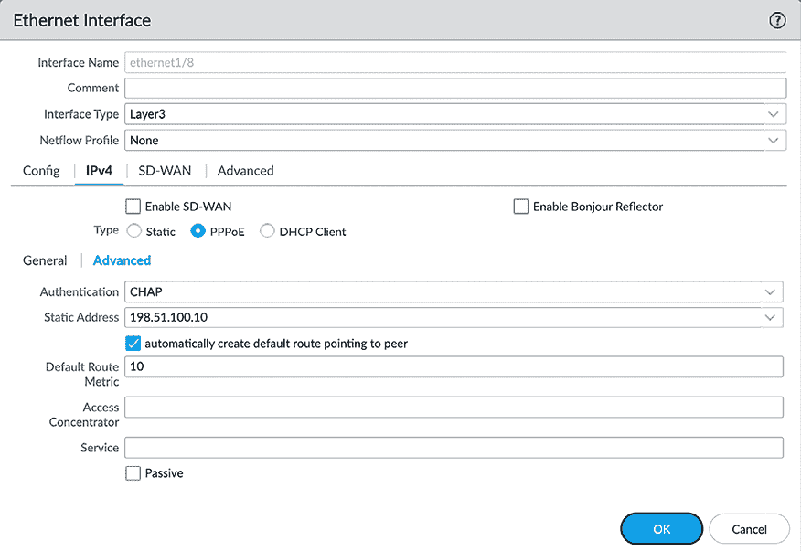

图 2.53：Layer 3 PPPoE 高级选项

配置完接口后，单击 **确定** 并提交更改。提交完成后，您可以从 **网络** | **接口** | **以太网** 页面单击 **显示 PPPoE 客户端运行时信息** 以获取有关连接的信息。从 CLI，您可以发出以下命令查看相同的输出：

```
admin@PA-440> show pppoe interface <interface>
```

**DHCP 客户端** 选项卡允许您将接口配置为 DHCP 客户端，从上游 DHCP 服务器接收其 IP 信息：


图 2.54：Layer 3 DHCP 客户端高级选项

您可以选择自动接受默认路由或禁用此功能并在 `VR` 中手动定义默认路由。如果 ISP 需要，您可以发送系统或自定义主机名，并且您可以确定默认路由的度量值。

在 **Layer3** | **高级** 选项卡中，我们可以访问多个高级功能：


图 2.55：Layer 3 高级选项

在这里我们可以设置接口的链路速度、双工模式和状态。在 **其他信息** 选项卡中，我们可以添加之前看到的管理配置文件，更改 **最大传输单元** (`MTUs`)，并启用 **调整 TCP MSS** 并使用自定义值来更改流经防火墙的 TCP 数据包中的 MSS 头值。

在其他可用选项卡中，我们还可以设置静态 IPV4 ARP 条目，如果上游设备需要 **静态 ARP 条目** 则会很有用，IPV6 **邻居发现** (`ND`) **条目** 或 **邻居发现协议** (`NDP`) **代理**。还可以添加 **链路层发现协议** (`LLDP`) 配置文件以与交换机接口。

最后，如果外部接口由 ISP 分配了动态 IP，可以设置 DDNS 主机名。目前支持四个厂商：DuckDNS、afraid.org、no-IP 和 Palo Alto：


图 2.56：DDNS 配置

为了使 Layer 3 子网和 IP 地址能够在接口之间访问，它们需要添加到路由表中；这是在 `VR` 中完成的。

### VLAN

`VR` 是防火墙的路由元素，但正如名称所示，它不是由单个引擎组成，而是接口订阅的路由集合。每个 Layer 3、环回和 VLAN 接口都需要与一个 `VR` 相关联，但系统上可以使用多个 `VR`。并非所有接口都需要与同一个 `VR` 相关联。

您可以从 **网络** | **虚拟路由器** 菜单配置默认 `VR` 或添加新的 `VR`。在 `VR` 的 **路由器设置** 选项卡中，您可以查看并添加与此 `VR` 相关联的接口，并在需要时调整管理距离。管理距离为路由协议关联一个优先级。默认情况下，静态路由的优先级高于 **开放最短路径优先** (`OSPF`)（管理距离更低），但如果您希望 `OSPF` 路由具有优先级并且仅在 `OSPF` 不可用时使用静态路由，则可以更改此优先级。同一路由协议内的路由可以分配一个度量值以赋予其更高的（度量值更低）或更低的（度量值更高）优先级。同一类型内的路由（静态、OSPF 等）首先根据其子网的大小进行优先级排序。较小的子网（例如 `/32`）将优先于较大的子网（例如 `/16`）。接下来，将使用度量值来确定具有相同子网掩码的网络的优先级，度量值较低者具有优先级（例如，`10.0.0.0/24 metric 10` 将优先于 `10.0.0.0/24 metric 20`）：


图 2.57：VR 设置

在 **静态路由** 选项卡中，您可以根据需要添加目标路由。默认情况下，防火墙会在路由表中加载所有已连接（配置在 Layer 3、环回或 VLAN 接口上）的网络；添加静态路由可从路由角度使远程网络可用。

您可能需要配置的第一个路由之一是“默认路由”，它允许客户端连接到互联网。如果 Layer 3 接口配置为 `PPPoE` 或 DHCP 客户端，可以启用 **自动创建默认路由** 选项，该选项将根据上游 ISP 自动添加默认路由。

默认路由的 **目标** 为 `0.0.0.0/0`。常规路由可能具有较小的子网，例如 `172.16.0.0/24`。

**接口** 选项指示出口接口将是什么。如果路由指向互联网，则接口将是 ISP 路由器连接的接口。

**下一跳** 有几个选项：

*   **IP 地址**：转发数据包到的上游路由器的 IP。

*   **下一个 VR**：数据包是否需要在同一设备上移交给不同的 `VR`。

*   `FQDN`：如果上游路由器具有动态 IP，使用由 DNS 记录动态更新的 `FQDN` 可能很有用。


## 路由和接口配置

## 路由配置

* `Discard`：路由可以设置为“black hole”某些子网。这可用于防止任何数据包到达连接的带外网络，即使安全策略允许这种情况。

* `None`：路由可能没有下一跳，例如路由到 VPN 隧道中的数据包。

`Admin Distance` 和 `Metric` 设置可以根据需要为每个路由更改。

`Route Table` 用于向常规单播路由、多播路由或两者添加路由。

如果您有冗余可用，可以使用 `Path Monitoring` 通过路由发送心跳 ping。如果 ping 失败达到配置的次数，路由将被禁用。路由表将针对匹配的数据包重新评估，并将使用下一个最佳匹配来路由数据包（即具有更高度量值或更大子网的路由）：


图 2.58：`VR` 默认路由

在三层接口上配置的任何子网都会作为直连网络添加到路由表中，无需添加静态路由。

## 二层接口和 VLAN

将接口设置为二层类型可使防火墙的功能类似于在网络中放置一台交换机。每个接口充当交换机上相当于接入端口（如果需要中继功能，请参阅 `Subinterfaces` 主题）的角色，您可以根据需要添加任意数量的接口。

每个接口应使用不同的区域，以便利用安全策略控制接口之间的流量。设置为同一区域的接口默认情况下会在不检查的情况下交换流量，并且需要一个捕获所有流量的安全策略来启用检查。

要将接口分组为逻辑“交换机”，您需要通过 `Networks` | `VLANs` 创建 VLAN 对象，并添加您之前设置为二层且希望连接的接口：


图 2.59：VLAN 组

`VLAN Interface` 选项将路由功能作为逻辑三层接口添加到组中。如果您有上游 ISP 路由器或连接到需要交互的三层接口的不同子网，这可能会很有用。

您可以通过 `Network` | `Interfaces` | `VLAN` 配置 VLAN 接口。将其分配给您创建的 VLAN 组，填写 `Virtual Router` 字段，并分配一个区域。此区域在为安全策略与三层接口交互时将代表二层接口：


图 2.60：VLAN 接口配置

您还需要为 VLAN 接口分配一个 IP 地址，以便二层接口上的客户端可将其用作默认网关或路由下一跳。请确保它与二层接口上的客户端位于同一子网中：


图 2.61：VLAN 接口 IP 地址

## Tap 接口

Tap 接口可用作被动嗅探端口。如果另一台网络设备设置了端口镜像，其 egress 端口可以连接到 tap 接口以拦截所有数据包并应用应用 ID 和内容 ID。只要 Tap 接口接收到会话的所有数据包，它就能像流量流经防火墙一样检查流量。然而，有一些限制：

* 防火墙并未积极参与数据包的处理，因此如果检测到威胁，它无法采取行动；只能报告。
* SSL 解密只能应用于入站连接，如果服务器证书连同其私钥可以加载到防火墙上。

Tap 接口只需配置安全区域：


图 2.62：Tap 接口

为了充分利用 Tap 功能，需要创建一个安全规则以允许所有操作，或如果您想限制范围，则允许特定子集。防火墙会在后台丢弃所有数据包，但将安全规则设置为丢弃会使数据包在检查前被丢弃：


图 2.63：Tap 安全规则

类似于监听端口镜像，防火墙可以将所有未加密的会话数据发送到第三方 `DLP` 或威胁情报设备。它可以通过 Decryption Port Mirror 接口实现。

## Decryption Port Mirror 接口

Decryption Port Mirror 接口允许将解密后的数据包转发到外部设备以进行进一步检查：防火墙将接收设置为解密的 TLS 数据包，因此会执行解密会话所需的所有步骤，然后使用 Decryption Port Mirror 接口作为 egress 接口将明文负载转发给第三方设备进行“第二意见”。例如，这对 DLP 很有用。许可证可通过支持门户免费激活，方法是浏览 [`support.paloaltonetworks.com`](https://support.paloaltonetworks.com) 然后进入 `Assets` | `Devices`。

在那里，您可以找到您的防火墙并单击 `Actions` 按钮。如果您选择激活功能许可证，您将能够激活 `Decryption Port Mirror`：


图 2.64：激活 Decryption Port Mirror 许可证

要在防火墙上激活许可证，请按照以下步骤操作：

1. 从 `Device` | `Licenses` 中，选择 `Retrieve license keys from license server`。
2. 在 `Device` | `Setup` | `Content ID` | `Content-ID settings` 中，启用 `Allow forwarding of decrypted content`。
3. 在 `Network` | `Interfaces` | `Ethernet` 中，将接口设置为 `Decrypt Mirror` 类型。
4. 在 `Objects` | `Decryption` | `Decryption Profiles` 中，打开解密配置文件并将接口添加到 `Decryption Mirroring`。
5. 在 `Policies` | `Decryption` 中，创建使用解密配置文件的解密规则。
6. 保存更改并连接 Decryption Port Mirror 接口。

除了以太网接口外，还有三种不同的逻辑接口：

* `Loopback`
* `Tunnel`
* `VLAN interface`

现在让我们来看看接口中的瑞士军刀——loopback。

## Loopback 接口

Loopback 接口是一个逻辑三层接口，可用于多种用途。一个常见的用例包括为其自身接口添加额外的公网 IP，以便可以为其添加 VPN 配置。另一个用例是为 loopback 添加管理配置文件，然后利用安全规则允许管理员从异类网络管理防火墙。它需要配置一个 IP 地址（每个 loopback 接口仅支持一个 IP）和一个安全区域，并且需要与 `VR` 关联。

它可以设置为与其中一个三层接口相同子网和区域中的新 IP 地址，因此诸如 `Management Profile`、`Captive Portal` 和 `GlobalProtect` 之类的服务可以托管在与物理接口主 IP 不同的 IP 上。

为了增加额外安全性，它也可以设置为不同的区域，以便客户端能够连接到 loopback 接口时需要匹配的安全规则：


图 2.65：Loopback 接口

`Interface Name` 旁边的数字是逻辑接口的识别号。可以为接口分配 1 到 9999 之间的数字，并且仅用作接口的识别号。

## Tunnel 接口

Tunnel 接口是逻辑接口，作为隧道流量的入口和出口点，包括站点到站点 VPN 和 GlobalProtect SSL 和 IPSec。物理隧道终止于三层或 loopback 接口，但需要加密的数据包应路由到 tunnel 接口：


图 2.66：VPN 隧道的静态路由

如以下屏幕截图所示，此接口需要与 `VR` 和安全区域关联：


图 2.67：Tunnel 接口


The number next to `Interface Name` is an identification number for the logical interface.

### 重要提示
为了获得强大的安全态势，请为各个 VPN 连接设置单独的区域，即使是已知位置。将每个连接和远程网络视为单独的区域可确保足够的可见性和控制。如果 VPN 隧道为所有远程办公室设置相同的区域，远程办公室可能会暴露于恶意软件（想想 WannaCry）并感染其他办公室。默认的 `intrazone` 安全规则允许所有会话运行且不应用扫描。

还有几种提供特定功能的“special”接口类型；我们将在以下章节介绍特殊用例接口。

当交换机上行链路需要包含多个 `802.1q` VLAN 标签时，可以将其配置为中继，并且在防火墙上可以创建子接口以对应每个 VLAN 标签。

## 子接口
所有物理（即 `Layer 2`、`Layer 3`、`VWire` 和 `Aggregate`——我们将在本章稍后介绍这种类型的接口）接口都可以拥有子接口。当物理接口连接到包含 `VLAN` (`802.1Q`) 标记数据包的中继链路时，会使用子接口。物理接口无法解释这些标签，但子接口可以。对于中继承载的每个 `VLAN`，您可以创建一个子接口来表示来自交换机的虚拟网络。使用子接口的优点是每个 `VLAN` 都可以与其自己的安全区域关联。

子接口将模仿其父物理接口的所有配置细节，但接口类型不能与物理接口类型不同（例如，`Layer 3` 物理接口不能承载 `Layer 2` 子接口）。

您可以通过选择所需的物理接口并在 `Network | Interfaces` 的左下角单击 `Add Subinterface` 来创建这些接口：


图 2.68：创建子接口

## HA 接口
`High Availability` (`HA`) 接口在设置两个防火墙的集群时是必需的。某些机箱将具有内置专用 HA 接口，在这种情况下，您可能无需自行创建任何 HA 接口。如果没有板载 HA 接口，或需要额外的接口作为备份 HA 链路，则可以选择数据平面接口来履行此角色并连接到 HA 对端。

## AE 接口
为了将可用带宽提高到接口的物理限制之上，可以使用 `802.1AX` 协议将接口捆绑到 `Aggregated Ethernet` (`AE`) 组中。最多可将八个接口组合成一个逻辑捆绑。

可以通过在 `Network | Interfaces | Ethernet` 下单击 `Add Aggregate Group` 来创建新组。

您首先需要将类型设置为 `Layer 2`、`Layer 3`、`VWire` 或 `HA`，这将需要与物理接口等效的相同配置（即安全区域、`VR`、`VLAN` 或 `VWire`）。

此外，您可以配置 `Link Aggregation Control Protocol` (`LACP`) 以改善接口故障检测。`LACP` 可在物理层和数据链路层上启用链路故障检测，而默认协议仅检测物理链路故障。

您可以设置防火墙处于 `Active` 或 `Passive` 模式。此配置设置需要与 `LACP` 对端（通常是交换机）一起审查，因为只能将一个对端配置为 `Active`，但如果两者都设置为 `Passive`，`LACP` 将无法工作。

`Transmission Rate` 的值会影响链路故障检测的响应能力，但也会产生开销。慢速传输意味着每 30 秒一次，而快速传输意味着每秒一次。

`Fast Failover` 将在接口宕机时在 1 秒内切换到运行中的接口。传统故障转移在 3 秒后发生。

`System Priority` 决定哪个对端确定端口优先级。

`Maximum Interfaces` 决定聚合组中同时可以处于活动状态的接口数量。此数字不应超过分配给该组的物理接口数量，但可以利用它来限制总可用带宽，同时在发生故障时保留热备接口。例如，如果聚合组需要总带宽为 4 千兆位，但您也不想超过此带宽以保留系统资源，则可以将五个或更多接口分配给聚合组，并将 `Maximum Interfaces` 设置为 `4`。只有在接口故障时才会激活另一个接口来接管工作。在 HA 配置中，两个防火墙形成集群时，可以在被动对端上启用 `LACP`，以便在被动对端需要承担活动角色之前预先协商链路聚合组，从而减少故障转移所需的时间。

这是通过选中 `Enable in HA Passive State` 实现的。两个集群成员可以使用相同的系统 MAC，但连接的交换机可能不支持此功能。下图显示了这一点：


图 2.69：LACP

创建聚合组后，您可以通过将 `Interface Type` 设置为 `Aggregate Ethernet` 并选择所需的 `Aggregate Group` 来添加接口：


图 2.70：聚合组中的物理接口

在某些情况下，您可能需要能够连接到交换机上的端口镜像并仅监听而不参与。对于此类情况，您可以配置 `Tap` 接口。

通过上一节介绍的信息，您现在能够为遇到的每个网络设计选择合适的接口。`VWire` 可帮助您在无法干扰现有路由的环境中添加防火墙，`Layer 3` 接口将防火墙置于路由决策的中间，`Layer 2` 接口使防火墙的行为类似于交换机，并且可以为所有这些接口添加子接口以考虑 `VLAN` 标签。您能够配置链路聚合并可以利用隧道接口设置 `IPSec` 隧道。

## 摘要
在本章中，您学习了如何创建支持账户、注册新设备并添加许可证。您现在能够识别所有不同的支持许可证并选择合适的订阅许可证来满足您的需求。您可以升级和更新设备，使其固件保持最新，并加载最新的应用程序和威胁签名以保护网络。您学习了如何保护管理接口，以便只有合法用户才能连接，并且您可以为管理员分配不同的访问权限和特权。您能够配置所有物理接口，如 `Layer 3` 和 `VWire`，并知道何时最合适使用。您还可以根据需要利用隧道接口和环回接口等逻辑接口。

如果您正在准备 `PCNSE`，请注意升级需要在继续进行维护版本之前下载基本映像。动态更新的推荐阈值为 6 至 12 小时（除非设备位于关键环境中，在这种情况下阈值应为 24 小时），并且您应该能够识别所有接口类型之间的差异。

在下一章中，我们将开始构建强大的安全策略并学习如何为网络流量设置强大的安全态势。

# 第 3 章：构建强大的策略

# 构建强大的策略
在本章中，您将熟悉配置安全配置文件、为安全构建规则库以及 `network address translation` (`NAT`)。我们将学习每个设置的作用、其预期行为以及如何利用它来实现预期结果。对不同规则库中所有可用功能的完全控制将使您能够采取强大的安全立场。


In this chapter, we’re going to cover the following main topics:

在本章中，我们将涵盖以下主要主题：

* Understanding and preparing security profiles
* 理解和准备安全配置文件
* Understanding and building security rules
* 理解并构建安全规则
* Setting up NAT in all possible directions
* 在所有可能的方向上设置 NAT

By the end of this chapter, you will be able to set up a complete ruleset that will ensure your users are able to reach the applications and resources they need, internally hosted servers can be reached from the internet, and any threats trying to slip through can be stopped in their tracks.

在本章结束时，您将能够设置一套完整的规则集，以确保您的用户能够访问所需的应用程序和资源，内部托管的服务器可以从互联网访问，并且任何试图渗透的威胁都将被拦截。

## 技术要求

## 技术要求

Before you get started, your firewall must have connectivity between at least two networks, with one preferably being your **internet service provider** (**ISP**), to fully benefit from the information provided in this chapter.

开始之前，您的防火墙必须至少在两个网络之间具有连接性，其中一个最好是您的 **互联网服务提供商** (**ISP**)，以充分利用本章提供的信息。

## 理解和准备安全配置文件

## 理解和准备安全配置文件

There are several types of security profiles, like Antivirus, Vulnerability Protection, URL Filtering, and Anti-Spyware (we’ll cover all of these different profiles in the following sections). Before you can start building a solid security rule base, you need to create at least one custom security profile of each type to use in all of your security rules. There are pre-configured profiles available, but they are set to read-only, which means that if you start using them in security rules, you’ll need to replace them one by one if you create custom ones later.

存在多种类型的安全配置文件，例如 Antivirus、Vulnerability Protection、URL Filtering 和 Anti-Spyware（我们将在以下各节中介绍所有这些不同的配置文件）。在开始构建稳固的安全规则库之前，您需要为每种类型创建至少一个自定义安全配置文件，以便在所有安全规则中使用。存在预配置的配置文件，但它们设置为只读，这意味着如果您开始在安全规则中使用它们，后续如果创建自定义配置文件，则需要逐一替换它们。

### 专业提示

### 专业提示

As a best practice, add security profiles to all of the rules, including drop rules. On drop rules, security profiles do not consume any resources but they will help form a habit of adding profiles to all rules, and if the rule ever changes to `Allow`, the profiles will already be assigned.

作为最佳实践，将安全配置文件添加到所有规则中，包括 drop 规则。在 drop 规则上，安全配置文件不会消耗任何资源，但它们有助于养成向所有规则添加配置文件的习惯，并且如果规则 ever 更改为 `Allow`，配置文件将已分配。

Security profiles are evaluated by the first security rule that a session is matched against. If a six-tuple is matched against a security rule with no or limited security profiles, no scanning can take place until there is an application shift and the security policy is re-evaluated. *All* security rules need to have security profiles.

安全配置文件由与会话匹配的第一个安全规则进行评估。如果六元组与没有或仅有限安全配置文件的规则匹配，则在发生应用程序转移并重新评估安全策略之前，无法进行扫描。*全部* 安全规则都需要具有安全配置文件。

## Antivirus 配置文件

## Antivirus 配置文件

The Antivirus profile has three sections that depend on different licenses and dynamic update settings:

Antivirus 配置文件有三个部分，取决于不同的许可证和动态更新设置：

* The actions under `ACTION` rely on the threat prevention license and antivirus updates
* `ACTION` 下的操作依赖于威胁防护许可证和防病毒更新
* `Wildfire Action` relies on the WildFire license and the WildFire updates that are set to periodical updates (1-minute or longer intervals)
* `Wildfire Action` 依赖于 WildFire 许可证以及设置为定期更新（1 分钟或更长间隔）的 WildFire 更新
* `Wildfire Inline Ml Action` relies on WildFire set to real time
* `Wildfire Inline Ml Action` 依赖于设置为实时 的 WildFire

If any of these licenses are missing from your system, the actions listed in their columns will not be applied.

如果系统缺少其中任何一个许可证，则其列中列出的操作将不会应用。

`Application Exception` allows you to change the action associated with a decoder for individual applications as needed. The actions that can be set for both threat prevention and WildFire antivirus actions are as follows:

`Application Exception` 允许您根据需要更改与单个应用程序的解码器关联的操作。可以为威胁防护和 WildFire 防病毒操作设置的操作如下：

* `allow`: Allows matching signatures *without* logging.
* `allow`：允许匹配的签名 *无需* 记录。
* `drop`: Drops matching signatures and writes an entry in the threat log.
* `drop`：丢弃匹配的签名并在威胁日志中写入条目。
* `alert`: Allows matching signatures to pass but writes an entry in the threat log.
* `alert`：允许匹配的签名通过但在威胁日志中写入条目。
* `reset-client`: Drops matching packets, sends a TCP RST to the client (session initiator), and writes an entry in the threat log. The server (session responder) is not notified.
* `reset-client`：丢弃匹配的数据包，向客户端（会话发起方）发送 TCP RST，并写入威胁日志条目。服务器（会话响应方）不会收到通知。
* `reset-server`: Drops matching packets, sends a TCP RST to the server (session responder), and writes an entry in the threat log. The client (session initiator) is not notified.
* `reset-server`：丢弃匹配的数据包，向服务器（会话响应方）发送 TCP RST，并写入威胁日志条目。客户端（会话发起方）不会收到通知。
* `reset-both`: Drops matching packets, sends a TCP RST to both the client and the server, and writes an entry in the threat log.
* `reset-both`：丢弃匹配的数据包，向客户端和服务器发送 TCP RST，并写入威胁日志条目。

Packet captures can be enabled for further analysis by the security team or as forensic evidence. They are attached to the threat log and are limited to packets containing matched signatures.

可以启用数据包捕获以供安全团队进一步分析或作为取证证据。它们附加到威胁日志中，并且仅限于包含匹配签名的包。

You can create a new Antivirus profile by going to `Objects` | `Security Profiles` | `Antivirus`. As the following screenshot shows, we will use Palo Alto Networks’ recommended best practices settings:

您可以通过转到 `Objects` | `Security Profiles` | `Antivirus` 来创建新的 Antivirus 配置文件。如以下屏幕截图所示，我们将使用 Palo Alto Networks 推荐的最佳实践设置：


Figure 3.1: Creating an Antivirus profile

图 3.1：创建 Antivirus 配置文件

For the Antivirus profile, the setting in the default profile will have `imap` and `pop3` set to `alert` only. Since these protocols do not respond too well to reset, this may be a good setting in cases where they are actively being used in the organization. In most cases, email has been replaced by a web-based (TLS/SSL) alternative and it would actually be more secure to reset legacy protocols.

对于 Antivirus 配置文件，默认配置文件中的设置将仅将 `imap` 和 `pop3` 设置为 `alert`。由于这些协议对重置的响应不佳，因此在组织中积极使用它们的情况下，这可能是一个不错的设置。在大多数情况下，电子邮件已被基于 Web（TLS/SSL）的替代方案取代，实际上重置旧协议会更安全。

Exceptions can be added in the `Signature Exceptions` tab for false positives or known true positives. Exceptions are added by typing (or pasting) the `Threat ID` as found in the threat log and clicking `Add`:

可以在 `Signature Exceptions` 选项卡中为误报或已知的真阳性添加异常。异常是通过键入（或粘贴）威胁日志中查找到的 `Threat ID` 并单击 `Add` 来添加的：


Figure 3.2: AntiVirus exceptions

图 3.2：AntiVirus 异常

Additional machine learning actions can be set on the `Wildfire Inline ML` tab for `Windows Executables`, `PowerShell Script 1` and `PowerShell Script 2`, `Executable Linked Format`, `MSOffice`, `Shell`, `OOXML`, and `MachO`. Each model can be set to one of three actions:

可以在 `Wildfire Inline ML` 选项卡上为 `Windows Executables`、`PowerShell Script 1` 和 `PowerShell Script 2`、`Executable Linked Format`、`MSOffice`、`Shell`、`OOXML` 和 `MachO` 设置额外的机器学习操作。每个模型可以设置为三种操作之一：

* `enable (inherit per-protocol actions)`, which enables additional machine learning scanning, and if a virus is detected, the matching protocol (`smtp`, `http`, and so on) action that was set in the main `Action` tab is applied
* `enable (inherit per-protocol actions)`，它启用额外的机器学习扫描，如果检测到病毒，则将主 `Action` 选项卡中设置匹配协议（`smtp`、`http` 等）的操作应用
* `alert-only (override more strict actions to alert)` will enable additional machine learning scanning but positive matches will only be reported in logging
* `alert-only (override more strict actions to alert)` 将启用额外的机器学习扫描，但正匹配仅在日志记录中报告
* `disable (for all protocols)`, which is the default setting and does not apply machine learning to the selected model
* `disable (for all protocols)`，这是默认设置，不对所选模型应用机器学习

The following screenshot illustrates the available actions per model:

以下屏幕截图说明了每个模型的可用操作：


Figure 3.3: WildFire Inline ML

图 3.3：WildFire Inline ML

WildFire inline ML can dynamically analyze certain file types for various file details and PowerShell scripts for malicious characteristics.

WildFire inline ML 可以动态分析某些文件类型的各种文件详细信息以及 PowerShell 脚本的恶意特征。

## Anti-Spyware 配置文件

## Anti-Spyware 配置文件

The Anti-Spyware profile is extremely customizable and is built by a set of rules within the profile. These rules serve to change the default actions associated with each threat; so, if no rules are created at all, the profile will simply apply the default action for a specific signature when it is detected.

Anti-Spyware 配置文件极其可定制，并由配置文件内的规则集构建。这些规则用于更改与每个威胁关联的默认操作；因此，如果根本未创建任何规则，配置文件将在检测到特定签名时简单地应用该签名的默认操作。

Anti-Spyware supports the same actions as Antivirus (`allow`, `drop`, `alert`, `reset-client`, `reset-server`, and `reset-both`), with the addition of `block-ip`, which can track by source or source-destination pair and will block the offending IP for a duration of `1-3600` seconds. Tracking by source will block all connections from the client for the duration of the block, while tracking by source-destination pair will only block connections from the client to the target destination and will not block the same client from connecting to other destinations.

Anti-Spyware 支持与 Antivirus 相同的操作（`allow`、`drop`、`alert`、`reset-client`、`reset-server` 和 `reset-both`），并增加了 `block-ip`，它可以根据源或源-目标对进行跟踪，并将阻止违规 IP 的持续时间为 `1-3600` 秒。按源跟踪将阻止客户端在阻止期间的所有连接，而按源-目标对跟踪仅会阻止客户端到目标目的地的连接，不会阻止同一客户端连接到其他目的地。

The `Packet Capture` options include:

`Packet Capture` 选项包括：

* `none`,
* `none`,
* `single-packet`, which only captures the packet containing the payload matching a signature.
* `single-packet`，它仅捕获包含匹配签名的有效载荷的数据包。
* `extended-capture` enables the capture of multiple packets to help analyze a threat. The number of packets captured by `extended-capture` can be configured via `Device` | `Setup` | `Content-ID`. The default is `5`.
* `extended-capture` 启用捕获多个数据包以帮助分析威胁。`extended-capture` 捕获的数据包数量可通过 `Device` | `Setup` | `Content-ID` 配置。默认值为 `5`。

### 重要说明

### 重要说明

Enabling packet capture on all threats does require some CPU cycles. The impact will not be very large, but if the system is already very taxed, some caution is advised.

在所有威胁上启用数据包捕获确实需要一些 CPU 周期。影响不会很大，但如果系统已经非常繁忙，则应谨慎操作。

`Severity` indicates the severity level of the threat that applies to this rule.

`Severity` 表示适用于此规则的威胁的严重级别。

Create a new Anti-Spyware profile and add the following rules:

创建新的 Anti-Spyware 配置文件并添加以下规则：

* `Policy Name`: `Block-Critical-High-Medium`
  * `Severity`: `critical, high, medium`
  * `Action`: `reset-both`
  * `Packet Capture`: `single-packet`
* `Policy Name`：`Block-Critical-High-Medium`
  * `Severity`：`critical, high, medium`
  * `Action`：`reset-both`
  * `Packet Capture`：`single-packet`
* `Policy Name`: `Default-Low-Info`
  * `Severity`: `low`, `informational`
  * `Action`: `default`
  * `Packet Capture`: `disable`
* `Policy Name`：`Default-Low-Info`
  * `Severity`：`low`、`informational`
  * `Action`：`default`
  * `Packet Capture`：`disable`

### 重要说明

### 重要说明


## 反间谍软件配置文件
官方最佳实践配置文件可能看起来与此处列出的一样略有不同。这是因为 Palo Alto 会将每个严重级别拆分开（但设置完全相同）。因此，前面的示例效率稍高一些！
您的配置文件现在应如下所示：

图 3.4：反间谍软件配置文件
严重级别为 critical、high 和 medium 的威胁总体上具有较高的真正恶意比例，因此重置连接被认为是最佳实践。对这些威胁进行数据包捕获可以帮助我们判断被阻止的内容是否为误报。低严重级别和信息严重级别的威胁很可能纯属信息性，可以保留为默认操作。
如以下屏幕截图所示，我们需要确保审查 `Category`，因为这允许对每种类型的威胁进行精细化处理，如果以后需要更细粒度和个性化的操作。

图 3.5：反间谍软件类别
反间谍软件配置文件还包含 DNS 签名，这些签名分为订阅服务的两个数据库。内容 DNS 签名随威胁防护动态更新一起下载。DNS 安全数据库使用动态云查询。
每个数据库中的元素可以设置为 `Alert`、`Allow`、`Block` 或 `Sinkhole`。`Sinkhole` 使用 DNS 投毒技术替换 DNS 回复数据包中的 IP，因此客户端确实会收到有效的 DNS 回复，但目标 IP 已被更改。这确保了感染的终端可以通过过滤流向 sinkhole IP 的会话的流量日志轻松找到。您可以继续使用 Palo Alto Networks 默认的 sinkhole，`sinkhole.paloaltonetworks.com`，或使用您首选的 IP。
DNS sinkhole 的工作原理由以下步骤和图表说明：
1. 客户端向内部 DNS 服务器发送 DNS 查询以解析恶意域名。
2. 内部 DNS 将 DNS 查找中继到互联网 DNS 服务器。
3. 防火墙向内部 DNS 服务器插入对 DNS 查询的投毒回复，其中包含指向 sinkhole IP 的记录。
4. DNS 回复被转发给客户端。
5. 客户端向 sinkhole IP 而不是恶意服务器发起出站连接。管理员立即知道哪个主机可能已感染并正在尝试建立 `command and control` (`C2`) 连接：

图 3.6：DNS sinkhole 的工作原理
如果对这些 DNS 查询进行阻止而不是 sinkhole，则会牵连内部 DNS 服务器，因为请求是通过它中继的。
`Command and Control` 和 `Malware` 域的默认操作是阻止 DNS 回复，因为 sinkhole 可能会触发更具规避性的行为。因此，建议将这些类别保留为默认设置。为所有其他类别选择适当的动作。出于研究目的，您可以启用数据包捕获。
在 PAN-OS 11.2 及更高版本中，在 `DNS Zone Misconfiguration` 字段中，您可以添加网络内面向公众的 `parent` 域。高级 DNS 安全可以监控这些域是否存在误配置，例如可能被恶意行为者滥用的废弃子域。
在此选项卡底部，我们可以选择 `SVCB` (type 64)、`HTTPS` (type 65) 和 `ANY` (type 255)，这些是 DNS 资源记录类型，用于在 DNS 解析过程中加密客户端 hello。阻止这些将防止加密 DNS 会话建立，确保您仍可继续应用 DNS 安全：

图 3.7：反间谍软件 DNS 签名
任何误报或被视为可信但实际上具有恶意的站点都可以添加到 `DNS Exceptions`，以便它们不再被阻止或 sinkhole。
在 `Inline Cloud Analysis` 选项卡上，我们可以启用内联云分析，并为本地深度学习分析引擎可检测到 C2 流量的每个协议定义要采取的操作。如果某些域名或 IP 地址应排除在此检查之外，您可以在以下屏幕截图中显示的字段中添加一个 `external dynamic list` (`EDL`; 我们稍后会学习这些) 或 IP：

图 3.8：内联云分析
现在让我们查看漏洞防护配置文件。
## 漏洞防护配置文件
漏洞防护配置文件也使用规则来控制某些基于网络的攻击的处理方式。`Action` 包含与反间谍软件相同的选项：`allow`、`drop`、`alert`、`reset-client`、`reset-server`、`reset-both` 和 `block-ip`。
重置操作会发送 TCP RST 数据包。`block-ip` 会阻止来自源的所有数据包，可以设置为 `monitor source` 以阻止所有内容，或设置为源目标以仅在一段时间内阻止发往特定目标的数据包。
`Host Type` 确定规则是否适用于针对客户端 (download: 例如浏览器漏洞)、服务器 (upload: 例如 SQL 注入) 或任意主机的威胁。
请务必查看可用的 `Categories`，因为它们与我们在反间谍软件中图 3.4 中看到的一样，如果需要可以提供更精细的粒度：

图 3.9：漏洞防护配置文件类别
创建以下规则：
* `Rule Name:` `Block-Critical-High-Medium`
  * `Host Type:` `any`
  * `Severity:` `critical, high, medium`
  * `Action:` `reset-both`
  * `Packet Capture:` `single-packet`
* `Rule Name:` `Default-low-info`
  * `Host Type:` `any`
  * `Severity:` `low`, `informational`
  * `Action:` `default`
  * `Packet Capture:` `disable`
您的配置文件现在应如下所示：

图 3.10：漏洞防护配置文件
配置文件将重置匹配 critical、high 或 medium 严重级别威胁的任何连接，并收集威胁的数据包样本用于研究或取证。低严重级别和信息严重级别的威胁可以保留为默认设置。
虽然这些规则将为匹配特定严重级别的所有签名提供良好的覆盖，但您可能需要在某个时候为特定 CVE 添加规则。如果您创建新规则，可以将其定制为特定 CVE 甚至特定厂商。
CVE 代码由 MITRE 在 `https://cve.mitre.org` 维护
厂商 ID 通常由厂商发布，其格式与例如 Palo Alto 的 `PAN-SA-yyyy-nnnn` 或 Microsoft 的 `MSyy-nnn` 相似。如果您想例如过滤特定年份，可以将 `PAN-SA-2024` 添加到厂商 ID。请记住将匹配 CVE 或厂商 ID 的更具体规则放在规则顶部。
在 `Inline Cloud Analysis` 选项卡上，您可以启用用于 SQL 注入攻击或命令注入攻击的内联机器学习驱动检测。您可以在 `Exclude from Inline Cloud Analysis` 部分添加基于 URL 或基于 IP 的 `EDL`，以便不对其进行检查，这对于可能遇到许多误报的开发环境非常有用：

图 3.11：漏洞防护内联云分析
在下一小节中，我们将学习 URL 过滤配置文件的类别。
## URL 过滤配置文件
URL 过滤利用 URL 类别来确定对每个类别采取什么操作。
类别分为两组：自定义 URL 类别和由 URL 过滤许可证提供的动态类别。
### 自定义 URL 类别
自定义 URL 类别不需要许可证，因此即使没有访问 URL 过滤许可证，您也可以创建这些对象并应用 URL 过滤。
转到 `Objects` | `Custom Objects` | `URL Category` 创建新的自定义类别并添加网站。有两种类型的自定义类别：


## URL 列表
URL 列表允许手动逐行输入 URL。它采用轻量级的 `regular expression` (`RegEx`) 与地址匹配，因此不需要 `http://` 或 `https://` 即可匹配。

## 类别匹配
类别匹配允许您将任意预定义类别组合到自定义类别中。这在对一组预定义类别应用安全规则或解密策略时非常有用。

自定义 URL 类别中使用的字符串会被分隔符分割为子字符串或标记。`./?&=;+` 字符被视为分隔符，因此 `www.example.com` 有三个标记和两个分隔符。每个标记都可以用通配符 (`*`) 替换，以匹配子域或整个 `top-level domains` (`TLDs`)。通配符不能作为标记的一部分使用；例如，`www.ex*.com` 是非法的通配符。每个字符串可以以正斜杠 (`/`) 结束，也可以不加结束斜杠而保持开放。不结束字符串如果字符串很短或很常见，可能会产生后果，因为它可能匹配 unintended 较长的地址。例如，`*.com` 字符串可能匹配 `www.communicationexample.org`，因此添加结束斜杠可以防止这种情况。

还有一个 `Append Trailing Slash` 功能位于 `Device | Setup | Content-ID | URL Filtering`，默认情况下已启用。它会自动为未添加斜杠的任何 EDL 或自定义 URL 类别添加尾部斜杠。如果确实需要开放式条目，请禁用此功能。

使用多个通配符需要使用子域，因此 `*.*.com` 将匹配 anything.anything.com，但不匹配 anything.com。

### 配置 URL 过滤配置文件
配置 URL 过滤配置文件时，您需要在 `Categories` 选项卡中为每个 URL 过滤类别在 `Site Access` 列中选择要应用的操作，如以下屏幕截图所示：


图 3.12：URL 过滤配置文件

可用的操作如下：

* `none`：仅用于自定义 URL 类别。这将排除自定义类别中包含的 URL 在此 URL 过滤配置文件中的使用。
* `allow`：允许类别且不记录日志。
* `alert`：允许类别并在 URL 过滤日志中记录访问。
* `block`：阻止请求，注入 HTTP 503 错误并重定向到防火墙托管的页面，向用户解释其访问已被拒绝且操作已记录。
* `continue`：注入交互式网页，告知用户即将访问受限网站，并提供 `Continue` 按钮供其确认访问该网站相关的风险。
* `override`：注入交互式网页，允许用户在提供继续密码时继续。此密码可在 `Device | Setup | Content-ID | URL Admin Override` 中设置。

此外，要使用 `override` 选项，需要创建一个接口管理配置文件 (`Network | Network Profiles | Interface Mgmt`)。该配置文件应启用 `Response Pages` 服务并添加到用户连接的接口上，以便此页面正常工作，如以下屏幕截图所示：


图 3.13：接口管理配置文件

如您在 *图 3.10* 中看到的，URL 过滤配置文件要求为站点访问单独为每个 `Category` 字段设置操作，并且如果启用了 `User Credential Submission`，则可以应用额外的过滤来决定用户是否允许向某个类别提交企业凭据。这有助于防止钓鱼攻击。

如以下屏幕截图所示，如果您想一次更改大量（或全部）操作，有一个快捷方式可以帮助您。如果将鼠标悬停在 `Site Access` 或 `User Credential Submission` 上，会出现一个小箭头，让您选择 `Set All Actions` 或 `Set Selected Actions`：


图 3.14：URL 过滤配置文件中的“设置所有操作”

可以按如下方式设置一个良好的基线 URL 过滤策略：

1. 将所有类别设置为 `alert`。这将确保所有 URL 类别都被记录。
2. 将 `Adult`、`Command and Control`、`Copyright Infringement`、`Extremism`、`Malware`、`Peer-to-Peer`、`Scanning-activity`、`Real-time-detection` 和 `Phishing and Proxy Avoidance and Anonymizers` 设置为 `Block`。
3. 将 `Dating`、`Gambling`、`Games`、`Hacking`、`Insufficient Content`、`Not-Resolved`、`Parked`、`Questionable`、`Unknown` 和 `Web Advertisements` 设置为 `Continue`。
4. 根据公司政策或当地法律法规调整设置（例如，出于法律原因某些 URL 类别不能被记录）。设置为 `Continue` 的 `Categories` 通常处于可接受边缘，但仍可能出于合法目的需要访问。`Continue` 操作使用户有机会在实际打开网页之前确认其确实打算访问该 URL。

`URL Filtering Settings` 选项卡包含多个日志选项，具体取决于您的需求可能很有用：

* `Log container page only`：此设置仅记录用户请求的实际访问，并会抑制相关网页链接，例如用户正在访问的页面上的嵌入式广告和内容链接，从而减少日志量。
* `Safe Search Enforcement`：如果客户端未启用严格的安全搜索，则阻止访问搜索引擎。目前支持 Google、Bing、Yahoo、Yandex 和 YouTube。

还可以启用额外的日志记录：

* `User-Agent`：这是用户用于访问网页的网络浏览器。
* `Referer`：这是链接到正在访问的资源的网页（例如，Google 或 CNN 链接到资源页面）。
* `x-forward-for`：如果用户使用下游代理，则会掩盖其原始来源。如果下游代理支持启用 `x-forward-for` 功能，它将在 `c` 头中添加客户端的原始 IP，从而允许识别原始用户。

以下步骤和屏幕截图向您展示如何在 URL 过滤配置文件中启用这些设置：

1. 启用 `Log container page only` 以为用户提供一定的隐私并防止记录嵌入式广告页面。
2. 启用 `Safe Search Enforcement`。
3. 为 `User-Agent` 和 `Referer` 启用额外的日志记录。


图 3.15：URL 过滤设置

`User Credential Detection` 选项卡允许您启用凭据检测（有关更多详细信息，请参阅 *第 6 章*、*识别用户并控制访问*）。

`HTTP Header Insertion` 通过向应用程序提供商的 HTTP/1.x 请求中插入 HTTP 头来控制 Web 应用程序访问。如以下示例所示，这可以帮助您控制可在 Dropbox 中访问的团队 ID，以及可在 Office 365 和 Google 应用允许的域中访问的租户和内容。您可以创建任何需要插入特定头的 URL，以确保用户访问的是适当的实例：


图 3.16：HTTP 头插入

`Inline Categorization` 选项卡可让您启用额外的扫描以帮助识别钓鱼网站或恶意 JavaScript，并需要 `Advanced URL` 订阅许可证：


图 3.17：内联分类

您可以单独启用本地和云分类，以防您不想执行云查找或不想给防火墙增加额外负载。

### URL 过滤优先级


## URL 过滤

部分网站可能属于多个类别，并且还可能列在自定义类别或外部动态 URL 列表中。`URL Filtering` 决定应用哪个操作的方式基于应用于它的操作的严重程度，以及它是否在自定义类别、外部动态 URL 列表或预定义类别中。按严重程度降序排列的操作如下：

1. `Block`
2. `Override`
3. `Continue`
4. `Alert`
5. `Allow`

类别顺序如下：

1. `Custom URL categories`
2. `External dynamic URL lists`
3. `Pre-defined categories`

所以作为示例 – 如果一个 URL 存在于所有类别中，则会应用自定义 URL 类别的动作。如果一个 URL 存在于多个自定义 URL 配置文件中，则会应用最严重的动作。

现在，让我们来看一下文件阻止配置文件。

## 文件阻止配置文件

默认的 `strict file blocking` 配置文件包含所有通常被阻止的文件类型，并可作为良好的起点模板。选择严格配置文件并点击 `clone` 操作，如以下屏幕截图所示，以基于此创建一个新配置文件。

如果组织中需要允许任何文件类型，请将其从阻止操作中移除：


图 3.18：文件阻止配置文件克隆

方向让您可以确定是否只阻止特定文件类型的上传或下载，或两者兼顾，以及文件类型组。文件阻止配置文件还使用规则，以便文件类型可以与其自己的方向和操作一起分组。默认操作是 `Allow`，因此未包含的任何文件类型都将被允许通过（但如果安全策略中附加了适当的安全配置文件，则会被扫描）。可用的操作有 `Alert`、`Block` 和 `Continue`，其工作原理与 `URL Filtering` `Continue` 选项类似，如果文件是从支持 HTTP 重定向以在继续下载或上传之前向用户提供警告页面的网页下载的。

查看所有文件类型并设置您想要阻止的类型。 对于不确定的文件类型且希望先进行审查的类型，可以将其设置为 `Alert` 操作，以便您可以在 `Monitor` | `Logs` | `Data Filtering` 中跟踪出现情况。

如以下屏幕截图所示，我们可以通过点击 `Add` 按钮，选择文件类型，然后设置操作来创建文件类型集合：


图 3.19：文件阻止配置文件

我们现在来看一下 WildFire 分析配置文件。

## WildFire 分析配置文件

WildFire 分析配置文件控制哪些文件被上传到 WildFire 以在沙箱中进行分析，以及哪些文件被发送到 WildFire 的私有实例（例如 `WF-500` 设备）。克隆默认配置文件以将所有文件上传到 WildFire，或创建新配置文件如果您想要限制转发的文件或需要将文件重定向到私有云。如果没有 WildFire 许可证，只有 `Portable Executables` (`PEs`) 会被转发到 WildFire。

如果所有文件类型都可以上传进行检查，只需为任何应用程序和任何文件类型设置规则即可。如果存在例外，要么创建规则将特定文件分流到私有云（如果您的数据中心有 WildFire 设备），要么指定哪些文件 *可以* 被上传，如图所示：


图 3.20：WildFire 分析配置文件

除了将文件上传到云或私有沙箱外，您还可以将文件发送到云进行内联扫描。将文件上传到 WildFire 沙箱需要稍多时间，但会在虚拟沙箱中执行文件并让其“爆炸”以进行完整分析。内联扫描仅限于 PE 文件，但可以利用机器学习驱动的检测引擎来检测高级威胁。您可以创建规则来确定哪些应用程序的哪些文件可以被上传，以及在检测到恶意软件时采取什么操作：


图 3.21：内联云分析

我们现在已经涵盖了所有安全配置文件，您可以在后续的安全规则中使用它们，但您也可以创建自定义对象，以便更精细地针对您想要识别并采取行动的特定威胁或数据模式进行调整。在下一节中，我们将学习如何创建这些对象以及需要什么才能定义自定义对象正常工作所需添加的数据。

## 自定义对象

我们已经查看了自定义 URL 类别，但正如本节将讨论的那样，您还可以创建自定义间谍软件和漏洞签名，结合数据字符串和 `RegEx` 来匹配特定签名并通过安全配置文件采取行动。这会很有用，如果您知道某个资源可能对特定代码字符串存在漏洞，订阅了提供可自行添加签名的威胁源，或想要控制检测到模式时发生的情况。

### 自定义间谍软件/漏洞对象

您可以使用 `RegEx` 创建自己的签名来检测间谍软件回拨/C2 或网络漏洞。如以下屏幕截图所示，`Configuration` 页面需要基本信息，例如间谍软件的 ID 号介于 `15.000-18.000` 和 `6900001-7000000` 之间，漏洞的 ID 号介于 `41.000-45.000` 和 `6800001-6900000` 之间，以及名称、严重性值、方向和任何可能以后有用的附加信息。方向和受影响客户端有助于 `Content-ID` 引擎识别匹配此签名的预期数据包方向：


图 3.22：自定义间谍软件和漏洞对象

在 `Signatures` 选项卡中，您有两个主要签名添加模式，如以下屏幕截图所示：

* `Standard`: 这会添加一个或多个签名，通过逻辑 `AND` 或 `OR` 语句组合。
* `Combination`: 这将预定义（动态更新）签名与时间组件组合，要求在 `x` 时间内有 `n` 次命中，按源、目标或源-目标聚合。


图 3.23：标准或组合签名

组合签名允许您选择预定义签名并添加时间属性，因此只有在特定时间范围内检测到签名一定次数后才会采取行动。因此，让我们专注于标准签名，因为这是我们可以构建自己的签名的地方。

从主屏幕，您可以添加签名集，所有签名集都由逻辑 `OR` 语句分隔。

一旦开始构建集合，您需要确定范围。事务在单个数据包中匹配签名，而会话跨越会话中的所有数据包。如果您添加用于识别威胁的签名始终出现在单个数据包的有效载荷中，您应该设置事务。这将允许 `Content-ID` 引擎立即停止扫描。如果您添加多个字符串，可以启用 `Ordered Condition Match`，这要求签名按自上而下的顺序匹配。如果此选项关闭，最后一个签名可能在第一个之前被检测到。如果您添加多个字符串，可以通过添加 `AND` 条件将它们链接起来。

一个签名由以下内容组成：

* 一个 `operator` 要么是模式，要么是大于、等于或小于运算符。大于、等于和小于运算符允许您定位标头、有效载荷、有效载荷长度等。模式允许您匹配数据包或一系列数据包中任何位置找到的确切字符串。
* 一个 `context` 是在任何可用协议中可能找到签名的<|message|>（例如，如果您在 `http-req-host-header` 中查找字符串，则如果在有效载荷中看到该字符串，则不会匹配）。


为了获取完整列表，有一个很好的在线资源描述了所有上下文，网址为 `https://knowledgebase.paloaltonetworks.com/KCSArticleDetail?id=kA10g000000ClOFCA0`。不过，许多上下文都是自解释的，如以下截图所示：


图 3.24：创建签名

*   一个 `pattern` 或 `value`：例如，如果你想匹配 HTTP 请求头中的主机名，你将使用 `domain\.tld` `RegEx`，其中反斜杠表示其后的点是对点的精确匹配，而不是 `RegEx` 通配符。

可用的 `RegEx` 通配符字符包括以下内容：


图 3.25：支持的 RegEx 通配符字符

*   一个 `qualifier` 可以进一步限制模式可以在交易的哪个阶段匹配，无论是在方法还是类型中使用。使用限定符是可选的：


图 3.26：主机头模式

用于从会话中捕获可用有效载荷信息的良好工具是 `Wireshark`，你可以从 `https://wireshark.org` 下载。

通过上述自定义对象，你能够识别以特定方式运行的会话，但此过程也可用于识别会话内部的信息和关键字。

## 自定义数据模式

在自定义数据模式中，你可以添加敏感信息字符串或传输敏感信息的指示符。有一组预定义模式，包括社会安全号码、信用卡号码以及其他几种身份识别号码。你可以使用 `RegEx` 在文档中匹配确切字符串或利用文件属性。一旦选择了适当的参数，你可以将这些自定义数据模式添加到 `Data Filtering` 配置文件中，并如以下截图所示分配权重。这些权重决定了在会话中某个标记被命中多少次后会以日志条目的形式生成警报，以及在何种情况下应因可疑行为而阻止会话（例如，发送一封包含一个社会安全号码的电子邮件可能是可以接受的，但不允许多个）：


图 3.27：数据过滤配置文件

现在你已经有机会查看和配置所有可用的安全配置文件，最简单地将它们应用到安全规则的方法是使用安全配置文件组。

## 安全配置文件组

现在你已经准备好所有这些安全配置文件，请创建一个新的安全配置文件组，如以下截图所示，并将其命名为 `default`。这样可以确保该组会自动添加到你创建的每个新安全规则中（它不会添加到现有规则中，因此请确保对其进行审查）：


图 3.28：默认安全配置文件组

将 `all` 安全策略添加到安全规则中并无害，因为 `Content-ID` 会智能地仅对会话中检测到的应用程序应用适当的签名和启发式方法（例如，`HTTP` 签名不会与 `FTP` 会话匹配）。

此外，在 `Objects | Log Forwarding` 中创建一个名为 `default` 的日志转发配置文件，但目前可以将其保持为空。这与默认安全配置文件组的作用相同，即自动填充每个新安全规则的日志转发操作。更新配置文件比以后必须为每个规则添加配置文件要容易得多。

现在你能够构建自己的安全配置文件并在需要时添加自定义签名。凭借你所学到的信息，你将能够确保我们在下一节中创建的安全规则设置为阻止威胁并扫描内容。

## 了解和构建安全规则

我们现在需要构建一些安全规则来允许或拒绝网络进出流量。默认规则只允许同区域流量并阻止其他所有流量，如下所示：


图 3.29：默认安全规则

在以下各节中，我们将开始构建规则库，确保首先引入一些规则来丢弃不期望的源和目标，然后添加以安全方式允许用户所需应用程序为重点的许可策略，利用 `App-ID` 确保仅允许预期应用程序通过。最后，我们将更详细地查看构成规则库的对象以及在长期使用后如何保持规则整洁。

我们首先将通过创建两个新规则来确保“不良”流量被丢弃——一个用于入站流量，一个用于出站流量。

## 丢弃“不良”流量

入站规则将具有外部区域作为源，以及包含已知恶意地址的四个 `EDL`s。这些列表通过威胁防护动态更新进行更新，因此如果看不到它们，请确保你拥有 `Threat Prevention` 许可证并已下载并安装最新的内容包。在 `General` 选项卡上添加描述性名称和任何相关标签。`Source` 选项卡应如下所示：


图 3.30：重新配置的外部动态列表

在 `Destination` 选项卡中，将目标区域设置为外部区域以及你打算托管允许入站 NAT 的内部服务器的任何区域（例如企业邮件或 Web 服务器），并将目标地址设置为 `Any`，如下图所示：


图 3.31：安全规则目标区域

我们暂时将 `Application` 和 `Service/URL Category` 选项卡保持为默认值。在 `Actions` 选项卡中，将操作设置为 `Drop`。这将静默丢弃任何入站数据包：


图 3.32：安全规则操作

按照以下步骤创建上述入站丢弃规则：

1.  创建一个新的安全规则并为其提供描述性名称，例如 `Malicious EDL Inbound Drop`。
2.  可以在 `Description` 字段中添加附加信息。
3.  将源区域设置为连接到互联网的任何区域（例如 `Untrust`）。
4.  将源地址设置为四个（或其子集）预定义的 `EDL`s。
5.  将目标区域设置为将接受来自互联网的入站连接的内部区域（例如 `DMZ`），同时包括外部区域，或直接使用任意选项。
6.  将操作设置为 `Drop`。

**重要说明**

你可能已经注意到 `Profile Setting` 字段和 `Log Forwarding` 已用你在上一步中创建的 `default` 配置文件填充。在所有阻止会话的规则中，都不会进行内容扫描，因此拥有这些配置文件不会造成开销。

单击 `OK`，然后按以下截图制作反向规则，将源区域设置为内部区域，目标设置为外部区域，并将预定义的 `EDL` 作为地址。如果你将 DNS sinkhole IP 地址更改为你选择的地址，也在此处添加该 IP：


图 3.33：出站丢弃规则

按照以下步骤创建上述出站丢弃规则：

1.  创建一个新的安全规则并为其提供描述性名称，例如 `Malicious EDL Outbound Drop`。
2.  将源区域设置为内部区域（例如 `Trust`、`DMZ`）。
3.  将目标区域设置为通向互联网的任何区域（例如 `Untrust`）。
4.  设置三个目标地址，并为每个地址选择一个预定义的 `EDL`s。
5.  将 `Action` 设置为 `Drop`。


一个良好的做法是在规则库末尾添加一些 `catch all` 规则，如下图所示，一旦所有必需的策略都已添加到 `catch any` 不允许的连接。从可疑区域出发，一个 `catch all` 规则应设置为 `application-default`，另一个设置为 `any`；这将有助于识别未命中安全策略的标准应用程序以及（更可疑的）未使用正常端口的非标准应用程序（请参阅 `Allowing applications` 部分了解 `application-default` 服务）：


图 3.34：规则库末尾的捕获全部规则

在最后一个捕获全部规则中添加一个 `any`-`any` drop 规则将覆盖区域内默认允许规则并可能阻止某些服务，因此如果您想丢弃所有未计入的连接，请确保您已考虑这些情况。常被忽略的连接有 DHCP relay、IPSec 和作为区域内的 GlobalProtect。

您现在有一些规则正在主动丢弃您不希望通过防火墙的连接，但除了静默丢弃数据包之外还有更多选项。我们接下来将回顾其他选项。

## 操作选项

处理新连接有多种不同的操作可用，其中一些是隐蔽的，一些是嘈杂且信息丰富的。根据您的需求选择使用哪一个：

* `Deny` 将丢弃会话并执行与应用程序关联的默认 `Deny` 操作。某些应用程序可能会静默丢弃，而其他应用程序会发送 RST 数据包。
* `Allow` 允许会话通过。
* `Drop` 静默丢弃数据包。
* `Reset Client` 向客户端发送 TCP RST。
* `Reset Server` 向服务器发送 TCP RST。
* `Reset Both` 向客户端和服务器都发送 TCP RST。

如果您选中 `Send ICMP Unreachable` 复选框且入站接口为第 3 层，则会为所有被丢弃的 TCP 或 UDP 会话向客户端发送 `ICMP Unreachable` 数据包。这对于优雅地结束 UDP 会话很有用，因为 UDP 不支持 RST 数据包。它还将帮助远程主机找到替代目标或放弃，而如果没有 ICMP 消息，它可能会继续向防火墙发送 UDP 数据包。

## 允许应用程序

通常有两种方法来确定您想要允许哪些应用程序：

* 创建已知应用程序组
* 创建应用程序过滤器按其行为对应用程序进行分类

从 `Objects` | `Application Groups`，您可以创建可在安全策略中使用的已知应用程序组，如下所示：


图 3.35：应用程序组

`Important note`

安全规则库从上到下进行评估，一旦找到匹配项，评估就会停止，然后执行匹配的安全规则。这意味着如果可能存在重叠，阻止规则需要在允许规则 `above` 放置。

随着基于云的主机和廉价 SaaS 解决方案的广泛采用，更多传统程序正转变为可通过网络浏览器访问的基于网络的应用程序。这使得管理员更难轻松确定需要允许哪些应用程序，因为业务需求变化很快。在 `Objects` | `Application Filters` 中创建的应用程序过滤器让您可以创建动态应用程序组，按其属性添加应用程序，而不是逐个添加。这些属性可以为“良好”属性选择以添加到允许规则（如下图所示）或“不良”属性以丢弃规则：


图 3.36：具有基本属性的应用程序过滤器

或者，过滤器可以基于分配给应用程序的预定义和自定义标签，如下所示：


图 3.37：具有标签的应用程序过滤器

您可以通过将它们添加到 `Applications` 选项卡来混合匹配应用程序组和过滤器以构建进一步的安全规则，如下所示：


图 3.38：安全规则中的 APPLICATIONS 选项卡

要使用应用程序过滤器创建新的 `Allow` 规则，请执行以下操作：

1. 创建新的安全规则并添加描述性名称。
2. 将源区域设置为将连接到互联网的 `internal zone`。
3. 将目标区域设置为 `external zone`。
4. 在 `Applications` 中，添加新行并选择 `Application Filter`。
5. 单击所有所需属性并查看底部的一些应用程序。添加描述性名称并单击过滤器的 `OK`，然后再次单击安全规则。

您现在有一个基于应用程序过滤器的 `allow` 规则！

### 应用程序依赖项

您可能会注意到，当您开始向安全规则添加应用程序时，一些应用程序具有依赖项。这些依赖项将在添加应用程序时出现在 `Depends On` 字段中。这些应用程序依赖于底层协议或构建在现有、更基本的应用程序之上，该应用程序需要在安全规则库中添加并允许此子应用程序才能工作。

它们不一定需要添加到同一安全策略中。

从 PAN-OS 9.1 开始，这些依赖项在安全规则中显示。如以下屏幕截图所示，它们在添加新应用程序时出现，可以立即添加到同一安全规则或安全规则库中的不同规则。

由于防火墙每次会话更改为新的 App-ID 时都会遍历安全规则，您可能已在不同规则中满足依赖项，并且一旦匹配此新规则中设置的 App-ID 之一，防火墙将把会话更改为此新规则。在较旧的 PAN-OS 版本中，用户只有在配置提交后才会收到这些依赖项的警告。您也可以通过 `Objects` | `Applications` 查看单个应用程序的应用程序依赖项：


图 3.39：应用程序依赖项

现在应用程序已设置，让我们看看服务端口是如何控制的。

### Application-default 与手动服务端口

每个应用程序将使用某个服务端口来建立连接。默认情况下，每个服务都设置为 `application-default`，这会强制每个应用程序使用其默认端口（例如，网页浏览使用端口 `80`（未加密）和 `443`（SSL）加密，而 FTP 使用端口 `21`（未加密明文）和 `990`（加密））。

`Important note`

使用打洞的协议，例如 FTP，会通过 `Application Layer Gateway` (`ALG`) 自动处理，`ALG` 是内容解码器中特定于此协议的一部分。ALG 确保“子”会话被接受为同一安全规则的一部分，即使端口可能与默认端口不同。

如果应用程序需要自定义端口，您可以添加手动创建的服务对象，但这将阻止使用 `application-default`。因此，任何例外最好在单独的规则中进行，以防止应用程序通过不寻常的端口“逃逸”：


图 3.40：服务端口

添加 URL 类别可用于在 TCP 层允许或阻止 URL 类别：


图 3.41：安全规则中的 URL 类别

而不是在 (ISO) 第 7 层应用 URL 过滤，直接添加到安全规则的 URL 类别简化了允许或拒绝访问特定类别。

当外发连接被识别为网页浏览（或 SSL）时，内容解码器将识别正在访问的 URL 并进行类别查找。如果安全规则中设置了 URL 类别，如 `Figure 3.38` 所示，可以立即应用第 3 层操作以允许或拒绝会话继续。


这与通过安全配置文件进行的 URL 过滤不同，因为 URL 过滤会将会话中发现的 URL 与所有预定义的 URL 类别和自定义 URL 类别进行比较。这可能会因类别重叠而带来复杂性，或使规则过于宽泛。

例如，如果只需要允许或拒绝特定类别，传统的 URL 过滤安全配置文件就需要设置为允许所需的类别并阻止所有其他类别，这可能会破坏其他更通用的网页浏览安全规则。一个典型的例子是打印机或其他 IoT 设备，它需要访问预设的 URL 列表以接收更新或报告指标，但不需要其他 URL 类别。在安全规则中直接使用自定义 URL 类别可将该设备的访问限制为仅这些 FQDN。

## 控制日志记录和计划

默认情况下，每个安全规则都设置为 `Log at Session End`。这意味着只有在会话结束时才会将日志写入流量日志。对于某些会话，可能需要记录更多交互，因此可以启用 `Log at Session Start`。不过这会带来相当大的开销，因为在收到 SYN 数据包时以及每次应用切换时，会话的每个新阶段都会产生一条日志。因此，单个会话可能会有两到五条额外的日志条目。

其他非常健谈或相关性较低的应用可能根本不需要记录，例如 DNS。

### 重要说明

即使在安全规则操作选项卡中同时禁用了开始和结束日志，会话中检测到的任何威胁仍会记录到威胁日志中。

日志转发可用于将日志转发到 Panorama、Strata Logging Service 或 syslog 服务器，或发送电子邮件。如果将其中一个日志转发配置文件命名为 default，它将自动添加到创建的每个新安全规则中：


图 3.42：日志选项和计划

`Schedule` 可用于创建此安全规则处于活动状态的时间段，如果某些应用仅在一天中的特定时间允许使用（例如，Facebook 可在午餐时间和下班后允许）：


图 3.43：计划

在继续将这些新知识付诸实践并开始创建更多规则之前，让我们回顾一下如何准备地址对象，以便规则库更易读，并且可以在多个规则中重用相似对象。

## 地址对象

为了更轻松地管理安全和 NAT 策略中的目标，您可以通过 `Objects` | `Addresses` 创建地址对象。在此处创建新对象后，您可以在不同规则中重用同一对象，如果有任何更改，只需更改地址对象，所有安全和 NAT 规则就会自动更新：

1. 单击 `Add` 并为地址提供描述性名称。设置命名约定是一个良好的做法，以便您可以对所有其他地址对象重复此过程。一个好的示例是为所有服务器名称添加 `S_` 前缀，为所有网络添加 `N_` 前缀，以便易于识别。

2. 如需设置描述。

3. 选择此对象的类型：

   * `IP Netmask` 允许您为单个 IPv4 或 IPv6 地址设置带有子网掩码的 IP，最低可至 `/32` 或 `/64`（无需添加 `/32`）。

   * `IP Range` 允许您定义一个范围，其中包含范围中第一个和最后一个 IP 之间的所有 IP 地址，以破折号 `-` 分隔。

   * `IP Wildcard Mask` 允许您设置覆盖二进制匹配的子网掩码，其中零位要求 IP 位完全匹配，而 `1` 为通配符。因此，例如，通配符子网 `0.0.0.254` 翻译为 `000000000.0000000.0000000.11111110`。前三个字节已设置，最后一个字节中除第一位外的所有位都是通配符。这意味着如果关联的 IP 地址设置为 `10.0.0.2` (`00001010.0000000.000000.00000010`)，则子网中以 0 结尾的所有 IP 都会匹配（即所有偶数 IP 地址）。如果 IP 设置为 `10.0.0.1`，则所有奇数 IP 都会匹配。此类型对象只能在安全规则中使用。

   * `FQDN` 允许您设置防火墙将根据 `time to live` (`TTL`) 定期解析并缓存的域名。每个 FQDN 对象最多支持 `10 A` 或 `AAAA` 记录。使用 `Resolve` 链接验证域名是否可以解析。

4. 添加标签以便轻松识别和筛选此对象的策略。

5. 单击 `OK`。

一旦您拥有相似的对象集合，还可以通过 `Objects` | `Address Groups` 创建组。这些组可用于将对象捆绑以供安全或其他策略使用。

## 标签

标签可用于对许多其他对象进行分组、筛选或轻松识别。安全区域、策略规则或地址对象都可以为每个对象标记多达 64 个标签。通过 `Objects` | `Tags`，您可以创建新标签：

1. 单击 `Add` 并为标签创建描述性且最好简短的名称（最多 `127` 个字符）。您还可以使用下拉菜单选择其中一个已创建的安全区域，这将导致标签自动分配给该区域。

2. 选择颜色或将其保留为 `None`。

3. 添加注释。

4. 单击 `OK`。

如以下屏幕截图所示，标签随后可用于视觉上增强规则库或筛选特定类型的规则：


图 3.44：安全策略中的标签

在构建安全规则时，对象（例如地址、应用程序和服务）可以从左侧的对象浏览器中单击并拖动到任何规则中，并从一个规则拖动到另一个规则。无需打开规则并导航到适当的选项卡来添加对象。

过一段时间后，您需要审查已构建的安全规则库，以确保没有遗漏任何应用程序、规则未设置得过于宽松，或存在导致规则未使用的重复项。让我们看看如何做到这一点。

## 策略优化器

当您位于 `Security` 或 `NAT policy` 选项卡时，左下角有一个名为 `Policy Optimizer` 的工具，可通过跟踪规则使用情况来帮助改进安全规则。Policy Optimizer 记录与规则相关的统计信息，并可报告以下内容：

* 已闲置 30 天、90 天或所有时间的规则，以便您可以删除它们

* 设置为未定义应用程序且被这些规则接受的应用程序的规则

* 具有未使用的应用程序的规则，以便您可以删除这些多余的应用程序

在规则库投入生产一段时间后，Policy Optimizer 的输出将开始类似于以下屏幕截图：


图 3.45：策略优化器

与 Policy Optimizer 配合使用，每个规则还具有一个名为 `Apps Seen` 的列。

### Apps Seen 列

每个安全规则还将收集有关流经其的应用的信息。此信息可从安全策略中的 `Apps Seen` 列访问：


图 3.46：已见应用

所有检测到的应用程序都可以添加到当前规则、现有规则或从当前规则克隆的规则中。

## 创建 NAT 规则


## NAT 配置

除非你是极少数能够获得自己的 `A` (`/8`) 或 `B` (`/16`) 类子网的组织之一，否则你的内部网络段很可能由一个或多个众所周知的 RFC1918 私有 IP 地址分配组成：`10.0.0.0/8`、`172.16.0.0/12` 或 `192.168.0.0/16`。需要 NAT 才能使你的主机能够访问互联网，以及你的客户和合作伙伴能够访问部署在你数据中心中的公共资源。NAT 规则可以通过 `Policies` | `NAT` 进行配置。

对于本节，请牢记以下接口设置：


Figure 3.47: 接口区域和 IP 配置

地址转换根据方向和目的的不同有不同的类型，每种都有其自身的细微差别。让我们先回顾入站 NAT。

## 入站 NAT

对于入站 NAT，重要的是要记住防火墙是基于区域的，并且源区域和目标区域是在评估 NAT 策略 *之前* 确定的：


Figure 3.48: 数据包流阶段

这意味着对于入站 NAT，源区域和目标区域将是相同的。路由表将根据默认路由确定源区域，并根据配置在外部接口上的连接网络确定目标区域。

例如，如果 `203.0.113.1` 互联网 IP 连接到 `198.51.100.2` 防火墙 IP 以到达 `10.0.0.5` 服务器，防火墙将在其路由表中查找 `203.0.113.5`。它会发现它仅匹配默认路由 `0.0.0.0/0`，该路由指向 `ethernet1/1` 接口，该接口位于 `Untrust-L3` 区域。然后它将查找 `198.51.100.2`（数据包头中的原始目标 IP），并发现它位于 `ethernet1/1` 接口上的 `198.51.100.0/24` 连接网络中，该接口位于 `Untrust-L3` 区域。

`Original Packet` 选项卡需要具有以下内容：

* 相同的源区域和目标区域。
* `Source Address` 可以是通用互联网源的 `Any`，也可以是已知的源的特定 IP 地址或子网。
* `Destination Interface` 指示数据包的目标接口。在存在多个具有重叠路由的接口的情况下，这可能很重要。
* `Service` 可用于限制接收数据包中允许的目标端口。这在 IP 空间受限且需要 `port address translation`（`PAT`）在同一外部 IP 上托管不同服务的情况下会有所帮助，并可防止过度暴露内部主机。
* `DESTINATION ADDRESS` 需要是一个单 IP 用于一对一目标 NAT（不要添加子网）。基于子网的目标 NAT 是可能的，但仅适用于 `Session Distribution`。

传入 NAT 规则的 `Original Packet` 选项卡将类似于以下屏幕截图：


Figure 3.49: 原始数据包 NAT 翻译

在 `Translated Packet` 选项卡中，你可以设置外部客户端需要更改的内容以便访问内部服务器：

* `Source Address Translation` 通常设置为 `None`，但如果需要，可以设置为匹配内部接口子网或环回接口。这将使服务器接收到源自内部 IP 的数据包，而不是原始互联网 IP。
* `Destination Address Translation` 将 `Translation Type` 设置为 `Static IP`，也称为一对一 NAT，会将目标 IP 更改为单个内部服务器。
* `Translated Port` 可用于内部服务在不同端口上运行而外部广告的端口不同时。例如，外部 Web 服务器可能可在默认 SSL 端口 `443` 上访问，而在服务器本身上，服务在 `8443` 上启用。

在入站 NAT 规则的 `Translated Packet` 选项卡中，我们将添加目标服务器的私有 IP，如下图所示：


Figure 3.50: 翻译后数据包 NAT 翻译

接下来，让我们看看相反方向的地址转换。

## 出站 NAT

出站 NAT 重写内部客户端的源 IP 地址，使其指向与不同区域关联的接口。这可能是面向互联网的区域或连接到合作伙伴、VPN 或 WAN 的区域，如以下屏幕截图所示：

* 源区域将反映客户端所连接的接口。
* 目标区域和目标接口将反映基于原始数据包的路由查找确定的出站接口。


Figure 3.51: 出站 NAT 原始数据包

使用 IP 池进行源转换时，防火墙将使用代理 ARP 来获得 IP 地址的所有权。这意味着你不需要在接口上物理配置所有 IP 地址，但建议至少在接口上配置子网，以便防火墙知道用于广播代理 ARP 数据包的接口。如果接口上不存在子网，代理 ARP 将广播到所有接口。

### 重要说明

从 PAN-OS 10.2.8、11.0.5 和 11.1.0 开始，此行为已更改；防火墙现在将对源 NAT 应用严格的代理 ARP 强制执行，这意味着它只会为与入口接口相同子网中的 IP 地址发送代理 ARP。

对于目标 NAT，行为保持不变。

让我们看看一些常见的使用案例，以及一些特殊的使用案例 – NAT 规则配置。

### Hide NAT 或 一对多 NAT

出站 NAT 最常见的实现是臭名昭著的 `hide NAT`，或多对一，它会将所有内部客户端的源 IP 地址更改为防火墙的外部 IP(s)。最好将此规则放置在规则库的底部附近，因为它会捕获任何非特定会话并将源 IP 重写为防火墙的 IP。

这种类型 NAT 的最佳选项是 `Dynamic IP and Port`（`DIPP`）。`DIPP` 会将源 IP 重写为所选接口或手动输入的 IP、IP 范围或子网，并在出站时为会话分配随机源端口，如下所示：


Figure 3.52: DIPP 到接口 IP 或手动选择

`DIPP` 支持每个可用源 IP 约 64,000 个并发会话，乘以平台支持的超额订阅因子。作为经验法则，小型平台通常支持 2 倍超额订阅，大型平台支持 4 倍，而超大型平台支持高达 8 倍。当有多个 IP 可用时，`DIPP` 会根据源 IP 的哈希值分配重写 IP，以便同一源始终获得相同的转换地址。一旦给定转换地址的并发允许量耗尽，新的会话将被阻止，直到现有会话释放为止。

你可以使用以下命令检查当前的超额订阅比率：

```
admin@PA-220> show running nat-rule-ippool rule <rule name>
VSYS 1 Rule <rule name>:
Rule: <rule name>, Pool index: 1, memory usage: 20344
-----------------------------------------
Oversubscription Ratio:                2
Number of Allocates:                   0
Last Allocated Index:                  0
```

从 PAN-OS 11.1.1 及更高版本开始，`Persistent Dynamic IP and Port`（`PDIPP`）允许你将私有源 IP 绑定到特定的转换 IP，以便客户端的所有会话都在相同的后 NAT IP 后面进行转换。这对于 STUN 等应用程序非常有帮助，这些应用程序会打开多个后续连接并要求所有连接都源自同一 IP。


如果需要超过 64,000 倍超额订阅比率的每源并发会话，或需要维护源端口，则可以选择使用 `Dynamic IP` 而不是 `DIPP`。`Dynamic IP` 会在为给定源 IP 分配的转换地址中简单地“跳转”到下一个可用 IP，同时保持源端口。

作为后备，如果可用 IP 池因 `Dynamic IP` 不支持超额订阅而耗尽，则可以启用 `DIPP`。后备中使用的 IP 不应与任何主 IP 池重叠：


图 3.53：具有两个子网和 DIPP 后备的 Dynamic IP

在某些情况下，网络上的服务器或主机需要“拥有”自己的 IP 地址，这可以通过一对一 NAT 规则实现。

## 一对一 NAT

`Static IP` 将始终把源转换为相同的转换 IP 并保持源端口。可以设置 IP 范围，在这种情况下，源 IP 将按顺序匹配到转换后的 IP，但源范围和转换范围的大小必须相同很重要；例如，`10.0.0.5-10.0.0.15` 转换为 `203.0.113.5-203.0.113.115`。

`Bi-directional` 选项会创建一个隐含的入站 NAT 规则，以允许对相同的源/转换后源对进行入站转换。此隐含规则会重用规则中设置的目标区域，并将 `any` 作为新的源区域。它会将转换后的地址设置为原始源到新的转换后目标的新目标。

对于出站规则，如图 3.54 所示，您有以下内容：

*   源：`Trust-L3`
*   目标：`Untrust-L3`
*   原始源：`serverfarm`
*   转换后源：`serverfarm-public`

对于设置了双向的规则，将创建以下隐含 NAT 规则。此规则在规则库中不可见，因此请非常注意设置为双向的任何规则及其含义：源设置为 `any`，因此隐含规则可能会捕获来自您配置之外的其他区域的非预期会话：

*   源：`any`
*   目标：`Untrust-L3`
*   原始目标：`serverfarm-public`
*   转换后目标：`serverfarm`


图 3.54：带双向选项的 Static IP NAT

在某些情况下，需要对因 NAT 而需要走异常路由的会话应用“双重 NAT”。这类 NAT 规则称为 U-turn 或 hairpin NAT 规则。

## U-turn 或 hairpin NAT

如果内部主机需要通过其公共 IP 地址连接到同一子网上的另一个内部主机，就会出现一个独特的问题。对于每个会话，只能匹配一条 NAT 规则。当客户端连接到公共 IP 时，路由表会希望将数据包发送到互联网，这将触发隐藏 NAT 规则，从而转换源 IP。（它不会触发正常的目标 NAT 规则，因为该规则的源区域为 `Untrust`。）

数据包随后应返回内部，因为目标公共 IP 也由防火墙拥有，但无法触发第二次 NAT 操作，因此数据包被丢弃。

如果隐藏 NAT IP 与目标 IP 相同，在公共 IP 地址有限的环境中很常见，数据包将被注册为 land attack：

```
admin@PA-220> show counter global | match land
Global counters:
Elapsed time since last sampling: 26.05  seconds
name     value  rate severity category  aspect  description
-------------------------------------------------------------
Flow_parse_land 1 1  drop     flow      parse    Packets dropped: land attack
```

如果无法更改内部 DNS 记录，使 FQDN 在本地网络上解析为内部 IP，或在客户端的主机文件中添加条目，则解决此问题的变通方法是配置 U-turn 或 hairpin NAT。

**重要提示**

如果您使用的是 `PAN-OS 9.0.2` 或更高版本，请查看 Enable DNS Rewrite 部分中的替代解决方案。

这种类型的 NAT 结合了目标 NAT 和源 NAT，必须放在规则库的顶部，以防止隐藏 NAT 规则捕获这些出站会话。需要源 NAT 的原因是使会话保持在防火墙上，从而不创建不对称路由。

如果您配置目标 NAT 将公共 IP 重写为内部 IP 而不转换源，则服务器将收到带有原始源 IP 完整的数据包并直接回复客户端，从而绕过防火墙。客户端的下一个数据包将被发送到防火墙，防火墙将尝试执行 TCP 会话健全性检查并确定 TCP 会话是否已中断，从而丢弃客户端数据包。

添加源转换将强制服务器回复防火墙，防火墙然后将转换后的数据包转发回客户端：


图 3.55：U-turn NAT

这种复杂性也可以通过将 DNS 查询更改为最终目标的内部 IP 来解决。

## 启用 DNS 重写

`Enable DNS Rewrite` 选项在 `PAN-OS 9.0.2` 及更高版本中引入，并使 NAT 策略能够应用于 DNS 响应数据包内部：

*   它会反向转换与规则中转换后的目标地址匹配的 DNS 响应。如果 NAT 规则将 `198.51.100.2` 重写为 `10.0.0.5`，则反向重写会将 `10.0.0.5` 的 DNS 响应更改为 `198.51.100.2.`
*   它会正向转换与规则中原始目标地址匹配的 DNS 响应。正向 DNS 重写会将 `198.51.100.2` 的 DNS 响应更改为 `10.0.0.5`。

这在内部主机需要向 DMZ 中的 DNS 服务器查询也托管在 DMZ 中的服务器的 FQDN 的场景中可能很有用，在该场景中它们在 DNS 响应中接收外部 IP。这可能导致奇怪的路由问题（参见 U-turn 或 hairpin NAT 部分），因为目标 IP 将与外部区域匹配，但客户端和服务器都在内部区域：


图 3.56：启用 DNS 重写

如果服务托管在多个物理服务器上（原始目标是一个返回多个 IP 地址的 FQDN），则可以将目标转换设置设置为 `Dynamic IP`（`with session distribution`）。防火墙将根据所选方法重写目标 IP：


图 3.57：Dynamic IP（带会话分发）

这些会话重新分发方法的工作方式如下：

*   `Round Robin` 以轮转顺序为新会话分配 IP。
*   `Source IP Hash` 根据源 IP 的哈希为新会话分配 IP。相同的源 IP 将始终连接到相同的目标，因此如果客户端和防火墙之间存在代理，例如，或 NAT 网关，请勿使用此方法。
*   `IP Modulo` 根据源 IP 和目标 IP 为新会话分配 IP，执行 XOR 和取模运算。
*   `IP Hash` 使用源 IP 和目标 IP 的哈希为新会话分配。
*   `Least Sessions` 将新会话分配给会话表中活动并发会话最少的 IP 地址。

有了这些信息，您现在将能够解决可能遇到的任何 NAT 挑战。

## 摘要


在本章中，你学习了如何创建安全配置文件以及如何构建一组配置文件，从而影响防火墙处理威胁的方式。你学习了如何创建利用最佳实践的安全配置文件，并可以将这些配置文件添加到默认的安全配置文件组中，以便你的安全规则库从一开始就具备强大的防护态势。你还可以创建完整的安全规则，这些规则利用可重用对象，具有易于识别的标签，并且设置为基于应用识别而非端口来允许所有期望的访问。你现在可以创建复杂的 NAT 策略，以满足入站和出站连接的需求。

如果你正在备考 PCNSE，请特别注意最佳实践安全配置文件是如何设置的：对于严重性为 critical、高和中等的，设置为 reset-both 和单包数据包捕获，而低和信息级别则设置为默认且不进行数据包捕获。请记住区域在 NAT 规则的原始数据包选项卡中扮演的重要角色。请记住 App-ID 与 application-default 的重要性和影响，以及如何使用应用过滤器来定义行为，而无需手动考虑所有应用程序。

在下一章中，我们将了解如何通过利用基于策略的路由来进一步控制你的会话，将业务关键会话与普通互联网隔离开来，利用服务质量限制占用带宽的应用，并通过 SSL 解密查看加密会话内部。
