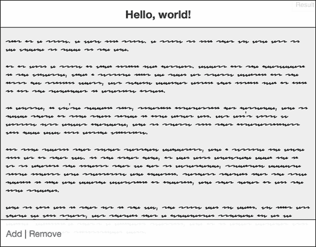

# Sassy CSS

本章中的几个代码片段也可以通过随书代码包附带的交互式代码片段演练场来使用。启动演练场的说明位于代码包中的 `README.md` 文件中。启动后，选择 **3: Sassy CSS**，然后浏览并尝试这些示例。在适用的情况下，每个小节和代码片段都会指示你应选择哪个章节和示例。

我们已经简要提及了 Sass 的优势，但学习如何使用它需要一点努力。话虽如此，认识到关于 Sass 的一个非常重要的事实至关重要，这会让学习变得更容易：每个 CSS 文件都是一个有效的 SCSS 文件。Sass 本身支持两种格式；但我们将使用的格式类似于 CSS 语法，并使用 `.scss` 扩展名。这意味着你可以编写纯 CSS，Sass 将能毫无问题地识别它。这让你可以按照自己的节奏学习特性，而不会损失生产力。在你不了解某个 Sass 特性的情况下，你可以编写常规 CSS。稍后，当你学得更多时，可以使用 Sass 重写该 CSS。

## Note

Sass 支持的另一种格式使用缩进而非括号来定义文件结构。这些文件使用 `.sass` 扩展名。

在深入探讨 Sass 的优势之前，重要的是要记住浏览器不支持 SCSS 语法。这意味着我们必须使用工具将 SCSS 文件转换为浏览器能理解的 CSS 文件。你已经熟悉将 ES2015 代码转换为 ES5 的过程，这一过程与此非常相似。

Sass 高度基于 DRY 概念——即不要重复自己。另一方面，CSS 往往充满了重复，因此 Sass 代码可以比等效的 CSS 更加模块化和紧凑。在编写 Sass 代码时，应寻找减少重复和鼓励代码复用的机会。

Sass 包含命令式控制结构，如控制流和循环，以及外观和行为类似函数的构造。这意味着 Sass 代码有时读起来更像是一个程序，而不是一个样式表。因此，很容易将大量复杂的功能抽象到可复用的模块中；但这也意味着必须熟悉 Sass 的工作原理。话虽如此，如果有任何困惑，查阅生成的 CSS 文件通常有助于理清头绪。

我们无法涵盖 Sass 提供的每一项特性。相反，我们将介绍本书代码中倾向于使用的特性。如果你愿意，可以随时通过浏览 Sass 文档 (`http://sass-lang.com/documentation/file.SASS_REFERENCE.html`) 了解更多。

## Comments

CSS 允许采用 `/* … */` 形式的注释。这种类型的注释适用于许可证和其他应由客户端下载的文本。但通常，开发人员会在生产环境的 CSS 文件中剥离除许可证外的任何注释，以减小文件体积。Sass 通过提供单行注释功能来解决这个问题。这种单行注释永远不会被渲染到输出的 CSS 文件中，因此你可以随意使用它，而无需担心输出文件的大小。单行注释以双正斜杠 (`//`) 开头。Sass 将继续渲染 `/* … */` 注释，因此这也是一种控制哪些注释保留在最终输出中的有用方法。

Sass 也可以配置为消除所有注释。如果你使用此功能，仍可通过使用 `/! … */` 强制某些注释包含在最终输出中。如果你需要在最终输出中包含许可证，这可能会很有用。

## Calculation

CSS 长期以来一直饱受 *magic* numbers（魔数） 的困扰——这些值的含义或开发人员如何得出这些值相当晦涩。请看下面的例子：

```
.some-element {
    width: 560px;
}
```

除了知道某物宽 `560px` 之外，这个片段并没有告诉你宽度是如何确定的。这意味着稍后回来适当修改该值很困难。它可能是图像的宽度，也可能是一系列数学运算的结果。

借助 CSS3，我们可以执行运行时计算，这非常有用。因此，我们可以编写如下代码：

```
.some-element {
    width: calc((960px / 12) * 7);
}
```

这开始提供一些上下文——我们有一个 `960px` 的网格，包含 `12` 列，该元素应宽 `7` 列。因此，当我们稍后回来修改它时，就会知道最初的意图。

尽管大多数现代移动浏览器支持此功能，但以这种方式使用 `calc` 是不明智的，因为它会带来性能损耗，因为必须持续对其求值。因为这个数值永远不会改变，如果计算结果能只确定一次并插入输出 CSS 中，速度会更快。

Sass 允许我们在样式中内联指定计算来实现这一点。请看下面的例子：

```
.some-element {
  width: (960px / 12) * 7;
}
```

当 Sass 生成 CSS 文件时，它会写入 `560px`，这意味着浏览器不必担心重新计算这个值。但当我们查看自己的代码时，更容易阅读和理解为什么 `560px` 是最终结果。

### Note

本节中的代码片段位于本书代码包的 `snippets/03/ex1-calculation/` 中。使用交互式代码片段演练场时，选择 **3: Sassy CSS** 和 **Example 1: Calculation**。

预期的数学运算符均可用，包括加法 (`+`)、减法 (`-`)、乘法 (`*`) 和除法 (`/`)。取模 (`%`) 也受支持。如果任何操作数缺少单位，则根据前面的操作数推断单位。这意味着 `5px + 3` 变为 `8px`，而 `10px * 3` 计算为 `30px`。

应当注意，Sass 不执行混合单位计算。例如，不能将 `em` 单位加到 `px` 单位上。这会导致错误。如果你需要进行此类计算，CSS3 的 `calc` 是你唯一的选择。

然而，你可以将比率转换为百分比。例如：

```
.some-element {
    width: ((960px / 12) * 7) / 960px * 100%;
}
```

在前面的例子中，我们试图从 `960px` 网格转换为基于百分比的布局，同时保持相同的比率。前面计算的结果将是 `58.3333%`。乘以 `100%` 将我们的计算转换为百分比。

除法运算符有些特殊——该符号在 CSS 中也经常使用。以下代码的结果应该是什么？

```
.some-element {
    width: 500px / 20;
}
```

在前面的例子中，Sass 将输出 `500px / 20`，而不是 `25px`。这是因为 CSS 简写也使用正斜杠来分隔某些值。例如，`font` 接受字号和行高（例如，`20px/50px` 指定 `20px` 字号和 `50px` 行高）。因为每个 CSS 文件也是一个有效的 Sass 文件，且期望生成的输出与原始 CSS 文件匹配，所以 Sass 在这种情况下无法执行任何除法。为了在这种情况下强制执行除法，我们可以用括号将表达式括起来，如下所示：

```
.some-element {
    width: (500px / 20);
}
```

我们还可以使用各种函数对数字进行操作。`round(1000px / 3)` 将被转换为 `333px`，而不是 `333.3333px`。有关所有可用函数的列表，请参阅 `http://sass-lang.com/documentation/Sass/Script/Functions.html`。

计算也可以在颜色上执行；但使用颜色函数（列在前面的链接中）比使用计算来达到预期结果更容易。

如果你需要执行字符串连接，可以使用加法运算符。


# 变量

有关 Sass 计算的更多信息，请参阅 [`sass-lang.com/documentation/file.SASS_REFERENCE.html#ope`](http://sass-lang.com/documentation/file.SASS_REFERENCE.html#ope)。

原生 CSS 最明显的问题之一是缺乏变量。CSS 往往反复指定相同的颜色、尺寸和图片。虽然可以利用 CSS 的层叠特性来缓解此问题，但并非所有人都会这么做。让我们看几个例子。每个示例将复制以下简单布局：



我们在每个示例中使用的 HTML 如下（后续代码片段均不改变此 HTML）：

```html
<div class="ui-view-container">
  <div class="ui-navigation-bar">
    Hello, world!
  </div>
  <div class="ui-scroll-container">
    <p>...</p> ...
  </div>
  <div class="ui-tool-bar">
    <a href="#">Add</a> | <a href="#">Remove</a>
  </div>
</div>
```

### 注意

本节中的代码片段位于本书代码包的 `snippets/03/ex2-variables/a…c` 目录下。使用交互式代码片段演练场时，请选择 **3: Sassy CSS** 以及示例 **2a** 到 **2c**。

尽管此布局看起来相当简单，但很容易看出生成的 CSS 如何迅速变得难以控制。请看下面的示例：

```css
// 代码片段示例 2a
.ui-view-container {
    position: absolute;
    padding: 10px; margin: 10px;
    border: 1px solid black;
    background-color: #EEE;
    top: 0; left: 0;
    bottom: 0; right: 0;
    box-sizing: border-box;
    font: 16px "Helvetica Neue", Helvetica, Arial, sans-serif;
}
.ui-navigation-bar {
    position: absolute;
    height: 50px; line-height: 50px;
    top: 0;
    left: 0; right: 0;
    border-bottom: 1px solid black;
    background-color: rgba(255,255,255,.95);
    color: #333;
    box-sizing: border-box;
    text-align: center;
    font-size: 20px;
    font-weight: bold;
    z-index:1;
}
.ui-scroll-container {
    position: absolute;
    top: 0; left: 0;
    right: 0; bottom: 0;
    padding: 50px 10px;
    overflow: auto;
}
.ui-tool-bar {
    position: absolute;
    bottom: 0;
    left: 0; right: 0;
    padding: 0 10px;
    line-height: 50px; height: 50px;
    box-sizing: border-box;
    background-color: rgba(255,255,255,.95);
    color: #333;
    border-top: 1px solid black;
    z-index:1;
}

.ui-tool-bar a {
    color: #369;
    text-decoration: none;
    display: inline-block;
    line-height: 50px;
}
```

这并非良好的 CSS —— 它非常重复，且未利用 CSS 的层叠特性。因此，让我们重写它，使其减少重复且更易维护：

```css
//代码片段示例 2b
.ui-view-container, .ui-navigation-bar, .ui-tool-bar, 
.ui-scroll-container {
    box-sizing: border-box;
    position: absolute;
}
.ui-view-container, .ui-scroll-container {
    top: 0; left: 0;
    bottom: 0; right: 0;
}
.ui-navigation-bar, .ui-tool-bar {
    background-color: rgba(255,255,255,.95);
    color: #333;
    height: 50px;
    left: 0; right: 0;
    padding: 0 10px;
    z-index: 1;
}
.ui-navigation-bar, .ui-tool-bar, .ui-tool-bar a {
    line-height: 50px;
}
.ui-view-container {
    border: 1px solid black;
    background-color: #EEE;
    font: 16px "Helvetica Neue", Helvetica, Arial, sans-serif;
    margin: 10px;
    padding: 10px;
}
.ui-navigation-bar {
    border-bottom: 1px solid black;
    font-size: 20px;
    font-weight: bold;
    text-align: center;
    top: 0;
}
.ui-scroll-container {
    overflow: auto;
    padding: 50px 10px;
}
.ui-tool-bar {
    border-top: 1px solid black;
    bottom: 0;
}
.ui-tool-bar a {
    color: #369;
    display: inline-block;
    text-decoration: none;
}
```

上述代码有所改进，但仍不够清晰，且包含大量含义不明显的**魔术数字**（在更大的样式表中情况会更糟）。通过变量，我们可以开始消除这些魔术数字，提高代码的可读性。我们还可以通过在单一位置修改变量，而非在样式表中到处搜索特定值并替换，从而轻松调整应用的外观。

Sass 定义变量的方式如下：

`$variable: value;`

有了这个知识，我们现在可以仅用少量变量编写一个可换肤的 CSS 版本：

```css
//代码片段示例 2c
$text-color: #333;
$font: "Helvetica Neue", Helvetica, Arial, sans-serif;
$text-font: 16px $font;
$text-title-size: 20px;
$text-title-weight: bold;
$tint-color: #369;
$bar-background-color: rgba(255,255,255,.95);
$view-background-color: #EEE;
$separation-border: 1px solid black;
$separation-size: 10px;
$bar-height: 50px;

.ui-view-container, .ui-navigation-bar, .ui-tool-bar, 
.ui-scroll-container {
    box-sizing: border-box;
    position: absolute;
}
.ui-view-container, .ui-scroll-container {
    top: 0; left: 0;
    bottom: 0; right: 0;
}
.ui-navigation-bar, .ui-tool-bar {
    background-color: $bar-background-color;
    color: $text-color;
    height: $bar-height;
    left: 0; right: 0;
    padding: 0 $separation-size;
    z-index: 1;
}
.ui-navigation-bar, .ui-tool-bar, .ui-tool-bar a {
    line-height: $bar-height;
}
.ui-view-container {
    border: $separation-border;
    background-color: $view-background-color;
    font: $text-font;
    margin: $separation-size;
    padding: $separation-size;
}
.ui-navigation-bar {
    border-bottom: $separation-border;
    font-size: $text-title-size;
    font-weight: $text-title-weight;
    text-align: center;
    top: 0;
}
.ui-scroll-container {
    overflow: auto;
    padding: $bar-height $separation-size;
}
.ui-tool-bar {
    border-top: $separation-border;
    bottom: 0;
}
.ui-tool-bar a {
    color: $tint-color;
    display: inline-block;
    text-decoration: none;
}
```

如果你数一下行数，可能会注意到这个示例实际上比之前的示例更长。因此，乍一看，这似乎没有多大好处。然而，一旦你研究代码，就会发现几项改进，包括以下几点：

*   代码**更具可读性和可理解性**。我们无需猜测 `50px` 可能代表什么 —— 代码明确指出它是栏组件的高度。
*   代码**减少了魔术数字**。几乎每个值（零或一除外）都由变量表示，而不是晦涩的数字。这并非说 Sass 中的每个值都应是变量；但当你发现自己在相似上下文中反复输入相同值时，可能就是使用变量的好时机。
*   **易于更改外观**。我们只需修改前几行代码中的值即可。如果我们想让栏高 `44px` 而不是 `50px`，这将是一个简单的更改。在第二个片段中，虽然仍然容易，但我们必须在多处进行更改。如果我们执行搜索替换，就必须做出一个站不住脚的断言：即每个 `50px` 实例都应被更改。在我们的特定案例中这很安全，但在大型文件中，正确性就不太可能得到保证。

### 注意

Sass 变量的作用域限于声明它们的选择器内。因此，如果变量在 `.ui-tool-bar` 中声明，其他选择器将无法访问。你可以通过追加 `!global` 强制将此类变量设为全局。但如果你发现自己需要这样做，不如直接将变量本身移出选择器。

在使用变量时，你可能还会发现插值很有用。请看下面的片段：

```css
.ui-navigation-bar {
    font: $text-title-weight #{$text-title-size}/#{$bar-height} 
          $font;
  //font: bold 20px/50px"Helvetica Neue", Helvetica, Arial, 
          sans-serif;
}
```


# 插值

前面的插值（用 `#{$variable-name}` 标识）有助于避免解析问题。在前面的示例中，正斜杠可能会被以多种不同方式解释（包括除法）。为避免歧义（以及可能的错误结果），我们可以使用插值。

我们也可以在其他地方使用插值。请看下面的示例：

```
$button-class: button;
a.#{$button-class} {
  ...
}
```

这将编译为以下 CSS：

```
a.button {
  ...
}
```

在前面的示例中，我们必须使用插值；使用 `a.$button-class` 会导致错误。

# 嵌套

阅读 HTML 时，很明显存在层级和嵌套结构。但在大多数 CSS 代码中，这种结构很快就会丢失。这会导致难以理解 CSS 是如何实现最终外观的。我们可以使用 Sass 的嵌套功能，让代码更易编写和理解。

## 注意

本节的代码片段位于代码包的 `snippets/03/ex3-nesting/` 目录下。使用交互式片段演练场时，选择 **3: Sassy CSS** 和示例 **3**。

让我们继续使用上一节讨论的布局。工具栏中有两个锚点。虽然锚点明显嵌套在 `div` 工具栏内，但阅读 CSS 时并不那么明显。不过，我们可以这样编写 Sass：

```
.ui-tool-bar {
    border-top: $separation-border;
    bottom: 0;
    a {
      color: $tint-color;
      display: inline-block;
      text-decoration: none;
    }
}
```

现在，很明显我们在为工具栏内的锚点定义样式。生成的 CSS 会从这种嵌套中创建两条规则：`.ui-tool-bar` 和 `.ui-tool-bar a`。

嵌套时，有一个特殊的占位符可用：`&`（ampersand）。当我们需要使用伪元素（如 `:hover` 等）时，这很有用。这让我们可以编写如下规则：

```
.ui-tool-bar {
    ...
    a {
        ...
        &:hover {
            text-decoration: underline;
        }
    }
}
```

Sass 还提供另一种形式的嵌套。CSS 经常将属性分组。例如，`font-family`、`font-size` 和 `font-weight` 都与元素的字体相关。在 CSS 中，我们必须单独指定每个属性（或使用 CSS 简写）。但在 Sass 中，我们可以这样做：

```
.some-element {
    font: {
        family: sans-serif;
        size: 16px;
        weight: bold;
    }
}
```

# Mixin 和函数

如前所述，Sass 旨在减少重复并增加抽象。Sass 提供了 `@mixin` 和 `@function` 指令，让我们创建可复用的组件，稍后可插入样式中。

## 注意

本节的代码片段位于代码包的 `snippets/03/ex4-mixins/a…d` 目录下。使用交互式片段演练场时，选择 **3: Sassy CSS** 和示例 **4a** 到 **4d**。

支持供应商前缀是个很好的例子。在许多样式表中，常见如下代码：

```
.some-element {
  -webkit-box-sizing: border-box;
  -moz-box-sizing: border-box;
  -ms-box-sizing: border-box;
  -o-box-sizing: border-box;
  box-sizing: border-box;
}
```

这不仅难看，而且极其重复。使用 Sass，我们可以编写一个 mixin 来完成这项工作。首先，定义 mixin：

```
// Snippet Example 4a
@mixin box-sizing($value) {
  -webkit-box-sizing: $value;
  -moz-box-sizing: $value;
  -ms-box-sizing: $value;
  -o-box-sizing: $value;
  box-sizing: $value;
}
```

这看起来很像前面的片段。记住，mixin 本质上是一个宏或模板，可在别处引入。使用时，可以创建如下规则：

```
.some-element {
  @include box-sizing(border-box);
}
```

当然，结合变量插值，我们可以更进一步，使其更抽象，如下片段所示：

```
// Snippet Example 4b
@mixin prefix($property, $value...) {
  -webkit-#{$property}: $value;
  -moz-#{$property}: $value;
  -ms-#{$property}: $value;
  -o-#{$property}: $value;
  #{$property}: $value;
}

@mixin box-sizing($value) {
  @include prefix(box-sizing, $value);
}
```

### 注意

前面示例中的 `…` 标记表示该参数可接受多个参数。这类似于 ES6 中的 `…` 运算符。

最后，我们可以再进一步抽象：

```
// Snippet Example 4c
$prefixes: "-webkit-","-moz-","-ms-","-o-","";
@mixin prefix($property, $value...) {
  @each $prefix in $prefixes {
    #{$prefix}#{$property}: $value;
  }
}
```

这是 Sass 提供的控制流和循环示例。但请记住，没有运行时性能影响——Sass 在转换为 CSS 时会展开循环。

### 注意

此 `prefix` mixin 无法处理所有使用供应商前缀的情况；但对于我们的示例已足够。我们的 mixin 未处理的一种情况是属性值中的供应商前缀。

如果你发现自己反复重用同一计算，`@function` 指令会很有用。例如，假设我们要使用 `960px` 网格，但不想在代码中散布大量计算。我们可以编写如下函数：

```
// Snippet Example 4d
$grid-width: 960px;
$grid-columns: 12;
@function grid-size($columns) {
  @return ($grid-width / $grid-columns) * $columns;
}
```

使用方式如下：

```
.some-element {
  width: grid-size(5);
}
```

### 注意

你也可以按名称向 mixin 和函数传递参数。例如，`grid-size($columns: 5)`。

# 面向对象 CSS

虽然 mixin 提供了很好的代码复用方式，但还有另一种方式可减少重复并鼓励抽象。Sass 提供了 `@extend` 指令机制。

让我们看一个简单的 CSS 示例：

```
.button {
  ...
}
.shiny-button {
  ...
}
```

如果要创建一个闪亮按钮，元素需要附加两个类（`button shiny-button`）。这容易出错，因为我们必须记住包含两个类；也会导致冗长的类列表。Sass 的 `@extend` 关键字可简化此问题。请看下面的版本：

```
.button {
  ...
}
.shiny-button {
  @extend .button
  ...
}
```

当我们创建一个类为 `shiny-button` 的 HTML 元素时，它将自动获得赋予 `button` 的所有规则，而无需在类列表中显式列出它。

但有时，我们可能想复用样式而不弄乱 CSS。如果基类永远不会单独使用，则没有理由为它生成类名。在这种情况下，Sass 有占位符的概念。请看下面的示例：

```
%button {
  ...
}
.shiny-button {
  @extend %button
  ...
}
```

现在，我们可以像前面那样创建一个类为 `shiny-button` 的 HTML 元素，但无法创建仅类为 `button` 的元素，因为该类不存在。

## 注意

有一种称为 OOCSS 的面向对象 CSS 形式。想了解更多，请参阅 [`appendto.com/2014/04/oocss/`](http://appendto.com/2014/04/oocss/)。本节标题使用“面向对象”仅因为它是描述 Sass 使用 `@extend` 时行为的最佳方式。

# 模块和分部

CSS 允许从其他样式表导入样式，Sass 进一步扩展了这一点，允许 Sass 文件导入其他 Sass 文件。语法与 CSS 基本相同，只是省略了文件扩展名。请看下面的示例：

```
@import "utils", "grid";
```

上述命令会在同一目录下查找 `util.scss` 和 `grid.scss` 文件并导入其规则。如果需要导入 CSS 文件，可以：

```
@import "vanilla.css";
```


# Sass 部分文件

导入的 Sass 文件可能不是你希望单独编译为 CSS 的文件。如果是这种情况，你可以在文件系统中给文件名前加上下划线。例如，沿用前面的示例，我们可以使用 `_util.scss` 文件代替 `util.scss`。`@import` 的外观和工作方式相同，但 Sass 永远不会尝试创建 `_util.css` 文件（如果没有下划线，它会尝试创建 `util.css` 文件）。使用哪种方式主要取决于你是否希望生成相应的 CSS 文件。

# 使用 Gulp 设置 Sass

在使用 Sass 之前，我们需要在项目中安装它，然后向 `gulpfile.js` 添加一些额外的代码。值得庆幸的是，所有步骤都相当简单。步骤如下：

## 安装 Sass

1. 通过执行以下命令安装 Gulp 可用的 Sass 版本：

```bash
$ npm install --save-dev gulp-sass@2.0.4
```

## 配置 Gulp 路径

2. 接下来，修改 `gulp/config.js` 以定义 SCSS 文件的位置以及输出应放置的位置：

```javascript
assets: {
    copy: […],
    code: {…},
    styles: {
        src:  "www/scss/app.scss",
        dest: "www/css"
    }
}
```

## 创建 Sass 编译任务

3. 现在，创建 `gulp/tasks/copy-scss.js`：

```javascript
var gulp = require("gulp"),
    sass = require("gulp-sass"),
    notify = require("gulp-notify"),
    sourcemaps = require("gulp-sourcemaps"),
    gutil = require("gulp-util"),
    config = require("../config"),
    settings = require("../settings"),
    paths = require("../utils/paths");

function copySCSS() {
  var isRelease = (settings.BUILD_MODE === "release");
  var includePaths = []; // [1]
  var includeModules = config.sass &&
        config.sass.includeModules;
  if (includeModules instanceof Array) {
    includePaths = includePaths.concat(
      includeModules.map(function(moduleName) {
        var module = require(moduleName);
        return module.includePath;
      }));
  }
  var moreIncludePaths = config.sass &&
      config.sass.includePaths;
  if (moreIncludePaths instanceof Array) {
    includePaths = includePaths.concat(moreIncludePaths);
  }
  return gulp.src(paths.makeFullPath(
                  config.assets.styles.src,
                  paths.SRC)) //[2]
    .pipe(isRelease ? gutil.noop() : sourcemaps.init()) //[3]
    .pipe(sass({
      includePaths: includePaths, //[4]
      outputStyle: (isRelease ? "compressed" : "nested") //[5]
    }))
    .on("error", function(error) {
      this.emit("end");
    })
    .on("error", notify.onError(function(error) {
      return "SASS: " + error.message;
    }))
    .pipe(isRelease ? gutil.noop() : sourcemaps.write()) //[3]
    .pipe(gulp.dest(paths.makeFullPath(
          config.assets.styles.dest, paths.DEST)));
}
module.exports = {
  task: copySCSS
}
```

## 理解 Sass 任务

这看起来应该有点眼熟——这里有几行代码与我们在上一章中处理的 `copy-code.js` 任务非常相似。话虽如此，让我们来看看一些细节：

*   在文件开头附近（`[1]`），我们检查配置文件，看是否有希望 Sass 在执行 `@import` 时搜索的目录。我们可以将这些路径作为数组指定在 `sass.includePaths` 中，或者通过在 `sass.includeModules` 数组中列出它们，指定各种暴露了 `includePath` 的 `npm` 模块。我们稍后将介绍一个示例。这些路径实际上在 `[3]` 中被使用。

*   注意，我们只向 `gulp.src()` 传递了一个文件（`[4]`）。就像上一章中的 `babelify` 一样，我们只需要传递顶层 Sass 文件。Sass 将根据顶层文件中包含的导入语句发现需要处理的其他文件。然后，我们只需在 `index.html` 文件中包含一个样式表。话虽如此，如果你想处理多个 Sass 文件，没有什么能阻止你包含多个文件。

*   就像上一章一样，只有当我们不为生产环境构建时（`[3]`），才会渲染源映射。拥有源映射对于调试非常有用，但它们占用空间，而我们不需要将这些空间传递给用户。

*   当我们在发布模式下构建时（`[5]`），`outputStyle` 会被压缩。生成的输出不打算让人阅读，但浏览器仍然能很好地理解它。这有助于节省最终用户设备上的空间。

## 更新复制任务

在实际使用此方法之前，我们需要修改 `gulp/tasks/copy` 任务，使其如下所示：

```javascript
module.exports = {
  deps: ["copy-assets", "copy-scss", "copy-code"]
}
```

## 运行构建

此时，我们可以执行 `gulp copy`，它将处理 `src/www/scss/` 文件夹中的 `app.scss`。完成后，`build/www/css/` 中将会有一个 `app.css` 文件。此时，你可以通过在 `head` 部分添加以下行来修改 `src/www/index.html` 以包含样式表：

```html
<link rel="stylesheet" type="text/css" href="./css/app.css">
```

# 包含通过 npm 安装的样式表

`npm` 不仅仅用于 JavaScript——有几个模块包含我们可以利用的 Sass 样式表。让我们用一个样式表“重置”（它清除浏览器应用于各种元素的各种样式）作为一个简单的例子。这种“重置”对于在不同浏览器和渲染引擎之间获得视觉一致性很有用，因为不同浏览器可能对元素有不同的默认样式。

### 注意

注意：你可能更倾向于规范化元素样式而不是清除它们。如果是这种情况，请查看 [`www.npmjs.com/package/normalize-scss`](https://www.npmjs.com/package/normalize-scss)。

首先，执行以下命令：

```bash
$ npm install --save node-reset-scss@1.0.1
```

接下来，让我们向 `gulp/config.js` 添加以下对象：

```javascript
"sass": {
  "includeModules": [
    "node-reset-scss"
  ]
}
```

此时，我们可以在 Sass 文件顶部使用 `@import "reset";`。如果我们在 Gulp 配置中没有使用 `includePaths`，我们将需要使用 `@import "../../../node_modules/node-reset-scss/scss/reset";`。就我个人而言，我会选择前者——它容易输入得多！

不过，不能保证模块会通过 `includePath` 暴露其样式表的位置。如果没有，我们可以直接指定路径，如下所示：

```javascript
"sass": {
  "includePaths": [
    "./node_modules/node-reset-scss/scss"
  ]
}
```

# 总结和后续步骤

在本章中，你了解了 Sass——一种允许我们编写模块化且减少重复 CSS 的语言。你还将 Sass 集成到了构建过程中。此时，你已完成构建过程的设置。

在下一章中，我们将介绍一些高级响应式设计，这将帮助我们创建应用程序的外观和感觉。
