# 响应式设计考量

关于 `Cordova` 和 `PhoneGap` 一个非常常见的问题是 *如何正确处理不同的屏幕尺寸？* 不幸的是，这个问题通常在开发过程已经非常晚期时才被提出，此时将适当的修复引入代码已变得困难。开发人员使用硬编码尺寸构建了应用，通常忽略了宽高比差异，现在任何修复实施起来都很昂贵。因此，从应用开发的一开始，就至关重要的是要实现你的应用，使其能响应用户设备的尺寸。

`HTML` 天生是响应式的，但如果你使用基于像素的原点和尺寸，很容易破坏这种自然的响应性。只要尽可能避免这些陷阱，并使用百分比以及绝对和相对定位，你的应用将自然缩放以适应其所在的任何屏幕。结果可能不是你想要的（空白太多或太拥挤），但这些可以使用 `CSS` 轻松解决。


# 响应式设计与像素密度

处理图标时图片还比较简单——图标在任何设备上往往具有相同的尺寸和形状；但处理背景图片或填满屏幕宽高的图片时，情况则截然不同。图片对宽高比非常敏感，当图片的宽高比不正确时，观看者通常能立刻察觉。CSS3 为此提供了相应的机制来帮助我们解决这些问题。

## 本章概览

在本章中，我们将涵盖以下内容：

*   像素密度
*   CSS3 单位，包括 `rem` 和视口单位
*   媒体查询
*   图片尺寸调整
*   Flex-box 布局

## 代码示例与资源

本章中的多个代码片段也可通过随书代码包附带的交互式片段演练场使用。启动演练场的说明位于代码包中的 `README.md` 文件中。启动后，选择 **4: Responsive design**，然后浏览并尝试相关示例。在适用的情况下，每个章节和片段都会指明应选择哪个章节和示例。

虽然本书的演示应用仅专注于构建过程，但使用本章技术的完整代码位于代码包中的 `/logology-v04/` 目录下。建议阅读 `logology-readme.md` 文件，以更好地了解底层代码和结构。您可以按照代码包中 `readme.md` 文件的说明，在设备上构建并运行该应用。

## 设备屏幕的多样性

各种屏幕尺寸的设备主导着当今的移动市场。有些屏幕较小，为 4.5 英寸；有些则较大，达到 6 英寸。平板电脑当然更大，有 7 英寸、8.9 英寸、10 英寸等（最新发布的 iPad Pro 为 12.9 英寸）。

更复杂的是，这些屏幕的分辨率也大不相同。屏幕的物理尺寸很难说明其包含多少像素——4.5 英寸屏幕的分辨率可能是 320 x 480 像素，也可能是 640 x 960，或 1280 x 800。稍大一点的屏幕可能拥有显著更多的像素——6 英寸手机的分辨率可能高达 2560 x 1600。

大多数开发者习惯将像素视为可直接控制的离散单位。换句话说，开发者认为可以单独确定屏幕上每个像素的颜色和亮度。虽然确实可以单独控制每个像素，但在渲染 Web 内容时，很快会遇到文本和其他元素尺寸方面的问题。只要设备使用大像素（对应低像素密度），就没有任何问题。但高密度显示屏普及的那一刻，Web 浏览器就面临了真正的问题。如果浏览器强制执行 1:1 的像素映射，那么在分辨率为 1440 x 900 像素的桌面显示器上易于阅读的内容，在像素密度高得多的较小移动设备上就会变得极其微小。这对视力极好的年轻人可能不算什么，但无论渲染多么清晰锐利，大多数人长时间阅读极小字号的大量文本都很困难。

移动浏览器面临两难境地：要么要求用户将网页缩放到舒适的大小，要么由浏览器自动缩放网站。移动浏览器厂商选择了后者。为了确保网站仍能以相同的布局渲染，移动浏览器还会“欺骗”网站，报告的屏幕像素数少于实际像素数。报告像素与实际像素的比率称为**缩放因子**（`scaling factor`）。大多数设备报告整数缩放因子，通常为 2:1。较新的设备拥有如此高密度的显示屏，以至于报告 3:1。

这个缩放因子或缩放比率表示每个逻辑像素包含的物理像素数量。**逻辑像素**（`logical pixel`）就是一组组合在一起形成一个可寻址单元的物理像素。开发者不一定能控制组内的每个像素——这是设备的责任。这使得具有不同缩放因子的新设备能够合理地按照设计师的意图渲染内容。文本和矢量图形可以自动受益于更高密度的屏幕，保持锐利。在最坏的情况下，图片会显得稍微模糊一些（因为设备必须对图片进行上采样以适应更多像素）。一旦某种像素密度足够普及，设计师就可以为这些特定设备生成更高分辨率的图片。

理论够多了。我们中有些人是视觉型学习者，下面通过一张图来展示其工作原理：

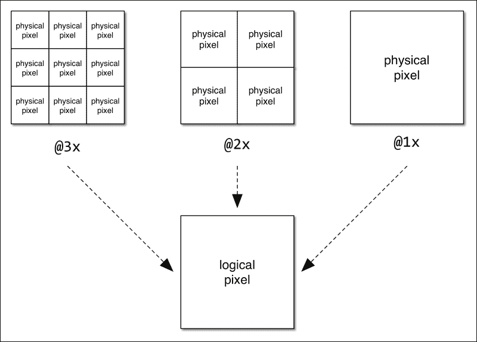

请注意，顶部展示了由缩放因子表示的三种不同像素密度。**@3x**（或 3:1）表示 9 个物理像素对应 1 个逻辑像素（3 x 3）。**@2x**（2:1）将 4 个物理像素映射到 1 个逻辑像素（2 x 2）。最后，**@1x**（1:1）表示物理像素与逻辑像素之间存在直接的一对一映射。

在使用 CSS 和 HTML 时，几乎所有情况下我们处理的都是逻辑像素，而非物理像素。只有在处理图片或使用 HTML5 `canvas` 时，这才不完全适用。本书不讨论 HTML5 `canvas`，但我们必须在具有多种不同像素密度的屏幕上渲染清晰的图片。

不幸的是，并非所有缩放因子都是整数。这意味着一个逻辑像素并不总能完全与离散的物理像素对齐。请看下图：

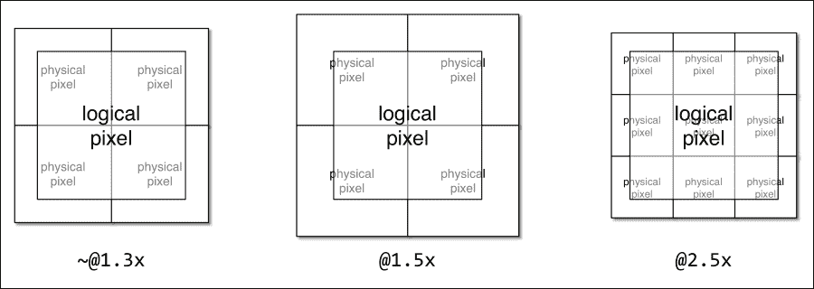

注意物理像素如何无法完全容纳在逻辑像素内？这意味着无法确保像素级完美；总会存在一定程度的混合，即一个物理像素混合了两个逻辑像素的颜色。在高密度显示屏（如 iPhone 6s+）上，这不太明显，因为物理像素本身非常小。但在其他显示屏（如 2012 年的 Nexus 7）上，由于物理像素尺寸较大，这变得非常明显。此时你应该认识到，实现真正像素完美的希望已破灭，应放弃这一幻想。HTML 本来就不是关于像素完美的。

### Note

这并不是说无法寻址每一个物理像素——是有办法的。但这通常需要大量艰苦的工作。值得注意的是，即使是 Apple 的 iPhone 6s+ 在使用原生用户界面控件时，也不渲染像素完美。在这个特定示例中，你必须回退到 `OpenGL`。

上图并非设备将逻辑像素混合为物理像素的完美呈现。这取决于设备和所寻址的逻辑像素。因此，有时某条线或边框似乎未被混合，而另一条则会。这仅取决于逻辑像素恰好落在物理像素网格的何处。请看下图——虽然每条线都用单像素笔画绘制，但根据绘制位置的不同，会使用不同的物理像素来渲染最终结果。如果像素较大，这非常明显。

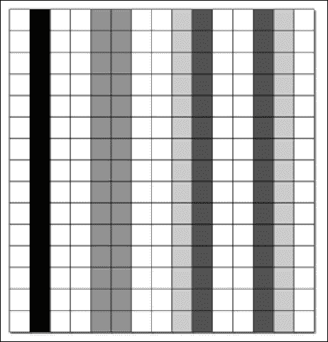

您可能熟悉典型的 CSS 单位，如 `px`（像素）、`pt`（点）和 `em`（字体大小）。还有一些在印刷场景中更常用，如 `in`（英寸）和 `cm`（厘米）。您也应该熟悉指定百分比，以便内容能适当调整大小。


## CSS3 单位

不幸的是，这些单位虽然支持良好，但不如现代应用开发所需的灵活。值得庆幸的是，CSS3 新增了几个新单位供我们利用，它们在移动平台上的支持也日趋完善。

`em` 单位表示特定元素的 `font-size`。若元素的 `font-size` 为 `20px`，则 `1em` 同样为 `20px`。这在过去很有用，因为它便于基于字体大小调整元素尺寸。`rem` 单位是该单位的扩展。`rem` 代表 `root em`，它允许我们指定一个在整个文档中一致的 `root em` 大小。也就是说，若我们在 `html` 元素上指定 `font-size: 16px`，则可在文档任意处使用 `1rem`，其将计算为 `16px`，无论该元素可能继承的任何 `font-size`。

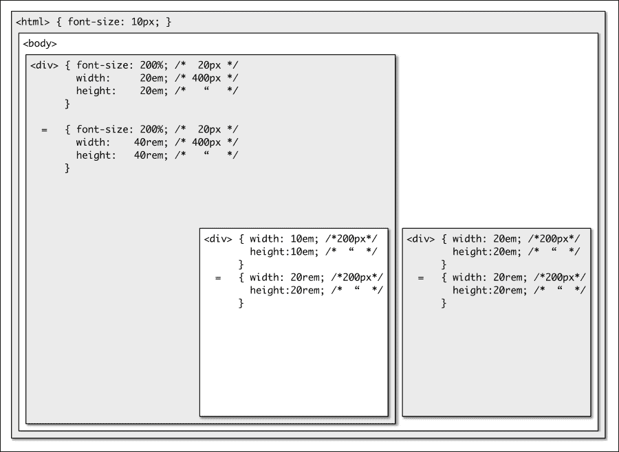

上图有助于理清这种关系。请注意，`em` 单位代表的像素数随元素（或其父元素）的 `font-size` 而变化。但 `rem` 单位始终一致：它始终等于 `html` 元素的 `font-size`。

### 视口单位

其他有用的单位是视口单位，共有四种：

*   `vw`：等于视口宽度的 1%
*   `vh`：等于视口高度的 1%
*   `vmin`：等于视口最短边的 1%
*   `vmax`：等于视口最长边的 1%

从技术上讲，若最近的定位元素填满整个浏览器视口，前两个单位等同于使用百分比。当然，若元素未填满视口，百分比无法达到相同效果，这正是这些新单位如此有用的原因。

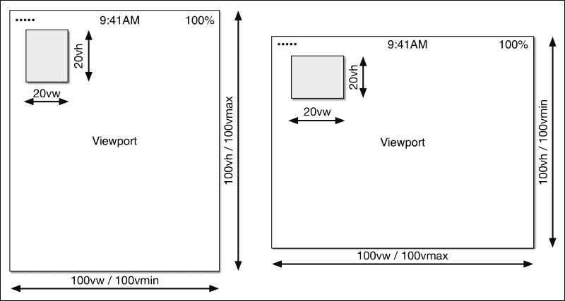

上图清晰地展示了这些单位的工作原理：`vw` 和 `vh` 单位始终分别代表视口宽度和高度的 1/100。而 `vmin` 和 `vmax` 单位仅基于最短和最长轴。

### `calc` 单位

还有一个单位值得简要提及，虽然你可能不会立即将其视为单位：`calc`。如果你还记得，在 第 3 章 *Sassy CSS* 中，我们讨论了如何使用 Sass 为我们执行计算。我们提到操作数必须具有相同单位。然而，CSS3 `calc` 表达式可处理混合单位，允许我们编写 `calc(25% + 25rem)` 或 `calc(25rem + 2vw)`，或几乎任何我们想要的表达式。下图直观展示了这一点：

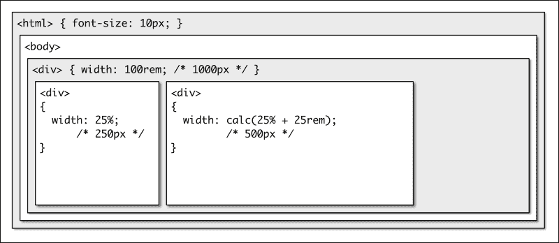

### 浏览器兼容性

一切都很美好，直到我们谈论浏览器兼容性。桌面浏览器对这些单位支持良好，令人惊讶的是，许多现代移动浏览器也是如此。但有一些注意事项：

*   **视口单位**：iOS 6.1+ 和 Android 4.4+ 支持（参见 [caniuse.com](http://caniuse.com/#feat=viewport-units)）。遗憾的是，iOS 6 和 7 对视口单位处理异常。网上有一个 buggyfill 可解决此问题：[viewport-units-buggyfill](https://github.com/rodneyrehm/viewport-units-buggyfill)。不幸的是，Android 4.3 或更低版本无法支持，因此若以这些 Android 版本为目标，必须提供回退方案。
*   **Root EM 单位**：iOS 4.1+ 和 Android 2.1+ 支持良好（参见 [caniuse.com](http://caniuse.com/#feat=rem)）。可放心大量使用。但链接页面指出，某些 Android 设备可能存在问题。
*   **动态计算**：iOS 6+ 支持，但 iOS 6 需要 `-webkit-` 前缀。Android 支持不足。Android 4.4 起部分支持加减法，直到 Android 浏览器版本 37 才完全支持。这意味着你可能应仅使用加减法，且对于运行 Android 4.3 或更低版本的设备，绝对需要回退方案。若可能，考虑改用 Sass 的 `calc` 函数，因为它在所有浏览器均可工作。

若以非常新的现代平台为目标，你可能无需担心回退方案。例如，截至撰写时，仅以 iOS 8 为目标即可覆盖 92% 的 iOS 市场，且无需视口 buggyfill。另一方面，仅 Android 4.4+ 以任何形式支持 CSS3 `calc` 函数，遗憾的是，截至撰写时，仅 67% 的安装基数运行 4.4 或更高版本。

### Tip

可通过访问 [Android 版本分布仪表盘](https://developer.android.com/about/dashboards/index.html) 确定任意 Android 版本的安装基数。iOS 请访问 [Apple App Store 支持](https://developer.apple.com/support/appstore/)。基于单个应用统计的替代视图见 [iOS Version Stats](http://david-smith.org/iosversionstats/)。

本书代码包中有一个简短示例演示这些单位，位于 `snippets/04/ex1-css3-units/`。你可在浏览器或设备上运行。若使用交互式片段演练场，请选择 **4: Responsive Design**，**Example 1**。

## 媒体查询

媒体查询是极其强大的构造，允许我们根据运行代码的设备属性构建响应式布局。例如，我们可根据屏幕宽度、高度或像素密度更改各元素的样式。或者，我们可检测各种设备能力，如色深，或判断是屏幕还是打印机。本节将重点介绍如何检测屏幕尺寸和像素密度。

媒体查询可使用 CSS `@import` 规则、样式表链接和 `@media` 规则定义。我们将聚焦于后者，因为它是典型形式。

媒体查询通常如下所示：

```
@media only screen and (max-width: 768px) and 
(max-resolution: 2dppx) {
  /* some CSS rules that apply when this query is true */
}
```

语法相当灵活，你可能已猜出上述规则的作用。但让我们梳理如何编写媒体查询：

*   `only`：用于阻止理解媒体类型但不理解媒体查询的旧版浏览器应用样式。
*   `screen`：指定此查询仅适用于屏幕，而非纸张或其他设备。既然本书以移动设备为目标，`screen` 最合理（我们通常不打印内容）。注意媒体类型（如 `screen`）不使用括号指定。
*   `and`：连接过滤器。所有过滤器必须匹配查询才匹配。等同于 JavaScript 的 `&&` 运算符。
*   逗号 (`,`)：连接过滤器，但仅需一个过滤器匹配查询即匹配。等同于 JavaScript 的 `||` 运算符。
*   `not`：否定查询。若使用 `and` 连接过滤器，则应用于整个查询；若使用逗号连接，则仅应用于单个过滤器。
*   过滤器用括号括起，形式为 `media-feature:value`。
*   媒体查询内的样式仅在整个查询匹配时应用。

Sass 为媒体查询增加了一项功能：可在选择器内部指定媒体查询。这使我们能将可能影响布局或样式的媒体查询保持在被修改项附近，如下例所示：


```css
.someElement {
    width: 100%;
    min-width: 320px;
    @media only screen and (max-width: 320px) {
        display: none; // hide this element on screens that
                       // aren't wide enough to show it.
    }
}
```

## 媒体查询特性

有许多特性可供我们筛选。让我们浏览一些常见的特性：

*   `width` 筛选器基于视口的宽度。`min-width` 设定宽度的下限，而 `max-width` 设定宽度的上限。例如，筛选器 `max-width: 320px` 将匹配宽度为 0 到 320 逻辑像素的任何视口，但不会匹配宽度为 400 像素的视口。另一方面，`min-width: 320px` 将匹配宽度为 320 逻辑像素或更大的所有视口。如果使用 `width`（不带 `min-` 或 `max-` 前缀），仅当视口宽度与指定宽度完全匹配时才会匹配。

*   `height` 筛选器基于视口的高度。例如，`width`、`min-height` 和 `max-height` 都可以使用，它们的工作方式与前一点相同（只是使用高度代替宽度）。

*   `aspect-ratio` 筛选器基于视口的宽高比。宽高比是视口宽度与高度的比率。支持 `aspect-ratio`、`min-aspect-ratio` 和 `max-aspect-ratio`。

*   `orientation` 筛选器基于视口是处于横向还是纵向。注意，这不一定表示设备的方向。就此特性而言，当视口宽度大于高度时匹配 `landscape`（横向），`portrait`（纵向）则相反。因此，在移动设备上，当设备物理上处于纵向时显示软键盘，可能会触发该值的变化，导致视口变得比高度更宽，这将被视为此筛选器的 `landscape`。

*   `device-pixel-ratio` 筛选器基于物理像素与逻辑像素的比率。例如，1:1 的显示器比率为 `1`。2:1 的显示器比率为 `2`。此特性不再是检测设备像素密度的首选方式，但 iOS 和 Android 4.4 以下版本仍常用。这些平台也都使用 `-webkit-` 前缀。它们也支持 `min-device-pixel-ratio` 和 `max-device-pixel-ratio`。

*   `resolution` 筛选器基于设备的分辨率。最常用的两个单位是 `dpi` 和 `dppx`。前者基于每英寸的像素数进行匹配，而后者本质上等同于 `device-pixel-ratio`。由于浏览器支持原因，你需要在查询中同时处理这两个单位。`min-resolution` 和 `max-resolution` 也受支持。

### 注意

如果你对媒体查询稍有了解，可能会认为我们这里遗漏了一些显而易见的特性。你说得对——我们没有列出 `-device-` 特性。这些特性不是基于实际视口，而是基于设备本身。许多开发者使用它们来检测正在渲染的设备；但随着新设备发布，屏幕尺寸和分辨率不断变化，这变成了一场永无止境的战斗。此外，如果你基于这些特性修改布局，可能得不到预期结果，因为浏览器视口不一定填满整个屏幕，尤其是同时运行多个应用时。依我之见，最好避免使用这些特性，仅依赖视口特定特性进行布局。

还有更多可用于检测的特性。全面讨论媒体查询超出了本书范围。如果你想深入了解媒体查询，请参阅 [MDN 媒体查询指南](https://developer.mozilla.org/en-US/docs/Web/Guide/CSS/Media_queries)。

## 特性检测的优势

这种特性检测的优势在于，我们可以创建不仅仅是随视口大小简单缩放的布局。我们可以根据视口大小实际修改应用的整个布局。例如，在 iOS 上，如果应用运行在 iPad 或 iPhone 6s+ 上，可能意味着并排显示两个视图，但在较小设备上，应用只会渲染单个视图。这让我们在不编写大量 JavaScript 代码的情况下，就能极大程度地控制用户界面的外观。

能够检测像素密度也至关重要。这主要不是为了布局，因为布局使用逻辑像素，而是为了图像和图标，它们混合使用逻辑和物理像素。

大多数 HTML 元素默认是响应式的，假设我们不针对其位置或大小使用基于像素的单位。位图（或栅格图像）则不同；它们在不丢失信息的情况下无法调整大小，所以我们必须单独处理它们。

## 图像渲染场景

关于图像，有三种场景：

*   渲染特定尺寸的图像，如图标或缩略图
*   渲染需要自动调整大小以适应视口宽度的图像，如页头图像
*   渲染需要填满视口的背景图像

在所有这些情况下，我们都希望图像尽可能清晰，且尽可能少地进行上采样，因为这会导致图像模糊。如果我们渲染图标，也应尽量避免下采样，因为这也会导致图标渲染不佳。

## 像素密度与图像清晰度

在描述 1:1 像素映射（也称为低密度、loDPI 或非视网膜）显示器上的渲染，与同一图像在 2:1 像素映射（通常称为高密度、hiDPI 或视网膜）显示器上的渲染之间的差异时，实际查看一些像素会有所帮助。让我们看一个图标，其内容清晰度很重要，因为任何模糊对查看者都显而易见：

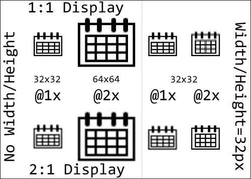

图像上半部分是 1:1 显示器的截图。下半部分来自 2:1 显示器。左侧是在我们包含一个没有 `width` 或 `height` 属性的 `img` 标签时渲染的。因为低密度版本是 `32 x 32 pixels`，高密度版本是 `64 x 64 pixels`，它们以两种不同的尺寸渲染。在右侧，渲染的是相同的图标，但每个都指定了 `width` 和 `height` 为 `32px`。我们还应指出，渲染的两个图标并不相同：`@1x` 版本针对低密度显示器优化，使用 `32 x 32 pixels`；`@2x` 版本针对高密度显示器优化，使用 `64 x 64 pixels`。*原因* 显而易见：我们希望图标在尽可能多的屏幕密度上看起来都尽可能清晰。

现在应该很清楚为什么我们要关心上采样和下采样了。图像左上角的两张图清晰锐利，但左下角的两张图却模糊不清。这是因为浏览器正在对这些图像进行上采样，使它们无论屏幕分辨率如何，看起来大小大致相同。不幸的是，这种上采样必然会丢失信息，为了补偿，浏览器会对图像应用一些数学变换以避免像素化。这远非完美，而且也需要处理时间。因此，我们希望尽可能避免这种情况。


# 响应式图标和图片

右上角的图标是一个很好的例子，说明了为什么最好避免将所有内容都从高密度版本进行下采样：在 1:1 显示器上，它远不如低密度版本清晰。这是因为浏览器现在必须将四倍数量的像素塞进四分之一的空间里，因此一些信息必然会*丢失*。有时这效果还可以——例如图标中的某些线条依然清晰——但其他时候，这会产生模糊的线条。

右下角的两个图标代表同一张图片，但在 2:1 显示器上。第二个图标清晰锐利。而第一个图标则再次变得非常模糊。这是因为低密度版本必须上采样到 2:1 显示器，以便显示为相同的尺寸。

此时，应该很明显，每个图标的实际分辨率与我们在告诉 HTML 或 CSS 图片大小时所用的尺寸之间存在脱节。低密度版本是 `32 x 32 pixels`，高密度版本是 `64 x 64 pixels`。但在两种情况下，我们都需要告诉浏览器图标是 `32 x 32 pixels`。但这确实意味着，为了获得最佳效果，我们需要向浏览器提供正确版本的图标，否则会得到不理想的结果。这也意味着我们需要创建针对图标将要显示的密度进行优化的版本——仅在 Photoshop 中进行上采样或下采样会产生相同或类似的次优结果。

## 提示：使用矢量图形

基于这个原因，建议您使用矢量图形而非位图来设计素材。矢量图形可以根据需要轻松调整大小和微调以获得所需输出，但位图只能缩放，这可能导致模糊的结果。

您可以使用各种机制来确保浏览器显示合适的图标版本，但具体使用哪一种通常取决于上下文。

### 结合 `srcset` 使用 `img`

如果您使用 `img` 标签，可以使用 `srcset` 属性请求合适的版本。使用此属性有不同的方式，但我们关注的是像素密度。以下代码可处理 1:1、2:1 和 3:1 密度的显示器：

```html

```

您可以根据需要包含任意数量的图标版本；浏览器将尝试选择最佳选项。当然，为了获得最佳显示效果，最好提供针对您的应用可能运行的每种显示密度的版本。

### 结合媒体查询使用 `background-image`

如果您在 CSS 中使用 `background-image`，则需要不同的机制：媒体查询。请看下面的例子：

```css
.icon {
    width: 32px; height: 32px;
    background: url('./calendar.png') no-repeat center center
                / 32px 32px;
}
@media only screen and (-webkit-min-device-pixel-ratio: 1.01),
  only screen and (min-resolution: 1.01dppx),
  only screen and (min-resolution: 193dpi) {
    .icon {
        background-image: url('./calendar@2x.png');
    }
}
@media only screen and (-webkit-min-device-pixel-ratio: 2.01),
  only screen and (min-resolution: 2.01dppx),
  only screen and (min-resolution: 289dpi) {
    .icon {
        background-image: url('./calendar@3x.png');
    }
}
```

在前面的例子中，您可能会想知道为什么我们要对像素比使用小数边界。如果我们指定 `min-resolution: 1dppx`，我们就是在告诉浏览器在 1:1 显示器上渲染 2:1 版本。这是我们要避免的。然而，如果我们指定 `min-resolution: 2dppx`，介于 1:1 和 2:1 之间的任何显示器最终都会*上采样* 1:1 版本，而不是*下采样* 2:1 版本。虽然两者都不理想，但 2:1 版本在这类显示器上的渲染效果会比 1:1 版本好。从技术上讲，这就是为什么 `dpi` 版本好得多的原因；我们不必担心小数。

## 注意：为什么是 193dpi？

那么，为什么是 `193dpi`？它是与 `1.01dppx` 匹配的最接近的模拟值。`289dpi` 同理——它与 `2.01dppx` 非常接近。

如果您想偷懒，可以直接让浏览器下采样您拥有的最密集版本的图标。这*行得通*，但并不完美。首先，最佳效果只会出现在密度是最高版本一半（或四分之一，依此类推）的显示器上。其次，浏览器被迫做不必要的更多工作。如果经常这样做，您应用的渲染性能可能会受损。

如果您查看本书的代码包，有一个示例可以在您自己的浏览器或设备上运行，演示了这些不同的技术。它位于 `snippets/04/ex2-responsive-icons/index.html`。如果您使用交互式代码片段演练场，请选择 **4: Responsive Design**（响应式设计）和 **Example 2**（示例 2）。

## 提示：为不同密度设计图标

图标通常需要修改才能在不同像素密度的显示器上呈现最佳效果。例如，某些图标需要在其 1:1 版本中简化，而 3:1 版本可能需要细微调整才能在高密度显示器上看起来最好。设计图标时，最好始终在矢量编辑器中进行。先为高密度显示器设计；然后为任何低密度显示器做出相应调整。

代表照片的图片比图标表现好得多，但我们没有理由在高密度显示器上显示模糊的照片。幸运的是，在 1:1 显示器上对高密度图片进行下采样，比对图标进行下采样要不明显得多。这仍不理想，因为浏览器必须做额外的工作在低密度显示器上渲染高密度图片。因此，最好使用图片编辑器对图片进行下采样，并向浏览器提供正确的图片。

当我们知道图片在屏幕上的尺寸时，为许多不同的显示密度提供优化版本很容易。然而，有时我们无法适应每一种可能的尺寸变化。这通常发生在我们希望图片填满视口宽度但保持正确宽高比时。其他时候，我们可能希望图片作为背景（甚至前景）图片填满视口。同样，我们希望保持宽高比。由于屏幕密度和分辨率的数量众多，我们无法为可能遇到的所有变化创建图片的最佳版本。

一种常见模式是在标题中渲染一张填满设备宽度的图片。这种模式看起来类似于下图：


通常，图片高度有一个上限，这样图片下方的文字始终清晰可见。在这种情况下，人们也会想偷懒，直接缩小最密集的图片。但正如我们已经提到的，这会对性能产生负面影响。最好能确定图片中的所有像素是否都能被渲染；如果不能，您可以使用密度较低的图片。

这种模式很容易实现——CSS 实际上非常简短：

```css
.fancy-heading {
    background: #789 url('./header-1024.jpg') no-repeat right 33% 
                / cover;
    width: 100%;
    height: 25vw; min-height: 250px;
    position: relative;
}
@media only screen and (min-width: 1025px),
  only screen and (min-width: 513px) 
  and (-webkit-min-device-pixel-ratio: 1.5) {
    .fancy-heading {
        background-image: url('./header-2000.jpg');
    }
}
```


尽管 CSS 代码很短，但这里发生了不少事情。如果你在浏览器中打开代码包中的 `snippets/04/ex3-responsive-header-images/index.html` 并调整浏览器宽度，就能看到这一点。标题会根据尺寸调整大小，且图片始终填满标题区域。同样，你会注意到标题文本的大小也会根据浏览器窗口或设备的宽度而改变，尽管前面的 CSS 中未展示这一点。

## 注释

如果你愿意，也可以使用交互式代码片段演练场查看该示例。选择 **4: Responsive Design**（4：响应式设计），**Example 3**（示例 3）。

这段 CSS 有几个有趣的特性：

*   `background-size` 的值设为 `cover`（如 `background` 属性简写中斜杠后所示）。这指示浏览器调整图片大小以覆盖整个区域。浏览器也会保持图片的宽高比。
*   `background-position` 的值设为 `right 33%`。我们可以指定所需的任何位置；这仅取决于我们使用的图片，以及是否有重要内容需要尝试保持可见。
*   `height` 值为 `25vw`。这确保标题始终为视口宽度的 25%。我们还设置了 `min-height`，只是为了防止高度变得太小。
*   默认情况下，我们使用的图片宽 `1024 x 512 px`。这是从原始图片（宽 `2000 x 1000`）降采样而来的。如果浏览器宽度大于 `1024 逻辑像素`，我们不妨自动切换到更大的图片。否则，浏览器将不得不上采样较小的图片。
*   对于 `1.5:1` 或更高的像素密度，当逻辑像素宽度超过 `512 px` 时，我们显示一张更大的图片。我们本可以指定 `2:1` 密度；但如果像素密度大于 `1:1`，最好进行降采样而不是上采样。我们在这里选择的比例相当随意。

覆盖在该图片上的文本也是响应式的——大小根据浏览器宽度变化。然而，在某些情况下，我们可能想要限制字体大小。此外，既然此示例在任意图片上有文本，添加额外属性以使文本更易读会很有帮助。以下是 CSS：

```css
.fancy-heading h1 {
    box-sizing: border-box;
    font: normal 10vw Helvetica, sans-serif;
    text-align: right;
    color: white;
    text-shadow: 0 5px 5px black;
    background-image: linear-gradient(180deg, rgba(0, 0, 0, 0), 
        rgba(0, 0, 0, 0.75));
    position: absolute;
    bottom: 0px;
    left: 0; right: 0;
    padding: 10px; margin: 0;
}
@media only screen and (min-width: 1024px) {
    .fancy-heading h1 {
        font-size: 77pt;
    }
}
```

让我们回顾一下前面代码中有趣的部分：

*   `text-shadow` 属性用于通过在文本周围渲染阴影，将文本与其背景分离。如果背景图片有接近白色的区域，这特别有用。
*   `background-image` 属性指定了一个渐变，使文本后方的区域变暗。同样，这是为了提高可读性。
*   `font-size` 值为 `10vw`，即视口宽度的 10%。然而，如果尺寸变得太大，我们将其限制在 `77pt`。注意这具有随意性——取决于你认为什么看起来最好。

请注意，阴影和渐变对性能影响较大；浏览器必须计算阴影和渐变的外观，这需要额外时间。不要过度使用这些效果，否则你的应用可能会开始变得迟缓。

另一种典型模式是全屏图片。借助视口单位，这可以通过仅对前面的代码进行微小变化来实现：

```css
.fancy-heading {
    ...
    width: 100vw;
    height: 100vh;
}
```

如果你不想使用视口单位，通过绝对定位图片并将 `top`、`left`、`right` 和 `bottom` 属性设为 `0`，也能实现相同效果。

## 注释

此示例位于本书代码包的 `snippets/04/ex4-responsive-fullscreen-images` 中。如果你愿意，也可以使用交互式代码片段演练场查看该示例。选择 **4: Responsive Design**（4：响应式设计），**Example 4**（示例 4）。

到目前为止，我们一直在使用 `cover`，这很棒，除非你想确保整个图片始终可见。如果你需要后者，请改用 `contain`。不过你需要一个合适的 `background-color` 值，因为图片可能不会完全填满元素。相反，浏览器会将图片适配在元素区域内，并找到能在不裁剪的情况下使用的最大尺寸。

CSS 中的复杂布局常常是挫败感的来源。有时，可以使用 `display: table-*` 变体来达到预期效果；但这些对于非表格数据远非理想。

**Flexbox 布局模块**为我们提供了控制元素布局的机制，即使父元素或视口的尺寸未知。这使其成为响应式移动应用的理想选择。Flexbox 在现代浏览器中拥有相当好的支持（参见 `http://caniuse.com/#feat=flexbox`）。不幸的是，规范经历了多次迭代，旧版浏览器在那些阶段实现了规范。低于 `iOS 6.1` 和 `Android 4.4` 的版本使用旧版语法。因此，如果你打算支持其中任何一个，就必须支持规范的多个版本。通常这不难；但旧版本并不总是支持相同的功能。在大多数浏览器中，你还必须使用适当的前缀，如 `-webkit-`。

在本节中，我们将使用现代 Flexbox 语法。不过，还有许多其他工具可用于自动提供前缀，包括 `Autoprefixer` (`https://github.com/postcss/autoprefixer`)，甚至可以开发 `Sass` mixin 来做同样的事。

首先，我们需要理清一些术语。Flexbox 的布局规则可影响两种不同类型的元素：容器和项目。这显而易见；但当我们处理 HTML 时，我们通常从父子关系的角度考虑元素。在 Flexbox 布局中，容器本质上是父元素，而项目是直接后代。从视觉上看，关系如下图所示：

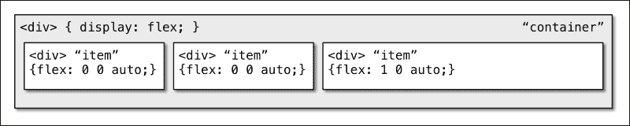

注意容器元素接收 `display: flex` 样式规则。这指示容器以灵活的方式布局其项目。相对于其父元素，容器本身的布局表现得就像设置了 `display: block` 样式一样。如果需要，还有一个 `inline-flex` 选项（等同于 `inline-block`）。

内部的项目将自动以灵活方式布局；但你几乎肯定想指定这些项目如何增长或收缩。有三条规则可实现这一点：

*   `flex-grow`：确定元素是否可以增长，以及相对于其他项目能增长多少。默认情况下禁用增长，但将此属性设为零也将禁用增长。
*   `flex-shrink`：确定元素是否可以收缩。默认情况下允许收缩，但将此属性设为零也将禁用收缩。
*   `flex-basis`：确定元素在增长或收缩前的默认尺寸。如果指定 `auto`，浏览器会根据 `flex-grow` 调整尺寸。

有一个名为 `flex` 的简写属性，这就是你在前面的图片中看到的每个项目的属性。顺序为 `flex: <flex-grow> <flex-shrink> <flex-basis>`。后两个数字不是必需的；如果未指定，浏览器会智能地计算它们。


在前面的示例中，你可以看到我们阻止了最左侧两个元素的增长。然而，最右侧的元素可以自由填充剩余空间，并且它确实这样做了。

`flex-grow` 不仅仅是一个启用或禁用增长的开关。它还可以用来确定项目之间的相对增长。如果除中间项目外的所有项目都获得 `flex-grow: 1`，而中间项目获得 `flex-grow: 2`，正如你在下图所见，它的宽度将是其他项目的两倍：

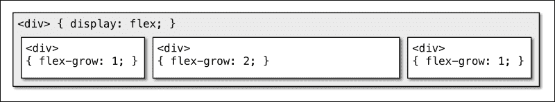

Flexbox 还可以使用 `flex-wrap` 来换行那些可能无法适应容器的项目。你可以为该属性提供的值有 `nowrap`、`wrap` 和 `wrap-reverse`。前两个应该很容易理解，但最后一个很有趣；它允许你反转布局的顺序。

从视觉上看，换行效果如下图所示：

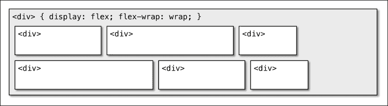

### Tip

不幸的是，使用旧版 Flexbox 语法的设备将无法处理此功能——它们不支持换行。遗憾的是，这消除了该模块的大量灵活性，且没有很好的变通方法。就我们的目的而言，我们假设你使用的是拥有相当现代浏览器的设备（iOS 6.1+ 或 Android 4.4+）。

Flexbox 还允许我们通过一个名为 `justify-content` 的属性来确定元素间间距的应用方式。允许以下几个值：

*   `flex-start`：这将项目对齐到容器的开始位置
*   `flex-end`：这将项目对齐到容器的结束位置
*   `center`：这将项目对齐到容器的中心位置
*   `space-between`：这会在项目之间根据需要添加空间，但在开始或结束位置不添加空间
*   `space-around`：这会在项目周围根据需要添加空间，包括开始或结束位置的项目

下图演示了 `space-between`：

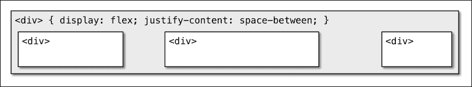

你可能已经注意到，我们试图避免在涉及这些属性时提及宽度、左侧或右侧。这是有充分理由的：Flexbox 既允许水平布局（`row`），也允许垂直布局（`column`）。相同的属性可用于每种方向，因此用容器的开始或结束来描述比用容器的左侧或右侧更合理。

要改变布局方向，可以使用 `flex-direction` 属性。它接受四个值：

*   `row`：这会水平排列项目，就像文本一样（从左到右或从右到左，取决于语言）。这是默认值。
*   `row-reverse`：这会水平排列项目，但顺序相反。
*   `column`：这会垂直排列项目。
*   `column-reverse`：这会垂直排列项目，但顺序相反。

让我们看一个垂直布局的示例：

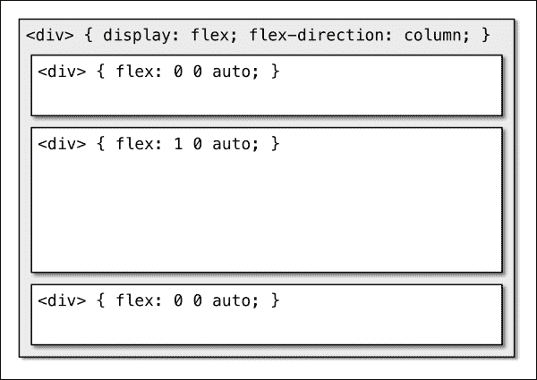

正如你所见，在布局方面，Flexbox 给了我们很多选择。还有许多其他属性可供使用。遗憾的是，我们无法在本章涵盖所有内容。一个很棒的参考资料在 [`css-tricks.com/snippets/css/a-guide-to-flexbox/`](https://css-tricks.com/snippets/css/a-guide-to-flexbox/) 。请将其加入书签；在使用此布局模块时你很可能会需要它（我确实需要！）。

那么，我们如何将所有这些结合起来以创建复杂布局呢？比如说，像下面这个？

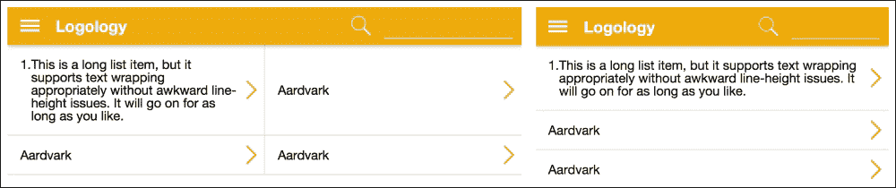

前面的布局包含相当多的内容。在左侧，你可以看到宽屏设备上的布局效果。在右侧，是窄屏设备上的布局。事实上，如果设备更窄，导航栏的高度会根据需要增长，以避免截断搜索组件。

我们可以非常轻松地实现此布局。我们将省略颜色、字体等，仅专注于我们使用的 Flexbox 属性。下图展示了如何实现此布局：

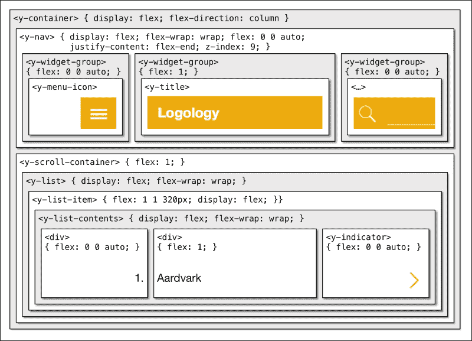

### Note

如果你想查看一个功能示例，请访问本书代码包中的 `snippets/04/ex5-flexbox-ui/index.html`。如果你正在使用交互式片段演练场，请选择 `4: Responsive Design` 和 `Example 5`。

现在，那里发生了相当多的事情，它展示了如何使用 Flexbox 模块实现复杂布局。让我们回顾一些更有趣的细节：

*   值得注意的是，在本例中 `y-container` 是绝对定位的，并锚定在视口的四个角。
*   外层容器 `y-container` 使用 `flex-direction: column` 进行垂直定向。这让我们能够包含一个非绝对定位的导航栏。虽然绝对定位导航栏没有错，但如果栏可以增长，就很难确保它不会遮挡其他可能无法移开的内容。当然，你可以要求导航栏始终保持特定高度，但这并不总是理想的。在我们的示例中，如果项目不全都适合，我们允许导航栏扩展。如果我们使用绝对定位，这肯定会覆盖它下方的项目。
*   导航栏 `y-nav` 通过 `flex: 0 0 auto` 被禁止伸缩。这是因为我们不希望导航栏占用比它真正需要的更多（或更少）的空间。
*   另一方面，滚动容器 `y-scroll-container` 通过 `flex: 1` 被允许伸缩。它将填满导航栏剩下的任何空间。
*   在导航栏内部，有三个 `y-widget-group` 元素。除了中间的项目，这些都不允许伸缩。然而，中间的项目可以占用剩余空间。在我们的示例代码中，最右侧的项目实际上设置了 `width: 25vw`。因此，该元素确实会调整大小，但依据的是视口宽度，而非 Flexbox 容器。
*   导航栏还允许换行。如果导航栏太窄，每个组件组都可以换行到下一行。这使得每个项目都能保持可见和可用，而无需求助于截断或隐藏。
*   在滚动容器内部，我们有一个列表 `y-list`。正如你从示例图中所见，该列表可以根据需要将自身分割成多列。这是通过在 `y-list` 元素上放置 `flex-wrap: wrap`，然后在项目上放置 `flex: 1 1 20rem` 来实现的。这将 `flex-basis` 设置为 `20rem`，这意味着浏览器将基于此值而非其内在尺寸（那会小得多）来确定每个项目的大小。这也意味着浏览器会增长元素的尺寸，直到能在同一行容纳两个（或更多） `20rem` 的元素。这意味着我们的列表项通常将是 `20rem` 或更宽。然而，我们也允许它们收缩（`flex-shrink: 1`）。因此，如果浏览器可用空间较少，它会根据需要减小项目的宽度。

一旦你开始从 Flexbox 模块的角度思考布局，许多复杂的布局就变得可能甚至简单了。虽然我们以前总能生成相当复杂的布局，但这通常需要跳出框框的思维和绝对定位。有时，这些方法非常脆弱；一个过大的元素可能会破坏整个布局。

所有这些灵活性确实是有代价的：浏览器必须做更多的工作来计算所有元素的位置。这意味着你必须决定增加的灵活性是否值得性能的下降。如果你有大量项目使用 Flexbox，可能会注意到用户界面有些迟缓。因此，你需要仅在适当的时候使用它。


