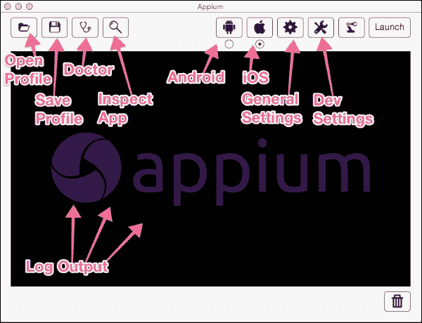
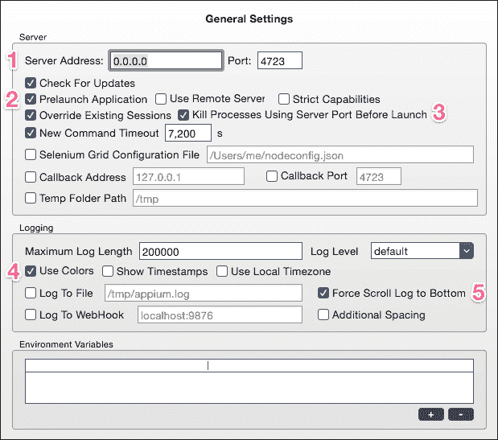
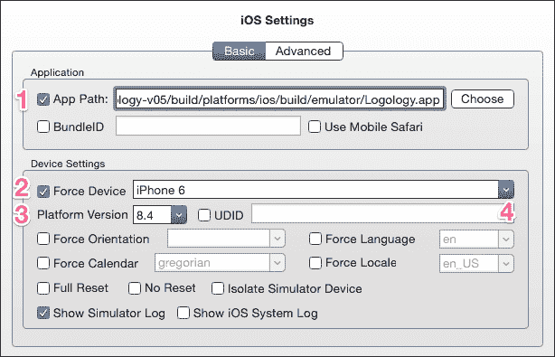
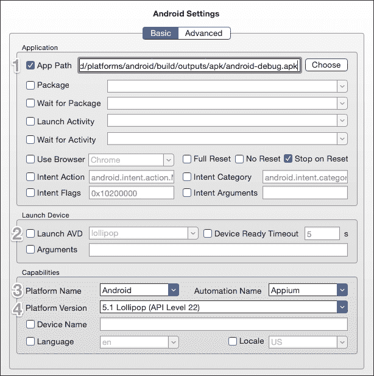
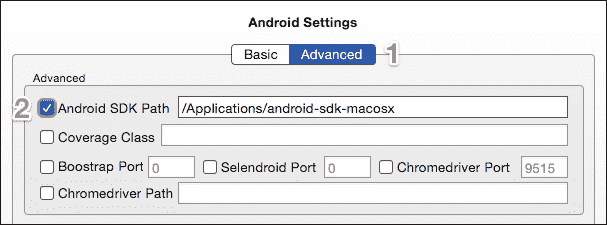
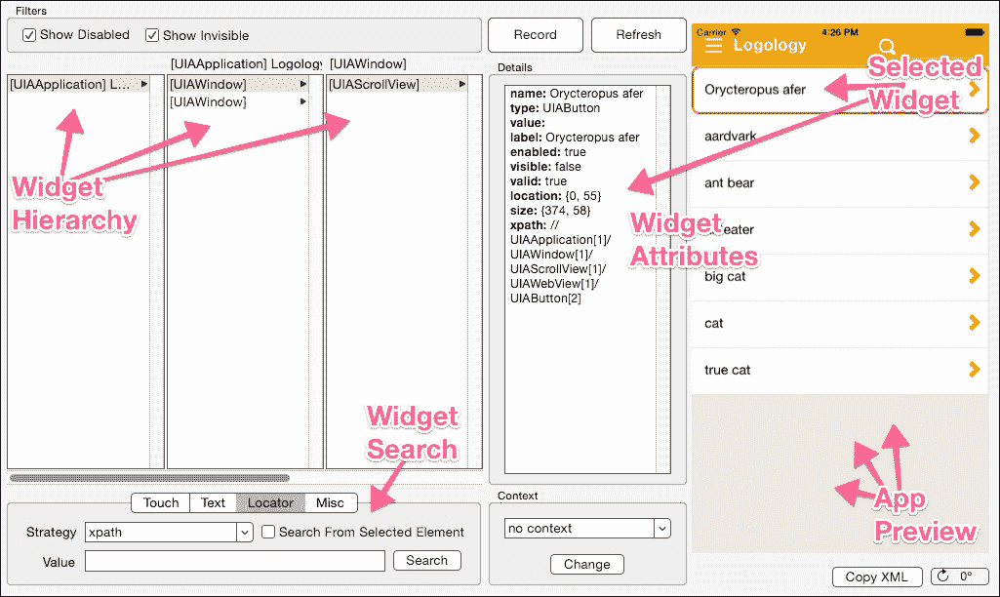
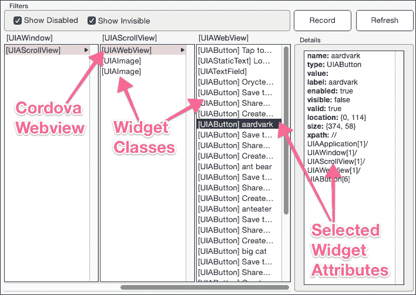
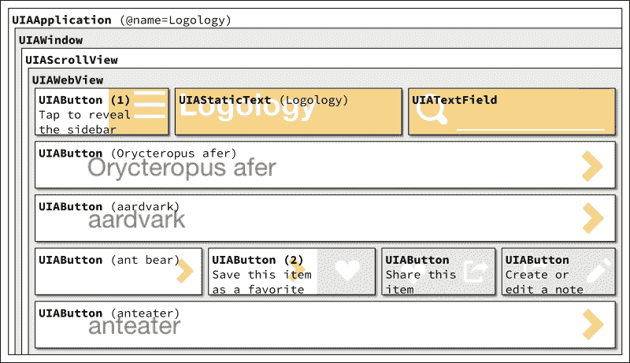
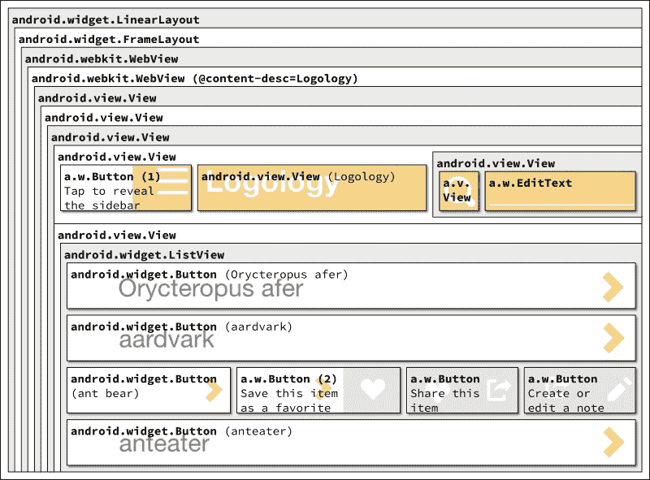
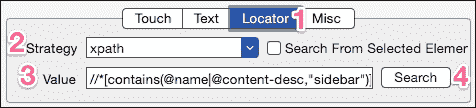

# 无障碍访问

正如我们之前提到的，你还需要知道，只有使用相当现代的浏览器引擎的设备才能很好地支持这种布局类型。我们的示例假设运行 iOS 6.1 或更高版本以及 Android 4.4 或更高版本。支持旧版 Flexbox 语法的旧浏览器仍可参与，但不支持换行特性，这会严重阻碍复杂布局。如果你足够努力，通常可以为这些浏览器提供降级方案或其他变通办法。但只有你自己能决定这是否值得你投入时间和精力。

在本章中，我们涵盖了大量内容，全部与响应式设计有关。我们永远不知道我们的应用可能面临什么设备尺寸，我们希望确保它在几乎任何环境中都能呈现出最佳效果。在本章中，我们介绍了逻辑像素与物理像素的区别、如何响应式地渲染图像，以及如何使用 Flexbox 模块构建复杂的用户界面。

在下一章中，你将学习如何使我们的应用对可能有视力障碍的用户可访问。

无障碍访问对于你的移动应用至关重要，尽管它经常被忽视。它的重要性不亚于本地化和全球化（甚至可能更重要），特别是因为实现应用无障碍并不要求精通多种语言，也不需要支付他人进行翻译。

然而，应用无障碍访问往往被忽视，即使是在原生应用中也是如此。这很遗憾，特别是对于原生应用，因为使用原生 SDK 添加无障碍功能非常容易。

混合应用在现代设备上也对无障碍功能有良好的支持。因此，混合应用开发者没有理由不在他们的应用中实现无障碍功能。

如果你不需要任何无障碍功能，很容易忽略这一点。如果你的视力是 20/20（视力表标准视力），听力极佳，或者你没有任何灵活性障碍，很容易忘记其他想使用你应用的人可能无法以同样的方式使用你的应用。

在本章中，我们将介绍一些创建可供用户无障碍访问的应用的方法。以下是本章将涵盖的内容：

*   无障碍功能的类型
*   免费获得的无障碍支持
*   什么是 WAI-ARIA？
*   WAI-ARIA 角色
*   无障碍示例
    *   表现与内容的分离
    *   可访问的图标按钮
    *   可访问的导航
    *   可访问的列表
    *   可访问的警报和对话框
*   与原生无障碍功能融合
    *   安装 PhoneGap 移动无障碍插件
    *   检测用户首选的文本大小
    *   检测屏幕阅读器
    *   朗读自定义文本
    *   实用工具

本章中的几个示例也可以通过随本书代码包附带的交互式代码片段演练场来体验。启动演练场的说明在代码包中的 `README.md` 文件里。启动后，选择 **5: Accessibility**（5: 无障碍访问），然后选择第一个示例。

在使你的应用无障碍时，你可能需要考虑许多不同类别的无障碍功能。当然，你需要考虑你的应用是否真的需要考虑这些类别。但了解用户可能拥有的各种需求很重要。让我们来回顾一下各种形式。

你可以查看 [`webaim.org/articles/`](http://webaim.org/articles/)，那里有关于各种残疾类型以及如何最好地帮助用户的大量信息。我们在以下部分总结了这个极佳资源中的一些信息，但你真的应该完整地浏览该网站。

## 色觉缺陷

你的许多用户可能有色觉缺陷（也称为*色盲）。请参阅 [`en.m.wikipedia.org/wiki/Color_blindness`](https://en.m.wikipedia.org/wiki/Color_blindness) 了解一些患病率统计数据。

“色盲”这个词用得不太准确；并不是受影响的人完全看不见颜色——他们中的许多人能看见。只是他们可能难以将某些颜色与其他颜色区分开来。全色盲（完全看不见颜色）*极其*罕见；大多数人确实能看见许多不同的颜色。

有几种不同的缺陷类型：红色弱、绿色弱、蓝色弱和全色盲。这种缺陷是由于个体眼睛中的视锥细胞对特定波长的光不敏感所致。例如，红色弱个体的眼睛中的视锥细胞对红光不太敏感。

有一个简单的方法可以帮助任何有色觉缺陷的用户：不要仅依靠颜色来传达信息。例如，如果你的应用用红色标识错误状态，用绿色标识正常状态，红色弱用户可能无法分辨两者的区别。

### 提示

你应该避免使用颜色传达信息的另一个原因是：颜色可能因用户所在的位置不同而含义不同。绿色不总是意味着*通行*，红色不总是意味着*停止*。

对于许多应用来说，色觉缺陷通常影响不大。话虽如此，任何依赖用户将颜色与其他颜色区分开来的应用（也许是一个泡泡消除游戏或绘图应用）都应该提供一些替代方式来传达重要的颜色信息（也许可以通过使用其他图标）。

## 低视力

低视力是指无法通过眼镜或隐形眼镜矫正的视力缺陷。低视力有很多种，如黄斑变性、青光眼、白内障等。但总体而言，低视力用户很难分辨非常小或对比度低的任何东西。

这种残疾绝对会影响应用的用户界面设计。网站和应用使用非常小的字号以及前景色和背景色对比度低的情况非常常见。这些内容有时即使对于视力完美的人也难以阅读，但低视力个体肯定会在这种类型的内容上遇到很大问题。

有几种方法可以帮助这些用户，如下所示：

*   增大字体大小
*   增加对比度

这并不一定意味着你的应用必须默认两者都做。也许你喜欢某种低对比度的配色方案。你可以随时提供一个设置，允许用户在需要时切换到高对比度配色方案。字体大小也是如此；允许用户将字体大小更改为舒适的大小，可能比*以防万一*一开始就设置大字号更可取。

### 注意

值得注意的是，iOS 和 Android 都支持在各自平台的“设置”应用中设置更大的字体大小。不幸的是，混合应用不会自动继承此设置，但有一个可用的插件可以为我们处理这个问题。我们将在本章后面讨论这个插件。

## 失明

直到这一节，我们还能依赖用户能够感知某些视觉线索。例如，用户可能无法分辨某些颜色，但他们可以看到信息是如何分组在一起的。

然而，对于盲人用户，我们不能依赖*任何*视觉线索来帮助用户浏览我们的应用。这意味着我们对用户能够点击按钮或滚动长文本的典型预期完全落空了。


# Web 应用程序的无障碍注意事项

值得庆幸的是，有许多软件可以将 Web 内容转换为盲人用户更易用的形式。此外，移动设备在操作系统中内置了广泛的无障碍功能，为盲人提供帮助。应用程序可以免费获得其中一些功能，但我们的应用程序也可以通过提供更具体的提示来改善体验，以便辅助技术能更好地理解我们应用程序的意图。

在使应用程序对盲人无障碍时，重要的是要认识到以下几个关键点：

*   **图像不可用**。只要可能，请提供文本表示。请记住，这些替代表示不必是字面上的。如果您有一个代表停车标志的图像，当显著信息仅仅是*停止*时，您不一定需要将其描述为一个涂有红漆并带有白色字母的八边形物体等。
*   **上下文很重要**。视力好的人可以从视觉上推断出大量上下文。对于视力不好的人来说，唯一的上下文就是刚刚传达的信息。项目呈现给用户的顺序通常是源代码或 DOM 顺序。因此，如果您的 DOM 顺序混乱，您的应用程序将毫无意义。
*   **导航从链接到链接进行**。用户不是通过滚动并直接点击想去的地方，而是按顺序导航链接。这意味着如果您的可导航项目顺序混乱，用户可能会感到困惑。
*   应用程序应提供跳过重复、冗长或繁琐内容的方式。
*   屏幕上的内容不会立即*完全可见*。用户需要等待，直到他们的辅助技术将信息提供给他们。根据辅助技术和内容的不同，这可能需要相当长的时间。

## 听觉障碍

不产生声音的应用程序无需担心听觉障碍。但如果您的应用程序播放视频或音乐，或者您的应用程序是一款播放音效等的游戏，您绝对应该为用户提供无障碍功能。

我们不会详述各种类型的听力障碍，因为解决方案是一样的：为音频材料提供字幕和文字记录。对于游戏，您可以在游戏内实体发出声音时，提供该声音的屏幕表示。

## 运动障碍

运动障碍意味着您的用户可能无法像手指完全正常的人那样与设备交互。用户可能无法直接触摸屏幕，或者在执行手势（如捏合缩放）时有困难。在这些场景中，为手势提供备选方法是明智之举。对于那些需要按顺序与您的应用程序交互的人来说，提供跳过冗长或繁琐材料的方法也很重要。这也意味着您的内容需要按合乎逻辑的顺序排列，并提供正确的上下文。

## 阅读障碍

阅读障碍是一种极其常见的认知障碍，会损害语言或视觉处理能力。对于长段文本，一些阅读障碍患者发现特制字体会有所帮助。其中一种字体是 OpenDyslexic。可在 `http://opendyslexic.org` 获取。虽然这不一定应该成为您应用程序的默认字体，但如果您的应用程序显示大量文本（例如电子书应用），您可能需要考虑将其作为一项可供阅读障碍用户启用的选项。

## 癫痫发作

对于大多数生产力或企业应用程序来说，这不是什么大问题；但了解这一点很重要，特别是如果您正在开发游戏，或者想通过快速闪烁某些东西来吸引用户注意力。

简而言之，除非您提供适当的警告和禁用该功能的机制，否则不要快速频闪或闪烁项目。这些会导致用户感到恶心和头晕；更糟糕的是，一些用户可能会经历癫痫发作。

游戏显然是可能无法避免这种情况的地方；游戏可能依赖于此。《Super Hexagon》就是一个典型例子；游戏的难度取决于闪烁、频闪和旋转的游戏区域。在这些情况下，明智的做法是放置一条警告，提醒那些容易因屏幕内容而感到头晕、恶心和/或癫痫发作的用户避免使用该应用。

## HTML 与无障碍历史

在上一章中，我们提到 HTML 和 CSS 在设计上主要是响应式的。实际上，阻止 HTML 响应式需要一些工作。

无障碍方面也多少如此。这并非因为 HTML 最初真正是考虑到无障碍而构建的（并非如此），而是因为许多已开发的辅助技术必须应对不可访问的 Web 内容。在这些情况下，辅助技术必须从标记中获取尽可能多的信息。一些 HTML 元素，如 `a`、`input`、`select`、`option` 等，提供了大量有用信息。多年来，屏幕阅读器已经形成了对这些元素常用方式及交互方式的理解。

HTML 2.0 引入了著名的 `alt` 属性。这是 Web 无障碍的第一丝曙光，但它并非仅为无障碍而添加。`alt` 属性旨在在原始内容无法渲染时进行渲染。此后，它被用作在图像无法被屏幕阅读器或盲文设备渲染时描述图像的简单方法。

然而，HTML 4.0 真正开始重视无障碍。除了要求所有 `img` 标签必须有 `alt` 属性外，它还允许在所有标签上使用 `title` 和 `lang` 属性。此外，HTML 4.0 鼓励将表现样式与内容分离。这使得辅助技术更容易以用户可理解的形式渲染 Web。

随着 HTML 中对这些的支持，W3C（万维网联盟）发布了 WCAG（Web 内容无障碍指南），这是一套 Web 开发人员应遵循的指南，以确保无障碍设计。这些指南的第二个版本于 2008 年发布，可在 `http://www.w3.org/WAI/intro/wcag.php` 查看。

所有这些并不意味着我们的应用程序可以完全免费地变得无障碍——远非如此，但这确实意味着如果某个 HTML 元素或属性满足我们的需求，我们应该使用它。反之，这意味着我们不应挪用 HTML 元素并以意想不到的方式使用它。

让我们看几个简单的例子，通过简单地使用 HTML 元素和属性，我们可以几乎免费地获得无障碍性。考虑以下代码片段：

```html

```

花点时间考虑一下，各种残疾用户在浏览器中渲染上述内容时可能会遇到什么困难。从源代码来看，这显然将是一张狗的图片。但您的用户无法立即访问源代码，且文件名不保证具有如此描述性。

我们可以通过以下方式立即提高此图像的可用性和无障碍性：

```html

```

我们立刻可以看到，辅助技术将能够向最终用户描述该图像。这对任何弱视或无视力用户都很重要。

### 注意

`alt` 属性实际上并非无障碍功能，尽管我们可以像无障碍功能那样使用它。如果浏览器无法加载图像或无法渲染它（例如纯文本 Web 浏览器），`alt` 属性的内容也会显示出来。

`alt` 属性仅允许用于 `img` 和 `area` 元素。对于其他元素，应改用 `title` 属性。`title` 属性通常在桌面端渲染为工具提示；但它们也会被屏幕阅读器朗读，通常在最初导航到该项目几秒钟后。例如：

```html
<button title="Share this page with your friends">Share</button>
```


某些辅助技术在用户导航到该元素时，最初会将其渲染为“共享，按钮”。如果读者再等待几秒钟，`title` 属性通常也会被渲染出来。其他技术可能会同时渲染两者。无论哪种方式，拥有 `title` 属性肯定能为您的用户提供额外且有用的上下文。

大多数辅助技术会从您的应用对 HTML 元素的使用中推断出大量信息。在前面的示例中，使用 `button` 标签提供了额外信息，可用于向用户提供额外信息。当然，我们本可以使用 `div` 标签。如果样式得当，这在视觉上也能正常工作。但 `div` 无法向辅助技术提供任何额外信息，因此在存在替代方案时应避免使用。

这意味着，每当有 HTML 元素与我们应用的语义相匹配时，我们就应该使用它。例如，在有可点击元素的地方，我们应该使用 `button` 或 `<input type="button|submit|reset" />`，而不是 `div`。

相反，使用语义与我们应用意图不符的 HTML 元素是非常不明智的。例如：

```
<h1 onclick="doSomething();">Add Item</h1>
```

虽然这个例子极其牵强，但它会让最终用户感到困惑，因为屏幕阅读器已经对 `h1` 是什么以及如何呈现它（顶级标题）有了相当清晰的概念。如果我们的应用决定它其实是一个按钮，屏幕阅读器将无法知晓这一点，从而误导用户。

HTML5 引入了许多具有新语义的新元素。我们可以用 `nav` 代替 `<div class="navigation">`，用 `aside` 代替 `<div class="sidebar">`。理解 HTML5 的辅助技术可以利用这些新元素为用户提供额外的上下文。

即使 HTML 元素具有内置的无障碍功能，且存在一些无障碍特性（如 `alt` 和 `title`），显然 Web 应用仍需向辅助技术传达更多信息。混合应用经常会渲染没有 HTML 等价物的元素。此外，Web 应用的语义并不总是与网站现有的无障碍特性完美契合。此时，WAI-ARIA 规范应运而生。

### 注释

**WAI-ARIA** 是 **Web Accessibility Initiative**（Web 无障碍倡议组织）在 W3C 发布的 **Accessible Rich Internet Applications**（无障碍富互联网应用）规范的简称。

该规范允许您为 HTML 元素指定额外的语义，以便更清晰地指示元素的功能。语义主要分为两大类：

*   **角色**：这表示元素在应用中执行的语义角色。例如，导航栏会被赋予 `role="navigation"` HTML 属性。角色通常分为两类：`landmark`（地标）和 `widget`（部件）。地标角色标记页面的区域：横幅、组、内容、侧边栏等，而部件角色标记特定的用户界面控件。

*   **属性**：这些是元素上以 `aria-` 为前缀的属性，代表数据值或其他状态。WAI-ARIA 区分 `states`（状态）和 `properties`（属性）。状态通常更具动态性（即变化更频繁），但将这些统称为属性在实践中更为简单。

正如上一节末尾提到的，WAI-ARIA 与 HTML5 确实存在一些重叠。例如，`nav` 元素会自动获得 `role="navigation"`。如果可能，您应该优先使用 HTML5 元素，这样就不必为 WAI-ARIA 角色和属性编写大量支持代码。如果您的目标浏览器*不*理解 HTML5，为了最大兼容性，您需要两者都包含（例如，`<nav role="navigation">`）。

### 注释

WAI-ARIA 角色和属性不会改变相关元素的功能，也不会改变其外观。它们仅作为辅助技术的提示使用。

所有现代移动浏览器（Blackberry 除外）都支持 WAI-ARIA。然而，某些平台的支持是近期才加入的。例如，Android 从 Android 4.4 开始才支持 WAI-ARIA。此外，除 Mobile IE 外，支持 WAI-ARIA 的其余浏览器往往只提供部分支持。换句话说，如果您必须面向旧平台，不应仅依赖 WAI-ARIA 来创建无障碍应用——也就是说，除非没有其他方法实现您的需求，否则不要大量使用带有 `role` 和 `aria-` 属性的 `div` 元素。

网上有许多有用的文章讨论 WAI-ARIA。遗憾的是，完整涵盖这一主题超出了本章的范围。这不一定是个问题，因为在许多情况下，使用 HTML5 的新元素（如 `nav`）就能免费获得更好的无障碍体验。即便如此，为了未来着想，阅读了解 WAI-ARIA 也是明智之举。以下链接非常有用：

*   [`developer.mozilla.org/en-US/docs/Web/Accessibility/ARIA`](https://developer.mozilla.org/en-US/docs/Web/Accessibility/ARIA)
*   [`caniuse.com/#feat=wai-aria`](http://caniuse.com/#feat=wai-aria)
*   [`www.html5accessibility.com`](http://www.html5accessibility.com)
*   [`w3c.github.io/aria-in-html/`](http://w3c.github.io/aria-in-html/)
*   [`oaa-accessibility.org/examples/`](http://oaa-accessibility.org/examples/)
*   [`www.marcozehe.de/2014/03/27/what-is-wai-aria-what-does-it-do-for-me-and-what-not/`](https://www.marcozehe.de/2014/03/27/what-is-wai-aria-what-does-it-do-for-me-and-what-not/)
*   [`www.w3.org/TR/wai-aria-practices/`](http://www.w3.org/TR/wai-aria-practices/)

## WAI-ARIA 角色

虽然我们无法涵盖 WAI-ARIA 的所有内容，但可以快速浏览一下适合在混合应用中使用的地标角色和部件角色。还有更多可用的角色，但它们通常不是大多数应用所需的角色。

### 注释

当 HTML5 元素具有相同语义时，我们在括号中列出了它们。除非您面向的设备对 HTML5 或 WAI-ARIA 支持不佳，否则您应该优先使用这些元素，而不是 WAI-ARIA 角色。

一个有用的参考资料位于 [`www.karlgroves-sandbox.com/CheatSheets/ ARIA-Cheatsheet.html`](http://www.karlgroves-sandbox.com/CheatSheets/%20ARIA-Cheatsheet.html)，以下参考也以此为基础。

*   `article` (`<article>`)：内容（如博客文章等）。
*   `banner` (`<header>`)：通常用于标记网站的标题。
*   `complementary` (`<aside>`)：用于标记可与主要内容分离的相关内容。例如，*另请参阅* 或 *更多关于……* 部分。
*   `contentinfo` (`<footer>`)：包含文档信息的容器；通常是页脚。
*   `form` (`<form>`)：表示一组标签及其对应的输入元素。
*   `main` (`<main>`)：文档的主要内容。
*   `navigation` (`<nav>`)：包含指向其他文档链接的导航元素。
*   `search`：允许用户执行搜索操作的一组元素。

有大量的部件角色，几乎涵盖您所需的任何用户界面元素。我们不会列出所有可用的部件角色；只会按类别列出您更可能用到的那些。请注意那些有 HTML5 等价物的角色。如果可以，您应该优先使用这些 HTML5 元素，而不是 WAI-ARIA 角色：

*   内容相关：文本、图像等
    *   `heading` (`<h#>`)：文本标题
    *   `img` (``)：图像
    *   `link` (`<a href="…">`)：指向其他资源的链接
    *   `separator` (`<hr>`)：分隔项目组
*   通用
    *   `group` (`<div>`, `<optgroup>`, `<fieldset>`)：用于对部件进行分组


## WAI-ARIA 角色

### Presentation（呈现）

- `presentation`：辅助技术不会尝试与该元素进行交互

### Messages（消息）

- `alert` (`alert()`)：一条通常有时效性的重要消息
- `log`：一个接收信息更新的元素，可能会移除旧的更新
- `marquee`：一个信息频繁更新的区域，但该信息并非关键
- `status` (`<output>`)：一条包含提示信息的消息（但可能不代表严重错误）

### Dialogs and Alerts（对话框和警告）

- `alertdialog`：一个包含 `alert` 消息的对话框
- `dialog`：这表示应用程序为接收用户的额外输入而显示的一个对话框
- `toolbar`：一个动作的精简列表，通常是水平的

### Form Elements（表单元素）

- `button` (`<button>`, `<input type="button|submit|reset">`)：一个可点击的按钮
- `checkbox` (`<input type="checkbox">`)：一个复选框
- `radio` (`<input type="radio"`)：一个单独的单选项；属于一组，一次只能选中一个
- `radiogroup`：一组 `radio` 元素
- `slider` (`<input type="range"`)：一个允许用户通过滑块从一系列值中选择的控件
- `textbox` (`<input type="text|…`", `<textarea>`)：这描述了一个文本输入元素

### Select Lists（选择列表）

- `combobox` (`<select>`)：这通常用于表示一个用户可通过输入来选择信息的控件
- `listbox` (`<select>`, `<datalist>`)：一个允许用户从列表中选择项目的控件
- `option` (`<option>`)：选择列表或数据列表中的一个项目

### Grids and Tables（网格和表格）

- `columnheader` (`<th scope="col">`)：表格或网格中的列标题
- `grid` (`<table>`)：一个表格或网格
- `gridcell` (`<td>`)：表格或网格中的一个单元格
- `row` (`<tr>`)：网格或表格中的一行单元格
- `rowgroup` (`<thead>`, `<tfoot>`, `<tbody>`)：网格或表格中的一组行

### Lists（列表）

- `list` (`<ul>`, `<ol>`)：一个静态列表
- `listitem` (`<li>`)：列表或目录中的一个项目

### Menus（菜单）

- `menu` (`<menu>`)：一个用户可从中选择的项目列表
- `menubar`：这通常代表一个水平的、持久的菜单，包含下拉菜单
- `menuitem`：菜单或菜单栏中的一个项目
- `menuitemcheckbox`：一个作为复选框的菜单项
- `menuitemradio`：一个作为一组项目中一项的菜单项，该组中只能选择一项

### Trees（树）

- `tree`：一个允许折叠或展开子树的分层列表
- `treegrid`：一个允许折叠和展开其行的网格（类似树）
- `treeitem`：树中的一个项目

关于使用 WAI-ARIA 和 HTML 无障碍特性的例子有很多，但专门针对移动端混合应用的却不多。在本节中，我们将介绍几个例子，应该能让你很好地了解如何在你的应用中创建无障碍控件。

## Separation of presentation and content（表现与内容的分离）

如果你对这个概念还不熟悉，现在是时候非常熟悉地掌握分离应用的表现与内容了。这将使辅助技术更容易正确地向最终用户呈现你的应用。当然，凭借我们拥有的 Web 技术，这实际上非常容易实现；*视觉* 表现应位于你的 CSS（或 Sass）中，而内容应位于你的 HTML 中。如果你现在正说“嗯，当然！”，你可能会想知道我为什么还要提这事——这看起来显而易见。但有时，什么构成*内容*，什么构成*表现*，并不总是立刻显而易见的。

### Note（注意）

对于动态生成的内容，同样适用：你的代码应为*内容*生成 HTML 元素，并为*表现*使用现有的 CSS 类。

例如，我们可以制定一个非常简单（但错误）的规则：所有图片都应包含在 HTML 中，因为图片是内容。然而，如果你思考几秒钟，就会迅速意识到这并不正确：按钮上的图标是图片，但它们不是内容，特别是对于看不见它们的用户。相反，他们更关心按钮应该做什么；他们不太可能关心你为视力正常者使用了什么图标。

什么是内容、什么是表现，很大程度上取决于你的应用，所以我们没有一条铁律来判断哪是哪。一般来说，分界线在于构成应用*外壳*的元素（导航栏、工具栏等）与应用显示或操作的数据之间。前者通常是表现，后者是内容。

## Accessible icon buttons（无障碍图标按钮）

既然我们在上一节提到了图标按钮，让我们来看看如何创建一个无障碍的图标按钮。因为我们需要将表现与内容分离，所以需要使用 CSS 和 HTML 来实现：

```
<button class="icon-bookmark" 
title="Bookmark this word">Bookmark</button>
```

到目前为止，这还不算太令人兴奋。但它已经非常无障碍了；屏幕阅读器可能会将这个 `Bookmark` 按钮读作“Bookmark this word”。对于视力良好的用户，让我们为它添加适当的样式：

```
.icon-bookmark {
  -webkit-appearance: none;
  -moz-appearance: none;
  border: 0;
  margin: 0; padding: 0;
  background: transparent url('bookmark.png') no-repeat 
              center center / 32px 32px;
  width: 32px; height: 32px;
  color: currentColor;
}
/* 别忘了使用媒体查询来处理 
高分辨率显示器！ */
```

在大多数应用中，你可能想为此图标添加更多样式，但前面提到的样式足以说明问题。图标的视觉外观不是内容，而是表现，所以它属于我们的 CSS。对于不关心表现的用户，他们无需担心样式。通过将图标图片分离到 CSS 中，辅助技术不会错误地向最终用户指示存在一张图片。

另请注意，我们在前面的 HTML 代码中不需要使用任何 WAI-ARIA 属性。这是因为理解 HTML5 和 WAI-ARIA 的辅助技术会自动为该元素分配 `button` 角色。然而，如果你的目标平台是较旧的、可能不会自动执行此操作的平台，你可以改用以下代码：

```
<button role="button" class="icon-bookmark" 
title="Bookmark this word">Bookmark</button>
```

如果你想渲染一个无文本的图标但仍保持无障碍，应用 `font-size: 0` 样式是最简单的方法。这可以防止文本在屏幕上渲染，但辅助技术仍可将按钮的文本呈现给最终用户。

## Accessible navigation（无障碍导航）

移动应用中的大多数视图都有顶部导航栏的概念。这些栏可以从仅包含视图标题的简单栏，到包含按钮和输入元素的复杂栏。

一般来说，这些并不难实现无障碍。请看下面的例子：

```
<nav class="y-nav" >
  <div class="y-widget-group">
    <button class="y-menu-glyph" 
            title="Tap to open sidebar">Menu</button>
  </div>
  <div class="y-widget-group y-flex">
    <h1 class="y-title">Logology</h1>
  </div>
  <div class="y-widget-group y-group-align-right">
    <form method="POST">
      <label role="search">
        <div role="presentation" 
             class="y-search-glyph">Search</div>
        <input type="text" />
      </label>
    </form>
  </div>
</nav>
```

### Note（注意）


# 无障碍示例

## 导航和屏幕阅读器

我们不必担心在这些（或大多数）示例中的表现，因为从任何辅助技术的角度来看，这其实并不重要。这并不是说辅助技术完全忽略 CSS；它们通常会检测 `display:none` 并忽略那些元素，但会忽略大多数其他样式。

请注意，我们在这个示例中并没有摆脱 `div` 元素。但在语义上，它们是最贴切的匹配（尽管你也可以为 `span` 找到充分的理由）。即使没有类名，我们也能大致了解 `div` 元素主要是为了将导航栏中的相关项目分组。

那么，屏幕阅读器将如何渲染呢？`nav` 元素会自动获得 `navigation` 角色，因此用户会知道他们正处于导航栏中。如果用户使用辅助技术选择 `Menu` 按钮，他们将听到“Menu，button（较长停顿）Tap to open sidebar”。如果他们浏览导航栏，他们将听到应用程序的名称（`Logology`），然后听到他们聚焦在一个输入元素上（“Search，text field… double tap to edit"）。

此例还说明了代码顺序如何影响结果的重要性。如果我们将标题置于 `Menu` 按钮之前，用户将按该顺序听取信息。在这个例子中，这不是什么大问题；上下文很容易推断。但对于其他元素，确保顺序正确至关重要。请记住，您的用户可能无法看到您应用程序的视觉层级，从而无法推断上下文。

此外，请注意，这里只出现了两个 WAI-ARIA 角色实例，而且只是为了正确处理搜索控件。首先，包裹图标和相关输入元素的 `label` 元素获得 `search` 角色；图标本身也被标记为 `presentation` 角色。这种角色告诉屏幕阅读器为了无障碀目的完全忽略该元素，这完全没问题；图标实际上没有除视觉提示之外的任何真实用途。一般来说，如果我们不提供这个第二个角色，也不会发生什么坏事：`div` 元素通常会被辅助技术忽略，除非指定了角色。

如果您担心兼容性，以下版本将详细列出 WA-ARIA 角色：

```html
<nav role="navigation" class="y-nav" >
  <div role="group" class="y-widget-group">
    <button role="button" class="y-menu-glyph" 
            title="Tap to open sidebar">Menu</button>
  </div>
  <div role="group" class="y-widget-group y-flex">
    <h1 role="heading" aria-level="1" 
        class="y-title">Logology</h1>
  </div>
  <div role="group" class="y-widget-group y-group-align-right">
    <form method="POST" role="form">
      <label role="search">
        <div role="presentation" 
             class="y-search-glyph">Search</div>
        <input role="textbox" type="text" />
      </label>
    </form>
  </div>
</nav>
```

## 无障碀列表

移动应用程序中常见的设计模式是列表视图。每个列表项均可选择以深入查看并获取更多信息。这通常用视觉上的箭头或其他图标标记。通常，这些都能很好地映射到现有的 HTML 标签，如 `ul` 和 `li`。让我们看一个示例：

```html
<ul class="y-list" >
  <li class="y-list-item">
    <button class="y-list-contents">
      <div>1.</div>
      <div class="y-flex">A list item.</div>
      <div class="y-indicator"></div>
    </button>
    <div class="y-list-actions" >
      <button class="y-fav-glyph" 
              title="Save this item as a favorite.">
              Favorite</button>
      <button class="y-share-glyph" 
              title="Share this item with a friend.">
              Share</button>
    </div>
  </li>
    ...
</ul>
```

同样，这里的样式其实并不重要，除了一个重要细节：在前面的示例中，我们还包含了列表操作。在某些平台上，这些操作可能通过在列表项上滑动来触发；在其他平台上，它们可能显示在列表项旁边。滑动是一个潜在的问题手势，因此您应确保有其他方式访问这些功能，前提是这些项目并非始终可见。此外，如果它们不在屏幕上可见，则应标记 `aria-hidden="true"` HTML 属性，否则它们仍可能被辅助技术选中。

### 注意

如果您尝试使用 `VoiceOver` 或类似技术，您可能会发现这并不像原生那样反应。在 `iOS` 上，具有附加操作的列表项会收到类似“swipe up or down to select a custom action, then double tap to activate（向上或向下滑动以选择自定义操作，然后双击激活）"的额外提示。不幸的是，无法使用 `WAI-ARIA` 精确模拟这一点。

请注意，我们用 `button` 包裹了列表内容。这是因为整个列表项是可选的（不仅仅是列表项内部的元素），我们需要向最终用户传达这一点。

## 无障碀警报和对话框

大多数应用程序在运行过程中都需要向用户显示警报或对话框。虽然您可以通过适当修改 `DOM` 和样式来实现，但这不会通知任何辅助技术有什么重要事情发生。一个简单的警报结构可能如下：

```html
<div class="y-alert-container">
 <div class="y-alert-dialog">
  <h1>Important!</h1>
  <p>An important message!</p>
  <button>OK</button>
 </div>
</div>
```

### 注意

此结构仅具代表性；通常，当需要显示警报对话框时，这将以编程方式添加。

为了提醒用户有新的警报对话框，我们需要添加一些属性：

```html
<div class="y-alert-container">
 <div class="y-alert-dialog" role="alertdialog">
  <h1>Important!</h1>
  <p role="alert">An important message!</p>
  <button>OK</button>
 </div>
</div>
```

请注意这两个新的 `role` 属性。`alertdialog` 角色标记包含消息的容器，而 `alert` 角色指示包含消息本身的元素。

这将生效，除了底层内容仍然对辅助技术可见。大多数警报对话框不会填满整个屏幕，但*是*模态的。所以，我们不希望用户对哪些控件可用、哪些不可用感到困惑。要修复此问题，我们可以向需要向辅助技术隐藏的内容添加 `aria-hidden="true"`，然后在对话框关闭时移除该属性。

还有一点：对话框显示后，需要以编程方式将焦点设置在第一个按钮上。如果我们不将焦点放在警报内的元素上，辅助技术仍会认为用户停留在先前选定的项目上。

通常，所有这些都是通过 `JavaScript` 实现的。这是一个示例：请注意，我们假设应用程序的主内容包含在一个具有 `mainWindow` 作为 `id` 属性的元素中：


# 混合应用无障碍访问

## 示例：简单警报对话框

```javascript
function simpleAlert() {
    let outerDiv = document.createElement("div"),
        innerDiv = document.createElement("div"),
        titleEl  = document.createElement("h1"),
        messageEl =  document.createElement("p"),
        buttonEl = document.createElement("button"),
        mainWindow = document.getElementById("mainWindow");

    outerDiv.className = "y-alert-container";
    innerDiv.className = "y-alert-dialog";

    //content
    titleEl.textContent = "Important!";
    messageEl.textContent = "This is an important message.";
    buttonEl.textContent = "OK";

    // accessibility
    innerDiv.setAttribute("role", "alertdialog");
    messageEl.setAttribute("role", "alert");

    // create the dom structure
    outerDiv.appendChild(innerDiv);
    innerDiv.appendChild(titleEl);
    innerDiv.appendChild(messageEl);
    innerDiv.appendChild(buttonEl);

    document.body.appendChild(outerDiv);
    setTimeout(function () {
      // show the dialog visually; 
      // inside a setTimeout for animations
      outerDiv.classList.add("visible");
      // hide the underlying content from the Accessibility API
      mainWindow.setAttribute("aria-hidden", true);
      // focus the button
      buttonEl.focus();
    }, 0);

    buttonEl.addEventListener("click", function() {
        // hide the dialog visually
        outerDiv.classList.remove("visible");
        // wait for animations to finish before removing it form 
        // the DOM
        setTimeout(function() {
          // let the underlying content become visible to 
          // assistive technologies
          mainWindow.removeAttribute("aria-hidden");
          document.body.removeChild(outerDiv);
        }, 400);
    }, false);
}
```

## 概述

混合应用的一个问题在于难以适配用户的无障碍设置。iOS 和 Android 都提供了大量提供无障碍辅助的设置。原生 SDK 通常几乎默认就会响应这些设置——也就是说，原生应用几乎无需额外成本即可响应用户的设置。即使原生应用需要做一些工作，通常也只需读取一个偏好设置并做出相应响应（例如，增大字体大小）。

混合应用不会自动获得这些优势，这意味着它们往往在真空环境中运行，无法响应用户的无障碍设置。当用户的大多数原生应用都能响应文本大小、字幕等设置的更改，而你的混合应用却不能时，这显然标志着该应用*表现不佳*。

从技术上讲，得益于 Cordova 使用插件的能力，所有这些设置都可以呈现给我们的混合应用。有一个插件能实现其中的大部分功能，尽管它并不暴露*所有*可能的设置。然而，对于大多数应用而言，该插件暴露的设置已足以满足大部分需求。

该插件（称为移动无障碍插件）可在 [`github.com/phonegap/phonegap-mobile-accessibility`](https://github.com/phonegap/phonegap-mobile-accessibility) 获取，并拥有完善的文档。它暴露了某些无障碍功能是启用还是禁用，同时也暴露了用户的首选文本大小。此插件使我们的应用能立即适应用户的偏好，而不显得格格不入。

## 安装移动无障碍插件

如果你使用 Cordova CLI，安装插件非常简单：

```bash
cordova plugin add https://github.com/phonegap/phonegap-mobile-accessibility
```

如果你使用 Gulp 工作流，添加插件也非常容易，但需要将插件添加到我们的 `package.json` 文件中。找到 `cordova.plugins` 数组并将仓库地址添加进去，如下所示：

```json
{
  "cordova": {
    "...": "",
    "plugins": [
      "...",
      "https://github.com/phonegap/phonegap-mobile-accessibility"
    ]
  },...
}
```

添加完成后，可以通过执行以下命令重新初始化构建产物：

```bash
$ gulp init
$ gulp copy
```

## 检测用户首选文本大小

iOS 和 Android 都允许用户覆盖正文中使用的默认文本大小，改为更舒适的大小。我们可以接入此设置并相应地缩放用户界面。

安装插件后，实现这一点非常简单。在接收到 `deviceready` 事件后，我们可以执行以下代码：

```javascript
MobileAccessibility.usePreferredTextZoom(true);
```

这将导致插件确定用户的首选字体大小，并相应地调整文本大小（但不调整图片或图标）。这过程非常快；虽然如果你的布局复杂，可能会在极短时间内被注意到。如果这造成干扰，你可能希望在浏览器完成内容调整前，短暂地保持应用的启动画面可见。

从技术上讲，你不必每次都调用此方法；该设置实际上存储在 `localStorage` 中，应用将继续调整应用的文本大小。这使得该方法在设置视图中很有用，你可能希望允许用户切换应用是否遵循系统的字体大小设置。

如果传入 `false`，插件将不再管理字体缩放。

### 注意

在 iOS 上，有一种替代方案可以在不使用此插件的情况下管理字体大小。你可以在 [`mir.aculo.us/2013/09/16/how-to-create-a-web-app-that-looks-like-a-ios7-native-app-part-1/`](http://mir.aculo.us/2013/09/16/how-to-create-a-web-app-that-looks-like-a-ios7-native-app-part-1/) 了解更多，但请注意这不具备跨平台兼容性。

## 检测屏幕阅读器

理想情况下，我们的应用不应关心屏幕阅读器是否处于激活状态。但有时了解这一点很有用，因为应用可能希望改变处理手势的方式或渲染视图的方式。要检测屏幕阅读器是否处于激活状态，可以执行以下操作：

```javascript
MobileAccessibility.isScreenReaderRunning(isActive => console.log(`Screen reader is active? ${isActive ? "yes": "no"}.`));
```

如果你的应用确实关心屏幕阅读器是否激活，那么你很可能也希望在状态改变时收到通知。为此，我们需要监听一个特殊事件，每当屏幕阅读器开启或关闭时就会触发该事件：

```javascript
function screenReaderHandler(features) {
  if (features !== undefined &&
      features.isScreenReaderRunning !== undefined) {
    if (features.isScreenReaderRunning) {
      // screen reader is running, act accordingly
    } else {
      // screen reader isn't running, act accordingly
    }
  }
}
window.addEventListener(
  MobileAccessibilityNotifications.SCREEN_READER_STATUS_CHANGED,
  screenReaderHandler,
  false
);
```

这两种方法都是通用的：在 iOS 上，它们将检查 VoiceOver 是否激活；在 Android 上，它们将检查 TalkBack 是否启用。也有专门检查这些特定功能的方法。如果你想这样做，请查阅插件文档。

## 朗读自定义文本

有时，以编程方式向用户朗读文本会很方便。此插件提供了两个方法，专门用于通过屏幕阅读器控制语音输出。

要朗读自定义文本，可以执行以下操作：

```javascript
MobileAccessibility.speak("Word added to your favorites.");
```

如果需要停止朗读，可以执行以下操作：

```javascript
MobileAccessibility.stop();
```

## 无障碍测试工具

有许多不同的工具可用于帮助检查应用的无障碍性。有些可以在浏览器中运行，而其他的则需要在模拟器或真机上使用：

- Accessibility Inspector（无障碍检查器），可在 OS X 和 iOS 上使用
- VoiceOver，可在 OS X 和 iOS 上使用
- TalkBack，可在 Android 上使用


# 测试与 UI 自动化

## 无障碍测试工具

*   Chrome 无障碍开发者工具，网址：<https://chrome.google.com/webstore/detail/accessibility-developer-t/fpkknkljclfencbdbgkenhalefipecmb>
*   Safari/WebKit 中的无障碍面板（右键点击 `An Element`，然后选择 `Inspect Element`。它将在侧边栏显示节点详情。然后，你需要展开 `Accessibility` 面板）

### 提示

虽然前面提到的工具对测试应用的无障碍性非常有用，但你的用户将是关于应用可用性信息的**最佳来源**。始终与用户一起测试你的应用，以了解无障碍功能在真实场景中的表现。

本章我们涵盖了相当多的内容。如果你真的想好地服务于无障碍用户，你会想要阅读本章链接的所有内容。如果这看起来**令人生畏**，那是因为它确实如此。这不是你能在几个小时内就掌握的东西。你需要与用户一起测试应用，看看它在真实环境中如何被使用，然后据此进行迭代。

在下一章中，我们将介绍可用于测试应用功能的方法，既包括代码视角，也包括用户界面自动化视角。

## 测试的重要性

确保应用按预期运行绝对**至关重要**。当应用很小时，很容易将测试作为**事后考虑**。毕竟，这是一个小应用，手动测试起来相当容易，对吧？不幸的是，即使是面向多个设备的小应用，测试起来也极其复杂，仅仅因为你无法获得所有可用于测试的设备。此外，在每个平台上每次更改后手动测试应用**极其枯燥**；这样做你会犯**错误**。幸运的是，有更好的方法。

测试常被作为**事后考虑**，这很遗憾，因为它是开发过程中**重要**的组成部分。不幸的是，当你刚开始学习一门语言时，很容易**忽视**它，因为通常假设你处理的是小型、易于验证的代码片段，而不是大型的数万行代码库。一个简单的二十行程序可以轻松证明是正确的，为什么还要写测试，对吧？然而，500 行的程序就没那么容易测试了。5,000 行的程序更糟，而 100,000 行的程序如果没有大量的**协助**或**自动化**则根本不可能测试。

自动化测试**显著地**简化了我们的测试流程。我们不必运行大量手动测试，而是可以告诉自动化工具如何为我们运行测试，以及如果一切正常测试应产生什么结果。然后自动化工具可以为许多不同的平台执行我们所有定义的测试，并且比我们自己执行测试快得多，这意味着它更有可能在每次代码更改后执行。这让我们相当有信心我们的应用按设计工作——前提是我们为自动化工具提供了足够的测试用例。如果不向工具提供足够的测试用例，自动化工具就无法捕捉所有问题。当然，你仍然需要让真实用户测试你的应用；你不太可能想到每一种可能的场景。一旦测试人员发现潜在问题，你可以编写一个测试，确保它在未来持续被检查。

## 本章内容

本章将涵盖以下内容：

*   断言简介
*   使用 `Chai` 编写测试
*   使用 `Mocha` 运行测试套件
*   编写 UI 自动化测试
*   使用 `Appium` 和 `Mocha` 运行 UI 自动化测试
*   将测试与 `Gulp` 集成

本章中的一些代码片段可通过随本书代码包附带的交互式代码片段演练场使用。启动演练场的说明在代码包中的 `README.md` 文件中。启动后，选择 `6: Testing and UI Automation`，然后浏览并尝试示例。在适用的情况下，每个章节和片段都会指示你应选择哪个章节和示例。

## 自动化测试与断言

自动化测试依赖于断言的概念。断言本身非常简单：它们只是一个事实陈述。如果陈述在事实上为真，测试将通过（或继续下一步）；但如果陈述为假，测试将失败并报告错误。

### 注意

本节的代码片段位于本书代码包中的 `snippets/06/ex1-basic-assertions/a`。使用交互式代码片段演练场时，选择 `6: Testing and UI Automation` 和示例 `1a`。

考虑以下简短片段：

```
let x = 5;
let y = x * 2;
```

代码执行后，我们可以对其做出几个断言：

*   `x` 将包含值 `5`
*   `y` 将包含值 `10`

手动测试这一点并不太难。我们可以打开 JavaScript REPL 或浏览器的调试控制台，很容易判断这些断言的真假。然而，持续这样做很繁琐。我们可以做得更好。让我们在片段中添加一些代码：

```
if (x !== 5) {
    throw new Error("x is not 5!");
}
if (y !== 10) {
    throw new Error("y is not 10!");
}
```

然而，显然这段代码有一些样板代码。此外，最好将断言写为正面陈述，而不是负面陈述。让我们写一个简单的方法来帮助我们：

```
/**
* Throws an error with `msg` if `expr` is false.
*/
function assert(expr, msg) {
  if (!expr) {
    throw new Error (msg);
  }
}
```

现在，让我们考虑以下示例：

```
let x = 5;
assert (x === 5);                  // [1]
x = 4;
assert (x === 5);                  // [2]
assert (x === 5, "X isn't 5")      // [3]
```

第一个断言 `[1]` 什么也不做；断言实际上是真的。然而，如果我们重新定义 `x` 的值并再次尝试，将在断言 `[2]` 处抛出错误。这个错误不会太有用；它将是一个通用错误，所以明智的做法是改用 `[3]` 的形式。这将抛出一个带有消息 `X isn't 5` 的错误。

实际的断言库通常提供更多功能，例如测试特定值（而非简单的真假检查）、属性检查、代码块是否抛出错误等。然而，它们都建立在一个非常简单的概念之上：如果事实不为真，则抛出错误。

### Chai 断言库

`Chai` 是一个断言库。我们不需要编写多个 `assert` 变体，`Chai` 提供了多种不同的方法供我们创建易于阅读的测试。`Chai` 还使用方法链来创建更接近英语的测试版本，使它们既易读又易写。

### 注意

关于 `Chai` 的更多信息，请访问 <http://www.chaijs.com>。

`Chai` 很有用，因为它允许我们在不费太大力气的情况下编写表达性强的测试。它还通过让你选择几种提供的接口之一来满足你这位开发者的需求。共有三种：

*   `assert`：测试使用 assert 风格的接口，类似于我们在上一节中使用的。有许多实用方法可供使用，例如 `assert.typeOf()`、`assert.equal()` 等。也可以像上一节那样直接使用 `assert(expression, message)`。
*   `expect`：测试使用 `expect()` 和方法链来形成类英语语句。例如，`expect(x).to.equal(5)` 或 `expect(a).to.have.property('b')`。
*   `should`：测试使用对象上的 `should` 属性和方法链来形成类英语语句。例如，`x.should.equal(5)` 或 `a.should.have.property('b')`。如果被测表达式有可能评估为 `null` 或 `undefined`，请改用 `expect` 接口。


# Chai 断言库

这完全取决于你偏好哪种接口；这里没有对错之分。就我个人而言，我偏好 `should`，但你可以使用其中任何一种，并创建完美的测试套件。

### 提示

关于各种接口之间差异的更多信息，请参阅 [`chaijs.com/guide/styles/`](http://chaijs.com/guide/styles/)。

## 安装 Chai

为了使用 Chai，你需要将其作为开发依赖安装在你的项目中：

```
npm install --save-dev chai@3.2.0
```

## 设置 Chai 接口

在使用 Chai 方法之前，我们的测试需要引入该模块并请求所需的接口，如下所示：

```
let assert = require("chai").assert;    // assert 接口，或
let expect = require("chai").expect;    // expect 接口，或
let should = require("chai").should();  // should 接口
```

## 使用插件

Chai 还具有使用插件的能力，这可以扩展 Chai 本身的功能。大量 Cordova 代码是异步的，通常我们会使用 Promise 来抽象它。要在 Chai 中使用 Promise，我们需要添加一个名为 `chai-as-promised` 的插件（可在 [`chaijs.com/plugins/chai-as-promised`](http://chaijs.com/plugins/chai-as-promised) 获取）：

```
npm install --save-dev chai-as-promised@5.1.0
```

使用该插件需要略微不同的样板代码。因此，代码看起来不再是使用 `require`，而更像下面这样：

```
let chai = require("chai");
chai.use(require("chai-as-promised"));
let should = chai.should();              // 或 .expect 或 .assert
```

现在，在使用 Promise 时，我们可以编写像 `promise.should.eventually.equal(5)` 这样的测试。`Chai-as-promised` 会自行处理 Promise 的异步特性。

## 组织测试文件

在使用任何断言库编写测试时，还有一个细节。没人希望测试代码和应用代码在同一个文件中。如果我们的测试代码与应用代码内联在一起，最终会在生产应用中生成测试代码，这会拖慢速度。这也会使测试不同场景变得困难。相反，测试总是写在独立于被测试代码的文件中。

就简单的代码测试而言，它们通常放在 `test` 子目录中。这就是你在本书的代码包中找到代码测试的地方。如果你是手动构建的项目目录，现在应该添加这个文件夹：

```
cd /your/project/directory/root
mkdir test
cd test
```

通常，你会在这个目录下有许多文件，每个文件测试特定的功能。因此，我们不想编写大量样板代码。相反，最好创建一些辅助工具，这样我们就不需要编写大量样板代码了。让我们在 `test` 目录下创建一个 `helper` 目录，我们将用它来构建辅助工具：

```
mkdir helper
cd helper
```

## 创建辅助工具

现在，我们将创建一个名为 `setup.js` 的文件。它应该如下所示：

```
"use strict";

var chai = require("chai");
var chaiAsPromised = require("chai-as-promised");
chai.use(chaiAsPromised);

var should = chai.should();
exports.should = should;    // 或 assert 或 expect
```

## 编写测试代码

有了样板代码，我们如何将代码与测试分离呢？让我们从编写一些对对象进行操作的代码开始。我们将其命名为 `code.js`（务必将其放在 `test` 目录中），内容如下：

```
"use strict";

exports.doSomething = function (obj) {
    obj.x = 5;
}

exports.doSomethingElse = function (obj) {
    obj.x = 4;
}
```

注意这并没有做任何有用的事情；但请记住，这可能是我们项目中执行某些功能的任何文件。你通常需要返回一个对象或函数，以便测试代码可以驱动它。但你的应用通常有相同的要求，所以这并不难。

现在，让我们编写一个名为 `test.js` 的测试文件：

```
"use strict";

let should = require("./helpers/setup").should;
let code = require("./code.js");

let anObject = {
    x:0
}

code.doSomething(anObject);
anObject.x.should.be.equal(5);              // [1]

code.doSomethingElse(anObject);
anObject.x.should.be.equal(5);              // [2]
```

注意我们是如何通过 `setup.js` 文件引入 `should` 的。因为我们这样使用 `setup.js` 文件，所以我们也可以编写基于 Promise 的测试（尽管这个例子不需要 Promise）。简而言之，任何你为设置断言库而重复的样板代码都可以放入 `setup.js`，因为它将应用于所有测试。

花点时间弄清楚测试结果会是什么，然后再继续阅读本节。

### 注意

本节中类似的代码片段位于本书代码包中的 `snippets/06/ex1-basic-assertions/b`。使用交互式代码片段演练场时，选择 `06` 和示例 `1b`。

上面代码中的断言 `[1]` 将会通过，因为 `anObject.x` 将被设置为 `5`。然而，断言 `[2]` 将会失败；`anObject.x` 将被设置为 `4`，这不等于 `5`。仅从代码中很容易看出这一点，但我们需要一种实际运行测试的方法。

## 使用 Babel 运行测试

我们可以很容易地做到这一点：直接使用 `node`。不幸的是，直到 `node` 能够理解 Babel 所用的相同 ES2015 之前，我们实际上需要使用一个名为 `babel-node` 的 `node` 包装器。它很容易安装；虽然在本节中我们不会长期使用它，但安装它还是个好主意。它对于尝试 ES2015 语法非常有用：

```
npm install -g babel-node
```

现在我们可以运行测试了：

```
babel-node test.js
```

最初，你可能会认为事情搞砸了。但花点时间看看输出。它应该看起来像下面这样：

```
logology-v06/node_modules/chai/lib/chai/assertion.js:107
      throw new AssertionError(msg, {   [1]
            ^
AssertionError: expected 4 to equal 5   [2]
    at Object.<anonymous> (logology-v06/test/test.js:15:22)  [3]
    at Module._compile (module.js:460:26)
    at normalLoader (/usr/local/lib/node_modules/babel/node_modules/babel-core/lib/api/register/node.js:199:5)
    at Object.require.extensions.(anonymous function) [as .js] (/usr/local/lib/node_modules/babel/node_modules/babel-core/lib/api/register/node.js:216:7)
    at Module.load (module.js:355:32)
    at Function.Module._load (module.js:310:12)
    at Function.Module.runMain (module.js:501:10)
    at Object.<anonymous> (/usr/local/lib/node_modules/babel/lib/_babel-node.js:144:25)
    at Module._compile (module.js:460:26)
    at Object.Module._extensions..js (module.js:478:10)
```

如果你看不到类似的错误，说明确实出错了；你可能把路径搞混了。但如果你看到了，说明你做对了。

那么错误告诉我们什么？

1. 断言失败（错误类型是 `AssertionError`）。
2. 失败的断言是 `4 === 5`。请注意 `[3]` 处的行号是不正确的，因为 Babel 正在转译我们的 ES2015 代码并将其传递给 Node.js。

当然，这些都不美观。很难准确判断到底哪个断言失败了（是第一个还是第二个？），也很难从这一堆混乱信息中提取重要信息。此外，还有一个困难：一次运行多个测试。谢天谢地，有一种更好的方法，叫做测试运行器，我们稍后会介绍。

使用 Chai 编写测试非常简单，但本章篇幅不足以完整记录你能做的一切。相反，让我们看看一些常见示例。如果想了解更多，请参阅 [`chaijs.com/api/`](http://chaijs.com/api/) 的文档。另请注意，我们在以下所有示例中都使用 `should` 接口。`expect` 接口是相同的（除了 `expect()` 部分），但 `assert` 接口使用不同的方法。

## 语言链


# 语言链

语言链使得用典型的英语编写测试用例变得容易。你已经见过一个例子：`be`。单独使用时，`be` 不做任何事情；它只是为了可读性而存在。`x.should.be.equal(5)` 等同于 `x.should.equal(5)`，也等同于 `x.should.be.be.be.be.equal(5)`。你不太可能写出后者，但链接某些单词的能力使测试用例非常具有表现力。

### 注意

本节示例位于本书代码包的 `snippets/06/ex2-language-chains` 中。使用交互式代码片段演练场时，请选择 **6: Testing and UI Automation**（6：测试与 UI 自动化）和示例 **2**。

并非每个单词都有效，因此你需要知道可以链接哪些单词：`to`、`be`、`been`、`is`、`that`、`which`、`and`、`has`、`have`、`with`、`at`、`of` 和 `same` 都是可链接的。`a` 和 `an` 也可链接，但它们还有另一个功能：类型检查，我们稍后会介绍。

这意味着你可以编写像 `x.should.have.property("apple").which.is.equal(5)` 这样的短语，Chai 就能明白你的意思（`x.apple===5`）。

## 逻辑词

这些是用于测试逻辑条件的单词：

### 注意

本节示例位于本书代码包的 `snippets/06/ex3-logical-words` 中。使用交互式代码片段演练场时，请选择 **6: Testing and UI Automation** 和示例 **3**。

*   `not`：这会否定断言；等同于 `!`。
*   `true`：这断言值为 `true`。例如，`(1===1).should.be.true`。
*   `false`：这断言值为 `false`。例如，`(1===2).should.be.false`。
*   `ok`：这断言值为真值。例如，`(1).should.be.ok`、`"hello".should.be.ok`，但 `(false).should.not.be.ok`。

## 测试存在性和类型

以下内容让你可以测试变量的存在性及其类型：

### 注意

本节示例位于本书代码包的 `snippets/06/ex4-testing-existence-types` 中。使用交互式代码片段演练场时，请选择 **6: Testing and UI Automation** 和示例 **4**。

*   `null`：这断言值为 `null`。例如，`expect(x).to.be.null` 或 `expect(x).to.not.be.null`。注意它仅适用于 `expect` 或 `assert`。
*   `undefined`：这断言值为未定义。例如，`expect(x).to.be.undefined`。注意它仅适用于 `expect` 或 `assert`。
*   `exist`：这断言值既不是 `null` 也不是 `undefined`。例如，`let x=5; x.should.exist;` 是一个真命题，但你真的应该使用 `expect(x).to.exist` 这种形式，以防 x 是 `null` 或 `undefined`。
*   `a`、`an`、`instanceOf`：这断言值为指定类型。例如，`"hello".should.be.a("string")`。务必先检查你正在测试的项目是否存在。

## 测试相等性

你已经看到了一种检查相等性的方法：`equal`。然而，根据上下文，还有其他几种方法可供使用，如下所示。

### 注意

本节示例位于本书代码包的 `snippets/06/ex5-testing-equality` 中。使用交互式代码片段演练场时，请选择 **6: Testing and UI Automation** 和示例 **5**。

*   `equal`、`equals`、`eq`：这测试严格相等；等同于 `===` 运算符。例如，`(5).should.equal(5)` 为真，但 `[1].should.equal([1])` 不为真，即使从视觉上看似乎是真的。然而从 JavaScript 角度来看，每个数组都是一个单独的实例，所以它们不严格相等。为了避免这种情况，你可以结合 `deep` 使用 `equal`：`[1].should.deep.equal([1])` 为真。注意，如果你测试的项目有可能是 `null` 或 `undefined`，请使用 `should.equal(x,5)` 或 `expect(x).to.be.equal(5)` 这种形式。
*   `eql`、`eqls`：这是 `.deep.equal` 的别名。
*   `above`、`gt`、`greaterThan`：这断言值高于提供的阈值；等同于 `>` 运算符。例如，`[1,2,3].should.have.length.above(1)` 和 `(5).should.be.above(4)`。
*   `below`、`lt`、`lessThan`：这断言值低于提供的阈值；等同于 `<` 运算符。例如，`[1,2,3].should.have.length.below(4)`。
*   `least`、`gte`：这断言值高于提供的阈值或等于它；等同于 `>=` 运算符。例如，`[1,2,3].should.have.length.at.least(3)` 和 `(10).should.be.gte(5)`。
*   `most`、`lte`：这断言值低于提供的阈值或等于它；等同于 `<=` 运算符。例如，`[1,2,3].should.have.length.at.most(3)`。
*   `within`：这断言值在两个提供的值之间。例如，`"hello".should.have.length.within(4,6)`。
*   `closeTo`：这断言值在提供的精度范围内接近提供的值。例如，`(5.75).should.be.closeTo(6, 0.5)`。
*   `match`：这断言字符串匹配给定的正则表达式。例如，`"hello".should.match(/.*/)`。
*   `string`：这断言字符串包含给定的子字符串。例如，`"hello".should.have.string("lo")`。

## 测试集合

当涉及到测试数组、对象或字符串可能包含的内容时，也有几个非常有用的方法，如下所示：

### 注意

本节示例位于本书代码包的 `snippets/06/ex5-testing-collections` 中。使用交互式代码片段演练场时，请选择 **6: Testing and UI Automation** 和示例 **6**。

*   `length`、`lengthOf`：这断言数组或字符串具有指定的长度。例如，`[1, 2].should.be.length(2)`。
*   `contain`、`contains`、`include`、`includes`：这断言数组或字符串包含提供的项目。等同于 `indexOf`。例如：`"hello".should.contain("lo")` 和 `[1, 2, 3].should.contain(2)`。
*   `empty`：这断言集合为空。对字符串和数组检查 `length === 0`。如果对象没有可枚举属性，则被视为空。
*   `property`：这断言项目具有指定的属性，以及可选的指定值。如果结合 `deep` 使用，可以使用点号和括号表示法深入探测对象。例如，`({x:5}).should.have.property("x")` 和 `({x:{y:2}}).should.have.deep.property("x.y", 2)`。数组也适用：`({x:[1,2]}).should.have.deep.property("x[0]", 1)`。
*   `ownProperty`、`haveOwnProperty`：这断言项目具有指定属性，且该属性是项目自身的——即不是通过原型链继承的。
*   `respondTo`：这断言项目具有指定的方法。例如，`x.should.respondTo("aMethodName")`。
*   `key`、`keys`：这断言项目具有指定的键。对象是否应包含所有提供的键，取决于前面语言链中的各种修饰符。
    *   `any`：如果在链中使用了此项，则项目只需拥有提供的键中的一个，断言即为真。例如，`({x:5,y:10}).should.contain.any.keys("a", "b", "x")` 通过，因为对象包含 `x` 作为键。
    *   `all`：如果在链中使用了此项，则项目需要包含所有提供的键，断言才为真。项目是否可以拥有更多键，取决于语言链中使用的是 `have` 还是 `contain`。例如，`({x:5,y:10,z:20}).should.contain.all.keys("x", "y")` 通过，因为它拥有所有指定的键。`({x:5,y:10,z:20}).should.have.all.keys("x", "y")` 失败，因为它拥有比指定更多的键。


# 使用 Mocha 进行测试聚合

由于我们必须快速识别哪些测试失败了，因此我们需要一个实用程序来聚合所有测试，并以可读的格式呈现结果。市面上有很多优秀的测试运行器（Karma、Chutzpah、Jasmine 等）。但在本节中，我们将使用 `Mocha`。`Mocha` 非常简单：它会执行我们提供的每个测试，识别通过的测试，然后以显而易见的方式报告任何错误。

### 注意

您可以在 [`mochajs.org`](http://mochajs.org) 找到更多关于 `Mocha` 的文档。

## 安装 Mocha

首先，我们需要安装 `Mocha`：

```
npm install -g mocha
```

## 编写测试套件

接下来，我们需要编写一些 `Mocha` 能够理解的测试套件。请继续删除我们之前创建的 `code.js` 和 `test.js` 文件。现在是进行真正测试的时候了！事实上，让我们来测试一下我们应用的 `AbstractDictionary` 类。

下面是一个非常简单的测试，我编写它是为了验证字典确实能够创建一个新的 `Dictionary` 对象：

```
"use strict";
let should = require("./helpers/setup").should;
import Dictionary from "../src/www/js/app/models/Dictionary";

describe("Dictionary Tests", () => {
    let dictionary = new Dictionary();
    it("should be able to create a new instance", () => {
        return dictionary.should.exist;
    });
});
```

请注意，除了导入我们的 `Dictionary` 对象之外，前导代码与我们之前测试文件中使用的相同。新的部分是以 `describe` 开头的部分。

`describe()` 仅用于将一个或多个测试分组在一起。`describe()` 可以根据需要嵌套任意层级（虽然如果嵌套很深，你可能应该将测试套件拆分到单独的文件中）。在输出中，组内执行的测试会显示一个漂亮的标题，以便于引用。

测试用例是使用 `it()` 方法定义的。为了充分测试你的代码，可以根据需要定义任意数量的 `it()`。事实上，当你想到测试点时，应该将待定测试放入测试套件中；这些测试被定义为没有函数体的 `it()` 方法：

```
it("should be able to jump up and down");     
// 在输出中将标记为 PENDING（待定）
```

这让你稍后可以回来定义实际的测试，同时也能跟踪仍需实际实现的测试。

每个测试可以是完全独立的，也可以依赖于之前的执行结果。这完全取决于你和你正在测试的代码。在我们的例子中，我们希望每个测试都建立在先前的结果之上，以减少代码重复。例如，下面是我们如何验证新创建的字典确实是空的（并且在搜索空字典时不会抛出错误）：

```
describe("Dictionary Tests", () => {
    let dictionary = new Dictionary();
    describe ("#Create", () => {
        it("should be able to create a new instance", () => {
            return dictionary.should.exist;
        });
    });
    describe ("#Empty", () => {
        it("should return an empty sorted index", () => {
            return dictionary.sortedIndex.should.have.lengthOf(0);
        });
        describe ("#find", () => {
            it("searching on an empty dictionary by 
              lemma should not error", () => {
                return dictionary.getEntries({lemma:"cat"}).
                  should.eventually.have.lengthOf(0);
            });
            it("searching on an empty dictionary by wordnetref 
              should not error", () => {
                return dictionary.getEntries({wordNetRef:0}).
                  should.eventually.have.lengthOf(0);
            });
        });
    });
});
```

因为现在有了多个测试，我们引入了额外的 `describe()` 语句。这使我们能够对测试进行分类。第一个测试仅验证我们能否创建一个新字典，因此它归入 `#Create` 类别。接下来的几个测试验证该字典的空性，因此它们共同归入 `#Empty` 类别。然而，最后两个测试在字典内部进行搜索，所以我们给它们一个 `#find` 子类别。在 `Mocha` 的输出中，每个 `describe()` 语句都会创建一个新的缩进层级，因此每个测试的类别都清晰可见。

### 注意

注意前面代码中的 `eventually`？这是 `chai-as-promised` 等待 Promise resolve 的方式。

到目前为止，这些测试都很简单。让我们看一个包含更复杂测试的例子：

```
describe ("#AddApple", () => {
    it("should be able to add an entry.", () => {
        let definition = new Definition({
            wordNetRef: 1,
            lemmas: ["apple"],
            partOfSpeech: "noun",
            gloss: "A tasty fruit"
        });
        return dictionary._addDefinition(definition).should.exist;
    });
    it("should now return a single sorted index", () => {
        return dictionary.sortedIndex.should.have.lengthOf(1);
    });
    it("... that contains the word Apple", () => {
        return dictionary.sortedIndex.
          should.deep.equal(["apple"]);
    });
    describe ("#find", () => {
        it("should be able to find the entry for Apple via lemma", () => {
            return dictionary.getEntries({lemma:"apple"}).should.
                    eventually.have.lengthOf(1).and.
                    deep.property("[0].gloss","A tasty fruit");
        });
        it("should be able to find the entry for Apple via wordnetref", () => {
            return dictionary.getEntries({wordNetRef:1}).should.
                    eventually.have.lengthOf(1).and.
                    deep.property("[0].gloss","A tasty fruit");
        });
    });
});
```

所有这些测试应该都很容易理解。最复杂的测试在 `#find` 类别中。在这些测试中，我们测试 `lengthOf()`（以确保返回结果只包含一项），并确保我们收到了正确的定义。

## 运行测试

定义了一些测试后，我们可以使用 `Mocha` 来运行它们：

```
mocha --require "babel/register" .
```

### 注意

如果你不使用 ES2015，则不需要 `--require "babel/register"` 部分。

该点号指示 `Mocha` 在当前工作目录中运行它能找到的所有测试。你可以指定想要运行的文件，甚至是多个路径和文件。不过，通常人们会希望运行特定目录下的所有测试。

## 解读输出

输出应如下所示：

```
  Dictionary Tests
    #Create
    √ should be able to create a new instance
    #Empty
    √ should return an empty sorted index
      #find
      √ searching on an empty dictionary by lemma should not error
      √ searching on an empty dictionary by wordnetref should not error
    #AddApple
    √ should be able to add an entry.
    √ should now return a single sorted index
    √ ... that contains the word Apple
      #find
      √ should be able to find the entry for Apple via lemma
      √ should be able to find the entry for Apple via 
wordnetref
... [snip] ...

  27 passing (47ms)
```

前面的结果通常是你所期望的：列出的每个测试都已通过（由对勾标记表示），且没有任何错误。虽然这是件好事，但仍然重要的是要记住，这并不能确保你的代码一定没有 Bug：`Mocha` 只能测试你显式定义的情况。

然而，你经常会看到类似以下的输出：

```
  Dictionary Tests

... [snip] ...

    #AddRock/Stone
    √ should be able to add a fourth entry with two lemmas.
    √ should return a sorted index of length 4
      1) ... that is [apple, cat, rock, stone]

... [snip] ...

  26 passing (61ms)
  1 failing

  1) Dictionary Tests #AddRock/Stone ... that is 
[apple, cat, rock, stone] :

      AssertionError: expected ['apple', 'cat', 'rock', 'stone' ] 
to deeply equal ['apple', 'cat', 'rock', 'stones' ]
      + expected - actual
      [
        "apple"
        "cat"
        "rock"
      -  "stone"
      +  "stones"
      ]

... [snipped out stack trace] ...
```


首先，请注意，错误最初是与通过的测试一起列出的。它们不是用对勾标记，而是用数字列出。这个数字类似于脚注；可用于引用稍后列出的实际错误。这也意味着错误消息本身（通常很长且冗长）不会弄乱测试列表，因此仍然很容易判断哪些测试通过、哪些测试失败。

错误本身位于末尾。它们带有与测试列表中显示的相同编号，并且还包含每一个 `describe` 和 `it` 的描述，以便在代码中轻松定位测试。消息指示失败的断言，然后继续指示差异。这非常有用，因为它能让你看清结果的哪些部分是正确的，哪些部分不是。最后，列出了堆栈跟踪。它通常会直接指向代码中的错误，只不过对于 ES2015 转译后的代码，行号几乎总是不正确（这就是为什么我在前面的示例中将其裁剪掉的原因）。你应该确保测试用例标记清晰，以便在不依赖行号的情况下轻松定位问题。

### 提示

有时，测试用例失败仅仅是因为拼写错误，或者对结果应有的样子存在误解。在前面的案例中，测试用例中有个拼写错误。因此，不要假设测试失败就意味着代码有 Bug。这可能意味着你的 `测试用例` 有 Bug。务必测试你的测试用例，并确保它们本身是准确的。

关于代码测试 Cordova 应用，有几件重要的事情你应该了解：

*   代码测试发生在 Node JavaScript 环境中，而非浏览器或设备上。
*   如果你需要验证应用是否正确创建了 DOM 元素，可以使用各种模块模拟特定方面，例如 jsdom ([`www.npmjs.com/package/jsdom`](https://www.npmjs.com/package/jsdom))。
*   代码测试无法验证插件行为。最好提供能模拟插件行为的替代方案，以便测试应用的其他方面。

当然，在验证应用正确性方面，这些限制极大。因此，我们需要一些额外的工具来在设备上测试应用。

要在物理设备上验证应用的正确性，我们需要深入研究用户界面自动化。这些测试更侧重于与应用的交互及正确结果的验证，而非验证应用的内部逻辑。测试看起来更像是一系列与应用控件的交互集合，而不是直接处理模型、视图、控制器等。检查正确结果更像是确保特定控件显示在屏幕上，而不是检查对象是否具有特定属性。

虽然自动化测试的目标与代码测试相同，但你必须从不同的角度来处理测试。直接测试代码时，你可以访问代码创建的对象并轻松与它们交互。通过自动化测试应用时，你必须从用户的角度来审视应用：应该按哪些按钮，视觉结果应该是什么？在某种程度上，可以将内部代码测试视为白盒测试，将应用测试视为黑盒测试。

这个类比并不完美，因为黑盒测试通常意味着你不知道或无法访问应用的内部结构。大多数自动化工具都会提供一定级别的应用内省能力；因此，通常可以验证内部状态，这在某些方面违背了黑盒的类比。即便如此，这也是一种很好的思考方式：黑盒迫使你与可见界面交互，而不是与内部代码交互。

有许多不同的工具执行用户界面自动化，但必须验证这些工具能否以移动设备为目标。此外，虽然自动化工具可能支持原生代码，但我们也需要一个允许我们使用跨平台代码的工具。毕竟，除非绝对必要（确实存在必须这样做的情况），否则我们不想为每个目标平台编写多个版本的测试。

不幸的是，满足所有这些要求的工具非常少。就目前撰写本文而言，最好的工具（就可靠性、稳定性和社区支持而言）是 Appium。Appium 可以在 iOS 和 Android 设备上运行自动化测试，也支持 iOS 模拟器和 Android 模拟器。Appium 使用 JavaScript 定义测试用例，并与我们已经熟悉的测试运行器 Mocha 良好集成。因此，它是满足我们需求的绝佳选择。

### 注意

测试 iOS 应用需要一台 Mac。测试 Android 应用可以使用 Windows、Linux 或 Mac OS X。

## 安装 Appium

安装 Appium 非常简单：

```
npm install -g appium@1.4.16
```

这会安装一个名为 `appium` 的全局工具。该工具充当自动化测试与设备之间的桥梁。因此，在运行任何使用它的自动化测试之前，它需要处于运行状态。我们稍后将介绍如何启动它。

现在，确保你的环境已正确设置以供 Appium 使用：

```
$ appium-doctor
```

如果 Appium 所需的一切都设置正确，你应该会看到以下通知：

```
√ All Checks were successful
```

然而，如果我们要测试 iOS 应用，还需要安装其他几个工具。这是由于 iOS 处理远程调试的方式所致。Android 宽松得多，不需要那么多初始设置。

首先，对于 iOS，我们需要安装一个协助 Appium 将应用部署到设备的工具。虽然 Cordova 使用名为 `ios-deploy` 的工具，但 Appium 使用另一个名为 `ideviceinstaller` 的工具。假设你已经安装了 `brew` 包管理器，该工具很容易安装：

```
brew install --HEAD ideviceinstaller
```

接下来，我们需要安装一个代理，允许 Appium 与物理设备上的应用交互：

```
brew install ios-webkit-debug-proxy
```

当我们在物理 iOS 设备上测试应用时，此代理也需要运行。我们稍后将介绍如何启动此代理。

### 注意

在 iOS 模拟器上运行应用时，不需要该代理。

要与应用中的 Web 组件交互，我们还需要安装一个工具。此步骤适用于 iOS 和 Android：

```
npm install --save-dev wd@0.3.12
```

`wd` 是 Web Driver。它允许 Appium 与 Cordova 使用的系统 WebView 交互。我们的应用本身不会使用此驱动，但我们的测试用例会；因此使用 `--save-dev` 标志。

从技术上讲，你不需要再安装其他东西，但还有一样东西你应该安装：Appium 桌面应用。运行应用测试并不需要它，但在编写测试时探索应用却是无价之宝。这是因为你不会仅使用 Web 技术与应用交互。相反，你必须了解应用从自动化角度是如何呈现的，以便定位你想要交互的控件。能够在应用中点击并发现内部结构，比猜测要简单快捷得多。

为此，你可以在 [`appium.io`](http://appium.io) 下载桌面应用。只需点击 `Download Now` 按钮，然后安装应用程序。

## 使用 Appium 探索你的应用

现在我们已经安装了一切，让我们探索一下应用在 Appium 中的呈现方式。启动我们刚下载的 Appium 桌面应用。它应该如下所示：


# 使用 Appium 探索你的应用



## 应用区域

让我们浏览一下应用的各个区域：

### 配置文件管理
*   **打开配置文件** 将打开一个之前保存的 Appium 配置文件
*   **保存配置文件** 将当前设置另存为一个新的 Appium 配置文件
*   **诊断** 将为你运行 `appium-doctor`，以验证你的环境是否已正确配置
*   **检查应用** 将打开 **Appium 应用检查器** 对话框。我们稍后将更详细地介绍此窗口

### 平台配置与选择
*   **Android** 按钮将显示一个配置对话框，允许你指定 Android SDK 的位置、应用包的位置以及它提供的其他设置。Android 图标下方的单选按钮指示当你点击 **启动** 时将使用哪个平台。
*   **iOS** 按钮将显示一个配置对话框，允许你指定应用包的位置、Appium 应使用的 iOS 版本等。Apple 图标下方的单选按钮指示当你点击 **启动** 时将使用哪个平台。

### 设置
*   **常规设置** 包含通用配置选项。这些设置不是特定于平台的，这与 Android 和 iOS 设置不同。
*   **开发者设置** 包含额外的开发者设置。我们在本章中不会用到它，但你可能希望自行探索这些设置。

### 启动
*   **启动** 将在选定平台上启动你的应用。当应用正在运行时，此按钮将显示为 **停止**。再次点击它将停止应用。

### 日志输出
*   **日志输出** 区域将显示应用运行时 Appium 的输出。这通常非常冗长，但当你想要探索底层结果时非常有用。

## 配置常规设置

在我们实际探索应用之前，需要配置一些设置。点击 **常规设置** 按钮以显示全局配置设置。以下是我们的配置：



你的设置不必完全一致。以下是我们发现有用的一些设置：

1.  **服务器地址** 和 **端口**：通常你不需要更改这些。但如果你有其他服务正在此端口上运行，你将需要将其更改为未使用的端口。
2.  **预启动应用**：这确保应用会在设备或模拟器上自动启动。
3.  **启动前终止占用服务器端口的进程**：这确保在启动应用之前终止任何先前存在的进程。
4.  **使用颜色**：这只是让日志文件更具可读性。
5.  **强制滚动日志到底部**：这也使日志文件更易于跟踪。当记录新项目时，日志文件本身将自动滚动到新信息处。

## 构建应用包

为了测试我们的应用，我们需要知道应用包的位置。你应该已经拥有可在模拟器上运行的版本，但你可能没有构建可在真实设备上运行的版本。让我们继续构建：

```
# 使用 Gulp
  gulp build --for ios --mode debug --target device
  gulp build --for android --mode debug --target device

# 使用 Cordova
  cordova build ios --device
  cordova build android --device
```

### 注意

你可以用 `emulator` 代替 `device` 来为模拟器构建，尽管模拟器/仿真器目标是默认的构建目标。

## 定位应用包

接下来，我们需要确定应用包的位置。Cordova 遵循一种模式，所以弄清楚这一点并不难，值得庆幸。路径如下：

*   iOS 真机构建：`<project root>/build/platforms/ios/device/<app-name>.ipa`
*   iOS 模拟器构建：`<project root>/build/platforms/ios/emulator/<app-name>.app`
*   Android（真机和模拟器）：`<project root>/build/platforms/android/build/outputs/apk/android-debug.apk`

这些路径很重要，因为 Appium 使用它们来部署和启动我们的应用程序。现在，点击 Appium 应用中的 Android 机器人图标或 iOS Apple 图标。这将允许你指定应用在计算机上的位置以及应使用的设备设置。

## 配置 iOS

对于 iOS，我们的配置如下所示：



### iOS 设置

让我们浏览一下各项设置：

1.  **应用路径**：这指定了我们应用包的位置。在我们的示例中，我们使用的是 iOS 模拟器，所以我们将使用 iOS 模拟器构建版本。
2.  **强制设备**：这让我们确定将启动哪个设备模拟器。
3.  **平台版本**：这让我们使用特定的 iOS 版本启动设备模拟器。在真机测试时，这应与物理设备的 iOS 版本匹配。
4.  **UDID**：要在真机上测试，Appium 需要知道设备的 UDID。使用模拟器时，你可以留空此项。

### 提示

如果你想在真机上测试，需要知道设备的 UDID。你可以通过执行 `xcrun instruments -s devices` 来找到它。假设你的设备已连接到电脑，它应该会与你安装的所有模拟器一起出现。你的设备 UDID 列在括号中。你还需要运行 webkit 调试代理，如下所示：`ios_webkit_debug_proxy -u <your device UDID>:27753 -d &`。

## 配置 Android

对于 Android，我们的配置如下所示：



### Android 设置

这些设置如下：

1.  **应用路径**：这指定了我们应用包的位置。无论我们使用的是模拟器还是真机，Android 都不在意，所以这通常不需要更改，除非你在不同芯片组的设备上测试（例如 Intel 与 ARM）。
2.  **启动 AVD**：如果勾选，Appium 将启动指定的模拟器。列出的模拟器来自 `android avd` 命令。如果你安装了 Genymotion，可能会看到其他列出的模拟器，但你无法使用此工具启动 Genymotion。如果你想使用 Genymotion，必须在任何测试之前启动虚拟设备，并取消勾选此设置。
3.  **平台名称**：你需要为此设置选择 **Android**。
4.  **平台版本**：你需要将其与物理或模拟设备上运行的 Android 版本相匹配。

### 高级设置

你还需要指定 Android SDK 的位置；点击 **高级** 选项卡并在 **2** 中输入 SDK 的路径：



### 注意

对于 Android 和 iOS，你都需要将配置与你正在使用的模拟器/设备相匹配。例如，如果你的设备运行 Android 5.1，你应该确保 Android 设置指向 Android 5.1。如果你的 iOS 设备运行 8.4，请确保 iOS 配置的版本设置为 8.4。

## 启动应用

要启动你的应用，你可以通过点击 Android 或 Apple 图标下方的单选按钮来选择要使用的平台，然后点击 **启动** 按钮。

### 提示

如果你在真机上测试，请务必在使用 Appium 启动应用之前将设备插入电脑。如果你使用 Genymotion，请在使用 Appium 启动应用之前启动你的虚拟设备。

## 检查应用

你的应用应该会在模拟器中启动或在连接的设备上启动，并且大量信息应该会显示在日志窗口中。一旦应用启动，点击 **检查应用** 按钮（它有一个放大镜图标）。你应该会看到类似于以下屏幕截图的内容：



此屏幕上有几个感兴趣的区域，但我们最感兴趣的是其中四个。这些区域为我们编写适合应用的正确测试提供了一切所需，如下所示：


# 使用 Appium 探索您的应用

## Appium Inspector 界面

1.  `Widget Hierarchy`（控件层级）显示在对话框中间的多栏区域中。当您点击控件时，该控件的子控件将显示在相邻的列中。

2.  `App Preview`（应用预览）显示在对话框最右侧。选中的控件应在预览中显示为红色边框。

3.  `Widget Attributes`（控件属性）区域显示所选控件的信息。这些属性可用于以编程方式搜索控件。

4.  左下角的 `Widget Search`（控件搜索）选项卡页在将搜索字符串固化到测试用例之前测试它们时非常有用。它默认不显示，因此您必须手动显示它。

### 注意

当您在模拟器或物理设备上与应用交互时，预览不会自动刷新。要获取最新预览，请点击 `Refresh`（刷新）按钮。

如果您测试的应用仅使用原生组件，则可以很轻松地开始查找元素。由于我们的应用是混合应用，我们首先需要找到对应于我们 Cordova 应用的 Web 视图。您可以通过控件类来识别它。在 iOS 上，它标记为 `UIAWebView`；在 Android 上，它是标记为 `android.webkit.WebView` 的第二个控件（由于某种原因有两个）。

一旦您定位到 Cordova Web 视图，就可以继续深入控件层级。您应该开始识别出您自己应用的元素。我们应用的某个视图的层级和属性类似于以下屏幕截图：



### 提示

层级中括号内的文本是 `Widget Class`（控件类）。这描述了控件的类型。它可用于以编程方式定位控件，但它是特定于平台的；因此，您应仅将其作为最后的手段使用。

您可能会注意到，层级结构仅隐约类似于您应用的 DOM 结构。iOS 和 Android 在这方面都有各自的处理方式，且两者使用不同的层级结构。因此，在构建测试时，您需要在两个平台上查看您的应用，以便了解您需要处理的元素实际位于何处。为了编写良好的跨平台测试用例，您随后需要寻找在 iOS 和 Android 上都适用的共性，以便仍能创建一个在两个平台上都能工作的简单测试用例。

让我们看看在 iOS 上滑动一行以显示某些操作后，我们应用的层级结构：



如果您将此层级结构与之前的屏幕截图进行比较，可以看到元素几乎没有显示任何结构。我们对它们进行了漂亮的排列，使它们在视觉上与应用预览相对应。但就 Appium 而言，它们只是一个控件的线性列表。

我们提到过层级结构因平台而异。让我们看看 Android 上的相同布局：



在某些方面，Android 的层级结构更接近我们的 DOM 布局。例如，导航栏有自己的容器，搜索控件也有一个容器。然而，在其他方面，它类似于 iOS 的层级结构。也就是说，列表本身没有深度，尽管它在 DOM 中确实有深度。

当您探索应用的层级结构时，可能会注意到一件重要的事：层级结构和属性类似于您的应用呈现的 `accessibility`（无障碍）层级结构。简而言之，您为使应用对最终用户无障碍所付出的所有努力，在测试中也会获得回报，因为您可以使用相同的信息来测试您的应用！

假设我们想点击汉堡菜单图标以显示侧边栏。我们在两个图中都将其标记为 **(1)**。我们不能只写类似 `tap({x:50, y:50})` 这样的代码，其中 `x` 和 `y` 是坐标，仅仅因为该位置的控件可能因设备、平台、方向等而截然不同。因此，我们需要通过其他方式定位控件。我们将使用 `Location Strategies`（定位策略）来实现。通常，我们会使用 `XPath` 策略，这是一种搜索 XML 文档的方法。Appium 可以将应用的控件层级转换为 XML，并且 XPath 可跨多个平台工作，这使其成为一个不错的选择。

### 基本 XPath 语法

首先，让我们回顾一些基本的 XPath 语法。假设我们有如下形式的 XML 文档：

```
<UIAWebView id="w1">
  <UIAButton id="btn1" name="button 1" />
  <UIAButton id="btn2" name="button 2" />
  <UIAList id="lst1">
    <UIAButton id="btn3" name="button 3" />
  </UIAList>
</UIAWebView>
```

要直接引用特定节点，例如 `button 3`，我们可以使用以下 XPath 查询：

```
/UIAWebView/UIAList/UIAButton
```

现在，这看起来很像文件或 URI 路径，对吧？这是设计使然：XPath 使用了一些您已经熟悉的约定，并对其进行扩展，以便在树中进行更复杂的搜索。

让我们看更多示例。在继续之前，请尝试推断它们匹配的内容：

```
1. /UIAWebView/UIAButton
2. /UIAWebView/UIAButton[2]
3. /UIAWebView/*
4. //UIAButton
5. //UIAButton[3]
6. //*[@name="button 3"]
7. //*[@name="button 2" or @name="button3"]
8. //*[@name|@id="button 1"]
```

因此，大多数都应该很简单；但有几个答案可能会让您感到惊讶。让我们看看这些 XPath 匹配哪些节点：

1.  匹配 `#btn1` 和 `#btn2`，因为它们是 `UIAWebView`（根元素）的直接后代。

2.  匹配 `#btn2`。它是 `UIAWebView` 的第二个直接后代 `UIAButton`。

3.  匹配 `#btn1`、`#btn2` 和 `lst1`。`*` 可用作通配符以匹配任何元素类型。

4.  匹配 `#btn1`、`#btn2` 和 `#btn3`。通过使用 `//`，搜索不再固定于根元素。

5.  什么都不匹配。惊讶吗？事实上，尽管 #4 返回了三个元素，但 `[3]` 不像数组索引。相反，它匹配相对于其父级为第三个的任何 `UIAButton`，而我们没有这样的元素。

6.  匹配 `#btn3`。我们使用的是属性搜索（`@name`）。值区分大小写。

7.  匹配 `#btn2` 和 `#btn3`。我们可以使用 `or` 和 `and` 来创建更复杂的搜索字符串。

8.  匹配 `@btn1`。`|` 运算符是并集：它将查看两个属性，`name` 和 `id`。

### 在 XPath 中使用函数

我们还可以使用函数，这样就不必搜索确切的文本。例如，让我们看看可以通过编程方式找到我们汉堡菜单图标的搜索字符串：



要查看此特定选项卡页，您需要先点击 `Locator`（定位器）选项卡。`Strategy`（策略）应已设置为 `xpath`；如果没有，请相应地更改它。接下来，您需要将搜索字符串输入 `Value`（值）字段，然后点击 `Search`（搜索）。

我们构建的完整搜索字符串是 `//*[contains(@name|@content-desc,"sidebar")]`。如果您点击 `Search`（搜索）按钮，显示侧边栏的汉堡菜单图标应会以红色高亮显示。

### 提示

如果找不到项目或找到多个项目，Appium 将通过警告对话框通知您。

此搜索字符串查找包含文本 "sidebar" 的任何控件。如果侧边栏是打开的，此搜索实际上会太模糊；它会找到两个按钮。但如果侧边栏不可见，搜索将按我们期望的找到汉堡菜单图标。在这种情况下，我们实际上想搜索与“点击以显示侧边栏”完全匹配的内容。

让我们尝试一个更复杂的例子。假设我们想定位层级结构中标记为 **(2)** 的 `Favorite`（收藏）图标。此按钮会将 `ant bear`（食蚁兽）添加到用户的收藏定义中。

我们当然可以非常具体（它是 `name|content-desc` 并集中包含 `Save this item as a favorite`（将此项保存为收藏）的第三个按钮）：

```
//*[@content-desc|@name="Save this item as a favorite"][3]
```


然而，我们通常需要更通用的方法。毕竟，如果行数更多或行的排列顺序不同，按钮的位置就会改变。为此，我们首先需要定位到我们需要的那一特定行：

```
//*[@content-desc|@name="ant bear"]
```

一旦找到该行，我们需要深入其中并找到关联的 `Favorite` 按钮。同样，我们可以相当具体地定位；碰巧该按钮是该定义的紧邻同级元素：

```
//*[@content-desc|@name="ant bear"]/following-sibling::*[1]
```

如果我们应用的 DOM 结构发生变化，此测试将停止工作。因此，我们需要查找特定内容；在本例中为 `Save this item as a favorite`：

```
//*[@content-desc|@name="ant bear"]/following-sibling::*[@content-desc|@name="Save this item as a favorite"]
```

如果你执行此操作，会发现搜索实际上定位了更多项目；即所有位于我们收藏定义之后的 `Favorite` 按钮。因此，我们需要将返回集限制为第一个项目。最终查询如下所示：

```
//*[@content-desc|@name="ant bear"]/following-sibling::*[@content-desc|@name="Save this item as a favorite"][5]
```

遗憾的是，完整描述 XPath 超出了本章的范围。你可以查看本书代码包中的示例（我们的测试位于 `logology-v06/test-ui` 目录下）。你也可以在网上找到许多优秀资源，例如：

*   [`en.wikipedia.org/wiki/XPath`](https://en.wikipedia.org/wiki/XPath)
*   [`developer.mozilla.org/en-US/docs/Web/XPath`](https://developer.mozilla.org/en-US/docs/Web/XPath)
*   [`msdn.microsoft.com/en-us/library/ms256086(v=vs.110).aspx`](https://msdn.microsoft.com/en-us/library/ms256086\(v=vs.110\).aspx)
*   [`www.w3.org/TR/xpath20/`](http://www.w3.org/TR/xpath20/) （规范）
*   [`chris.photobooks.com/xml/`](http://chris.photobooks.com/xml/) 是一个出色的 XPath 测试工具，可高亮显示匹配的节点。请务必选择左上角的 `XPath`。然后你可以输入 XML 文档和 XPath 搜索语句，点击 `Render` 即可高亮显示匹配的节点。

现在 Appium 桌面应用的优势应该很清晰了：它是在探索应用层级在 Appium 中如何呈现的同时，针对应用本身测试 XPath 搜索字符串的绝佳方式。

## 创建测试用例

对于本章的这一节，你需要查看本书代码包中的 `logology-v06/test-ui` 目录以简化测试设置。如果你不想使用它也可以，但那样你就需要手动进行 Appium 配置。

在 `test-ui/helpers` 中，我们有以下几项内容：

*   `servers/`：该目录包含两个脚本，用于定义 Appium 服务器的运行位置。SauceLabs 提供了一种远程运行测试的机制；如果你想使用它，可以更新该目录下的 `sauce.js` 并填入你的访问信息。我们将使用 `local.js` 服务器设置，其默认为 `localhost:4723`（注意，如果你需要更改 Appium 运行的端口号，必须更新此文件）。
*   `profiles/`：Appium 根据指定的能力（capabilities）决定使用哪个设备。当你只连接了一台物理设备时，测试目标显而易见；但通常你会同时有多个模拟器和多个平台可用。因此，Appium 需要能够确定使用哪一个。指定的设置与我们在 Appium 桌面应用中使用的相匹配。我们在该目录下定义了多个配置文件，但你需要根据自己的环境进行调整。配置文件如下所示：

```
exports.profile = {
    browserName: "",
    platformName: "Android",
    platformVersion: "5.1.1",
    deviceName: "Android Emulator",
    app: __dirname + "/../../../build/platforms/android/build/outputs/apk/android-debug.apk"
}
```

*   `util.js`：包含工具函数和初始化代码。它包含用于根据环境变量选择适当能力的样板代码。它还返回一个我们可以用来*驱动*应用的 WebDriver 实例。
*   `should.js`：引入 `chai` 和 `chai-as-promised`。它包含与我们代码测试非常相似的样板代码。

让我们看一个简单的测试用例：

```
"use strict";

var util = require("./helpers/util");
var should = util.should;

describe("Test", function() {
    this.timeout(300000);
    it("should have a rootContainer", () => {
        return util.driver.elementByCss("#rootContainer")
                          .should.eventually.exist;
    });
})
```

测试本身应该很简单。我们正在检查特定 DOM 元素是否存在。因为启动需要一段时间，我们添加了 `timeout`，并使用了 `eventually.exist`，因为 `elementByCss` 返回一个 Promise。

*等等！* 我听到你说：我们可以使用 CSS 选择器来定位应用中的元素？为什么我们刚才还要讲那个复杂的 XPath？

悲伤的答案是：虽然你确实可以确定某些 DOM 元素是否存在于 DOM 中以及更多操作（你可以验证它们的内容等），但有一件关键事情你*做不到*：**触摸**它们。

哦，很多文档会告诉你可以，你也欢迎*尝试*。通常大概如下所示：

```
return util.driver.waitForElementByCss
("main.SearchViewController nav button.menu-icon") 
.click();
```

不幸的是，**什么也不会发生**。如果你通过检查另一个元素的可见性来验证 `click` 是否真正生效，测试最终会失败，因为 `click` 从未发生。如果你运气更好，恭喜你！但对我而言，唯一可靠的交互方法是切换到原生上下文并通过 XPath 查找目标元素，如下所示：

```
util.switchToNativeContext()
    .waitForElementByXPath
    ("//*[@content-desc|@name='Tap to reveal the sidebar']")
    .click()
    .then(util.switchToWebViewContext)
    .waitForElementByCss
    ("main.MenuViewController.default-displayed", 2000)
    .isDisplayed().should.eventually.equal(true);
```

### 注意

如果你只想模拟点击，可以使用 `.safeExecute()` 在我们应用的上下文中执行任意 JavaScript 代码。例如，我们可以发送一个打开侧边栏的通知。虽然这行得通，但这绝对与用户与设备交互的方式相去甚远：用户不会发送通知，他们会触摸按钮。

混合应用中有两种上下文，每种上下文提供不同的搜索机制。上下文如下：

*   **原生上下文**将应用视为原生应用程序。这意味着我们必须使用 XPath 搜索可见层级；但这也意味着我们可以与其他原生控件交互。如果我们测试的插件呈现了原生用户界面，我们也需要为其切换到原生上下文。
*   另一方面，**Web 上下文**指的是 Cordova 用于包装我们应用代码的 WebView。在 Web 上下文中，我们可以通过 CSS 选择器查找元素、执行任意 JavaScript 代码等。但我们无法真正*触摸*任何东西。

### 提示

有一种复杂的方法仅使用 CSS 来定位元素并模拟点击；具体细节请查看代码包。不幸的是，在 iOS 上这会导致测试运行非常缓慢。

我们无法详细介绍可用于自动化的每一种可用方法，但以下是一些你可以在驱动程序或驱动程序找到的元素上执行的非常有用的命令：

*   使用上下文


# Appium API 参考

## 上下文管理

*   `contexts()` 返回一个包含所有可用上下文的数组。原生上下文将包含子字符串 `NATIVE`，而 WebView 上下文将包含 `WEBVIEW`。除这些之外，完整字符串可以是任何内容，但通常会包含下划线和数字。
*   `currentContext()` 返回一个包含当前上下文的字符串。
*   `context(someContext)` 切换到指定的上下文，如果未提供值则切换到默认上下文。

## 查找元素

*   `elementByXPath(xpath)` 通过指定的 XPath 搜索字符串查找元素。如果需要获取多个元素，请使用复数形式（`elementsByXPath`）。您可以使用 `hasElementByXPath` 检查元素是否存在。如果您想在元素存在时获取该元素，不存在时获取 `undefined`，可以使用 `elementByXPathIfExists`。
*   `elementByCss(selector)` 使用指定的 CSS 选择器字符串查找元素。仅当您处于 Web 上下文时有效。如前所述，存在多种变体：`elementsByCss`、`hasElementByCss` 和 `elementByCssIfExists`。
*   `elementByAccessibilityId(id)` 使用指定的辅助功能 ID 查找元素。这在 Web 上下文中效果不佳，因为我们无法直接设置此值。但当您使用原生控件（例如插件中可能包含的控件）时，它会非常方便。

## 元素属性

*   `clear()` 将清除 `textarea` 或 `input` 元素的值。
*   `isSelected()` 指示元素是否被选中。这用于 `option` 元素或复选框和单选按钮。
*   `isEnabled()` 指示元素是否已启用。
*   `isDisplayed()` 指示项目是否显示在屏幕上。
*   `getComputedCss(property)` 返回元素的计算 CSS 属性。

## 浏览器历史记录导航

*   `back()` 将导航到历史记录中的上一页。在测试路由时很有用。
*   `forward()` 将导航到历史记录中的下一页。
*   `refresh()` 将重新加载当前页面。

## 执行代码

*   `safeExecute(javascriptCode)` 在您的应用内执行任意代码。您可以使用它来检查应用的状态，就像您可能在浏览器控制台中手动操作的那样。
*   `safeEval(expression)` 在您的应用内评估任意 JavaScript 表达式并返回结果。

## 触摸交互

*   `shake()` 将模拟设备摇晃。例如，在 iOS 上，这可能用于触发撤销操作。
*   `click()` 将在元素定位后模拟单击该元素一次。
*   `scroll(xOffset, yOffset)` 将在指定方向模拟滚动手势。

## 键盘交互

*   `deviceKeyEvent(keyCodeToSend)` 模拟按下指定的键。您可以使用 `util.wd.SPECIAL_KEYS` 来表示特殊键，如 Home 等。完整列表请见 [`github.com/admc/wd/blob/master/lib/special-keys.js`](https://github.com/admc/wd/blob/master/lib/special-keys.js)。
*   `hideKeyboard()` 隐藏软键盘。
*   `submit()` 将提交与该元素关联的表单。

## 杂项

*   `setImplicitWaitTimeout(ms)` 定义 Appium 在搜索元素时等待的时长
*   `lock()` 将锁定设备屏幕
*   `backgroundApp()` 将应用发送到后台
*   `startActivity({appPackage:, appActivity:})` 可用于在 Android 设备上启动一个 Activity
*   `openNotifications()` 将打开通知栏，仅限 Android
*   `takeScreenshot()` 将截取屏幕截图

## 进阶文档

欲获取更多文档，请参考以下网站：

*   [`appium.io/slate/en/master/?javascript`](http://appium.io/slate/en/master/?javascript)
*   [`github.com/admc/wd/blob/master/doc/api.md`](https://github.com/admc/wd/blob/master/doc/api.md)

有关自动化测试的更多示例，请参阅本章的代码包。

# 运行测试

现在我们已经定义了测试，如何启动它们？首先，我们需要确保 Appium 正在运行。您应该在一个单独的会话中执行此操作，因为一旦启动，除非您停止服务器，否则无法做其他任何事情：

```
appium
```

### 提示

您可以运行 `appium &` 以在 Linux 和 Mac OS X 上将 Appium 放入后台运行。输出仍会在屏幕上生成，因此如果您将其放入后台，可能需要记录输出，如下所示：`appium > output.log & 2>&1`。

Appium 启动后，将等待运行自动化测试。如果我们使用模拟器或物理 Android 设备，现在就可以开始这些测试。但是，对于 iOS，如果在物理设备上测试，我们需要启动 WebKit Proxy（同样，在另一个会话中）：

```
ios_webkit_debug_proxy -u <your device's UDID>:27753 -d
```

对于我们的代码测试，我们将使用 Mocha 来运行测试本身。但是，我们首先需要设置一些环境变量：

```
### 如果使用 sh 或 bash
UIA_PROFILE=device-profile UIA_UDID=device-udid UIA_LOGGING=enabled UIA_SERVER=local mocha . --require "babel/register"
### 如果使用 fish
env UIA_PROFILE=device-profile UIA_UDID=device-udid UIA_LOGGING=enabled UIA_SERVER=local mocha . --require "babel/register"
% 在 Windows 上
set UIA_PROFILE=device-profile
set UIA_LOGGING=enabled
set UIA_SERVER=local
mocha . --require "babel/register"
```

### 提示

这些环境变量是任意的；它们只是我们在 `test-ui/helpers/util.js` 中使用的变量。

在所有这些环境变量中，只有 `UIA_PROFILE` 是必需的。如果省略 `UIA_LOGGING`，我们的测试脚本将假设不应生成详细日志。如果省略 `UIA_SERVER`，将假定为 `local`。`UIA_UDID` 仅用于在真实 iOS 设备上测试；否则也可以省略。

因此，如果我们想使用 Android 模拟器启动测试，可能会输入以下命令：

```
UIA_PROFILE=android-5-1-1 UIA_LOGGING=enabled mocha ./test-ui/test.js --require "babel/register"
```

如果您开启了日志记录，可能会很快被生成的输出淹没。这对于验证测试的准确性很有用。但是，一旦您确定测试按预期工作，可以禁用日志记录，您将回到典型的 Mocha 输出：测试列表及其通过或失败的状态。

到目前为止，我们一直使用环境变量和 `mocha` 手动执行测试。如果我们能改用 `gulp` 来执行测试，那不是很好吗？

幸运的是，这真的非常简单。首先，我们需要安装一个集成 Gulp 和 Mocha 的插件：

```
npm install --save-dev gulp-mocha@2.1.3
```

然后，我们需要在 `gulpfile.js` 顶部添加一行（如果您还没有这样做）：

```
require("babel/register"); // 在测试中启用 ES2015
```

我们还需要在 `gulp/config.js` 的 `config` 对象中添加一些配置设置：

```
var config = {
    …
    test: {
        code: "test/*.js",
        ui: "test-ui/*.js"
    },
}
```

这些配置设置将在我们的测试任务中使用，以指示应将哪些 JavaScript 文件视为测试。请注意，我们的代码测试和 UI 自动化测试位于不同的目录中。

接下来，我们需要添加一个执行代码测试的新任务。我们称之为 `gulp/tasks/test.js`：


# 使用 Gulp 和 Mocha 进行测试

## 单元测试

```
"use strict";

var gulp = require("gulp"),
    notify = require("gulp-notify"),
    config = require("../config"),
    paths = require("../utils/paths"),
    mocha = require("gulp-mocha");

function test() {
    return gulp.src(paths.makeFullPath(config.test.code), 
                    {read: false})
               .pipe(mocha({reporter: "spec"}))
               .once("error", notify.onError(
               "TEST: <%= error.message %>\n <%= error.stack %>"))
               .once("error", function () {
                   process.exit(1);
               })
               .once("end", function () {
                   process.exit();
               });
}

module.exports = {
    task: test
}
```

这应该相当简单；大部分是错误处理和通知。事实上，`process.exit` 方法是为了确保测试能干净地退出。否则，这等同于执行 `mocha . --reporter=spec`。因为我们在 `gulpfile.js` 顶部引入了 `Babel`，所以所有测试都会自动被 `Babel` 转译。

## UI 自动化测试

我们的自动化测试并不更复杂。唯一的额外代码在于处理环境变量：

```
"use strict";

var gulp = require("gulp"),
    gutil = require("gulp-util"),
    notify = require("gulp-notify"),
    config = require("../config"),
    settings = require("../settings"),
    paths = require("../utils/paths"),
    mocha = require("gulp-mocha");

function testUI() {
    var iosUDID = gutil.env.udid;
    var profile = gutil.env.profile;
    var server = gutil.env.server || "local";

    process.env["UIA_PROFILE"] = profile;
    process.env["UIA_SERVER"] = server;
    if (settings.VERBOSE) {
        process.env["UIA_LOGGING"] = "enabled";
    }
    if (iosUDID) {
        process.env["UIA_UDID"] = iosUDID;
    }

    return gulp.src(paths.makeFullPath(config.test.ui), 
                    {read: false})
               .pipe(mocha({reporter: "spec"}))
               .on("error", notify.onError(
                   "TEST-UI: <%= error.message %>"))
               .once("error", function () {
                   process.exit(1);
               })
               .once("end", function () {
                   process.exit();
               });
}

module.exports = {
    deps: ["build"],
    task: testUI,
}
```

除了处理环境变量的部分外，唯一的其他变化是使用 `config.test.ui` 作为指示测试存储位置的配置设置。

### 注意

另请注意，`test-ui` 依赖于 `build` 步骤。我们将其设为依赖，因为测试需要构建好的应用包。如果你想，可以移除该依赖；但你需要记住每次更改时手动重新构建应用。

或者，你可以创建一个设置，允许你在需要时跳过构建步骤（当你只是修改测试代码时这可能很有用）。请查看本书的代码包以获取示例。注意，实际的更改是在 `gulp/tasks/cordova-build.js` 中，而不是 `test-ui.js`。

## 运行测试

现在，要运行代码测试，你只需执行以下命令：

```
gulp test
```

要运行自动化测试，命令会稍微复杂一些，但也不算太复杂：

```
gulp test-ui --target=device|emulator --profile=appium-profile --udid=ios-udid --verbose=yes|no --server=local|sauce
```

你的目标应与用于测试的配置文件相匹配。如果你在模拟器上测试，请为目标指定 `emulator`。如果你在真机上测试，请指定 `device`。`udid` 开关仅在测试物理 iOS 设备时才需要。日志由 `verbose` 控制；如果省略，则不记录日志。`server` 也是可选的；如果省略，将默认为 `local`。

没有理由不将这些命令串联起来，让一个 `Gulp` 命令启动所有测试，但我们将其留作练习供你完成。

哇！本章我们处理了很多复杂的内容。我们安装了 `Mocha` 和 `Appium`。我们还介绍了创建代码测试和用户界面自动化测试。最后，我们将流程集成到了 `Gulp` 中。

在下一章中，我们将深入探讨 `IndexedDB`，它是一个持久化对象存储。我们将用它来存储应用数据。
