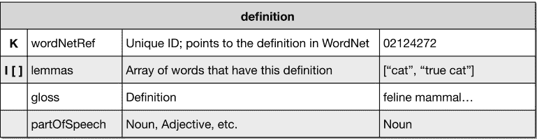
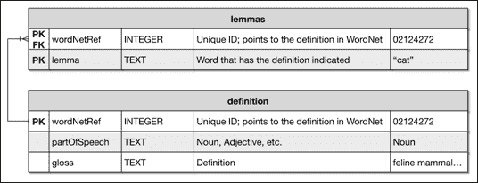

# IndexedDB 概览

## 存储选项

`Cordova` 应用可以使用多种不同类型的持久化存储。你使用哪种存储机制主要取决于应用的存储需求。此外，你的应用不限于单一类型的存储。将用户偏好存储在 `localStorage` 中，而将较大文件使用 `File API` 存储，这可能最合理。另一方面，`localStorage` 和 `File API` 都没有提供存储、检索和搜索结构化数据的简单机制。当然你可以将它们用于这些目的，但你必须自己完成大部分艰苦工作。

两种存储机制来拯救我们，使我们不必重复造轮子。较旧（现已弃用）的标准 `Web SQL Database` 使用关系数据模型，这类似于 `Oracle`、`PostgreSQL`、`Microsoft SQL` 等数据库。一种名为 `IndexedDB`（Indexed Database 的缩写）的较新标准使用键-对象存储。这对 `JavaScript` 特别有用，因为我们最常处理对象。因此，持久化这些对象变得非常简单。

`IndexedDB` 和 `Web SQL Database` 都不特定于 `Cordova`；你也可以在桌面浏览器中使用它们。这是一个很好的特性，因为你可以在桌面浏览器上测试应用的存储，从而实现更快的迭代和更容易的调试。如果你为桌面编写过网站应用，也可能重用你的存储代码（以及可能的许多其他代码）。不过有个坑（总是有的！）：`IndexedDB` 的支持情况参差不齐；要在不遇到许多痛苦问题的情况下使用它，你可能需要使用 polyfill 或其他封装器。值得庆幸的是，有几个优秀的可用方案。

## 章节内容

在本章中，我们将涵盖以下内容：

*   `IndexedDB` 支持和 polyfill
*   关系型存储与键-对象存储的区别
*   创建数据库
*   在数据库中创建对象存储
*   处理数据库升级
*   事务
*   存储对象
*   获取对象
*   删除对象
*   使用游标和索引
*   关闭数据库

本章主要关注使用 `IndexedDB` 的基础知识。如果你想看真实示例，我们已在本书代码包 `logology-v07/` 中的演示应用中实现了 `IndexedDB`。

本章中的几个代码片段也可以通过随书代码包附带的交互式片段演练场使用。启动演练场的说明在代码包中的 `README.md` 文件里。启动后，选择 **7: IndexedDB**，然后浏览和尝试示例。在适用的情况下，每个章节和片段都会指示你应选择哪个章节和示例。

## 浏览器支持

在继续之前，讨论 `IndexedDB` 的支持情况很重要。因为它比 `Web SQL Database` 规范更新，所以支持较少。在某些支持它的平台上，它也可能极其受限和/或充满 bug。

### 注意

有关最新的浏览器支持，请参阅 [`caniuse.com/#feat=indexeddb`](http://caniuse.com/#feat=indexeddb)。

截至撰写时，`IndexedDB` 具有以下移动浏览器支持：

*   **iOS**：iOS 7.x 不支持；iOS 8.x 和 iOS 9.x 行为极其 buggy
*   **Android**：4.4 以下版本不支持；Android 4.4 及更高版本完全支持


# 桌面端支持与 Polyfill

## 浏览器支持

桌面端的支持情况要好得多；Chrome 和 Firefox 已经支持完整的 `IndexedDB` 实现多个版本了，而 OS X 上的 Safari 实现存在 Bug（考虑到 iOS 也有 Bug 实现，这不足为奇）。在桌面端，Internet Explorer 自版本 10 起就拥有部分实现。

所有这些意味着，如果你打算支持不同的平台和操作系统版本，你几乎肯定需要一个 polyfill 或封装库，来解决你可能遇到的各种问题。

## 可用的 Polyfill 和封装库

有许多不同的选项可供选择：

*   **`IndexedDBShim`** ([`github.com/axemclion/IndexedDBShim`](https://github.com/axemclion/IndexedDBShim))：如果 `IndexedDB` 不可用，它会使用 `Web SQL Storage`。
*   **`Cordova-IndexedDB`** ([`github.com/DickvdBrink/cordova-indexeddb`](https://github.com/DickvdBrink/cordova-indexeddb))：它将 `IndexedDBShim` 封装在一个 Cordova 插件中，以便更简单地安装。
*   **`Cordova-Plugin-IndexedDB`** ([`github.com/MSOpenTech/cordova-plugin-indexedDB`](https://github.com/MSOpenTech/cordova-plugin-indexedDB))：这是另一个封装了 `IndexedDBShim` 的 Cordova 插件。
*   **`Treo`** ([`github.com/treojs/treo/`](https://github.com/treojs/treo/))：该模块采用了另一种方法，提供了一个围绕 `IndexedDB` 的轻量级封装，使用起来稍微容易一些（它支持 Promise、轻松的版本变更等）。如果平台不原生支持 `IndexedDB`，它还可以通过 `IndexedDBShim` 回退到 `Web SQL Database`。

以上所有选项对于应用程序来说都是完全可行且可接受的（毫无疑问还有其他库也能工作）。前三个完全遵循规范，因此你现有的 `IndexedDB` 代码无需更改。`Treo` 是规范的一个封装，旨在提供更简单的语法，因此需要少量的代码更改。但正如你将在本章中看到的，为了获得更具可读性的代码，这是值得的。

# 关系型与键-对象存储模型

让我们介绍一下关系型存储模型和键-对象存储模型之间的一些差异，因为虽然这两种存储模型乍看之下似乎相似，但实际上它们截然不同。因此，如果你的部分数据更适合使用关系型模型进行存储和查询，而另一些数据更贴合键-对象模型，你可以选择在应用程序中同时使用两者。

## 关系型存储模型

关系型存储模型简单地描述了在模式层面定义的数据之间的关系。**模式** 描述了数据结构中的字段。在关系型存储模型中，模式通常也被称为表。

表将数据存储为一系列行和列，有点像电子表格，只不过行和列的编号方式不同（例如，电子表格通常用顺序字母命名列，用顺序数字命名行）。关系组件本身描述了一个表中的数据如何与另一个表中的数据相关联。

这类数据库擅长存储高度结构化且与其他数据有大量关系的数据。这些数据库通常还使用 **SQL**（**结构化查询语言**）作为操作和检索数据的语言。你在开发经历中很有可能在某个时刻见过一些 SQL 代码。话虽如此，既然我们将在下一章更多地介绍关系型存储模型，这里就不深入细节了。

## 键-对象存储模型

键-对象存储模型是另一种存储结构的方式，不过在这里，数据结构本身往往更灵活。每个对象都被存储，并稍后通过唯一标识符进行引用。这个唯一 ID 可能是自动生成的，也可能是给定对象上一个保证唯一的属性。对象也可以通过其他属性（可能唯一，也可能不唯一）建立索引，以便更轻松地查找对象。

这与关系型模型的关键区别在于，对象存储之间没有描述的关系。从技术上讲，仍然存在 **模式**（尽管比关系型模型更灵活），因为通常有一些属性是人们期望存在于所有持久化对象上的。除此之外，然而，两个存储之间没有指定的关系。

## 关系处理差异

例如，在关系型存储模型中，`order` 和 `customer` 模式之间的关系直接在数据库中描述。例如，`order` 模式可能有一个 `customer_id` 字段，而关系指定该 `customer_id` 字段直接关联到 `customer` 模式（通过 `customer_id` 字段）。这为查询优化和数据一致性提供了强大的机制，并且可以在数据库层面强制执行。

直观上，这种关系型存储模型可能如下所示：


显而易见，关系型存储模型虽然高度结构化，但并不总是能随时处理可能到来的任何类型的数据。很多时候，人们会向表中添加“用户”或自定义字段（如上文订单表中所用），以便为特定对象提供自定义数据。当然，随着时间的推移，这会变成开发和管理的噩梦。令人震惊的是，我见过有两百多个字段的数据库，字段名仅用通用列名加数字标记。基于这些数据进行开发和报表几乎是不可能的。

在键-对象存储模型中，关系本身仍然存在：如果我们想根据订单获取客户信息，我们需要根据客户 ID 查找客户。然而，无法在数据库本身中描述这些关系，也没有机制在数据库层面提供查询优化或数据一致性。相反，这些必须在应用层面进行管理。

直观上，键-对象存储模型可能如下所示：


## 灵活性与权衡

正如你所见，结构化数据仍在被存储，但存储本身对于接受什么数据可以更灵活。这并不是说关系消失了——完全不是；它们只是现在存在于你的代码中。额外的自定义数据也不会由应用程序自动处理。应用程序必须构建为预期额外数据，并在看到它时理解如何处理。即便如此，存储本身也不会因最初未预料到的额外字段而退缩。

在许多方面，键-对象存储模型比关系型模型简单得多。假设你有一个键或索引，你可以非常快速地找到一个对象。你也可以争辩说，你随后获取相关数据的速度可能比关系型数据库更快，仅仅因为你不必担心复杂的 SQL 解析，以及大多数关系型数据库为生成高性能查询而进行的各种查询优化。另一方面，你也可以争辩说关系型模型承担的心智和开发成本更低。关系型模型使一次性获取所有相关数据变得非常简单（而不是分一系列步骤），并且大多数关系型数据库都能很好地优化查询（代价是更复杂的内部代码）。

## 选择存储模型

你站在哪一边会因情况而异。两种存储模型都有各自的优缺点。如果你需要高度灵活的数据，关系型数据库可能不是最佳选择，因为你很可能最终不得不将数据存储在大量的二进制或字符大对象中，而查询这些数据很少是件愉快的事。如果你需要编写依赖大量相关数据的非常复杂的查询，你可能会发现关系型模型要简单得多。这实际上取决于你的数据结构。


在我们能够将任何对象存储到数据库之前，首先需要创建数据库。这并不像 `createDatabase` 甚至 `openDatabase` 操作那样简单。由于 `IndexedDB` 的异步特性，以及各种浏览器和平台都使用过 `IndexedDB` 的带前缀版本，这一过程实际上稍微复杂一些。

### 注意

本节中的代码片段位于本书代码包的 `snippets/07/ex1-create-database/*` 中。使用交互式代码片段演练场时，请选择 **7: IndexedDB** 以及从 **1a** 到 **1c** 的示例。

这是一个示例：

```
// Example Snippet 1a
// IndexedDB has been prefixed, so we need to get the prefixed 
// version if the non-prefixed version is not available. from: 
// https://developer.mozilla.org/en-US/docs/Web/API/IndexedDB_API/Using_IndexedDB
let indexedDB = window.indexedDB || window.mozIndexedDB ||  
    window.webkitIndexedDB || window.msIndexedDB;  //[1]

function openDatabase({name, version, onopen, onerror} = {}) { 
  //[2]
  let req = indexedDB.open(name, version);
  req.onerror = function(evt) {
    console.log("[DB] Encountered an error opening the database:", 
                evt.target.error);
  };
  req.onsuccess = function(evt) {
    let db = this.result; //[3]
    db.onerror = onerror || function(dbEvent) { //[4]
        console.log("[DB] Encountered a database error:", 
                    dbEvent.target.error);
    };
    onopen(db); //[5]
  };
}

function gotADatabase(db) { //[6]
  console.log(db);
}

openDatabase({ //[7]
  name: "StarterDictionary",
  version: 1,
  onopen: gotADatabase});
```

如果这看起来有点吓人，别担心；它其实没看起来那么糟。部分复杂性仅仅是因为 `IndexedDB` 的所有操作都是异步的，并使用事件来传达每个请求的状态。它有点像没有 Promise 的 `XMLHttpRequest` 或 File API。

因为浏览器使用过带前缀的版本，我们必须确定浏览器使用哪个属性来表示 `IndexedDB` 的接口。这就是我们在前一个示例第一行的 `[1]` 处所做的。值得庆幸的是，如果你使用 `IndexedDBShim`，这个问题就不存在了，这样你就可以始终引用 `indexedDB`。

`openDatabase` 函数 (`[2]`) 完成了打开数据库的繁重工作。首先，它调用 `indexedDB.open`，这看起来相当不言自明。第一个参数 `name` 指定数据库名称，`version` 指定版本号。版本号稍后会派上用场。

### 注意

版本必须是非浮点数。`1.3` 或 `"one"` 都不行。

`open` 方法返回一个请求对象；在示例中我们称之为 `req`。当请求遇到错误或成功完成时，它会触发相应的事件，所以我们必须为请求附加事件处理程序（分别是 `onerror` 和 `onsuccess`）。因为 `open` 操作是异步的，我们可以在发出打开数据库的实际请求*之后*分配事件处理程序，因为请求不会立即执行。

当数据库成功打开时，你可以通过将 `this.result` 中的值复制到一个更具描述性的变量名（如 `db`）中来获取对数据库本身的引用，如 `[3]` 所示。在示例中，我们紧接着做的下一件事 (`[4]`) 是分配一个全局错误处理程序，它只是将发生的任何错误记录到控制台。（生产应用程序在这里需要更健壮的处理。）一旦我们这样做，就会将数据库引用发送给回调函数 (`[5]`)。

示例的最后一部分 (`[7]`) 实际演示了 `openDatabase` 函数的用法。我们想要打开或创建一个名为 `StarterDictionary` 的数据库；它处于版本 `1`。打开后，它会带着引用调用 `gotADatabase` (`[6]`)。这个函数非常简单；它只是在那一刻将数据库记录到控制台。

这可能不是你想要创建或打开数据库的方式。所以，我们将把它转换为使用 Promise，如下例所示：

```
// Example Snippet 1b
let indexedDB = window.indexedDB || window.mozIndexedDB ||
    window.webkitIndexedDB || window.msIndexedDB;

function openDatabase({name, version, onerror}) {
  return new Promise((resolve, reject) => {
    let req = indexedDB.open(name, version);
    req.onerror = function(evt) {
      reject(evt.target.error);
    };
    req.onsuccess = function() {
      let db = this.result;
      db.onerror = onerror || function(dbEvent) {
          console.log("[DB] Encountered a database error:",
                      dbEvent.target.error);
      };
      resolve(db);
    };
  });
}

openDatabase({
  name: "StarterDictionary",
  version: 1
}).then(db => console.log(db))
  .catch(err => console.log(
         "Encountered an error opening the database:", err));
```

啊，这好多了。但它远非完美，因为你需要负责用 Promise 包装 `IndexedDB`。如果有个库能帮我们做这件事呢？结果真有，它叫 `Treo`。

我们已经提到过 `Treo`，所以你可能想看看我们之前提到的网站。如果我们想把它加到项目中，并添加一个回退到 Web SQL Database 的方案（以防浏览器不原生支持 `IndexedDB`），我们可以很简单地做到：

```
$ npm install --save treo treo-websql
```

一旦我们在项目中安装了它，打开或创建数据库就很容易了（尽管我们目前还做不了什么，因为我们没有模式）：

```
// Example Snippet 1c
let treo = require("treo"),
    promise = require("treo/plugins/treo-promise"),
    webSQL = require("treo-websql");

let schema = treo.schema()
                 .version(1);

let db = treo("StarterDictionary", schema);
db.use(webSQL());  //[1]

db.use(promise());     //[2]

console.log(db);
```

这里有几点注意事项：`[1]` 和 `[2]` 处的 `db.use` 命令启用 `Treo` 插件。第一个启用 Web SQL Database 作为回退，以防 `IndexedDB` 不被原生支持。第二个启用 Promise 的使用。

### 注意

这两个命令的顺序**非常重要**。自行调换顺序后果自负。

我不知道你怎么想，但我更喜欢这种代码！因此，在本章的其余部分，我们将展示不使用 Promise 或 `Treo` 的*原生*代码，然后展示 `Treo` 版本。如果你想自己在 `IndexedDB` 周围包装一个 Promise，我就留给你作为练习了。

### 注意

如果你查看代码包中的片段代码，会注意到它不使用 `require`。相反，片段使用这些文件的浏览器版本。你可以用任一方式使用 `Treo`，但我尽可能喜欢使用 `require` 和 NPM。

到目前为止，我们的数据库什么有用的事也做不了。我们还没有定义任何用于存储对象的模式。让我们在下一节看看如何做到这一点。

到目前为止，我们的数据库无法存储任何东西，因为我们还没有创建对象存储空间。如果你熟悉关系型数据库中的表或模式，这些有些相似。当然，在我们能够将任何对象存储在其中之前，我们必须首先创建一个存放它们的地方。

修改数据库结构的唯一时机是在 `onupgradeneeded` 处理程序中。每当数据库需要升级时就会调用此处理程序，这讲得通，但它在数据库全新时也会被调用。

为了创建对象存储空间，我们需要确定大多数对象预期将拥有的至少一些属性。虽然你可以存储任何种类的、具有任意数量属性的对象，但确实需要一种方法来查找存储空间中的对象，而不必遍历每个存储的对象。


# 主要查找机制：键

查找对象的主要机制是对象的**键**（`key`）。该键可以是将要存储的所有对象上都存在且在集合中唯一的属性，也可以由数据库本身自动生成。选择哪种方法很重要：没有简单的方法可以切换到另一种方法。

# 索引

对象很少仅通过其键来定位，因此需要其他方式来定位对象。在 IndexedDB 中，这些被称为**索引**（`index`）。索引是对一个或多个对象位置的引用——非常像邮寄地址或定位器。这些索引不必唯一，也不必作为属性存在于存储区中的所有对象上（这些对象只是不会出现在索引中）。对象的键和各种索引相结合，提供了一种快速访问数据的方式，同时保持了极大的灵活性。

# 创建对象存储区

通过在数据库句柄上调用 `createObjectStore` 来创建对象存储区。它至少需要一个参数，但通常你会传递两个：存储区的名称（或模式、表）以及该存储区是将使用特定属性作为键还是使用自动生成的 ID。

一旦创建了存储区，通过在生成的对象存储区上调用 `createIndex` 来创建额外的索引。这里通常使用三个参数：索引的名称、要索引的对象属性以及任何额外选项（例如值是否必须在索引中唯一）。

除了用于定位对象的键之外，所有索引对于存储的任何对象在技术上都是可选的。此外，对象可以拥有任意数量的额外属性，因此存储区的模式是开放式的。这与典型的关系型数据库截然不同，但这也为存储 JavaScript 对象提供了强大的功能和灵活性。

# 演示应用 Logology 的对象存储区设想

让我们为演示应用 Logology 想象一个对象存储区。我们需要以一种可以快速检索的方式存储定义。考虑以下模式：



该模式不一定描述定义可能伴随的每个属性，但它代表了我们通常期望在 `definition` 对象中找到的内容。第一个字段 `wordNetRef` 标记为 `K`，这只是我们表示该属性是对象存储区键的方式。

## 注

如果你不熟悉 WordNet，它是普林斯顿大学发布的免费英语词典（更多信息请访问 <http://wordnet.princeton.edu/>）。

每个 WordNet 定义都有一个数据库位置。由于这是唯一的，因此将其用于我们的定义也很合理（我们将从他们的词典获取定义。毕竟是免费的，假设遵守其许可证）。

下一个字段 `lemmas` 是一个数组，表示该定义所适用的单词的基本形式（即非复数化或以其他方式变形或变位）。一个定义可能适用于许多不同的词元；从这个意义上说，这些词元彼此是同义词（考虑 pop 与 soda）。同样，一个词元可能适用于多个定义（考虑 pop：它是指苏打水、声音，还是可能指某人的父亲？）。

`gloss` 就是定义本身。WordNet 的定义非常简短且稀疏，但足以满足我们的目的。人们可以自己编写额外内容或授权其他词典内容。

最后，`partOfSpeech` 表示该词是名词、动词等。

当然，可以想象各种其他属性；例如反义词列表，或者如果定义是关于对象的，则指向图像的链接。关键在于这些不必在对象存储区的模式中指定。

## 注

本节的代码片段位于代码包的 `snippets/07/ex2-create-store/*` 中。使用交互式片段演练场时，选择 **7: IndexedDB** 和示例 **2a** 和 **2b**。

考虑到这一点，让我们看一个使用 IndexedDB 创建此存储区的简单示例：

```javascript
// Example Snippet 2a
function openDatabase({name, version, onopen, onerror, onupgrade} 
                      = {}) {
    let req = indexedDB.open(name, version);
    ...
    req.onupgradeneeded = function(evt) {
        onupgrade(evt.target.result);
    };
}
...
function schemaV1(db) {
    // schema definition has a primary key based on property 
    // wordNetRef
    let definitionStore = db.createObjectStore("definition", 
                             {keyPath: "wordNetRef"});
    definitionStore.createIndex("lemmas", "lemmas", 
                               {unique: false, multiEntry: true});
}

openDatabase({name: "StarterDictionary", version: 1,
              onopen: gotADatababase, onupgrade: schemaV1});
```

请注意，我们没有列出可能存在的每个字段。你只需要包含稍后可能用于访问对象的字段。在我们的例子中，`wordNetRef` 和 `lemmas` 属性是查找单词的唯一途径。

## 注

索引可以是唯一的（`unique: true`）或非唯一的（`unique: false`）。此外，如果传递 `multiEntry: true`，则对应对象属性中的所有项都将添加到索引中。例如，在前面的图片中，`cat` 和 `true cat` 都将在指向同一定义的索引中。

而在 Treo 中，这完全不同（且更容易理解）：

```javascript
// Example Snippet 2b
let schema = treo.schema1()
                 .version(1)
                 .addStore("definition", {key: "wordNetRef"})
                 .addIndex("lemmas", "lemmas", 
                           {unique: false, multiEntry:true});

let db = treo("StarterDictionary", schema);
db.use(webSQL());
db.use(promise());
```

正如可能已经显而易见的，IndexedDB 数据库带有版本号。每当应用请求的数据库版本比用户实际拥有的版本更新时，将调用 `onupgradeneeded`，以便应用有机会修改数据库。

## 注

本节的代码片段位于代码包的 `snippets/07/ex3-upgrade-database/*` 中。使用交互式片段演练场时，选择 **7: IndexedDB** 和示例 **3a** 到 **3b**。

值得庆幸的是，`onupgradeneeded` 会提供数据库的旧版本号和期望的版本号，否则我们将难以决定需要更改什么。有了这些信息，我们可以非常简单地升级数据库。首先，让我们稍微修改 `openDatabase` 函数如下：

```javascript
// Example Snippet 3a
function openDatabase({name, version, onopen, onerror, onupgrade}) {
    let req = indexedDB.open(name, version);
    req.onerror = function(evt) {
        console.log("[DB] Encountered an error opening the database:" + evt.target.error);
    };
    req.onsuccess = function() {
        let db = this.result;
        db.onerror = onerror || function(dbEvent) {
            console.log("[DB] Encountered a database error:" + dbEvent.target.error);
        };
        onopen(db);
    };
    req.onupgradeneeded = function(evt) {
        let oldVersion = evt.oldVersion;
        // Safari returns a really silly value for newly created databases.
        // From https://github.com/treojs/idb-schema/blob/master/lib/index.js
        onupgrade(evt.target.result, oldVersion > 4294967295 ? 0 : oldVersion);
    };
}
```

我们所做的只是修改 `onupgradeneeded` 事件处理程序以存储旧版本（附加在 `evt` 上），然后将其传递给我们的升级处理程序（在调用 `openDatabase` 时指定）。如果你想知道 `[1]` 中与那个大数字的比较，是因为 Safari 在数据库刚创建时返回一个荒谬的高数字，而不是像其他浏览器那样返回更合理的 `0`。


# 构建升级函数

现在我们可以构建一个升级函数：

```
// Example Snippet 3a, continued
function upgradeDatabase(db, oldVersion) {
  for (let curVersion = oldVersion; curVersion < db.version;
           curVersion++) {
    switch (curVersion) {
      case 0:
        let definitionStore = db.createObjectStore("definition", {
            keyPath: "wordNetRef"
          });
        definitionStore.createIndex("lemmas", "lemmas", {
            unique: false,
            multiEntry: true
          });
        break;
      case 1:
        db.createObjectStore("notes", {
            autoIncrement: true
          });
        db.createObjectStore("favorites", {
            autoIncrement: true
          });
        break;
      default:
        console.log("No upgrade steps available");
    }
  }
}
```

现在，假设我们的应用想要打开数据库的版本 2。如果数据库是新创建的，`oldVersion` 将等于零。因此，`case 0` 和 `case 1` 都会被执行。如果数据库已经处于第一个版本，则只会执行 `case 1`（因为它是从版本 1 升级到版本 2）。

## Treo 方式

现在，让我们看看 Treo 的方式。到目前为止，你可能已经猜到它要简单得多，确实如此：

```
// Example Snippet 3b
let schema = treo.schema()
                 .version(1)
                   .addStore("definition", {key: "wordNetRef"})
                   .addIndex("lemmas", "lemmas", 
                             {unique: false, multiEntry:true})
                .version(2)
                  .addStore("favorites", {autoIncrement: true})
                  .addStore("notes", {autoIncrement: true});
let db = treo("StarterDictionary", schema);
db.use(webSQL());
db.use(promise());
```

如果你留意细节，或者过去做过哪怕简单的版本迁移，你就会知道数据库模式升级很少如此简单。如果你只需要删除一些存储或索引，这相当简单。你可以调用 `deleteObjectStore` 和 `deleteIndex`（原生 API）或调用 `dropStore` 和 `dropIndex`（Treo）。另一方面，你的数据可能也需要重组。不幸的是，没有简单的方法可以做到这一点。你需要复制存储中的数据，将其更改到临时存储中，删除并重新创建存储，然后将数据从临时存储复制回去。

# 事务

所有读取或写入对象存储的交互都必须在事务的上下文中执行，事务是一种确保数据一致性的机制。如果事务的任何部分失败，事务期间发生的所有操作都将被恢复。

你可以按如下方式从数据库请求事务：

```
let transaction = db.transaction(["store", ...], mode);
```

`transaction` 的第一个参数是你将在事务中使用的存储列表。你必须预先指定这些存储，才能实际查询或修改其中的数据。

第二个参数是可选的。它指定事务是仅读取数据（`readonly`）还是需要写入数据（`readwrite`）。还有一种 `versionchange` 模式，可用于更改存储模式，但你应该只在数据库升级期间进行此类操作。如果未提供此参数，将假定为 `readonly`。

事务会生成事件，因此你可以跟踪事务的进展情况。事务可能生成三种事件类型：

*   `error`：事务期间发生错误。除非你采取措施避免，否则事务内的数据更改将自动回滚。你可以通过首先在错误上调用 `preventDefault`，然后适当处理错误来以不同方式处理错误。
*   `abort`：事务将被中止，所有更改将被回滚。
*   `complete`：事务将完成，所有更改将被持久化。

### Tip

非常重要的是要认识到，当你收到 `complete` 事件时，无法保证你保存的任何数据实际上已被持久化。事实上，没有真正的机制可以确保数据已被持久化到存储中。因此，如果数据极其关键，你可能不想使用 IndexedDB。

一旦你有了事务，就可以通过调用 `objectStore` 并传入存储名称，来获得创建事务时指定的对象存储的访问权限。

如果出于任何原因你需要终止事务，可以调用 `abort()`。但你将丢失事务期间所做的任何更改，因为它们将被回滚。

### Note

事务仅在事务中有待处理的请求时保持活动状态。一旦没有更多请求，事务将变为非活动状态，无法再用于生成请求。

那么，Treo 如何处理事务？非常、非常不同。事实上，如果你只需要获取或存储单个项目，Treo 会自动为你处理事务。如果你需要在单个事务中执行多个操作，Treo 提供了一个 `batch` 方法，将在单个事务中执行这些操作。我们稍后会回到这个方法。

# 存储对象

假设你在数据库和事务级别有适当的错误处理程序，存储对象非常简单。你可以跟踪存储的每个对象的事件；但如果你存储大量数据，这很快会让你不堪重负。

### Note

本节中的代码片段位于代码包的 `snippets/07/ex4-store-objects/*` 中。使用交互式代码片段演练场时，选择 **7: IndexedDB** 和从 **4a** 到 **4b** 的示例。

有两种方法可以存储对象：你可以添加它，也可以放入它。以下是这两种方法的区别：

*   `add`：这将存储一个对象。该对象不得已存在于存储中。该对象必须满足任何唯一键和索引，否则将生成错误。
*   `put`：如果对象不存在，这将存储该对象；如果对象已存在于存储中，这将更新该对象。该对象必须满足任何唯一键和索引，否则将生成错误。

一旦你有了 `readwrite` 事务，就可以使用上述任一方法来存储对象。让我们看一个例子：

```
// Example Snippet 4a
function gotADatabase(db) {
  // Definitions from WordNet. See wordnet/LICENSE-WordNet.md in 
  // code package.
  let definitions = [
    {
      wordNetRef: "02124272",
      lemmas: ["cat", "true cat"],
      partOfSpeech: "noun",
      gloss: "feline mammal usually having thick soft fur and no ability to roar: domestic cats; wildcats"
    },
    {
      wordNetRef: "02130460",
      lemmas: ["cat", "big cat"],
      partOfSpeech: "noun",
      gloss: "any of several large cats typically able to roar and living in the wild"
    },
    {
      wordNetRef: "02085443",
      lemmas: ["aardvark", "ant bear",
               "anteater", "Orycteropus afer"],
      partOfSpeech: "noun",
      gloss: "nocturnal burrowing mammal of the grasslands of Africa that feeds on termites; sole extant representative of the order Tubulidentata"
    }
  ];
  let transaction = db.transaction(["definition"], "readwrite");
  transaction.onerror = function(evt) {
    console.log("[DB] Transaction got an error: " +
      evt.target.error);
  };
  transaction.oncomplete = function() {
    console.log("[DB] All entries added.");
  };
  let definitionStore = transaction.objectStore("definition");
  definitions.forEach(definition => definitionStore.put(definition));
}
```

请注意，即使 IndexedDB 的所有操作都是异步的，我们仍然可以将大量数据作为大部分同步的操作持久化到存储中。它并不是真正的同步。每个存储数据的请求只会被排队，直到可以被处理。数据直到 `complete` 事件触发后才能真正被检索。


## 使用 Treo 添加数据

Treo 也支持添加数据，但仅提供 `put` 方法，因为如果试图创建一个已存在的对象，通常不希望报错——相反，大多数开发者希望对象被更新。对于多个对象或操作，Treo 也支持 `batch` 方法。

但首先，需要获取对象存储。这是通过使用对象存储名称调用 `store` 来完成的。然后可以根据需要调用 `put` 或 `batch`。让我们看一个例子：

```javascript
// 示例代码片段 4b
// 假设定义与前一个示例相同
let definitionStore = db.store("definition");
definitionStore.batch(definitions)
  .then(() => console.log("All entries added"))
  .catch((err) => console.log("[DB] An error was encountered " + err));
```

此时，代码量没有实质性的不同，不同之处在于 Treo 允许我们在这种情况下使用 Promise，而不是原生示例中的事件处理机制。

检索之前存储的对象非常容易，前提是你知道键。如果你只知道来自索引的值，事情会变得稍微难一点（虽然也不算太难）。我们稍后会讨论后一种情况。

### 注意

本节中的代码片段位于本书代码包的 `snippets/07/ex5-get-objects/*` 中。使用交互式代码片段演练场时，请选择 **7: IndexedDB** 和示例 **5a** 与 **5b**。

## 检索对象

与存储对象一样，你首先需要获取一个事务。然而，因为我们只需要一个只读事务，所以这变得容易得多。请看下面的例子：

```javascript
// 示例代码片段 5a
let req = db.transaction(["definition"]).objectStore("definition")
            .get("02124272");
```

传递给 `get` 的值是 `wordNetRef` 编号，它是对象的键。如果你使用的是自动生成的键，你需要指定它们（当然，你可能不会随手就知道键是什么）。

一旦找到对象，将调用 `success` 事件。事实上，如果指定键不存在对象，也会调用此事件，因此这是一个你需要自行检查的条件。如果发生其他错误，将触发 `error`。

让我们完成这个例子：

```javascript
// 示例代码片段 5a，续
req.onerror = function (evt) {
  console.log("[DB] An error occurred: ", evt.target.error);
};
req.onsuccess = function (evt) {
  let definition = evt.target.result;
  if (!definition) {
    console.log("Couldn't find the desired entry.");
  } else {
    console.log(JSON.stringify(definition, null, 2));
}
};
```

当触发 `success` 时，实际对象存储在 `evt.target.result` 中。如果这是 `undefined`，则 IndexedDB 无法为请求的键找到对象。如果不是 `undefined`，则你可以继续对对象进行任何所需操作，例如将其显示给用户或执行额外计算。

在 Treo 中，过程非常相似：

```javascript
// 示例代码片段 5b
let definitionStore = db.store("definition");
definitionStore.get("02124272")
  .then((result) => 
    console.log(result ? JSON.stringify(result, null, 2)
                       : "Couldn't find entry."))
  .catch((err) => {
    console.log("[DB] An error was encountered "+ err);
});
```

同样，就像原生版本一样，`undefined` 结果意味着找不到该对象。

## 删除对象

删除对象与使用 `get` 检索它们非常相似，只是我们使用 `delete` 代替。

### 注意

本节中的代码片段位于本书代码包的 `snippets/07/ex6-delete-objects/*` 中。使用交互式代码片段演练场时，请选择 **7: IndexedDB** 和示例 **6a** 与 **6b**。

让我们看一个例子：

```javascript
// 示例代码片段 6a
let req = db.transaction(["definition"],"readwrite").objectStore("definition").delete("02124272");
req.onerror = function (evt) {
  console.log("[DB] An error occurred: ", evt.target.error);
};
req.onsuccess = function () {
  console.log("Deleted the entry.");
};
```

重要的是要注意，即使找不到要删除的对象，也会调用 `success` 事件。如果发生其他错误，将触发 `error`。

让我们看看 Treo 的版本：

```javascript
// 示例代码片段 6b
let definitionStore = db.store("definition");
definitionStore.del("02124272")
  .then(() => console.log("Entry deleted."))
  .catch((err) => {
    console.log("[DB] An error was encountered "+ err);
});
```

Treo 使用 `del` 而不是 `delete` 来删除条目，除此之外，它与检索对象非常相似。

## 使用游标和索引

到目前为止，我们只使用存储时的唯一键来检索数据。但我们也可以使用创建的索引来定位对象，而无需知道对象的唯一键。

### 注意

本节中的代码片段位于本书代码包的 `snippets/07/ex7-cursors-indexes/*` 中。使用交互式代码片段演练场时，请选择 **7: IndexedDB** 和示例 **7a** 与 **7b**。

为此，我们在创建事务后从对象存储请求一个 `index`。一旦拥有索引，我们就可以调用 `get` 来检索索引中的对象。让我们看一个例子：

```javascript
// 示例代码片段 7a
let req = db.transaction(["definition"]).objectStore("definition")
            .index("lemmas").get("cat");
req.onerror = ...;
req.onsuccess = function (evt) {
  let definition = evt.target.result;
  if (definition) {
    console.log(JSON.stringify(definition, null, 2));
  } else {
    console.log("Couldn't find entry.");
  }
};
```

如果你查看几节前的 `definitions` 数组，你会发现一个问题：如果一个索引值对应多个对象怎么办？答案是 `get` 不在乎：它返回找到的第一个。只要索引是唯一的，这没问题；但如果索引不唯一，你将难以检索所有对象。游标是解决此问题的一种方式。它们允许你迭代多个值。你可以通过在索引或对象存储上调用 `getCursor` 来获取游标。只要你的 `success` 处理程序在游标上调用 `continue`，游标就会为索引或对象存储中的每个项目调用 `success`。例如：

```javascript
// 示例代码片段 7a，续
let req = db.transaction(["definition"]).objectStore("definition")
            .index("lemmas").openCursor();
req.onerror = ...;
req.onsuccess = function (evt) {
  let cursor = evt.target.result;
  if (cursor) {
    console.log(`key: ${cursor.key}, value: 
                ${JSON.stringify(cursor.value, null, 2)}`);
    cursor.continue(); // 获取下一个对象
  } else {
    console.log("No more entries.");
  }
};
```

前面的示例现在将列出 `lemmas` 索引中每个对象的每个定义。只要有匹配的对象，`cursor` 就会被定义。键和值可以通过分别引用 `key` 和 `value` 属性来获取。一旦没有更多项目，`cursor` 将变为 `undefined`。这也意味着如果索引中没有任何条目，`cursor` 最初就会是 `undefined`。

虽然迭代索引或存储中的每个项目很有用，但通常这并不是我们想要的。通常，我们需要过滤结果。为此，我们需要创建一个范围来限制结果。

`IDBKeyRange` 提供了几种可用于创建范围的方法。根据你的需求，有几个选项可用：

*   `only(key)`：游标将仅返回与键完全匹配的值。
*   `lowerBound(key [,exclusive=false])`：游标将返回包括键在内及键之后的所有值。如果 `exclusive` 为 `true`，则键本身将被排除。
*   `upperBound(key [,exclusive=false])`：游标将返回键及键之前的所有值。如果 `exclusive` 为 `true`，则键本身将被排除。
*   `bound(lowerKey, upperKey[,lowerExclusive=false [,upperExclusive=false]])`：这是 `lowerBound` 和 `upperBound` 的组合。


# IndexedDB 游标和 Treo 封装库

## 将 `IDBKeyRange` 与 `openCursor` 配合使用

然后可以将返回的范围传递给 `openCursor` 方法，如下所示：

```
let IDBKeyRange = window.IDBKeyRange || window.webkitIDBKeyRange 
                                             || window.msIDBKeyRange;
let range = IDBKeyRange.only("cat");
let req = db.transaction(["definition"]).objectStore("definition")
                  .index("lemmas").openCursor(range);
```

## 更改游标方向

游标默认按升序迭代。如果你想改变该顺序，也可以做到。例如，以下代码将按降序迭代：

```
let req = db.transaction(["definition"]).objectStore("definition")
            .index("lemmas").openCursor(range, "prev");
```

## Treo 的简化 API

Treo 完全摒弃了游标的概念，只做你最可能想要的事：返回所有匹配的项。让我们看一个例子：

```
let definitionStore = db.store("definition");
definitionStore.index("lemmas").get("cat")
  .then((result) => 
          console.log(result ? JSON.stringify(result, null, 2) 
                             : "Couldn't find entry."))
  .catch((err) => {
    console.log("[DB] An error was encountered "+ err);
});
```

除非索引是唯一的（意味着只能返回一个值），否则将传入一个数组给 `result`。该数组包含索引中所有与 `get` 指定的键匹配的项。

如果你想使用原生 `IDBKeyRange` 范围，Treo 也支持，但它还支持一种更具表现力且更易读的版本。例如：

```
definitionStore.index("lemmas").get({gte: "cat", lt:"dog"})...;
```

这与 `IDBKeyRange.bound("cat", "dog", false, true)` 效果相同。所有匹配 `cat` 及之后的对象都会被返回，但仅限于 `dog` 之前（不包括 `dog`）。

## 关闭数据库

每当应用程序关闭或终止时，数据库会自动为你关闭。如果你对数据库的需求是短暂的，你可能认真考虑手动关闭数据库。如果你发现自己需要为短暂的事务打开大量数据库，也可能需要考虑手动关闭数据库。

你可以通过调用 `close` 来实现。从技术上讲，你可以通过检查返回的请求对象来监控 `close` 操作的状态。但通常没必要这样做。请注意，数据库不会立即关闭；该操作本身仍然是异步的，因此如果你需要立即重新打开数据库，你肯定得添加一个 `success` 处理程序（或者在使用带有 Promise 的 Treo 时添加 `then` 处理程序）。

# 资源

使用 IndexedDB 可以做很多事。本章无法涵盖所有内容。你可能会发现以下资源有用：

*   Mozilla (MDN) 文档（注：它们使用 `errorCode` 和 `stopPropagation`，这是不正确的）
    *   [`developer.mozilla.org/en-US/docs/Web/API/IndexedDB_API/Using_IndexedDB`](https://developer.mozilla.org/en-US/docs/Web/API/IndexedDB_API/Using_IndexedDB)
    *   [`developer.mozilla.org/en-US/docs/Web/API/IndexedDB_API`](https://developer.mozilla.org/en-US/docs/Web/API/IndexedDB_API)
*   Microsoft 文档：[`msdn.microsoft.com/en-us/library/ie/hh673548(v=vs.85).aspx`](https://msdn.microsoft.com/en-us/library/ie/hh673548\(v=vs.85\).aspx)
*   W3C 规范：[`www.w3.org/TR/IndexedDB/`](http://www.w3.org/TR/IndexedDB/)
*   Treo 仓库：[`github.com/alekseykulikov/treo`](https://github.com/alekseykulikov/treo)
*   浏览器支持：[`caniuse.com/indexeddb`](http://caniuse.com/indexeddb)
*   另一个封装库（类似 Treo）叫 Dexie：[`www.dexie.org`](http://www.dexie.org)

# 章节总结与过渡到 Web SQL Database

在本章中，我们介绍了如何创建 IndexedDB 数据库、如何存储和检索对象，以及关系存储机制与键-对象存储机制的区别。在下一章，我们将使用 Web SQL Database 探索存储方程的关系方面。

键-对象存储非常有用，但有时我们需要更强大的功能。Web SQL Database 让我们利用 `SQL`（结构化查询语言）以简单高效的方式处理结构化和关系型数据，而 IndexedDB 通常需要大量编程来合并多个表的结果或执行全文搜索。SQL 只需几行简短的代码就能非常简单地完成这些任务。

正如上一章所述，Web SQL Database 使用一种关系数据模型，这类似于 Oracle、PostgreSQL、Microsoft SQL 等数据库。这种关系模型非常适合高度结构化的数据，但不太适合结构灵活的数据。后者不会在数据库模式本身中表达关系，而前者会，因此它还可以在数据库层面而非代码层面强制执行数据完整性。

使用 Web SQL Database 有一个缺点：标准机构基本上已经废弃了该规范。实现 Web SQL Database 的浏览器使用了单一实现：SQLite。标准机构不想将 SQLite 的 SQL 方言编入规范。也就是说，所有现代 WebKit 浏览器都支持 Web SQL Database，这在桌面端和移动端都是如此。现在有太多网站依赖它，因此尽管它本质上是一个死规范，但短期内不太可能被移除。

既然我们使用 Cordova 构建应用，我们就可以访问平台浏览器对 Web SQL Database 的实现。这确实带来了一些显著限制（特别是存储空间）。因此，我们将使用一个第三方插件，它使用相同的 API，但使用独立的 SQLite 数据库。这也意味着即使浏览器开始移除其 Web SQL Database 实现，Cordova 依然安全，因为随时可以添加插件来恢复功能。

### 关于 SQLite 的说明

Web SQL Database 本质上是 SQLite 的一个封装。SQLite 是一种轻量快速的关系数据库实现，在移动设备上有极佳的支持。要了解更多关于 SQLite 的信息，你可以访问其网站：[`www.sqlite.org`](http://www.sqlite.org)。

# 本章涵盖内容

在本章中，我们将涵盖以下内容：

*   Web SQL Database 支持
*   Cordova SQLite 插件
*   创建和打开数据库
*   使用事务
*   创建表
*   插入数据和绑定值
*   查询数据
*   删除数据
*   SQLite 实用工具

# 代码包参考

本章主要关注使用 Web SQL Database 的基础知识。如果你想看真实案例，我们已在本书代码包 `logology-v08/` 中的演示应用里实现了 Web SQL Database。

本章中的几个代码片段也可通过随书代码包附带的交互式片段演练场使用。启动演练场的说明在代码包的 `README.md` 文件中。启动后，选择 `8: Web SQL Database`，然后浏览和尝试示例。适用时，每个章节和片段会指示你应选择哪个章节和示例。

# 浏览器支持

所有现代 WebKit 浏览器都支持 Web SQL Database。这包括 Android 设备上的 Chrome 和 iOS 设备上的 Mobile Safari。Android 支持可追溯至 Android 2.1，iOS 支持可追溯至 iOS 3.2。在桌面浏览器上，支持时间甚至更长。

值得注意的是，Internet Explorer 和 Firefox 不在支持列表中。这些浏览器仅支持 IndexedDB（IE 仅部分支持）。在它们的桌面版或移动版中均找不到对 Web SQL Database 的支持。如果你最终决定以 Windows Phone 或 Firefox OS 为目标平台，你可能需要注意这一点并相应规划。


# Web SQL 数据库和 Cordova SQLite 存储插件

## 存储限制

当使用浏览器提供的 Web SQL 数据库支持时，我们会受到存储限制的约束。为了确保网站或应用不会占用计算机上的所有空间，浏览器会强制执行数据库大小的配额限制。这通常从 `5 MB` 开始。大多数浏览器允许扩展至 `50 MB`。

浏览器对 Web SQL 数据库实施的存储限制对移动应用来说是个问题，因为 `5` 甚至 `50 MB` 可能不足以满足应用的需求。值得庆幸的是，有一种方法可以绕过这一限制，也能绕过该标准已废弃且未来可能从浏览器中移除的事实：使用第三方插件。

## 第三方插件

有几个与 SQLite 交互的第三方插件可用，但我们将使用的这个插件旨在实现与所用规范相同的 API。这意味着，通常情况下，你可以在桌面浏览器和移动浏览器上使用相同的代码。其他一些插件提供截然不同的 API，这也可以，但不利于跨平台的代码复用。

我们将使用的插件名为 `Cordova SQLite Storage`，可从 <https://github.com/litehelpers/Cordova-sqlite-storage> 获取。你可以使用以下命令将其添加到 Cordova 项目中：

```
$ cordova plugin add io.litehelpers.cordova.sqlite
```

### 注意

如果你需要分发预填充的数据库，可以使用该插件的另一个版本，地址为 <https://github.com/litehelpers/cordova-sqlite-ext>。

## 创建和打开数据库

使用 Web SQL 数据库或 Cordova SQLite 存储插件创建和打开数据库很简单，但两者之间有几个差异是你需要注意的。在介绍这些差异之前，让我们先了解一下基础知识。

### 注意

本节的代码片段位于本书代码包中的 `snippets/08/ex1-create-database/`。使用交互式代码片段演练场时，选择 `8: Web SQL Database` 和示例 `1`。

### Web SQL 数据库语法

使用 Web SQL 数据库时，你可以通过以下方式打开数据库：

```
let db = window.openDatabase(name, version, description, quota);
```

让我们逐一了解这些参数：

*   `name`：这是数据库的文件名。通常以 `.db` 扩展名结尾。此参数为必填。
*   `version`：Web SQL 数据库支持版本化数据库。从技术上讲这是一个字符串参数，所以你可以使用 `1.0` 甚至 `"one"`。不过，我的建议是始终使用 `1`，稍后我们会说明原因。
*   `description`：这是数据库的简短描述，但主要供你自己参考。
*   `quota`：此参数指定你认为数据库需要多大，单位为字节。通常请求 `1`、`2` 或 `5` 兆字节。如果以后需要扩大容量，使用更大的 quota 打开数据库将请求额外空间。请记住，quota 只是一个*请求*，而非保证；用户完全可以不授予任何存储权限。

### Cordova SQLite 存储插件语法

使用 Cordova SQLite 存储插件时，首选语法略有不同：

```
window.sqlitePlugin.openDatabase(
    {name, location, createFromLocation,
     androidDatabaseImplementation, androidLockWorkaround});
```

差别不小，对吧？*从技术上讲*，你也可以使用第一种语法（只需添加 `sqlitePlugin`），但这已不再是该插件的首选语法。这是因为首选语法支持更多额外功能，而且 version、description 和 quota 实际上并不受支持，这意味着在使用浏览器实现时，没有理由使用除 `1` 以外的任何值作为数据库版本。

大多数参数都是可选的，但让我们快速过一遍所有参数：

*   `name`：与另一个版本一样，这是数据库的名称。
*   `location`：这是一个可选参数，指定数据库实际存储的位置。这仅影响 iOS。位置如下：
    *   `0`：将数据库存储在 `Documents/` 中；iTunes 可见，且由 iCloud 备份。这也是默认位置。
    *   `1`：将数据库存储在 `Library/` 中。由 iCloud 备份，但 iTunes 不可见。
    *   `2`：将数据库存储在 `Library/LocalDatabase/` 中。不由 iCloud 备份，iTunes 也不可见。
*   `createFromLocation`：这允许你随应用分发预填充的数据库。你的 `www` 文件夹中与之同名的数据库将被复制到最终位置。如果该位置已存在数据库，则不会再次复制。这仅在使用 <https://github.com/litehelpers/cordova-sqlite-ext> 处的插件时有效。
    *   `0`：不使用预填充数据库；创建的数据库将为空
    *   `1`：使用预填充数据库创建数据库
*   `androidDatabaseImplementation`：指定 Android 上应使用哪种 SQLite 实现。默认情况下，插件使用自己的实现而非系统提供的实现，但这偶尔会遇到问题（特别是在使用 Crosswalk 项目或 Ionic 时）。
    *   `2`：数据库使用系统 SQLite 实现而非插件自己的实现。为获得最佳兼容性，请使用此设置。
*   `androidLockWorkaround`：默认情况下未启用，但某些 Android 版本在意外关闭应用时会出现数据库锁定或数据丢失问题。这仅在 `androidDatabaseImplementation` 为 `2` 时才会发生。
    *   `1`：每次事务后关闭数据库。这以性能为代价修复了锁定和数据丢失问题。如果你将 `androidDatabaseImplementation` 设为 `2`，最好也包含此设置。

## 抽象差异：WebSQLDB 类

由于标准和插件之间的差异，通常最好将这些差异抽象化。让我们创建一个类来实现这一点：

```
// 示例片段 "WebSQLDB 类"；位于
// snippets/08/WebSQL/index.js
class WebSQLDB {
    constructor({name, version = "1", description, 
                 quota = (5 * 1024 * 1024),
                 location = 0, createFromLocation = 0,
                 androidDatabaseImplementation = 2,  
                 androidLockWorkaround = 1} = {}) {
        this.db = null;
        this.name = name;
        this.version = version;
        this.description = description;
        this.quota = quota;
        this.plugin = false;
        this.supportsReadOnlyTransactions = false;

        if (window.sqlitePlugin) {
            this.plugin = true;
            this.db = window.sqlitePlugin.openDatabase(
                {name, location, createFromLocation,
                 androidDatabaseImplementation,
                 androidLockWorkaround});
        } else {
            this.db = window.openDatabase(name, version, 
                description, quota);
        }

        if (!this.db) { // [1]
            throw new Error("Could not instantiate a database.");
        }

        if (this.db.readTransaction) { // [2]
            this.supportsReadOnlyTransactions = true;
        }
    }
}
```

请注意，前面的代码使用了大量默认参数。这些是建议的典型值，将它们设为默认值是合理的。如果你的应用需要不同的默认值，你随时可以将那些值设为默认值。

另外，请注意，我们只需检查返回值 `[1]` 即可判断打开数据库是否成功。如果它未设置为对象，则表示操作失败，我们可以适当地报错。最后几行 `[2]` 只是检查环境是否支持只读事务，我们将在下一节中深入探讨。

### 注意


# Web SQL 数据库：事务与表创建

## 打开数据库

当然，仅仅为了打开数据库而创建一个类有点大材小用。但随着本章的深入，我们将不断增强这个类。

要使用该类打开数据库，可以按如下方式操作：

```
let db = new `WebSQLDB`({name: "test.db"});
```

有了这一个类，我们就抽象掉了标准 Web SQL 数据库和插件版本之间的差异。现在我们有了一个打开的数据库，让我们看看如何与数据库进行交互。

## 理解事务

在进一步深入之前，我们需要了解 Web SQL 数据库是如何处理事务的。你*可以*在不使用事务的情况下针对数据库执行 SQL 命令，但这并不推荐。使用事务使你有机会在发生错误时回滚你添加、删除或更改的任何数据。通过这种方式，事务有助于维护数据库的一致性。

### 注意

本节中的代码片段位于本书代码包的 `snippets/08/ex2-transactions/` 中。使用交互式代码片段演练场时，请选择 **8: Web SQL Database** 和示例 **2**。

### 事务方法

通过在数据库对象上调用 `transaction` 即可轻松启动事务，如下所示：

```
db.transaction( transactionCallback, error, success )
```

### 注意

尽管由于使用了回调，乍一看 Web SQL 数据库似乎是异步的，但事实并非如此。IndexedDB 是唯一真正异步的本地存储解决方案。

### 事务参数

从技术上讲，`transaction` 的最后两个参数是可选的；你在网上找到的大多数示例都不会使用它们。即便如此，了解它们的用途也很重要，因此我们将逐一介绍每个参数：

*   `transactionCallback`：这*是*（且*必须是*）一个接受单个参数的回调函数。该参数是一个代表事务的对象。该事务仅在当前 JavaScript 执行运行循环中有效。这意味着它在 `setTimeout` 或类似函数中将无效。
*   `error`：如果在事务处理过程中发生错误，将调用此函数。此时，事务中的任何更改都将被回滚。此参数*不是*必需的。
*   `success`：当事务成功完成时，将调用此函数。这是可选的，且在大多数示例中很少提供，但它非常重要。只有调用此函数时，我们才能确定事务已成功完成。

最重要的参数是 `transactionCallback`。这必须是一个函数，负责实际执行事务，无论是创建表、添加数据还是查询数据。该函数可以以同步方式针对事务执行任意数量的命令。如果在任何时刻发生错误，更改将被回滚。

默认情况下，`transaction` 方法将假定你正在对数据库进行更改。如果你只是执行 `SELECT` 查询，可以改用 `readTransaction` 方法，这将带来更好的性能。虽然大多数浏览器都支持它，但检查该函数是否存在很重要，因为并非所有环境都支持它。

### 事务示例

让我们看一个所有这些如何协同工作的示例：

```
db.transaction(
    (tx) => {
        console.log("in transaction");
        // do queries, etc.
    },
    (err) => console.log(`Transaction error: ${err}`),
    () => console.log("Transaction completed successfully.")
);
```

一旦进入 `transactionCallback` 方法，事务就可用于针对数据库运行查询和执行命令。在我们的示例中，我们使用 `tx` 来指代该事务，仅仅是因为它是一个简短的缩写，且更易于输入。

### 提示

如果你熟悉典型的 `success, error` 回调方法模式，请注意此方法将它们的顺序颠倒了。

### Promise 化事务

这还不够理想；如果能配合 Promise 使用该多好？虽然确实可以将 Promise 与 Web SQL 数据库结合使用，但必须在事务本身施加的限制内进行：即它仅在当前特定的 JavaScript 运行循环中有效。

即便如此，让我们向我们的类添加一个事务方法。它将如下所示：

```
transaction(cb, {readOnly = false} = {}) {
    return new Promise((resolve, reject) => {
        let r;
        this.db(readOnly && this.supportsReadOnlyTransactions)
          ? "readTransaction" : "transaction" => {
            try {
                r = cb(transaction);
            } catch (err) {
                reject(err);
            }
        }, (err) => reject(err),
          () => resolve(r));
    });
}
```

特别重要的是，*Promise 化*版本仍然直接使用事务对象调用事务回调。这是由于 Promise 异步工作，等到下一个 JavaScript 运行循环到来时，事务将已失效。相反，我们必须立即执行回调，并在事务成功完成时 resolve。这意味着我们的 Promise 化版本并不完美，但它仍然让我们能够编写如下代码：

```
db.transaction((tx) => {
    console.log("in promised transaction");
    // do queries, etc...
}).then(() => console.log(
              "Promise transaction completed successfully."))
  .catch((err) => console.log(`Promise transaction error: 
                               ${err}`));
```

## 创建表

请注意，我们尚未针对数据库执行任何查询。让我们通过创建一些表来存储有用的数据来纠正这一点。

顾名思义，Web SQL 数据库依赖 SQL 来创建表、存储数据和检索数据。这意味着你基本上需要掌握一门额外的语言才能使用 Web SQL 数据库；仅靠 JavaScript 是不够的。话虽如此，SQL 很容易上手。即便如此，全面讲解该语言超出了本章的范围。对于 SQLite 版本的 SQL，[`www.sqlite.org/lang.html`](http://www.sqlite.org/lang.html) 是一个很好的资源。

### 注意

本节中的代码片段位于本书代码包的 `snippets/08/ex3-create-table/` 中。使用交互式代码片段演练场时，请选择 **8: Web SQL Database** 和示例 **3**。

### SQL 语法

创建表相当简单。首先，让我们看看用于创建表的 SQL 语法，然后我们将转到使用 Web SQL 数据库的 JavaScript 版本。请注意，在我们所有的 SQL 示例中，我们使用的是 SQLite 版本的 SQL：

```
CREATE TABLE [IF NOT EXISTS] tableName (
    columnName <TYPE> [<CONSTRAINT>] [, ...]
    [<TABLE CONSTRAINTS>]
)
```

### 注意

SQL 关键字不区分大小写。在我们的示例中，关键字通常大写，但没有强制要求必须大写。

### SQLite 类型亲和性

所有 Web SQL 数据库实现所使用的数据库 SQLite，不像大多数 SQL 数据库那样类型是静态的，而是更具动态性（实际上有点像 JavaScript）。这通常不影响我们编写 SQL 的方式，但认识到这一点很重要，因为这确实意味着 SQLite 在可存储内容方面实际上更灵活。以下是你在 SQL 中可能看到的各种类型在 SQLite 中将如何处理：

| 常见 SQL 类型 || SQLite 类型亲和性 || 说明 |
| --- | --- | --- | --- |
| `CHAR, CHARACTER, VARCHAR, VARCHAR2, NCHAR, NVARCHAR, TEXT, CLOB` || TEXT || 该列将以文本形式存储数据。数值数据在存储前会被转换为文本表示形式。 |
| --- | --- | --- | --- |
| `BLOB` || None || 用于存储二进制大对象。由于数据是二进制的，因此分配类型亲和性没有意义。 |


## SQLite 类型亲和性

| 类型名称 | 亲和性 | 说明 |
|----------|--------|------|
| `INT, INTEGER, TINYINT, SMALLINT, MEDIUMINT, BIGINT` | `INTEGER` | 如果可能，数值数据将使用整数而非浮点数存储。如果存储的数字超出有符号 64 位范围，将使用浮点数表示。 |
| `REAL, DOUBLE, FLOAT` | `REAL` | 如果可能，数值数据将使用浮点表示。如果数字可用整数存储且这样能节省空间，则会作为整数存储。 |
| `NUMERIC, DECIMAL, BOOLEAN, DATE, DATETIME` | `NUMERIC` | 用于存储数值数据。如果插入文本，会先尝试将文本转换为数字。若转换失败，则作为文本存储。 |

正如你所见，SQLite 在类型存储方面非常灵活。因此，除非纯粹为了自文档化目的，否则*过度显式*地指定预期数据类型意义不大。

## 模式定义



这里多了一些细节：即每列现在都有类型亲和性。我们还标明哪些字段是主键（`PK`）和哪些是外键（`FK`）。两表之间的连线定义了关系；这里表示一个 `definition` 可以有多个关联的 `lemmas`。

## 创建 definition 表

以下是定义 `definition` 表的方式：

```
CREATE TABLE IF NOT EXISTS definition (
    wordNetRef INTEGER PRIMARY KEY,
    partOfSpeech TEXT,
    gloss TEXT
)
```

在此定义中，我们将 `wordNetRef` 字段标记为 `INTEGER PRIMARY KEY`。这意味着该字段存储的数据为整数（WordNet 引用是整数），且这些值也是表的主键。键只是引用表中数据的一种方式。表的主键为此目的进行了优化；它是你访问数据的*主要*方式。它自动要求在表的所有数据中唯一，并自动创建索引，使使用它的查询非常快。

表的其余部分使用 `TEXT` 类型亲和性。你在 SQL 中常会看到 `VARCHAR2` 或其他字符类型；它们能实现相同的功能。此外，你还常会看到长度规格（如 `VARCHAR2(255)`）。SQLite 会完全忽略这些。如果你确实有文本长度限制，在表定义中包含这些限制也可以，但 SQLite 实际上不会强制执行此类长度限制。

## 创建 lemmas 表

我们的 `lemmas` 表稍微复杂一些。两个字段被标记为 `PRIMARY KEY`，意味着它们的组合值在表中必须唯一。此外，`wordNetRef` 被标记为 `FOREIGN KEY`。外键引用其他表上的键（因此得名），可用于强制执行这些关系。话虽如此，SQLite 默认不强制执行这些关系，但它们从文档角度来看仍然非常有用。

创建此表的语句如下：

```
CREATE TABLE IF NOT EXISTS lemmas (
    wordNetRef INTEGER,
    lemma TEXT,
    PRIMARY KEY (wordNetRef, lemma),
    FOREIGN KEY (wordNetRef) REFERENCES definition (wordNetRef)
)
```

## `IF NOT EXISTS` 子句

在 SQL 中，尝试创建已存在的表会报错。这有时很有用；也许已存在的表是旧版本，需要重建。但更多时候，我们只希望表不存在时才创建，这正是我们一直在用的 `IF NOT EXISTS` 子句的作用。有了这个子句，如果表已存在，什么也不会发生，也不会抛出错误；如果表不存在，它们会正常创建。

## `DROP TABLE` 命令

这引出了另一面：如果能创建表，如何销毁它们？我们可以使用 `DROP` 命令：

```
DROP TABLE [IF EXISTS] tableName
```

事实上，只要数据总能重建，你就可以将 `DROP TABLE IF EXISTS` 和 `CREATE TABLE` 语句结合起来，极大地简化事务。当然，如果你需要转换已保存的数据，这远非理想，这也是为什么 `DROP TABLE` 和 `CREATE TABLE` 在需要时也能产生错误的原因。

## 在应用中使用 `executeSql`

要在应用中使用这些 SQL 语句，我们需要在事务对象上调用 `executeSql`。该方法接受要使用的 SQL 命令、任何额外的绑定值（稍后介绍）、成功和错误回调，如下所示：

```
tx.executeSql(sqlStatement, bindVariables, success, error);
```

除第一个参数外都是可选的，所以当我们不关心从查询获取结果或判断命令是否失败（因为事务错误处理程序会被调用）时，可以用以下方式创建表：

```
db.transaction((tx) => {
    tx.executeSql("DROP TABLE IF EXISTS definition");
    tx.executeSql("DROP TABLE IF EXISTS lemmas");
    tx.executeSql("CREATE TABLE definition ( wordNetRef INTEGER 
        PRIMARY KEY, partOfSpeech TEXT, gloss TEXT)");
    tx.executeSql("CREATE TABLE lemmas ( wordNetRef INTEGER, lemma 
        TEXT, PRIMARY KEY(wordNetRef, lemma) FOREIGN KEY 
        (wordNetRef) REFERENCES definition (wordNetRef))");
}).then(() => console.log("Tables created successfully."))
  .catch((err) => console.log(`Error: ${err.message}`));
```

### Note

如果事务中有大量语句要执行，最好将它们放入数组并迭代。这样就不用输入一百万次 `tx.executeSql` 了。

## 封装工具函数 `exec`

如果你或你的团队非常精通 SQL，这很好；但如果你想让代码更像 JavaScript，可能想用一些工具函数包装这些命令。此外，有时直接执行这些命令而不必持续定义事务也很有用（但这仅在整个事务仅为单条命令时才合理）。为此，我们可以在类上定义一个名为 `exec` 的方法，如下所示：

```
exec({transaction, sql, binds, readOnly = false} = {}) {
    if (!transaction) {
        return this.transaction((transaction) => {
            return this.exec({transaction, sql, binds, readOnly});
        }, {readOnly});
    } else {
        return transaction.executeSql(sql, binds);
    }
}
```

这还不是我们使用的完整方法；查询数据时我们会添加更多内容。但现阶段已足够。

此方法实际上是二合一：如果在未建立 `transaction` 的情况下调用（未传入 `transaction` 参数），它会自行实例化一个 `transaction` 并返回 Promise。如果已建立并传入了 `transaction`，命令将直接执行。注意，后一种情况下没有 `success` 或 `error` 处理程序。此时没有 `success` 处理程序，因为我们目前对结果不感兴趣（结果仅在查询时有意义）；没有 `error` 处理程序，因为我们将让 `transaction` 错误处理程序处理任何出现的问题。

### Note

你可以指定一个错误处理程序，但该处理程序旨在作为恢复方法。即该方法必须尝试以某种方式纠正遇到的错误，且*必须*返回 `false`。否则，实际上会再次抛出错误，指示 `error` 处理程序未按预期返回 `false`。

## 添加 `DROP TABLE` 和 `CREATE TABLE` 封装

有了这个方法，我们就可以在 `DROP TABLE` 和 `CREATE TABLE SQL` 语句周围添加一些包装器：


## 创建和删除表

```javascript
createTable({name, fields = [], constraints = [], 
             ifNotExists = true, transaction} = {}) {
    let fieldSql = fields.map((field = []) => 
                               field.join(" ")).join(", "),
        constraintSQL = constraints.join(" ");
    let sql = `CREATE TABLE ${ifNotExists ? "IF NOT EXISTS" : ""} 
              ${name} (${fieldSql} 
              ${constraintSQL!=="" ? `, ${constraintSQL}` : ""})`;
    return this.exec({transaction, sql});
}

dropTable({name, ifExists = false, transaction} = {}) {
    let sql = `DROP TABLE ${ifExists ? "IF EXISTS" : ""} ${name}`;
    return this.exec({transaction, sql});
}
```

此时，我们可以直接调用 `createTable` 而不传 `transaction` 来创建一个简单的表，也可以先创建一个 `transaction`，然后连续创建多个表，如下所示：

```javascript
db.transaction((tx) => {
  db.dropTable({name: "definition", ifExists: true, 
                transaction: tx});
  db.dropTable({name: "lemmas", ifExists: true, 
                transaction: tx});
  db.createTable({name: "definition", ifNotExists: true, 
                  transaction: tx,
                  fields: [["wordNetRef","INTEGER PRIMARY KEY"],
                           ["partOfSpeech", "TEXT"],
                           ["gloss", "TEXT"]]});
  db.createTable({name: "lemmas", ifNotExists: true, 
                  transaction: tx,
                  fields: [["wordNetRef", "INTEGER"],
                           ["lemma", "TEXT"]],
                  constraints: ["PRIMARY KEY (wordNetRef, lemma)",
                                "FOREIGN KEY (wordNetRef) 
                           REFERENCES definition (wordNetRef)"]});
  }).then(() => console.log(
                    "Promise Tables created successfully."))
  .catch((err) => console.log(`Promise Error: ${err}`));
```

注意，这并不一定更短；关键不在于*更短*，而在于更清晰、更易于理解。它仍然需要一些 SQLite 知识（特别是关于主键和外键），但你也不必在代码中嵌入大量冗长的 SQL 字符串。

现在我们已经创建了一些表，让我们开始在这些表中实际存储一些数据。

在 SQL 中，我们通常使用两条语句来存储数据：`INSERT INTO` 和 `UPDATE`。前者用于向表中添加数据，后者用于更新已存在的数据。还有一种变体允许合并数据：不存在的数据会被添加，已存在的数据会被更新。不同的 SQL 数据库服务器处理方式不同，但 SQLite 使用 `INSERT` OR `REPLACE INTO`。

### Note

本节的代码片段位于代码包的 `snippets/08/ex4-insert-data/` 目录下。使用交互式代码片段演练场时，选择 **8: Web SQL Database** 和 Example **4**。

`INSERT INTO` 语句如下所示：

```sql
INSERT [OR REPLACE] INTO tableName (
    fieldName [, ...]
    ) VALUES (
    values [, ...]
    )
```

`UPDATE` 语句如下所示：

```sql
UPDATE tableName
  SET fieldName = value
WHERE condition
```

从很多方面来看，`UPDATE` 语句比 `INSERT INTO` 语句更具可读性，主要是因为后者强制你在脑海中将值映射到字段名。如果像我们一直在做的那样创建一个包装器，这就不会那么痛苦了，所以这是我们建议的路径。否则，冗长的 `INSERT INTO` 语句会变得非常难以理解。

此外，还有件事你应该注意。如果你要将用户提供的数据插入数据库，必须注意一个称为 SQL 注入的安全问题。

SQL 命令是由字符串构建的，你在我们的包装器中已经看到了不少这方面的内容。如果我们允许不受信任的数据进入这些命令，恶意用户就可能篡改我们的命令，从而更改或破坏数据库。虽然本地数据库不如远程数据库那么关键，但只要有可能，你的代码仍应防范此类攻击。

为此，Web SQL Database 引入了**绑定值**的概念。这些值允许你在 SQL 命令中指定占位符（类似于 ES2015 模板字符串），然后稍后再指定值。这些值永远不会作为 SQL 命令的一部分被解析，因此它们无法更改命令，也无法更改或删除数据。

让我们快速看看使用绑定值时我们的语句是什么样子的：

```sql
INSERT INTO definition ( wordNetRef, partOfSpeech, gloss ) 
VALUES ( ?, ?, ? );

UPDATE definition 
   SET partOfSpeech = ? 
 WHERE wordNetRef = ?;
```

上述代码中的问号表示占位符。然后，当我们真正请求数据库执行命令时，也会同时传递这些值。这确保了如果 `gloss` 包含 `;` `DROP TABLE definition`，插入数据时不会真正删除我们的表。

那么，你可能会想，为什么我们在包装器中一直构建字符串而不是使用绑定值呢？原因很简单：绑定值在定义数据库结构的语句中不受支持（这些称为 **DDL** 或数据定义语言语句），所以别无选择，只能构建字符串而不是使用绑定值。为了更安全，应该添加额外的转义方法；但希望你永远不会基于不受信任的数据来构建数据结构。

### Tip

插入、更改或查询数据的语句统称为 **DML** 或数据操作语言语句。所有 DML 语句都接受绑定值。

现在我们有了 SQL 语句，可以使用上一节中使用的相同 `executeSql` 方法来实际执行它们。这就是我们提供绑定值的时候。例如：

```javascript
let definitions = [
    {wordNetRef: "02124272", partOfSpeech: "noun",
     gloss: "feline mammal usually having thick soft fur and no 
             ability to roar: domestic cats; wildcats"},
    {wordNetRef: "02130460", partOfSpeech: "noun",
     gloss: "any of several large cats typically able to roar and 
             living in the wild"},
    {wordNetRef: "02085443", partOfSpeech: "noun",
     gloss: "nocturnal burrowing mammal of the grasslands of 
             Africa that feeds on termites; sole extant 
             representative of the order Tubulidentata"}
];

let lemmas = [
    {wordNetRef: "02124272", lemma: "cat"},
    {wordNetRef: "02124272", lemma: "true cat"},
    {wordNetRef: "02130460", lemma: "cat"},
    {wordNetRef: "02130460", lemma: "big cat"},
    {wordNetRef: "02085443", lemma: "aardvark"},
    {wordNetRef: "02085443", lemma: "ant bear"},
    {wordNetRef: "02085443", lemma: "anteater"},
    {wordNetRef: "02085443", lemma: "Orycteropus afer"}
];

db.transaction((tx) => {
      let definitionSql = "INSERT INTO definition ( wordNetRef,        
                        partOfSpeech, gloss ) VALUES ( ?, ?, ? )";
      let lemmaSql = "INSERT INTO lemmas ( wordNetRef, lemma ) 
                      VALUES ( ?, ? )";
      definitions.forEach(({wordNetRef, partOfSpeech, gloss}) =>
                          tx.executeSql(definitionSql, 
                          [wordNetRef, partOfSpeech, gloss]) );
      lemmas.forEach(({wordNetRef, lemma}) => 
          tx.executeSql(lemmaSql, [wordNetRef, lemma]));
}).then(() => console.log("Data inserted successfully."))
  .catch((err) => console.log(`Error: ${err.message}`));
```

注意，在前面的代码中，绑定值是以数组形式提供的。与 ES2015 模板字符串不同，绑定值不是按名称指定的，而是按位置指定的。这意味着第一个问号由数组中的第一个值替换，依此类推。

让我们为工具类创建一个该语句的包装器：


## `insert` 封装函数

```javascript
insert({intoTable, data = {}, replace = false, transaction, 
    template = false} = {}) {
    let fieldKeys = Object.keys(data);
    let fieldNames = fieldKeys.join(", ");
    let fieldBinds = fieldKeys.map(() => "?").join(", ");
    let binds = Object.values(data);
    let sql = `INSERT ${replace ? "OR REPLACE" : ""} 
       INTO ${intoTable} (${fieldNames}) VALUES (${fieldBinds})`;
    return template ? sql : this.exec({transaction, sql, binds});
}
```

从本质上讲，前一个函数将根据 `data` 中的属性创建语句的主体。例如，如果我们传递一个 `definition` 对象，字段名将被提取为 `wordNetRef`、`partOfSpeech` 和 `gloss`。如果 `template` 为 `false`，SQL 语句和生成的绑定值（从每个属性的值中提取）将被执行。另一方面，如果 `template` 为 `true`，它将只返回一个我们可以复用的 SQL 语句。

这是绑定值的另一个好处：我们可以复用 SQL 语句，仅仅是因为我们没有在每条语句中对值进行编码。这对我们的代码和 SQL 解析器都有巨大的性能提升。我们不必每次都构建 SQL 语句，SQL 解析器也不必每次都对其进行解码。

## 使用封装器

现在我们有了这个封装方法，可以按如下方式重写代码：

```javascript
[ ["definition", definitions],
  ["lemmas", lemmas] ].forEach( ([ table, data]) => {
    let sql;
    data.forEach((item) => {
        if (!sql) { 
            sql = db.insert({intoTable: table, data: item, 
                             template: true}); 
        }
        db.exec({sql, binds: Object.values(item), 
                 transaction: tx});
    });
  });
```

我们将编写处理 `UPDATE` 的封装器留给你，但它不会与 `INSERT INTO` 封装器有太大不同。

## 使用 `SELECT` 检索数据

现在数据已经存入数据库，我们需要一种方法将数据取出。在 SQL 中，这是通过使用 `SELECT` 语句完成的。这是一个非常通用的命令，因此不可能在单个章节中完全涵盖。相反，我们将介绍一些简单的命令，你可以自行进一步探索。

### 注意

本节的代码片段位于本书代码包的 `snippets/08/ex5-select-data/` 中。使用交互式代码片段演练场时，请选择 **8: Web SQL Database** 和示例 **5**。

### 提示

`SELECT` 语句的功能远不止这些，但目前这些已足够使用。

### 基本 `SELECT` 语法

在最简单的情况下，`SELECT` 语句如下所示：

```sql
SELECT fieldName[, ...]
  FROM tableName[, ...]
[WHERE condition[ ...]]
[ORDER BY field [direction], ...]
```

如果我们想选择所有定义，可以编写以下命令：

```sql
SELECT wordNetRef, partOfSpeech, gloss
  FROM definition
```

正如你所见，`WHERE` 和 `ORDER BY` 完全是可选的。`WHERE` 子句允许我们过滤数据。例如：

```sql
SELECT wordNetRef, partOfSpeech, gloss
  FROM definition
WHERE partOfSpeech = ?
```

如果我们将 `noun` 作为绑定值传递，将只获取名词的定义。你可以在表达式中使用许多运算符。以下是其中一些：

### 运算符

*   `<`, `<=`, `=`, `>=`, `>`, `<>`：这些运算符的行为正如你所期望的那样。如果你倾向于使用 `==` 和 `!=` 分别表示相等和不相等，也是可以的。SQLite 以相同方式处理这些运算符。只有一个注意事项：`NULL` 不能使用这些运算符进行比较。
*   `IS`：要比较 `NULL`，可以使用 `IS`。完整形式为 `IS NULL` 或 `IS NOT NULL`。
*   `AND`, `OR`：这些用于将表达式和子句连接在一起。
*   `NOT`：作为一元 `NOT` 运算，对后续表达式的结果取反。
*   `BETWEEN a AND b`：这是 `value >= a AND value <= b` 的一种更简便的写法。
*   `LIKE`：此运算符充当通配符匹配。`%` 可用于匹配任意数量的字符，下划线可用于匹配单个字符。这些类似于正则表达式，但简单得多。默认情况下，`LIKE` 不区分大小写，但仅限于 ASCII 字符集。
*   `IN (a, b, c, …)`：此运算符将一个值与一组值列表进行比较。

还有许多其他可用的运算符。如需完整说明，请参阅 [`www.sqlite.org/lang_expr.html`](http://www.sqlite.org/lang_expr.html)。

### 使用 `ORDER BY` 排序

指定 `ORDER BY` 子句时，允许我们指定结果集的顺序。你可以指定先按哪些字段排序以及排序方向。例如，`ORDER BY wordNetRef ASC` 将按 `wordNetRef` 字段**升序**排列结果。当字段具有数字亲和性时，`ASC` 将按数字升序排序，`DESC` 将按数字降序排序。当字段具有文本亲和性时，同样应用这些顺序，但将使用字母顺序。如果未指定排序顺序，则默认为升序。

### 连接表

`SELECT` 语句不必仅操作单个表，这可能是 `IndexedDB` 和 `Web SQL Database` 之间最大的区别之一。在 `IndexedDB` 中，由你的 JavaScript 代码负责合并来自多个模式的结果。在 `Web SQL Database` 中，SQL 本身可以在无需额外 JavaScript 代码的情况下合并值。

在连接多个表时，必须小心。如果我们只是执行 `SELECT * FROM definition, lemmas`，得到的结果会比预期多得多，因为 SQL 并不假设我们想根据主键连接它们。相反，它返回笛卡尔积。一个表中的每一行都将与另一个表中的每一行组合。即使是示例中简短的定义列表，最终也会产生相当多的行。

### 关于选择所有列的注意事项

`*` 可用于 `SELECT` 语句以返回所有字段。通常，你应该避免使用它，而应明确请求你具体需要的数据。这将带来更快的性能。

相反，必须始终指定表如何链接。如果我们想将 `definition` 和 `lemmas` 连接在一起，应编写如下语句：

```sql
SELECT definition.wordNetRef, lemma, partOfSpeech, gloss
  FROM definition, lemmas
WHERE definition.wordNetRef = lemmas.wordNetRef
ORDER BY lemma
```

当列名重复时，SQL 要求我们指定列来自哪个表。在前面的例子中，`wordNetRef` 同时存在于 `definition` 和 `lemmas` 中，因此我们可以使用 `definition.wordNetRef` 和 `lemmas.wordNetRef` 来指定表。

### 执行 `SELECT` 语句

现在我们有了 SQL 语句，如何实际执行它？同样，我们可以使用 `executeSql`。但这一次，我们绝对需要一个成功处理程序来检索结果。让我们看看它的样子：

```javascript
return db.transaction((tx) => {
  tx.executeSql("SELECT definition.wordNetRef, lemma," + 
                "partOfSpeech, gloss FROM definition," +
                "lemmas WHERE definition.wordNetRef = " +
                "lemmas.wordNetRef ORDER BY lemma", null,
  (tx, results) => {
      let rows = [];
      for (let i = 0, l = results.rows.length; i < l; i++) {
          rows.push(results.rows.item(i));
      }
  })
});
```

大部分看起来很简单，但你可能会想知道为什么我们要获取结果并将它们推入数组。奇怪的是，`Web SQL Database` 的结果并不是以数组形式返回的。相反，必须通过调用 `rows.item()` 来访问每一行。这可能出于性能原因，但确实使事情变得有点复杂。为了避免我们不断重复此操作，我们可以将此功能添加到我们的 `exec` 方法中。让我们按如下方式重写它：


## `exec` 函数

```javascript
exec({transaction, sql, binds, readOnly = false} = {}) {
    if (!transaction) {
        return this.transaction((transaction) => {
            return this.exec({transaction, sql, binds, readOnly});
        }, {readOnly});
    } else {
        let returnResults = {};
        transaction.executeSql(sql, binds,
            (transaction, results) => {
                returnResults.rowsAffected = results.rowsAffected;
                returnResults.rows = [];
                if (results.rows && results.rows.length > 0) {
                    for (let i = 0, l = results.rows.length; 
                         i < l; i++) {
                        returnResults.rows.push(
                            results.rows.item(i));
                    }
                }
            });
        return returnResults;
    }
}
```

## 简化查询示例

完成此操作后，我们可以将代码简化为如下所示：

```javascript
db.exec({sql: "SELECT definition.wordNetRef, lemma, partOfSpeech," + 
            "gloss FROM definition, lemmas " +
            "WHERE definition.wordNetRef = lemmas.wordNetRef " +
            "ORDER BY lemma"})
  .then((r) => { console.log(r); })
  .catch((err) => console.log(`Promise Error: ${err.message}`));
```

## 访问结果集行

结果集中的一行实际上是一个只读的 JavaScript 对象。查询中的每个字段都作为一个属性存在于生成的对象中。如果我们想引用第二行的 `lemma` 字段值，可以使用 `results.rows.item(2).lemma`（假设不将结果推入数组），或者 `r.rows[2].lemma`（假设将结果推入数组）。如果字段名不是有效的 JavaScript 属性名，可以使用括号表示法：`r.rows[2]["lemma"]`。

## 使用绑定值过滤结果

在进入下一节之前，让我们快速展示一个如何使用绑定值过滤结果的示例：

```javascript
tx.executeSql("SELECT definition.wordNetRef,lemma,partOfSpeech," +    
              "gloss FROM definition, lemmas " +
              "WHERE definition.wordNetRef = lemmas.wordNetRef " +
              "AND lemma = ? ORDER BY lemma", ["cat"],
              (tx, results) => { ... });
// 或者
db.exec({sql: "SELECT definition.wordNetRef,lemma,partOfSpeech," + 
             "gloss FROM definition, lemmas " +
             "WHERE definition.wordNetRef = lemmas.wordNetRef " + 
             "ORDER BY lemma", binds: ["cat"]})
  .then((r) => { console.log(r); })
  .catch((err) => console.log(`Promise Error: ${err.message}`));
```

### 注意

我们不会深入讲解我们的 `SELECT` 封装方法的代码。如果你想查看我们的版本，可以通过本书代码包中的片段工具查看该库。

## 删除数据

现在我们已经有了数据并可以查询它，如果我们需要删除它该怎么办？

删除操作其实非常简单。SQL 语句如下：

```sql
DELETE
  FROM tableName
[WHERE condition ...]
```

这将删除与你提供的条件匹配的所有行，并保留其余行。如果未提供条件，则会删除所有行。

我们不会讲解如何在 JavaScript 中使用此命令；它使用的是你已经熟悉的同一个 `executeSql` 方法。如果你确实想看一些代码，可以查看本书代码包中的示例片段。

## SQLite 数据库工具

SQLite 被用于多个生态系统。因此，有许多优秀的实用程序可用于与 SQLite 数据库交互。其中一些如下：

### 桌面浏览器工具

*   Chrome 和 Safari 为 Web SQL 数据库提供远程和本地调试支持。功能极其有限，但你可以对数据库执行查询和其他命令。如果你正在远程调试设备，请注意你将无法看到由应用创建的数据库。你必须将其下载到计算机，或者禁用插件并使用平台默认的 Web SQL 数据库支持。要访问数据库，请打开 **Web Inspector** 并导航到 **Resources** 面板。你应该会看到一个 **Databases** 部分，展开它可显示数据库中的表。如果你选择数据库而不是表，也可以对数据库执行命令。

### 跨平台桌面客户端

跨平台桌面客户端可用于检查从设备复制的数据库，或用于创建预填充数据库。

*   DB Browser for SQLite（开源）：<http://sqlitebrowser.org>
*   SQLite Studio（免费）：<http://sqlitestudio.pl/?act=about>
*   RazorSQL（商业）：<http://razorsql.com/features/sqlite_gui.html>
*   Navicat for SQLite（商业）：<http://www.navicat.com/products/navicat-for-sqlite>
*   Valentina Studio（免费）：<https://www.valentina-db.com/en/studio-for-sqlite>

## 本章小结

本章涵盖了大量内容。你学习了如何创建和打开数据库、使用事务、创建表、插入和查询数据以及删除数据。

## 下一章：传输文件

在下一章中，我们将学习向远程服务器传输文件以及从远程服务器传输文件。

许多应用不可避免地需要向服务器传输文件或从服务器传输文件。将照片存储在云端的应用需要从用户的应用上传文件。如果用户需要编辑这些文件，则需要再次将它们下载到客户端。虽然可以使用 `XMLHttpRequest` 或 `Web Sockets` 来实现这一点，但 Cordova 提供了一个专门用于大文件传输的核心插件：“file transfer”插件。

## 本章主题

在本章中，我们将介绍以下内容：

*   配置白名单
*   从服务器下载文件
*   在服务器上使用 PHP 接收文件
*   向服务器上传文件
*   监控进度
*   中止传输
*   安全顾虑

## 使用交互式片段演练场

本章中的几个片段可通过随本书代码包提供的交互式片段演练场使用。启动演练场的说明在代码包中的 `README.md` 文件中。启动后，选择 **9: Transferring Files**，然后浏览并尝试这些示例。在适用的情况下，每个小节和片段都会指示你应选择哪个章节和示例。

## 配置网络白名单

因为我们将通过网络连接发送和接收数据，所以需要配置网络白名单。通常，Cordova 的示例应用允许与任何主机通信。但通常情况下，除非你有充分的理由允许不受限制的通信（例如，你的应用是一个浏览器），否则你应该主动限制应用可以通信的主机。

## 添加白名单插件

首先你需要的是白名单插件。要使用 Cordova CLI 添加它，可以执行以下操作：

```bash
cordova plugin add cordova-plugin-whitelist
```

另一方面，既然我们在应用的 `package.json` 中管理插件，我们可以将其添加到 `plugins` 部分，如下所示：

```json
...,
"plugins": {
    ...,
    "cordova-plugin-whitelist"
}, ...
```

完成后，我们可以运行 `gulp init` 以使用必要的插件重建 Cordova 项目。

### 提示

从 Cordova iOS 和 Cordova Android 的 4.0 版本开始，除非添加了白名单插件，否则所有网络访问都会被拒绝。这与早期版本的每个 Cordova 平台默认授予网络访问权限相比，是一个重大变更。

## 在 `config.xml` 中配置白名单

现在白名单已添加，我们需要对其进行配置。这在我们项目的 `config.xml` 文件中完成（在我们的例子中，它位于 `src/config.xml` 下）。如果你想授予对任何或所有主机的无限制访问权限，以下片段将实现这一点：


# Cordova 白名单配置与文件传输插件

## 白名单配置示例

```xml
<access origin="*" />
<allow-intent href="http://*/*" />
<allow-intent href="https://*/*" />
<allow-intent href="tel:*" />
<allow-intent href="sms:*" />
<allow-intent href="mailto:*" />
<allow-intent href="geo:*" />
<platform name="android">
  <allow-intent href="market:*" />
</platform>
<platform name="ios">
  <allow-intent href="itms:*" />
  <allow-intent href="itms-apps:*" />
</platform>
```

## 理解白名单插件

这里实际上有很多内容，特别是如果你不熟悉新的白名单插件的话。让我们来看看其中一些有趣的部分：

*   **`<access>`** 指定我们的应用被允许与之通信的主机。可以有任意数量的此类标签，因此你可以尽可能具体地指定。通配符也可用；在本例中，`*` 允许与所有主机通信。

*   **`<allow-intent>`** 指定你的应用被允许触发的意图。意图是一个 URL，它会在用户设备上安装的另一个应用中打开一个 URL。例如，`http(s)://` 会在用户的网页浏览器中打开，而 `tel://` 会在可用时打开电话拨号器。本节列出的意图相当通用，涵盖了广泛的用例。如果你的应用不需要特定的意图，你应该将其移除。

*   **`<platform>`** 允许我们指示某些设置仅适用于特定平台。例如，`market://` URL 方案仅在 Android 设备上有效，而 `itms://` 和 `itms-apps://` URL 方案仅在 iOS 设备上有效（这些会打开应用商店）。

## 配置对特定主机的访问

在我们的例子中，假设我们需要通信的服务器是 `www.example.com`。我们可以使用 `<access>` 标签：

```xml
<access origin="http://www.example.com" />
```

### 注意：安全 HTTP

我们的示例假设通过 HTTP 进行数据传输，这并不安全。如果你想使用安全的 HTTP 连接，应该改为指定 `https://`。

如果你可能需要访问该主机的任何子域名，可以按如下方式使用通配符：

```xml
<access origin="http://*.example.com" />
```

## 白名单的其他功能

白名单还控制着其他几个功能，你可能会感兴趣（取决于你的需求）。更多信息请参阅 [`github.com/apache/cordova-plugin-whitelist#network-request-whitelis`](https://github.com/apache/cordova-plugin-whitelist#network-request-whitelis)。

## 文件传输插件与 XHR

一直以来都可以利用 `XMLHttpRequest` 从外部服务器发送和接收内容，这意味着*从技术上讲*你可以完全弃用文件传输插件而改用 XHR，即使对于大文件也是如此。

虽然可行，但由于以下几个原因，这并不理想：

*   你会受到跨域限制的约束，这可能意味着需要为目标服务器添加 `CORS` 支持。
*   接收到的数据实际上并未存储在任何地方；你仍需负责将其写入文件。
*   除非你使用抽象层，否则需要编写大量样板代码。

另一方面，文件传输插件具有以下优势：

*   它无需你编写额外代码即可从原生文件系统读取和写入。
*   它不受跨域限制约束；请求由原生代码发起。
*   操作可以在应用进入后台时完成（注意 iOS 对后台操作持续时间有限制：大约十分钟）。

### 何时使用哪种

那么，何时应该使用文件传输插件而不是 XHR？这实际上取决于你打算如何处理数据。

*   **使用 XHR** 如果你要下载一个大型 JSON 文件并打算立即解析：你会立即获得数据，而不必编写代码去从文件系统读取文件。
*   **使用文件传输插件** 如果文件是 SQLite 文件之类。虽然你可以使用 XHR 将响应以二进制格式写入文件系统，但使用文件传输插件要容易得多，也更不容易出错。

简而言之，如果你希望文件以*文件形式*存在于用户设备上，请使用文件传输插件。如果你只需要解析响应中的数据，请使用 XHR。

上传同理：
*   如果你上传的数据是代码中动态创建的，可以使用 XHR 将此数据提交给服务器。
*   如果你需要传输的数据位于文件系统中的文件里，请改用文件传输插件。同样，你可以使用 File 插件读取文件内容然后通过 XHR 发送，但文件传输插件更简单且不易出错。

### 协议限制

重要的是要注意，文件传输插件仅使用 HTTP(S) 传输数据。也就是说，该插件不会尝试进行 FTP 或 SFTP 文件传输（或任何其他协议）。有些插件支持此功能，但超出了本章范围。

## 安装文件传输插件

在使用文件传输插件之前，我们需要先安装它。

### 使用 Cordova CLI

```bash
cordova plugin add cordova-plugin-file-transfer
```

### 使用 `package.json`

```json
...,
"plugins": {
    ...,
    "cordova-plugin-file-transfer"
}, ...
```

然后，我们需要执行 `gulp init` 以使用新插件重新创建 Cordova 项目。

### 注意：代码片段

本节的代码片段位于本书代码包中的 `snippets/09/ex1-downloading-files`。使用交互式片段演练场时，选择 **9: Transferring Files** 和示例 **1**。

## 使用文件传输插件

该插件提供了一个 `FileTransfer` 类，封装了下载和上传功能。在下载或上传任何文件之前，我们必须创建该类的一个新实例：

```javascript
let fileTransfer = new FileTransfer();
```

### 注意：`deviceready` 事件

请记住，直到 `deviceready` 事件触发之前，你无法真正使用 `FileTransfer`。

获得实例后，你可以调用它提供的 `download` 方法。它接受几个参数：

*   **`url`**：你想要下载的文件的 URL。你应该使用 `encodeURI` 确保特殊字符被正确编码，否则可能会遇到错误。
*   **`downloadLocation`**：这是你想要保存文件的位置。这应该是一个 `cdvfile://` 位置，但也可以是绝对路径。
    *   如果文件仅临时保存，请保存到 `cdvfile://localhost/temporary`。
    *   如果文件永久保存，请保存到 `cdvfile://localhost/persistent`。注意，后者在 iOS 上可能会被 iCloud 备份。
*   **`downloadSuccess`**：文件下载成功时调用此函数。它会传递文件存储位置和生成的 HTTP 响应信息。
*   **`downloadError`**：下载过程中发生错误时调用此函数。它会传递一个错误对象，指示下载失败的原因（如果可用）。
*   **`trustAllHosts`**：当为 `true` 时禁用 SSL 证书检查。默认为 `false`，除非有充分理由，否则应避免更改此设置。在生产代码中绝对不要使用 `true`。
*   **`options`**：这允许你指定额外选项，例如授权头。

### 下载示例

```javascript
function downloadError(err) {
  console.log(`Encountered a download error: ${JSON.stringify(err, null, 2)}`);
}

function downloadSuccess(entry) {
  console.log(`Download completed successfully: ${JSON.stringify(entry, null, 2)}`);
}

function go() {
    let assetURL = encodeURI("http://kerrishotts.github.io/Mastering-PhoneGap-Code-Package/index.html");
    let downloadLocation = "cdvfile://localhost/persistent/index.html";

    let fileTransfer = new FileTransfer();
    fileTransfer.download(assetURL, downloadLocation, downloadSuccess, downloadError);
}

document.addEventListener("deviceready", go);
```


这个例子非常简单：它从 GitHub 下载一个文件（实际上是本书代码包的 HTML 页面），并将其保存到设备的本地文件系统中，文件名为 `index.html`。文件名可以是你喜欢的任何名称；它不必与原始名称匹配（尽管你应该努力保持相同的扩展名）。此外，它可以保存到子目录中；如果该目录不存在，将会自动创建。

如果发生错误，将调用 `downloadError` 函数。我们的错误处理非常简单；它只是记录 `error` 对象。在生产环境中，你需要做更多的工作来弄清楚问题所在，以及是否有办法绕过它（或向用户显示友好的错误消息）。传入的 `err` 对象包含以下可能对你有用的信息：

*   `code` 表示错误代码。它可以是以下之一：

    *   `FileTransferError.FILE_NOT_FOUND_ERR`：无法在该下载位置保存文件。
    *   `FileTransferError.INVALID_URL_ERR`：源 URL 无效（你是否忘记使用 `encodeURI`？）。
    *   `FileTransferError.CONNECTION_ERR`：无法建立连接。有网络连接吗？主机可达吗？如果你使用 SSL，请确保证书未过期，且由受信任的证书颁发机构签名。
    *   `FileTransferError.ABORT_ERR`：传输被应用中止。
    *   `FileTransferError.NOT_MODIFIED_ERR`：自上次请求以来源文件未被修改。如果请求返回 HTTP 304 代码，就会发生这种情况。

*   `source` 是插件尝试下载的源 URL。
*   `target` 是下载目标位置。
*   `http_status` 表示来自服务器的响应代码。这可能是各种代码。但通常以下是典型代码：

    *   `200` (`OK`)：请求成功完成。此时，错误发生在保存文件时，而非服务器端。
    *   `304` (`Not Modified`)：请求成功完成，但自上次请求以来文档未更改。
    *   `401` (`Not Authorized`)：请求未能完成，可能是因为你未通过服务器认证。
    *   `403` (`Forbidden`)：请求失败，因为你无权访问该资源。你可能需要请求用户提供凭据。
    *   `404` (`Not Found`)：请求失败，因为未找到资源。
    *   `500` (`Internal Server Error`)：服务器端出现严重错误。错误消息可能包含额外的有用信息，也可能不包含。

*   `body` 是来自服务器的响应。如果你收到的状态码不是 200，你可能想在这里检查更多信息。

正如你所见，这里有很多错误处理的机会。至少，你会想向用户显示一条无法下载文件的通知；但你可以利用传入的 `error` 对象中提供的信息，为用户定制消息。

如果下载成功完成，将调用 `downloadSuccess` 函数。同样，我们的处理程序非常简单；它只是记录 `file` 条目（表示文件在文件系统中的存储位置）。在生产应用中，此时你将继续处理该文件；调用此方法时，你可以确信文件已存在于文件系统中。如果你需要使用 File API 进行额外处理，可以通过传入的 `file` 条目来实现。

如果你需要为受保护的资源提供凭据，可以按如下方式操作：

```javascript
let fileTransfer = new FileTransfer();
let username = "testuser";
let password = "password";
let options = {
    headers: {
        "Authorization": `Basic ${btoa(`${username}:${password}`)}`
    }
}
fileTransfer.download(assetURL, downloadLocation, downloadSuccess, downloadError, false, options);
```

### 提示

如果你要发送凭据，请确保使用 SSL 来保护通信安全。

## 上传文件

在将文件上传到服务器之前，我们需要服务器上有能够接收和处理文件的程序。至少，此过程会将文件写入服务器上的特定位置，但通常还有更多工作要做。通常，会检查请求以确保没有可疑行为（例如文件过大或类型错误）。然后，文件几乎总是会被重命名以防止命名冲突。之后，就由你决定了：你可以对文件运行病毒扫描、调整大小（如果是图片）、上传到后端数据库、发送到另一台服务器，等等。

### 注意

本节的代码片段位于本书代码包的 `snippets/09/ex2-uploading-files` 中。使用交互式代码片段演练场时，请选择 **9: Transferring Files** 和示例 **2**。

我们迄今为止使用的 File Transfer 插件使用 multipart HTTP `POST` 请求上传数据，这非常有用。这意味着我们可以使用与从网站用户请求文件相同的方法，这通常涉及 HTML 表单上的 `<input type="file" />` 控件和一个处理结果的 PHP 脚本。在我们的例子中，我们不需要 HTML 表单；是我们的应用在执行上传，而不是用户，所以我们可以直接调用 PHP 脚本。

### 注意

如果你已经有了这样的系统，可以跳过本节。另外请注意，虽然本节使用 PHP，但这些概念适用于任何服务端语言。

让我们开始构建 PHP 脚本。我们将其命名为 `upload.php`。在顶部，我们将放置稍后要用到的一些配置设置：

```php
<?php
$maximumFileSize = 5 * 1024 * 1024;
$uploadLocation = "../upload/";
$validMimeTypes = array("text/plain", "text/html", "image/png", "image/jpeg");
```

虽然你可以在 `php.ini` 设置中限制服务器上的最大文件大小，但最好不要假设这些设置就是你想要的。因此，在上传脚本中检查文件大小也是个好主意。但要记住，这里在 `$maximumFileSize` 中指定的任何大小都不会覆盖你的 `php.ini` 设置，所以你需要确保 `post_max_size` 和 `upload_max_filesize` 设置足够大，能够接受 `$maximumFileSize` 字节的文件。

上传位置完全取决于你和你的服务器配置。有效的 MIME 类型也由你决定；这些将允许你过滤掉非预期格式的文件。当然，既然我们的应用将是上传文件的客户端，理想情况下应用永远不会发送错误类型的文件，但多检查一下总无妨。此外，你的应用可能不是上传脚本的唯一客户端，所以你需要处理应用可能不是发送数据的一方的情况。

PHP 自动将有关正在上传文件的信息放入一个名为 `$_FILES` 的全局变量中。我们可以使用它来提取所需信息：

```php
$uploadedFile = $_FILES['file'];
$uploadedFileError = $uploadedFile['error'];
$uploadedFileSize = $uploadedFile['size'];
$uploadedFileType = $uploadedFile['type'];
$uploadedFilePath = $uploadedFile['tmp_name'];
```

一个重要的注意事项是，`$_FILES` 上的 `file` 索引是文件键。如果你有一个 HTML 表单，它将匹配你的文件输入元素的 `name`。我们将其称为“文件键”：

```html
<form enctype="multipart/form-data" method="POST">
    <input type="file" name="file" />
</form>
```

接下来，我们将用 `try…catch` 语句包装我们所做的一切。如果出现问题，这将让我们返回适当的错误（否则我们可能会在错误条件下返回 200）：


```
try {
    // everything else we do in this section will be in this
    // try section
} catch (RuntimeException $err) {
    // generate a 500 server error
    http_response_code(500);
    // and give some error information
    echo $err->getMessage();
}
?>
```

所有这些代码的作用是确保遇到错误时返回 500 错误代码。我们还会返回错误原因，以便客户端理解上传请求失败的原因。

有了这个基础，我们需要开始检查错误条件。拒绝文件上传有几个原因：

*   请求畸形或损坏
*   未提供文件或提供了过多文件（此脚本一次只处理一个文件）
*   文件过大
*   上传耗时过长
*   文件类型错误
*   服务器保存文件时遇到问题（空间不足、上传路径无效等）

### 注意

本节错误检查代码基于 [`php.net/manual/en/features.file-upload.php#114004`](http://php.net/manual/en/features.file-upload.php#114004)。

考虑到这一点，让我们开始检查这些错误条件。我们可以按如下方式检查请求是否畸形或提供了过多文件：

```
if(!isset($uploadedFileError) || is_array($uploadedFileError)) {
    throw new RuntimeException("Invalid arguments");
}
```

在 PHP 中，所有文件上传都会设置错误条件，*即使文件已成功上传*。我们可以检查该条件是否存在，以验证是否有人试图发送畸形或损坏的请求。如果错误条件不存在，我们可以立即停止处理。如果有多个错误条件（是一个数组），则说明发送了多个文件；我们也可以报错。

接下来，我们检查错误条件本身。它会告诉我们文件是否上传正确、是否未发送文件，或文件是否大于服务器设置允许的大小：

```
switch($uploadedFileError) {
    case UPLOAD_ERR_OK:
        break;
    case UPLOAD_ERR_NO_FILE:
        throw new RuntimeException("No file sent");
        break;
    case UPLOAD_ERR_INI_SIZE:
    case UPLOAD_ERR_FORM_SIZE:
        throw new RuntimeException("File too large");
        break;
    default:
        throw new RuntimeException("Unknown error");
}
```

注意，除了错误为 `UPLOAD_ERR_OK` 的情况外，每个 `case` 都会抛出 `RuntimeException`。后一种情况意味着服务器正确接收了文件，我们可以继续处理。对于任何其他情况，我们都应立即停止并报错。

仅因为我们已根据服务器设置检查了文件大小，并不意味着它不大于我们实际想要接受的大小。此代码片段将上传文件的大小与 `$maximumFileSize` 进行对比：

```
if ($uploadedFileSize > $maximumFileSize) {
    throw new RuntimeException("File too large");
}
```

除非你运行的服务器可以接受所有类型的文件，否则你很可能想要检查文件类型。我们可以只检查 `$uploadedFileType`，但这是客户端发送的信息，可能不准确或不正确。相反，我们还应根据文件系统的信息检查文件类型。此代码片段正是如此：

```
$finfo = finfo_open(FILEINFO_MIME_TYPE);
$actualFileType = finfo_file($finfo, $uploadedFilePath);

if (!in_array($uploadedFileType, $validMimeTypes) ||
    !in_array($actualFileType, $validMimeTypes)) {
    throw new RuntimeException("File format isn't valid");
}
```

前面的代码片段将检查客户端指定的文件类型和服务器认为的文件类型是否在 `$validMimeTypes` 列表中。如果不在，脚本将报错并拒绝保存文件。

这满足了前面提到的大多数错误条件。现在，是时候将文件保存到所需的上传位置了。但首先，我们应该重命名文件使其具有唯一名称，否则可能会覆盖他人上传的文件：

```
$newFileName = "upload_" . uniqid();
```

`uniqid` 是 PHP 中的一个函数，根据当前时间返回字符串。这意味着名称实际上可能不唯一；但假设服务器时间从不更改，这对我们的目的已足够。当然，你可以使用任何重命名方案（关于 `uniqid` 的唯一性详见 [`stackoverflow.com/questions/4070110/how-unique-is-uniqid`](http://stackoverflow.com/questions/4070110/how-unique-is-uniqid)）。

现在我们有了唯一的文件名，可以尝试保存文件：

```
if (move_uploaded_file($uploadedFilePath, $uploadLocation . $newFileName)) {
    echo "File uploaded successfully!";
} else {
    throw new RuntimeException("File failed to upload (" . error_get_last() . ")");
}
```

敏锐的读者会注意到，从技术上讲，如果我们执行到这一步，服务器已经接受了文件；它只是位于 `$uploadedFilePath` 指示的临时位置。`move_uploaded_file` 是 PHP 函数，只是将文件从临时位置移动到更永久的位置。

如果移动失败，我们将抛出另一个错误及失败原因。此时可能是严重问题。也许接受上传的卷空间不足，或我们尝试存储文件的位置不存在。

如果移动成功，我们将返回成功消息。PHP 默认也会返回 200 状态代码。

仅有脚本还不够。你需要一台能运行 PHP 脚本的服务器。这超出了本书范围，但如果你想要一个非常简单的测试环境来测试 PHP 脚本，可以使用 Cloud9 ([`c9.io`](https://c9.io))，它提供云端完整开发环境并支持 PHP。事实上，你可以在我的公共工作区查看此示例（假设你有 Cloud9 账户）：[`ide.c9.io/kerrishotts/mastering-phonegap-ch8-server`](https://ide.c9.io/kerrishotts/mastering-phonegap-ch8-server)。Cloud9 不适用于持续运行的服务器，但非常适合开发用途，特别是公共项目可免费使用（最多一个私有项目也免费）。

现在我们有了一个在服务器上等待上传内容的脚本，可以使用 File Transfer 插件进行上传。正如你所料，我们将调用 `upload` 而不是 `download`。这需要设置一些选项，所以不像调用 `download` 那么简单。

`upload` 接受以下参数：

*   `fileToUpload`：指示存储在本地设备上要上传的文件。使用 `cdvfile://` 文件路径。
*   `uploadURL`：上传脚本的 URL。应通过 `encodeURI` 传递。
*   `uploadSuccess`：上传成功时调用。
*   `uploadError`：上传未成功完成时调用。
*   `options`：至少指定文件键、名称和 MIME 类型。还可提供参数、标头和其他有用设置。这是 `FileUploadOptions` 的实例。

### 注意

本节代码片段位于代码包的 `snippets/09/ex2-uploading-files` 中。使用交互式代码片段演练场时，选择 **9: Transferring Files** 和示例 **2**。

让我们看一个示例：


## 文件上传基础示例

```
function uploadError(err) {
    console.log(`Encountered an upload error: ${JSON.stringify(err, null, 2)}`);
}

function uploadSuccess(r) {
    console.log(`Upload completed successfully: ${JSON.stringify(r, null, 2)}`);
}

function doUpload() {
    let fileToUpload = 
                    "cdvfile://localhost/persistent/index.html";
    let uploadURL = encodeURI(
                            "https://your.server.com/upload.php");

    let options = new FileUploadOptions();
    options.fileKey = "file";
    options.fileName = "index.html";
    options.mimeType = "text/html";

    let fileTransfer = new FileTransfer();
    fileTransfer.upload(fileToUpload, uploadURL, uploadSuccess, 
                        uploadError, options);
}
```

这里指定的 `options` 是最低要求。我们必须指定文件键、文件名和文件类型。后两者更接近建议：我们的脚本无论如何都会重命名文件（以确保没有命名冲突），也不假设我们关于 MIME 类型的陈述是真实的。

注意我们为 `options.fileKey` 指定了文件。这与我们设想的输入元素上的 `name="file"` 属性匹配，也是 PHP 脚本用来索引 `$_FILES` 的方式。如果这不正确，上传将会失败。

如果上传遇到错误，将调用 `uploadError`。它将具有与传递给 `downloadError` 的错误对象相同的结构。

如果上传成功完成，将调用 `uploadSuccess`，并传入一个包含上传数据的对象。你不必对它做太多处理；它只是让你检查服务器发送的响应。在 Android 上，你还可以检查发送的字节数，但 iOS 不支持此功能，因此你无法用它来判断浏览器是否发送了你预期的字节数。

你可以指定其他有用的选项：

*   `httpMethod`：更改上传文件所用的方法。默认为 `POST`，但如果需要可以改为 `PUT`。
*   `chunkedMode`：默认情况下，文件分块上传，这允许原生代码优化文件传输方式（尤其是大文件）。如果需要禁用分块上传，将其设为 `false`。
*   `headers`：你可能需要发送认证信息或其他头部。可以通过在 `headers` 对象中发送该信息来实现。

下面是一个稍微复杂的示例，使用了前面提到的选项：

```
let options = new FileUploadOptions();
options.fileKey = "file";
options.fileName = "index.html";
options.mimeType = "text/html";
options.chunkedMode = false;
options.httpMethod = "PUT";
options.headers = {
    "Authorization": `Basic ${btoa(`${username}:${password}`)}`
}

let fileTransfer = new FileTransfer();
fileTransfer.upload(fileToUpload, uploadURL, uploadSuccess, 
                    uploadError, options);
```

### 注意

从技术上讲，`upload` 支持 `trustAllHosts` 作为第六个参数。其工作方式与下载时的 `trustAllHosts` 相同，但除非你真的必须接受自签名证书，否则应避免将其设为 `true`。在生产代码中绝不应这样做。

## 上传/下载进度监听

只要下载或上传的是小文件，用户不太可能注意到操作耗时。但一旦传输中等大小的文件，耗时就会变得明显。因此，你需要一种方式向用户传达进度。

*如何* 实现完全取决于你。你可以只显示一个加载指示器，也可以显示某种进度条。但在此之前，我们必须监听操作的进度更新。

### 注意

本节代码片段位于代码包的 `snippets/09/ex3-progress`。使用交互式片段演练场时，选择 **9: Transferring Files** 和示例 **3**。

注册接收进度更新非常简单。创建 `FileTransfer` 实例后，可以为 `onprogress` 属性分配一个处理程序，如下所示：

```
function reportProgress(progressEvent) {
  // 我们将在下面添加此函数的内容。
}

let fileTransfer = new FileTransfer();
fileTransfer.onprogress = reportProgress;
```

`reportProgress` 接收的 `progressEvent` 有一些有用的属性：

*   `lengthComputable`：如果为 `true`，则可以计算操作的长度。并非所有服务器都返回下载大小，所以这不总是可用。
*   `total`：如果可以计算长度，这是操作的总大小。
*   `loaded`：已下载（或上传）的数据量。

如果 `lengthComputable` 为 true，则可以通过用 `loaded` 除以 `total` 来确定操作完成的百分比：

```
let pctComplete;
if (progressEvent.lengthComputable) {
    pctComplete = progressEvent.loaded / progressEvent.total;
}
```

### 注意

此时，`pctComplete` 是 0 到 1 之间的数字。如果想要典型的 0-100 范围，可以乘以 100。

假设 DOM 中有一个 `progress` 元素，在现代设备上会渲染进度条。我们可以按如下方式更新它：

```
if (progressEvent.lengthComputable) {
    document.getElementById("progressBar").setAttribute("value",
        (progressEvent.loaded / progressEvent.total));
}
```

如果无法计算操作的完成百分比，由你决定做什么。你可以显示一个不确定进度条（虽然 iOS 7 不支持 `progress` 元素的不确定性）。你可以显示额外信息告诉用户已下载了多少数据；虽然这可能给不了他们太多信息，因为他们也不太可能知道应该传输多少数据。总之，目标是让他们确信操作正在进行，即使不知道还要多久。你可以随时间缓慢增加进度条（Web 浏览器等待服务器响应时常这样做），或显示安抚性消息，如“请稍候——我们仍在下载数据”。

但你不能保证一定会收到进度更新，所以不要围绕它构建关键逻辑。如果文件已在浏览器缓存中、传输极快或发生错误，可能没有时间发送进度事件。

## 终止文件传输

只要可能，用户都应能终止文件传输，即使你不认为传输会花很长时间。你不知道他们的网络状况，即使是很短的文件，在网络条件极差时也可能比任何人预期的都要长。话虽如此，你不必立即提供选项；你可能想等待几秒钟，给传输留出完成时间，然后再提供中止操作的方法，以确保用户不会不小心按下屏幕上出现的任何按钮。

中止传输很简单：`FileTransfer` 的任何实例都有一个 `abort` 方法，它将停止操作并调用错误处理程序。错误代码始终为 `FileTransferError.ABORT_ERR`，因此你的错误处理程序可以正确通知应用的其他部分关于终止的情况。

### 注意

本节代码片段位于代码包的 `snippets/09/ex4-abort`。使用交互式片段演练场时，选择 **9: Transferring Files** 和示例 **4**。

下面是一个示例。在这种情况下，DOM 中有 `<button id="cancelDownload">`。点击时，传输被中止：


```
function go() {
    let assetURL = "https://github.com/kerrishotts/Mastering-PhoneGap-Code-Package/zipball/master";
    let downloadLocation = 
                        "cdvfile://localhost/temporary/index.zip";

    let fileTransfer = new FileTransfer();

    document.getElementById("cancelDownload")
            .addEventListener("click", () => {
                fileTransfer.abort();
            });
    fileTransfer.download(assetURL, downloadLocation, 
                          downloadSuccess, downloadError);
}
```

# 文件传输安全注意事项

既然我们已经介绍了文件传输，那么回顾一些重要的安全顾虑就显得尤为重要，因为你的应用不再是一个与互联网其他部分断开连接的孤岛。

*   你的应用**不应**自动信任从服务器接收到的内容。服务器可能已被攻陷，或者中间人攻击可能会篡改内容。

*   你的服务器**绝对不应**自动信任从你的应用（或其他任何地方）接收到的内容。你最好的选择是使用病毒扫描器扫描每一个上传的文件；但这当然不是绝对的保证。

*   如果可能，你应该倾向于使用 SSL 连接（HTTPS），而不是未加密的通信。

*   在使用 SSL 连接时，自签名证书和由设备不信任的证书颁发机构签名的证书将被拒绝。与其将 `trustAllHosts` 设置为 `true`，不如努力在你控制的服务器上提供受信任的证书。

*   如果你要发送认证信息，*务必*使用 SSL。

*   如果你要显示从服务器下载的任何数据，请务必以一种不易受注入攻击的方式进行。要么对数据进行转义，使危险的 HTML 和 JavaScript 无法被提供，要么使用 `textContent`（而不是 `innerHTML` 或其变体）。请注意，`textContent` *不* 解析 HTML，因此如果内容本身是 HTML，你将需要对其进行转义，否则用户将只看到 HTML 源代码（而非期望的输出）。

## 本章小结

在本章中，你学习了如何从服务器下载文件。你还了解了如何使用服务器上的 PHP 脚本上传文件。我们讨论了一些关于信任从服务器下载或上传到服务器的内容的安全顾虑。
