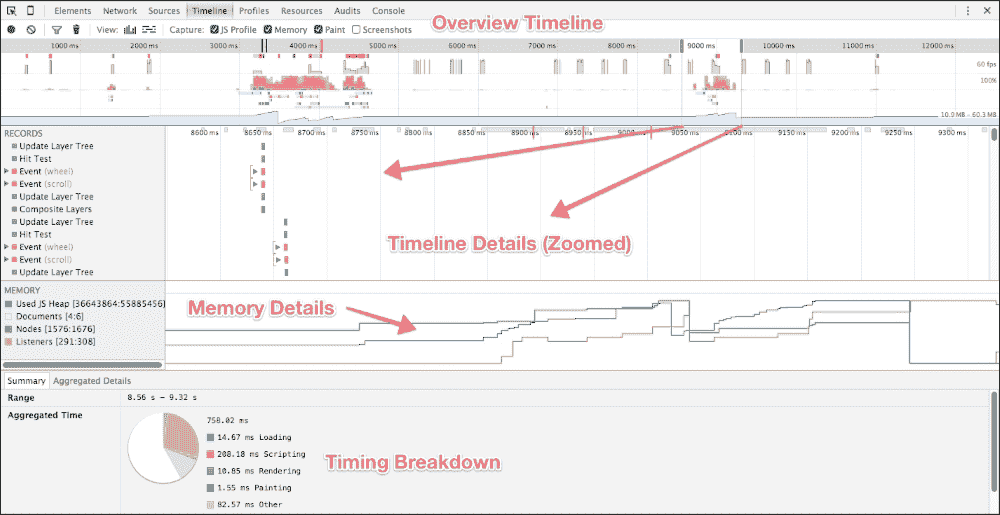
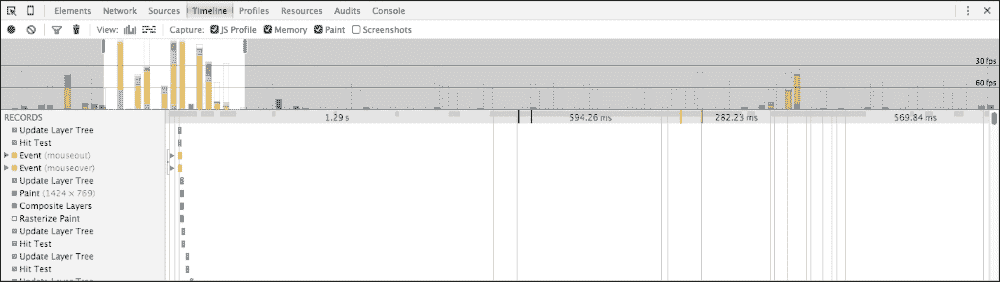
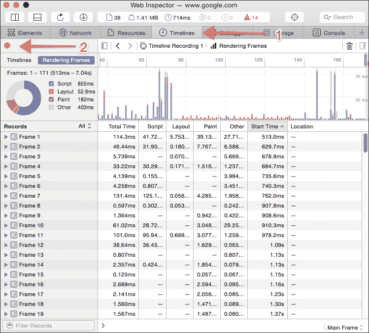
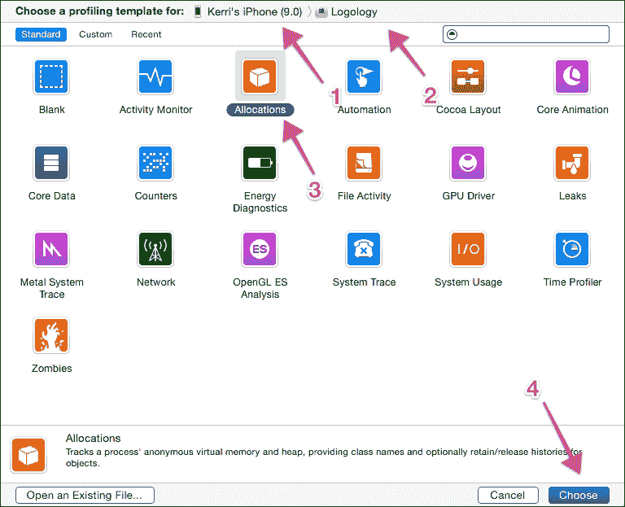
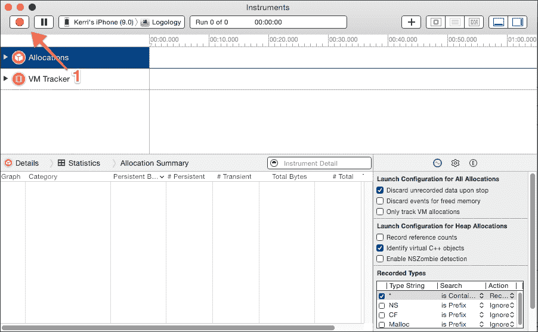
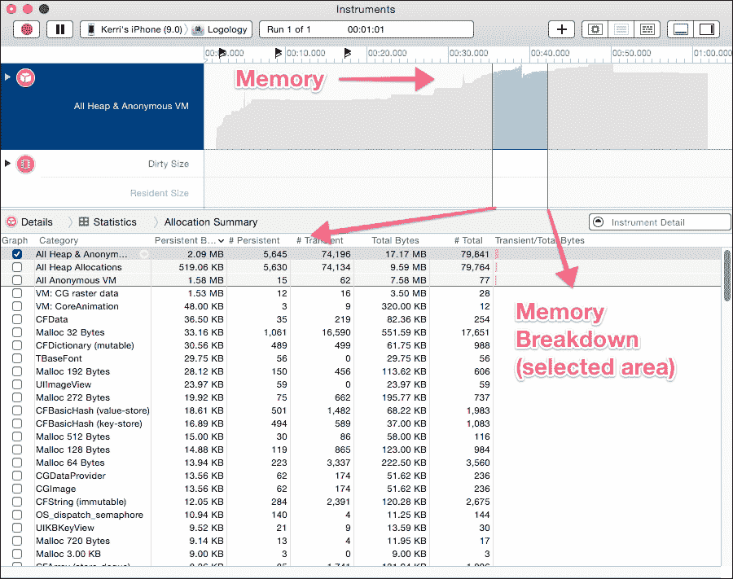
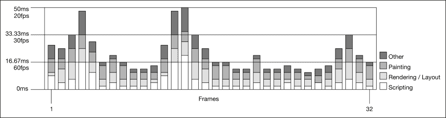
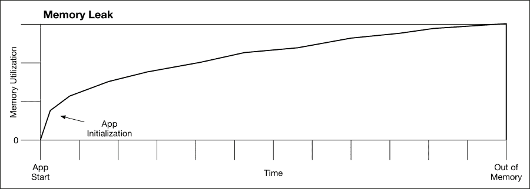
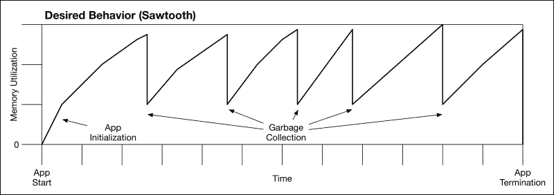

# 性能优化

在下一章中，我们将讨论你的应用可能遇到的各种性能问题，以及如何解决这些问题，以便你的用户在使用你的应用时拥有极佳的体验。

在开发应用时，由于多种原因，我们往往很容易忽视应用在物理设备上的性能表现。其中一个原因可能是在桌面浏览器（如 Google Chrome 或 Safari）中测试大量功能，尤其是在快速迭代时。对于插件测试，开发者可能大部分时间选择使用模拟器，特别是如果他们需要快速跨多平台测试时。尽管这种策略很有用，但它在一个关键领域失效了：它无法告诉我们应用在真实设备上的性能表现。

在本章中，我们将涵盖以下主题：

## 涵盖主题

*   定义性能
*   桌面端、模拟器和物理设备之间的性能差异
*   对应用进行性能分析
*   修正输入延迟
*   修正视觉卡顿
*   修正内存问题
*   拆分并委派长时间运行的计算

## 先决条件

本章假设你拥有一台可用于测试应用性能的物理设备。我们还假设你可以将此设备连接到开发机器，并使用 Google Chrome（针对 Android）或 Safari（针对 iOS）远程调试应用。

## 远程调试资源

如果你尚未配置设备和开发机器以进行远程调试，以下文章可能会有所帮助：

*   [`blog.idrsolutions.com/2015/02/remote-debugging-ios-safari-on-os-x-windows-and-linux/`](https://blog.idrsolutions.com/2015/02/remote-debugging-ios-safari-on-os-x-windows-and-linux/)
*   [`developer.chrome.com/devtools/docs/remote-debugging`](https://developer.chrome.com/devtools/docs/remote-debugging)

## 性能定义

虽然乍一看“性能”是什么似乎显而易见，但实际上它是一个相当模糊的词，包含许多内涵。例如，使用这个词是指速度？是指每秒帧数？还是指内存使用量？

由于该词本身可能存在歧义，让我们建立一些术语和定义：

*   **图形性能**：合成 DOM 中的元素、将它们发送给 GPU 并在屏幕上渲染它们所需的时间长度。
*   **计算性能**：一个方法完成其任务所需的时间长度。
*   **每秒帧数**：这与图形和计算性能均相关。这是我们每秒可以执行的屏幕渲染次数。理想情况下，应用应以每秒六十帧为目标。
*   **输入性能**：从输入（如触摸）到视觉确认动作被理解所需的时间长度。这并不意味着动作已完成，只是设备识别了该输入。
*   **内存利用率**：应用消耗的内存量。这需要在一段时间内测量，以便很好地了解应用在典型会话中使用了多少内存。
*   **存储性能**：读取和/或写入数据到设备持久化存储所需的时间长度。
*   **存储利用率**：应用持久化存储的数据量。

## 桌面端与移动端性能对比

虽然我们正在构建移动应用，但在桌面浏览器或模拟器中运行应用是很常见的，尤其是在代码快速迭代时。除非有直接需要物理设备的功能（例如加速度计），否则许多开发工作可以在应用从未见过物理设备之前就顺利完成。

虽然这种开发方式在前期节省了大量时间，但这也意味着性能问题往往会被忽视，直到为时已晚。因此，定期在代表目标市场的物理设备上运行你的应用，以确保性能保持在可接受范围内，是个好主意。

让我们回顾一下你在桌面浏览器、模拟器和物理设备之间将遇到的典型差异。

### 桌面浏览器性能差异

虽然移动设备的计算和图形性能正在提升，但大多数开发机器在大多数任务上都能轻松超越即使是旗舰级的移动设备。这有几个原因，但归根结底是组件的功耗、组件的尺寸、散热和成本。所有这些因素往往相互制约；例如，可以找到速度极快的 GPU，但它们比速度较慢的同类产品成本更高，且往往需要更多电力并散发更多热量。

### 电源可用性与消耗


# 设备约束：桌面端与移动端的差异

桌面设备在电源可用性和消耗方面受到的限制远少于移动设备。笔记本电脑介于两者之间，因为它们使用电池供电（类似移动设备），但这些电池提供的功率也比移动设备大（更接近桌面设备，但程度不及）。因此，桌面级 CPU 和 GPU 在重负载下可消耗大量功率，而移动设备没有这种奢侈：它们受限于小电池的体积和输出功率。散热也成了问题。桌面和笔记本电脑通常有一个或多个风扇，在内部温度过高时启动，内部组件之间也有更多空间让空气高效流动。如果内部散热无法完全补偿，CPU 或 GPU 会降低性能以避免过热损坏。移动设备也是如此，但它们没有风扇来散热。它们依赖散热片和外壳向外辐射热量，但这显然远不如风扇高效。此外，如果设备烫手，会严重限制用户与其交互的能力。

所有这些意味着，桌面级设备能以更快的速度和更高的功耗运行更长时间。这对计算密集型和图形密集型应用影响巨大，因为桌面端可能按预期运行，但移动端可能因负载过重而无法胜任。请记住，您的开发机器很可能比即使是较新的移动设备也至少快一个数量级，甚至更多。

## 电池续航

除了功耗，还有电池续航。桌面设备当然不太需要担心电池消耗，因为它接入市电（当然，停电会让桌面设备也瘫痪）。因此，我们可能需要让应用根据剩余电量改变行为，这一点可能不会立刻显现。如果您用笔记本电脑开发，这会更明显一些，因为您开发时就要管理电池。但大多数笔记本电脑的电池容量大得多，放电模式也与移动设备不同。因此，仍值得思考您的应用如何消耗电池，以及在低电量情况下如何表现。

## 浏览器影响

鉴于上述所有因素，桌面浏览器也比移动端同类产品快几个数量级。因为 Cordova 应用是利用系统 WebView 的混合应用，同样的情况也适用于我们的应用。因此，桌面端 5 ms 完成的计算，移动端可能需要 50 ms。桌面端强大 GPU 几毫秒就能绘制的画面，移动端可能耗时更长。

## 内存

除了上述因素，桌面通常拥有更多可用内存。开发机器拥有 8 到 32 GB（甚至更多）内存并不罕见，而移动设备可能只有 1 到 4 GB（旧设备更少）。这意味着移动设备在允许任务消耗内存（尤其是后台）方面必须严格得多，内存不足时更倾向于终止后台应用。这对混合应用是个潜在问题，因为 WebView 本身仅生成屏幕上的 DOM 内容就需要大量内存。在内存充足的桌面端这往往被忽略；但在移动端，渲染复杂布局可能导致应用被移动操作系统终止。

## 存储

存储情况也大不相同。桌面或笔记本电脑通常有 256 GB 到数 TB 的可用存储，而移动设备的持久化存储通常上限为 128 GB。当然，运行您应用的大多数设备实际存储甚至更少，留给应用的可用存储可能很少（或没有）。简而言之，我们的混合应用必须妥善处理低存储或无存储的情况，而不能直接崩溃。

存储读写速度也差异巨大。您的开发机器可能有速度极快的固态硬盘，也可能有相对较慢的机械硬盘。移动设备虽用固态存储，但其运行速度远低于桌面级固态硬盘。处理小文件时这不是大问题，但读写超大文件时肯定会暴露问题。

## 延迟

还有一个领域需要关注，即输入（如鼠标）与屏幕输出之间的延迟。这取决于设备的潜在性能及其当前任务，但总有一定的最小处理时间。这称为**延迟**，必须将其控制在绝对最小，以免被用户察觉。

与物理世界交互时，延迟极低。即便如此，虽然我们的大脑感觉动作与对动作的感知是同时发生的，但实际上从产生动作冲动到大脑视觉识别其后果，存在少量延迟。之所以感觉即时，是因为大脑使用了一种缓冲机制。如果事件在短时间内到达，会被视为同时发生；超出该时间框架，则不再视为同时。

观看人物说话的视频即可看到此效应。通常视频经过剪辑，音频看似同步。但偶尔会遇到音频**未**正确同步的视频，效果至少令人不适，最糟让人烦躁以致停止观看。然而若查看实际视频帧和音频，会发现完美同步音视频非常困难（尤其是音视频来自不同来源时）。得益于大脑缓冲，我们能容忍少量错位，约 ±20 ms（因人而异）。对某些人，100 ms 以上的延迟也不会造成问题。

这对设备交互影响深远。想象您在电脑屏幕上移动鼠标指针。有多个过程在发生，都需有限时间完成。大脑决定指针去向，计算肌肉指令并发送给肌肉。此时计算机收到鼠标移动通知，根据位置差和加速度计算指针终点，合成新位置的指针画面，发送给 GPU 渲染。大脑处理屏幕画面，根据刚才发生的情况进一步移动和调整。这是一个大反馈回路；只要全在几毫秒内完成，就会感觉同时。但如果过程过长（如超过 50 ms），人们必定会察觉。


# 移动端与桌面端的输入输出延迟差异

如果你曾将显示器镜像到电视或其他远程设备，你很可能经历过上述现象。或者，如果你曾通过糟糕的网络连接登录到远程机器，你可能也经历过这种情况。由于通过空气或糟糕的网络连接传输信息涉及额外的延迟，你的输入与最终输出之间的延迟会比正常情况增加。因此，人们开始感觉与输出脱节，并且难以预判我们行动的结果。当你在鼠标移动中引入延迟时，这最为明显。我们的大脑倾向于过度补偿而偏离目标，这非常令人沮丧。当然，我们最终可以适应这种延迟，但这远非理想。

我之所以提到所有这些，原因如下：桌面端的输入与输出之间的延迟与移动设备上的延迟是*不同*的；如果响应时间*过高*，用户会感到沮丧。只要有进度指示器，用户可以容忍长时间运行的计算，但用户不喜欢用户界面在其触摸操作后大幅滞后。正如滞后的鼠标指针是个问题一样，滚动不跟随用户手指同样成问题。点击鼠标按钮能给我们相当即时的反馈，即是的，我们确实*点击*了按钮（即使计算机识别得很慢），但移动设备响应触摸时没有那个中间的物理点击过程。如果设备响应缓慢，用户往往会重复操作，以为自己按得不够用力或设备未记录他们的触摸。如果不了解这一点，个人可能会无意中触发不需要的操作，甚至导致数据丢失。

重要的是要认识到，你无法消除输入和输出之间的所有延迟，但你可以尝试将其最小化。即使经过最小化处理，你也会发现很难产生比 `33 ms`（`60 fps` 下的两帧屏幕刷新）更快的响应。如果你发现应用程序延迟超过 `50` 到 `100 ms`，你的应用程序肯定会让用户感到沮丧。

这种延迟并不意味着用户发起的操作也必须在短时间内完成。重要的是设备能尽快让用户知道“是的，我听到了”。用户不会指望视频在几毫秒内编码完成，但他们确实期望用户界面在那个时间范围内*做点什么*，以便他们知道自己的触摸被理解了。

因为桌面或笔记本电脑上的延迟与移动设备上的延迟*不同*，所以不应该认为：仅仅因为事情在桌面上立即发生，在移动设备上也是如此。鼠标点击在桌面上通常感觉相当即时，但如果我们在代码中使用相同的 JavaScript 事件，我们的应用程序会感觉非常慢，因为它通常必须等待约 `300 ms` 以确保没有双击即将到来。桌面也必须等待双击，但延迟*短得多*，所以感觉会即时得多。

还有一件事我需要提到：显然，桌面浏览器虽然与其移动端表亲有关，但*不*相同。它们针对桌面级 `CPU` 进行了优化，支持不同的操作系统，并支持不同的功能集。通常，它们的更新频率比移动端对应产品高得多（尽管这在 Android 上正在改变）。因此，仅仅因为你的应用程序在桌面浏览器上运行，并*不*意味着它能在移动浏览器上运行。测试应用程序的绝对最佳方式始终是在物理设备上进行，但如果你想验证你的 `HTML`、`JavaScript` 和 `CSS` 代码是否在移动设备上运行，你也可以启动模拟器。

# 模拟器性能差异

作为开发人员，你通常会在应用程序的开发和测试过程中频繁使用模拟器。虽然这些模拟器在技术上处于桌面级别，但它们有自己的怪癖，使得判断性能变得困难。

首先，提醒一下：没有 iOS *模拟器*（Emulator），只有 iOS *模拟器*（Simulator）。这是关键，因为模拟器和仿真器之间有很大区别。在实践中，这意味着 iOS 模拟器往往比物理设备快得多，而 Android 模拟器可能较慢或较快，具体取决于用于仿真的架构。

iOS 设备使用 `ARM` 架构，因此当应用程序编译时，代码的原生部分将被转换为 `ARM CPU` 可识别的指令。另一方面，开发机器大多是基于 `x86` 的机器（Intel/AMD），无法原生理解这些指令。有两种方法来处理这个问题：要么将应用程序重新编译为 `x86` 代码，要么模拟 `ARM CPU`。

当然，应用程序运行需要大量的支持框架和库。这在很大程度上就是 iOS 模拟器和 Android 模拟器之间差异所在。Android 一段时间以来一直能够同时针对 `ARM` 和 `x86` 架构（事实上，有一些搭载 `x86 CPU` 的 Android 设备）。因此，在这一点上，模拟器和仿真器所做的事情没有根本性的区别。

iOS 模拟器和 Android 模拟器之间的真正区别在于：iOS 模拟器将你的应用程序作为原生 Mac OS X 应用程序运行，而 Android 模拟器将在完全虚拟化的环境中运行你的应用程序。这通常不会产生*太大*的差异，但它会改变你访问网络或存储等资源的方式。例如，在使用 iOS 模拟器时，`localhost` 指的是你的开发机器，就像在任何其他进程中一样。而在使用 Android 模拟器时，`localhost` 指的是虚拟化设备。你可以通过简单地引用机器在网络上的实际 `IP` 地址（或主机名）来忽略这一差异。但这说明了区别：被模拟的 iOS 应用程序与你所有的其他进程一起运行，而 Android 应用程序则在虚拟化容器内运行。

那么，这对我们应用程序的性能意味着什么？归根结底就是：不要信任你的模拟器。不是因为它想欺骗你，而是因为它无法准确复制物理设备的性能配置文件。以下是一些不同之处：

*   图形性能通常会降低，往往幅度很大。现代 Android 模拟器可以访问主机 `GPU`，这方面已有所改进。但 iOS 模拟器和 Android 模拟器都无法准确反映物理设备的 `GPU` 性能。根据我的经验，你可能达到约 `80%` 的性能，但你不太可能始终看到完美流畅、以 `60 fps` 运行的界面。
*   计算性能可能差异很大。如果像 iOS 模拟器那样在 `x86` 架构上运行，某些 Android 模拟器也可以做到，那么性能很可能会超过物理设备，因为它以与桌面 `CPU` 相同的速度（或稍慢）运行。另一方面，如果你的 `CPU` 正在模拟 `ARM` 架构，则性能会惨不忍睹，比物理设备慢得多。
*   可用内存可能差异很大，如下所示：
    *   在模拟 iOS 应用程序时，应用程序实际上可以访问开发机器上所有可用的内存，这几乎可以保证它永远不会内存不足。此外，你的开发机器拥有支持交换文件的操作系统；因此，它还可以将持久存储上所有剩余空间用于应用程序的内存需求。iOS 模拟器中有一个实用程序可以*模拟*低内存状况，但仅此而已。


# 性能测试与性能分析

## 模拟器的局限性

- 当你创建一个 Android 虚拟设备或使用 GenyMotion 设备时，会为虚拟设备分配一定量的内存。这更接近物理设备的情况，因为 Android 操作系统、WebView 以及你的 Web 代码必须共存于一个更受限的空间内。遗憾的是，这些模拟器无法反映真实设备的使用情况（通常其他应用也会与你的应用一起驻留在内存中），因此它并非完美的替代品。

- 可用存储空间可能差异巨大，但关于存储读/写速度的警示与前一节相同：

    - 同样，在模拟 iOS 应用时，该应用对持久化存储的访问权限与设备上的其他应用相同。这意味着 iOS 应用可能会填满你的硬盘，尽管它不应能逃逸 Mac OS X 提供的沙箱，因此无法损害你的其他文件。这意味着在大多数开发机器的规格下，你的应用不太可能遇到存储空间不足或耗尽的情况。

    - Android 设备也会被提供具有最大容量限制的虚拟化持久化存储。这更准确地反映了物理设备上的情况；但同样，它并不完全代表真实世界。大多数用户会在设备中塞满应用，从而减少你自己的应用可用的存储空间，而模拟器通常相当“简陋”（存储空间充足）。

- 延迟也可能是一个大问题，主要是作为模拟器计算和图形性能的副作用，但也因为人们经常用鼠标代替触摸手势。这已经完全破坏了应用在真实设备上的真实手感；但这也意味着你不仅要承受开发机器操作系统自带的延迟，还要承受模拟器的延迟。加上较慢的图形性能，延迟会变得很严重。简而言之，如果模拟器上的延迟很严重，不要惊慌。在真机上测试一下再决定是否惊慌！

- 虽然这与性能没有直接关系，但也很重要：模拟器并不总能提供与物理设备相同的功能。GPS 支持可能是模拟的，但它与物理设备的 GPS 报告能力不同。如果你正在开发一款使用加速度计的游戏，在物理设备之外你几乎肯定无法进行测试，不仅因为模拟器不支持加速度计，还因为其他性能和延迟的差异。

那么，模拟器的意义何在？它让我们能够验证混合应用是否能与我们针对的系统 WebView 协同工作。它还能让我们测试许多插件，这是在桌面浏览器上无法做到的。但别忘了，模拟器永远无法替代真机。

## 识别性能问题

现在我们希望已经说服你在物理设备上验证性能，那么如何识别性能是否正在成为问题呢？有几种方法：

- **物理测试** 涉及在设备上与你的应用进行实际交互。当你测试应用时，可能会遇到视觉卡顿、延迟、滞后或更糟的情况。在尽可能多的不同类别设备上进行测试也很重要，因为每种类型和型号的性能往往差异很大。这可能会迅速变得昂贵，但通过大规模的 Beta 测试和大量人工测试人员，可以在一定程度上缓解这一问题。

- **性能分析** 通过查看多个不同指标来识别潜在问题所在。内存是最明显的指标；你可以在交互过程中记录应用的内存使用情况，以识别潜在的内存问题。你也可以确定应用中可能导致视觉卡顿的长时间运行进程。性能分析不可避免地会引入自身的性能影响（总是会变慢），因此不要仅依赖性能分析作为性能的唯一衡量标准。将设备从开发机器上拔下，在没有任何调试器附加的情况下使用你的应用，以获得应用真实手感的真实体验。

第一种方法不言自明：拿起你的设备玩转你的应用。确保应用已与调试器断开连接，因为调试器会对应用性能产生负面影响。如果你注意到任何卡顿、滞后或延迟，就知道有问题了。此时，你可以使用第二种方法：性能分析来诊断问题。

性能分析依赖于特定平台的工具。对于 Android，你可以使用 Google Chrome 的远程 Web 检查器工具来分析你的应用。对于 iOS，你需要使用 Safari 浏览器的最新版本进行移动端调试，同时也需要使用 Instruments 来检查内存使用情况。

## Android 上的性能分析

假设你的设备或模拟器运行 Android 4.4 或更高版本，分析你的应用非常简单。假设你已配置设备进行远程调试，应用已安装并运行，设备已连接到开发机器，你应该能在 Chrome 中导航到 `chrome://inspect` 并看到列出的设备和应用。

点击你想要调试的设备和应用后，你应该会看到熟悉的 Web Inspector 工具，Google Chrome 允许你用它来调试和检查常规网页。在检查器中，应该有一个 `Timeline` 标签页可供点击。最初这将是空白的；但你可以点击左上角的 `Record` 图标，Google Chrome 将开始记录应用的内存使用、CPU 利用率、每秒帧数等。完成与应用的交互后，点击 `Stop` 图标以结束录制。

示例性能分析如下截图所示：



有许多不同的区域，你可以根据关注点调整大小。标签页上方的工具栏允许你更改数据可视化方式。前面的截图是应用性能（包括图形和计算）及内存使用的高度压缩时间线。你可以选择时间线的一部分以查看更多详细信息，这些信息显示在 `Timeline Details` 部分。在此下方是同一选定时段的内存利用率，细分为几个不同类别。截图底部是一个饼图，表示选定时间中花费在渲染、绘制、执行脚本等方面的比例。

此特定视图对于跟踪内存利用率特别有用。注意时间线上的蓝色图表？那是应用内存分配的压缩表示。`Memory Details` 部分给出了时间线中选定区域的特写。图例指示了哪些线条颜色代表哪些类别；其中 `Used JS Heap` 至关重要，它代表分配的总内存。`Nodes` 和 `Listeners` 也很有用，分别代表文档中的节点数和事件监听器数量。

如果你切换视图（通过点击工具栏中 `View` 正右侧的图标），你应该会看到类似这样的内容：



在该截图中，顶部的图表仍然是应用的时间线，但它代表设备绘制每一帧所需的时间。这很有用，因为它指示了应用在何处因无法足够快地生成帧而导致视觉卡顿。在截图底部，你可以看到展开的详细信息，显示你的代码中哪些部分执行时间过长。

## iOS 上的性能分析

不幸的是，Safari 的检查器工具不如 Chrome 先进；因此，有必要使用两个工具。我们可以使用 Safari 9 或更高版本来分析每秒帧数。要分析应用的内存，你需要使用 Xcode 的 Instruments 工具。


# iOS 混合应用的性能分析与优化

## 使用 Safari Web Inspector 进行远程调试

首先，如果你已将设备配置为远程调试模式，并且应用已安装且正在设备上运行，你应该能够将设备插入开发机器。然后，你需要启动 `Safari` 并导航至 `Develop` | `Your Device` | `Your App` 以打开 Safari 的检查器。

你应该会看到一个 `Web Inspector` 窗口。在顶部，工具栏下方，应该有一系列标签页。点击 `Timelines`，然后点击 `Rendering Frames`。你应该会看到类似下图的内容，尽管此时没有数据：



要开始记录设备性能，请点击标记为 `2` 的 `Record` 图标，然后与设备进行交互。当你完成与应用的交互后，再次点击该图标；检查器将填充大量有用信息。

顶部是一条时间轴，代表应用的图形渲染性能；例如，绘制每一帧所需的时间。当我们想要避免视觉卡顿时，这非常有用。你可以选择一系列帧，甚至单个帧，然后深入查看每一帧所耗费的时间。

## 使用 Xcode Instruments 进行内存分析

然而，要分析应用的内存，必须放弃 `Safari` 而改用 `Xcode` 的 `Instruments` 工具。此外，两者不能同时分析同一个应用；因此，你需要在启动 `Instruments` 之前关闭 Safari 的检查器。

虽然你可以分析正在运行的应用的内存使用情况，但从应用启动之初就获取内存消耗趋势是明智之举。为此，你需要重启应用；但你不必手动操作——`Instruments` 可以为你启动它。

### 启动 Instruments

要启动 `Instruments`，可以执行以下任一步骤：

1.  打开 `Xcode`，然后导航至 `Xcode` | `Open Developer Tool…` | `Instruments`
2.  使用 `Spotlight` 搜索 `Instruments`

任一方法均可。你应该会看到如下截图所示的对话框：



### 配置分析会话

首先要做的是选择你的设备。如果运气好，它已经被选中。如果没有，点击 `1` 以显示可用设备。然后，你需要选择要分析的应用；点击 `2` 以显示已安装和正在运行的应用。你应该选择一个已安装的应用，以便我们在应用初始化时捕获内存利用情况。

接下来，选择要分析的内容。你可能想要使用 `Allocations` `3`，但其他选项也非常有用。选定后，点击 `Choose`，你应该会看到类似下图所示的界面：



### 记录内存分配

目前，视图看起来并不丰富，那只是因为 `Instruments` 正在等待你开始分析。点击 `Record` 图标并与应用交互。完成交互后点击 `Stop` 图标。你应该会看到类似下图所示的内容：



如你所见，此次分析运行仅关注内存利用率。你可以在时间轴中选择一个范围。详细信息显示在时间轴下方的区域中。

## 注意事项

有个重要细节你需要知道：点击分析会降低应用性能，这在某种程度上是个两难困境。简而言之，如果在正常使用应用时未发现卡顿，但在分析时*确实*出现了卡顿，请别担心：是分析器干扰了运行。如果你在检查内存问题，不要认为看到的图形性能具有代表性。应用真实图形运行表现的*唯一*真实体现，是设备未连接开发机时的状态。

显而易见，我们无法消除*所有*输入延迟。总会存在一些延迟。但我们*可以*消除那些令人沮丧的时刻——即设备似乎没有立即理解我们意图的时候。

## 处理触摸事件与点击延迟

因为移动设备依赖触摸且屏幕通常较小，手势是主要输入机制。此外，因为我们喜欢对屏幕上的数据执行许多操作，应用往往需要识别多种手势。点击是显而易见的手势，但在浏览网页时，双击缩放手势也常被使用。因为我们的混合应用运行在 WebView 中，它继承了相同的双击缩放手势，这通常是有问题的。你见过多少应用允许你缩放其 UI 元素？极少，甚至没有。

### 300ms 延迟问题

双击缩放手势带来了一个问题：乍看之下，它与屏幕上的单次点击没什么两样。这意味着 WebView 必须等待一小段时间，以判断是否发生了足够快的第二次点击从而将其计为双击。对于大多数 WebView，这段时间是 300 ms，即近三分之一秒。在这段时间结束前，单击事件无法发送。这导致了巨大的输入延迟。

较新版本的 Android 已认识到此问题，并提供了各种属性以避免此延迟。而截至撰写本文时，iOS 并未提供任何完全禁用该手势的方法。相反，我们必须想办法绕过它。

Android 和 iOS WebView 都会生成 `mouse` 和 `touch` 事件。鼠标事件的存在是为了兼容可能不支持触摸的现有网页。这些事件包括具有 300 ms 延迟的 `click` 事件。然而，触摸事件完全避免了这个问题，因为它们更类似于 `mouseup`/`mousedown` 而非 `click`，所以可以立即触发。避免 `click` 300 ms 延迟的一种方法是直接使用 `touchend` 事件，只不过 `touchend` 实际上并非 `click`。各种怪癖可能会出现，这使得引入一个抽象所有痛苦的支持库要简单得多。这也是我们在本节中将采取的策略。

### 解决方案：FastClick 与手势库

如果你的应用严重依赖 `click` 事件，解决该问题最简单的方法是引入 `FastClick` 库 ([`https://github.com/ftlabs/fastclick`](https://github.com/ftlabs/fastclick))。它已部署在相当数量的混合应用中，且可在大量平台上运行。它监听触摸事件，并在手指离开屏幕时生成一个合成的 `click` 事件。然后它会抑制浏览器原本会生成的 `click` 事件。虽然听起来很简单，但带注释的代码多达 841 行。不必多说，事情很少像表面看起来那么简单。

就我个人而言，我选择避免使用 `click`，转而构建响应手势的应用。因此，我的代码不监听 `click`（一种鼠标事件），而是监听 `tap` 和 `swipe` 等手势。有许多不同的库提供手势支持，但我个人最喜欢的是 `Hammer.js` ([`https://github.com/hammerjs/hammer.js`](https://github.com/hammerjs/hammer.js))。它不像 `FastClick` 那样容易设置，但它支持除点击之外的更多手势。为了灵活性，人们牺牲了简洁性。

如果你的应用不需要除单击之外的手势支持，那么 `FastClick` 可能是你最好且最简单的选择。但如果你需要响应滑动、捏合等更多手势，你将需要考虑手势库。

### 推荐的手势库

以下是一些有用的手势库列表：

*   `Event.js` ([`https://github.com/mudcube/Event.js`](https://github.com/mudcube/Event.js))：支持多种不同事件，包括 `taps`、`long presses`、`swipes` 等。
*   `Hammer.js` ([`https://github.com/hammerjs/hammer.js`](https://github.com/hammerjs/hammer.js))：支持不同事件，如 `tap`、`long presses` 和 `swipes`。


- `Interact` ([`github.com/taye/interact.js`](https://github.com/taye/interact.js))：支持拖放、调整大小等功能，并带有惯性效果。
- `Zepto` ([`zeptojs.com/#Touch%20events`](http://zeptojs.com/#Touch%20events))：这是一个轻量级的 jQuery 替代品，但它支持简单的手势，如滑动和点击。
- `tap.js` ([`github.com/alexgibson/tap.js`](https://github.com/alexgibson/tap.js))：这与 `FastClick` 类似，但它使用 tap 事件，而不是覆盖 `click` 事件。

虽然上述方法在减少感知延迟方面已大有裨益，但我们仍可做得更多。通常，前面列出的库适用于在事件结束后做出响应，但如果事件正在进行中该怎么办？例如，应用通常不会等到用户抬起手指才记录屏幕按钮已被按下；相反，它们通常会在手指按在屏幕上时显示按下状态的按钮（或其他状态）。这减少了延迟感，并提升了性能感知，因为现在我们可以看到应用直接响应我们的触摸，而不仅仅是响应手势的完成。

实现这一点最简单的方法就是直接使用 CSS 已经为我们提供的各种状态，即 `:active` 和 `:focus` 状态。虽然移动端 WebView 支持 `:hover`，但其行为怪异，最好避免使用。

## 注意

`:hover` 当然在触摸环境中没有真正的对应物，因为设备无法识别手指何时真正悬停在屏幕上方。因此，浏览器采取了不同的策略：对元素的一次点击会将其过渡到 `:hover` 状态，然后再一次点击会触发 `click` 事件。虽然我理解其中的理由，但当我在网页上遇到这种情况时，会感到非常沮丧，因为这意味着我必须开始对所有东西点击两次。所以，请不要在你的应用中使用它！

当元素获得输入焦点时，会发生 `:focus` 状态。这仅对 `input`、`textarea`、`select` 和其他类似元素有效。通过改变元素的视觉状态（即使很微妙），用户可以确信应用聚焦在了合适的元素上。如果用户配对了硬件键盘，这也有好处，因为他们可以像在桌面浏览器中一样通过 `Tab` 键在元素间切换。

当元素接收到触摸时，会发生 `:active` 状态。这可能是最关键的实现状态，因为它能在*完全不需要任何 JavaScript 代码*的情况下，给用户近乎即时的反馈。这意味着它产生的延迟也最小。在切换到 `:active` 状态时，你不应尝试做任何*过于*花哨的事情，因为你不想强迫浏览器重新计算每个元素的位置；但改变文本颜色（即使很微妙）通常就足够了，且速度极快。

当你看到滚动时或动画播放时出现视觉卡顿，这个特定问题就最明显。卡顿发生的原因是设备无法执行足够快的所有必要计算来渲染屏幕，以满足目标 `60 fps`。为了达到这个目标，设备必须在大约 `16 ms` 内执行*你的*代码、布局 `DOM`、合成各种元素，并将结果发送给 `GPU`。如果听起来时间非常短，那是因为它确实很短。对于计算机来说，当然这是合理的时间。但在处理计算相互关联的 `DOM` 元素的位置和大小、将透明和半透明元素相互合成、然后将所有数据推送到 `GPU` 时，这些毫秒会迅速消失。

如果你遇到这个特定问题，我们之前提到的性能分析工具应该能帮助指出潜在问题所在。这是因为分析器会记录生成每一帧所需的时间。请看下面的例子：



此图代表了你在 Google Chrome 和 Safari 中可以看到的内容。每个柱状条的高度表示渲染该帧所需的时间，各个片段表示时间花在了哪里。

正如你在前面的图表中所见，只有当柱状条的高度低于 `60fps` 线时，我们的应用才能达到 `60 fps`。Google Chrome 和 Safari 都会指示 `60fps` 线。如果必要，它们也会显示 `30fps` 线。

一旦我们的帧渲染时间超过 `16.67 ms`，我们就无法维持 `60 fps`。如果慢于 `33.33 ms`，我们就无法维持 `30 fps`。如果这种情况不常发生，倒不是什么大问题，因为你永远无法*完全*控制设备（操作系统可能正在安装更新，浏览器可能正在垃圾回收，等等）。但如果持续发生，就会以视觉卡顿的形式表现出来。

## 达到 60 fps

那么，如何驯服每秒帧数这头野兽？这里有一些建议：

- 保持 `DOM` 简单。如果一个元素不需要属于 `DOM`，就不要添加它。
- 避免 `DOM` 中嵌套过深的元素。对子元素的更改将不可避免地强制父元素重新计算其位置和大小，这可能是一项昂贵的计算。
- 避免冗长的 `DOM` 元素列表。滚动浏览长列表会迅速变得卡顿和缓慢，因此最好限制可呈现的元素数量。你可以非常简单地使用分页来实现这一点，也可以使用无限滚动的变体，这更接近原生 `SDK` 的用法。然而，后者要复杂得多。一些无限滚动库如下：
  - `Infinity` ([`airbnb.io/infinity/`](http://airbnb.io/infinity/))
  - `iScroll` ([`iscrolljs.com`](http://iscrolljs.com))
- 缓存 `DOM` 元素引用。通常，你需要使用某种 `CSS` 选择器规则来定位所需的 `DOM` 元素。这可能很昂贵，特别是当 `DOM` 嵌套到一定程度时。通过 `ID` 查找元素是最快的选择，但你并不总是有这个选项。因此，当你不需要时，不要反复搜索 `DOM`，而是缓存结果。
- 避免不必要的 `DOM` 回流。每当浏览器需要计算元素的位置、大小和样式时，就会发生这种情况，通常是响应对特定属性的查询（如 `window.getComputedStyle(element).width`），或当各种样式发生变化时（如 `element.style.width="100%"`）。向节点添加元素也会导致 `DOM` 回流，这意味着如果 `parentElement` 在 `DOM` 中，你应该避免在循环中使用 `parentElement.appendChild(element)`（为此请使用 `document fragments`）。移除元素时也会发生回流，因此隐藏元素（`visibility: hidden`）通常比移除它更快，特别是当你知道将来还需要该元素时（如侧边栏菜单的情况）。
- 保持 `CSS` 精简。你的 `CSS` 越复杂，计算 `DOM` 元素上的各种属性就越复杂。移除不需要的规则并避免复杂的选择器。
- 保持 `CSS` 布局简单。重要的是要记住，浏览器实际上正在求解一些非常复杂的方程，以满足你的布局要求，这些计算会迅速累积。例如，`Flexbox` 虽然易于使用，但也难以计算。你可以通过绝对定位元素或使用 `CSS transforms` 来避免一些计算，但这也可能消除 `HTML` 和 `CSS` 的优势：响应视口大小的应用。如果你将所有东西都绝对定位，重新计算每个元素的位置就成了你自己代码的责任。取决于你的应用结构，这实际上可能比让浏览器处理这项责任更耗时。


# 性能优化建议

## CSS 与渲染优化

*   **避免花哨的 CSS 样式。** 这包括各种情况，但核心原则是：最小化透明度、半透明度、阴影和渐变的使用。这意味着你应该尽量减少 `box-shadow` 和 `opacity` 的使用，同时也应避免过度使用 `border-radius`（它需要半透明支持）。渐变和阴影的图片比等效的 CSS 样式性能更好。这并非说你必须完全消除这些图形修饰，而是说应避免过度使用。如果发现某些低端设备无法流畅运行这些效果，你可能需要添加一个设置让用户降低图形质量（或自动检测）。

*   **使用 CSS 3D 变换，但勿过度。** 这些 3D 变换会强制 GPU 渲染受影响的 DOM 元素，从而提升性能。但需谨慎，过度使用会产生反效果，且会消耗大量内存。此外，每次使用时应避免嵌套过深的变换。GPU 需要介入，而这些内存传输并非无成本。

*   **结合 CSS 动画或 `requestAnimationFrame` 使用 CSS 变换。** 始终避免对典型定位样式（`top`、`left` 等）制作动画，而应使用 CSS 3D 变换。当动画过程中无需用户交互时可使用 CSS 动画，或使用 `requestAnimationFrame` 通过 CSS 变换平滑地实现用户交互动画。

*   **减少绑定在 DOM 元素上的事件监听器数量。** 理想情况下，使用事件委托（我们的演示应用从一开始就采用了此方式）。当用户触摸屏幕时，DOM 需要确定所有能响应该特定触摸的元素。事件处理程序越多，列表越长。事件委托通过减少事件处理程序数量来加速此过程，因为只需在视图根层级添加一个处理程序。这些处理程序可能仍会嵌套（例如视图内的视图），但最终数量将远少于为长列表中的每个列表项单独添加事件处理程序。

## 实用性能资源

以下网站提供了非常有用的性能信息：

*   PhoneGap 应用的 10 大性能技巧：[`coenraets.org/keypoint/phonegap-performance/`](http://coenraets.org/keypoint/phonegap-performance/)
*   最小化浏览器重排：[`developers.google.com/speed/articles/reflow`](https://developers.google.com/speed/articles/reflow)
*   成功 PhoneGap 应用的性能与 UX 考量：[`www.tricedesigns.com/2013/03/`](http://www.tricedesigns.com/2013/03/)

# 内存管理

## 内存泄漏分析

如果你的应用快速分配大量内存却不释放回操作系统，应用会迅速被终止。另一方面，缓慢的内存泄漏可能要等到应用会话持续数小时甚至数天后才会显现。

如果你怀疑存在内存泄漏，性能分析会有所帮助，但无论如何最好对应用进行性能分析，以确定其是否总体上占用了过多内存。毕竟，并非所有内存问题都是泄漏。

那么，内存泄漏是什么样的？在性能分析器图表中，它表现为一条持续上升的线，如下所示：



此处的时间范围很重要；这是在相当长的一段时间内，而非仅几秒钟。由于浏览器管理内存的方式，总会有一小段时间内看到图表持续上升。关键在于，在此例中，内存从未被释放。因此，图表会持续上升数分钟甚至更久，直到操作系统因内存压力终止应用。

## 理想内存模式

图表理想情况下应呈现锯齿状，如下图所示：



## 垃圾回收与引用释放

你可能已经知道，WebView 是垃圾回收环境。垃圾回收在应用生命周期内周期性发生，旨在在内存不再需要时将其释放回操作系统。关键在于，没有显式机制告诉垃圾回收器某对象不再需要；它会自行判断。如果对象没有其他引用，垃圾回收器会释放它。但如果对象哪怕只有一个引用，回收器也会保留它。

基于这一事实，避免不必要地持有对象的最佳做法是：在不再需要时将其设为 `null`。

## 闭包与内存压力

闭包也会导致内存压力。当函数继承其周围的词法环境时就会发生这种情况。例如，假设有如下代码：

```javascript
function a() {
  var anArray = [1,2,3];
  function b() {
    console.log(anArray);
  }
  b();
}
```

调用 `b` 时，你期望控制台输出 `[1, 2, 3]`。虽然这讲得通，但也意味着 `b` 持有对 `a` 存储数据的引用。在 JavaScript 中，特别是涉及事件处理和异步方法时，很容易捕获大量数据，因为我们经常在函数内部创建函数。每个函数都能访问其父级的词法环境；这会迅速累积。

通常这不是**巨大**问题，因为当父级不再被引用时，这些函数就会被删除。然而，当我们开始将事件监听器绑定到 DOM 元素时，情况就变得棘手了，因为此时父函数及其所有数据无法被释放，直到 DOM 元素也被移除且不再被任何其他事物引用。

## 事件监听器清理

在处理事件监听器时，必须始终做的一件事是：完成使用后从元素上移除处理程序。简而言之，每个 `addEventListener`（或类似方法）都应有对应的 `removeEventListener`。每个 `on` 都应有 `off`。这不仅减少了应用中意外行为的可能性，还允许浏览器释放监听器保留的所有内存。

## 释放不需要的变量

有时问题不在于持有内存时间过长，而在于持有的内存过多。浏览器在优化此方面正变得更好，它们会保留方法实际引用的词法作用域中的变量；但这远非完美。因此，如果词法作用域中有**方法不需要的**大型对象，应将其设为 `null` 以释放内存。

## 进阶阅读

有许多文章值得深入研读：

*   JavaScript 内存性能分析：[`developer.chrome.com/devtools/docs/javascript-memory-profiling`](https://developer.chrome.com/devtools/docs/javascript-memory-profiling)
*   内存管理：[`developer.mozilla.org/en-US/docs/Web/JavaScript/Memory_Management`](https://developer.mozilla.org/en-US/docs/Web/JavaScript/Memory_Management)
*   修复 AngularJS 和其他 JavaScript 应用中的内存泄漏：[`www.codeproject.com/Articles/882966/Fixing-Memory-Leaks-in-AngularJS-and-other-JavaScr`](http://www.codeproject.com/Articles/882966/Fixing-Memory-Leaks-in-AngularJS-and-other-JavaScr)
*   高性能、垃圾回收器友好的代码：[`buildnewgames.com/garbage-collector-friendly-code/`](http://buildnewgames.com/garbage-collector-friendly-code/)

# 长时间计算处理

大量数据录入和生产力类应用通常是在等待用户操作，而非相反。然而，如果你的应用执行长时间计算（无论何种），你很可能会遇到令人恐惧的应用冻结现象。


# JavaScript 性能与运行循环

## JavaScript 的单线程本质

JavaScript 本身是单线程的。这意味着你的代码一直拥有控制权，直到它将控制权交还给浏览器，此时浏览器才能开始渲染 DOM 和检测事件。这些事件通常会触发更多的代码，循环往复。

## 运行循环问题

通常，你的代码执行得足够快，用户不会察觉。也就是说，他们会在你的应用中滚动、切换视图或点击按钮。希望他们不会注意到你的代码何时在运行。但如果你需要进行一个耗时超过 16.67 毫秒的复杂计算，他们就会开始注意到，因为你会再次看到视觉上的卡顿。

问题在于 JavaScript 使用的运行循环。当你的代码拥有控制权时，浏览器无法响应任何用户输入，也无法渲染任何 DOM 元素。如果你的应用正在运行一个耗时不长的短计算，这只会看起来像一个小的视觉故障。但如果是长时间计算，用户会认为你的应用已冻结。虽然你的应用*并没有*冻结，但用户无法分辨，因为所有的输入和输出都已停止。

## 长时间计算的性能分析

性能分析再次变得有用，它显示的方式与渲染缓慢非常相似。但你将处于更有利的位置来区分二者，因为你刚刚执行了一个导致长时间计算的操作。例如，如果你点击一个名为“计算大素数”的按钮，你会知道如果设备随后暂停几秒钟，很可能是因为它在执行你要求的操作，而不是因为你的 DOM 过于复杂，或者你使用的 CSS 样式过度占用了 GPU。不过，你可以在此期间使用性能分析器来确定各个方法的持续时间，这为你提供了优化目标。

## 优化策略

优化高度依赖于你的代码，因此我们无法给出具体的指导方向。不过，还有几件事你可以做来帮助解决这个问题：

*   将任务拆分成可在短时间内执行的离散任务（使用 `setInterval` 或 `requestAnimationFrame`）。
*   使用 `Web Workers`。遗憾的是这超出了本章的范围，但以下网站有大量优秀信息：
    *   使用 Web Workers：`https://developer.mozilla.org/en-US/docs/Web/API/Web_Workers_API/Using_web_workers`
    *   Web Workers 基础：`http://www.html5rocks.com/en/tutorials/workers/basics/`

`Web Workers` 在大多数现代设备上受支持，因此建议将长时间运行的计算放在 worker 中。这模拟了多线程，因为 worker 拥有自己的运行循环。这样浏览器的循环就能保持对用户输入的响应。

### 将任务拆分为离散单元

将任务拆分可以达到类似的效果，尽管这要求任务可以拆分成离散的部分。考虑一个简单的例子：

```javascript
function countToX(x) {
  var i = 0;
  while (i < x) {
    i++;
  }
  console.log("done!");
}
```

这个例子不做任何*有用*的事情，但它很好地说明了问题。如果我们用一个小值调用此方法，用户不会注意到任何东西，因为计算机可以非常快地向上计数。然而，如果我们用一个足够大的值调用它（而且需要相当大），用户会注意到设备在任务进行期间冻结了。

然而，我们可以将其拆分成小任务：

```javascript
function countToX(x) {
  var i = 0;
  var intervalId;
  function countALittleBit() {
    var j = 0;
    while (j < 10) {
      if (i < x) {
        i++;
        j++;
      } else {
        console.log("done");
        clearInterval(intervalId);
        j = 10;
      }
    }
  }
  intervalId = setInterval(countALittleBit, 0);
}
```

现在，无论我们传递给 `countToX` 的数字有多大，浏览器将始终保持对用户的响应。任务本身将花费更长时间，也许长得多，但用户仍然可以与应用交互。

本质上，重要的是：保持方法的运行时间短。不要在代码中执行*过于*冗长的计算，除非将其拆分成单独的部分或使用 `Web Workers`。

## 本章小结

本章涵盖了大量内容，从阐明我们使用“性能”一词的含义，到桌面设备、模拟器和真机之间的各种差异。我们还涉及了如何对应用进行性能分析，并概述了一些常见问题及其解决方法。

在下一章中，我们将开始通过创建应用图标和启动画面资源，为将应用提交到 Apple App Store 和 Google Play 商店做准备。
