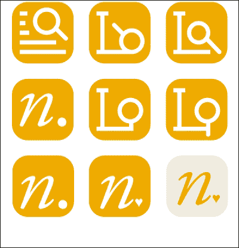
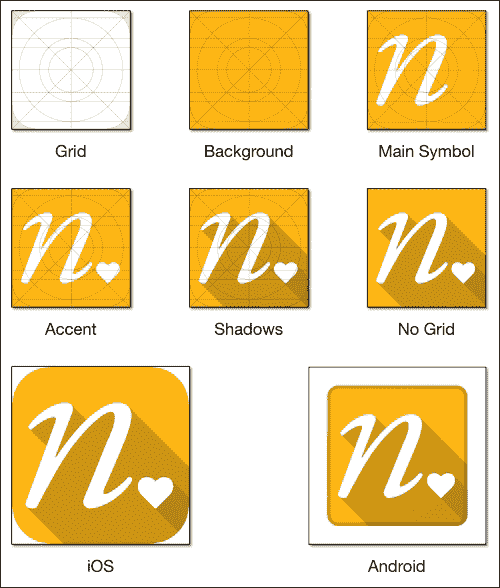
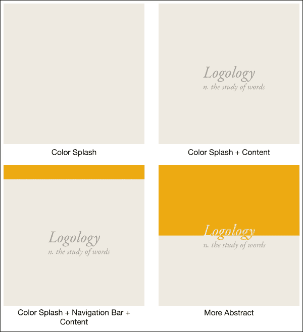
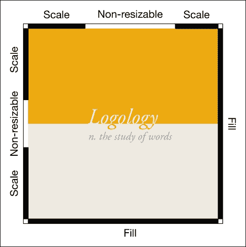

# 应用图标和启动画面

## 概述

毫无疑问，你已经看过 Cordova/PhoneGap 项目使用的默认启动画面和图标。这些在开发期间已足够；但当你准备向大众发布应用时，你需要合适的图形资源。这些资源分为三类：应用图标、启动画面和应用内图形。我们已经在 第 4 章 *更响应式的设计* 中一定程度上讨论了如何使你的应用内图形响应用户的设备。我们讨论的一些内容也适用于你应用的图标和启动画面。然而，这些特定资源需要特殊配置，以确保 Cordova/PhoneGap 正确使用它们。

## 本章主题

在本章中，我们将涵盖以下主题：

*   应用图标要求
*   创建应用图标
*   启动画面要求
*   创建启动画面
*   配置你的应用
*   实用资源

## 设计工具考量

本章假设你有一定的图形设计应用经验，如 Adobe Photoshop、Adobe Illustrator、GIMP、Sketch 等。如果你还不熟悉此类应用，你应该考虑找一个支持*矢量*插图的应用。有许多应用是*位图*基础的，即你控制结果图像中的每个像素。由于移动设备屏幕尺寸和分辨率变化迅速，以分辨率无关的方式开发图像更安全，这样你可以在特定分辨率下生成新图像而不损失细节。

### 注意

如果你听说过*位图*图像，重要的是要知道这些是光栅图像。

Adobe Photoshop 常用于此任务，尽管它不是纯矢量图形编辑器。Photoshop 的大多数功能针对光栅图像，但 Photoshop 内置了足够的矢量支持，能够创建分辨率无关的图像。在创建应用图标和启动画面时，也有大量可用的 Photoshop 资源，这进一步简化了它们的开发。

从技术上讲，*任何*图形编辑器当然都可以创建图标和启动画面。因此，你不必在本章中使用 Adobe Photoshop。虽然我们的示例将使用 Photoshop，但大多数图形编辑器都有我们将使用的工具的对应物。如果你需要寻找矢量编辑器，请查看本章末尾的*实用资源*部分。

## 应用图标的重要性

你的应用图标是一个非常重要的图形资产。它通常是用户在移动设备上启动你的应用的方式。因此，它必须很容易从用户屏幕上的其他图标中区分出来。对于游戏或高度图形化的应用，图标可能是应用本身的更直观表现。但对于许多其他应用，图标是一种抽象表现。如果你的应用有一个可识别的品牌，图标可以是品牌的变体，如 Facebook、Twitter 等的应用图标。


# 应用图标设计指南

## 跨平台考量

您的应用所支持的每个平台对图标都有不同的*物理*要求。但在大多数情况下，各平台的审美大体相同，唯一的区别在于尺寸以及是否有圆角（以及圆角的程度）。在许多方面，这使得设计跨平台图标变得相当容易。只要避开圆角，针对各种不同尺寸进行设计并不困难。这并不是说您的图标在各平台上必须完全一致。在某些情况下，您可能需要为每个平台微调图标（一个在略微方正的圆角下看起来不错的图标，在圆角下可能就不那么好看了）。

## iOS 图标要求

在介绍如何创建图标之前，我们首先需要解决关于物理尺寸的各种要求。每个平台都要求我们为各种系统用途生成不同尺寸的图标。让我们逐一了解，从 iOS 开始：

| 类别 | 尺寸 (dpi) |
| --- | --- |
| 在设置应用中使用的图标 | 29 × 29 (@1x), 58 × 58 (@2x), 87 × 87 (@3x) |
| 在 Spotlight 搜索中显示 | 40 × 40 (@1x), 80 × 80 (@2x), 120 × 120 (@3x) |
| 在主屏幕上显示 | 76 × 76 (@1x iPad), 152 × 152 (@2x iPad), 120 × 120 (@2x iPhone), 180 × 180 (@3x iPhone) |
| 向后兼容性 (<= iOS 6.1) | 57 × 57 (@1x iPhone), 114 × 114 (@2x iPhone), 72 × 72 (@1x iPad), 144 × 144 (@2x iPad), 100 × 100 (@2x iPad, 设置应用) |
| App Store | 1024 × 1024 |

并非每个图标都是必需的。从技术上讲，如果您以 iOS 6.2 或更高版本为目标，只需向 App Store 提供 `1024 × 1024` dpi 图标，向应用提供 `120 × 120` dpi 图标即可；如果以 iOS 6.1 或更低版本为目标，则需提供 `57 × 57` dpi 图标。但其他图标都标记为推荐，尽管它们是可选的，且 `Cordova/PhoneGap` 应用模板已经为您定义了好几个。您要么需要移除所有未使用的图标，以确保默认图标不会在意外的位置显示，要么应该覆盖所有图标。我倾向于后者，即使生成多个版本的图标稍微麻烦一些。

## Android 图标要求

对于 Android，情况类似，但变体没有那么多。从技术上讲，Android 也只需要一个图标。但为了获得最佳效果，您应该提供以下尺寸的图标：

| DPI | 分辨率 |
| --- | --- |
| mdpi | 48 × 48 |
| hdpi | 72 × 72 |
| xxdpi | 96 × 96 |
| xxxhdpi | 144 × 144 |
| xxxxhdpi | 192 × 192 |
| Google Play 商店 | 512 × 512 |

与 Apple 类似，您还需要为 Google Play 商店创建一个应用版本图标。该图标尺寸应为 `512 × 512`。

## 为何多种尺寸很重要

您可能会问，为什么我们要担心这么多不同的尺寸。在大多数情况下，将图标从大尺寸源分辨率缩小到小尺寸会生成一个可用的图标，但不可避免会丢失细节。当然，我们通常会为此做计划，并在设计大尺寸图标时预期它们稍后会被缩小。这在一定程度上行得通，直到遇到这些极小图标的问题。如果在 `72 × 72` 的图标中渲染了大量细节，这些细节在 `48 × 48` 或 `29 × 29` 像素的图标中会模糊在一起。因此，两个平台都允许您根据需要对这些较小的图标进行微调。从技术上讲，反向操作也可行。您可以为高分辨率图标添加更多细节，尽管这里存在视觉极限。较大尺寸的图标通常显示在大致相同的物理空间内，而眼睛所能感知的细节是有限的。

## 自动化工具

幸运的是，在大多数情况下，我们可以自动化创建各尺寸图标的过程，然后根据需要进行微调。本章末尾的*实用资源*部分提供了一些有用的 `Photoshop` 动作（本质上是宏）和其他实用工具。

## 优秀应用图标的原则

创建一个脱颖而出的应用图标不一定容易，而且我们在本章中无法真正涵盖*如何*做到这一点。这需要创造力，并没有一套能保证产生创意结果的步骤。但有一些通用的理念可供您用来创建适合您应用的图标。

以下是您通常在优秀应用图标中能发现的特质：

*   **图标呼应品牌或徽标。** 请注意，这并不等同于说图标*就是*您的品牌或徽标（例如，您的品牌或徽标可能无法在不修改的情况下适应图标的尺寸）。此外，这仅在品牌或徽标广为人知时才有效（如 Facebook、Twitter 等）。

*   **图标具有辨识度。** 也就是说，图标不应看起来太像用户设备上可能安装的其他应用。这通常意味着您不应制作一个颜色和字体与 Facebook 图标过于相似的图标。不是因为您*不能*这么做，而是因为用户可能会轻易搞不清他们要启动的是哪个应用。

*   **图标符合平台审美。** 当前的设计趋势多为扁平化（尽管阴影和图层效果依然存在）。高度拟物化的设计已过时，在其他图标通常为扁平化的平台上，它们会显得格格不入。虽然使用拟真图标可能让您的应用图标脱颖而出，但也可能给用户留下负面印象，认为该应用过时且追随旧设计潮流。

*   **图标清晰可辨。** 您的图标将在设备上以多种不同尺寸显示，并且必须在所有这些尺寸下保持清晰可辨且易于识别。例如在 iPhone 上，您的图标在设置应用中可能只占小指指甲大小的空间，而在主屏幕上可能占大拇指指甲大小的空间。在 App Store 等其他地方，它可能以更大的尺寸渲染。因此，您的图标需要在各种比例下都易于识别。

*   **图标引人入胜。** 除非您的应用与黑白照片处理有关，或是一款以单色为主的游戏，否则您的应用图标最好包含一些颜色。从您应用本身使用的颜色中汲取灵感是个好的开始。

*   **图标代表您的应用。** 您的图标应以一种切实、有意义的方式与您的应用建立联系。不要总是选择最显而易见的方案；例如，相机应用并不*总是*需要用相机作为应用图标，但用户必须能看到图标并将其与您的应用联系起来。这就是为什么使用品牌或徽标仅在它们广为人知时效果才好；用户已经建立了固有的联系。大多数应用没有这种奢侈条件。

*   **图标专业。** 这当然有主观性，且很难用文字描述清楚，因为没有一套步骤能保证结果。简而言之，图标看起来必须像是经过精心设计的。元素应适当对齐，文本应调整字距，图像和形状应按正确的宽高比渲染，等等。我们不是每个人都是杰出的艺术家，但仅将事物在网格上对齐并确保文本正确渲染，就能在很大程度上改善用户感知。

## 图标示例

让我们看看一些符合上述标准的优秀图标，以及一些还有改进空间的图标：


这些图标都不算不专业。它们看起来都不错，但有些在与其代表的应用建立联系方面做得比其他的好。第一行中的图标是极好的例子，它们非常出色地代表了各自的应用。它们令人难忘、不过度拟物化、在各种尺寸下都易于辨识、引人入胜，且能代表应用及其关联品牌。**Tweetbot** 图标很容易被拟人化，这让联系变得更加容易。另一方面，**Flipboard** 则利用了他们的品牌形象。注意它不是一个简单的 *F*，而是一个风格化的版本，也暗合了文章在应用内呈现的方式。最后，虽然 **Slack** 的图标确实用了一个 *S*，但其颜色与他们的品牌和应用体验相匹配。

然而，第二行中的图标虽然专业，但还有改进空间。我打赌你猜不出第一个图标应该代表什么。我最初猜测是待办事项或任务列表应用。不过我猜错了。该应用实际上是关于求职的。从应用标题来看稍微明显一点，但即便如此；打勾标记并不能自动造就一个好图标。中间的图标代表一个基于云的服务，这没问题，但云服务有很多。此外，还有很多其他应用使用云作为符号，这意味着这个特定的图标与该应用的关联性非常小。最后，我们看看右侧的图标。虽然它符合应用的配色方案，但除了告诉用户标题以 *S* 开头外，它没有传达任何关于应用的信息。字形没有经过高度风格化处理以使其成为标志性图标。因此，用户将很难记住这个图标会启动 **Stripe Dashboard** 应用。

最后，第三行是一些游戏应用的优秀图标。制作一个糟糕的游戏图标并非不可能，但游戏通常很容易就能产出好的图标。在每个例子中，图标都准确地代表了游戏世界本身，它们都令人难忘，且让人很容易与每个游戏建立联系。

既然我们稍微聊了聊什么构成了好的应用图标，现在让我们看看我为本书代码包中的演示应用 Logology 所用的一个小设计流程。我最初的设计不会完美——它们是概念验证。一旦我找到喜欢的设计，我总能进一步完善图标。

你的概念验证不需要在用于创建最终版本图标的同一个编辑器中完成。许多设计师喜欢先在纸上草拟想法，或使用其他能让用户快速摆弄形状和颜色的应用。就我个人而言，在这个阶段我同时使用 Omnigraffle（类似于 Microsoft Visio）和 Adobe Photoshop，偶尔也会在纸上草拟。让我们看看一些初步尝试：



这里有些想法很有前景，也有些则不然。有一件事你永远不必害怕，就是把你的想法记在纸上，甚至包括那些你不喜欢的。有时，在脑海中构想行得通的东西，在纸上却行不通，*反之亦然*。允许自己摆弄各种想法，即使你最初认为它们不会有什么结果。你可能会让自己大吃一惊。

即使你已经确定了自认为最好的想法，你最好还是同时开发至少两个图标。这能让你稍后进行 A–B 测试，看看你的 Beta 测试员对你的图标有何看法。他们可能更喜欢与你不同的东西。虽然选项太多会让人无从下手，但少数几个选项（比如两三个）无妨。

既然我们有了一些想法，是时候在支持矢量编辑的编辑器中开始设计图标了。无论你的应用面向哪个平台，你都应该从一个*正方形*画布开始。你可能会发现，在正方形上叠加各种网格有助于布局。我们将在本章的*实用资源*部分提到其中一些。



上图展示了我们创建这个特定图标所采取的大致步骤。让我们快速过一遍这些步骤：

1.  第一张图（左上角）显示了正方形画布上的空白网格。在我们的例子中，正方形是 1024 × 1024 像素。从技术上讲，几乎所有工作都将使用矢量完成，所以你使用什么分辨率其实无关紧要，只要它是正方形即可。
2.  下一步（上中）显示了应用于背景的色彩渲染。在我们的例子中，我们使用了一种纯色，比我们应用的导航栏稍亮一些。许多图标会对背景使用渐变，但在我们的例子中纯色效果最好。
3.  接下来，我们开始应用符号。在本例中，我们添加了代表名词的 *n*。这有点抽象，但 *l* 就词典定义而言并不真正代表任何含义。
4.  在中间行的开头，你可以看到我们应用了重音符号。我们用爱心代替了在词典中缩写名词后通常会有的句号。
5.  结果仍然有点平淡，所以为了稍微改善一下，我们添加了一些长阴影，正如你在中间图片中看到的那样。
6.  随着流程完成，我们移除了网格线，从而获得了无遮挡的视图。

你可以在左下角看到 iOS 图标，在右下角看到 Android 图标。两者有一些差异，主要包括：

*   iOS 图标填满整个画布，且具有非常圆的角。圆角效果实际上是由操作系统生成的，所以我们实际上是将*正方形*图标与应用打包在一起，而不是带圆角的图标。
*   Android 图标不填满整个画布，与 iOS 相比具有相对较尖的角。Android 期望我们提供在设备上显示的最终样子，所以我们必须提供圆角和间距。

### 提示

iOS 强制主屏幕上的网格元素之间保持分离，且不允许应用图标有透明度。因此，你有责任填满整个图标画布。然而，Android 期望你在画布内应用一些间距，以便你的图标与其他图标有所分离。由于 Android 支持将透明度作为应用图标的一部分，这让你可以在图标形状上发挥极大的创意。

现在我们有了图标，需要将其打包进应用。不幸的是，iOS 和 Android 都需要生成许多不同版本的图标。手动操作很痛苦，所以我们可以利用各种 Photoshop 动作（你的工具可能称之为“宏”）来为我们生成所有图标尺寸。你可以在本章末尾的*实用资源*部分看到我们使用的各种动作。

与应用图标不同，启动屏幕仅在应用实际加载到设备内存时短暂出现。这意味着它可见的时间不长。如果显示时间太长，你就已经有麻烦了。因此，启动屏幕可能*不是*展示过于复杂或花哨内容的最佳位置。启动屏幕的全部意义在于掩盖启动应用所需的时间，并在 iOS 上给人一种应用加载速度比实际快得多的印象。在 Android 上，许多应用完全不使用启动屏幕。但由于 Cordova/PhoneGap 应用初始化底层 Web 视图的方式，启动屏幕仍然是你想要使用的东西。

### 注意

在 Android 上，应用的系统 Web 视图往往需要片刻来初始化。在此期间，你的应用可能会呈现不理想的显示（类似于使用某些网站时有时出现的无样式内容闪烁）。因此，强烈建议使用启动屏幕，以免最终用户看到任何闪烁或渲染错误的内容。


从技术上讲，你的启动画面可以只是一个简单的黑色背景，这也能工作。如果你的应用背景颜色是黑色，你确实可以这样做。如果你的应用有白色背景，黑色的启动画面会有点分散注意力，所以你应该努力让启动画面与你的应用界面相匹配。

苹果的想法是，你的启动画面应该看起来像应用已经加载进内存，但尚未填充数据。这给人一种应用加载很快的印象，但这其实是个把戏；此时你的应用仍然无响应。就我个人而言，从最终用户的角度来看，这有点令人沮丧，因为它似乎让应用的加载时间感觉比原本更慢。我倾向于比应用预期的更早地开始与采用这种方式的应用进行交互，所以当应用最终初始化完成时，我不得不重复我的操作。

### 提示

大多数设备都有一个**看门狗**，确保你的应用在一定时间内启动。例如，在 iOS 上，如果你的应用在十秒内未完成启动，你的应用将被自动终止。操作系统判定如果应用在该时间段内保持无响应则已崩溃，为了防止用户不得不手动终止应用，操作系统会替他们做这件事。

大多数应用开发者会转而创建一些稍微抽象但仍能代表其应用的东西。应用使用的颜色会出现在启动画面上，但启动画面的其余部分可能无法准确反映应用的实际外观。虽然苹果不赞成这种启动画面，但大多数应用都属于这一类，所以显然苹果并不太在意你是否遵循他们关于此问题的指南。

其他应用会将启动画面作为一个机会来大展身手。这在游戏中最为常见，但启动画面其实并非为了*延迟*用户与应用的交互，它纯粹是为了掩盖加载时间。因此，如果你的应用加载很快，你的用户可能永远无法注意到你艺术设计的精细细节。简而言之：保持简单，而非复杂。此外，游戏通常会快速连续渲染*多个*启动画面。例如，发行商可能独占一个画面，而开发公司可能获得另一个。实际的游戏画面可能会在启动菜单之前显示。这种特定的启动画面用法应由你的应用处理，*而非*操作系统。因此，你最好使用一个非常简单的启动画面（也许只是像许多任天堂游戏中看到的“Your Publisher presents”信息）。

这转化为几种不同风格的启动画面。让我们看看其中几种：



正如你所见，第一个启动画面（左上）非常平淡。它是纯色，仅此而已。在这种情况下，如果我们的演示应用没有数据，它将与应用的背景颜色匹配。这不那么是为了展示我们一直在谈论的未填充用户界面；它只是试图防止从一种颜色到另一种颜色的突兀过渡。如果我用了黑色，从启动画面到应用的过渡将极其明显。

第二个启动画面（右上）更进一步。在这种情况下，我添加了应用名称和一句标语。这些从未以这种特定形式出现在应用中，但它告诉用户：*是的，应用正在加载，顺便说一句，你启动的是正确的应用*。

第三个启动画面（左下）开始基于未填充用户界面的隐喻工作。顶部有一个橙色条，正好位于应用中导航栏的位置。过渡到应用将是几乎无缝的，除了应用标题和标语的消失。

最后一个启动画面（右下）开始变得更抽象一些。颜色仍然相同，但我放弃了导航栏的概念。取而代之的是两种不同颜色以某种方式分割屏幕（像一本书），应用标题强加在这两种颜色的分界线上，产生一种反相效果。这*绝对不是*我们的应用在无数据时的样子，但启动画面依然有效。

就像你的应用图标一样，你的启动画面需要以各种分辨率渲染。对于每个平台，这意味着创建一个与你的应用所针对的各种屏幕尺寸和方向相匹配的启动画面。在 iOS 上，这加起来有相当多的版本。你在 Android 上也会遵循相同的示例，但你也可以使用九宫格图片。

### 提示

九宫格图片是*可调整大小*的光栅图片。你可以通过它们的扩展名识别它们：`.9.png`。它们是 PNG 文件，所以从技术上讲你可以在任何编辑器中创建它们。边框周围是一系列黑白像素。这些像素告诉 Android 图片的哪些部分可以缩放，哪些部分应始终保持相同大小。这允许你创建一个完全填充任何设备屏幕的启动画面，同时不会拉伸重要内容（如徽标或其他用户界面元素）。我们将在本章后面介绍创建这些图片。

此时应该很明显，为每种不同的分辨率创建大量版本的启动画面可能非常耗时。如果你将重要内容保持在画布中心附近，你可能能够使用一些工具为你创建这些图片（我在章节末尾列出了一些）。但如果你的内容靠近边缘（如导航栏），你将不得不自己做这项艰苦的工作。在前面的示例中，这使得第三个启动画面最难导出。

让我们快速浏览一下 iOS 所需的分辨率：

| 设备 || 竖屏 || 横屏 |
| --- | --- | --- |
| iPhone (@1x) || 320 × 480 || 不适用 |
| iPhone 4, 4s (@2x) || 640 × 960 || 不适用 |
| iPhone 5, 5s (@2x) || 640 × 1136 || 不适用 |
| iPhone 6, 6s (@2x) || 750 × 1334 || 1334 × 750 |
| iPhone 6+, 6s+ (@3x) || 1242 × 2208 || 2208 × 1242 |
| iPad (@1x) || 768 × 1024 || 1024 × 768 |
| iPad (@2x) || 1536 × 2048 || 2048 × 1536 |
| iPad Pro (@2x) || 2048 × 2732 || 2732 × 2048 |

Android 也有几个不同的建议启动画面分辨率，如下所示：

| DPI || 竖屏 || 横屏 |
| --- | --- | --- |
| ldpi || 200 × 320 || 320 × 200 |
| mdpi || 320 × 480 || 480 × 320 |
| hdpi || 480 × 800 || 800 × 480 |
| xhdpi || 720 × 1280 || 1280 × 720 |

这些尺寸不是铁律。Android 设备有许多不同的屏幕尺寸和像素密度。这就是为什么我们要使用九宫格图片：它们可以缩放以适应任何设备尺寸，而不会扭曲内容。

正如我们提到的，iOS 和 Android 对于启动画面应该是什么、甚至是否需要启动画面都有不同的看法。真正重要的是要知道，无论是苹果还是谷歌，在启动画面方面都*不*特别*要求*你遵守他们的指南。对苹果来说尤其如此，重要的是启动画面存在即可。他们*不会*检查它是否与你的用户界面在无数据时的样子相匹配。

对于我们的应用，我们将采用稍微抽象的启动画面方法（前一节中的第四个启动画面）。这让我们可以通过使用自动化工具而不是全手动来简化所有各种分辨率启动画面的导出。

我们无法涵盖创建初始启动画面所涉及的*所有*步骤，因为它们会根据你的用例、你的应用用户界面和你的图形编辑器而有所不同，但我们可以从高层面介绍你必须做的事情。你应该能够查看我的源图片和输出图片，以了解我的效果如何。


# 创建启动画面和应用图标

## 设计启动画面

1. 我做的第一件事是创建一个 3072 x 3072 像素的正方形空白画布。这让我能够适配市场上现有的 `@3x` 设备。与图标一样，画布有多大其实并不重要，只要它是正方形即可，因为你应该尽可能多地使用基于矢量的形状来设计启动画面。

2. 接着，我添加了一个新图层，用纯背景色填满整个画布。我使用了与应用相同的背景色，以便从启动画面过渡到实际应用时不会显得突兀。

3. 然后，我添加了一个矢量形状填满画布的上半部分，并用应用的导航栏颜色填充它。

4. 然后，我将应用标题放在画布中心。我用刚创建的形状的副本（以及其反选区）对其进行遮罩，以便在文本上创建反相效果。根据你的颜色搭配，你也可以直接使用混合模式来获得相同（或相似）的效果。

5. 在应用标题下方，我添加了一行标语。

此时，我们已准备好导出启动画面。我使用了 **Ape Tools—Image Gorilla**（链接见章节末尾）来创建启动画面的各种尺寸。之所以能这么做，仅仅是因为内容位于启动画面的正中央。

这在 iOS 上效果很好，因为你确切知道应用可能会遇到哪些屏幕分辨率。而在 Android 上，你根本不知道会遇到什么屏幕分辨率。你可以以典型尺寸为目标（这也是自动化工具所做的），但如果启动画面显示在不符合这些尺寸的设备上，你可能会看到黑边，或者启动画面的一部分被裁剪。这就是 **九宫格图片** 派上用场的地方。

## Android 的九宫格图片

要创建九宫格图片，你需要给 `PNG` 文件添加一个单像素的透明边框。在右侧和底部，你可以绘制一行黑色像素，同时保持角落像素透明。这是 **填充区域**，即 Android 在填充屏幕时会使用的图片部分。在顶部和左侧，你各绘制两行黑色像素，每一行覆盖图片中不可缩放的内容。这被称为 **缩放区域**。Android 会自由缩放这些线相交区域的内容以填满整个屏幕。剩余的透明区域不会被缩放，因此内容不会变形。

谈到九宫格图片，有个可视化参考总是有帮助的。下图展示了演示应用启动画面的单像素边框样子（此处边框已放大，以便你更清晰地查看）：



### 注意

输出图片中边框的白色部分应为*透明*，而非白色。

保存九宫格图片时，应使用 `.9.png` 扩展名，以便 Android 知道该图片可缩放。此外，边框*必须*宽一像素，否则它会开始在屏幕上渗漏到图片中。

虽然你可以在任何光栅编辑器（如 Adobe Photoshop、GIMP 等）中创建九宫格图片，但也有一些专门的工具可协助创建此类图片。我在本章末尾列出了一些。

## 项目目录结构

现在我们已经创建了应用的图标和启动图片，需要配置应用以使用它们。这两种情况都需要将导出的文件重命名为特定名称，并移入特定目录。然后，我们将编辑配置文件以指向这些文件。

如果你下载了本书的代码包，或者使用典型的 Cordova/PhoneGap 模板创建了应用，那么你很可能已经拥有配置应用所需的目录结构。如果没有，结构应如下所示：

```
<project root>
`-- src
    |-- config.xml
    |-- res
    |   |-- icon
    |   |   |-- android
    |   |   `-- ios
    |   `-- splash
    |       |-- android
    |       `-- ios
    `-- www
```

### 提示

如果你打算使用 PhoneGap Build，还应在 `www` 目录中创建符号链接指向 `src/res`。这将允许 PhoneGap Build 访问图片文件。

## 配置图标和启动画面

如果你使用的是我们应用的代码，可能还记得我们大量使用 `package.json` 文件进行配置。这比折腾 XML 要简单一些。为了使用我们创建的图片，我们有如下代码片段（完整版本在本书的代码包中）：

```json
{
    "cordova": {
        "icon": {
          "ios": [
            { "src": "res/icon/ios/icon-60.png", 
                "w": 60, "h": 60 },
            { "src": "res/icon/ios/icon-60@2x.png", 
                "w": 120, "h": 120 },
            { "src": "res/icon/ios/icon-60@3x.png", 
                "w": 180, "h": 180 },
            ...
          ],
          "android": [
            { "src": "res/icon/android/ldpi.png", "d": "ldpi" },
            { "src": "res/icon/android/mdpi.png", "d": "mdpi" },
            ...
          ]
        },
        "splash": {
          "ios": [
            { "src": "res/splash/ios/Default~iphone.png", 
                "w": 320, "h": 480 },
            { "src": "res/splash/ios/Default@2x~iphone.png", 
                "w": 640, "h": 960 },
            { "src": "res/splash/ios/Default-Portrait~ipad.png", 
                "w": 768, "h": 1024 },
            ...
          ],
          "android": [
            { "src": "res/splash/android/splash-land-ldpi.9.png", 
              "d": "land-ldpi" },
            { "src": "res/splash/android/splash-land-mdpi.9.png", 
              "d": "land-mdpi" },
            { "src": "res/splash/android/splash-land-hdpi.9.png", 
              "d": "land-hdpi" },
            ...
          ]
        }, ...
    }
}
```

另一方面，如果你使用 `config.xml`，可以用以下方式实现相同功能：

```xml
<icon src="res/icon/ios/icon-60.png" platform="ios" 
 width="60" height="60" />
<icon src="res/icon/ios/icon-60@2x.png" platform="ios" 
 width="120" height="120" />
<icon src="res/icon/ios/icon-60@3x.png" platform="ios" 
 width="180" height="180" />
...
<icon src="res/icon/android/ldpi.png" platform="android" 
 density="ldpi" />
<icon src="res/icon/android/mdpi.png" platform="android" 
 density="mdpi" />
...
<splash src="res/splash/ios/Default~iphone.png" platform="ios" 
 width="320" height="480" />
<splash src="res/splash/ios/Default@2x~iphone.png" platform="ios" 
 width="640" height="960" />
<splash src="res/splash/ios/Default-Portrait~ipad.png" 
 platform="ios" width="768" height="1024" />
...
<splash src="res/splash/android/splash-land-ldpi.9.png" 
 platform="android" density="land-ldpi" />
<splash src="res/splash/android/splash-land-mdpi.9.png" 
 platform="android" density="land-mdpi" />
<splash src="res/splash/android/splash-land-hdpi.9.png" 
 platform="android" density="land-hdpi" />
...
```

### 提示

如果你使用 PhoneGap Build，XML 源代码会略有不同。请参阅本书代码包中的示例，或访问 [`docs.build.phonegap.com/en_US/configuring_icons_and_splash.md.html`](http://docs.build.phonegap.com/en_US/configuring_icons_and_splash.md.html)。

对于 Android，文件名本身并不重要。明智的做法是使用像素密度命名，以便区分不同文件。

iOS 则另当别论。每个图片的名称也非常重要。最好将文件重命名为以下名称：

## iOS 图标命名约定

| 类型 | 分辨率 | 文件名 |
|------|------------|----------|
| 图标 | 60 × 60 | `icon-60.png` |
|      | 120 × 120 | `icon-60@2x.png` |
|      | 180 × 180 | `icon-60@3x.png` |
|      | 76 × 76 | `icon-76.png` |
|      | 152 × 152 | `icon-76@2x.png` |
|      | 40 × 40 | `icon-40.png` |
|      | 80 × 80 | `icon-40@2x.png` |
|      | 57 × 57 | `icon.png` |
|      | 114 × 114 | `icon@2x.png` |
|      | 72 × 72 | `icon-72.png` |
|      | 144 × 144 | `icon-72@2x.png` |


# 图标与启动画面规范

| 设备/用途 | 尺寸 (像素) | 文件名 |
| :--- | :--- | :--- |
| 图标 | 50 × 50 | `icon-50.png` |
| 图标 | 100 × 100 | `icon-50@2x.png` |
| 启动画面 | 320 × 480 | `Default~iphone.png` |
| 启动画面 | 640 × 960 | `Default~iphone@2x.png` |
| 启动画面 | 768 × 1024 | `Default-Portrait~ipad.png` |
| 启动画面 | 1536 × 2048 | `Default-Portrait~ipad@2x.png` |
| 启动画面 | 1024 × 768 | `Default-Landscape~ipad.png` |
| 启动画面 | 2048 × 1536 | `Default-Landscape~ipad@2x.png` |
| 启动画面 | 640 × 1136 | `Default-568h@2x~iphone.png` |
| 启动画面 | 750 × 1334 | `Default-667h.png` |
| 启动画面 | 1334 × 750 | `Default-Landscape-667h.png` |
| 启动画面 | 1242 × 2208 | `Default-736h.png` |
| 启动画面 | 2208 × 1242 | `Default-Landscape-736h.png` |

## 命名约定

较新版本的 `iOS` 对图标和启动画面文件的命名宽容度大大提高，但早期版本并非如此。因此，遵循 `Apple` 建议的命名约定是一种良好的实践。

> **注意**
>
> `iPad Pro` 不支持光栅化启动画面，必须使用 `Storyboard` 启动画面。如果你想使用 `iOS 9` 的多任务处理功能，情况也是如此。遗憾的是，在撰写本书时，`Cordova` 尚不支持 `Storyboard` 启动画面。

## 常用设计工具

几乎有太多支持矢量绘图的编辑器了，以下列出一些最流行的：

### 纯矢量编辑器

*   **Adobe Illustrator** — <http://www.adobe.com/products/illustrator.html> (订阅制, Windows 和 Mac OS X)
*   **Affinity** — <https://affinity.serif.com/en-us/> (商业软件, Mac OS X)
*   **CorelDRAW** — <http://www.coreldraw.com/us/product/graphic-design-software/> (商业软件, Windows)
*   **DrawPlus** — <http://www.serif.com/drawplus/> (免费入门版和商业版, Windows)
*   **Inkscape** — <https://inkscape.org/en/> (免费, 跨平台)
*   **Sketch** — <http://bohemiancoding.com/sketch/> (商业软件, Mac OS X)

### 支持矢量的位图编辑器

*   **Adobe Photoshop** — <http://www.adobe.com/products/photoshop.html> (订阅制, Windows 和 Mac OS X)
*   **GIMP** — <http://www.gimp.org> (免费, 跨平台)
*   **Photoline** — <http://www.pl32.com> (商业软件, Windows 和 Mac OS X)

### Photoshop 动作与模板

*   iOS 网格图标: <https://www.brownbagmarketing.com/ios-7-and-the-golden-ratio/>
*   长阴影动作: <https://dribbble.com/shots/1205511-Free-Long-Shadow-Photoshop-Action>
*   iOS App 图标模板 (含动作): <http://appicontemplate.com/ios8>
*   Android App 图标模板 (含动作): <http://appicontemplate.com/android>

### 九宫格编辑器

*   **Draw 9-patch** (随 Android SDK 提供) — <http://developer.android.com/tools/help/draw9patch.html>
*   **Simple nine-patch generator** (在线工具) — <https://romannurik.github.io/AndroidAssetStudio/nine-patches.html>
*   **Nine-patch editor** (Java) — <https://github.com/mgarin/weblaf/releases> (下载并运行 `ninepatch-editor-1.28.jar`)

### 自动化工具

*   **MakeAppIcon** — <http://makeappicon.com/> (仅限 App 图标)
*   **Icon Generator** — <http://icon.angrymarmot.org> (仅限 App 图标)
*   **Ape Tools** — <http://apetools.webprofusion.com/tools/imagegorilla> (App 图标和启动画面)

### 灵感来源

*   <http://www.iconsfeed.com>
*   <http://iosicongallery.com>
*   <http://www.iospirations.com>

## 本章小结

在本章中，我们讨论了如何创建 App 图标和启动画面，涵盖了导出图片所需的各种分辨率，最后介绍了如何配置 App 使用这些图片。

## 下一章预告

在下一章中，我们将通过分步说明，处理将 App 提交到 `Apple App Store` 和 `Google Play Store` 的实际流程。完成后，你将拥有一个可在应用商店下载的 App！

---
