# 部署与发布

一旦你的 App 基本完善，你不太可能希望自己成为唯一的用户；因此，你可以开始考虑各种部署途径。部署有多种形式，我们将在本章涵盖大部分内容。你将被引导完成注册开发者账号的过程。

## 本章主题

*   构建模式
*   分发方式
*   注册开发者账号
*   生成签名的发布版构建
*   部署 Ad Hoc 版本
*   部署应用商店版本

> **企业版构建说明**
>
> 我们不会在本章讨论 *企业版* 构建：这类部署供公司内部使用（通常供其员工）。这通常需要环境内的专用配置，因此超出了本书范围。

## 构建模式详解

在深入探讨之前，我们需要定义构建 App 进行部署时的相关术语。存在几种变体，充分理解它们非常重要。

通常有两种构建模式：`debug` 和 `release`。根据需求，你可能会有更多模式，但本章仅聚焦这两种。让我们了解它们的用途和区别。

### `debug` 模式

`debug` 构建是 `Cordova` 生成的 *默认* 构建。它包含大量调试信息（因此得名），在开发和调试阶段极其有用。你的 App 可能还有额外的调试辅助工具。例如，可能有一个查询本地数据库的简单工具。输出可能不美观，但在调试时这不重要。

`debug` 构建 **绝不** 面向普通最终用户。这意味着你绝不应将调试代码部署到应用商店（否则 App 可能被拒）。虽然这听起来显而易见，但调试代码进入生产代码的频率令人担忧。虽然生成大量日志数据不一定是最坏的情况，但至少会导致性能下降。在另一极端，调试代码很少是最安全的代码。

### `release` 模式

`release` 构建就是适合发布给最终用户的构建。`Cordova` 会生成剥离了调试信息的原生代码，并阻止远程调试连接。发布版构建在安全验证上通常更严格。例如，Android `debug` 构建不一定检查 SSL 证书是否由受信任的证书颁发机构签名，但 `release` 构建一定会检查。

你也可以利用发布版构建流程，通过压缩和混淆资源来优化。并非所有用户设备空间充足，减小 App 体积能改善用户体验。移除 Source Maps 在这方面效果显著，因为它们可能占用大量存储空间。App 中的任何其他调试辅助工具都应被移除，或打磨成可用于支持最终用户的功能。


拥有构建产物后，显然需要对其进行分发。但这里存在一个问题：设备（以及最终用户）如何*信任*他们下载的代码就是你发布的代码？答案很简单：代码签名。

签名构建产物就是使用特定签名身份对构建产物进行*签名*。此签名实质上是一对公钥/私钥，它将签名后的构建产物与你作为开发者的身份关联起来。对构建产物本身的任何未经授权的修改都将导致签名不匹配，因此用户可以合理地确信代码确实来自你。对于典型的 Android 用户，他们安装的应用确实将由你签名。对于 iOS 用户，他们安装的应用最初将由你签名，但 Apple 会使用其自己的身份对其重新签名。

### 注意

当然，你应该意识到，如果 Apple 可以使用其自己的签名身份重新签名你的应用，那么几乎任何其他人也可以做到。对于 iOS 来说，这不是一个大问题，因为设备通常只信任 Apple 签名的代码。然而对于 Android，这确实意味着其他人可以重新签名你的应用，而设备不会提出异议。不过，他们无法为你的应用发布版本更新；重新签名的应用始终会作为一个新应用安装，而不是作为升级。

在 Android 上，构建产物可以是签名的，也可以是未签名的。未签名的构建产物要求最终用户执行额外步骤以允许安装。因此，不应依赖这种方式作为可靠的分发模型。在 iOS 上，*所有*构建产物均已签名，且用户无法允许安装来自不受信任来源的已签名应用。这实际上意味着，虽然可以在 Android 上旁加载应用，但 iOS 完全阻止了此功能（除非用户是开发者）。

签名构建产物是确保用户拥有的代码位（bits）正是你作为开发者认为他们应该拥有的代码的一种方式。无论好坏，它也是控制分发渠道的一个好方法。请注意，我们已经提到 iOS 不允许旁加载或安装未签名的应用。Apple 在安全模型方面大肆宣传，但同时也想控制分发渠道。因此，如果你想在 Android 上部署应用，将有大量分发渠道可用；但在 iOS 上，这些渠道非常有限。

## 分发方法

谈到实际部署构建产物时，有几种不同的分发方法：

*   **临时分发**：部署无需真正的基础设施。你可以通过电子邮件或网站发送构建产物。这些构建产物通常面向特定用户（尤其是在 iOS 上）。它们通常不打算作为最终用户安装应用的主要方式。

*   **Beta 测试分发**：这类似于临时分发，但有以下关键区别：你的应用已超越初始开发阶段，你正请求一小群用户尝试以他们能想到的任何方式“破坏”你的应用。这很有用，因为单个开发者无法捕获自己代码中的所有 Bug（原因多种多样）。此类部署可以没有后台基础设施，也可以使用协助测试过程的工具（如 TestFlight 和 HockeyApp）。通常会添加额外的支持库，以便在应用崩溃时通知你，并查看用户执行了什么操作导致了崩溃。

*   **企业分发**：如果你曾在企业工作，你可能已经熟悉这样一个事实：这些企业通常对可使用的技术、安装位置和方式有着相当严格的控制。因此，企业倾向于通过各种自动化解决方案控制应用部署，所有这些在技术上均超出了本章的范围。

*   **应用商店**：对大多数个人和公司而言，这是目标：你的应用上架 Apple App Store 或 Google Play。这让你的目标受众能像搜索、购买、下载和安装任何其他应用一样对待你的应用。这种一致性降低了用户掏钱包的门槛，但也降低了用户接触你应用的门槛。商店通常拥有大量自己的基础设施来托管你的内容，这就是为什么它们都会抽取应用成本的一部分作为分成。另一方面，你不必担心在自己的基础设施上托管应用副本。应用商店发布*始终*是发布版本构建。

### 注意

在上述所有情况中，iOS 都要求你拥有一个有效的开发者账号，即使是临时分发也不例外。Android 在这方面稍宽松一些：你只需一个 Google Play 市场开发者账号即可提交到 Google Play 市场。

在将任何应用部署到除你自己以外的物理 iOS 设备之前，你需要成为一名注册的 Apple 开发者。过去，Apple 要求你每年支付 99 美元才能在自己的物理设备上测试应用，但自 iOS 9 发布以来，这一要求已被取消。虽然这有助于你自己的测试，但你仍需支付订阅费才能将应用部署到你不拥有的设备上，这通常是最终目的。

Google 仅在你打算将 Android 应用提交到 Google Play 市场时才要求账号。在此之前，你不需要账号。截至撰写本文时，这需要一次性支付 25 美元。然而，为了保持一致性，我们将在第一部分介绍在两个平台上注册自己的流程。

### 注意

虽然我们将只关注 iOS 和 Android，但其他平台的说明大体相似。

## 成为 Apple iOS 开发者

要将应用程序部署到除你自己以外的设备，你需要注册 Apple 的开发者计划。要开始该流程，你应该访问 `https://developer.apple.com/programs/enroll/`。你会立即面临一个选择：你可以选择作为个人注册，也可以作为公司注册。你应该使用哪一种取决于你的具体情况，本书无法涵盖所有各种场景。

然而，如果你是一名独立开发者，不为其他公司工作，注册个人账号应该是稳妥的。如果由于某种原因，你需要将账号转为公司开发者账号，稍后可以进行转换。你通常也可以将你的应用转移到另一个账号。

如果你是*在*一家公司工作的开发者，你可能应该创建一个公司账号。这更复杂，因为 Apple 需要验证你是否有权代表公司签订合同协议。你的公司还需要一个 D-U-N-S 编号，它能唯一标识你的公司。除非你的公司非常小或刚成立，否则你很有可能已经拥有一个。如果没有，获取该编号的过程虽然免费，但可能需要几天时间；尽管在某些地区，该过程耗时要少得多。

在开始注册流程之前，你*还将*需要一个 Apple ID。如果你还没有，你需要先设置一个。事实上，即使你*已经*有了一个，你可能也应该创建一个单独的 Apple ID 来管理你的部署。如果 Apple 出于某种原因禁用了你的账号，你将同时失去对个人应用和已部署到商店应用的访问权限：谨慎总比后悔好。

我们假设此时你还没有 Apple ID。那么，让我们来完成创建一个的过程：

1.  访问 `https://appleid.apple.com`。

2.  你应该会看到一个类似于下图的屏幕：

3.  点击**创建 Apple ID**。

4.  系统将显示一个空白注册表单。填写你的*法定*姓名、电子邮件地址，并选择密码。结果应类似于下图所示的表单：


###### 成为 Apple iOS 开发者

5. 向下滚动并回答安全问题，输入您的出生日期。表单应类似于以下屏幕截图所示的表单：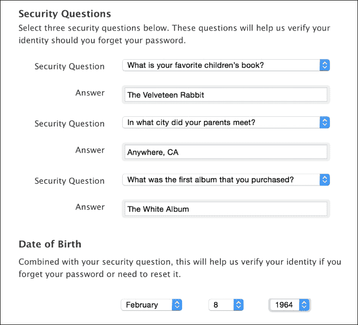

6. 接下来，您需要再向下滚动一点并输入您的邮寄地址（至少）。如果您有备用电子邮件地址，建议设置一个。您的表单应类似于下图（我们省略了备用地址）：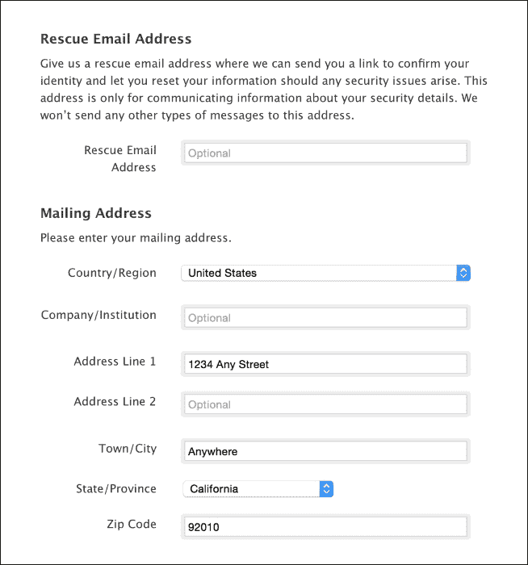

7. 再向下滚动一点并选择您首选的语言和电子邮件偏好设置。如果您已有 Apple ID，大概可以取消勾选 **Email Preferences（电子邮件偏好设置）** 下的两个复选框。如果您想随时了解 Apple 的新闻和公告，可能只想保留第一个复选框的勾选。无论哪种方式，您的表单看起来应该如下所示：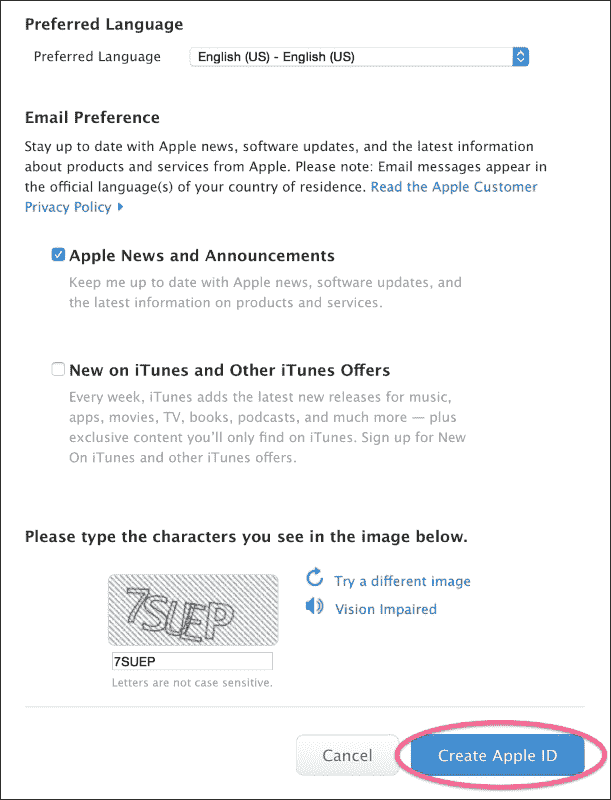

8. 最后，点击 **Create Apple ID（创建 Apple ID）**，系统将提示您验证电子邮件地址。Apple 会向您提供的地址发送一封电子邮件，其中包含一个验证链接。点击该链接，即可让 Apple 知道您可以通过所提供的地址联系到。系统将提示您使用刚刚设置的用户名和密码再次登录。屏幕如下所示：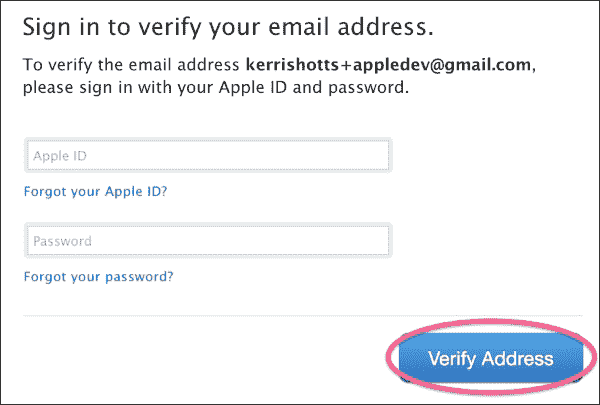

9. 点击 **Verify Address（验证地址）** 后，您应该会看到以下屏幕截图，表明电子邮件地址已验证：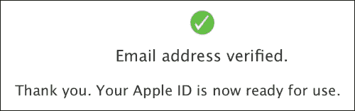

### Tip（提示）

您几乎肯定想为您的账户启用双因素认证以提高安全性，但这超出了本章的范围。

如果您设置了备用电子邮件地址，也需要验证该地址。备用电子邮件地址的验证邮件是单独发送的。

现在您有了 Apple ID，我们可以开始开发者注册流程。返回 `https://developer.apple.com/programs/enroll/` 并点击 **Start Your Enrollment（开始注册）** 按钮，如下所示：

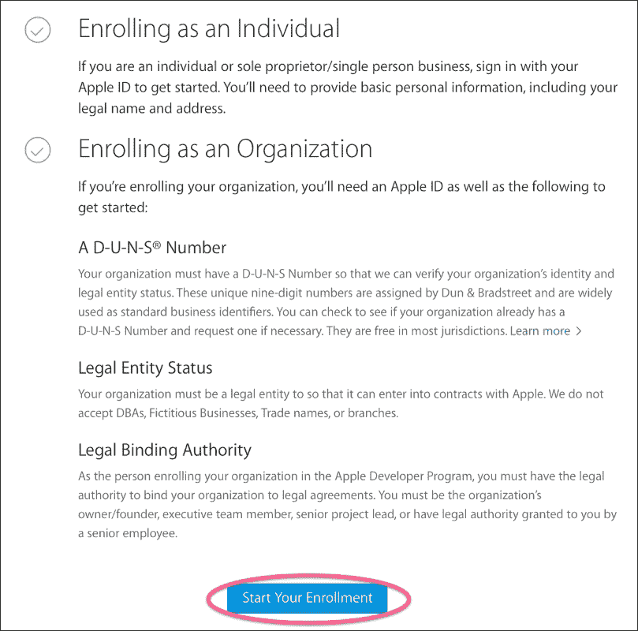

接下来，请按照以下步骤注册开发者计划：

1. 系统将提示您使用刚创建的 Apple ID 登录。完成后，系统将提示您查看并同意 **Apple Developer Agreement（Apple 开发者协议）**，如下截图所示：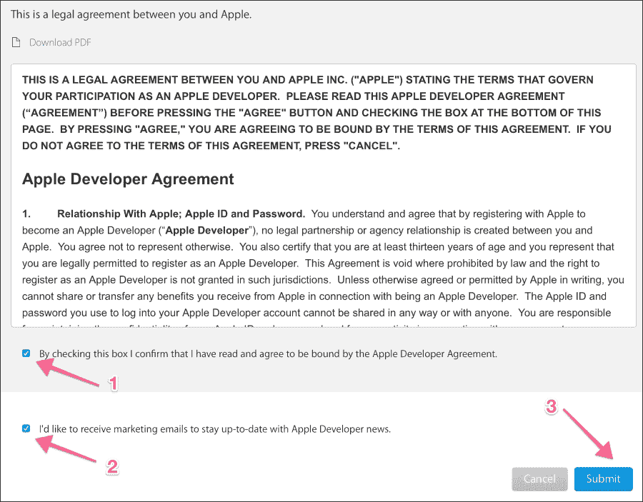

2. 勾选确认您已阅读并同意条款 (1)。理想情况下，您还应勾选希望随时了解 Apple Developer 新闻 (2)，除非您有另一个已接收此信息的开发者账户。然后，点击 **Submit（提交）**，系统将提示您验证您正在使用的 Apple ID 是否为您真正想要使用的那个。随后系统会询问您是想以个人开发者还是公司身份继续，如下所示：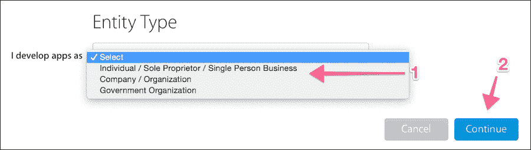

    ### Note（注意）

    我是以个人身份进行的，所以如果您以公司身份注册，步骤会有所不同。Apple 还会验证您是否有权参与法律协议，因此他们会核实您提供的信息。这可能需要几天时间。

3. 点击 **Continue（继续）** 后，系统将要求您提供联系信息以及地址。请注意，您的姓名不可编辑，因此您的 Apple ID 也必须使用您的法定姓名。表单应如下所示：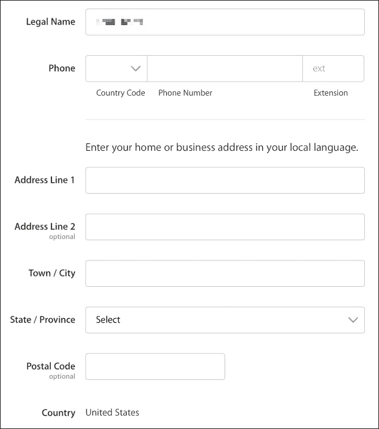

4. 向下滚动一点，阅读并接受呈现的协议，如下截图所示。然后，点击 **Continue（继续）**。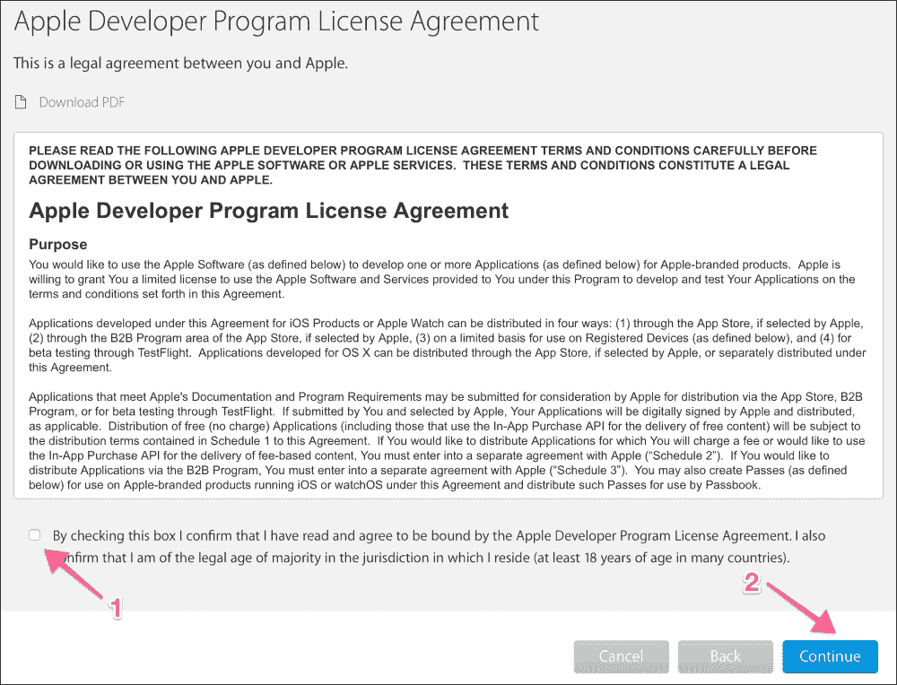

5. 此时，将出现一个验证屏幕。确保您提供的信息正确无误，然后点击 **Continue（继续）**。

6. 现在系统将要求您完成购买，如下截图所示。如果您愿意，可以通过勾选 (**1**) 所示的复选框，让 Apple 自动续订您的协议。无论哪种方式，点击 **Purchase（购买）** 以继续。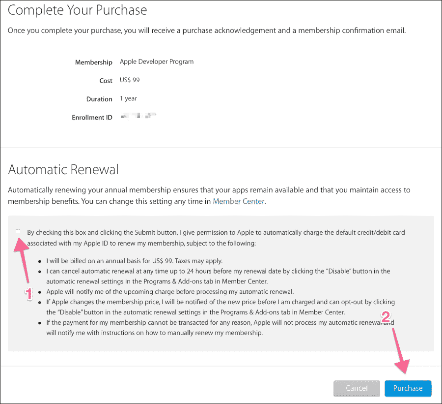

7. 您将被重定向到 Apple Store，系统将再次提示您输入用户名和密码。输入后点击 **Sign In（登录）**。

8. 您应该会看到类似于下图的订单屏幕。输入您的地址、联系信息和信用卡信息，然后点击 **Continue（继续）**。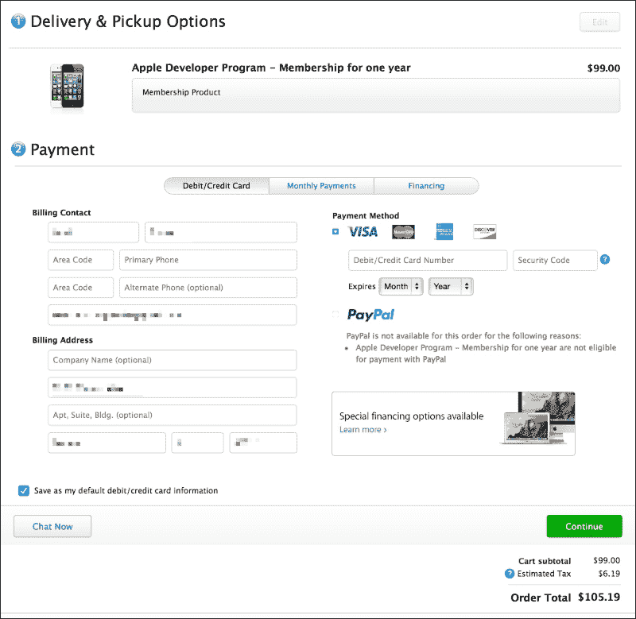

9. 此时，您需要再次验证您的信息，然后点击 **Place Your Order（下单）**。您还将收到一条确认消息和电子邮件。

恭喜，您现在正式成为一名 Apple 开发者了！请注意，处理个人开发者账户可能需要长达二十四小时，而公司账户可能需要更长的时间，具体取决于验证流程完成的速度。

## 成为 Google Play Store 开发者

Google 并不要求您必须是 Google Play 市场开发者才能将应用部署到本地设备，也不要求在您临时分发应用之前必须注册。但是，如果您想在 Google Play 市场上架，则*确实*需要一个账户。您需要准备一些东西，我们将在本节中全部设置：

*   一个 Google 账户
*   一个 Google Wallet 账户
*   一份 Google 商家协议

与 Apple 开发者账户一样，我们建议您为应用分发目的创建一个完全独立的身份，这样如果账户出现任何问题，不会影响您的个人账户。

1. 导航至 `https://play.google.com/apps/publish/`。如果您想使用现有账户，系统将提示您登录。您也可以通过点击 **Create Account（创建账户）** 来创建新账户，如下截图所示：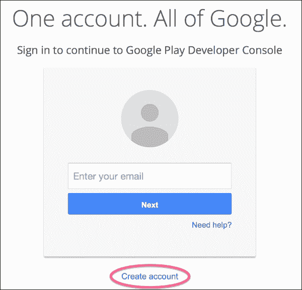

2. 您将被带到一个典型的注册屏幕，系统会询问您的姓名、密码和其他信息。默认情况下，Google 假设您也想要一个单独的电子邮件地址。但如果您点击 **I prefer to use my current email address（我更倾向于使用我当前的电子邮件地址）**，则可以改用您当前的电子邮件地址。下截图显示了一个示例：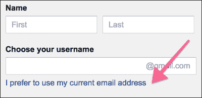

3. 无论您以哪种方式继续，都需要填写您的姓名、密码等信息，如下截图所示：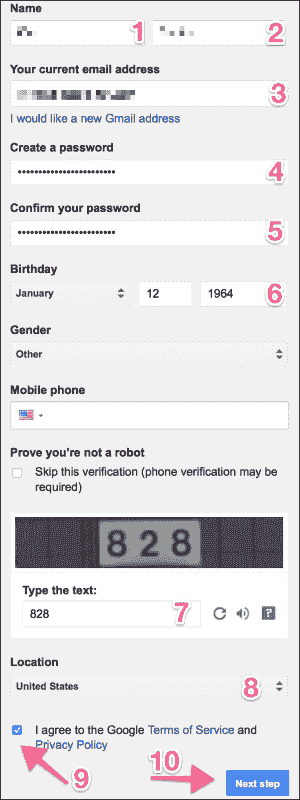

    ### Note（注意）

    如果您创建一个新的电子邮件账户，Google 也会要求提供一个现有的电子邮件账户。这类似于 Apple 的备用电子邮件地址。

4. 假设您输入了所有必填信息并正确响应了验证码，Google 将显示如下内容：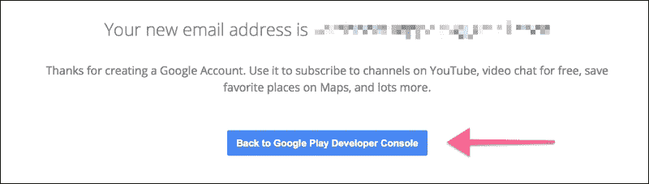

    ### Note（注意）

    您还将收到一封包含相同信息的电子邮件。

5. 此时，您可以点击 **Back to Google Play Developer Console（返回 Google Play 开发者控制台）**，应该会看到下面的屏幕。请务必阅读分发协议 (**1**) 并勾选 **I agree…（我同意……）** (**2**)，然后再点击 **Continue to payment（继续付款）**。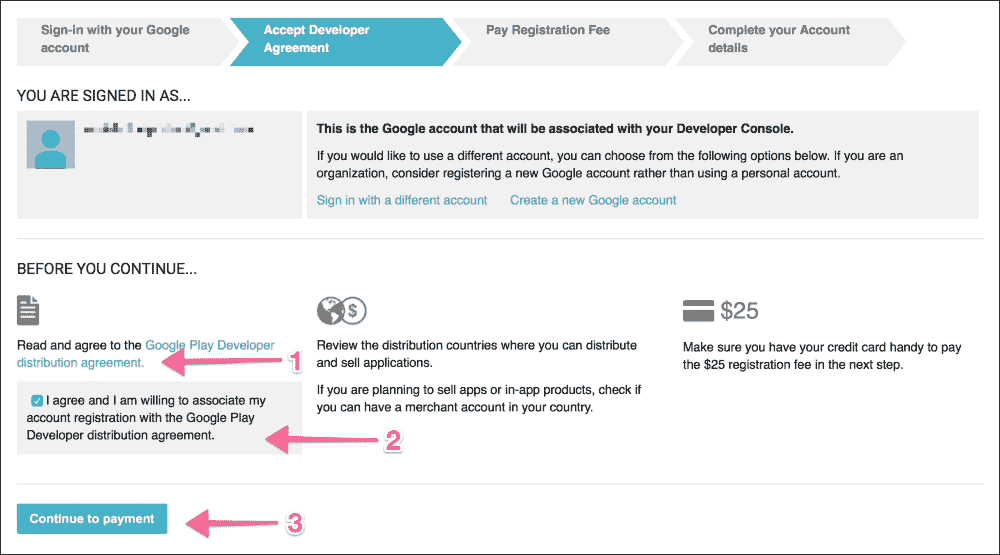

6. Google 现在将提示您设置 Google Wallet，如下截图所示。输入您的付款信息，取消勾选第二个复选框 (**8**)（否则您会收到发送到您电子邮件的特别优惠），然后点击 **Accept and continue（接受并继续）**。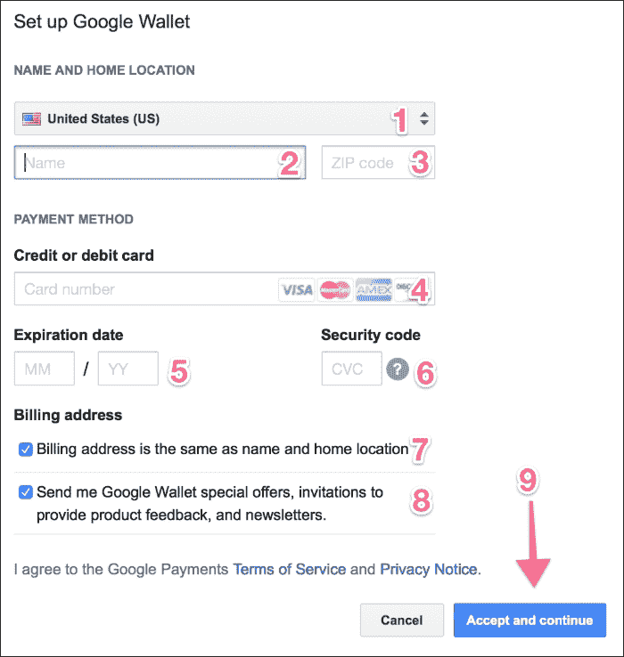


7. Google 将显示费用，撰写本文时为 25 美元。点击 `Buy` 完成交易。

8. Google 可能会要求您更新账单信息。输入与您的付款方式相同的地址和电话号码。然后，点击 `Buy`。

9. 当您的付款被处理后，您应该会收到以下通知；点击 `Continue registration`：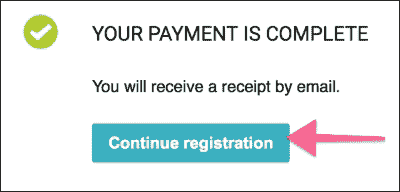

10. 离成功不远了：下一步将询问您的开发者姓名、电子邮件、网站和其他联系信息。这是您的用户将看到的信息，它不需要与您在 Google 账户设置中已提供的信息相匹配。例如，您可能希望在开发者姓名字段中输入公司名称而不是个人姓名。（如果您这样做，请确保您有权这样做。）输入完成后，点击 `Complete registration`，如下面的屏幕截图所示：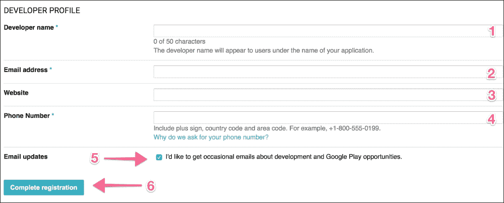

11. 如果您的意图仅是免费提供应用，那么到此就完成了。但如果您想销售应用或添加应用内购买，则需要设置商家账户。点击 `set up a merchant account`，如下所示：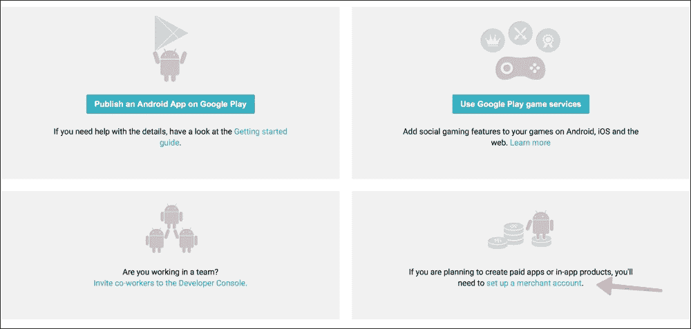

12. 您将看到另一份注册表单。顶部部分现在应该已经很熟悉了。它询问您的姓名、地址等。请注意，Google 现在要求您提供 `legal business information`。输入后向下滚动一点。

13. 向下滚动时，您应该会看到类似下面的屏幕截图。在这里，您将提供面向客户的信息，例如您的网站、您销售的产品（如果您销售应用，应选择 `Computer Software`），以及最终用户信用卡账单上应显示的内容（请注意信用卡账单字段较短；您可能需要缩写）。阅读服务条款后，点击 `Submit`。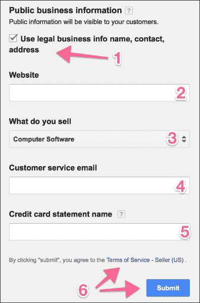

14. 假设一切顺利，Google 应该会返回以下内容，表明您的商家账户已获批准：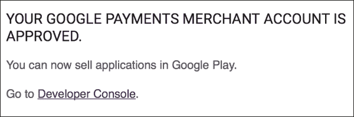

恭喜！此时，您已成为 Google Play 市场开发者，可以将您的应用提交到商店！

如果您曾在模拟器甚至真机上运行过该应用，那么您很有可能已经生成了一个调试版本；这是 Cordova 应用的默认设置。要生成发布版本，您必须显式请求。要生成适合部署的发布版本，您还需要对其进行签名。通过为应用签名，您将允许其他设备确保该应用确实来自您，并降低他人篡改您应用的可能性。

在本节中，我们将介绍如何创建构建并对其进行签名。由于每个平台的签名步骤不同，我们将在单独的小节中介绍它们。

## 管理 iOS 签名身份

为了给您的代码签名（无论是调试版还是发布版），您需要一个签名身份。在 iOS 上（所有构建都会被签名，无论其调试状态如何），您至少拥有两个身份：一个 `development` 身份和一个 `distribution` 身份。这些身份唯一地标识您作为开发者的身份。`development` 身份仅用于调试构建，而 `distribution` 身份用于部署发布构建。

在 iOS 上，通常使用 `Xcode` 来管理您的签名身份。如果 `Xcode` 发现某些设置不正确，它通常会自行纠正。但是，您确实需要让 `Xcode` 知道您的 `Apple ID` 账户信息，以便它能为您妥善管理这些身份。

为此，请遵循以下说明：

1. 启动 `Xcode`。

2. 打开 `Xcode` 应用程序菜单，然后点击 `Preferences…`。

3. 点击 `Accounts` 标签页，如下一个屏幕截图所示：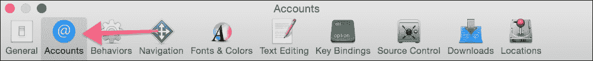

4. 点击工作表左下角的 `+` 按钮。您应该会看到一个类似于下面的下拉菜单：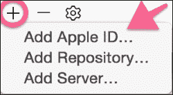

5. 点击 `Apple ID…`。您应该会看到一个对话框，提示您输入 `Apple ID` 登录凭据：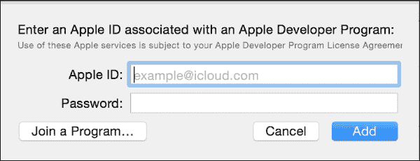

6. 输入您的账户信息并点击 `Add`。稍等片刻，让 `Xcode` 检索您的信息。随后您应该会在 `Accounts` 工作表左侧的列表中看到已添加的账户。

7. 点击新添加的账户。账户信息随后将显示在工作表的右侧。点击工作表右下角的 `View Details…`。

8. 此时，`Xcode` 将显示您安装的签名身份，列表可能为空。如果是这种情况，您可以点击对话框左下角的刷新图标，这将提示 `Xcode` 询问您是否允许它为您创建几个证书（这些就是您的签名身份）。允许其创建，您最终将得到一个看起来部分类似这样的列表：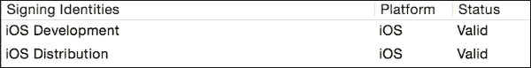

9. 点击 `Done` 按钮关闭对话框。如果您愿意，此时可以关闭 `Xcode`，但几分钟后您还需要用到它，所以您可能想暂时保持其运行。

### 注意

`Xcode` 可能不会自动获取您的签名身份。如果出现这种情况，请点击对话框中间的 `+` 按钮，然后点击 `iOS Development` 以添加您的 `development` 身份。重复这些步骤，但随后选择 `iOS Distribution` 以添加您的 `distribution` 身份。以下屏幕截图应该会有所帮助：
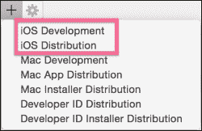

## 管理 iOS App ID

Apple 提供了通配符应用程序 ID，但建议您为每个打算分发的应用创建一个特定的 ID。如果您的应用可以接收推送通知或处理应用内购买，这一点尤为重要，因为这些设置非常细粒度，必须针对单个应用，而不能针对一系列应用。

要创建 iOS App ID，请遵循以下步骤：

1. 登录开发者会员中心 (`https://developer.apple.com/membercenter`)。您应该会看到一个标题为 `Certificates, Identifiers & Profiles` 的链接。点击该链接后，您应该会看到类似于下图的内容：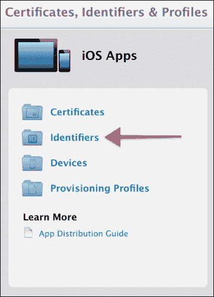

2. 点击如前一个屏幕截图所示的 `Identifiers` 链接，您可能只会看到一个已定义的 App ID：`Xcode: iOS Wildcard Apple ID`。

3. 列表上方有一个 `+` 按钮；点击它。您将被带到一个如下所示的表单：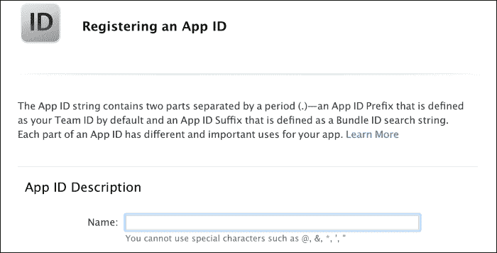

4. 在 `App ID Description` 字段中，输入您的应用名称。这仅供您参考，所以只需对您自己有意义即可。

5. 如果您向下滚动，应该会看到一个 `App ID Suffix` 部分，如下所示：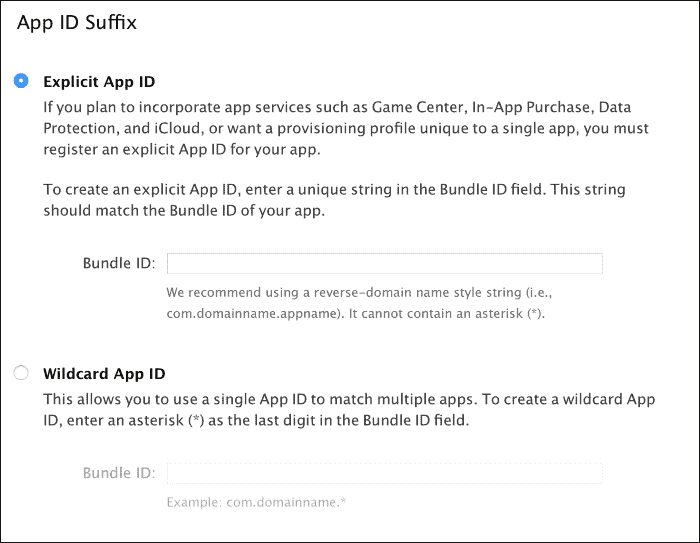

6. 输入您创建 Cordova 应用时使用的相同值。这在 `config.xml` 文件中。如果您使用的是与我们相同的构建系统，它也存在于 `package.json` 文件中。对于我们的演示应用，我使用了 `com.packtpub.logology`。

7. 如果您再向下滚动一点，应该会看到一个标题为 `App Services` 的部分，如下所示：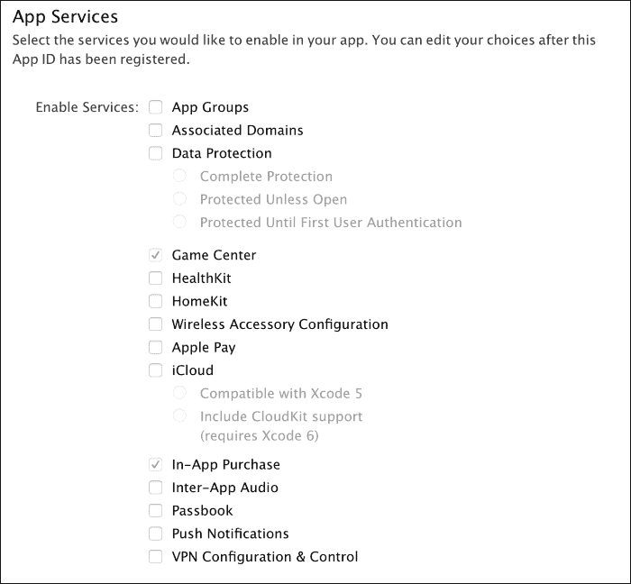


8. 进行您认为需要的任何选择。如果您的应用使用推送通知，您将需要启用此功能。如果您不确定，稍后随时可以更改，所以不要过于纠结于这个问题。请注意，`Game Center` 和 `In-App Purchase` 已经被勾选。所有非通配符 App ID 都将启用这些功能。如果您想使用这些功能，仍然需要向您的应用添加相应的代码。

9. 点击 `Continue`。您将看到一个确认屏幕。点击 `Submit`。然后，在确认屏幕上点击 `Done` 以返回 App ID 列表。

### 注意

如果您需要编辑现有的 App ID，请在列表中点击该 App ID，然后点击 `Edit`。您可能需要稍微向下滚动，因为点击行后出现的功能信息可能会填满您的屏幕。您也可以使用同样的方法删除现有的 App ID。点击 `Edit` 后出现的表单上有一个 `Delete` 按钮。

App ID 本身作用不大，但它是真正重要部分的关键：您应用的配置文件。

## 管理 iOS 设备

为了以临时分发或开发的方式部署您的应用，您需要让 Apple 知道该应用应在哪些设备上运行。幸运的是，这非常简单。但一年内您*可以*定位的设备数量*是有限制*的。这是为了确保您不会试图绕过 Apple 的分发渠道。除非您拥有大量设备或经营大型公司，否则您可能不会超出限制。

### 注意

当您首次将应用部署到设备上时，`Xcode` 通常非常擅长自动注册您连接的设备。但您可能想要注册一台您无法亲自接触的设备，例如远程团队成员的设备。

要添加设备，您首先需要知道设备的 `UDID`（通用设备标识符）。您可以通过以下步骤确定它：

1. 将您的设备连接到计算机。
2. 启动 `Xcode`。
3. 打开 `Window` 菜单并点击 `Devices`。
4. 您应该会看到如下所示的屏幕：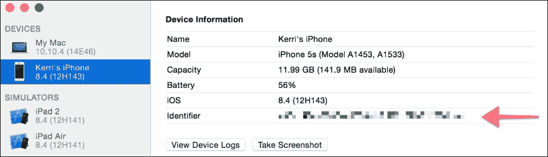

现在您知道了 `UDID`，可以按照以下步骤将设备添加到您的开发者账户：

1. 登录开发者会员中心（`https://developer.apple.com/membercenter`）。您应该会看到一个标题为 `Certificates, Identifiers & Profiles` 的链接。点击该链接。如果您已经登录，请跳至第 2 步。
2. 点击 `Devices`。
3. 页面右上角有一个 `+` 按钮。点击它以添加新设备。
4. 在 `Name` 字段中输入一个您能识别该设备的名称，在 `UDID` 字段中输入 `UDID`。点击 `Continue`。
5. 您将被提示查看您的信息。如果一切正确，请点击 `Register`。

## 管理 iOS 配置文件

配置文件是 iOS 验证设备是否有权运行您的应用的方式。共有三种：开发、临时分发和 App Store 分发。开发显而易见：用于调试或测试构建。后两者用于发布构建——要么用于临时分发，要么最终用于 App Store 分发。您的应用可以拥有任意数量的这些配置文件。

要创建配置文件，请按以下步骤操作：

1. 登录开发者会员中心（`https://developer.apple.com/membercenter`）。您应该会看到一个标题为 `Certificates, Identifiers & Profiles` 的链接。点击该链接。如果您已经登录，请跳至第 2 步。
2. 点击 `Provisioning Profiles`。
3. 您应该会看到一个相当短的配置文件列表；可能一个都没有。
4. 右上角有一个 `+` 按钮。点击它以添加新配置文件。
5. 您应该会看到如下所示的表单：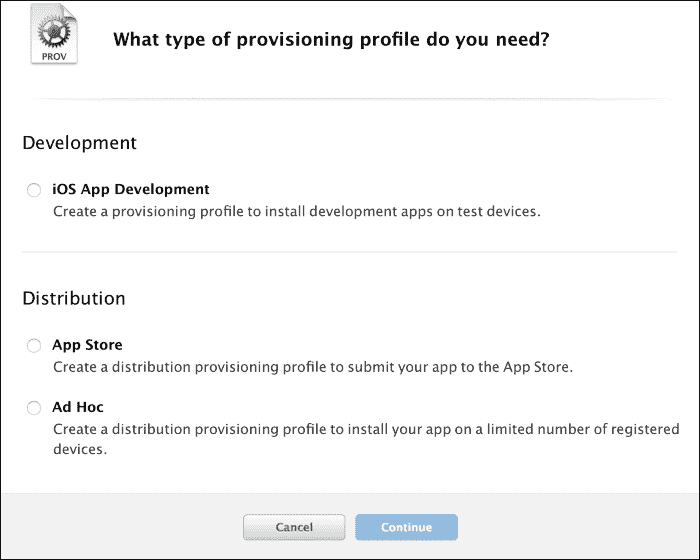
6. 选择您需要的选项。这当然取决于您正在创建哪种构建以及打算如何部署它。如果构建用于您自己的设备，请选择 `iOS App Development`。如果构建将在临时分发的基础上在 App Store 之外分发（给有限数量的设备），请选择 `Ad Hoc`。如果构建将提交给 App Store，请选择 `App Store`。如果您选择错误，随时可以删除该配置文件并创建另一个。
7. 点击 `Continue`。
8. 现在系统会询问您要将哪个 `App ID` 与此配置文件关联。从下拉列表中选择您在上一节中创建的那个，然后点击 `Continue`。
9. 接下来，系统会询问您要在配置文件中包含哪些证书。这些就是您之前创建的签名标识。可见的证书取决于您是创建开发配置文件还是分发配置文件。选择您想使用的那个，然后点击 `Continue`。
10. 如果您选择了临时分发或开发配置文件，系统会询问您要包含哪些设备。选择应该能够运行该应用的设备，然后点击 `Continue`。如果您选择了 App Store 配置文件，请跳至下一步。
11. 在 `Profile Name` 字段中输入一个您可以用来识别此配置文件的名称，如下所示。然后，点击 `Generate`：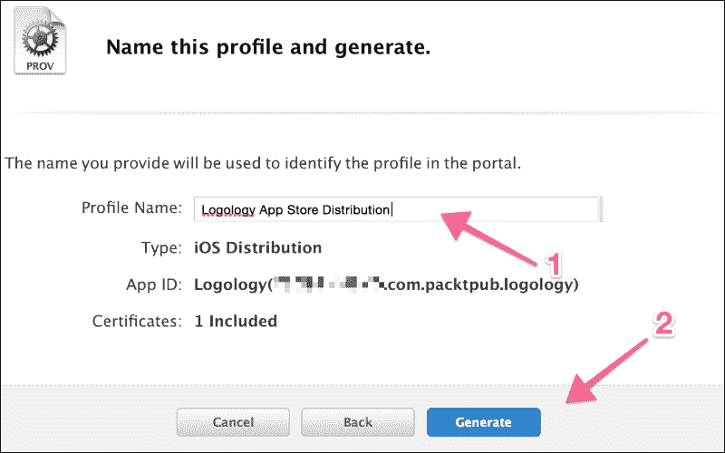
12. 配置文件生成后，您将看到一条消息，指示该配置文件已准备好下载和安装。如果您愿意可以这样做，但我们将在下一步让 `Xcode` 为我们管理它们。
13. 返回 `Xcode`（如果已关闭则打开它）。导航至 `Xcode` | `Preferences`，然后选择 `Accounts` 标签页。在左侧边栏中选择您的 `Apple ID`，然后点击右下角的 `View Details`。
14. 点击生成的对话框左下角的刷新图标并稍等片刻。几秒钟后，`Xcode` 应该会将新的配置文件添加到对话框底部列表的下半部分。

此时，您可以使用此配置文件为您的构建签名。然而，为了将来参考，我们还需要一件事，那就是配置文件的 UUID。要获取它，请按以下步骤操作：

1. 在列出配置文件的底部列表中，找到新添加的配置文件。
2. 右键点击该配置文件。应会出现一个菜单，其中包含 `Show in Finder` 选项。
3. 点击 `Show in Finder`。`Finder` 现在应会打开一个文件夹，其中标识了该配置文件。
4. 记下文件名；配置文件的 UUID 就是去掉扩展名后的文件名。
5. 对您需要用来构建的所有已添加配置文件重复步骤 1 到 4。
6. 完成后，点击 `Done` 并退出偏好设置面板。

## 创建 Android 密钥库

虽然 iOS 为您管理签名标识，但 Android 要求您自行处理这一方面。Android 将您的签名标识（实际上是一个私钥）存储在所谓的 `keystore` 中，该密钥库通常专用于您的应用。

### 注意

在本节中，我们假设您正在使用命令行来构建应用。如果您使用 `Android Studio`、`Eclipse` 或任何其他负责创建 Android 应用的 IDE，它们可能会为您处理这方面的工作（请参阅本章末尾的 `Resources` 部分）。

为了创建私钥，您可以在命令提示符下执行以下命令，将 `app_name` 替换为您的应用名称：

```
keytool -genkey -v -keystore .release.keystore -alias app_name -keyalg RSA -keysize 2048 -validity 10000
```

### 注意

您的开发机器上必须安装 `Java` 才能使用 `keytool` 实用程序。


`validity` 后面的数字以天为单位，你应该确保这是一个相当大的数字！在本例中，密钥的有效期略超过 27 年。

该工具现在将提出一系列问题，如下所示：

```
Enter keystore password: (1)
Re-enter new password:
What is your first and last name? (2)
[Unknown]:  Johnny Appleseed
What is the name of your organizational unit? (3)
[Unknown]:  Department
What is the name of your organization? (4)
[Unknown]:  Company
What is the name of your City or Locality? (5)
[Unknown]:  Anytown
What is the name of your State or Province? (6)
[Unknown]:  CA
What is the two-letter country code for this unit? (7)
[Unknown]:  US
Is CN=Johnny Appleseed, OU=Department, O=Company, L=Anytown, ST=CA, C=US correct? (8)
[no]:  yes

Generating 2,048 bit RSA key pair and self-signed certificate (SHA256withRSA) with a validity of 10,000 days
for: CN=Johnny Appleseed, OU=Department, O=Company, L=Anytown, ST=CA, C=US
Enter key password for <app_name> (9)
(RETURN if same as keystore password):
Re-enter new password:
[Storing .release.keystore]
```

让我们逐一了解在每个步骤中你需要提供的内容：

1.  `Keystore password`（密钥库密码）：此密码用于保护你的 `keystore` 本身。从技术上讲，`keystore` 可以存储许多不同的 `private keys`（私钥），尽管这可能不适用于你的情况。请务必使用强密码；如果攻击者持有你的 `keystore` 并能猜出密码，他们就离危害你的用户更近了一步。

2.  `First and last name`（名和姓）：你的名和姓。对此并没有真正的检查，所以请使用适合你特定情况的任何内容。

3.  `Organization unit`（组织单位）：`keytool` 假设你在组织层级内操作。如果你为公司创建应用，你的组织单位可能是信息技术部或应用开发部。你可以留空，但工具会假设为 `Unknown`。所以，你最好想一个讲得通的内容。如果你是个人开发者，可以直接指定 `Developer`（开发者）。

4.  `Name of your organization`（组织名称）：如果你在公司工作，这显而易见。如果你是拥有注册公司名称的个人开发者，可以使用公司名称。如果没有，就再次使用你的名字。

5.  `Name of your City or Locality`（城市或地区名称）：你或你公司的所在地。

6.  `Name of your State or Province`（州或省名称）：你或你公司所在的州或省。

7.  `Two-letter country code`（两位字母国家代码）：你或你公司所在国家的两位字母标识符。如果你不确定该为你的国家使用什么代码，请参阅 [`en.wikipedia.org/wiki/ISO_3166-1_alpha-2`](https://en.wikipedia.org/wiki/ISO_3166-1_alpha-2)。

8.  `Is … correct?`（……是否正确？）：如果显示的信息正确，请回答 `yes`。如果你指定 `no`，工具将再次提问，允许你编辑答案。

9.  `Key password for…`（……的密钥密码）：因为 `keystore` 可能包含多个 `private keys`（私钥），你需要为此特定的 `private key`（或 `alias` 别名）指定一个密码。你可以使用与 `keystore` 相同的密码，但要明白如果攻击者猜到了 `keystore` 密码，他们将能访问你的 `private key`，并能为你的最终用户生成应用更新。最好使用两个独立的强密码。

此时，你的当前目录下应该有一个名为 `.release.keystore` 的新文件。务必妥善保管此文件；它包含为你的应用签名（以及交付任何未来更新）所需的数据。如果丢失，你可能会失去生成应用更新的能力。如果其他人获得了访问权限，他们可以像你一样发布应用更新；这可不是好事。

**不要让此文件进入任何源代码仓库！** 立即告诉 `Git`（或你使用的任何源代码仓库）忽略该文件。

对于 `Git`，我们需要将以下内容添加到 `.gitignore` 文件中：

```
.release.keystore
```

### Tip（提示）

将你的 `keystore` 备份在安全的地方。如果你丢失了它，将无法发布应用更新！

## 对发布版本进行签名

在 第 1 章 *任务自动化* 中，我们介绍了如何构建一个包含去除源映射的压缩代码的发布版本。我们还介绍了如何使用我们的 `Gulp` 配置创建此类构建：

```
gulp build --mode release [--for platform-list]
```

这将创建一个发布版本，但它还不具备部署条件。在获得可部署的结果之前，我们需要对项目结构和 `Gulp` 配置进行更多更改。

首先，无论你是使用 `gulp` 还是其他构建工具，都需要创建一个 `build.json` 文件。该文件包含为应用签名的信息。它位于项目的根目录中。格式如下：

```
{
  "android": {
    "release": {
      "keystore": "../.release.keystore",
      "alias": "app_name"
    }
  },
  "ios": {
    "debug": {
      "codeSignIdentity": "iPhone Developer",
      "provisioningProfile": "<UUID>"
    },
    "release": {
      "codeSignIdentity": "iPhone Distribution",
      "provisioningProfile": "<UUID>"
    }
  }
}
```

### Note（注意）

`Android` 不要求你对 `debug`（调试）构建进行签名。如果你想签名，可以添加一个复制 `release` 部分的 `debug` 部分，只不过你需要创建一个 `debug` `keystore` 并使用它代替。

请注意，这里有一个用于 `iOS` `provisioning profile`（配置文件） `UUID` 的部分。如果你还记得 *Managing iOS Provisioning Profiles*（管理 iOS 配置文件）中的内容，`Xcode` 可以显示这些 `UUID` 是什么。遵循本节末尾的步骤，你应该能够确定要使用哪些 `UUID`。

如果你使用 `Cordova CLI` 构建应用，可以使用以下配置进行构建：

```
cordova build [platforms] --release --device --buildConfig=build.json
```

如果你使用 `gulp` 和我们的 `Gulp` 配置，需要进行以下更改：

1.  在实际执行构建步骤之前，`build.json` 文件需要被复制到 `build` 目录。这可以通过在 `gulp/config.js` 中向 `config.assets.copy` 对象添加以下内容来完成：

    ```
    var config = {
        …
        assets: {
            copy: [
                    {src: "../build.json", dest: "."},
                    …
            ], …
        }, …
    }
    ```

2.  `cordova-build.js` 任务中的 `buildCordova` 函数需要修改，以便将 `--device` 和 `--buildConfig` 标志传递给 `Cordova`：

    ```
    function buildCordova() {
        var target = settings.TARGET_DEVICE;
        if (!target || target === "" || 
             target === "--target=device") {
            target = "--device";
        }
        return cordovaTasks.build({
            buildMode: settings.BUILD_MODE,
            platforms: settings.BUILD_PLATFORMS,
            options: [target, "--buildConfig=build.json"]});
    }
    ```

现在你可以使用以下命令构建项目：

```
gulp build --mode release [--for platform-list]
```

无论你使用 `Cordova` 构建发布版本还是使用 `gulp`，发布构建的过程应与之前的 `debug` 构建类似。构建 `Android` 发布版本时有一个区别：你会被提示两次输入密码。第一次输入 `keystore` 的密码。第二次输入 `alias` 的密码。虽然你可以在 `build.json` 文件中指定密码，但强烈不建议这样做，因为这会造成安全风险。

现在你已经构建了发布版本，可以在以下位置访问相应的文件：

*   `Android`：`[build/]platforms/android/build/outputs/apk/android-release.apk`。


### iOS 构建生成

**iOS**：Cordova 生成的格式无法直接分发。您可以使用 Xcode，也可以使用以下命令行步骤（从项目根目录运行），将 `app_name` 替换为您的应用名称：

如果您使用的是我们的项目格式：

```
xcrun -sdk iphoneos PackageApplication "$(PWD)/build/platforms/ios/build/device/app_name.app" -o "$(PWD)/app_name.ipa"
```

如果您直接使用 Cordova CLI：

```
xcrun -sdk iphoneos PackageApplication "$(PWD)/platforms/ios/build/device/app_name.app" -o "$(PWD)/app_name.ipa"
```

将生成的 `.ipa` 文件移动到所需位置。

### 注意事项

您可能希望自动将 `.apk` 和 `.ipa` 文件移动到其他位置，例如项目中的 `dist` 文件夹。我们将此作为读者的练习，但自动化此过程并不困难。

一旦生成了签名构建，部署 Ad Hoc 版本就非常简单。生成的 `.apk` 和 `.ipa` 文件可通过电子邮件传输或通过网站下载，因此传输它们并不困难。有各种工具可以让这种部署方式变得简单。

## 通过电子邮件部署

要通过电子邮件部署，请按以下步骤操作：

1.  在您的电子邮件应用程序中创建一条新消息。
2.  将 `.apk` 或 `.ipa` 文件作为附件添加到电子邮件中。注意发送/接收大小限制。如果您的应用很大，您可能想用其他方式部署。
3.  发送给接收者。

一旦接收者收到构建版本，他们可以使用以下步骤进行安装：

**对于 Android**，请使用以下步骤：

1.  用户应移除该应用的任何先前版本，特别是如果它们是从 Google Play 市场或任何其他商店下载的。
2.  下载附件。
3.  点击以打开附件。
4.  Android 将询问用户是否希望安装该应用，以及该应用所需的任何权限。
5.  用户应点击**安装**。
6.  该应用将安装在他们的设备上。
7.  如果发生错误，用户应在再次尝试前从设备中移除该应用。

**对于 iOS**，请使用以下步骤（iOS 要求用户能够访问 iTunes 并将设备连接到计算机）：

1.  这些说明的副本可在 [`developer.apple.com/library/ios/documentation/IDEs/Conceptual/AppDistributionGuide/TestingYouriOSApp/TestingYouriOSApp.html#//apple_ref/doc/uid/TP40012582-CH8-SW6`](https://developer.apple.com/library/ios/documentation/IDEs/Conceptual/AppDistributionGuide/TestingYouriOSApp/TestingYouriOSApp.html#//apple_ref/doc/uid/TP40012582-CH8-SW6) 获取。
2.  用户应移除该应用的任何先前版本，特别是如果它们是从 App Store 下载的。
3.  在他们的计算机上下载 `.ipa`。
4.  将设备连接到计算机。
5.  双击 `.ipa` 文件。
6.  在 iTunes 中，导航到**设备**标签页（在侧边栏或左上角）。
7.  点击侧边栏中的**应用程序**。新应用应出现在应用程序列表中。如果没有立即显示，请使用搜索字段查找它。
8.  点击新应用旁边的**安装**。文本将变为**将安装**。
9.  点击**同步**或**应用**。应用现在将部署到设备上。
10. 如果应用部署失败，请在再次尝试前从设备中删除该应用（如果可见）。

## 通过 URL 部署

如果您的应用存储在 Dropbox 账户（或类似服务）中，或者您已将构建版本上传到 Web 服务器，则可以改为与用户共享链接。Android 用户可以直接安装应用，就像上一节一样。iOS 用户仍然需要访问安装了 iTunes 的机器，以便插入设备来安装构建版本。

## 通过 Diawi 部署

如果您想避免 iOS 繁琐的安装步骤，可以让用户从一个特殊网站安装您的应用：[`www.diawi.com`](http://www.diawi.com)。该网站接收您的 `.ipa` 文件并返回一个缩短的链接，您可以将其发送给所有用户。他们可以通过点击链接来安装。

如果您愿意，也可以在不使用 Diawi 的情况下在线完成此操作。只需遵循以下网站上的说明即可：

*   [`3qilabs.com/how-to-ad-hoc-distribute-your-ios-app-via-a-website-and-ota/`](http://3qilabs.com/how-to-ad-hoc-distribute-your-ios-app-via-a-website-and-ota/)
*   [`gknops.github.io/adHocGenerate/`](http://gknops.github.io/adHocGenerate/)
*   [`aaronparecki.com/articles/2011/01/21/1/how-to-distribute-your-ios-apps-over-the-air`](http://aaronparecki.com/articles/2011/01/21/1/how-to-distribute-your-ios-apps-over-the-air)

一旦您的应用经过测试，您就可以准备将应用部署到相应的商店。每个商店使用不同的流程，因此我们将分别详述每个平台的步骤。

## 部署到 Apple App Store

请按照以下步骤将您的应用部署到 Apple App Store：

1.  导航至 [`itunesconnect.apple.com`](https://itunesconnect.apple.com)。
2.  使用您的 Apple ID 登录。 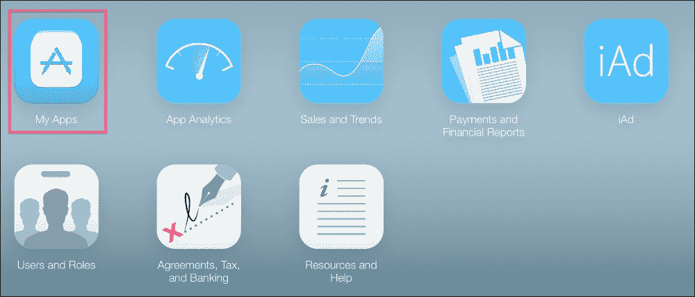
3.  您应该会看到一个各种图标的网格，如下所示：
4.  点击**应用程序**。
5.  点击页面左上角的 **+** 按钮。将出现一个下拉菜单。点击**新 iOS 应用程序**。
6.  将出现一个如下所示的新表单： 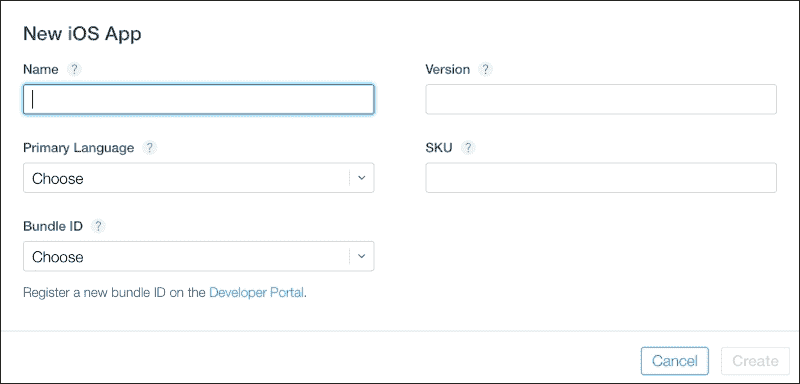
7.  在**名称**字段中提供您的应用名称。这对最终用户可见。
8.  从下拉列表中为应用选择**主要语言**。
9.  从下拉列表中为您的应用选择**包 ID**。这将与您在*管理 App ID* 部分创建的 App ID 匹配。
10. 在**版本**字段中输入您应用的版本。这应与您应用的 `config.xml` 和 `package.json` 文件中的版本匹配。
11. 为您应用的 **SKU** 选择一个唯一 ID。这对最终用户不可见，仅供您自己使用。
12. 点击**创建**。
13. 您将被带到一个包含多个部分的屏幕，包括**版本信息**、**通用应用信息**等。
14. 在字段名称**应用视频预览和屏幕截图**下方的表单顶部将有一个大的空白区域，后面跟着一个列出多种屏幕尺寸的选择器。这是您提供应用屏幕截图的地方，以便最终用户能对您的应用有良好的直观感受。您的应用支持的所有设备至少需要一张截图，但您每种设备规格最多可以有五张截图。我们在这里不介绍这些截图的创建，但在*资源*部分有几个可用的链接。
15. 向下滚动到屏幕截图部分下方。您应该会看到一个请求应用名称、描述和其他信息的表单。您的应用名称应该已经填好。
16. 在**描述**字段中输入您应用的描述。空白字符会被保留，因此您可以（也应该）使用段落和间距使描述清晰明了。
17. 在**关键词**字段中输入一些关键词，用逗号分隔。您最多可以使用 100 个字符。使用您认为潜在用户在搜索您的应用时会使用的术语。
18. 在**支持 URL** 字段中输入一个有效的 URL。此链接对最终用户可见，应为他们提供获取应用支持的途径。
19. 如果您的应用有营销网页，可以将该 URL 输入**营销 URL**。这将对最终用户可见。
20. 如果您的应用或公司有隐私政策（应该有！）且在网站上可用，请将该 URL 输入**隐私政策 URL** 字段。
21. 向下滚动到**通用应用信息**。
22. 点击**应用图标**字段标题下方的**选择文件**。选择您在上一章创建的 `iTunesArtwork@2x.png` 文件。此图标对浏览 App Store 的用户可见。


### 部署到 Apple App Store

## 应用元数据配置

23. 使用 **Category** 部分为您的应用选择主要和次要类别。如果您的应用仅适合一个类别，则无需提供次要类别。请确保所选类别以某种形式适用于您的应用，因为这也有助于用户找到您的应用。

24. 在 **Rating** 字段旁边，点击 **Edit** 链接。将出现一个如下所示的表单：
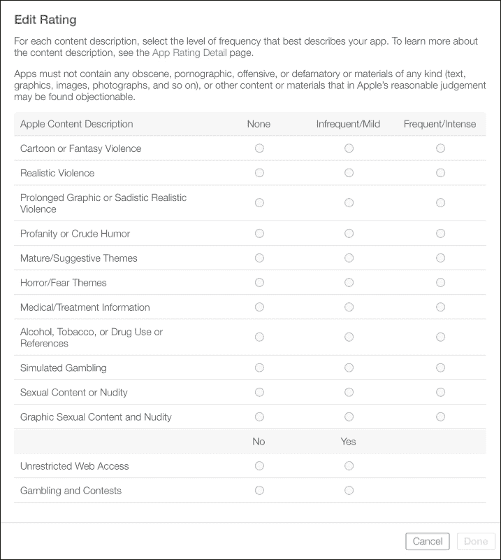

25. 为每个类别选择合适的项目。为每一行做出选择后，Apple 将显示最终评级。如果应用符合 **Made for Kids** 类别资格，Apple 将其显示为一个选项，如果应用面向儿童，您可以勾选它。完成后，点击 **Done**。

26. 在 **Copyright** 字段中输入您应用的版权信息。

27. 向下滚动到 **App Review Information** 部分。

28. 在提供的字段中输入您的联系信息。如果 Apple 审核团队对您的应用有任何疑问，他们将使用您提供的信息与您联系。如果您希望 Apple 联系其他人，请改为输入他们的信息。

29. 如果您的应用需要凭据才能工作，Apple 将要求提供演示账户。分别在 **Username** 和 **Password** 字段中输入用户名和密码。

30. 在 **Notes** 区域输入您认为应用审核团队需要了解的任何备注。

31. 向下滚动到 **Version Release** 部分。

32. 您可以选择 **Automatically release this version**（当应用团队接受您的提交时自动发布此版本），或选择 **Manually release this version**（手动发布此版本）。后者允许您在应用发布到 App Store 时拥有更精细的控制权。如果您同时发布 iOS 和 Android 应用，这会很有用。或者，如果您的市场部门在营销材料中指定了应用上线的具体日期，您可以等到该日期再将应用发布到市场。

33. 点击右上角的 **Save** 保存更改。

34. 点击网页顶部的 **Pricing** 链接。

35. 选择您应用的预计上架日期。无需精确到具体时间。

36. 选择价格等级。如果您的应用免费，请选择 **Free**。

37. 通过勾选或取消勾选 **Discount for Educational Institutions** 字段，选择教育机构是否应获得折扣。此项默认勾选。

38. 保持 **Custom B2B app** 未勾选，除非您参与了该开发者计划并交付 B2B 应用。

39. 点击 **Save**。

40. 页面将重新加载，现在您可以选择价格生效的生效日期，以及（可选）结束日期。这对于临时降价很有用。

41. 点击 **Save**。

42. 要返回应用列表，请点击 **Cancel**。

## 上传应用构建版本

这完成了应用元数据的配置，但我们还需要上传应用。您可以使用以下两种方法之一：通过 Xcode 或 Application Loader。如果您已有 `.ipa` 文件，Application Loader 效果很好，这正是我们拥有的。要提交它，请使用以下步骤：

1. 在 Mac 上打开 **Application Loader**。

2. 如果提示同意许可协议，请阅读并同意。

3. 使用您的 Apple ID 登录。

4. 点击 **Deliver Your App** 按钮。点击 **Choose**。

5. 系统将提示您提供 `.ipa` 文件的位置。导航到该位置并点击 **Open**。

6. 查看此时屏幕上的信息。它应列出应用标题、SKU 和版本号等内容。

7. 点击 **Next**。

8. **Application Loader** 将开始工作。它会将您的应用上传到 Apple，验证其未使用任何私有 API 等。

9. 过程完成后，您将看到一个大大的绿色对勾。点击 **Next**。

10. 点击出现的最终屏幕上的 **Done**。

11. 等待片刻，然后在浏览器中刷新应用详情。向下滚动到 **Build** 部分。您应该看到下图所示内容。如果没有，再等待片刻并再次刷新。


12. 点击 **+** 按钮。

13. 从弹出对话框中选择新上传的构建版本，然后点击 **Done**。

14. 构建版本现在显示在 **Build** 标题下方。

15. 点击 **Save**。

16. 查看应用信息。确认无误后，点击 **Submit for Review**。

17. 假设您的描述没有错误，您将被带到另一个屏幕，在那里您将被问及一系列关于应用出口合规性和合法性的问题。请如实回答，否则您的应用将被拒绝（或稍后被下架）。点击 **Submit**。

18. 等待。应用审核通常需要一周或更长时间（查看典型审核时间的有用网站是 [`appreviewtimes.com/`](http://appreviewtimes.com/)）。如果您第一次（甚至第二次）被拒，不要气馁。解决审核员指出的问题，然后重新提交应用。

19. 如果您选择手动发布应用，您的应用不会自动发布到 App Store。返回 iTunes Connect 中的应用页面，然后点击右上角的 **Release** 按钮。

20. 完成！老实说，最难的部分是创建截图和描述文本。如果您不太确定如何创建截图，请查看 *Resources* 部分。我们为您提供了一些链接。

# 部署到 Google Play Store

要将应用部署到 Google Play 市场，请执行以下步骤：

1. 在浏览器中访问 [`play.google.com/apps/publish/`](https://play.google.com/apps/publish/)。

2. 使用您的 Google 账户登录。

3. 点击 **Publish an Android App on Google Play**。您将看到如下所示的表单：
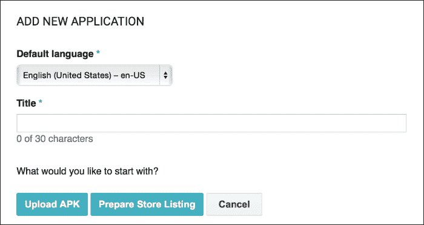

4. 如有必要，选择应用的默认语言。

5. 在 **Title** 字段中输入应用名称。

6. 点击 **Prepare Store Listing**。

7. 您将进入一个长表单，可以在其中输入应用信息、上传截图等。应用标题应已自动填入。

8. 在 **Short Description** 文本区域输入简短描述。您只有 80 个字符，所以要简洁且引人入胜。

9. 在 **Full Description** 文本区域输入应用的完整描述。空白和换行会被保留，所以利用段落和间距使描述易于阅读。

10. 向下滚动到 **Graphic Assets**。

11. 上传应用的截图。您至少需要两张，但每个类别最多可提供八张。仅为您的应用支持的设备规格提供截图。与 Apple 不同，您*不*需要为应用支持的*每个*设备规格提交截图。

12. 上传完截图后，向下滚动并上传应用图标。您在上一章中已创建它。

13. **Feature Graphic** 也是必需的；这些图片显示在应用的列表页面上。**Promo Graphic** 和 **TV Banner** 则是可选的。

14. 向下滚动到 **Categorization**。

15. 使用 **Application type** 下拉列表指示您的应用是游戏还是应用程序。

16. 从 **Category** 下拉列表中选择您的应用所属类别。

17. 使用 **Content Rating** 下拉列表指示内容分级。您需要在提交前填写分级问卷，但我们稍后会回到它。

18. 向下滚动到 **Contact Details**。

19. 如果您有网站，请在 **Website** 字段中输入网站 URL。

20. 在 **Email** 字段中输入公开可用的电子邮件地址。这将对使用您应用的用户可见。

21. 向下滚动到 **Privacy Policy**。


# 发布到 Google Play 商店

## 隐私政策与价格分发

22. 如果您有隐私政策，请将其 URL 输入到 `Privacy Policy` 字段。

23. 如果没有隐私政策，请勾选 `Not submitting a privacy policy URL at this time`。

24. 滚动到页面顶部，点击 `Save Draft`。

25. 在左侧边栏中导航到 `Pricing & Distribution`。

26. 如果应用免费，点击 `Free`；如果应用付费，点击 `Paid`。请注意，一旦将应用作为免费应用发布，后续无法将其改为付费。

27. 如果应用付费，请在 `Default Price` 字段中输入价格。

28. 点击 `Auto-convert prices now`，确保您的价格在应用将要上架的所有地区都已更新。

29. 向下滚动到 `Distribute in these countries`。

30. 如果想在全球分发，请勾选 `SELECT ALL COUNTRIES`。

## 上传构建版本

您现在可以将构建版本上传到应用商店。请按以下步骤将构建版本上传到应用商店：

1. 点击左侧的 `APK`。

2. 点击 `Upload your first APK to Production`。

3. 在弹出的对话框中点击 `Browse files`。

4. 选择您生成的 `.apk` 文件。该文件必须是签名的发布版本。选择文件后，它将开始上传到 Google Play。

5. 上传完成后，对话框将消失并显示 APK 信息。请注意 `Draft in Prod` 标识；应用尚未上架。

## 设置内容分级

现在我们已上传 `.apk`，可以通过以下步骤设置内容分级：

1. 在左侧边栏点击 `Content Rating`。

2. 点击 `Continue`。

3. 在 `Email address` 字段中输入您的电子邮件地址。

4. 向下滚动并选择您的应用类别。

5. Google 将根据类别提问。问题将分节呈现；回答每节的问题后，下一节将出现。

6. 完成后，点击 `Save Questionnaire`。

7. 点击 `Calculate Rating`。

8. 您的分级将显示出来。向下滚动并点击 `Apply Rating`。

## 发布应用

您现在可以发布应用了。点击 `Publish App` 按钮。系统将要求您查看信息和合格设备。如果一切看起来正确，请发布应用。应用将在几小时内在应用商店上架。

### 注意

如果发布按钮被禁用，请点击 `Why can't I publish` 链接，查看需要填写哪些字段。

## 实用链接

以下链接在处理创建签名构建版本时可能会有用：

### Android 专用签名

*   使用 Android Studio 签名：<http://developer.android.com/tools/publishing/app-signing.html>
*   使用 Eclipse 签名：<https://developer.android.com/tools/publishing/app-signing-eclipse.html>

### Beta 测试网站

*   TestFlight（Apple，仅 iOS）：<https://developer.apple.com/testflight/index.html>
*   Google Beta 测试（Google，仅 Android）：<https://support.google.com/googleplay/android-developer/answer/3131213?hl=en>
*   Hockey App（Microsoft Windows，iOS/Android）：<http://hockeyapp.net/features/>

### 创建应用商店截图

*   <http://www.raywenderlich.com/71175/make-great-app-store-screenshots>
*   <https://launchkit.io/screenshots>
*   <http://sketchtoappstore.com>
*   <http://www.smashingmagazine.com/2015/03/create-effective-app-screenshots-for-app-page/>
*   <https://support.google.com/googleplay/android-developer/answer/1078870?hl=en>
*   <http://blog.placeit.net/make-google-play-screenshots/>

## 结语

恭喜！在本章中，我们涵盖了大量信息，从创建开发者账户到为发布签名应用并将其提交到各个应用商店。希望您的应用现在能让用户享受，并获得好评。

您也完成了本书的最后一章，但这并不意味着您作为开发者的工作就此结束。您的用户可能会在应用中发现一些需要修复的 Bug，或者您可能想添加新功能。无论哪种方式，您可能都会向商店发布新版本的应用。在这个过程中，您将作为混合应用开发者不断成长。

您随时可能需要帮助。如果您遇到困难，我建议参考以下资源。有很多热心的志愿者乐于提供帮助：

*   Stack Overflow：<http://stackoverflow.com/tags/cordova>
*   PhoneGap/Cordova CLI Google 群组：<http://groups.google.com/group/phonegap>
*   PhoneGap Build 社区：<http://community.phonegap.com/nitobi>
*   Cordova Slack 社区：<http://slack.cordova.io/>
