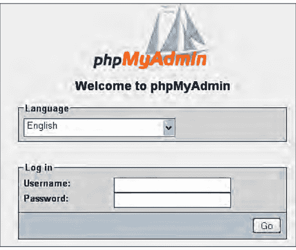
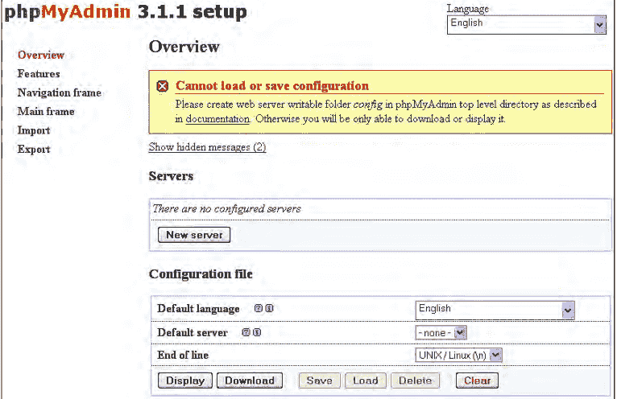
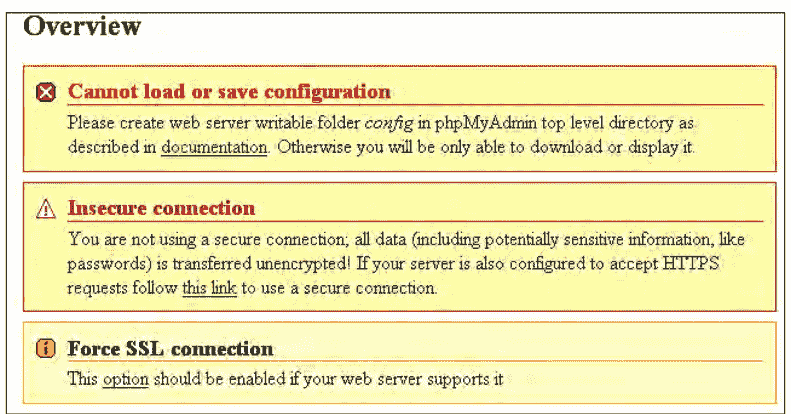
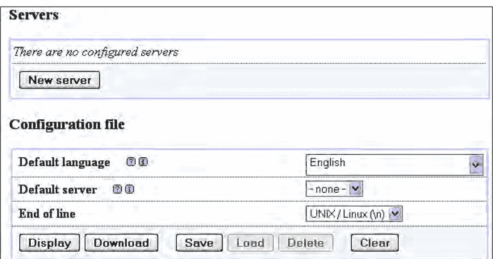
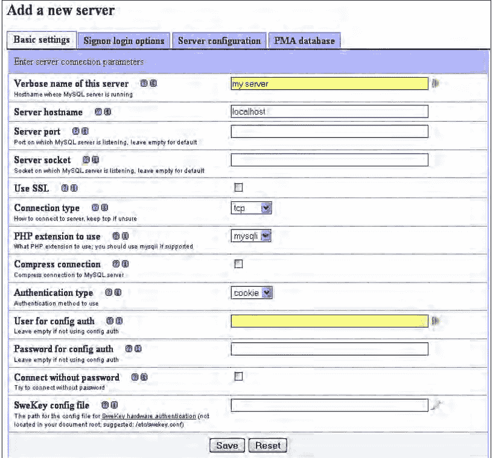
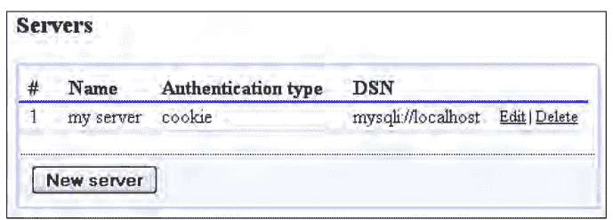

# 1 引言与安装

## 引言与安装

祝您阅读本书愉快！本章的目的是：

- 了解该软件产品在 Web 光谱中的位置
- 了解其所有功能
- 熟练掌握其安装和配置

### 介绍 phpMyAdmin

本节描述了 phpMyAdmin 在 PHP/MySQL Web 应用背景下的位置，并总结了其功能。

### Web 应用

Web 已经发展！在过去几年里，Web 发生了巨大变化。在其初期，Web 主要是一种用于传递静态信息的媒介（“看，我的主页在网上！”）。现在，Web 的很大一部分承载着由应用程序动态生成的信息，企业甚至个人都依赖这些信息来构建其内联网和公共网站。

由于数据库的明显优势——更好的信息可访问性和结构化——Web 应用大多以数据库为驱动。虽然使用的前端通常是众所周知（并且部署迅速）的 Web 浏览器，但在后端有一个数据库系统。应用程序为浏览器和数据库之间提供接口。

那些不运营数据库驱动网站的人，并没有充分利用该媒介的能力。此外，他们可能落后于已经做出转变的竞争对手。因此，问题不在于我们是否应该实施数据库驱动的网站，而在于何时以及如何实施。

为什么使用 Web 应用？它们通过提供以下可能性来改善用户体验并让用户参与其中：

- 收集有关网站的反馈
- 让用户通过论坛与我们以及彼此进行交流
- 从我们的电子商务网站订购商品
- 启用易于编辑的基于 Web 的信息（内容管理）
- 从 Web 设计和维护数据库

如今，WWW 可能代表 World-Wide Wave——一股巨大浪潮，从根本上改变了开发者对用户界面、数据呈现方式的思考，尤其是数据如何到达用户并返回数据中心的方式。

### PHP 和 MySQL：领先的开源组合

当我们查看托管服务提供商目前提供的 Web 应用平台时，我们会发现最普遍的是 PHP/MySQL 组合。

在各自的主页——http://www.php.net 和 http://www.mysql.com 的良好支持下，这一组合使开发者能够提供大量现成的开源 Web 应用，最重要的是，使内部开发者能够快速部署可靠的 Web 解决方案。

MySQL 大体符合 SQL:2003 标准，是一种以速度、稳健性和较小的连接开销而闻名的数据库系统。这在 Web 环境中非常重要，因为页面必须尽可能快速地提供。

PHP 通常作为 Web 服务器内部的模块安装，是一种流行的脚本语言，应用程序用它编写以与后端 MySQL（或其他数据库系统）以及前端浏览器进行通信。具有讽刺意味的是，该缩写的含义随着 Web 的发展而演变，从 Personal Homepage 到 Professional HomePage，再到其当前的递归定义：PHP: Hypertext Processor。关于名称的连续更改的参考可以在 PHP 的源代码中看到，网址为 http://cvs.php.net/viewvc.cgi/php3/CHANGES?r1=1.23&r2=1.24。PHP 可在数百万个 Web 域上使用，推动着自身快速发展的应用浪潮。

### 什么是 phpMyAdmin？

phpMyAdmin（官方主页为 http://www.phpmyadmin.net）是用 PHP 编写的 Web 应用，包含（像大多数 Web 应用一样）XHTML、CSS 和 JavaScript 客户端代码。它为管理 MySQL 数据库提供了一个完整的 Web 界面，并被广泛认为是该领域的领先应用。

自诞生以来一直是开源的，它获得了全球众多开发者和翻译者的支持（在撰写本书时已翻译成 55 种语言）。该项目目前托管在 SourceForge 上。

全球各地的托管服务提供商通过在其服务器上安装 phpMyAdmin 来展示他们对它的信任。流行的 cPanel（网站控制应用）与 phpMyAdmin 接口。此外，只要我们的服务提供商满足最低要求（请参阅本章后面的系统要求部分），我们就可以在自己的 Web 空间内安装自己的 phpMyAdmin 副本。

### phpMyAdmin 功能

phpMyAdmin 的目标是提供对 MySQL 服务器和数据的完整基于 Web 的管理，并跟上 MySQL 和 Web 标准的发展。虽然该产品并不完美，但目前它包含了最常请求的功能和其他额外功能。

开发团队根据报告的错误和请求的功能不断对产品进行微调，并定期发布新版本。

phpMyAdmin 提供了涵盖基本 MySQL 数据库和表操作的特性。它还具有一个内部关系系统，用于维护元数据以支持高级功能。最后，系统管理员可以从 phpMyAdmin 管理用户和权限。需要注意的是，phpMyAdmin 可用操作的选项取决于用户在特定 MySQL 服务器上的权限。

基本功能包括：

- 数据库创建、删除、重命名和属性更改
- 表创建、重命名、复制和删除
- 表结构维护，包括索引
- 特殊表操作（修复、优化和更改类型）
- 数据插入、修改、删除
- 数据以横向/纵向模式显示，以及打印视图
- 数据导航和排序
- 二进制数据上传
- 数据搜索（表或数据库）
- 示例查询（多表）
- 批量加载数据（导入）
- 以多种格式导出结构和数据，并进行压缩
- 多用户和多服务器安装，带基于 Web 的设置


高级功能包括：

-   字段级注释
-   外键（有或没有 InnoDB）
-   浏览外表
-   查询书签
-   数据字典
-   PDF 关系模式和字典
-   SQL 查询历史
-   连接到 MySQL，使用传统的 `mysql` 扩展或新的 `mysqli` 扩展（在 PHP 5 中）
-   数据库、表和字段的字符集支持（MySQL 4.1）
-   基于 MIME 类型的列内容转换
-   关系可视化设计器
-   支持 MySQL 5.0 功能 — 视图、存储过程、触发器、性能分析
-   支持 MySQL 5.1 功能 — 事件和分区
-   支持特殊存储引擎 — Maria、PBXT 和 PBMS（BLOB 流）
-   支持 Swekey 硬件身份验证 USB 密钥
-   主题管理以自定义界面外观

服务器管理功能包括：

-   用户和权限管理
-   数据库权限检查
-   验证服务器运行时信息并获取配置提示
-   完整服务器导出

## 安装 phpMyAdmin

是时候安装产品并对其进行最小化配置以便首次使用。

我们安装 phpMyAdmin 的原因可能是以下之一：

-   我们的托管服务提供商未安装中央副本
-   我们的提供商已安装它，但安装的版本不是最新的
-   我们直接在企业 Web 服务器上工作

## 所需信息

一些托管服务提供商提供集成 Web 面板，我们可以在其中管理账户，包括 MySQL 账户，还有可用于上传 Web 内容的文件管理器。根据此情况，我们将 phpMyAdmin 传输到 Web 空间的机制会有所不同。在开始安装之前，我们需要一些特定信息（如下列出）：

-   Web 服务器的名称或地址。这里，我们假设它为 www.mydomain.com。
-   我们的 Web 服务器账户信息（用户名、密码）。此信息将用于 FTP 或 SFTP 传输、SSH 登录或 Web 控制面板登录。
-   MySQL 服务器的名称或地址。通常，这是 localhost，这意味着它位于与 Web 服务器相同的机器上。我们假设它为 mysql.mydomain.com。
-   我们的 MySQL 服务器账户信息（用户名、密码）。

## 系统要求

特定 phpMyAdmin 版本的最新要求始终在随附的 Documentation.html 中说明。对于 phpMyAdmin 3.1，所需的最低 PHP 版本为 PHP 5.2，并支持 session 和标准 PHP 库（SPL）。此外，Web 服务器必须能够访问 MySQL 服务器（版本 5.0 或更高版本）——本地或远程机器均可。强烈建议在 cookie 身份验证模式下安装 PHP mcrypt 扩展以提高性能（有关更多信息，请参阅第 2 章）。事实上，在 64 位服务器上，此扩展是必需的。

在浏览器端，无论使用何种身份验证模式，都必须激活 cookie 支持。

## 下载文件

在 http://www.phpmyadmin.net 的下载部分提供了各种文件。这里可能会提供多个版本，下载最新稳定版本始终是一个好主意。我们只需要下载一个文件，它适用于任何平台（浏览器、Web 服务器、MySQL 或 PHP 版本）。对于版本 3.1，文件分为两组——english 和 all-languages。如果我们只需要英文界面，可以下载包含 "english" 的文件——例如，phpMyAdmin-3.1.0-english.zip。另一方面，如果我们需要至少一种其他语言，则应选择包含 "all-languages" 的选项。

如果我们使用仅支持 PHP4 的服务器——PHP 团队已于 December 31, 2007 起停止支持——那么 phpMyAdmin 的最新稳定版本不是一个好的下载选择。我建议使用版本 2.11.x，这是支持 PHP4 的最新分支。

提供的 files 有各种扩展名：.zip、.tar.bz2、.tar.gz、.7z。下载具有相应解压工具的扩展名的文件。在 Windows 世界中，.zip 是最通用的文件格式，尽管它比 .gz 或 .bz2（在 Linux/Unix 世界中常见）更大。在以下示例中，我们假设所选文件为 phpMyAdmin-3.1.1-all-languages.zip。

点击适当文件后，我们需要选择最近的镜像站点。文件将开始下载，我们可以将其保存在计算机上。

## 安装程序

下一步取决于您使用的平台。以下各节详细说明了一些常见平台的程序。您可以直接进入相关部分。

## 使用 Windows 客户端在远程服务器上安装

使用文件资源管理器，双击我们在 Windows 机器上刚下载的 phpMyAdmin-3.1.1-all-languages.zip 文件。文件解压工具应启动，显示主 phpMyAdmin-3.1.1-all-languages 目录内的所有脚本和目录。

使用文件解压工具提供的任何机制将所有文件（包括子目录）保存到工作站上的某个位置。这里，我们选择了 c:\。因此，已为解压创建了 c:\phpMyAdmin-3.1.1-all-languages 目录。

现在，是时候将整个目录结构 c:\phpMyAdmin-3.1.1-all-languages 传输到我们 Web 空间中的 Web 服务器。我们使用最喜欢的 FTP 软件或 Web 控制面板进行传输。

我们传输 phpMyAdmin 的确切目录可能有所不同。它可以是我们的 public_html 目录，也可以是我们通常传输 Web 文档的另一个目录。有关应使用确切目录或最佳传输目录结构方式的进一步说明，我们可以咨询托管服务提供商的帮助台。

传输完成后，这些文件可以删除，因为它们在 Windows 客户端上不再需要。

## 在本地 Linux 服务器上安装

假设我们选择了 phpMyAdmin-3.1.1-all-languages.tar.gz 并直接下载到 Linux 服务器上的某个目录。我们将其移动到 Web 服务器的文档根目录（例如，/var/www/html）或其子目录之一（例如，/var/www/html/utilities）。然后我们使用以下 shell 命令或使用窗口管理器提供的任何图形文件解压工具进行解压：

```
tar -xzvf phpMyAdmin-3.1.1-all-languages.tar.gz
```

我们必须确保目录和文件的权限和所有权适合我们的 Web 服务器。Web 服务器用户或组必须能够读取它们。

## 在本地 Windows 服务器上安装（Apache、IIS）

这里的程序与“使用 Windows 客户端在远程服务器上安装”部分所述类似，只是目标目录将在我们的 DocumentRoot（对于 Apache）或 wwwroot（对于 IIS）下。当然，在对 config.inc.php（在下一节中描述）进行修改后，我们无需传输任何内容，因为该目录已在 Web 空间中。

Apache 通常作为服务运行。因此，我们必须确保服务运行的用户具有正常读取权限以访问我们新建的目录。相同的原则适用于 IIS，它使用 IUSR_machinename 用户。该用户必须具有对目录的读取访问权限。您可以在目录属性的“安全/权限”选项卡中调整权限。

## 配置 phpMyAdmin

在这里，我们学习如何准备和使用包含连接到 MySQL 的参数的配置文件，并可根据我们的要求进行自定义。


> 在配置之前，我们可以将目录 phpMyAdmin-3.1.1-all-languages 重命名为 phpMyAdmin、phpmyadmin、admin 或其他更易于记忆的名称。这样，我们和我们的用户就可以访问一个易于记忆的 URL 来启动 phpMyAdmin。如果我们的服务器支持此功能，我们也可以使用符号链接。


## config.inc.php 文件

本文件包含有效的 PHP 代码，定义了大多数参数（以 PHP 变量表示），我们可以更改这些参数来根据自己的需求调整 phpMyAdmin。 其中还包含普通的 PHP 注释，我们可以对更改进行注释。

> 请注意不要在文件开头或结尾添加任何空行；这会妨碍 phpMyAdmin 的执行。

请注意 phpMyAdmin 在第一级目录中查找此文件——与 index.php 位于同一目录。

在 2.8.0 之前的版本中，下载的套件中包含了一个通用的 config.inc.php 文件。自 2.8.0 起，此文件不再存在于目录结构中。自 2.9.0 版本起，包含了一个 config.sample.inc.php 文件，可以将其复制到 config.inc.php 以作为起点。然而，建议您改用基于 Web 的设置脚本（本章中已解释），以获得更舒适的配置界面。

还有另一个文件——layout.inc.php——包含一些配置信息。由于 phpMyAdmin 提供主题管理，此文件包含特定于主题的颜色和设置。每个主题对应一个 layout.inc.php，位于 themes/themename，例如 themes/original。我们将在第 4 章“入门步骤”部分介绍修改其中一些参数。

## config.inc.php 的权限

在正常行为中，phpMyAdmin 会验证此文件的权限是否不允许每个人修改它。这意味着该文件不应被所有人写入。此外，如果权限不正确，它还会显示警告。然而，在某些情况下（例如在非 Windows 服务器上挂载的 NTFS 文件系统），权限检测会失败。在这些情况下，您应将此参数设置为 false：

```
$cfg['CheckConfigurationPermissions'] = false;
```

## 配置原则

如果没有配置文件，phpMyAdmin 的行为在 3.1.0 版本中发生了变化。在 3.0 及更早版本中，应用程序使用 libraries/config.default.php 中定义的默认设置，并尝试连接到 localhost 上的 MySQL 服务器——即 Web 服务器所在的同一台机器——使用用户 root 且无密码。这是大多数 MySQL 安装程序产生的默认设置，尽管它并不真正安全。然而，如果我们新安装的 MySQL 服务器仍使用默认的 root 账户，我们将自动登录并会看到 phpMyAdmin 关于此类安全缺失的警告。

> 如果 MySQL root 用户的概念对您来说难以理解，现在可能是浏览 http://dev.mysql.com/doc/refman/5.1/en/privilege-system.html 的时候了，以了解 MySQL 权限系统的基础知识。

自 3.1.0 版本起，开发团队希望推广更灵活的登录面板。这就是为什么在缺少配置文件的情況下，phpMyAdmin 默认显示基于 cookie 的登录面板（有关此内容的更多详细信息请参见第 2 章）：



我们可以通过打开浏览器并访问 http://www.mydomain.com/phpmyadmin 来验证这一事实，并将域名部分和目录部分替换为适当的值。

如果我们能够登录，这意味着 Web 服务器同一主机上正在运行 MySQL 服务器，并且我们刚刚与其建立了连接。然而，未创建配置文件意味着我们只能管理此主机。此外，许多高级 phpMyAdmin 功能（例如，查询书签、完整的关系支持、列转换等）将不会被激活。

> > 基于 cookie 的身份验证方法使用 Blowfish 加密在浏览器 cookie 中存储凭据。当不存在配置文件时，会生成一个 Blowfish 密钥并存储在会话数据中，这可能会导致安全问题。这就是为什么会显示警告消息的原因：**配置文件现在需要一个密钥短语（blowfish_secret）**。

在这一点上，我们有一些选择：

- 不使用配置文件使用 phpMyAdmin
- 使用基于 Web 的设置脚本生成一个 config.inc.php 文件
- 手动创建 config.inc.php 文件

这些选项在以下各节中介绍。我们应该注意，即使使用基于 Web 的设置脚本，我们也应熟悉 config.inc.php 文件格式，因为设置脚本并不涵盖所有可能的配置选项。

## 基于 Web 的设置脚本

强烈建议使用基于 Web 的设置机制，以避免因手动创建配置文件而可能出现的语法错误。此外，由于该文件必须遵守 PHP 的语法，新用户在此安装阶段遇到问题是很常见的。

> > 这里需要一个警告：当前版本仅为设置界面提供了有限数量的翻译语言。

要访问设置脚本，我们必须访问 http://www.mydomain.com/phpmyadmin/scripts/setup。初始执行时出现以下内容：



在大多数情况下，每个参数旁边的图标都指向相应的 phpMyAdmin 官方 Wiki 和文档，为您提供有关该参数及其可能值的更多信息。

如果出现“显示隐藏消息”，并且我们点击此链接，则会显示以下消息：



这里有三个警告。我们首先处理第二个——**不安全连接**。如果我们通过 HTTP（不安全协议）访问 Web 服务器，则会出现此消息。由于我们可能要在设置阶段输入机密信息，例如用户名和密码，建议您至少在此阶段通过 HTTPS 进行通信。HTTPS 使用 **SSL**（**安全套接层**）来加密通信，使线路窃听变得不可能。如果我们的 Web 服务器支持 HTTPS，我们只需按照建议的链接操作即可。它将重新启动设置过程，这次通过 HTTPS 进行。我们在示例中做出了此假设。

第三个警告鼓励您使用 **ForceSSL** 选项，该选项在使用 phpMyAdmin 时会自动切换到 HTTPS（与设置阶段无关）。

第一个警告告诉我们 phpMyAdmin 未找到名为 **config** 的可写目录。这是正常的，因为它不在下载的套件中。此外，由于目录尚不存在，我们会发现界面中的 **Save**、**Load** 和 **Delete** 按钮呈灰色。在此 **config** 目录中，我们可以：

- 在设置过程中保存配置文件的当前版本
- 加载之前准备好的 config.inc.php 文件

创建此配置目录并非绝对必要，因为我们可以将设置程序生成的 **config.inc.php** 文件下载到客户端机器。然后，我们可以通过与上传 phpMyAdmin 相同的机制（例如 FTP）将其上传到第一级目录中的 phpMyAdmin。无论如何，我们将创建此目录。

这里的原则是 Web 服务器必须能够写入此目录。实现此目的的方法不止一种。这里有一个在 Linux 服务器上可行的方案——为此目录添加对所有人的读、写和执行权限。

```
cd phpMyAdmin
mkdir config
chmod 777 config
```

完成此操作后，我们在浏览器中刷新页面，看到：



在配置对话框中，下拉菜单允许用户选择正确的行尾格式。这取决于我们计划稍后使用文本编辑器打开 config.inc.php 文件的平台。

单个 phpMyAdmin 副本可用于管理多个 MySQL 服务器。我们现在将定义描述我们第一个 MySQL 服务器的参数。我们点击 New server，服务器配置面板显示出来。

这些参数的完整解释可在本章的以下各节和第 11 章中找到。目前，我们注意到设置过程检测到 PHP 也支持 mysqli 扩展。因此，这是默认选择的扩展。该扩展是 PHP 用于与 MySQL 通信的编程库。

我鼓励您遵循界面提出的理念，并将 cookie 保留为身份验证类型。我们假设我们的 MySQL 服务器位于 localhost。因此，我们保留此值和所有建议值不变，除了以下内容：

- 此服务器的详细名称——我们输入 my server
- 配置身份验证的用户——我们删除 root 并将其留空


你可以看到任何从默认值更改的参数都会以不同的颜色显示。此外，一个小箭头会出现，其目的是将字段恢复到默认值。因此，你可以随意尝试更改参数，因为知道可以轻松地恢复到建议的值。此时，面板应如下所示：



我们然后点击 **Save** 并被带回 **Overview** 面板。此保存操作尚未将任何内容保存到磁盘；更改已保存在内存中。我们被警告已生成一个 Blowfish 密钥。然而，我们不必记住它，因为它在登录过程中不会被输入，而是内部使用。对于好奇的人，你可以切换到 **Features** 面板并点击 **Security** 选项卡以查看生成了哪个密钥。回到 **Overview** 面板。现在我们的设置过程知道了一个 MySQL 服务器，并且有链接可以让我们 **Edit** 或 **Delete** 这些服务器设置：



我们可以使用 **Display** 按钮查看生成的配置行——然后我们可以使用本章后面 *Description of some Configuration Parameters* 部分中给出的解释来分析这些参数。

此时，此配置仍仅在内存中，因此我们需要保存它。这是通过 **Overview** 面板上的 **Save** 按钮完成的。它将 `config.inc.php` 保存到我们之前创建的特殊 `config` 目录中。这是一个严格用于配置目的的目录。如果由于任何原因无法创建此 `config` 目录，你只需 **Download** 该文件并将其上传到 phpMyAdmin 安装的 Web 服务器目录中。

最后一步是将 `config.inc.php` 从 `config` 目录复制到顶级目录——包含 `index.php` 的目录。通过复制此文件，它将归用户所有而不是 Web 服务器，确保可以进行进一步的修改。此复制可以通过 FTP 或通过以下等命令完成：

```
cd config
cp config.inc.php ..
```

> 作为安全措施，建议你更改 config 目录的权限——例如，使用 chmod ugo-rwx config 命令。这是为了阻止在此目录中进行任何未经授权的读取和写入。

其他配置参数也可以通过这些基于 Web 的设置页面进行设置。为此，我们必须：

- 1. 启用对 config 目录的读写访问
- 2. 将 config.inc.php 复制到那里
- 3. 确保为 Web 服务器提供对该文件的读写访问
- 4. 启动基于 Web 的设置工具

我们邀请你浏览剩余的菜单以了解可用的配置可能性，无论是现在还是在我们介绍相关主题时。

为了使本书的文本更简洁，我们在以下章节中只会引用参数的文本值。

## Manual creation of config.inc.php

我们可以从头开始使用我们喜欢的文本编辑器创建此文本文件，或以 config.sample.inc.php 作为起点。确切的程序取决于我们使用的客户端操作系统。我们可以参考下一节获取更多信息。

config.inc.php 内部所有可能配置参数的默认值在 libraries/config.default.php 中定义。我们可以查看此文件以了解所使用的语法以及关于配置的进一步注释。参见本章 phpMyAdmin 升级部分中关于此文件的[content]
你可以看到任何从默认值更改的参数都会以不同的颜色显示。此外，一个小箭头会出现，其目的是将字段恢复到默认值。因此，你可以随意尝试更改参数，因为知道可以轻松地恢复到建议的值。此时，面板应如下所示：


我们然后点击 **Save** 并被带回 **Overview** 面板。此保存操作尚未将任何内容保存到磁盘；更改已保存在内存中。我们被警告已生成一个 Blowfish 密钥。然而，我们不必记住它，因为它在登录过程中不会被输入，而是内部使用。对于好奇的人，你可以切换到 **Features** 面板并点击 **Security** 选项卡以查看生成了哪个密钥。回到 **Overview** 面板。现在我们的设置过程知道了一个 MySQL 服务器，并且有链接可以让我们 **Edit** 或 **Delete** 这些服务器设置：


我们可以使用 **Display** 按钮查看生成的配置行——然后我们可以使用本章后面 *Description of some Configuration Parameters* 部分中给出的解释来分析这些参数。

此时，此配置仍仅在内存中，因此我们需要保存它。这是通过 **Overview** 面板上的 **Save** 按钮完成的。它将 `config.inc.php` 保存到我们之前创建的特殊 `config` 目录中。这是一个严格用于配置目的的目录。如果由于任何原因无法创建此 `config` 目录，你只需 **Download** 该文件并将其上传到 phpMyAdmin 安装的 Web 服务器目录中。

最后一步是将 `config.inc.php` 从 `config` 目录复制到顶级目录——包含 `index.php` 的目录。通过复制此文件，它将归用户所有而不是 Web 服务器，确保可以进行进一步的修改。此复制可以通过 FTP 或通过以下等命令完成：

```
cd config
cp config.inc.php ..
```

> 作为安全措施，建议你更改 config 目录的权限——例如，使用 chmod ugo-rwx config 命令。这是为了阻止在此目录中进行任何未经授权的读取和写入。

其他配置参数也可以通过这些基于 Web 的设置页面进行设置。为此，我们必须：

- 1. 启用对 config 目录的读写访问
- 2. 将 config.inc.php 复制到那里
- 3. 确保为 Web 服务器提供对该文件的读写访问
- 4. 启动基于 Web 的设置工具

我们邀请你浏览剩余的菜单以了解可用的配置可能性，无论是现在还是在我们介绍相关主题时。

为了使本书的文本更简洁，我们在以下章节中只会引用参数的文本值。

## Manual creation of config.inc.php

我们可以从头开始使用我们喜欢的文本编辑器创建此文本文件，或以 config.sample.inc.php 作为起点。确切的程序取决于我们使用的客户端操作系统。我们可以参考下一节获取更多信息。

config.inc.php 内部所有可能配置参数的默认值在 libraries/config.default.php 中定义。我们可以查看此文件以了解所使用的语法以及关于配置的进一步注释。参见本章 phpMyAdmin 升级部分中关于此文件的重要说明。

## Tips for editing config.inc.php on a Windows Client

此文件包含特殊字符（Unix 风格的行尾）。因此，我们必须使用理解此格式的文本编辑器打开它。如果我们使用错误的文本编辑器，此文件将以非常长的行显示。

最佳选择是标准的 PHP 编辑器。另一个选择是 WordPad、Metapad 或 UltraEdit。我们应注意不要在文件开头或结尾添加任何字符（即使是空白行）。这会干扰 phpMyAdmin 的执行并生成 Cannot send header output... 错误消息。如果发生这种情况，请参阅附录 B。

每次修改 config.inc.php 文件时，都必须再次将其传输到我们的 Web 空间。此传输通过 FTP 或 SFTP 客户端完成。你可以选择使用独立的 FTP/SFTP 客户端，如 FileZilla，或如果你的 PHP 编辑器支持此功能，则直接通过 FTP/SFTP 保存。

## Description of some configuration parameters

在本章和下一章中，我们将集中讨论处理连接和身份验证的参数。其他参数将在解释相应功能的章节中讨论。

### PmaAbsoluteUri

我们将查看的第一个参数是 $cfg['PmaAbsoluteUri'] = '';

PMA 是 phpMyAdmin 的常用缩写。对于配置参数，所选的约定是首字母大写，在本例中产生 Pma。在其代码的某些位置，phpMyAdmin 发送 HTTP Location 头部并必须知道其安装点的绝对 URI。在这种情况下使用绝对 URI 是由 RFC 2616 第 14.30 节要求的。

在大多数情况下，我们可以将其留空，因为 phpMyAdmin 会尝试自动检测正确的值。如果我们稍后浏览一个表，然后编辑一行并点击保存，我们将收到浏览器发出的错误消息，例如 This document does not exist。这意味着 phpMyAdmin 为了到达预期页面而构建的绝对 URI 是错误的，表明我们必须在此参数中手动输入正确的值。

例如，我们会将其更改为：

```
$cfg['PmaAbsoluteUri'] = 'http://www.mydomain.com/phpMyAdmin/';
```

### Server-specific sections

文件的下一部分包含特定于服务器的配置，每个配置都以以下内容开头：

```
$i++;
$cfg['Servers'][$i]['host'] = '';
```

如果我们只检查正常的服务器参数（其他参数将从第 11 章开始介绍），我们会看到每个服务器看起来像以下部分：

```
$i++;
$cfg['Servers'][$i]['host']      = '';
$cfg['Servers'][$i]['port']      = '';
$cfg['Servers'][$i]['socket']    = '';
$cfg['Servers'][$i]['connect_type'] = 'tcp';
$cfg['Servers'][$i]['extension'] = 'mysqli';
$cfg['Servers'][$i]['compress']  = FALSE;
$cfg['Servers'][$i]['controluser'] = '';
$cfg['Servers'][$i]['controlpass'] = '';
$cfg['Servers'][$i]['auth_type'] = 'cookie';
$cfg['Servers'][$i]['user']      = '';
$cfg['Servers'][$i]['password']  = '';
$cfg['Servers'][$i]['only_db']   = '';
$cfg['Servers'][$i]['hide_db']   = '';
$cfg['Servers'][$i]['verbose']   = '';
```

在此部分中，我们必须在 $cfg['Servers'][$i]['host'] 中输入 MySQL 服务器的主机名或 IP 地址——例如 mysql.mydomain.com 或 localhost。如果此服务器在非标准端口或套接字上运行，我们在 $cfg['Servers'][$i]['port'] 或 $cfg['Servers'][$i]['socket'] 中填写正确的值。有关套接字的更多详细信息，请参阅 connect_type 部分。

phpMyAdmin 界面中显示的服务器名称将是 `host` 中输入的名称（除非我们在以下参数中输入非空白值）。例如：

```
$cfg['Servers'][$i]['verbose'] = 'Test server';
```

因此，此功能可用于隐藏用户所见的真实服务器主机名。

### extension

PHP 用于与 MySQL 服务器通信的传统机制，如 PHP 5 之前可用的是 mysql 扩展。此扩展在 PHP 5 中仍然可用。然而，已经开发了一个名为 mysqli 的新扩展，并且由于其改进的性能及其对 MySQL 系列 4.1.x 全部功能的支持，应优先用于 PHP 5。此扩展设计为与 MySQL 版本 4.1.3 及更高版本一起使用。

在 phpMyAdmin 版本 2.6.0 中，实现了一个新的库。这使得可以使用两个扩展成为可能，为特定服务器选择其中一个。我们在 $cfg['Servers'][$i]['extension'] 中指示要使用的扩展。


## 持久连接

另一个重要参数（该参数并非特定于服务器，而是适用于所有服务器定义）是 $cfg['PersistentConnections']。对于使用 mysql 扩展连接的每个服务器，当该参数设置为 TRUE 时，会指示 PHP 保持与 MySQL 服务器的连接打开。这加快了 PHP 与 MySQL 之间的交互。然而，它在 config.inc.php 中默认设置为 FALSE，因为持久连接通常是服务器资源耗尽的原因。因此你会发现 MySQL 拒绝新的连接。出于这个原因，该选项甚至不适用于 mysqli 扩展。因此，如果你使用此扩展进行连接，将其设置为 TRUE 也不会产生任何效果。

## connect_type、socket 和端口

mysql 和 mysqli 扩展如果服务器位于 localhost，则会自动使用 socket 连接到 MySQL。考虑以下配置：

```
$cfg['Servers'][$i]['host']      = 'localhost';
$cfg['Servers'][$i]['port']      = '';
$cfg['Servers'][$i]['socket']    = '';
$cfg['Servers'][$i]['connect_type'] = 'tcp';
$cfg['Servers'][$i]['extension'] = 'mysql';
```

connect_type 的默认值是 tcp。然而，扩展会使用 socket，因为它认为当主机为 localhost 时这样更高效。因此，在这种情况下，我们可以将 connect_type 用作 tcp 或 socket。要强制进行真正的 tcp 连接，我们可以在 host 参数中指定 127.0.0.1 而不是 localhost。因为 socket 参数为空，扩展将尝试默认 socket。如果此默认 socket（在 php.ini 中定义）与分配给 MySQL 服务器的实际 socket 不对应，我们必须将 socket 名称（例如，/tmp/mysql.sock）放入 $cfg['Servers'][$i]['socket'] 中。

如果主机名不是 localhost，将发生 tcp 连接——这里使用特殊端口 3307。然而，留空端口值将使用默认 3306 端口：

```
$cfg['Servers'][$i]['host']        = 'mysql.mydomain.com';

$cfg['Servers'][$i]['port']        = '3307';

$cfg['Servers'][$i]['socket']      = "";

$cfg['Servers'][$i]['connect_type']  = 'tcp';

$cfg['Servers'][$i]['extension']    = 'mysql';
```

## 压缩配置

从 PHP 4.3.0 和 MySQL 3.23.49 开始，用于 PHP 与 MySQL 之间通信的协议允许压缩模式。使用此模式可提供更好的效率。要利用此模式，只需指定：

```
$cfg['Servers'][$i]['compress'] = TRUE;
```

## 升级 phpMyAdmin

通常，升级只是将新版本安装到单独的目录并将上一个版本的 config.inc.php 复制到新目录的问题。如果上一个版本是 phpMyAdmin 2.6.0 或更旧，则无法将其 config.inc.php 复制到新版本，因为文件格式已更改太多。


> 不应采用的升级路径或首次安装路径是将 libraries/config.default.php 复制到 config.inc.php。这是因为默认配置文件是特定于版本的，并且不能保证适用于未来的版本。

新参数会随版本而出现。它们记录在 Documentation.html 中，并在 libraries/config.default.php 中定义。如果 config.inc.php 中不存在配置参数，则将使用 libraries/config.default.php 中的值。因此，如果默认值适合我们，就无需在 config.inc.php 中包含它。

必须特别注意传播我们可能对 layout.inc.php 文件所做的更改，具体取决于所使用的主题。我们甚至可能需要复制自定义主题子目录，如果我们向结构中添加了自己的主题。

## 摘要

本章介绍了 Web 作为交付应用程序的手段是如何演变的，以及为什么我们应该使用 PHP/MySQL 来开发这些应用程序。本章还概述了为什么 phpMyAdmin 被公认为从 Web 接口 MySQL 的领先应用程序，并简要列出了其功能。然后讨论了安装 phpMyAdmin 的常见原因、从主站点下载的步骤、基本配置、将 phpMyAdmin 上传到我们的 Web 服务器以及升级的相关内容。

现在基本安装已经完成，下一个章节将深入探讨配置主题，通过探索身份验证和安全方面。

## 2

## 身份验证和安全

在 phpMyAdmin 中配置身份验证的方式有很多——取决于我们的目标、其他应用程序的存在以及我们需要的[content]
## 持久连接

另一个重要参数（该参数并非特定于服务器，而是适用于所有服务器定义）是 $cfg['PersistentConnections']。对于使用 mysql 扩展连接的每个服务器，当该参数设置为 TRUE 时，会指示 PHP 保持与 MySQL 服务器的连接打开。这加快了 PHP 与 MySQL 之间的交互。然而，它在 config.inc.php 中默认设置为 FALSE，因为持久连接通常是服务器资源耗尽的原因。因此你会发现 MySQL 拒绝新的连接。出于这个原因，该选项甚至不适用于 mysqli 扩展。因此，如果你使用此扩展进行连接，将其设置为 TRUE 也不会产生任何效果。

## connect_type、socket 和端口

mysql 和 mysqli 扩展如果服务器位于 localhost，则会自动使用 socket 连接到 MySQL。考虑以下配置：

```
$cfg['Servers'][$i]['host']      = 'localhost';
$cfg['Servers'][$i]['port']      = '';
$cfg['Servers'][$i]['socket']    = '';
$cfg['Servers'][$i]['connect_type'] = 'tcp';
$cfg['Servers'][$i]['extension'] = 'mysql';
```

connect_type 的默认值是 tcp。然而，扩展会使用 socket，因为它认为当主机为 localhost 时这样更高效。因此，在这种情况下，我们可以将 connect_type 用作 tcp 或 socket。要强制进行真正的 tcp 连接，我们可以在 host 参数中指定 127.0.0.1 而不是 localhost。因为 socket 参数为空，扩展将尝试默认 socket。如果此默认 socket（在 php.ini 中定义）与分配给 MySQL 服务器的实际 socket 不对应，我们必须将 socket 名称（例如，/tmp/mysql.sock）放入 $cfg['Servers'][$i]['socket'] 中。

如果主机名不是 localhost，将发生 tcp 连接——这里使用特殊端口 3307。然而，留空端口值将使用默认 3306 端口：

```
$cfg['Servers'][$i]['host']        = 'mysql.mydomain.com';

$cfg['Servers'][$i]['port']        = '3307';

$cfg['Servers'][$i]['socket']      = "";

$cfg['Servers'][$i]['connect_type']  = 'tcp';

$cfg['Servers'][$i]['extension']    = 'mysql';
```

## 压缩配置

从 PHP 4.3.0 和 MySQL 3.23.49 开始，用于 PHP 与 MySQL 之间通信的协议允许压缩模式。使用此模式可提供更好的效率。要利用此模式，只需指定：

```
$cfg['Servers'][$i]['compress'] = TRUE;
```

## 升级 phpMyAdmin

通常，升级只是将新版本安装到单独的目录并将上一个版本的 config.inc.php 复制到新目录的问题。如果上一个版本是 phpMyAdmin 2.6.0 或更旧，则无法将其 config.inc.php 复制到新版本，因为文件格式已更改太多。


> 不应采用的升级路径或首次安装路径是将 libraries/config.default.php 复制到 config.inc.php。这是因为默认配置文件是特定于版本的，并且不能保证适用于未来的版本。

新参数会随版本而出现。它们记录在 Documentation.html 中，并在 libraries/config.default.php 中定义。如果 config.inc.php 中不存在配置参数，则将使用 libraries/config.default.php 中的值。因此，如果默认值适合我们，就无需在 config.inc.php 中包含它。

必须特别注意传播我们可能对 layout.inc.php 文件所做的更改，具体取决于所使用的主题。我们甚至可能需要复制自定义主题子目录，如果我们向结构中添加了自己的主题。

## 摘要

本章介绍了 Web 作为交付应用程序的手段是如何演变的，以及为什么我们应该使用 PHP/MySQL 来开发这些应用程序。本章还概述了为什么 phpMyAdmin 被公认为从 Web 接口 MySQL 的领先应用程序，并简要列出了其功能。然后讨论了安装 phpMyAdmin 的常见原因、从主站点下载的步骤、基本配置、将 phpMyAdmin 上传到我们的 Web 服务器以及升级的相关内容。

现在基本安装已经完成，下一个章节将深入探讨配置主题，通过探索身份验证和安全方面。

## 2

## 身份验证和安全

在 phpMyAdmin 中配置身份验证的方式有很多——取决于我们的目标、其他应用程序的存在以及我们需要的[content]
## 持久连接

另一个重要参数（该参数并非特定于服务器，而是适用于所有服务器定义）是 $cfg['PersistentConnections']。对于使用 mysql 扩展连接的每个服务器，当该参数设置为 TRUE 时，会指示 PHP 保持与 MySQL 服务器的连接打开。这加快了 PHP 与 MySQL 之间的交互。然而，它在 config.inc.php 中默认设置为 FALSE，因为持久连接通常是服务器资源耗尽的原因。因此你会发现 MySQL 拒绝新的连接。出于这个原因，该选项甚至不适用于 mysqli 扩展。因此，如果你使用此扩展进行连接，将其设置为 TRUE 也不会产生任何效果。

## connect_type、socket 和端口

mysql 和 mysqli 扩展如果服务器位于 localhost，则会自动使用 socket 连接到 MySQL。考虑以下配置：

```
$cfg['Servers'][$i]['host']      = 'localhost';
$cfg['Servers'][$i]['port']      = '';
$cfg['Servers'][$i]['socket']    = '';
$cfg['Servers'][$i]['connect_type'] = 'tcp';
$cfg['Servers'][$i]['extension'] = 'mysql';
```

connect_type 的默认值是 tcp。然而，扩展会使用 socket，因为它认为当主机为 localhost 时这样更高效。因此，在这种情况下，我们可以将 connect_type 用作 tcp 或 socket。要强制进行真正的 tcp 连接，我们可以在 host 参数中指定 127.0.0.1 而不是 localhost。因为 socket 参数为空，扩展将尝试默认 socket。如果此默认 socket（在 php.ini 中定义）与分配给 MySQL 服务器的实际 socket 不对应，我们必须将 socket 名称（例如，/tmp/mysql.sock）放入 $cfg['Servers'][$i]['socket'] 中。

如果主机名不是 localhost，将发生 tcp 连接——这里使用特殊端口 3307。然而，留空端口值将使用默认 3306 端口：

```
$cfg['Servers'][$i]['host']        = 'mysql.mydomain.com';

$cfg['Servers'][$i]['port']        = '3307';

$cfg['Servers'][$i]['socket']      = "";

$cfg['Servers'][$i]['connect_type']  = 'tcp';

$cfg['Servers'][$i]['extension']    = 'mysql';
```

## 压缩配置

从 PHP 4.3.0 和 MySQL 3.23.49 开始，用于 PHP 与 MySQL 之间通信的协议允许压缩模式。使用此模式可提供更好的效率。要利用此模式，只需指定：

```
$cfg['Servers'][$i]['compress'] = TRUE;
```

## 升级 phpMyAdmin

通常，升级只是将新版本安装到单独的目录并将上一个版本的 config.inc.php 复制到新目录的问题。如果上一个版本是 phpMyAdmin 2.6.0 或更旧，则无法将其 config.inc.php 复制到新版本，因为文件格式已更改太多。


> 不应采用的升级路径或首次安装路径是将 libraries/config.default.php 复制到 config.inc.php。这是因为默认配置文件是特定于版本的，并且不能保证适用于未来的版本。

新参数会随版本而出现。它们记录在 Documentation.html 中，并在 libraries/config.default.php 中定义。如果 config.inc.php 中不存在配置参数，则将使用 libraries/config.default.php 中的值。因此，如果默认值适合我们，就无需在 config.inc.php 中包含它。

必须特别注意传播我们可能对 layout.inc.php 文件所做的更改，具体取决于所使用的主题。我们甚至可能需要复制自定义主题子目录，如果我们向结构中添加了自己的主题。

## 摘要

本章介绍了 Web 作为交付应用程序的手段是如何演变的，以及为什么我们应该使用 PHP/MySQL 来开发这些应用程序。本章还概述了为什么 phpMyAdmin 被公认为从 Web 接口 MySQL 的领先应用程序，并简要列出了其功能。然后讨论了安装 phpMyAdmin 的常见原因、从主站点下载的步骤、基本配置、将 phpMyAdmin 上传到我们的 Web 服务器以及升级的相关内容。

现在基本安装已经完成，下一个章节将深入探讨配置主题，通过探索身份验证和安全方面。

## 2

## 身份验证和安全

在 phpMyAdmin 中配置身份验证的方式有很多——取决于我们的目标、其他应用程序的存在以及我们需要的[content]
## 持久连接

另一个重要参数（该参数并非特定于服务器，而是适用于所有服务器定义）是 $cfg['PersistentConnections']。对于使用 mysql 扩展连接的每个服务器，当该参数设置为 TRUE 时，会指示 PHP 保持与 MySQL 服务器的连接打开。这加快了 PHP 与 MySQL 之间的交互。然而，它在 config.inc.php 中默认设置为 FALSE，因为持久连接通常是服务器资源耗尽的原因。因此你会发现 MySQL 拒绝新的连接。出于这个原因，该选项甚至不适用于 mysqli 扩展。因此，如果你使用此扩展进行连接，将其设置为 TRUE 也不会产生任何效果。

## connect_type、socket 和端口

mysql 和 mysqli 扩展如果服务器位于 localhost，则会自动使用 socket 连接到 MySQL。考虑以下配置：

```
$cfg['Servers'][$i]['host']      = 'localhost';
$cfg['Servers'][$i]['port']      = '';
$cfg['Servers'][$i]['socket']    = '';
$cfg['Servers'][$i]['connect_type'] = 'tcp';
$cfg['Servers'][$i]['extension'] = 'mysql';
```

connect_type 的默认值是 tcp。然而，扩展会使用 socket，因为它认为当主机为 localhost 时这样更高效。因此，在这种情况下，我们可以将 connect_type 用作 tcp 或 socket。要强制进行真正的 tcp 连接，我们可以在 host 参数中指定 127.0.0.1 而不是 localhost。因为 socket 参数为空，扩展将尝试默认 socket。如果此默认 socket（在 php.ini 中定义）与分配给 MySQL 服务器的实际 socket 不对应，我们必须将 socket 名称（例如，/tmp/mysql.sock）放入 $cfg['Servers'][$i]['socket'] 中。

如果主机名不是 localhost，将发生 tcp 连接——这里使用特殊端口 3307。然而，留空端口值将使用默认 3306 端口：

```
$cfg['Servers'][$i]['host']        = 'mysql.mydomain.com';

$cfg['Servers'][$i]['port']        = '3307';

$cfg['Servers'][$i]['socket']      = "";

$cfg['Servers'][$i]['connect_type']  = 'tcp';

$cfg['Servers'][$i]['extension']    = 'mysql';
```

## 压缩配置

从 PHP 4.3.0 和 MySQL 3.23.49 开始，用于 PHP 与 MySQL 之间通信的协议允许压缩模式。使用此模式可提供更好的效率。要利用此模式，只需指定：

```
$cfg['Servers'][$i]['compress'] = TRUE;
```

## 升级 phpMyAdmin

通常，升级只是将新版本安装到单独的目录并将上一个版本的 config.inc.php 复制到新目录的问题。如果上一个版本是 phpMyAdmin 2.6.0 或更旧，则无法将其 config.inc.php 复制到新版本，因为文件格式已更改太多。


> 不应采用的升级路径或首次安装路径是将 libraries/config.default.php 复制到 config.inc.php。这是因为默认配置文件是特定于版本的，并且不能保证适用于未来的版本。

新参数会随版本而出现。它们记录在 Documentation.html 中，并在 libraries/config.default.php 中定义。如果 config.inc.php 中不存在配置参数，则将使用 libraries/config.default.php 中的值。因此，如果默认值适合我们，就无需在 config.inc.php 中包含它。

必须特别注意传播我们可能对 layout.inc.php 文件所做的更改，具体取决于所使用的主题。我们甚至可能需要复制自定义主题子目录，如果我们向结构中添加了自己的主题。

## 摘要

本章介绍了 Web 作为交付应用程序的手段是如何演变的，以及为什么我们应该使用 PHP/MySQL 来开发这些应用程序。本章还概述了为什么 phpMyAdmin 被公认为从 Web 接口 MySQL 的领先应用程序，并简要列出了其功能。然后讨论了安装 phpMyAdmin 的常见原因、从主站点下载的步骤、基本配置、将 phpMyAdmin 上传到我们的 Web 服务器以及升级的相关内容。

现在基本安装已经完成，下一个章节将深入探讨配置主题，通过探索身份验证和安全方面。

## 2

## 身份验证和安全

在 phpMyAdmin 中配置身份验证的方式有很多——取决于我们的目标、其他应用程序的存在以及我们需要的[content]
## 持久连接

另一个重要参数（该参数并非特定于服务器，而是适用于所有服务器定义）是 $cfg['PersistentConnections']。对于使用 mysql 扩展连接的每个服务器，当该参数设置为 TRUE 时，会指示 PHP 保持与 MySQL 服务器的连接打开。这加快了 PHP 与 MySQL 之间的交互。然而，它在 config.inc.php 中默认设置为 FALSE，因为持久连接通常是服务器资源耗尽的原因。因此你会发现 MySQL 拒绝新的连接。出于这个原因，该选项甚至不适用于 mysqli 扩展。因此，如果你使用此扩展进行连接，将其设置为 TRUE 也不会产生任何效果。

## connect_type、socket 和端口

mysql 和 mysqli 扩展如果服务器位于 localhost，则会自动使用 socket 连接到 MySQL。考虑以下配置：

```
$cfg['Servers'][$i]['host']      = 'localhost';
$cfg['Servers'][$i]['port']      = '';
$cfg['Servers'][$i]['socket']    = '';
$cfg['Servers'][$i]['connect_type'] = 'tcp';
$cfg['Servers'][$i]['extension'] = 'mysql';
```

connect_type 的默认值是 tcp。然而，扩展会使用 socket，因为它认为当主机为 localhost 时这样更高效。因此，在这种情况下，我们可以将 connect_type 用作 tcp 或 socket。要强制进行真正的 tcp 连接，我们可以在 host 参数中指定 127.0.0.1 而不是 localhost。因为 socket 参数为空，扩展将尝试默认 socket。如果此默认 socket（在 php.ini 中定义）与分配给 MySQL 服务器的实际 socket 不对应，我们必须将 socket 名称（例如，/tmp/mysql.sock）放入 $cfg['Servers'][$i]['socket'] 中。

如果主机名不是 localhost，将发生 tcp 连接——这里使用特殊端口 3307。然而，留空端口值将使用默认 3306 端口：

```
$cfg['Servers'][$i]['host']        = 'mysql.mydomain.com';

$cfg['Servers'][$i]['port']        = '3307';

$cfg['Servers'][$i]['socket']      = "";

$cfg['Servers'][$i]['connect_type']  = 'tcp';

$cfg['Servers'][$i]['extension']    = 'mysql';
```

## 压缩配置

从 PHP 4.3.0 和 MySQL 3.23.49 开始，用于 PHP 与 MySQL 之间通信的协议允许压缩模式。使用此模式可提供更好的效率。要利用此模式，只需指定：

```
$cfg['Servers'][$i]['compress'] = TRUE;
```

## 升级 phpMyAdmin

通常，升级只是将新版本安装到单独的目录并将上一个版本的 config.inc.php 复制到新目录的问题。如果上一个版本是 phpMyAdmin 2.6.0 或更旧，则无法将其 config.inc.php 复制到新版本，因为文件格式已更改太多。


> 不应采用的升级路径或首次安装路径是将 libraries/config.default.php 复制到 config.inc.php。这是因为默认配置文件是特定于版本的，并且不能保证适用于未来的版本。

新参数会随版本而出现。它们记录在 Documentation.html 中，并在 libraries/config.default.php 中定义。如果 config.inc.php 中不存在配置参数，则将使用 libraries/config.default.php 中的值。因此，如果默认值适合我们，就无需在 config.inc.php 中包含它。

必须特别注意传播我们可能对 layout.inc.php 文件所做的更改，具体取决于所使用的主题。我们甚至可能需要复制自定义主题子目录，如果我们向结构中添加了自己的主题。

## 摘要

本章介绍了 Web 作为交付应用程序的手段是如何演变的，以及为什么我们应该使用 PHP/MySQL 来开发这些应用程序。本章还概述了为什么 phpMyAdmin 被公认为从 Web 接口 MySQL 的领先应用程序，并简要列出了其功能。然后讨论了安装 phpMyAdmin 的常见原因、从主站点下载的步骤、基本配置、将 phpMyAdmin 上传到我们的 Web 服务器以及升级的相关内容。

现在基本安装已经完成，下一个章节将深入探讨配置主题，通过探索身份验证和安全方面。

## 2

## 身份验证和安全

在 phpMyAdmin 中配置身份验证的方式有很多——取决于我们的目标、其他应用程序的存在以及我们需要的[content]
## 持久连接

另一个重要参数（该参数并非特定于服务器，而是适用于所有服务器定义）是 $cfg['PersistentConnections']。对于使用 mysql 扩展连接的每个服务器，当该参数设置为 TRUE 时，会指示 PHP 保持与 MySQL 服务器的连接打开。这加快了 PHP 与 MySQL 之间的交互。然而，它在 config.inc.php 中默认设置为 FALSE，因为持久连接通常是服务器资源耗尽的原因。因此你会发现 MySQL 拒绝新的连接。出于这个原因，该选项甚至不适用于 mysqli 扩展。因此，如果你使用此扩展进行连接，将其设置为 TRUE 也不会产生任何效果。

## connect_type、socket 和端口

mysql 和 mysqli 扩展如果服务器位于 localhost，则会自动使用 socket 连接到 MySQL。考虑以下配置：

```
$cfg['Servers'][$i]['host']      = 'localhost';
$cfg['Servers'][$i]['port']      = '';
$cfg['Servers'][$i]['socket']    = '';
$cfg['Servers'][$i]['connect_type'] = 'tcp';
$cfg['Servers'][$i]['extension'] = 'mysql';
```

connect_type 的默认值是 tcp。然而，扩展会使用 socket，因为它认为当主机为 localhost 时这样更高效。因此，在这种情况下，我们可以将 connect_type 用作 tcp 或 socket。要强制进行真正的 tcp 连接，我们可以在 host 参数中指定 127.0.0.1 而不是 localhost。因为 socket 参数为空，扩展将尝试默认 socket。如果此默认 socket（在 php.ini 中定义）与分配给 MySQL 服务器的实际 socket 不对应，我们必须将 socket 名称（例如，/tmp/mysql.sock）放入 $cfg['Servers'][$i]['socket'] 中。

如果主机名不是 localhost，将发生 tcp 连接——这里使用特殊端口 3307。然而，留空端口值将使用默认 3306 端口：

```
$cfg['Servers'][$i]['host']        = 'mysql.mydomain.com';

$cfg['Servers'][$i]['port']        = '3307';

$cfg['Servers'][$i]['socket']      = "";

$cfg['Servers'][$i]['connect_type']  = 'tcp';

$cfg['Servers'][$i]['extension']    = 'mysql';
```

## 压缩配置

从 PHP 4.3.0 和 MySQL 3.23.49 开始，用于 PHP 与 MySQL 之间通信的协议允许压缩模式。使用此模式可提供更好的效率。要利用此模式，只需指定：

```
$cfg['Servers'][$i]['compress'] = TRUE;
```

## 升级 phpMyAdmin

通常，升级只是将新版本安装到单独的目录并将上一个版本的 config.inc.php 复制到新目录的问题。如果上一个版本是 phpMyAdmin 2.6.0 或更旧，则无法将其 config.inc.php 复制到新版本，因为文件格式已更改太多。


> 不应采用的升级路径或首次安装路径是将 libraries/config.default.php 复制到 config.inc.php。这是因为默认配置文件是特定于版本的，并且不能保证适用于未来的版本。

新参数会随版本而出现。它们记录在 Documentation.html 中，并在 libraries/config.default.php 中定义。如果 config.inc.php 中不存在配置参数，则将使用 libraries/config.default.php 中的值。因此，如果默认值适合我们，就无需在 config.inc.php 中包含它。

必须特别注意传播我们可能对 layout.inc.php 文件所做的更改，具体取决于所使用的主题。我们甚至可能需要复制自定义主题子目录，如果我们向结构中添加了自己的主题。

## 摘要

本章介绍了 Web 作为交付应用程序的手段是如何演变的，以及为什么我们应该使用 PHP/MySQL 来开发这些应用程序。本章还概述了为什么 phpMyAdmin 被公认为从 Web 接口 MySQL 的领先应用程序，并简要列出了其功能。然后讨论了安装 phpMyAdmin 的常见原因、从主站点下载的步骤、基本配置、将 phpMyAdmin 上传到我们的 Web 服务器以及升级的相关内容。

现在基本安装已经完成，下一个章节将深入探讨配置主题，通过探索身份验证和安全方面。

## 2

## 身份验证和安全

在 phpMyAdmin 中配置身份验证的方式有很多——取决于我们的目标、其他应用程序的存在以及我们需要的[content]
## 持久连接

另一个重要参数（该参数并非特定于服务器，而是适用于所有服务器定义）是 $cfg['PersistentConnections']。对于使用 mysql 扩展连接的每个服务器，当该参数设置为 TRUE 时，会指示 PHP 保持与 MySQL 服务器的连接打开。这加快了 PHP 与 MySQL 之间的交互。然而，它在 config.inc.php 中默认设置为 FALSE，因为持久连接通常是服务器资源耗尽的原因。因此你会发现 MySQL 拒绝新的连接。出于这个原因，该选项甚至不适用于 mysqli 扩展。因此，如果你使用此扩展进行连接，将其设置为 TRUE 也不会产生任何效果。

## connect_type、socket 和端口

mysql 和 mysqli 扩展如果服务器位于 localhost，则会自动使用 socket 连接到 MySQL。考虑以下配置：

```
$cfg['Servers'][$i]['host']      = 'localhost';
$cfg['Servers'][$i]['port']      = '';
$cfg['Servers'][$i]['socket']    = '';
$cfg['Servers'][$i]['connect_type'] = 'tcp';
$cfg['Servers'][$i]['extension'] = 'mysql';
```

connect_type 的默认值是 tcp。然而，扩展会使用 socket，因为它认为当主机为 localhost 时这样更高效。因此，在这种情况下，我们可以将 connect_type 用作 tcp 或 socket。要强制进行真正的 tcp 连接，我们可以在 host 参数中指定 127.0.0.1 而不是 localhost。因为 socket 参数为空，扩展将尝试默认 socket。如果此默认 socket（在 php.ini 中定义）与分配给 MySQL 服务器的实际 socket 不对应，我们必须将 socket 名称（例如，/tmp/mysql.sock）放入 $cfg['Servers'][$i]['socket'] 中。

如果主机名不是 localhost，将发生 tcp 连接——这里使用特殊端口 3307。然而，留空端口值将使用默认 3306 端口：

```
$cfg['Servers'][$i]['host']        = 'mysql.mydomain.com';

$cfg['Servers'][$i]['port']        = '3307';

$cfg['Servers'][$i]['socket']      = "";

$cfg['Servers'][$i]['connect_type']  = 'tcp';

$cfg['Servers'][$i]['extension']    = 'mysql';
```

## 压缩配置

从 PHP 4.3.0 和 MySQL 3.23.49 开始，用于 PHP 与 MySQL 之间通信的协议允许压缩模式。使用此模式可提供更好的效率。要利用此模式，只需指定：

```
$cfg['Servers'][$i]['compress'] = TRUE;
```

## 升级 phpMyAdmin

通常，升级只是将新版本安装到单独的目录并将上一个版本的 config.inc.php 复制到新目录的问题。如果上一个版本是 phpMyAdmin 2.6.0 或更旧，则无法将其 config.inc.php 复制到新版本，因为文件格式已更改太多。


> 不应采用的升级路径或首次安装路径是将 libraries/config.default.php 复制到 config.inc.php。这是因为默认配置文件是特定于版本的，并且不能保证适用于未来的版本。

新参数会随版本而出现。它们记录在 Documentation.html 中，并在 libraries/config.default.php 中定义。如果 config.inc.php 中不存在配置参数，则将使用 libraries/config.default.php 中的值。因此，如果默认值适合我们，就无需在 config.inc.php 中包含它。

必须特别注意传播我们可能对 layout.inc.php 文件所做的更改，具体取决于所使用的主题。我们甚至可能需要复制自定义主题子目录，如果我们向结构中添加了自己的主题。

## 摘要

本章介绍了 Web 作为交付应用程序的手段是如何演变的，以及为什么我们应该使用 PHP/MySQL 来开发这些应用程序。本章还概述了为什么 phpMyAdmin 被公认为从 Web 接口 MySQL 的领先应用程序，并简要列出了其功能。然后讨论了安装 phpMyAdmin 的常见原因、从主站点下载的步骤、基本配置、将 phpMyAdmin 上传到我们的 Web 服务器以及升级的相关内容。

现在基本安装已经完成，下一个章节将深入探讨配置主题，通过探索身份验证和安全方面。

## 2

## 身份验证和安全

在 phpMyAdmin 中配置身份验证的方式有很多——取决于我们的目标、其他应用程序的存在以及我们需要的[content]
## 持久连接

另一个重要参数（该参数并非特定于服务器，而是适用于所有服务器定义）是 $cfg['PersistentConnections']。对于使用 mysql 扩展连接的每个服务器，当该参数设置为 TRUE 时，会指示 PHP 保持与 MySQL 服务器的连接打开。这加快了 PHP 与 MySQL 之间的交互。然而，它在 config.inc.php 中默认设置为 FALSE，因为持久连接通常是服务器资源耗尽的原因。因此你会发现 MySQL 拒绝新的连接。出于这个原因，该选项甚至不适用于 mysqli 扩展。因此，如果你使用此扩展进行连接，将其设置为 TRUE 也不会产生任何效果。

## connect_type、socket 和端口

mysql 和 mysqli 扩展如果服务器位于 localhost，则会自动使用 socket 连接到 MySQL。考虑以下配置：

```
$cfg['Servers'][$i]['host']      = 'localhost';
$cfg['Servers'][$i]['port']      = '';
$cfg['Servers'][$i]['socket']    = '';
$cfg['Servers'][$i]['connect_type'] = 'tcp';
$cfg['Servers'][$i]['extension'] = 'mysql';
```

connect_type 的默认值是 tcp。然而，扩展会使用 socket，因为它认为当主机为 localhost 时这样更高效。因此，在这种情况下，我们可以将 connect_type 用作 tcp 或 socket。要强制进行真正的 tcp 连接，我们可以在 host 参数中指定 127.0.0.1 而不是 localhost。因为 socket 参数为空，扩展将尝试默认 socket。如果此默认 socket（在 php.ini 中定义）与分配给 MySQL 服务器的实际 socket 不对应，我们必须将 socket 名称（例如，/tmp/mysql.sock）放入 $cfg['Servers'][$i]['socket'] 中。

如果主机名不是 localhost，将发生 tcp 连接——这里使用特殊端口 3307。然而，留空端口值将使用默认 3306 端口：

```
$cfg['Servers'][$i]['host']        = 'mysql.mydomain.com';

$cfg['Servers'][$i]['port']        = '3307';

$cfg['Servers'][$i]['socket']      = "";

$cfg['Servers'][$i]['connect_type']  = 'tcp';

$cfg['Servers'][$i]['extension']    = 'mysql';
```

## 压缩配置

从 PHP 4.3.0 和 MySQL 3.23.49 开始，用于 PHP 与 MySQL 之间通信的协议允许压缩模式。使用此模式可提供更好的效率。要利用此模式，只需指定：

```
$cfg['Servers'][$i]['compress'] = TRUE;
```

## 升级 phpMyAdmin

通常，升级只是将新版本安装到单独的目录并将上一个版本的 config.inc.php 复制到新目录的问题。如果上一个版本是 phpMyAdmin 2.6.0 或更旧，则无法将其 config.inc.php 复制到新版本，因为文件格式已更改太多。


> 不应采用的升级路径或首次安装路径是将 libraries/config.default.php 复制到 config.inc.php。这是因为默认配置文件是特定于版本的，并且不能保证适用于未来的版本。

新参数会随版本而出现。它们记录在 Documentation.html 中，并在 libraries/config.default.php 中定义。如果 config.inc.php 中不存在配置参数，则将使用 libraries/config.default.php 中的值。因此，如果默认值适合我们，就无需在 config.inc.php 中包含它。

必须特别注意传播我们可能对 layout.inc.php 文件所做的更改，具体取决于所使用的主题。我们甚至可能需要复制自定义主题子目录，如果我们向结构中添加了自己的主题。

## 摘要

本章介绍了 Web 作为交付应用程序的手段是如何演变的，以及为什么我们应该使用 PHP/MySQL 来开发这些应用程序。本章还概述了为什么 phpMyAdmin 被公认为从 Web 接口 MySQL 的领先应用程序，并简要列出了其功能。然后讨论了安装 phpMyAdmin 的常见原因、从主站点下载的步骤、基本配置、将 phpMyAdmin 上传到我们的 Web 服务器以及升级的相关内容。

现在基本安装已经完成，下一个章节将深入探讨配置主题，通过探索身份验证和安全方面。
