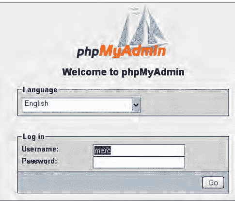
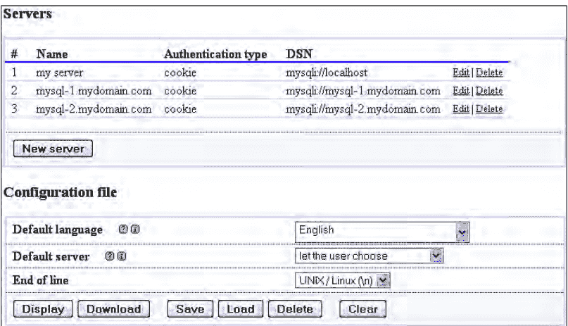
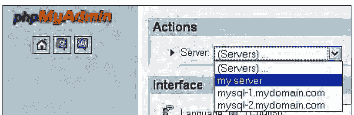
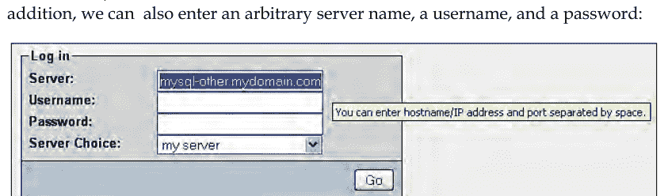
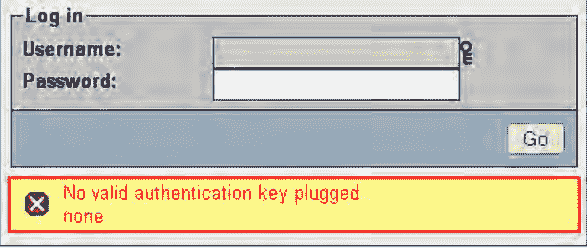
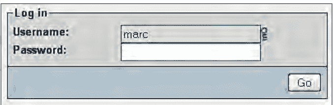

# 2 身份验证和安全

## 身份验证和安全

在 phpMyAdmin 中配置身份验证的方式有很多——取决于我们的目标、其他应用程序的存在以及我们需要的[content]
在 phpMyAdmin 中配置身份验证的方式有很多——取决于我们的目标、其他应用程序的存在以及我们需要的[content]
安全级别。本章探讨可用的可能性。

## MySQL 身份验证

当我们输入用户名和密码时，虽然看起来我们在登录 phpMyAdmin，但事实并非如此！身份验证系统是 MySQL 服务器的功能。我们只是使用 phpMyAdmin（在 Web 服务器上运行）作为一个接口，将我们的用户名和密码信息发送到 MySQL 服务器。严格来说，我们不是登录到 phpMyAdmin，而是**通过** phpMyAdmin。

这就是为什么在关于 phpMyAdmin 的用户支持论坛中，询问身份验证帮助的人经常被转回他们的 MySQL 服务器管理员，因为丢失的 MySQL 用户或密码并不是真正的 phpMyAdmin 问题。

本节解释了 phpMyAdmin 提供的各种身份验证模式。

## 无密码的 root 用户

在许多情况下，MySQL 的默认安装会使服务器暴露于入侵，因为它创建了一个名为 `root` 且没有密码的 MySQL 账户。为了解决这个问题，phpMyAdmin 3.1.0 引入了一个特定于服务器的配置参数，`$cfg['Servers'][$i]['AllowNoPasswordRoot']`，其默认值为 `false`。通常，此指令应保持为 `false`，以避免通过 phpMyAdmin 进行此类访问，因为黑客正在积极探测 Web 上的不安全 MySQL 服务器。请阅读 *Security* 部分以获取有关保护服务器的其他建议。

> > 如果此参数设置为 **false** 且使用 **root** 账户且无密码进行登录尝试，将显示 **Access denied** 消息。

## 使用 config 进行单用户身份验证

对于我们的第一个示例，我们将使用 config 身份验证类型，它易于理解。然而，在 *Multi-user authentication* 部分，我们将看到更强大和多样的身份验证方式。

> > 使用 **config** 身份验证类型会使我们的 phpMyAdmin 暴露于入侵，除非我们按照本章 *Security* 部分所述对其进行保护。

这里我们请求 config 身份验证，并输入此 MySQL 服务器的用户名和密码：

```
$cfg['Servers'][$i]['auth_type'] = 'config';
$cfg['Servers'][$i]['user']      = 'marc';
$cfg['Servers'][$i]['password']  = 'bingo';
```

然后我们可以保存我们在 config.inc.php 中所做的更改。

## 测试连接

现在是启动 phpMyAdmin 并尝试使用我们配置的值进行连接的时候了。这将测试以下内容：

- 我们在配置文件或基于 Web 的设置中输入的值
- 如果我们进行了手动配置，则 Web 服务器内部 PHP 组件的设置
- Web 服务器与 MySQL 服务器之间的通信

我们启动浏览器并指向安装 phpMyAdmin 的目录，如 http://www.mydomain.com/phpMyAdmin。如果这不起作用，我们尝试 http://www.mydomain.com/phpMyAdmin/index.php。（这意味着我们的 Web 服务器未配置为将 index.php 解释为默认起始文档。）

如果仍然出现错误，请参阅附录 B 以获取故障排除和支持。我们现在应该看到 phpMyAdmin 的主页。第 3 章概述了现在看到的面板。

## 多用户身份验证

我们可能希望允许 phpMyAdmin 的单个副本被一组人员使用，每个人都有自己的 MySQL 用户名和密码，并且只能看到他们有权访问的数据库。或者我们可能更喜欢避免在 config.inc.php 中以明文形式保存用户名和密码。

## 提供的身份验证类型

与其依赖存储在 config.inc.php 中的用户名和密码，phpMyAdmin 将与浏览器通信并从中获取身份验证数据。这使得所有在特定 MySQL 服务器中定义的用户都可以真正登录，而无需在配置文件中定义它们。有三种模式可供选择，允许通过 phpMyAdmin 受控登录到 MySQL——http、cookie 和 signon。我们必须选择适合我们特定情况和环境的一种（稍后会详细介绍）。http 和 cookie 模式可能要求我们首先定义一个控制用户。

## 控制用户

定义控制用户有两个目的：

- 在版本 4.1.2 之前的 MySQL 服务器或使用 --skip-show-database 运行的服务器上，控制用户允许使用多用户身份验证。此方面在本节中描述。
- 在所有版本的 MySQL 服务器上，此用户是使用 phpMyAdmin 的高级关系功能所必需的，这些功能从第 11 章开始描述。

为了能够为每种类型的 MySQL 用户使用身份验证类型（在 MySQL 中，用户权限可以用各种方式表达），我们应该在服务器的特定于服务器的部分中定义一个控制用户和密码。如果我们不定义一个，则使用 `user`@`hostname` 或 `user`@`%` 语法在 MySQL 中定义的用户将能够正常使用 phpMyAdmin 的功能，如创建数据库，而其他用户则不能。

出于身份验证目的，控制用户是一个特殊用户（我们通常为其选择的名称是 pma），它有权读取特殊 mysql 数据库中的某些字段（其中包含所有用户定义）。phpMyAdmin 仅为身份验证的特定需求使用此特殊控制用户发送查询，而不用于正常操作。创建控制用户的命令可在 phpMyAdmin 的 Documentation.html 中获得，并且可能因版本而异。此文档包含最新的命令。


当我们在 MySQL 服务器中创建控制用户时，我们按以下示例填写参数：

```
$cfg['Servers'][$i]['controluser'] = 'pma';
$cfg['Servers'][$i]['controlpass'] = 'bingo';
```

> 我在教授 phpMyAdmin 时使用 bingo 密码；建议不要为自己的安装使用相同的密码。

## 注销

自 2.10 版本起，可用一种机制来指示 phpMyAdmin 在注销后应将控制权传递到哪个 URL。此功能适用于所有身份验证类型。示例如下：

```
$cfg['Servers'][$i]['LogoutURL'] = 'http://www.mydomain.com';
```

该指令必须包含绝对 URL，包括协议。

## HTTP 身份验证

此模式——http——是 HTTP 中提供的传统模式，其中浏览器会询问用户名和密码，将其发送给 phpMyAdmin，并在所有浏览器窗口关闭之前一直发送。

要启用此模式，我们只需使用以下行：

```
$cfg['Servers'][$i]['auth_type'] = 'http';
```

此模式存在一些限制：

- PHP 根据版本可能不支持 HTTP 身份验证。当 PHP 作为 Apache 下的模块运行时，它可以工作；对于其他情况，我们应查阅我们版本的 PHP 文档。
- 如果我们想用 .htaccess 文件保护 phpMyAdmin 目录（参见本章的安全部分），这将干扰 HTTP 身份验证类型；两者不能同时使用。
- 没有真正的注销，因为我们必须关闭所有浏览器窗口才能使用相同的用户名再次登录。

即使考虑到这些限制，出于以下原因，此模式仍可能是一个有价值的选择：

- 一些浏览器可以以未加密的形式存储身份验证信息
- 它比 cookie 处理稍快

## Cookie 身份验证

Cookie 身份验证模式在提供的功能方面优于 http。它提供真正的登录和注销，并且可以在任何类型的 Web 服务器上运行 PHP 时使用。它在 phpMyAdmin 内部呈现登录面板（见下图）。由于我们拥有应用程序源代码，因此可以对其进行自定义。然而，正如你可能猜到的那样，对于 Cookie 身份验证，浏览器必须接受来自 Web 服务器的 Cookie —— 自 phpMyAdmin 2.8.0 起的所有身份验证模式均为如此。

此模式将登录屏幕中输入的用户名存储到浏览器中的永久 Cookie 中。密码以临时 Cookie 的形式存储。在多服务器配置中，每个服务器对应的用户名和密码分别存储。为了保护用户名和密码的保密性，防止针对 Cookie 内容的某些攻击方法，使用 Blowfish 机制对其进行加密。因此，要使用此模式，我们必须在 config.inc.php 中（一次）定义一个秘密密码，该密码将用于安全地加密此 phpMyAdmin 安装中以 Cookie 形式存储的所有密码。

这是通过在此处放置一个秘密密码来完成的：

```
$cfg['blowfish_secret'] = 'SantaLivesInCanada';
```

然后，对于每个特定服务器的区段，使用以下内容：

```
$cfg['Servers'][$i]['auth_type'] = 'cookie';
```

下次启动 phpMyAdmin 时，我们将看到如下图所示的登录面板：



默认情况下，phpMyAdmin 会在登录面板中显示针对该特定服务器成功登录的最后一个用户名，该用户名是从永久 Cookie 中检索到的。如果这种行为不可接受（如果我们希望从同一工作站登录的其他人看不到之前的用户名），我们可以将以下参数设置为 FALSE：

```
$cfg['LoginCookieRecall'] = FALSE;
```

在 phpMyAdmin 2.6.0 中添加了一个安全功能——输入密码的有效时间限制。此功能有助于保护工作会话。成功登录后，我们的密码连同计时器一起存储在 Cookie 中。phpMyAdmin 中的每个操作都会重置计时器。如果我们在 $cfg['LoginCookieValidity'] 中定义的一定秒数内保持不活动状态，我们将被断开连接并必须重新登录。默认值为 1800 秒。

> 用于保护用户名和密码的 Blowfish 算法需要大量计算。为了获得最佳速度，必须在我们的 Web 服务器上安装 PHP 的 mcrypt 扩展及其附带库。否则，phpMyAdmin 依赖于内部编码的算法，该算法可以工作，但会导致在 phpMyAdmin 上执行的几乎每个操作都延迟数秒！这是因为每次单击鼠标以便连接到 MySQL 时，都必须解码用户名和密码信息。

## Signon 身份验证

自 2.10 版本起，signon 模式使我们能够使用来自另一个应用程序的凭据来对 phpMyAdmin 进行身份验证。一些应用程序具有自己的身份验证机制，因此能够利用这一事实来避免另一个繁琐的登录面板是很方便的。为了使此功能正常工作，该应用程序必须将正确的凭据存储到 PHP 的会话数据中，以便稍后由 phpMyAdmin 检索。

要启用此模式，我们从以下指令开始：

```php
$cfg['Servers'][$i]['auth_type'] = 'signon';
```

假设身份验证应用程序已使用名为 FirstApp 的会话来存储凭据。我们将此告知 phpMyAdmin：

```php
$cfg['Servers'][$i]['SignonSession'] = 'FirstApp';
```

我们必须注意那些在其他应用程序之前尝试访问 phpMyAdmin 的用户；在这种情况下，phpMyAdmin 将用户重定向到身份验证应用程序。这是通过以下方式完成的

```php
$cfg['Servers'][$i]['SignonURL'] = 'http://www.mydomain.com/FirstApp';
```

身份验证应用程序如何以 phpMyAdmin 可理解的格式存储凭据？scripts/signon.php 中包含了一个示例。在此脚本中，有一个简单的 HTML 表单用于输入凭据以及初始化会话的逻辑——我们将使用 FirstApp 作为会话名称，并在此会话中创建用户、密码和主机信息：

```php
$_SESSION['PMA_single_signon_user'] = $_POST['user'];
$_SESSION['PMA_single_signon_password'] = $_POST['password'];
$_SESSION['PMA_single_signon_host'] = $_POST['host'];
```

> 请注意，FirstApp 不需要向用户询问 MySQL 的凭据。这些可以硬编码在应用程序内部，因为它们是秘密的，或者应用程序的凭据与 MySQL 的凭据之间存在已知的对应关系。

然后，身份验证应用程序使用其选择的方式——链接或按钮——让其用户启动 phpMyAdmin。

## 多服务器配置

config.inc.php 文件至少包含一个特定服务器的区段；然而，我们可以添加更多，从而使单个 phpMyAdmin 副本能够管理多个服务器。让我们看看如何配置更多服务器。

### 配置文件中定义的服务器

在 config.inc.php 文件的特定服务器区段中，我们看到针对每个服务器引用 $cfg['Servers'][$i] 的行。这里使用变量 $i，以便可以轻松地剪切和粘贴配置文件的整个区段来配置更多服务器。在复制此类区段时，我们应注意在每个区段之前出现的 $i++; 指令，该指令对于分隔服务器区段至关重要，也应被复制。

然后，在区段末尾，以下行控制启动时发生的情况：

```
$cfg['ServerDefault'] = 1;
```

默认值 1 表示 phpMyAdmin 将自行连接到第一个定义的服务器，或在使用高级身份验证时默认显示此服务器选择（本章后面会详细介绍）。我们可以指定任意数字，对应相应的特定服务器区段。我们也可以输入值 0，表示没有默认服务器。

此配置也可以通过基于 Web 的设置完成。下面给出了多服务器定义的示例，默认服务器设置为让用户选择。




未定义默认服务器时，phpMyAdmin 将显示服务器选择：



## 任意服务器

如果我们想要能够连接到未定义的 MySQL 服务器，可以使用另一种机制。首先，我们必须设置以下参数：

```
$cfg['AllowArbitraryServer'] = TRUE;
```

我们还必须将默认值 1 恢复到 $cfg['ServerDefault'] 中。然后，需要使用 cookie 认证类型。这样我们就能选择服务器并输入用户名和密码。

> 允许任意服务器意味着任何可从我们的 Web 服务器访问的 MySQL 服务器都可以通过 phpMyAdmin 连接。因此，此功能最好与增强的安全机制结合使用（请参阅安全部分）。

如图所示，我们仍然可以在“服务器选择”中选择其中一个已定义的服务器。此外，我们还可以输入任意服务器名称、用户名和密码：



如工具提示所示，如果此 MySQL 服务器监听在非标准端口上，您还可以输入端口号（当然用空格与主机名/IP 地址分隔）。

## 安全

安全可以从多个层面进行检查：

- 如何保护 phpMyAdmin 安装目录
- 哪些工作站可以访问 phpMyAdmin
- 合法用户可以看到哪些数据库
- 如何通过工作站上的物理 USB 密钥强制执行传输中数据保护和访问保护

### 目录级保护

假设有未经授权的人试图执行我们的 phpMyAdmin 副本。如果我们使用简单的 config 认证类型，任何知道我们 phpMyAdmin URL 的人对我们数据的有效权限都与我们相同。在这种情况下，我们应使用 Web 服务器提供的目录保护机制（例如 .htaccess，一个以点开头的文件名）来增加一层保护。

如果我们决定使用 http 或 cookie 认证类型，我们的数据就足够安全了。然而，我们仍应对密码采取正常预防措施（包括定期更改）。

phpMyAdmin 安装所在的目录包含敏感数据。不仅配置文件，而且存储在其中的所有脚本都必须防止被篡改。我们应确保除我们之外，只有 Web 服务器的有效用户对该目录中的文件具有读取权限，并且只有我们才能写入这些文件。

> phpMyAdmin 的脚本永远不需要修改此目录中的任何内容，除非我们使用“保存导出文件到服务器”功能（在第 7 章中解释）。

另一种可能的攻击来自在同一 Web 服务器上拥有账户的其他开发者。在这种攻击中，有人可能会尝试打开我们的 config.inc.php 文件。由于该文件可被 Web 服务器读取，有人可能会尝试从其 PHP 脚本中包含我们的文件。这就是为什么建议使用 PHP 的 open_basedir 功能，必要时将其应用于可能发起此类攻击的所有目录。

### 错误处理

版本 3.0 在 phpMyAdmin 中引入了基于 PHP 自定义错误处理机制的新 PHP 错误捕获行为。此错误处理程序的好处之一是避免路径泄露，而路径泄露被视为安全弱点。与此相关的默认设置如下：

```
$cfg['Error_Handler'] = array();
$cfg['Error_Handler']['display'] = false;
```

除非您正在开发新的 phpMyAdmin 功能并希望查看所有 PHP 错误和警告，否则应将 display 的默认值保持为 false。

### 基于 IP 的访问控制

可以再增加一层保护，这次验证发出使用 phpMyAdmin 请求的机器的 Internet 协议（IP）地址。

为了达到这一保护级别，我们构建允许或拒绝访问的规则，并指定这些规则的应用顺序。

### 规则

规则的格式为：

```
<'allow' | 'deny'> <username> [from] <source>
```

from 为可选，以下是一些示例：

| Rule | Description |
|---|---|
| allow Bob from 1.2.3.4 | 用户 Bob 允许从 IP 地址 1.2.3.4 访问。 |
| allow Bob from 1.2.3/24 | 用户 Bob 允许从匹配网络 1.2.3 的任何地址访问（这是 CIDR IP 匹配）。 |
| deny Alice from 4.5/16 | 用户 Alice 在位于网络 4.5 时无法访问。 |
| allow Melanie from all | 用户 Melanie 可以从任何地方登录。 |
| allow **Julie** from **localhost** | 等同于 127.0.0.1 |
| deny % from **all** | **all** 可用作 0.0.0.0/0 的等价物，表示任何主机。这里 % 符号表示任何用户。 |

源部分也可以使用特殊名称 **localnetA**、**localnetB** 或 **localnetC** 构成。这些代表 Web 服务器所在的完整 A 类、B 类或 C 类网络。请注意，phpMyAdmin 依赖于此功能的 $_SERVER["SERVER_ADDR"] PHP 参数。通常我们会有多个规则。假设我们希望使用以下两个规则：

```
allow Marc from 45.34.23.12
allow Melanie from all
```

我们必须将它们放入 config.inc.php（在相关的服务器特定部分）中，如下所示：

```
$cfg['Servers'][$i]['AllowDeny']['rules'] =
  array('allow Marc from 45.34.23.12',
    'allow Melanie from all');
```

在定义单个规则或多个规则时，使用 PHP 数组。我们必须遵循其语法，用单引号将每个完整规则括起来，并用逗号分隔每个规则。因此，如果只有一个规则，我们仍必须使用数组来指定它，如下所示：

```
$cfg['Servers'][$i]['AllowDeny']['rules'] =
  array('allow Marc from 45.34.23.12');
```

下一个参数说明规则的解释顺序。

### 规则解释顺序

默认情况下，此参数为空：

```
$cfg['Servers'][$i]['AllowDeny']['order'] = '';
```

这意味着不进行基于 IP 的验证。

假设我们希望默认允许访问，仅拒绝某些用户名/IP 对。我们应使用：

```
$cfg['Servers'][$i]['AllowDeny']['order'] = 'deny,allow';
```

在这种情况下，所有 deny 规则将首先应用，然后是 allow 规则。如果规则中未提及某情况，则授予访问权限。更严格的做法是默认拒绝。我们可以使用：

```
$cfg['Servers'][$i]['AllowDeny']['order'] = 'allow,deny';
```

这次，所有 allow 规则将首先应用，然后是 deny 规则。如果规则中未提及某情况，则拒绝访问。指定规则顺序的第三种（也是最严格的）方法是：

```
$cfg['Servers'][$i]['AllowDeny']['order'] = 'explicit';
```

现在，deny 规则在 allow 规则之前应用。但要被接受，用户名/IP 地址必须列在 allow 规则中，且不在 deny 规则中。

### root 访问的简化规则

由于 root 用户存在于几乎所有 MySQL 安装中，它经常成为攻击目标。从 phpMyAdmin 2.6.1 开始，一个参数允许我们轻松阻止 MySQL root 账户的所有登录，使用以下设置：

```
$cfg['Servers'][$i]['AllowRoot'] = FALSE;
```

### 限制数据库列表

有时避免在左侧面板中显示用户有权访问的所有数据库是有用的。phpMyAdmin 提供了两种限制方式——only_db 和 hide_db。

要指定可见的列表，使用 only_db 参数。它可能包含数据库名称或数据库名称列表。只有这些数据库会在左侧面板中显示：

```
$cfg['Servers'][$i]['only_db'] = 'payroll';
$cfg['Servers'][$i]['only_db'] = array('payroll', 'hr');
```

数据库名称可以包含 MySQL 通配符，如 _ 和 %。如果使用数组指定多个数据库，它们将在界面上按在数组中列出的相同顺序显示。

only_db 的另一个功能是，您可以使用它不是限制列表，而是强调某些名称，使其显示在列表顶部。这里，myspecial 数据库名称将首先出现，其后是所有其他名称：

```
$cfg['Servers'][$i]['only_db'] = array('myspecial', '*');
```


我们还可以使用 hide_db 参数指定必须隐藏的数据库名称。它包含一个正则表达式 (http://en.wikipedia.org/wiki/Regular_expression) 表示要排除的内容。如果我们不希望用户看到所有名称以 'secret' 开头的数据库，我们将使用：

```
$cfg['Servers'][$i]['hide_db'] = '^secret';
```

这些参数适用于此服务器特定配置中的所有用户。

> 这些机制并不能替代 MySQL 权限系统。用户对其他数据库的权限仍然有效，但他们无法使用 phpMyAdmin 的左侧面板导航到其它的数据库或表。

## 传输中数据保护

HTTP 本身并不能抵御网络嗅探（从线路上抓取敏感数据）。因此，如果我们不仅想保护用户名和密码，还想保护在 Web 服务器和浏览器之间传输的所有数据，就必须使用 HTTPS。

为此，假设我们的 Web 服务器支持 HTTPS，我们只需将 URL 中的 http 替换为 https 启动 phpMyAdmin，如下所示：

```
https://www.mydomain.com/phpMyAdmin
```

如果我们使用 PmaAbsoluteUri 自动检测：

```
$cfg['PmaAbsoluteUri'] = '';
```

phpMyAdmin 将检测到我们在 URL 中使用 HTTPS 并相应地做出反应。如果没有，我们必须按如下方式在此参数中填入 https 部分：

```
$cfg['PmaAbsoluteUri'] = 'https://www.mydomain.com/phpMyAdmin';
```

此外，自 phpMyAdmin 2.7.0 起，我们可以使用此设置自动将用户切换到 HTTPS 连接：

```
$cfg['ForceSSL'] = TRUE;
```

## Swekey 硬件认证

自 3.1 版本起，Swekey 硬件认证密钥的支持已合并到 phpMyAdmin 的基于 cookie 的认证中。此 USB 密钥的参考信息可在 http://phpmyadmin.net/auth_key 获取。Swekey 可与所有兼容的 Web 应用程序一起使用，基于对该物理设备的持有来增加安全级别。在 phpMyAdmin 的情况下，它并不会取代正常的 MySQL 认证。

## 配置

contrib/swekey.sample.conf 示例文件应作为配置此功能的基础。该文件包含来自厂商的示例配置命令和注释。原理很简单——每个 Swekey 设备都包含一个唯一 ID，且该 ID 必须在 Swekey 配置文件中与一个 MySQL 用户名关联。以下行是示例文件的一部分：

```
0000000000000000000000000000763A:root

000000000000000000000000000089E4:steve

0000000000000000000000000000231E:scott
```

这意味着负责 phpMyAdmin 配置的人员需要跟踪每个用户分配了哪个 Swekey，并将此信息写入文件。厂商无需知晓这种关联。他们只跟踪哪些 Swekey 已售出以及哪些已被停用。因此，只要相应更新配置，Swekey 就可以从一个用户传递给另一个用户。

示例文件中还包含其他与安全相关的指令，建议不要更改它们——尤其是 SERVER_CHECK、SERVER_RNDTOKEN 和 SERVER_STATUS。这是因为这些指令通过 https 访问服务器，这保证了我们 Web 服务器与厂商之间存在安全通道。

修改后，此文件应复制到 Web 服务器文档根目录之外的目录（建议位置为 /etc/swekey-pma.conf）。然后，还必须在 config.inc.php 中设置一个配置参数：

```
$cfg['Servers'][$i]['auth_swekey_config'] = '/etc/swekey-pma.conf';
```

## 使用

让我们看看现在当 phpMyAdmin 启动且工作站未连接 Swekey 时会发生什么：



我们注意到三处变化：
- 用户名字段无法输入
- 显示了一个小钥匙图标
- 出现错误消息

用户名字段被停用是正常的，因为用户名现在取自 Swekey 配置文件。图标可以被点击以访问厂商网站。该网站上有一个测试机制，用于验证是否已连接 Swekey。如果自动安装未成功，还可以下载驱动程序。

现在如果您连接 Swekey，假设用户 marc 已定义并与该设备关联，将显示一个令人安心的面板：



## 安全说明

如果我们的用户可以访问他们可以在其上安装自己的 phpMyAdmin 副本的 Web 空间，那么依赖该设备提供的保护就没有意义。显然，必须相应地配置 phpMyAdmin 才能使用 Swekey。因此，用户安装的 phpMyAdmin 副本将绕过保护。这意味着主机提供商应仅允许从他/她安装了受控 phpMyAdmin 副本且其他用户无法在其上安装自己的副本的 Web 服务器访问其 MySQL 服务器。

## 摘要

本章概述了如何使用单个 phpMyAdmin 副本管理多个服务器，以及如何使用认证类型来满足用户组的需要同时保护认证凭据。本章还涵盖了保护 phpMyAdmin 安装的方法。

我们现在将查看构成 phpMyAdmin 用户界面的所有面板和窗口。
