# 3 界面概述

在深入研究任务导向的章节（如搜索等）之前，适当了解一下 phpMyAdmin 界面的整体组织是合适的。我们还将看到影响整个界面的配置参数和设置。

## 面板和窗口

phpMyAdmin 界面由各种面板和窗口组成，每个都有特定功能。我们首先对每个面板进行快速概述，然后在本章后面再详细说明。

## 登录面板

出现的登录面板取决于所选择的认证类型。对于 http 类型，它将采用浏览器 HTTP 认证弹出屏幕的形式。对于 cookie 类型，将显示 phpMyAdmin 专用的登录面板。（这在第 2 章中有所介绍。）对于外部认证（signon），登录面板由外部应用程序本身处理。默认情况下，此面板上存在服务器选择对话框和语言选择器。

然而，如果我们使用 config 认证类型，则不会显示登录面板，首次显示的界面包含左侧和右侧面板。

## 左侧和右侧面板

这些面板一起出现，并在我们使用 phpMyAdmin 的大部分工作会话中显示。左侧面板是我们浏览数据库和表的导航指南。右侧面板是主要工作区域，数据在此管理并显示结果。其确切布局取决于从左侧面板做出的选择和执行的操作顺序。对于希伯来语等从右到左的语言，导航面板位于右侧，主要面板位于左侧。

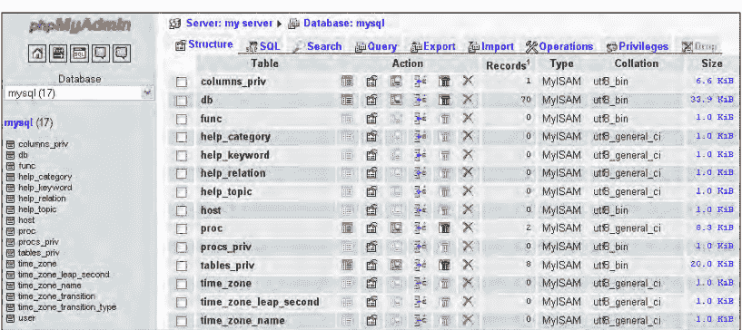

## 主页

右侧面板可以采用主页的形式。主页随后将包含与 MySQL 操作或 phpMyAdmin 信息相关的各种链接、语言选择器以及可能的主题选择器。

## 视图

在右侧面板中，我们可以看到数据库视图——可以在其中对特定数据库执行各种操作，或表视图——可以在其中访问许多用于管理表的函数。还有服务器视图，对系统管理员和非管理员用户都很有用。所有这些视图都有一个顶部菜单，其形式为选项卡，引导至不同的子页面，用于按通用功能（表结构、权限等）分组展示信息。

> 请不要将此处以界面意义使用的“视图”术语与 MySQL 5.0 的 SQL 视图概念（在第 17 章中介绍）混淆。

## 查询窗口

这是一个独立的窗口，通常从左侧面板打开——有时在从右侧面板编辑 SQL 查询时也会打开。其主要目的是便于查询工作并在右侧面板上显示结果。


## 起始页

当我们启动 phpMyAdmin 时，我们会看到以下内容（取决于 config.inc.php 中指定的身份验证类型，以及其中是否定义了多个服务器）：

- 其中一个登录面板
- 左侧和右侧面板，首页显示在右侧面板中

## 通用自定义

本节描述了对许多面板产生影响的设置。这些设置修改了窗口中标题的外观、信息图标以及表列表的排序方式。所有页面的整体视觉风格由主题系统控制，这里将一并介绍。

## 窗口标题配置

当左侧和右侧面板显示时，窗口的标题会更改以反映当前活动的 MySQL 服务器、数据库和表。phpMyAdmin 如果 $cfg['ShowHttpHostTitle'] 设置为 TRUE，也会显示有关 Web 服务器主机名的一些信息。显示的内容取决于另一个设置 – $cfg['SetHttpHostTitle']。如果此设置为空（默认情况下为空），则真正的 Web 服务器主机名会出现在标题中。我们可以放置另一个字符串，例如 "my Web server"，它将代替真正的主机名显示。

在打开多个 phpMyAdmin 窗口时，能看到 Web 服务器的主机名会很有帮助，因为这样可能连接到多个 Web 服务器。当然，每个 phpMyAdmin 窗口本身也可以访问多个 MySQL 服务器。

## 图标配置

当显示各种警告、错误或信息消息时，如果 $cfg['ErrorIconic'] 设置为 TRUE，它们可以附带一个图标。另一个参数 $cfg['ReplaceHelpImg']，当设置为 TRUE 时，会在每个有特定主题文档可用的地方显示一个包含问号的小图标。这两个参数默认都设置为 TRUE，因此会产生：

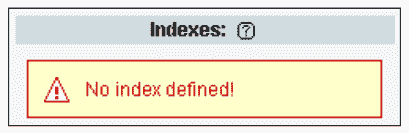

它们可以独立设置为 FALSE。两者都设置为 FALSE 时会得到：

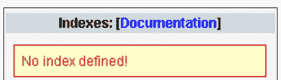

## 数据库和表名的自然排序

通常，计算机按字典顺序对项目进行排序，这对于表列表会产生以下结果：

```
table1
table10
table2
table3
```

phpMyAdmin 默认实现“自然排序”，由 $cfg['NaturalOrder'] 设置为 TRUE 指定。因此，左侧和右侧面板中的数据库和表列表按如下方式排序：

```
table1
table2
table3
table10
```

## 站点特定页眉和页脚

一些用户可能希望在 phpMyAdmin 界面上显示公司标志、帮助台链接或其他信息。为此，在主 phpMyAdmin 目录中，我们可以创建两个脚本——config.header.inc.php 和 config.footer.inc.php。我们可以在这些脚本中放入自己的 PHP 或 XHTML 代码，并在以下情况下在页面开头（页眉）或结尾（页脚）显示：

- 在 cookie 登录页面上
- 在右侧面板上

例如，创建一个包含以下行的 config.footer.inc.php：

```
<hr />
<em>All the information on this page is confidential.</em>
```

会在所有页面上产生预期消息：

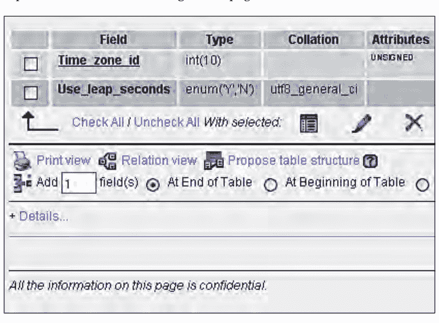

## MySQL 文档链接

phpMyAdmin 在其界面的各个位置显示指向 MySQL 文档的链接。这些链接指向官方 MySQL 文档中了解 MySQL 命令的确切位置。我们可以使用以下配置参数自定义引用的位置、语言和手册类型：

```
$cfg['MySQLManualBase'] = 'http://www.mysql.com/doc/en';
$cfg['MySQLManualType'] = 'searchable';
```

您可以查看 http://www.mysql.com/documentation 以了解手册可用的语言，并相应地更改参数。对于手册类型，最新的可能值作为注释在 config.inc.php 中解释。喜欢在本地服务器上保留此文档副本的用户会在此处指定本地链接。

$cfg['ReplaceHelpImg'] 参数控制链接的显示方式。其默认值 TRUE 使 phpMyAdmin 显示小问号图标。但是，如果其值为 FALSE，则会显示 Documentation 链接。

## 主题

从 phpMyAdmin 2.6.0 版本开始提供主题系统。颜色参数和各种图标位于 `themes` 子目录下的目录结构中。对于每个可用主题，都有一个以主题命名的子目录。它包含：

- `layout.inc.php` 用于主题参数
- `css` 目录包含各种 CSS 脚本
- `img` 目录包含图标
- `screen.png`，该主题的截图

下载的套件包含两个主题，更多主题可在 http://phpmyadmin.net/home_page/themes.php 获取。

## 主题配置

在 `config.inc.php` 中，`$cfg['ThemePath']` 参数默认包含 `themes`，表示所需结构所在的哪个子目录。这可以更改为指向公司特定的 phpMyAdmin 主题所在的另一个目录。

默认选择的主题在 `$cfg['ThemeDefault']` 中指定，设置为 `original`。如果用户无法选择主题，则会使用此主题。

> `original` 子目录绝不应被删除；phpMyAdmin 依赖它进行正常操作。

## 主题选择

在主页上，我们可以为用户提供主题选择器。将 `$cfg['ThemeManager']` 设置为 TRUE（默认值）会显示选择器：

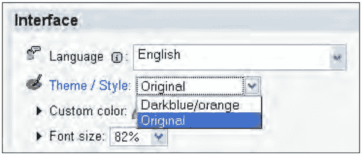

为了帮助选择合适的主题，**Theme/Style** 旁边的调色板图标会为我们提供可用主题的屏幕截图。然后我们可以在想要的主题下点击 **take it**。选择的主题会保存在 cookie 中。默认情况下，记住的主题适用于我们连接的所有服务器。要使 phpMyAdmin 为每个 MySQL 服务器记住一个主题，我们将 `$cfg['ThemePerServer']` 设置为 TRUE。

## 颜色选择器

这里有一个功能——自定义颜色选择器——可能看起来有些轻浮，但也有其用途。我们先讨论*如何*，然后再讨论*为什么*。

位于主页上的小彩虹图标可访问一个选择器，它控制两个面板的背景颜色。phpMyAdmin 团队合并了 Djamil Legato 的 MooRainbow 代码（http://moorainbow.woolly-sheep.net）来提供此功能。

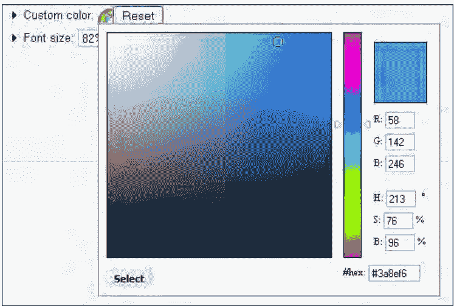

您可以以多种方式操作选择器——移动滑块、在大正方形中移动鼠标，或直接在字段中输入值。完成后，您点击 **Select** 以关闭选择器。

## 滑块

您会在某些页面上看到，一个小加号后跟一个控制标签——要么是 **Options** 要么是 **Details**。点击标签会打开一个滑块以显示界面中被认为在日常工作中使用较少的部分。由于有些人更喜欢立即看到整个界面——以牺牲屏幕空间为代价——有一个配置参数控制滑块的初始设置：

```
$cfg['InitialSlidersState'] = 'closed';
```

默认值 **closed** 表示滑块必须通过点击标签打开；您可能已经猜到相反的值是 open。此 JavaScript 功能来自位于 http://mootools.net 的 Mootools 库。

## 字符集、排序规则和语言

**字符集** 描述了特定语言或方言的符号如何编码。**排序规则** 包含比较和排序字符集字符的规则。用于存储数据的字符集可能与用于显示它的字符集不同，从而导致数据不一致。因此，需要转换数据。

自 MySQL 4.1.x 起，MySQL 服务器为我们执行字符重新编码工作。此外，MySQL 允许我们为每个数据库、每个表甚至每个字段指定字符集和排序规则。数据库的默认字符集适用于其每个表，除非在表级别被覆盖。相同的原则适用于每个字段。

## 排序规则

当字符串需要比较和排序时，系统（此处为 MySQL）必须遵循精确的规则。例如，“A”是否等同于“a”？'André' 是否等同于 "Andre"？一组此类规则称为排序规则。

选择合适的排序规则对于在搜索数据（例如来自 phpMyAdmin 的 **Search** 页面）时获得预期结果，以及对数据进行排序时非常重要。


关于排序规则的介绍，请参阅 http://dev.mysql.com/doc/mysql/en/Charset-general.htm，关于所涉及算法的更技术性解释，请参阅 http://www.unicode.org/reports/tr10/。

## Unicode and UTF-8

> Unicode 是一种行业标准，旨在使文本和符号 [...] 能够被计算机一致地表示和处理。

获取更多信息，请访问 http://en.wikipedia.org/wiki/Unicode 和 http://www.unicode.org/。

Unicode 目前支持超过 600 种语言，这是其相对于 ISO 或 Windows 可用的其他字符集的主要优势。对于像 phpMyAdmin 这样的多语言产品来说，这一点尤其重要。

为了表示或编码这些 Unicode 字符，存在许多 Unicode 转换格式（UTF）。一种流行的转换格式是 UTF-8，它每个字符使用一到四个八位字节。详情请访问 http://en.wikipedia.org/wiki/UTF-8。

请注意，浏览器必须支持 UTF-8（大多数当前浏览器都支持）。phpMyAdmin 分发包包含 lang 子目录中每个语言文件的 UTF-8 版本。

## Language selection

语言选择器会出现在登录面板（如果有）和主页上。phpMyAdmin 的默认行为是使用浏览器首选项中定义的语言，前提是该版本存在对应的语言文件。

默认语言——如果程序无法检测到——在 config.inc.php 中定义，参数为 $cfg['DefaultLang']，值为 'en-utf-8'。此值可以更改。语言名称的可能值在 libraries/select_lang.lib.php 脚本中作为数组定义。

即使定义了默认语言，每个用户（尤其是在多用户安装中）仍可从选择器中选择其首选语言。用户的选择在可能的情况下会保存在 cookie 中。

我们还可以通过设置 $cfg['Lang'] 参数并赋予值，例如 'fr-utf-8' 来强制使用单一语言。从 2.7.0 版本开始，还有另一个参数 $cfg['FilterLanguages'] 可用。假设我们希望将可用语言列表缩短为 English 和 Français – French，因为这些是用户唯一使用的语言。这是通过构建一个正则表达式来实现的，该表达式根据这些语言的 ISO 639 代码指示我们希望显示的语言。继续我们的示例，我们将使用：

```
$cfg['FilterLanguages'] = '^(fr|en)';
```

在此表达式中，插入符号 (^) 表示以...开头，而 (|) 表示或。该表达式表示我们将列表限制为其对应 ISO 代码以 fr 或 en 开头的语言。

默认情况下，此参数为空，表示不对可用语言列表应用任何过滤。

语言旁边的[content]
关于排序规则的介绍，请参阅 http://dev.mysql.com/doc/mysql/en/Charset-general.htm，关于所涉及算法的更技术性解释，请参阅 http://www.unicode.org/reports/tr10/。

## Unicode and UTF-8

> Unicode 是一种行业标准，旨在使文本和符号 [...] 能够被计算机一致地表示和处理。

获取更多信息，请访问 http://en.wikipedia.org/wiki/Unicode 和 http://www.unicode.org/。

Unicode 目前支持超过 600 种语言，这是其相对于 ISO 或 Windows 可用的其他字符集的主要优势。对于像 phpMyAdmin 这样的多语言产品来说，这一点尤其重要。

为了表示或编码这些 Unicode 字符，存在许多 Unicode 转换格式（UTF）。一种流行的转换格式是 UTF-8，它每个字符使用一到四个八位字节。详情请访问 http://en.wikipedia.org/wiki/UTF-8。

请注意，浏览器必须支持 UTF-8（大多数当前浏览器都支持）。phpMyAdmin 分发包包含 lang 子目录中每个语言文件的 UTF-8 版本。

## Language selection

语言选择器会出现在登录面板（如果有）和主页上。phpMyAdmin 的默认行为是使用浏览器首选项中定义的语言，前提是该版本存在对应的语言文件。

默认语言——如果程序无法检测到——在 config.inc.php 中定义，参数为 $cfg['DefaultLang']，值为 'en-utf-8'。此值可以更改。语言名称的可能值在 libraries/select_lang.lib.php 脚本中作为数组定义。

即使定义了默认语言，每个用户（尤其是在多用户安装中）仍可从选择器中选择其首选语言。用户的选择在可能的情况下会保存在 cookie 中。

我们还可以通过设置 $cfg['Lang'] 参数并赋予值，例如 'fr-utf-8' 来强制使用单一语言。从 2.7.0 版本开始，还有另一个参数 $cfg['FilterLanguages'] 可用。假设我们希望将可用语言列表缩短为 English 和 Français – French，因为这些是用户唯一使用的语言。这是通过构建一个正则表达式来实现的，该表达式根据这些语言的 ISO 639 代码指示我们希望显示的语言。继续我们的示例，我们将使用：

```
$cfg['FilterLanguages'] = '^(fr|en)';
```

在此表达式中，插入符号 (^) 表示以...开头，而 (|) 表示或。该表达式表示我们将列表限制为其对应 ISO 代码以 fr 或 en 开头的语言。

默认情况下，此参数为空，表示不对可用语言列表应用任何过滤。

语言旁边的[content]
关于排序规则的介绍，请参阅 http://dev.mysql.com/doc/mysql/en/Charset-general.htm，关于所涉及算法的更技术性解释，请参阅 http://www.unicode.org/reports/tr10/。

## Unicode and UTF-8

> Unicode 是一种行业标准，旨在使文本和符号 [...] 能够被计算机一致地表示和处理。

获取更多信息，请访问 http://en.wikipedia.org/wiki/Unicode 和 http://www.unicode.org/。

Unicode 目前支持超过 600 种语言，这是其相对于 ISO 或 Windows 可用的其他字符集的主要优势。对于像 phpMyAdmin 这样的多语言产品来说，这一点尤其重要。

为了表示或编码这些 Unicode 字符，存在许多 Unicode 转换格式（UTF）。一种流行的转换格式是 UTF-8，它每个字符使用一到四个八位字节。详情请访问 http://en.wikipedia.org/wiki/UTF-8。

请注意，浏览器必须支持 UTF-8（大多数当前浏览器都支持）。phpMyAdmin 分发包包含 lang 子目录中每个语言文件的 UTF-8 版本。

## Language selection

语言选择器会出现在登录面板（如果有）和主页上。phpMyAdmin 的默认行为是使用浏览器首选项中定义的语言，前提是该版本存在对应的语言文件。

默认语言——如果程序无法检测到——在 config.inc.php 中定义，参数为 $cfg['DefaultLang']，值为 'en-utf-8'。此值可以更改。语言名称的可能值在 libraries/select_lang.lib.php 脚本中作为数组定义。

即使定义了默认语言，每个用户（尤其是在多用户安装中）仍可从选择器中选择其首选语言。用户的选择在可能的情况下会保存在 cookie 中。

我们还可以通过设置 $cfg['Lang'] 参数并赋予值，例如 'fr-utf-8' 来强制使用单一语言。从 2.7.0 版本开始，还有另一个参数 $cfg['FilterLanguages'] 可用。假设我们希望将可用语言列表缩短为 English 和 Français – French，因为这些是用户唯一使用的语言。这是通过构建一个正则表达式来实现的，该表达式根据这些语言的 ISO 639 代码指示我们希望显示的语言。继续我们的示例，我们将使用：

```
$cfg['FilterLanguages'] = '^(fr|en)';
```

在此表达式中，插入符号 (^) 表示以...开头，而 (|) 表示或。该表达式表示我们将列表限制为其对应 ISO 代码以 fr 或 en 开头的语言。

默认情况下，此参数为空，表示不对可用语言列表应用任何过滤。

语言旁边的[content]
关于排序规则的介绍，请参阅 http://dev.mysql.com/doc/mysql/en/Charset-general.htm，关于所涉及算法的更技术性解释，请参阅 http://www.unicode.org/reports/tr10/。

## Unicode and UTF-8

> Unicode 是一种行业标准，旨在使文本和符号 [...] 能够被计算机一致地表示和处理。

获取更多信息，请访问 http://en.wikipedia.org/wiki/Unicode 和 http://www.unicode.org/。

Unicode 目前支持超过 600 种语言，这是其相对于 ISO 或 Windows 可用的其他字符集的主要优势。对于像 phpMyAdmin 这样的多语言产品来说，这一点尤其重要。

为了表示或编码这些 Unicode 字符，存在许多 Unicode 转换格式（UTF）。一种流行的转换格式是 UTF-8，它每个字符使用一到四个八位字节。详情请访问 http://en.wikipedia.org/wiki/UTF-8。

请注意，浏览器必须支持 UTF-8（大多数当前浏览器都支持）。phpMyAdmin 分发包包含 lang 子目录中每个语言文件的 UTF-8 版本。

## Language selection

语言选择器会出现在登录面板（如果有）和主页上。phpMyAdmin 的默认行为是使用浏览器首选项中定义的语言，前提是该版本存在对应的语言文件。

默认语言——如果程序无法检测到——在 config.inc.php 中定义，参数为 $cfg['DefaultLang']，值为 'en-utf-8'。此值可以更改。语言名称的可能值在 libraries/select_lang.lib.php 脚本中作为数组定义。

即使定义了默认语言，每个用户（尤其是在多用户安装中）仍可从选择器中选择其首选语言。用户的选择在可能的情况下会保存在 cookie 中。

我们还可以通过设置 $cfg['Lang'] 参数并赋予值，例如 'fr-utf-8' 来强制使用单一语言。从 2.7.0 版本开始，还有另一个参数 $cfg['FilterLanguages'] 可用。假设我们希望将可用语言列表缩短为 English 和 Français – French，因为这些是用户唯一使用的语言。这是通过构建一个正则表达式来实现的，该表达式根据这些语言的 ISO 639 代码指示我们希望显示的语言。继续我们的示例，我们将使用：

```
$cfg['FilterLanguages'] = '^(fr|en)';
```

在此表达式中，插入符号 (^) 表示以...开头，而 (|) 表示或。该表达式表示我们将列表限制为其对应 ISO 代码以 fr 或 en 开头的语言。

默认情况下，此参数为空，表示不对可用语言列表应用任何过滤。

语言旁边的[content]
关于排序规则的介绍，请参阅 http://dev.mysql.com/doc/mysql/en/Charset-general.htm，关于所涉及算法的更技术性解释，请参阅 http://www.unicode.org/reports/tr10/。

## Unicode and UTF-8

> Unicode 是一种行业标准，旨在使文本和符号 [...] 能够被计算机一致地表示和处理。

获取更多信息，请访问 http://en.wikipedia.org/wiki/Unicode 和 http://www.unicode.org/。

Unicode 目前支持超过 600 种语言，这是其相对于 ISO 或 Windows 可用的其他字符集的主要优势。对于像 phpMyAdmin 这样的多语言产品来说，这一点尤其重要。

为了表示或编码这些 Unicode 字符，存在许多 Unicode 转换格式（UTF）。一种流行的转换格式是 UTF-8，它每个字符使用一到四个八位字节。详情请访问 http://en.wikipedia.org/wiki/UTF-8。

请注意，浏览器必须支持 UTF-8（大多数当前浏览器都支持）。phpMyAdmin 分发包包含 lang 子目录中每个语言文件的 UTF-8 版本。

## Language selection

语言选择器会出现在登录面板（如果有）和主页上。phpMyAdmin 的默认行为是使用浏览器首选项中定义的语言，前提是该版本存在对应的语言文件。

默认语言——如果程序无法检测到——在 config.inc.php 中定义，参数为 $cfg['DefaultLang']，值为 'en-utf-8'。此值可以更改。语言名称的可能值在 libraries/select_lang.lib.php 脚本中作为数组定义。

即使定义了默认语言，每个用户（尤其是在多用户安装中）仍可从选择器中选择其首选语言。用户的选择在可能的情况下会保存在 cookie 中。

我们还可以通过设置 $cfg['Lang'] 参数并赋予值，例如 'fr-utf-8' 来强制使用单一语言。从 2.7.0 版本开始，还有另一个参数 $cfg['FilterLanguages'] 可用。假设我们希望将可用语言列表缩短为 English 和 Français – French，因为这些是用户唯一使用的语言。这是通过构建一个正则表达式来实现的，该表达式根据这些语言的 ISO 639 代码指示我们希望显示的语言。继续我们的示例，我们将使用：

```
$cfg['FilterLanguages'] = '^(fr|en)';
```

在此表达式中，插入符号 (^) 表示以...开头，而 (|) 表示或。该表达式表示我们将列表限制为其对应 ISO 代码以 fr 或 en 开头的语言。

默认情况下，此参数为空，表示不对可用语言列表应用任何过滤。

语言旁边的[content]
关于排序规则的介绍，请参阅 http://dev.mysql.com/doc/mysql/en/Charset-general.htm，关于所涉及算法的更技术性解释，请参阅 http://www.unicode.org/reports/tr10/。

## Unicode and UTF-8

> Unicode 是一种行业标准，旨在使文本和符号 [...] 能够被计算机一致地表示和处理。

获取更多信息，请访问 http://en.wikipedia.org/wiki/Unicode 和 http://www.unicode.org/。

Unicode 目前支持超过 600 种语言，这是其相对于 ISO 或 Windows 可用的其他字符集的主要优势。对于像 phpMyAdmin 这样的多语言产品来说，这一点尤其重要。

为了表示或编码这些 Unicode 字符，存在许多 Unicode 转换格式（UTF）。一种流行的转换格式是 UTF-8，它每个字符使用一到四个八位字节。详情请访问 http://en.wikipedia.org/wiki/UTF-8。

请注意，浏览器必须支持 UTF-8（大多数当前浏览器都支持）。phpMyAdmin 分发包包含 lang 子目录中每个语言文件的 UTF-8 版本。

## Language selection

语言选择器会出现在登录面板（如果有）和主页上。phpMyAdmin 的默认行为是使用浏览器首选项中定义的语言，前提是该版本存在对应的语言文件。

默认语言——如果程序无法检测到——在 config.inc.php 中定义，参数为 $cfg['DefaultLang']，值为 'en-utf-8'。此值可以更改。语言名称的可能值在 libraries/select_lang.lib.php 脚本中作为数组定义。

即使定义了默认语言，每个用户（尤其是在多用户安装中）仍可从选择器中选择其首选语言。用户的选择在可能的情况下会保存在 cookie 中。

我们还可以通过设置 $cfg['Lang'] 参数并赋予值，例如 'fr-utf-8' 来强制使用单一语言。从 2.7.0 版本开始，还有另一个参数 $cfg['FilterLanguages'] 可用。假设我们希望将可用语言列表缩短为 English 和 Français – French，因为这些是用户唯一使用的语言。这是通过构建一个正则表达式来实现的，该表达式根据这些语言的 ISO 639 代码指示我们希望显示的语言。继续我们的示例，我们将使用：

```
$cfg['FilterLanguages'] = '^(fr|en)';
```

在此表达式中，插入符号 (^) 表示以...开头，而 (|) 表示或。该表达式表示我们将列表限制为其对应 ISO 代码以 fr 或 en 开头的语言。

默认情况下，此参数为空，表示不对可用语言列表应用任何过滤。

语言旁边的[content]
关于排序规则的介绍，请参阅 http://dev.mysql.com/doc/mysql/en/Charset-general.htm，关于所涉及算法的更技术性解释，请参阅 http://www.unicode.org/reports/tr10/。

## Unicode and UTF-8

> Unicode 是一种行业标准，旨在使文本和符号 [...] 能够被计算机一致地表示和处理。

获取更多信息，请访问 http://en.wikipedia.org/wiki/Unicode 和 http://www.unicode.org/。

Unicode 目前支持超过 600 种语言，这是其相对于 ISO 或 Windows 可用的其他字符集的主要优势。对于像 phpMyAdmin 这样的多语言产品来说，这一点尤其重要。

为了表示或编码这些 Unicode 字符，存在许多 Unicode 转换格式（UTF）。一种流行的转换格式是 UTF-8，它每个字符使用一到四个八位字节。详情请访问 http://en.wikipedia.org/wiki/UTF-8。

请注意，浏览器必须支持 UTF-8（大多数当前浏览器都支持）。phpMyAdmin 分发包包含 lang 子目录中每个语言文件的 UTF-8 版本。

## Language selection

语言选择器会出现在登录面板（如果有）和主页上。phpMyAdmin 的默认行为是使用浏览器首选项中定义的语言，前提是该版本存在对应的语言文件。

默认语言——如果程序无法检测到——在 config.inc.php 中定义，参数为 $cfg['DefaultLang']，值为 'en-utf-8'。此值可以更改。语言名称的可能值在 libraries/select_lang.lib.php 脚本中作为数组定义。

即使定义了默认语言，每个用户（尤其是在多用户安装中）仍可从选择器中选择其首选语言。用户的选择在可能的情况下会保存在 cookie 中。

我们还可以通过设置 $cfg['Lang'] 参数并赋予值，例如 'fr-utf-8' 来强制使用单一语言。从 2.7.0 版本开始，还有另一个参数 $cfg['FilterLanguages'] 可用。假设我们希望将可用语言列表缩短为 English 和 Français – French，因为这些是用户唯一使用的语言。这是通过构建一个正则表达式来实现的，该表达式根据这些语言的 ISO 639 代码指示我们希望显示的语言。继续我们的示例，我们将使用：

```
$cfg['FilterLanguages'] = '^(fr|en)';
```

在此表达式中，插入符号 (^) 表示以...开头，而 (|) 表示或。该表达式表示我们将列表限制为其对应 ISO 代码以 fr 或 en 开头的语言。

默认情况下，此参数为空，表示不对可用语言列表应用任何过滤。

语言旁边的[content]
关于排序规则的介绍，请参阅 http://dev.mysql.com/doc/mysql/en/Charset-general.htm，关于所涉及算法的更技术性解释，请参阅 http://www.unicode.org/reports/tr10/。

## Unicode and UTF-8

> Unicode 是一种行业标准，旨在使文本和符号 [...] 能够被计算机一致地表示和处理。

获取更多信息，请访问 http://en.wikipedia.org/wiki/Unicode 和 http://www.unicode.org/。

Unicode 目前支持超过 600 种语言，这是其相对于 ISO 或 Windows 可用的其他字符集的主要优势。对于像 phpMyAdmin 这样的多语言产品来说，这一点尤其重要。

为了表示或编码这些 Unicode 字符，存在许多 Unicode 转换格式（UTF）。一种流行的转换格式是 UTF-8，它每个字符使用一到四个八位字节。详情请访问 http://en.wikipedia.org/wiki/UTF-8。

请注意，浏览器必须支持 UTF-8（大多数当前浏览器都支持）。phpMyAdmin 分发包包含 lang 子目录中每个语言文件的 UTF-8 版本。

## Language selection

语言选择器会出现在登录面板（如果有）和主页上。phpMyAdmin 的默认行为是使用浏览器首选项中定义的语言，前提是该版本存在对应的语言文件。

默认语言——如果程序无法检测到——在 config.inc.php 中定义，参数为 $cfg['DefaultLang']，值为 'en-utf-8'。此值可以更改。语言名称的可能值在 libraries/select_lang.lib.php 脚本中作为数组定义。

即使定义了默认语言，每个用户（尤其是在多用户安装中）仍可从选择器中选择其首选语言。用户的选择在可能的情况下会保存在 cookie 中。

我们还可以通过设置 $cfg['Lang'] 参数并赋予值，例如 'fr-utf-8' 来强制使用单一语言。从 2.7.0 版本开始，还有另一个参数 $cfg['FilterLanguages'] 可用。假设我们希望将可用语言列表缩短为 English 和 Français – French，因为这些是用户唯一使用的语言。这是通过构建一个正则表达式来实现的，该表达式根据这些语言的 ISO 639 代码指示我们希望显示的语言。继续我们的示例，我们将使用：

```
$cfg['FilterLanguages'] = '^(fr|en)';
```

在此表达式中，插入符号 (^) 表示以...开头，而 (|) 表示或。该表达式表示我们将列表限制为其对应 ISO 代码以 fr 或 en 开头的语言。

默认情况下，此参数为空，表示不对可用语言列表应用任何过滤。

语言旁边的[content]
关于排序规则的介绍，请参阅 http://dev.mysql.com/doc/mysql/en/Charset-general.htm，关于所涉及算法的更技术性解释，请参阅 http://www.unicode.org/reports/tr10/。

## Unicode and UTF-8

> Unicode 是一种行业标准，旨在使文本和符号 [...] 能够被计算机一致地表示和处理。

获取更多信息，请访问 http://en.wikipedia.org/wiki/Unicode 和 http://www.unicode.org/。

Unicode 目前支持超过 600 种语言，这是其相对于 ISO 或 Windows 可用的其他字符集的主要优势。对于像 phpMyAdmin 这样的多语言产品来说，这一点尤其重要。

为了表示或编码这些 Unicode 字符，存在许多 Unicode 转换格式（UTF）。一种流行的转换格式是 UTF-8，它每个字符使用一到四个八位字节。详情请访问 http://en.wikipedia.org/wiki/UTF-8。

请注意，浏览器必须支持 UTF-8（大多数当前浏览器都支持）。phpMyAdmin 分发包包含 lang 子目录中每个语言文件的 UTF-8 版本。

## Language selection

语言选择器会出现在登录面板（如果有）和主页上。phpMyAdmin 的默认行为是使用浏览器首选项中定义的语言，前提是该版本存在对应的语言文件。

默认语言——如果程序无法检测到——在 config.inc.php 中定义，参数为 $cfg['DefaultLang']，值为 'en-utf-8'。此值可以更改。语言名称的可能值在 libraries/select_lang.lib.php 脚本中作为数组定义。

即使定义了默认语言，每个用户（尤其是在多用户安装中）仍可从选择器中选择其首选语言。用户的选择在可能的情况下会保存在 cookie 中。

我们还可以通过设置 $cfg['Lang'] 参数并赋予值，例如 'fr-utf-8' 来强制使用单一语言。从 2.7.0 版本开始，还有另一个参数 $cfg['FilterLanguages'] 可用。假设我们希望将可用语言列表缩短为 English 和 Français – French，因为这些是用户唯一使用的语言。这是通过构建一个正则表达式来实现的，该表达式根据这些语言的 ISO 639 代码指示我们希望显示的语言。继续我们的示例，我们将使用：

```
$cfg['FilterLanguages'] = '^(fr|en)';
```

在此表达式中，插入符号 (^) 表示以...开头，而 (|) 表示或。该表达式表示我们将列表限制为其对应 ISO 代码以 fr 或 en 开头的语言。

默认情况下，此参数为空，表示不对可用语言列表应用任何过滤。

语言旁边的[content]
关于排序规则的介绍，请参阅 http://dev.mysql.com/doc/mysql/en/Charset-general.htm，关于所涉及算法的更技术性解释，请参阅 http://www.unicode.org/reports/tr10/。

## Unicode and UTF-8

> Unicode 是一种行业标准，旨在使文本和符号 [...] 能够被计算机一致地表示和处理。

获取更多信息，请访问 http://en.wikipedia.org/wiki/Unicode 和 http://www.unicode.org/。

Unicode 目前支持超过 600 种语言，这是其相对于 ISO 或 Windows 可用的其他字符集的主要优势。对于像 phpMyAdmin 这样的多语言产品来说，这一点尤其重要。

为了表示或编码这些 Unicode 字符，存在许多 Unicode 转换格式（UTF）。一种流行的转换格式是 UTF-8，它每个字符使用一到四个八位字节。详情请访问 http://en.wikipedia.org/wiki/UTF-8。

请注意，浏览器必须支持 UTF-8（大多数当前浏览器都支持）。phpMyAdmin 分发包包含 lang 子目录中每个语言文件的 UTF-8 版本。

## Language selection

语言选择器会出现在登录面板（如果有）和主页上。phpMyAdmin 的默认行为是使用浏览器首选项中定义的语言，前提是该版本存在对应的语言文件。

默认语言——如果程序无法检测到——在 config.inc.php 中定义，参数为 $cfg['DefaultLang']，值为 'en-utf-8'。此值可以更改。语言名称的可能值在 libraries/select_lang.lib.php 脚本中作为数组定义。

即使定义了默认语言，每个用户（尤其是在多用户安装中）仍可从选择器中选择其首选语言。用户的选择在可能的情况下会保存在 cookie 中。

我们还可以通过设置 $cfg['Lang'] 参数并赋予值，例如 'fr-utf-8' 来强制使用单一语言。从 2.7.0 版本开始，还有另一个参数 $cfg['FilterLanguages'] 可用。假设我们希望将可用语言列表缩短为 English 和 Français – French，因为这些是用户唯一使用的语言。这是通过构建一个正则表达式来实现的，该表达式根据这些语言的 ISO 639 代码指示我们希望显示的语言。继续我们的示例，我们将使用：

```
$cfg['FilterLanguages'] = '^(fr|en)';
```

在此表达式中，插入符号 (^) 表示以...开头，而 (|) 表示或。该表达式表示我们将列表限制为其对应 ISO 代码以 fr 或 en 开头的语言。

默认情况下，此参数为空，表示不对可用语言列表应用任何过滤。

语言旁边的[content]
关于排序规则的介绍，请参阅 http://dev.mysql.com/doc/mysql/en/Charset-general.htm，关于所涉及算法的更技术性解释，请参阅 http://www.unicode.org/reports/tr10/。

## Unicode and UTF-8

> Unicode 是一种行业标准，旨在使文本和符号 [...] 能够被计算机一致地表示和处理。

获取更多信息，请访问 http://en.wikipedia.org/wiki/Unicode 和 http://www.unicode.org/。

Unicode 目前支持超过 600 种语言，这是其相对于 ISO 或 Windows 可用的其他字符集的主要优势。对于像 phpMyAdmin 这样的多语言产品来说，这一点尤其重要。

为了表示或编码这些 Unicode 字符，存在许多 Unicode 转换格式（UTF）。一种流行的转换格式是 UTF-8，它每个字符使用一到四个八位字节。详情请访问 http://en.wikipedia.org/wiki/UTF-8。

请注意，浏览器必须支持 UTF-8（大多数当前浏览器都支持）。phpMyAdmin 分发包包含 lang 子目录中每个语言文件的 UTF-8 版本。

## Language selection

语言选择器会出现在登录面板（如果有）和主页上。phpMyAdmin 的默认行为是使用浏览器首选项中定义的语言，前提是该版本存在对应的语言文件。

默认语言——如果程序无法检测到——在 config.inc.php 中定义，参数为 $cfg['DefaultLang']，值为 'en-utf-8'。此值可以更改。语言名称的可能值在 libraries/select_lang.lib.php 脚本中作为数组定义。

即使定义了默认语言，每个用户（尤其是在多用户安装中）仍可从选择器中选择其首选语言。用户的选择在可能的情况下会保存在 cookie 中。

我们还可以通过设置 $cfg['Lang'] 参数并赋予值，例如 'fr-utf-8' 来强制使用单一语言。从 2.7.0 版本开始，还有另一个参数 $cfg['FilterLanguages'] 可用。假设我们希望将可用语言列表缩短为 English 和 Français – French，因为这些是用户唯一使用的语言。这是通过构建一个正则表达式来实现的，该表达式根据这些语言的 ISO 639 代码指示我们希望显示的语言。继续我们的示例，我们将使用：

```
$cfg['FilterLanguages'] = '^(fr|en)';
```

在此表达式中，插入符号 (^) 表示以...开头，而 (|) 表示或。该表达式表示我们将列表限制为其对应 ISO 代码以 fr 或 en 开头的语言。

默认情况下，此参数为空，表示不对可用语言列表应用任何过滤。

Language 旁边的[content]
关于排序规则的介绍，请参阅 http://dev.mysql.com/doc/mysql/en/Charset-general.htm，关于所涉及算法的更技术性解释，请参阅 http://www.unicode.org/reports/tr10/。

## Unicode and UTF-8

> Unicode 是一种行业标准，旨在使文本和符号 [...] 能够被计算机一致地表示和处理。

获取更多信息，请访问 http://en.wikipedia.org/wiki/Unicode 和 http://www.unicode.org/。

Unicode 目前支持超过 600 种语言，这是其相对于 ISO 或 Windows 可用的其他字符集的主要优势。对于像 phpMyAdmin 这样的多语言产品来说，这一点尤其重要。

为了表示或编码这些 Unicode 字符，存在许多 Unicode 转换格式（UTF）。一种流行的转换格式是 UTF-8，它每个字符使用一到四个八位字节。详情请访问 http://en.wikipedia.org/wiki/UTF-8。

请注意，浏览器必须支持 UTF-8（大多数当前浏览器都支持）。phpMyAdmin 分发包包含 lang 子目录中每个语言文件的 UTF-8 版本。

## Language selection

语言选择器会出现在登录面板（如果有）和主页上。phpMyAdmin 的默认行为是使用浏览器首选项中定义的语言，前提是该版本存在对应的语言文件。

默认语言——如果程序无法检测到——在 config.inc.php 中定义，参数为 $cfg['DefaultLang']，值为 'en-utf-8'。此值可以更改。语言名称的可能值在 libraries/select_lang.lib.php 脚本中作为数组定义。

即使定义了默认语言，每个用户（尤其是在多用户安装中）仍可从选择器中选择其首选语言。用户的选择在可能的情况下会保存在 cookie 中。

我们还可以通过设置 $cfg['Lang'] 参数并赋予值，例如 'fr-utf-8' 来强制使用单一语言。从 2.7.0 版本开始，还有另一个参数 $cfg['FilterLanguages'] 可用。假设我们希望将可用语言列表缩短为 English 和 Français – French，因为这些是用户唯一使用的语言。这是通过构建一个正则表达式来实现的，该表达式根据这些语言的 ISO 639 代码指示我们希望显示的语言。继续我们的示例，我们将使用：

```
$cfg['FilterLanguages'] = '^(fr|en)';
```

在此表达式中，插入符号 (^) 表示以...开头，而 (|) 表示或。该表达式表示我们将列表限制为其对应 ISO 代码以 fr 或 en 开头的语言。

默认情况下，此参数为空，表示不对可用语言列表应用任何过滤。

Language 旁的小信息图标[content]
关于排序规则的介绍，请参阅 http://dev.mysql.com/doc/mysql/en/Charset-general.htm，关于所涉及算法的更技术性解释，请参阅 http://www.unicode.org/reports/tr10/。

## Unicode and UTF-8

> Unicode 是一种行业标准，旨在使文本和符号 [...] 能够被计算机一致地表示和处理。

获取更多信息，请访问 http://en.wikipedia.org/wiki/Unicode 和 http://www.unicode.org/。

Unicode 目前支持超过 600 种语言，这是其相对于 ISO 或 Windows 可用的其他字符集的主要优势。对于像 phpMyAdmin 这样的多语言产品来说，这一点尤其重要。

为了表示或编码这些 Unicode 字符，存在许多 Unicode 转换格式（UTF）。一种流行的转换格式是 UTF-8，它每个字符使用一到四个八位字节。详情请访问 http://en.wikipedia.org/wiki/UTF-8。

请注意，浏览器必须支持 UTF-8（大多数当前浏览器都支持）。phpMyAdmin 分发包包含 lang 子目录中每个语言文件的 UTF-8 版本。

## Language selection

语言选择器会出现在登录面板（如果有）和主页上。phpMyAdmin 的默认行为是使用浏览器首选项中定义的语言，前提是该版本存在对应的语言文件。

默认语言——如果程序无法检测到——在 config.inc.php 中定义，参数为 $cfg['DefaultLang']，值为 'en-utf-8'。此值可以更改。语言名称的可能值在 libraries/select_lang.lib.php 脚本中作为数组定义。

即使定义了默认语言，每个用户（尤其是在多用户安装中）仍可从选择器中选择其首选语言。用户的选择在可能的情况下会保存在 cookie 中。

我们还可以通过设置 $cfg['Lang'] 参数并赋予值，例如 'fr-utf-8' 来强制使用单一语言。从 2.7.0 版本开始，还有另一个参数 $cfg['FilterLanguages'] 可用。假设我们希望将可用语言列表缩短为 English 和 Français – French，因为这些是用户唯一使用的语言。这是通过构建一个正则表达式来实现的，该表达式根据这些语言的 ISO 639 代码指示我们希望显示的语言。继续我们的示例，我们将使用：

```
$cfg['FilterLanguages'] = '^(fr|en)';
```

在此表达式中，插入符号 (^) 表示以...开头，而 (|) 表示或。该表达式表示我们将列表限制为其对应 ISO 代码以 fr 或 en 开头的语言。

默认情况下，此参数为空，表示不对可用语言列表应用任何过滤。

Language 旁的小信息图标[content]
## Effective character sets and collations

在主页上，我们可以看到 MySQL 字符集信息和一个 MySQL 连接排序规则选择器。以下是 MySQL 字符集信息：

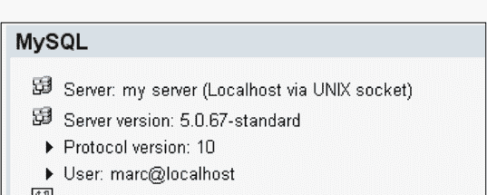

字符集信息（此处在 MySQL 字符集之后可见）直接来自于对应当前所选语言的语言文件中 $charset 变量。它用于生成 HTML 信息，告诉浏览器页面的字符集。

我们还可以使用 MySQL 连接排序规则对话框选择用于连接到 MySQL 服务器的字符集和排序规则。这会传递给 MySQL 服务器。MySQL 然后将要发送到我们浏览器的字符转换为此字符集。MySQL 也根据字符集信息解释从浏览器接收到的内容。请记住，所有表和字段都有字符集信息，描述其数据的编码方式。

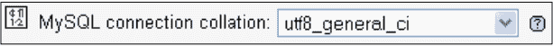

通常，默认值应该可以工作。但是，如果我们使用不同的字符集输入某些字符，可以在此对话框中选择正确的字符集。

以下参数定义默认连接排序规则和字符集：

```
$cfg['DefaultConnectionCollation'] = 'utf8_unicode_ci';
```

## Left panel (navigation)

左侧面板包含以下元素：

- Logo（见下一节）
- 服务器列表（如果 $cfg['LeftDisplayServers'] 设置为 TRUE）
- Home 链接或图标（带您返回 phpMyAdmin 主页）
- 注销链接或图标
- 指向查询窗口的链接或图标
- 显示 phpMyAdmin 和 MySQL 文档的图标
- 数据库和表，以及每个数据库的表数量统计

如果 $cfg['MainPageIconic'] 设置为 TRUE（默认值），我们会看到图标。但是，如果设置为 FALSE，我们会看到 Home、注销和查询窗口链接。

左侧面板可以通过点击并移动垂直分隔线在首选方向上拖动来调整大小，以显示更多数据，以防数据库或表名对于默认的左侧面板大小过长。

我们可以自定义此面板的外观。通常，所有参数都位于 `themes/themename/layout.inc.php` 中，除非另有说明。`$cfg['LeftWidth']` 包含左侧框架的默认宽度（以像素为单位）。背景颜色在 `$cfg['LeftBgColor']` 中定义，默认值为 `'#D0DCE0'`。`$cfg['LeftPointerColor']` 参数，默认值为 `'#CCFFCC'`，定义指针颜色。（指针在使用稍后讨论的全模式时出现。）为了激活任何正在使用的主题的左侧指针，`config.inc.php` 中存在一个主设置 `$cfg['LeftPointerEnable']`。其默认值是 TRUE。

## Logo configuration

Logo 显示行为由多个参数控制。首先，`$cfg['LeftDisplayLogo']` 必须设置为 TRUE，以启用 Logo 的任何显示。它默认为 true。点击此 Logo 会将界面带到 `$cfg['LeftLogoLink']` 参数所列的页面，通常是主 phpMyAdmin 页面（默认值 `main.php`），但可以是任何 URL。最后，`$cfg['LeftLogoLinkWindow']` 参数指示在点击 Logo 后新页面出现在哪个窗口。默认情况下，它在主页面上（值 `main`）。但是，使用值 `new` 可以在全新的窗口中打开。

Logo 图像本身来自 `logo_left.png` 文件，该文件位于每个特定主题目录结构中。

## Database and table list

以下示例显示尚未选择任何数据库：

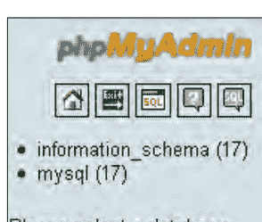

也可能看到以下屏幕：

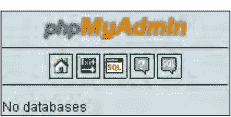

这意味着我们当前的 MySQL 权限不允许我们查看任何现有数据库。

> MySQL 服务器始终至少有一个数据库（名为 **mysql**），但在这种情况下，我们没有权限查看它。此外，从 MySQL 5.0.2 开始，一个名为 **information_schema** 的特殊数据库始终出现在数据库列表中。它包含一组视图，描述登录用户可见的元数据。

我们可能有权创建其中一个，如第 4 章所述。

## Light mode

左侧面板可以以两种方式显示——轻量模式和完整模式。轻量模式默认使用，由 $cfg['LeftFrameLight'] 中的 TRUE 值定义。此模式显示可用数据库的下拉列表，并且仅显示当前选择的数据库的表。它比完整模式更高效；原因在稍后章节中出现的完整模式部分中解释。这里我们选择了 **mysql** 数据库：

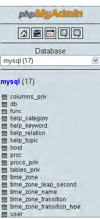

点击名称会在右侧面板中打开 **Database** 视图，点击表名会在右侧面板中打开 **Table** 视图以浏览该表。（请参阅 *Right Panel* 部分了解详情。）

## Tree display of database names

用户可能只被允许在一个数据库上工作——例如 **marc**。
一些系统管理员通过允许用户 **marc** 创建多个数据库提供更灵活的方案，前提是所有数据库名称都以 **marc** 开头，例如 **marc_airline** 和 **marc_car**。在这种情况下，左侧面板可以设置为显示这些数据库名称的树，如下所示：

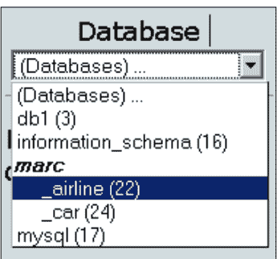

此功能目前仅在轻量模式下提供，并由以下参数控制：

```
$cfg['LeftFrameDBTree'] = TRUE;
$cfg['LeftFrameDBSeparator'] = '_';
```

$cfg['**LeftFrameDBTree**'] 中 TRUE 的默认值确保此功能被激活。分隔符的流行值是 '_'。

## Full mode

之前的示例在轻量模式下显示，但将 $cfg['**LeftFrameLight**'] 参数设置为 FALSE 会使用可折叠菜单（如果浏览器支持）生成我们数据库和表的完整布局：

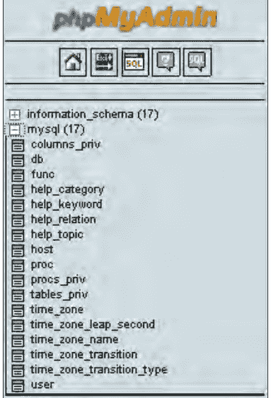

数据库中表的数量显示在括号中。默认情况下未选择完整模式；如果我们的当前权限允许访问大量数据库和表，则它可能会增加网络流量和服务器负载。必须在左侧面板生成链接以启用表访问并快速浏览每个表。此外，服务器必须计算所有表的行数。

## Table short statistics

将光标移到表名上会显示有关该表（如果有）的注释，以及其中当前存在的行数：

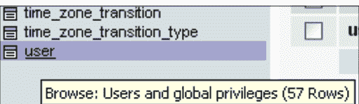

## Table quick-access icon

从 3.0 版本开始，确定对表的最常见操作必须是浏览它。因此，单击表名本身即可以浏览模式打开它。每个表名旁边的图标是快速对每个表执行其他操作的方式，默认情况下，它会带我们进入结构视图。

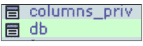

$cfg['LeftDefaultTabTable'] 参数控制此操作。它的默认值是 'tbl_structure.php'，即显示表结构的脚本。此参数的其他可能值列在 Documentation.html 中。

## Nested display of tables within a database

MySQL 的数据结构基于两个层级——数据库和表。这不允许按项目对表进行细分，而这是 MySQL 用户经常要求的功能。他们必须依赖于拥有多个数据库，但这并不总是被其提供商允许。为此，phpMyAdmin 引入了基于表命名的嵌套层级功能。

假设我们有权访问 db1 数据库，并且想要表示两个项目 marketing 和 payroll。使用项目名称和表名之间的特殊分隔符（默认情况下为双下划线），我们创建 payroll__employees 和 payroll__jobs 表，从而实现视觉上有趣的效果：

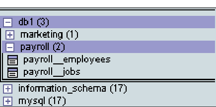

此功能通过 $cfg['LeftFrameTableSeparator']（此处设置为 '__'）参数化，以选择标记每个层级变化的字符，以及 $cfg['LeftFrameTableLevel']（此处设置为 '1'）来指定子层级的数量。

> 嵌套层级功能仅用于改善左侧面板的外观。在 MySQL 语句中引用表的正确方式保持不变——例如，db1.payroll__jobs。

从 phpMyAdmin 2.6.0 开始，在左侧面板中单击项目名称（此处为 payroll）会在右侧面板中打开该项目，仅显示与该项目关联的表。

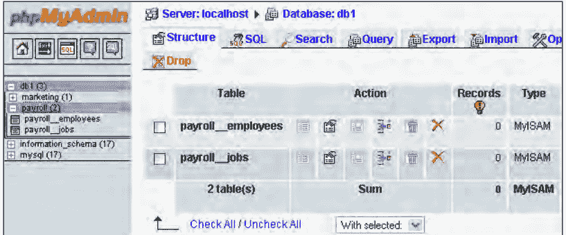

## Server-list choice

如果我们必须从同一个 phpMyAdmin 窗口管理多个服务器，并且经常需要在服务器之间切换，那么始终在左侧面板中保留服务器列表可能会很有用。

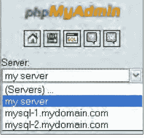

为此，必须将 $cfg['LeftDisplayServers'] 参数设置为 TRUE。服务器列表可以有两种形式——下拉列表或链接。显示哪种形式取决于 $cfg['DisplayServersList']。默认情况下，此参数设置为 FALSE，因此我们看到服务器的下拉列表。将 $cfg['DisplayServersList'] 设置为 TRUE 会生成指向所有已定义服务器的链接列表：

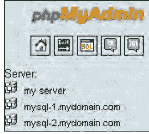

## Handling many databases or tables

本节描述了一些应对服务器上存在大量数据库和表的技术的。

## Limits on the interface

在 phpMyAdmin 2.11 之前，如果我们有权访问数百甚至数千个数据库，或同一数据库中的数百个表，则使用界面会很困难。导航面板的加载速度很慢，甚至完全无法工作。在 2.11 中，界面已重新设计以解决此问题。

以下两个新参数（显示其默认值）通过添加页面选择器和导航链接来限制显示的数据库和表数量：

```
$cfg['MaxDbList'] = 100;
$cfg['MaxTableList'] = 250;
```

$cfg['MaxDbList'] 的效果可以在服务器视图的主面板中看到：

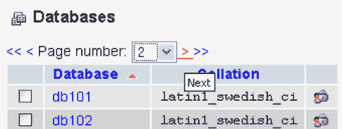

我们也可以在导航面板中看到效果：

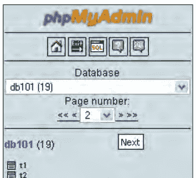

## Improving fetch speed

版本 3.0 引入了两个配置参数，影响数据库名称检索和表计数的速度。第一个是

```
$cfg['Servers'][$i]['ShowDatabasesCommand'] = 'SHOW DATABASES';
```

每当 phpMyAdmin 需要从服务器获取数据库列表时，它都会使用此参数中列出的命令。默认命令 SHOW DATABASES 在普通情况下是可以的。然而，在数据库众多的服务器上，通过尝试以下类似命令之一可以观察到速度提升：

```
SHOW DATABASES LIKE '*user#\_%'
```

```
SELECT DISTINCT TABLE_SCHEMA FROM information_schema.SCHEMA_PRIVILEGES*
```

```
SELECT SCHEMA_NAME FROM information_schema.SCHEMATA
```

在第一个示例中，#user# 被当前用户名替换。

在极端情况下（数千个数据库），自行安装 phpMyAdmin 副本的用户应在此参数中放入 `false`。这将阻止任何数据库名称的获取，并且需要使用该用户的数据库列表填充 `$cfg['Servers'][$i]['only_db']` 参数。

另一个可能有帮助的参数是 `$cfg['Servers'][$i]['CountTables']`，其默认值为 `true`。将其设置为 `false` 将指示 phpMyAdmin 在导航面板中生成数据库和表列表时（在完整模式下）避免计数表。

## Right panel (main)

右侧面板是主要工作区域，其所有可能视图将在以下各节中进行说明。其外观可以自定义。背景颜色在 `$cfg['RightBgColor']` 中定义，默认颜色为 #F5F5F5。我们还可以通过在 `$cfg['RightBgImage']` 中设置所需图像的 URI（例如，http://www.domain.com/images/clouds.jpg）来选择背景图像。

## Homepage

主页可能包含不同数量的链接，具体取决于登录模式和用户的权限。普通用户可能会看到如下内容：

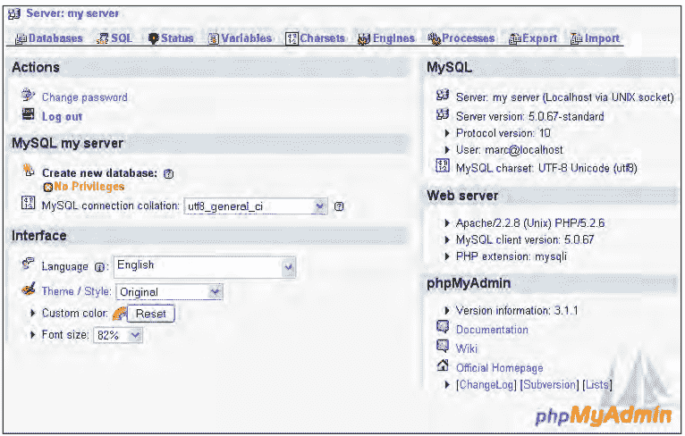

左侧面板中的 **主页** 链接用于显示此页面。它显示 phpMyAdmin 和 MySQL 版本、MySQL 服务器名称以及已登录用户。我们还看到该用户没有创建数据库的权限。我们看到一些与 MySQL 或 phpMyAdmin 本身相关的链接。如果用户未登录，则 **注销** 链接可能不存在，如配置文件中的 $cfg['Servers'][$i]['auth_type'] 参数设置为 config 所指示。

在此示例中，普通用户允许从界面更改其密码。要禁止此密码更改，我们将 $cfg['ShowChgPassword'] 设置为 FALSE。特权用户在主页上有更多选项。他们始终可以创建数据库，并且有更多链接来管理整个服务器——例如 **权限** 链接（有关更多信息，请参阅第 18 章）。另一个设置 $cfg['ShowPhpInfo']，如果我们想在主页上看到 **显示 PHP 信息** 链接，可以将其设置为 TRUE。

## Database view

phpMyAdmin 在每次从左侧框架单击数据库名称时，或在 SQL 框中输入 USE 命令后跟数据库名称时，都会进入此视图（如下截图所示）。

在这里我们可以查看数据库的概览——现有表、创建表的链接、数据库视图子页面的选项卡，以及我们可以对该数据库执行的一些特殊操作以生成文档和统计信息。每个表旁边都有一个复选框，用于对该表执行全局操作（在第 10 章中介绍）。表是通过使用复选框或单击行背景的任意位置来选择的。我们还可以看到每个表的大小，前提是 $cfg['ShowStats'] 设置为 TRUE。此参数还控制表视图中表特定统计信息的显示。


## 接口概览

此处出现的初始屏幕是数据库结构子页面。我们可能希望在进入数据库视图时显示不同的初始子页面。这由 $cfg['DefaultTabDatabase'] 参数控制，可用的选项在配置文件中以注释的形式给出。

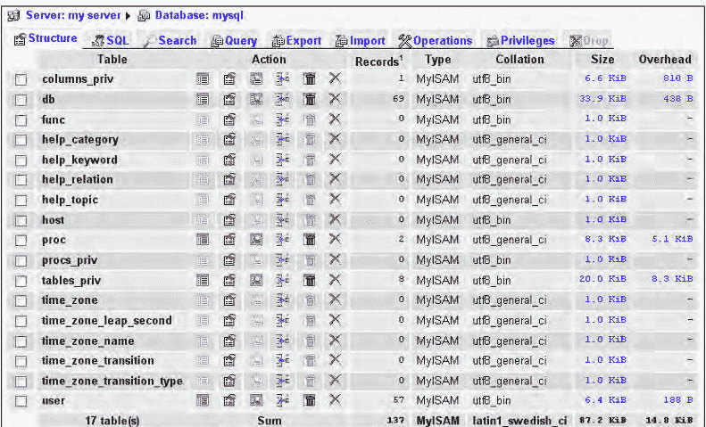

记录数是通过快速方法获得的，即 SHOW TABLE STATUS 语句——而不是使用 SELECT COUNT(*) FROM TABLENAME。这种快速方法通常是准确的，除了 InnoDB 表，它返回的记录数是近似值。为了即使对于 InnoDB 也能获得正确的记录数，可使用 $cfg['MaxExactCount'] 参数。如果近似记录数低于该参数的值——默认为 20000——则会使用较慢的 SELECT COUNT(*) 方法。

> 不要为此参数设置过高的值。你会得到正确的结果，但如果你的 InnoDB 表中有数十万条记录，则可能需要等待几分钟。

用户在大小和开销列中看到 KiB 术语时可能会感到惊讶。phpMyAdmin 采用了国际电工委员会（IEC）二进制前缀（参见 http://en.wikipedia.org/wiki/Binary_prefix）。显示的值在每个语言文件中定义。以下是英语的定义：

```
$byteUnits = array('B', 'KiB', 'MiB', 'GiB', 'TiB', 'PiB', 'EiB');
```

## 表视图

这是常用的视图，提供对所有表特定子页面的访问。通常，初始屏幕是表的结构屏幕，显示所有字段以及（在详细信息链接下）的索引。请注意，此屏幕的标题始终显示当前数据库和表名。我们还可以看到为表设置的注释：

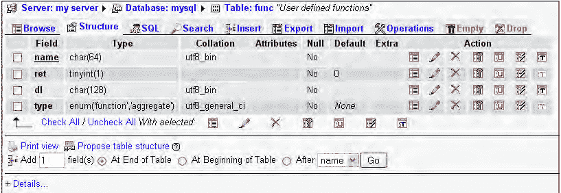

$cfg['DefaultTabTable'] 参数定义表视图上的初始子页面。一些用户更喜欢避免查看结构，因为在生产环境中他们通常运行保存的查询或进入搜索子页面（在第 9 章中解释）。

## 服务器视图

每次返回主页时都会进入此视图。特权用户当然会在服务器视图中看到更多选项。服务器视图面板的创建是为了将相关的服务器管理子页面分组在一起，并实现它们之间的轻松导航。

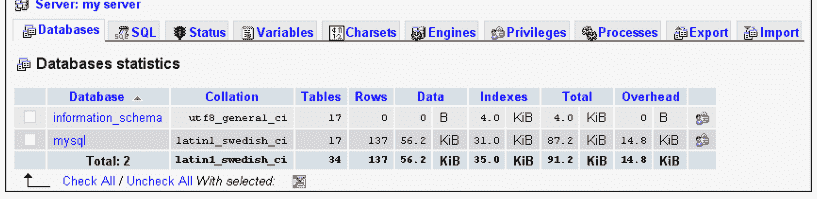

默认服务器页面由 $cfg['DefaultTabServer'] 参数控制。该参数也定义了初始起始页面。对于多用户安装，建议保留默认值（main.php），它显示传统的首页。我们可以通过将此参数更改为 server_status.php 来选择显示服务器统计信息，或使用 server_privileges.php 查看用户列表。其他可能的选项在配置文件中解释，服务器管理页面在第 18 章中解释。

## 主页和菜单标签的图标

配置参数 $cfg['MainPageIconic'] 控制右侧面板各处的图标外观：

- 在主页上
- 在列出服务器、数据库和表信息时页面顶部
- 在数据库、表和服务器视图中的菜单标签上

该参数默认为 TRUE，例如产生：


我们还可以通过将 $cfg['LightTabs'] 参数设置为 true 来不使用标签显示菜单项，产生：

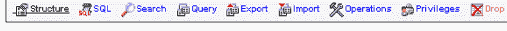

## 查询窗口

通常很方便拥有一个独立的窗口，在其中我们可以输入和完善查询，并且与右侧面板同步。此窗口称为查询窗口。我们可以通过使用小的 SQL 图标，或从左侧面板的图标或链接区域的查询窗口链接来打开此窗口。

如果 $cfg['QueryFrame'] 设置为 TRUE，则会显示此链接或图标。$cfg['QueryFrameJS'] 的 TRUE 告诉 phpMyAdmin 打开一个独立的窗口并使用 JavaScript 命令更新它；当然，这仅适用于启用了 JavaScript 的浏览器。如果将其设置为 FALSE，点击查询窗口只会打开右侧面板，并显示正常的 SQL 子页面。

> 查询窗口的完整可用性只有在独立窗口模式下才能实现。

查询窗口本身具有子页面，并且它显示在此处覆盖右侧面板：

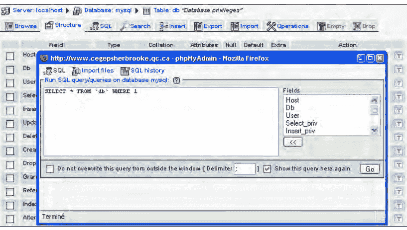

我们可以使用 $cfg['QueryWindowWidth'] 和 $cfg['QueryWindowHeight'] 选择此窗口的尺寸（以像素为单位）。第 12 章更详细地解释了查询窗口，包括可用的 SQL 查询历史功能。

## 摘要

本章涵盖：

- 语言选择系统
- 左面板和右面板的目的
- 左面板的内容，包括轻量模式和完整模式
- 右面板的内容，其各种视图取决于上下文
- 查询窗口和 MySQL 文档链接的自定义

下一章将指导您使用全新安装的 phpMyAdmin 完成简单步骤——初始表创建、数据插入和检索。
