# 4 初始步骤

在了解了 phpMyAdmin 面板的整体布局后，我们准备创建数据库、我们的第一个表，向其中插入一些数据并浏览它。这些初始步骤是有意保持简单的，但它们将为以后实现更复杂的操作奠定基础。此外，在本章结束时，我们将拥有剩余练习所基于的两个基本表。

### 数据库创建

在创建表之前，我们必须确保我们拥有一个数据库，并且 MySQL 服务器的管理员已授予我们 CREATE 权限。存在各种可能性：

- 管理员已为我们创建了数据库，我们在左侧面板中看到其名称；我们无权创建额外的数据库
- 我们有权从 phpMyAdmin 创建数据库
- 我们在共享主机上，主机制造商已安装通用 Web 界面（例如 Cpanel）来创建 MySQL 数据库和账户

请注意，配置参数 $cfg['ShowCreateDb'] 控制“创建新数据库”对话框的显示。默认情况下，它设置为 true，这会显示此对话框。

### 无权限？

如果您没有创建数据库的权限，主页将在“创建新数据库”标签下显示“无权限”消息。这意味着您必须使用已为您创建的数据库，或要求 MySQL 服务器管理员授予您必要的 CREATE 权限。

> 如果您是 MySQL 服务器的管理员，请参阅第 18 章。

### 首次数据库创建已授权

如果 phpMyAdmin 检测到我们有权创建数据库，主页将如下图所示出现：


如果 $cfg['SuggestDBName'] 参数设置为 TRUE——这是默认设置——则在输入字段中会出现建议的数据库名称。建议的数据库名称是根据我们拥有的权限构建的。

如果我们被限制使用前缀，前缀可能会在输入字段中建议。（此前缀的流行选择是用户名。）请注意，在这种情况下，前缀后面会跟省略号。我们应删除此省略号并用适当名称完成输入字段。


排序规则选择目前可以保持不变；但通过此对话框，我们可以为此数据库选择默认字符集和排序规则。此设置以后可以更改（有关此内容的更多解释，请参阅第 10 章）。

我们在此假设我们有权创建名为 marc_book 的数据库。我们在输入字段中输入 marc_book 并点击创建。数据库创建后，我们将看到以下屏幕：

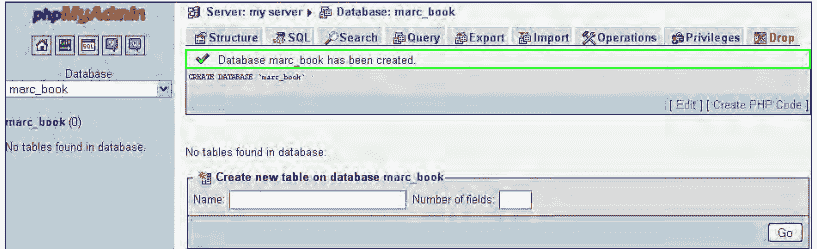


请注意以下内容：

-   右侧面板的主标题已更改，以反映我们现在位于此数据库中。
-   显示有关创建的确认消息。
-   左侧面板已更新；我们看到 **marc_book (0)**。这里，名称表示 **marc_book** 数据库已创建，而数字 **0** 表示其中不包含任何表。
-   默认情况下，phpMyAdmin 发送到服务器以创建数据库的 SQL 查询会以颜色显示。

> phpMyAdmin 显示其生成的查询，因为 $cfg['ShowSQL'] 设置为 TRUE。查看生成的查询是学习 SQL 的一种好方法。

由于生成的查询可能很大且占用大量屏幕空间，因此 $cfg['MaxCharactersInDisplayedSQL'] 充当限制。其默认值 1000 应该是在看到太少和太多查询之间取得良好平衡，尤其是在进行大型导入时。

重要的是检查 phpMyAdmin 的反馈以确定我们通过界面进行的操作的有效性。这样，我们就可以检测到诸如名称拼写错误或在错误数据库中创建表之类的错误。

## 创建我们的第一个表

现在我们有了新的数据库，是时候在其中创建表了。我们将使用的示例表名为 **book**。

## 选择字段

在创建表之前，我们应该计划要存储的信息。这通常在数据库设计期间完成。在我们的例子中，简单的分析让我们得出以下想要保留的图书相关数据：

-   **国际标准书号（ISBN）**
-   标题
-   页数
-   作者标识

目前，对于我们的 **book** 表来说，拥有完整的字段（或列）列表并不重要。我们将通过原型化应用程序来修改它，并在以后进行完善。在本章末尾，我们将添加第二个表 **author**，其中包含每个作者的信息。

## 表创建

我们已经选择了表名，并且知道字段数量。我们在 **Create new table** 对话框中输入此信息并单击 **Go** 以开始创建表：

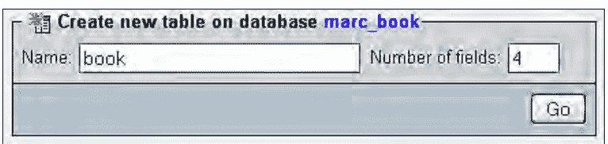

然后我们看到一个指定字段信息的面板。由于我们要求四个字段，因此我们得到四行。每行指的是一个字段的特定信息。以下图像表示此面板的左侧：

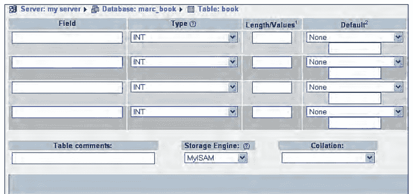

下一张图表示右侧。

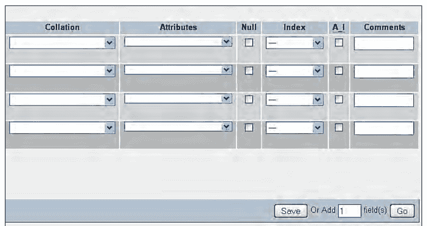

> 在 MySQL 4.1 之前的版本中，排序规则和注释列可能在此阶段不显示。请参阅第 3 章了解排序规则问题，并参阅第 11 章了解列注释。

MySQL 文档解释了表和字段名称的有效字符（如果我们搜索 Legal names）。这可能因 MySQL 版本而异。通常，文件名中允许的任何字符（除点和斜杠外）都可接受为表名，并且名称长度不得超过 64 个字符。字段名称也存在 64 个字符的限制，但我们可以使用任何字符。

我们在 Field 列下输入字段名称。每个字段都有一个类型，最常用的类型位于下拉列表的开头。

**VARCHAR**（可变字符）类型在字段内容为字母数字时被广泛使用，因为内容只会占用其所需空间。此类型需要最大长度，我们指定它。如果我们忘记这样做，保存时稍后会提醒我们一个小弹出消息。对于页数和作者标识，我们选择了 **INT** 类型（整数），如以下屏幕截图所示：

| 字段 | 类型 | 长度/值 |
|---|---|---|
| isbn | VARCHAR | 25 |
| title | VARCHAR | 100 |
| page_count | INT |  |
| author_id | INT |  |

字段还有其他属性，但在本示例中我们将它们留空。你可能会注意到屏幕底部的 **Add 1 Field(s)** 对话框。我们可以通过输入适当的值并点击 **Go** 来向此表创建面板添加一些字段。行数会根据新的字段数量而变化，同时保留有关前四个字段的已输入信息。在保存页面之前，让我们定义一些键。

## 选择键

表通常应有一个主键（具有唯一内容表示每一行的字段）。拥有主键对于行标识、更好的性能和可能的跨表关系是推荐的。这里一个好的值是 ISBN；因此，在 **Index** 对话框中，我们为 **isbn** 字段选择 **PRIMARY**。索引类型的其他可能性包括 **INDEX**、**UNIQUE** 和 **FULLTEXT**（有关此内容请参见第 6 章）。

> 索引管理（也称为键管理）可以在初始表创建时完成，也可以在表视图的 **Structure** 子页面中稍后完成。

为了提高我们将按作者 ID 进行的查询速度，我们应该在此字段上添加索引。我们屏幕的右侧现在看起来像这样：

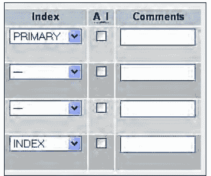

此时，我们可以从相应的下拉菜单中选择不同的存储引擎。但是，目前我们将接受默认存储引擎。

现在我们准备好通过单击 Save 创建表。如果一切顺利，下一个屏幕确认表已创建；我们现在位于表视图的 Structure 子页面。

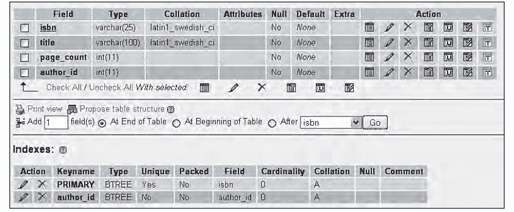

如果我们忘记在 Length 列中为 CHAR 或 VARCHAR 指定值，phpMyAdmin 会在尝试创建表之前提醒我们。

通往其他子页面的各种标签中，有些未激活，因为如果表中没有行，浏览或搜索表是没有意义的。但是，导出表是可以接受的，因为即使表不包含数据，我们也可以导出表的结构。

## 手动数据插入

现在我们有了表，让我们手动在其中放入一些数据。在此之前，这里有一些关于本书中数据操作的有用参考：

-   第 5 章解释如何更改数据
-   第 8 章解释如何从现有文件导入数据
-   第 10 章解释如何从其他表复制数据
-   第 11 章解释关系系统（在我们的例子中，我们希望链接到 author 表）

现在，单击 Insert 链接，这将带我们进入数据输入（或编辑）面板。此屏幕有空间输入两行信息，即我们示例中的两本书。这是因为 $cfg['InsertRows'] 的默认值是 2。屏幕下部，**Restart insertion with 2 rows** 对话框可用于在默认行数不适合我们需求时使用。但请注意，屏幕上已有的任何数据都将丢失。默认情况下，Ignore 复选框被选中，这意味着第二组字段将被忽略。但是一旦我们在该组的一个字段中输入一些信息并退出该字段，Ignore 框就会被取消选中。

我们可以为两本书输入以下示例信息：

-   ISBN: 1-234567-89-0, title: A hundred years of cinema (volume 1), 600 pages, author ID: 1
-   ISBN: 1-234567-22-0, title: Future souvenirs, 200 pages, author ID: 2

我们开始为第一行和第二行输入数据。Value 列宽度遵守字符字段的最大长度。对于本示例，我们将下方的下拉选择器保持在其默认值 Insert as new row。我们然后单击 Go 以插入数据。每一组代表一行的列之后都有一个 Go 按钮，屏幕下部还有一个。所有这些都具有保存输入数据的相同效果。

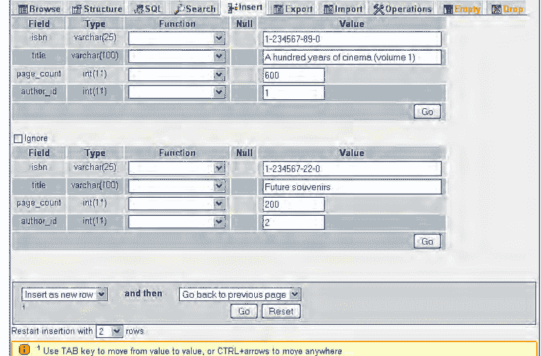

如果我们的意图是在这两种之后输入更多书籍的数据，我们将在单击 **Go** 之前从第一个下拉菜单中选择 **Insert another new row**。

## CHAR 和 VARCHAR 数据输入面板调优

默认情况下，phpMyAdmin 对字段类型 CHAR 和 VARCHAR 显示单行输入字段。这由将 $cfg['CharEditing'] 设置为 'input' 控制。有时，我们可能想在字段内插入换行符（新行）。（此插入可以通过 Enter 键手动完成，也可以通过从另一个屏幕源复制和粘贴文本行来完成。）这可以通过将 $cfg['CharEditing'] 更改为 'textarea' 来完成。这是一个全局设置，将应用于此 phpMyAdmin 副本的所有用户的所有表的所有字段。

我们可以通过以下方式调整此文本区域的列数和行数：

```
$cfg['CharTextareaCols']   = 40;
$cfg['CharTextareaRows']   = 2;
```


这里，$cfg['CharTextareaRows'] 的 2 表示在浏览器开始显示垂直滚动条之前，我们应该能够看到至少两行。这些设置适用于所有 CHAR 和 VARCHAR 字段。应用这些设置后，将生成如下不同的插入屏幕：

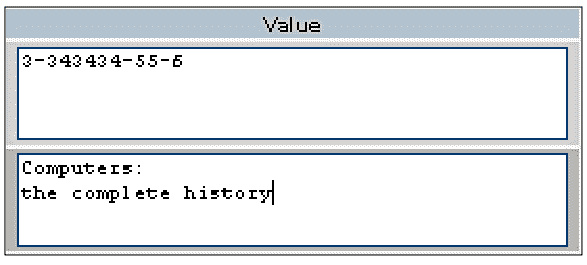

> 使用此输入模式，每个字段的最大长度在视觉上不再适用。它将在插入时由 MySQL 强制执行。

## 浏览模式

有多种方式进入此模式。事实上，每次显示查询结果时都会使用它。我们可以通过在导航面板上点击表名，或在特定表的表视图中点击 Browse 来进入此模式。

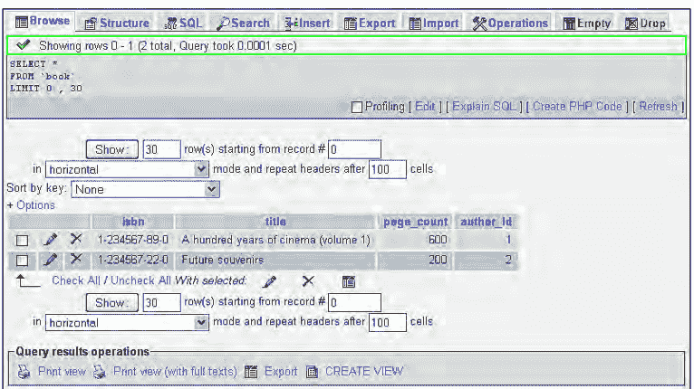

## SQL 查询链接

在浏览结果中，首先显示的是查询本身以及一些链接。显示的链接可能会根据我们的操作和一些配置参数而有所不同。

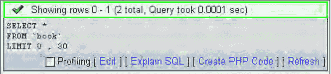

Profiling 复选框将在第 17 章中介绍。

如果 $cfg['SQLQuery']['Edit'] 设置为 TRUE，则会出现 Edit 链接。其目的是打开 Query 窗口，以便您可以编辑此查询（有关更多详细信息，请参阅第 12 章）。

如果 $cfg['SQLQuery']['Explain'] 设置为 TRUE，则会显示 Explain SQL。我们将在第 6 章中看到此链接的用途。

可以点击 Create PHP Code 链接将查询重新格式化为 PHP 脚本中预期的语法。然后可以直接复制并粘贴到我们正在处理的 PHP 脚本中需要查询的位置。请注意，单击后，此链接会更改为 Without PHP Code，这将恢复正常的查询显示。如果 $cfg['SQLQuery']['ShowAsPHP'] 设置为 TRUE，则此链接可用。

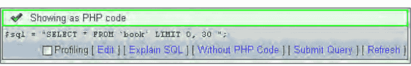

Refresh 用于再次执行相同的查询。由于 MySQL 服务器是多用户服务器，其他用户可能正在修改相同的表，因此结果可能会发生变化。如果 $cfg['SQLQuery']['Refresh'] 设置为 TRUE，则会显示此链接。

这四个参数在 config.inc.php 中的默认值均为 TRUE。

## 导航栏

此栏显示在结果顶部和底部。列标题可以根据在 repeat headers after... 中输入的值在结果中以一定间隔重复。


该栏使我们能够在页面之间导航，显示任意数量的记录（或行），从结果中的某一点开始。由于我们通过点击 Browse 进入浏览模式，因此生成结果的底层查询包含整个表。然而，这并不总是如此。

请注意，我们位于记录号 0，并以水平模式查看记录。

默认显示模式为 'horizontal'，由 $cfg['DefaultDisplay'] 定义。我们也可以将其设置为 'vertical'，如果我们通常更喜欢此模式。即使首选模式已在此配置参数中设置，我们始终可以使用 Show 对话框即时更改它。

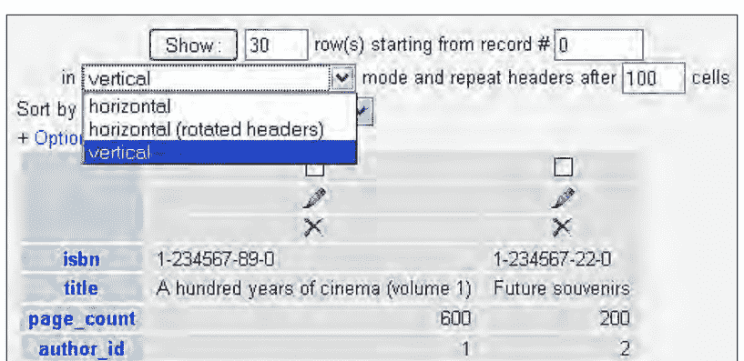

另一种可能是 'horizontalflipped' 选项，它会将列标题旋转 90 度。如果我们尝试此选项，另一个参数 $cfg['HeaderFlipType'] 会发挥作用。其默认值 css 显示真正旋转的标题。并非所有浏览器都支持此功能；然而，Internet Explorer 7 确实支持此功能并生成：

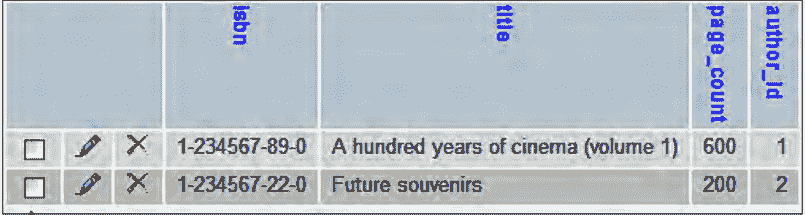

在其他浏览器上，似乎最好的做法是将 $cfg['HeaderFlipType'] 设置为 fake。

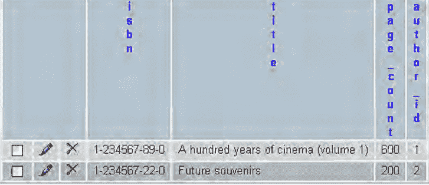

我们目前使用的是包含少量行的表。对于更大的表，我们可以看到更完整的导航按钮集。为了模拟这一点，让我们使用 Show 对话框将默认行数从 30 改为 1；然后点击 Show。我们可以看到导航栏自行适应：

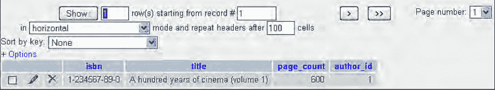

这次，有标记为 <<、<、> 和 >> 的按钮，分别可轻松访问结果的第一页、上一页、下一页和最后一页。这些按钮仅在必要时出现；例如，如果我们已在第一页，则不会显示第一页按钮。由于 $cfg['NavigationBarIconic'] 的默认设置是 TRUE，因此以这种方式显示这些符号。此处为 FALSE 将产生不同的标签集。

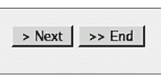

还有一个页码下拉菜单，可直接转到当前页面附近的一个页面。由于可能有数百或数千个页面，此菜单保持较小，仅显示当前页面前后几个页码。

出于设计考虑，phpMyAdmin 总是尝试提供快速结果，实现此结果的一种方法是向 SELECT 中添加 LIMIT 子句。如果原始查询中已有 LIMIT 子句，phpMyAdmin 将尊重它。默认限制为 30 行，设置在 $cfg['MaxRows'] 中。服务器上的多用户有助于将服务器负载保持在最低限度。

导航栏上还有另一个按钮，但必须通过将 $cfg['ShowAll'] 设置为 TRUE 来激活。用户经常使用此按钮会非常诱人。因此，在 phpMyAdmin 的多用户安装中，建议禁用该按钮（FALSE）。启用后，导航栏会增加一个 Show all 按钮。单击此按钮会检索当前结果集的所有行，这可能会达到 PHP 中的执行时间限制或服务器或浏览器的内存限制。

> 如果我们在 Show...rows 对话框中输入一个很大的数字，将会得到相同的结果（并且可能会遇到相同的问题）。

## 查询结果操作

一个标记为 Query results operations 的部分位于结果下方。它包含打印结果（是否包含 FULL TEXT 列）的链接、导出这些结果（参见第 7 章中的 Exporting Partial Query Results 部分），或从此查询创建视图（第 17 章将详细介绍）。

## 排序结果

在 SQL 中，除非显式排序数据，否则我们永远无法确定检索数据的顺序。某些检索引擎的实现可能会按数据输入的相同顺序显示结果，或按主键显示。然而，通过显式排序来获得所需顺序的结果是可靠的方法。

在显示浏览结果时，可以点击任何列标题对该列进行排序，即使它不是索引的一部分。让我们点击 **author_id** 列标题。


我们可以通过观察屏幕顶部的 SQL 查询来确认排序已发生；它包含一个 **ORDER BY** 子句。

我们现在会在 **author_id** 标题旁边看到一个指向上方的红色小三角形。这意味着当前排序顺序为 'ascending'。将鼠标光标移到 **author_id** 标题上会使红色三角形改变方向，以指示如果点击标题会发生什么——按降序 **author_id** 排序。

另一种排序方式是按键。Sort 对话框显示所有已定义的键。这里我们看到一个名为 **PRIMARY** 的键——在创建时为该字段勾选 **Primary** 时赋予 **isbn** 字段主键的名称：

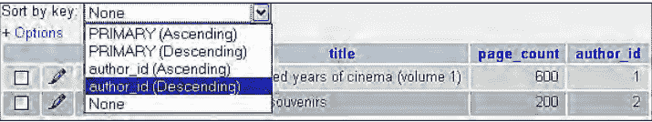

这可能是同时对多个字段排序的唯一方法（对于多字段索引）。

默认初始排序顺序在 `$cfg['Order']` 中定义，ASC 表示升序，DESC 表示降序。排序顺序也可以是 SMART，这意味着 DATE、TIME、DATETIME 和 TIMESTAMP 类型的字段将按降序排序，而其他字段类型将按升序排序。

## 标题词

因为我们可以更改页面上显示的记录数，所以很可能看不到全部数据。在这种情况下，查看标题词会有所帮助——显示数据的第一行和最后一行的指示。这样，您可以在不滚动到窗口底部的情况下点击 **Next** 或 **Previous**。

然而，phpMyAdmin 应该基于哪一列生成其标题词？做了一个简单的假设：如果您点击列标题以表示您打算对该列进行排序，phpMyAdmin 会使用该列的数据作为标题词。对于我们当前的 book 表，数据不足以明显注意到此技术的优点。然而，我们仍然可以看到，在排序后，屏幕顶部现在包含以下消息：

```
Showing rows 0 - 1 (2 total, Query took 0.0006 sec) [author_id: 1 - 2]
```

这里，方括号之间的消息意味着 **author_id** 编号 **1** 在第一个显示的行上，编号 **2** 在最后一个。

## 颜色标记行

在行之间移动鼠标时，行背景颜色可能会更改为 $cfg['BrowsePointerColor'] 定义的颜色。此参数可以在 themes/themename/layout.inc.php 中找到。要启用此功能，必须在 config.inc.php 中将所有主题的浏览指针 — $cfg['BrowsePointerEnable'] — 设置为 TRUE（默认值）。

在个人比较数据时或向他人展示数据时，视觉上标记某些行以突出其重要性可能很有趣。高亮是通过点击行完成的。再次点击会移除行上的标记。所选颜色由 $cfg['BrowseMarkerColor'] 定义（参见 themes/themename/layout.inc.php）。此功能必须通过将 $cfg['BrowseMarkerEnable'] 设置为 TRUE 来启用，这次在 config.inc.php 中。这为所有主题设置了该功能。我们可以标记多行。标记行也会激活该行的复选框。


## 限制每列的长度

在之前的示例中，我们始终可以看到每列的完整内容，因为每列的字符数都在 $cfg['LimitChars'] 定义的限制范围内。这是对所有非数值字段强制执行的限制。如果此限制较低（例如 10），显示效果如下：

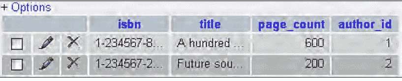

这将帮助我们同时查看更多列（以牺牲每列的可见内容为代价）。

## 显示选项

为了查看完整文本，我们现在将使用 Options 滑块，它会显示一些显示选项。我们当前关注的选项是 部分文本/完整文本 对；我们可以选择 完整文本 来查看所有被截断的文本。即使我们选择不更改 $cfg['LimitChars'] 参数，也会有需要请求完整文本的时候（当我们使用 TEXT 字段类型时——将在第 6 章详细介绍）。

## 浏览不同值

有一种快速方法可以显示每个字段的所有不同值以及每个值的出现次数。此功能在 结构 页面上可用。例如，我们想知道 book 表中有多少不同的作者，以及每位作者写了多少本书。在描述我们想要浏览的字段的行上（这里是 author_id），我们点击“浏览不同值”图标或链接。

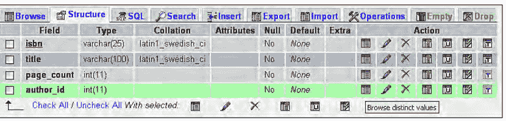

我们有一个有限的测试集，但仍然可以看到结果。

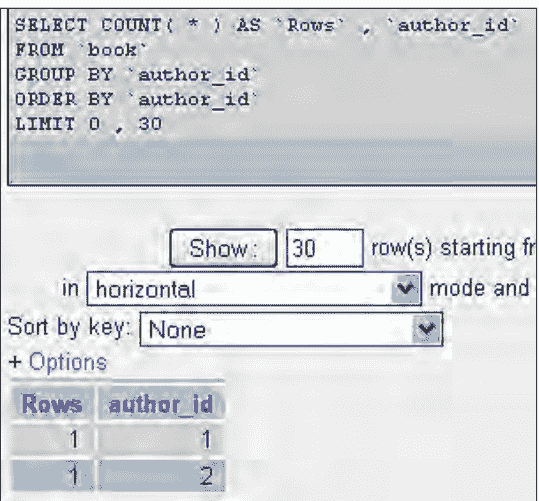

## 浏览模式自定义

以下是控制结果外观的更多参数。
这些参数——除了 $cfg['RepeatCells']——位于 themes/themename/layout.inc.php 中。

- $cfg['Border']：用于呈现结果的 HTML 表格默认没有边框，因为该参数设置为 0；我们可以设置一个较大的数字（例如 1 或 2）来为表格添加边框
- $cfg['ThBgcolor']：上述表格的标题默认背景颜色为 #D3DCE3
- $cfg['BgcolorOne'], $cfg['BgcolorTwo']：显示结果行时，会交替使用两种背景颜色；默认情况下，它们分别是 #CCCCCC 和 #DDDDDD。
- $cfg['RepeatCells']：当显示大量数据行时，我们可能会失去对每列含义的跟踪。默认情况下，每隔 100 个单元格就会显示列标题

## 创建一个额外的表

在我们的（简单）设计中，我们知道还需要另一个表——author 表。author 表将包含：

- 作者标识
- 全名
- 电话号码

要创建此表，我们必须返回到 数据库 视图。我们在导航面板中点击 marc_book，并请求创建另一个表，包含以下截图中所示的三个字段：

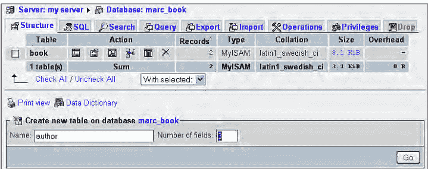

使用创建第一个表时使用的相同技术，我们输入以下内容：

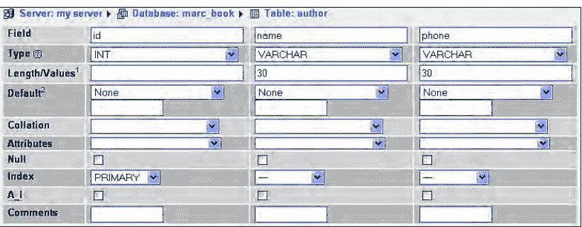

由于我们有三个或更少的字段，显示现在处于垂直模式（有关更多详细信息，请参阅第 6 章中的 垂直模式 部分）。

字段名称 **id**，它是此新表中的主键，与 book 表中的 **author_id** 字段相关。保存表结构后，我们为作者 1 和 2 输入一些数据。请发挥想象力！

## 摘要

本章解释了如何创建数据库和表，以及如何手动在表中输入数据。它还介绍了如何通过使用浏览模式来确认数据的存在，其中包括 SQL 查询链接、导航栏、排序选项和行标记。

下一章将解释如何编辑数据行，并涵盖删除行、表和数据库的各个方面。
