# 5 修改数据

数据并非静态，经常会发生变化。本章重点介绍编辑和删除数据及其支持结构——表和数据库。

## 编辑模式

当我们浏览一个表或查看任何单表查询的搜索结果时，如以下截图所示，每个表行的左侧或右侧会出现小图标：

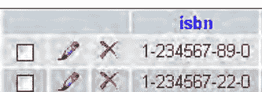

该行可以使用铅笔形图标进行编辑，并使用 X 形图标进行删除。这些控件的确切形式和位置由以下内容控制：

```
$cfg['PropertiesIconic'] = TRUE;
$cfg['ModifyDeleteAtLeft'] = TRUE;
$cfg['ModifyDeleteAtRight'] = FALSE;
```

我们可以决定是在左侧、右侧还是两侧显示它们。$cfg['PropertiesIconic'] 参数可以取 TRUE、FALSE 或 both 的值。TRUE 显示如前一图像中所示的图标，FALSE 将 Edit 和 Delete（或其翻译等价物）显示为链接，而 both 则同时显示图标和文本。

每行旁边的复选框将在本章后面的 多行编辑 和 删除多行 部分中进行解释。

点击 编辑 图标或链接会打开以下面板，该面板与数据输入面板类似（除下部外）：

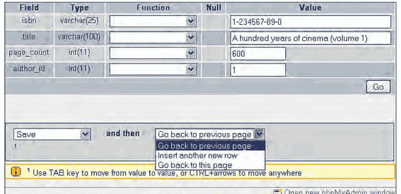

在此面板中，我们可以通过直接输入（或通过正常的操作系统机制剪切和粘贴）来更改数据。我们还可以使用 Reset 按钮恢复到原始内容。

默认情况下，下方的下拉菜单设置为 Save（以便我们对该行进行更改）和 Go back to previous page（以便我们可以在之前的結果页面上继续编辑另一行）。我们可能希望在点击 Go 后停留在当前页面——以便保存后继续编辑——我们可以选择 Go back to this page。如果我们想在保存当前行后插入另一条新行，只需在保存前选择 Insert another new row 即可。Save 选项下方的 Insert as new row 选择将在本章后面的 复制数据行 部分中进行解释。

## 使用 Tab 键移动到下一个字段

喜欢使用键盘的人可以使用 Tab 键转到下一个字段。通常，光标从左到右、从上到下移动，因此会进入 Function 列中的字段（稍后会详细介绍）。然而，为了方便在 phpMyAdmin 中进行数据导航，正常的导航顺序已被更改。Tab 键首先遍历 Value 列中的每个字段，然后遍历 Function 列中的每个字段。

## 使用箭头移动

另一种在字段之间移动的方法是使用 Ctrl+箭头 键。当屏幕上有很多字段时，这种方法可能比使用 Tab 键更方便。为此，$cfg['CtrlArrowsMoving'] 参数必须设置为 true，这是默认值。

> 在启用了 Spaces 的 Mac OS X 10.5 上，Ctrl+箭头 是切换虚拟桌面的默认快捷键；因此此技术不能用于在字段之间移动。

## 处理 NULL 值

如果表的结构允许字段内存在 NULL 值，则会在该字段的 Null 列中出现一个小复选框。选中它会将 NULL 值放入该字段中。phpMyAdmin 中还添加了特殊机制，以确保如果在该字段的 Value 列中输入数据，则 Null 复选框会自动清除。（这在启用了 JavaScript 的浏览器中是可能的。）

在此，我们修改了 author 表中 phone 字段的结构，以允许 NULL 值（请参阅第 6 章中的 编辑字段属性 部分）。此处 Null 复选框未被选中：

| 字段 | 类型 | 函数 | 空值 | 值 |
|---|---|---|---|---|
| id | int(11) |  |  | 1 |
| name | varchar(30) |  |  | John Smith |
| phone | varchar(30) |  | ☐ | +01 445 789-1234 |
|  |  |  |  | Go |

选中 Null 框后，数据将被擦除，如以下截图所示：

| 字段 | 类型 | 函数 | 空值 | 值 |
|---|---|---|---|---|
| id | int(11) |  |  | 1 |
| name | varchar(30) |  |  | John Smith |
| phone | varchar(30) |  | ☑ |  |
|  |  |  |  | Go |

如果此行再次被带到屏幕上，编辑面板将以这种方式出现。


## 将函数应用于值

MySQL 语言提供了一些在保存数据之前可以应用于数据的函数。如果将 $cfg['ShowFunctionFields'] 设置为 TRUE，其中一些函数会出现在每个字段旁边的下拉菜单中。

函数列表在 $cfg['Functions'] 数组中定义。对于特定数据类型最常用的函数会首先显示在列表中。$cfg['RestrictColumnTypes'] 和 $cfg['RestrictFunctions'] 数组中定义了一些限制，以控制哪些函数首先显示。

以下是限制 VARCHAR 类型显示的函数名称的定义：

```
$cfg['RestrictColumnTypes'] = array(
    'VARCHAR'     => 'FUNC_CHAR',  [...] 

$cfg['RestrictFunctions'] = array(
    'FUNC_CHAR'  => array(
        'ASCII',
        'CHAR',
        'SOUNDEX',
        'LCASE',
        'UCASE',
        'PASSWORD',
        'OLD_PASSWORD',
        'MD5',
        'SHA1',
        'ENCRYPT',
        'COMPRESS',
        'UNCOMPRESS',
        'LAST_INSERT_ID',
        'USER',
        'CONCAT'
    ), [...]
```

如以下屏幕截图所示，我们在保存此行时将 UPPER 函数应用于标题：

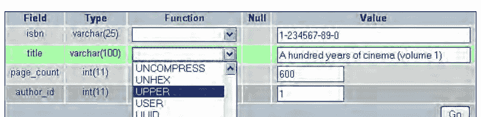

为了节省一些屏幕空间（以便能够看到更多数据），可以通过将 $cfg['ShowFunctionFields'] 设置为 FALSE 来禁用此功能。此外，Function 列标题是可点击的，因此我们可以即时禁用此功能。

当功能被禁用时——无论是通过点击还是通过配置参数——都会出现一个 Show: Function 链接，以便通过单击显示此 Function 列。

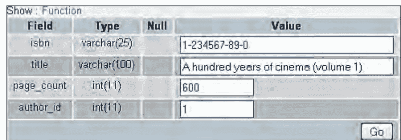

## 复制数据行

在数据维护过程中（用于永久复制或测试目的），我们经常需要生成一行的副本。如果在同一表中执行此操作，我们必须遵守键唯一性的规则。

这里举一个例子。我们的作者写了他的关于电影的书的第 2 卷。因此，需要稍作更改的字段是 ISBN、标题和页数。我们将现有行调出屏幕，更改这三个字段，然后选择 Insert as new row，如以下屏幕截图所示：

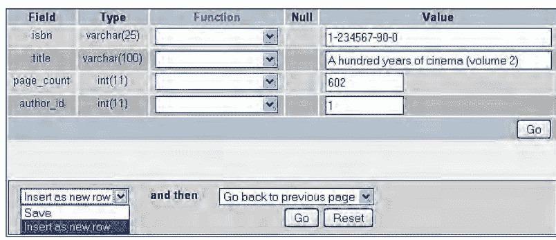

当我们点击 Go 时，会创建另一行，其中包含修改后的信息，而原始行保持不变：

|  | isbn | title | page_count | author_id |
|---|---|---|---|---|
| ☐ ✏️ ❌ | 1-234567-89-0 | 电影百年（第1卷） | 600 | 1 |
| ☐ ✏️ ❌ | 1-234567-22-0 | 未来纪念品 | 200 | 2 |
| ☐ ✏️ ❌ | 1-234567-90-0 | 电影百年（第2卷） | 602 | 1 |

## 多行编辑

多行编辑功能使我们能够在要编辑的行上使用复选框，并在 With selected 菜单中使用 Edit 链接（或铅笔形图标）。Check All / Uncheck All 链接也可以用来快速选中或取消选中所有框。我们也可以点击行数据的任何位置来激活相应的复选框。

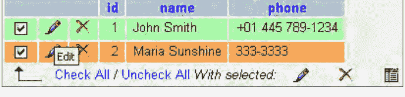

这会打开一个包含所有所选行的 Edit 面板。在编辑过程中，可以查看、比较和更改这些行的数据。

> 当我们用复选框标记一些行时，我们还可以对它们执行另外两个操作——删除（参见本章的 Deleting Many Rows 部分）和导出（参见第 7 章）。

## 编辑下一行

顺序编辑可以在具有整数字段主键的表上进行。我们的 author 表满足条件。让我们看看当我们开始编辑 id 值为 1 的行时会发生什么：

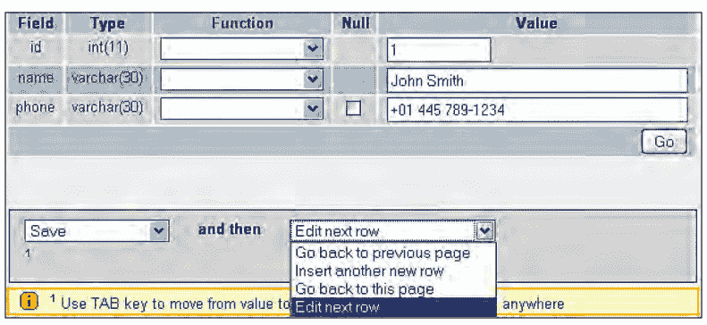

编辑面板出现，我们可以编辑作者编号 1。然而，在下拉菜单中，Edit next row 选项可用。如果选择，则下一个作者——主键值大于当前主键值的第一个作者——将可供编辑。

## 删除数据

phpMyAdmin 的界面使我们能够删除以下内容：

- 单个数据行
- 表的多个行
- 表中的所有行
- 多个表中的所有行

## 删除单行

我们可以使用每行旁边的 X 形小图标来删除该行。如果 $cfg['Confirm'] 的值为 TRUE，则每个 MySQL DELETE 语句在执行前都必须得到确认。这是默认值，因为允许仅通过一次点击就删除一行可能并不明智！

确认的形式取决于浏览器执行 JavaScript 的能力。基于 JavaScript 的确认弹出窗口看起来像以下屏幕截图：

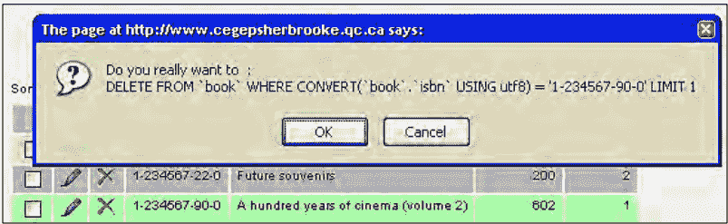

如果在浏览器中禁用了 JavaScript，则会出现一个不同的面板。

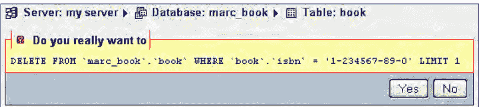

实际的 DELETE 语句将使用所需的信息来确保仅删除预期的行。在我们的例子中，已定义了主键并在 WHERE 子句中使用。在没有主键的情况下，将根据每个字段的值生成更长的 WHERE 子句。生成的 WHERE 子句甚至可能阻止 DELETE 操作的正确执行，尤其是在存在 TEXT 或 BLOB 字段时。这是因为用于将查询发送到 Web 服务器的 HTTP 事务的长度可能受到浏览器或服务器的限制。这也是强烈建议定义主键的另一个原因。

## 删除多行

在 phpMyAdmin 2.5.4 版本中添加的功能是多行删除。假设我们检查一页行并决定某些行必须被销毁。除了使用 Delete 链接或图标逐一删除它们之外——并且有时删除的决定必须在检查一组行时做出——在 Table view 模式下，行旁边有复选框：

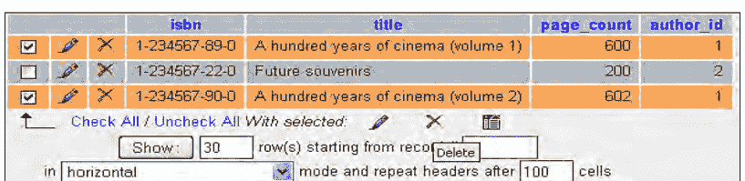

这些与 With selected X 形图标一起使用。确认屏幕会出现，列出即将被删除的所有行。也可以点击行数据的任何位置来激活相应的复选框。

## 删除表中的所有行

要完全擦除表中的所有行（保持其结构不变），我们进入 Database view 并点击左侧面板中的数据库名称。然后我们点击位于要清空的表同一行上的垃圾桶图标：

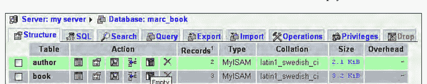

我们会收到一条确认 TRUNCATE 语句的消息（用于快速清空表的 MySQL 语句）。对于我们的练习，我们不会删除这些珍贵的数据！

清空表也可以在 Table view 中通过顶部菜单上的 Empty 链接完成：


> 删除数据，无论是逐行删除还是清空表，都是一项永久性操作。除非使用备份，否则无法恢复。

## 删除多个表中的所有行

上一节中的第一张屏幕截图显示了每个表名称左侧的复选框。我们可以选择一些表。然后，在 With selected 菜单中，选择 Empty 操作，如以下屏幕所示：

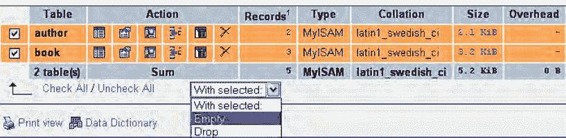

当然，这个决定绝不能轻率做出！

## 删除表

删除表会擦除数据和表的结构。我们可以使用 Table view 中的 Drop 链接删除表：


在 Database view 中，我们可以使用该表的 X 形图标删除特定表。相同的机制也存在于删除一个以上的表（使用下拉菜单和 Drop 操作）。

> Empty 和 Drop 操作标记为红色，以更好地指示这些操作对数据的固有危险。

## 删除数据库

我们可以使用 Database view 中的 Drop 链接删除整个数据库（包括其所有表）。


默认情况下，$cfg['AllowUserDropDatabase'] 设置为 FALSE。因此，此链接对无特权用户隐藏，直到该设置手动更改为 TRUE。

帮助我们三思，一条特殊消息 — **您即将销毁一个完整的数据库！** — 会在数据库被删除前出现。

> 数据库 mysql 包含所有用户和权限定义，非常重要。因此，即使对于管理员，此数据库的 Drop 按钮也被停用。

## 摘要

本章探讨了诸如以下的概念：

- 编辑数据
- 包含空字段并使用 Tab 键
- 对值应用函数
- 复制数据行
- 删除数据、表和数据库

下一章将介绍另一种更改——对表结构的修改。这包括：

- 添加列
- 处理特殊数据类型，如 DATE、ENUM 和 BIT 列
- 管理索引
