# 6 更改表结构

## 更改表结构

在开发应用程序时，由于新需求或修改后的需求，数据结构的要求经常发生变化。开发人员必须通过谨慎的表结构编辑来适应这些变化。本章探讨更改表结构的问题。具体来说，它展示了如何向现有表添加列并编辑列的属性。然后，我们在此基础上介绍更专业的列类型，并通过 phpMyAdmin 解释其处理方式。最后，我们介绍索引管理主题。

### 添加字段

假设我们需要一个新字段来存储书籍的语言，并且默认情况下我们保存数据的书籍是用英语编写的。我们可以将该字段命名为 **language**，它将包含由两个字符组成的代码（默认为 **en**）。

在 **book** 表的表视图的 **结构** 子页面中，我们可以找到 **添加字段** 对话框。在这里，我们指定想要多少个新字段，以及它们将放置的位置。

表中新字段的位置仅从开发人员的角度来看才重要。我们通常按逻辑对字段进行分组，以便在字段列表中更容易找到它们。字段的确切位置不会影响预期结果（查询输出），因为这些结果可以不考虑表结构进行调整。通常，最重要的字段（包括键）位于表的开头。然而，这只是个人偏好问题。

我们希望将新字段放在 **表末尾**。因此，我们选中相应的单选按钮并点击 **Go**。


其他可能的选项是 表开头 和 在...之后（在这种情况下，我们必须从下拉菜单中选择新字段必须跟随其后的字段）。

我们看到熟悉的新字段面板，会重复请求字段的次数。我们填写它。然而，由于我们这次想要输入默认值，我们执行以下两个操作：

- 将 Default 下拉菜单从 None 更改为 As defined：
- 输入默认值，en

然后我们点击 Save。

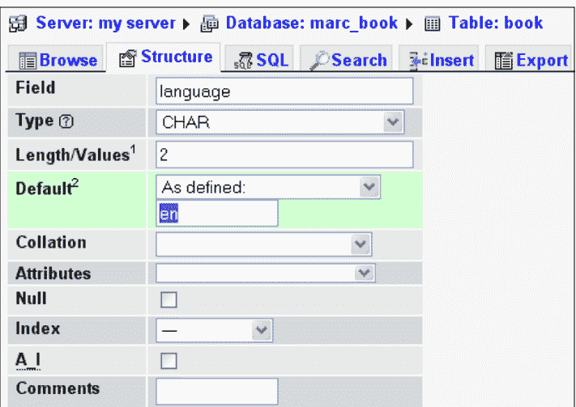

### 垂直模式

之前的面板以垂直模式出现，因为 $cfg['DefaultPropDisplay'] 的默认值为 3。这意味着对于三个或更少的列，使用垂直模式，对于超过三个的列，水平模式将被自动选择。在这里，我们可以使用我们选择的数字。

如果我们将 $cfg['DefaultPropDisplay'] 设置为 'vertical'，则添加新字段的面板（以及编辑字段结构的面板）将始终以垂直顺序呈现。在垂直模式下工作的优势变得明显，尤其是在每个字段有更多选项时，如第 16 章所述。

### 水平模式

$cfg['DefaultPropDisplay'] 参数也可以取值为 'horizontal'。让我们看看在请求三个新字段时面板在此模式下的外观：

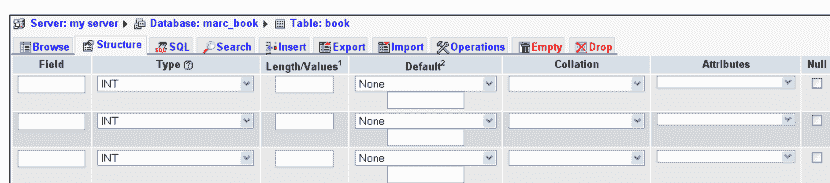

### 编辑字段属性

在 结构 子页面上，我们可以对表进行进一步更改。对于此示例，我们将 $cfg['PropertiesIconic'] 设置为 'both'，以便同时看到图标及其文本说明：

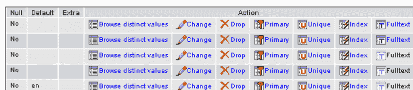

此面板不允许对字段进行每一种可能的更改。它特别允许：

- 使用特定字段上的 Change 链接更改一个字段结构
- 使用 Drop 操作删除字段
- 向现有主键添加字段
- 在字段上设置非唯一索引或唯一索引
- 设置全文索引（仅在字段类型允许时提供）

这些是快速链接，在某些情况下可能有用，但它们不能替代完整的索引管理面板。本章将解释这两者。

我们可以使用复选框来选择字段并且。 另外，使用适当的 With selected 图标，我们可以编辑字段或使用 Drop 进行多字段删除。 Check All / Uncheck All 选项允许我们轻松地选中或取消选中所有框。

### TEXT

我们现在将探讨如何使用 TEXT 字段类型以及相关的配置值，以调整 phpMyAdmin 的最佳行为。首先，我们向 book 表添加一个名为 description 的 TEXT 字段。

有三个参数控制在 TEXT 字段的 Insert 或 Edit 模式下显示的文本区域的布局。首先，每个字段的列数和行数由以下定义：

```
$cfg['TextareaCols'] = 40;
$cfg['TextareaRows'] = 7;
```

这（默认情况下）为 TEXT 字段提供了以下工作空间。


这些设置仅对文本区域施加视觉限制，如果需要，浏览器会创建垂直滚动条。

> 尽管 MEDIUMTEXT、TEXT 和 LONGTEXT 列可以容纳超过 32K 的数据，但某些浏览器并不总是能使用文本区域——HTML 提供的机制——来编辑它们。事实上，实验说服了 phpMyAdmin 开发团队，如果内容大于 32K，则产品显示警告消息。该消息警告用户内容可能无法编辑。

最后一个参数对 LONGTEXT 字段有影响。将 $cfg['LongtextDoubleTextarea'] 设置为 TRUE，会使可用编辑空间加倍。

### BLOB (Binary Large Object) 字段

BLOB 字段通常用于保存二进制数据（如图像和声音），尽管 MySQL 文档暗示 TEXT 字段可用于此目的。MySQL 5.1 手册说：“在某些情况下，可能希望将诸如媒体文件之类的二进制数据存储在 BLOB 或 TEXT 列中”。然而，另一句话：“BLOB 列被视为二进制字符串（字节字符串）”，似乎表明二进制数据应真正存储在 BLOB 字段中。因此，phpMyAdmin 的意图是使用 BLOB 字段来保存所有二进制数据。

我们将在第 16 章看到，有特殊机制可用于进一步处理 BLOB 字段，包括能够直接从 phpMyAdmin 中查看某些图像。此外，第 17 章涵盖了 BLOB 流支持。

首先，我们向 **book** 表添加一个 **BLOB** 字段 **cover_photo**。如果我们现在浏览表，可以看到每个 **BLOB** 字段的字段长度信息 **[BLOB - 0 B]**。

| isbn | title | page_count | author_id | language | description | cover_photo |
|---|---|---|---|---|---|---|
| 1-234567-89-0 | 电影百年（第1卷） | 600 | 1 | en |  | [BLOB - 0 B] |
| 1-234567-22-0 | 未来的纪念品 | 200 | 2 | en |  | [BLOB - 0 B] |
| 1-234567-90-0 | 电影百年（第2卷） | 602 | 1 | en |  | [BLOB - 0 B] |

这是因为 **Show BLOB** 显示选项（你还记得 **Options** 滑块吗？）默认情况下没有勾选。因此，它阻止了在 Browse 模式下显示 **BLOB** 内容。这种行为是有意的。通常，我们无法对以纯文本表示的二进制数据做任何事情。

### 二进制内容上传

如果我们编辑一行，会看到 **Binary – do not edit** 警告和一个 **Browse...** 按钮。此按钮上的确切标题取决于浏览器。尽管不允许编辑，但我们可以轻松地将文本或二进制文件的内容上传到此 **BLOB** 列中。

让我们使用 **Browse** 按钮选择一个图像文件——例如，位于我们客户端工作站上的 **phpMyAdmin/themes/original/img** 目录的测试副本中的 **logo_left.png** 文件。我们现在点击 **Go**。

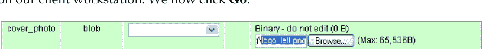

我们需要牢记上传大小的一些限制。首先，**BLOB** 字段大小限制为 64K。因此，phpMyAdmin 用 **Max: 65,536 Bytes** 警告提醒我们此限制。此外，PHP 本身也可能存在限制（有关更多详细信息，请参阅第 8 章）。我们现在已将图像上传到特定行的此字段中。

| isbn | title | page_count | author_id | language | description | cover_photo |
|---|---|---|---|---|---|---|
| 1-234567-89-0 | 电影百年（第1卷） | 600 | 1 | en |  | [BLOB - 6.7 KiB] |


如果我们为 **显示 BLOB** 显示选项勾选复选标记，我们现在在 **BLOB** 字段中看到以下内容：

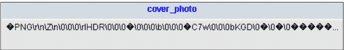

> 要真正从 phpMyAdmin 中查看图像，请参阅第 16 章。

`$cfg['ProtectBinary']` 参数控制在编辑二进制字段（**BLOB** 以及任何带有 `binary` 属性的字段）时可以执行的操作。默认值 `blob` 会阻止 **BLOB** 字段被编辑，但允许我们编辑 MySQL 标记为 `binary` 的其他字段。值为 `all` 时甚至会阻止 `binary` 字段被编辑。值为 FALSE 时则不提供任何保护，从而允许编辑所有字段。如果我们尝试最后一种选择，我们将在此行的 **编辑** 面板中看到以下内容：

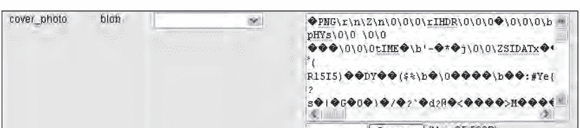

有可能这不是我们最喜欢的图像编辑器！事实上，即使我们不触碰 **BLOB** 字段而保存此行，数据也可能被损坏。但将 `$cfg['ProtectBinary']` 设置为 FALSE 的可能性是存在的，因为有些用户在 **BLOB** 字段中放置文本，并且需要能够修改此文本。

MySQL **BLOB** 数据类型实际上与相应的 **TEXT** 数据类型相似。然而，我们应该记住 **BLOB** 没有字符集，而 **TEXT** 列具有影响排序和比较的字符集。这就是为什么可以配置 phpMyAdmin 以允许编辑 **BLOB** 字段的原因。

## ENUM 和 SET

这两种字段类型都旨在表示可能值的列表。区别在于，用户使用 **ENUM** 时只能从定义的值列表中选择一个值，而使用 **SET** 时可以选多个值。使用 **SET** 时，所有多个值都进入一个单元格；但多个值并不意味着创建多于一行的数据。

我们在 book 表中添加一个名为 genre 的字段并将其定义为 ENUM。目前，我们选择在值列表中放置简短代码，并将其中一个 F 作为默认值，如以下屏幕截图所示：

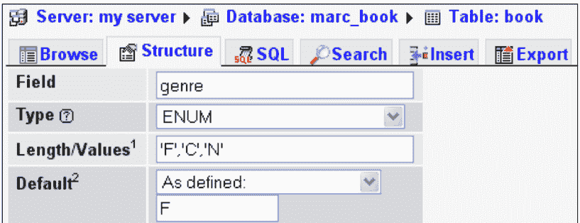

在值列表中，我们必须用单引号将每个值括起来，而在默认值字段中则不需要。在我们的设计中，我们知道这些值代表 Fantasy、Child 和 Novel。然而，目前我们想看看界面在简短代码下的行为。在插入面板中，我们现在看到一个单选框界面。


如果我们决定使用更具自描述性的代码，可以返回结构模式并更改 genre 字段的值定义。我们还必须将默认值更改为其中一个可能的值，以避免在尝试保存此字段结构的修改时收到错误消息。

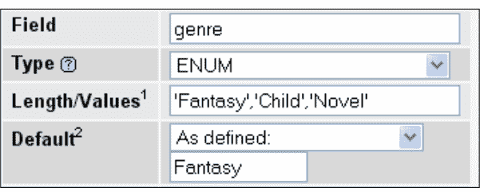

使用修改后的值列表，**插入** 面板现在如下所示：


请注意，由于可能的值更长，单选按钮已被下拉列表取代。

如果我们想要选择多个可能的值，必须将字段类型更改为 **SET**。可以使用相同的价值列表。然而，使用浏览器的多值选择器（在 Windows 或 Linux 桌面上按住 control 键单击，在 Mac 上按住 command 键单击），我们可以选择多个值，如屏幕截图所示：


> 对于前面的示例，我们将在规范化的数据结构中仅在 **book** 表中存储 **genre** 代码，并依赖另一个表来存储每个代码的描述。在这种情况下，我们不会使用 **SET** 或 **ENUM**。

## DATE、DATETIME 和 TIMESTAMP

我们可以使用普通的字符字段来存储日期或时间信息。但 **DATE**、**DATETIME** 和 **TIMESTAMP** 对于此目的更高效。MySQL 会检查内容以确保有效的日期和时间信息，并提供特殊函数来处理这些字段。

### 日历弹出

作为附加好处，phpMyAdmin 提供了日历弹出窗口以便于数据输入。

我们将首先在 **book** 表中添加一个 **DATE** 字段 — **date_published** —。如果我们进入 **插入** 模式，我们现在应该会看到新字段，可以在其中输入日期。**日历** 图标也可用：

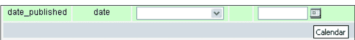

此图标会弹出一个与此 **DATE** 字段同步的窗口。如果字段中已有值，则弹出窗口会相应显示。在我们的例子中，字段中没有值，因此日历显示当前日期。

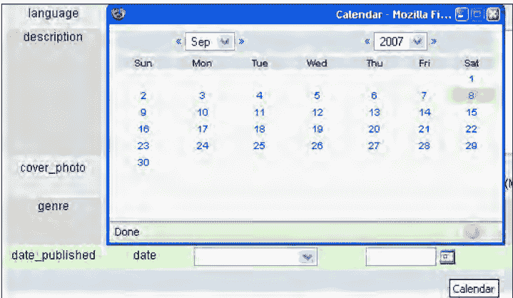

月份和年份标题两侧的小符号允许轻松滚动浏览月份和年份。简单点击我们想要的日期即可将其传输到 **date_published** 字段。

对于 **DATETIME** 或 **TIMESTAMP** 字段，弹出窗口提供编辑时间部分的功能。

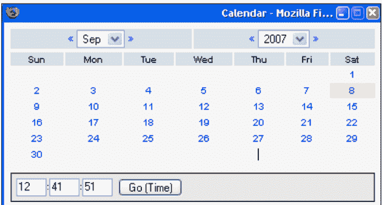

### TIMESTAMP 选项

从 MySQL 4.1.2 开始，有更多选项会影响 **TIMESTAMP** 列。让我们在 **book** 表中添加一个名为 **stamp** 的 **TIMESTAMP** 类型列。在 **默认** 下拉列表中，我们可以选择 **CURRENT_TIMESTAMP**；但在本练习中我们不会这样做。然而在 **属性** 列中，我们选择 **on update CURRENT_TIMESTAMP**。

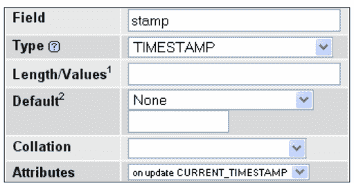

## 位

MySQL 5.0.3 引入了真正的位字段值。它们在数据库中占用的空间与定义中的位数相同。假设我们对每本书有三条信息，每条信息只能为真（1）或假（0）：

- 书是精装本
- 书包含 CD-ROM
- 书仅以电子格式提供

我们将使用单个 **BIT** 字段来存储这三条信息。因此，我们在 book 表中添加一个长度为 **3**（即 3 位）的字段：

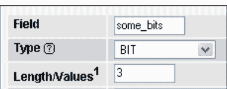

为了构建并随后解释我们存储在此字段中的值，我们必须以二进制方式思考，尊重字段内每个位的位置。为了表示一本书是精装本、不包含 CD-ROM、并且仅以电子格式提供，我们将使用值 101。

phpMyAdmin 以二进制方式处理 BIT 字段。例如，如果我们编辑一行并将值 101 设置为 some_bits 列，保存时将发送以下查询：

```
UPDATE `marc_book`.`book` SET `some_bits` = b '101'
WHERE `book`.`isbn` = '1-234567-89-0' LIMIT 1;
```

此查询中突出显示的部分表明该列确实接收到二进制值。在浏览时，确切的字段值（以十进制表示为 5——对我们的目的而言毫无意义）会以其二进制形式 101 重新显示，这有助于解释每个离散位值。

## 索引管理

phpMyAdmin 有许多索引管理选项，将在本节中介绍。

### 单字段索引

我们已经看到结构面板如何通过主键、索引和唯一等快速链接提供在单个字段上创建索引的快速方法。在字段列表下（在详细信息滑块中），有一个用于管理索引的界面部分：

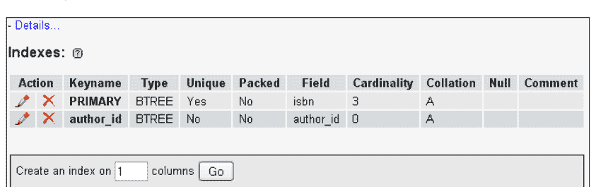

此部分包含编辑或删除每个索引的链接。这里，字段部分每个索引只列出一个字段，我们可以看到整个字段都参与了索引。这是因为每个字段名称后面没有大小信息，这与我们在下一个示例中看到的情况相反。

我们现在将在 title 上添加一个索引。然而，我们希望限制此索引的长度以减少磁盘上索引结构使用的空间。创建 1 列的索引选项是合适的。因此，我们点击 Go。在下一屏幕中，我们按如下所示指定索引详细信息：

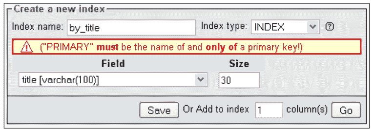

以下是如何填写此面板：

- **索引名称：** 我们自创的名称
- **索引类型：** 我们可以选择 INDEX 或 UNIQUE
- **字段：** 我们选择用作索引的字段，即 title 字段
- **大小：** 我们输入 30 而不是 100（字段的完整长度），以节省保存索引数据的表的物理部分空间

保存此面板后，我们可以从以下屏幕截图确认索引已创建，并且未覆盖 title 字段的整个长度：

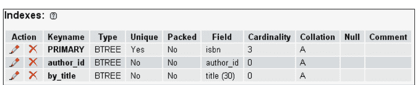

### 多字段索引和索引编辑

在下一个示例中，我们假设在未来的应用程序中，我们需要查找特定作者用特定语言撰写的书籍。扩展我们的 author_id 索引并添加 language 字段是有意义的。


我们点击包含 author_id 索引的那一行上的编辑链接（小铅笔）；这会显示该索引的当前状态。界面有空间在此索引中添加另一个字段。如果我们需要添加多个字段，可以使用 Add to index 1 column(s) 功能。在字段选择器中，我们选择 language。这次我们不需要输入大小，因为整个字段将在索引中使用。为了更好地记录，我们更改索引名称（author_language 是合适的）。

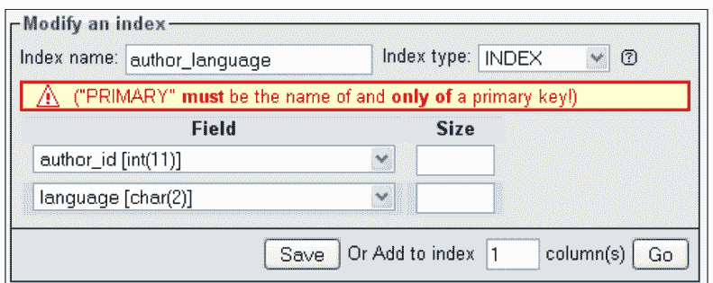

我们保存此索引修改。在索引列表中，我们可以确认我们的索引修改。

| 操作 | 键名 | 类型 | 唯一 | 打包 | 字段 | 基数 | 校对规则 | 空值 | 注释 |
|---|---|---|---|---|---|---|---|---|---|
|  | PRIMARY | BTREE | Yes | No | isbn | 3 | A |  |  |
|  | by_title | BTREE | No | No | title (30) | 0 | A |  |  |
|  | author_language | BTREE | No | No | author_id | 0 | A |  |  |
|  |  |  |  |  | language | 0 | A |  |  |

## FULLTEXT 索引

这种特殊类型的索引允许进行全文搜索。它仅支持 MyISAM 表的 VARCHAR 和 TEXT 字段。我们可以在字段列表中使用 Fulltext 快速链接，或前往索引管理面板并在下拉菜单中选择 Fulltext。


我们在 description 字段上添加一个 FULLTEXT 索引，以便能够根据描述中出现的词语定位一本书。

## 表优化——解释查询

在本节中，我们想要获取有关 MySQL 为特定查询使用的索引的信息，以及未定义索引时的性能影响。

假设我们想要使用以下查询：

```
SELECT  *
FROM `book`
WHERE author_id = 2 AND language = 'es'
```

我们想要知道，作者 id 为 2 所写的书籍中，哪些是 es 语言——我们的西班牙语代码。

要输入此查询，我们使用数据库或表菜单中的 SQL 链接，或 SQL 查询窗口（参见第 12 章）。我们在查询框中输入此查询并点击 Go。查询是否找到结果，现在并不重要。

> 你可以通过遵循第 9 章中的解释来产生对 author_id 2 和 language es 的搜索，从而获得相同的查询。

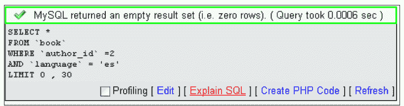

让我们查看链接：[Edit] [Explain SQL] [Create PHP Code] [Refresh]

我们现在将使用 [Explain SQL] 链接来获取有关此查询使用了哪个索引（如果有）的信息：

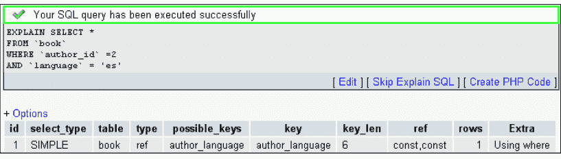

| id | 选择类型 | 表 | 类型 | 可能的键 | 键 | 键长度 | 参考 | 行数 | 额外信息 |
|---|---|---|---|---|---|---|---|---|---|
| 1 | SIMPLE | book | ref | author_language | author_language | 6 | const,const | 1 | Using where |

我们可以看到 EXPLAIN 命令已传递给 MySQL，告诉我们使用的 possible_keys 是 author_language。因此，我们知道此索引将用于此类查询。如果此索引不存在，结果会大不相同。

| id | 选择类型 | 表 | 类型 | 可能的键 | 键 | 键长度 | 参考 | 行数 | 额外信息 |
|---|---|---|---|---|---|---|---|---|---|
| 1 | SIMPLE | book | ALL | NULL | NULL | NULL | NULL | 3 | Using where |

这里，possible_keys（NULL）和 type（ALL）意味着不会使用索引，并且需要检查所有行才能找到所需数据。根据总行数，这可能会对性能产生严重影响。我们可以通过检查 phpMyAdmin 在每个结果页面上显示的查询时间（Query took x sec）并在有索引和无索引的情况下进行比较来确定确切的影响。然而，如果我们只有有限的测试数据，与生产环境中的真实表相比，时间差异可能很小。

## 索引问题的检测

为了帮助用户保持最佳索引策略，phpMyAdmin 会尝试检测一些常见的索引问题。例如，让我们访问 book 表并在 isbn 列上添加一个索引。当我们显示此表的结构时，会收到一个警告：

索引：
| 操作 | 键名 | 类型 | 唯一 | 打包 | 字段 | 基数 | 校对规则 | 空值 | 注释 |
|---|---|---|---|---|---|---|---|---|---|
|  | PRIMARY | BTREE | Yes | No | isbn | 3 | A |  |  |
|  | by_title | BTREE | No | No | title (30) | 0 | A |  |  |
|  | author_language | BTREE | No | No | author_id | 0 | A |  |  |
|  |  |  |  |  | language | 0 | A |  |  |
|  | isbn | BTREE | No | No | isbn | 0 | A |  |  |
|  | description | FULLTEXT | No | No | description | 0 |  |  |  |
警告 | 索引 PRIMARY 和 isbn 似乎相等，其中一个可能被移除。

这里的意图是警告我们在考虑整个表时索引结构效率低下。我们不需要在同一列上拥有两个索引。

## 摘要

在本章中，我们概述了：

- 如何添加字段，包括特殊字段类型，如 TEXT、BLOB、ENUM 和 SET
- 如何为 DATE、DATETIME 和 TIMESTAMP 字段使用日历弹出窗口
- 如何将二进制数据上传到 BLOB 字段
- 如何管理索引（多字段和全文），并从 MySQL 获取有关特定查询中使用了哪些索引的反馈

在第 7 章中，我们将学习如何导出表的结构和数据以备备份之用，或用作通往另一个应用程序的网关。
