# 7 导出结构和数据（备份）

## 导出结构和数据（备份）

保持良好的备份对项目至关重要。备份包括最新的备份以及在开发和生产阶段拍摄的中间快照。phpMyAdmin 的导出功能可以生成备份，也可以用于将数据发送到其他应用程序。

## 转储、备份和导出

让我们先澄清一些词汇。在 MySQL 文档中，你会遇到术语 dump，而在其他应用程序中，术语为 backup 或 export。在 phpMyAdmin 上下文中，这些术语含义相同。

MySQL 包含 mysqldump——一种可用于生成导出文件的命令行实用程序。但并非每个主机提供商都提供命令行实用程序所需的 shell 访问权限。此外，从 Web 界面访问导出功能更为方便。这就是为什么 phpMyAdmin（自 1.2.0 版本起）提供导出功能，其导出格式比 mysqldump 更多。本章将重点介绍 phpMyAdmin 的导出功能。

在开始导出之前，我们必须对导出的预期目标有清晰的认识。以下问题可能有所帮助：

- 我们需要完整的数据库还是仅某些表？
- 我们只需要结构、只需要数据，还是两者都需要？
- 将使用哪种实用程序将数据导入回来？（并非每个导出格式都可由 phpMyAdmin 导入。）
- 我们是否只想要数据的一个子集？
- 预期导出的大小是多少，以及我们与服务器之间的链路速度是多少？

## 导出的范围

当我们从 phpMyAdmin 点击 Export 链接时，我们可能处于以下其中一种视图或上下文中——Database view、Table view 或 Server view（更多内容将在第 18 章介绍）。根据当前上下文，结果导出的范围将是完整的数据库、单个表，甚至像 Server view 情况那样的多数据库导出。我们将首先解释数据库导出和所有相关的导出类型。然后我们将继续介绍表和多数据库导出，强调这些导出模式的差异。

## 数据库导出

在 Database view 中，点击 Export 链接。默认导出面板如下所示：

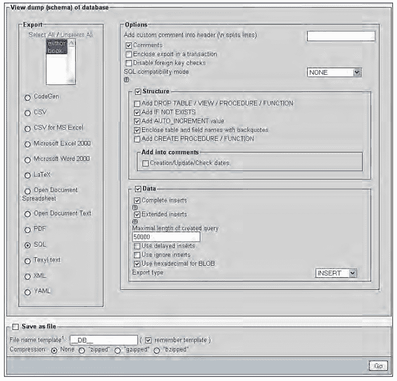

这里选择的默认值取决于 config.inc.php，更具体地说是 $cfg['Export'] 参数数组。例如，$cfg['Export']['format'] 参数设置为 'sql'，因此默认选择 SQL 导出模式。

导出面板有三个子面板。顶部面板 **Export** 和底部面板 **Save as file** 始终存在。然而，第三个面板会变化（使用动态菜单技术），以显示所选导出模式的选项（此处为 SQL）。

## 导出子面板

此子面板包含一个表选择器，我们可以在其中选择所需的表和格式。SQL 格式对我们的需求很有用，因为它创建可在任何 SQL 服务器上工作的标准 SQL 命令。其他可能的格式包括 LaTeX、PDF、Microsoft Excel 2000、Microsoft Word 2000、**逗号分隔值（CSV）**、YAML、CodeGen、Texy! 文本、Open Document Spreadsheet、Open Document Text 和 XML。另一种格式 Native MS Excel 在进一步的软件安装和配置后可用。（参见本章中关于 *Native MS Excel* 的部分。）

我们将现在讨论可以使用 **Export** 子面板选择的格式（以及在选择后可用的选项）。

> 即使我们可以将 phpMyAdmin 导出为所有这些格式，只有 SQL 和 CSV 格式可以使用当前 phpMyAdmin 版本重新导入。仅将这两种格式用于备份。

## SQL

我们将首先点击 **Select All**；我们想要所有表。我们知道表很小，因此屏幕上的导出不会太大。暂时，让我们取消选择 **Extended inserts** 复选框。然后我们点击 **Go**，产生以下输出：

```
-- phpMyAdmin SQL Dump
-- version 3.1.1
-- http://www.phpmyadmin.net
--
-- Host: localhost
-- Generation Time: Dec 21, 2008 at 12:55 PM
-- Server version: 5.0.67
-- PHP Version: 5.2.6
SET SQL_MODE="NO_AUTO_VALUE_ON_ZERO";
```


```
--
-- Database: `marc_book`
--
-- --------------------------------------------------------
--
-- Table structure for table `author`
--
CREATE TABLE IF NOT EXISTS `author` (
  `id` int(11) NOT NULL,
  `name` varchar(30) NOT NULL,
  `phone` varchar(30) default NULL,
  PRIMARY KEY  (`id`)
) ENGINE=MyISAM DEFAULT CHARSET=latin1;
--
-- Dumping data for table `author`
--
INSERT INTO `author` (`id`, `name`, `phone`) VALUES(1, 'John Smith', '+01 445-789-1234');
INSERT INTO `author` (`id`, `name`, `phone`) VALUES(2, 'Maria Sunshine', '333-3333');
-- --------------------------------------------------------
--
-- Table structure for table `book`
--
CREATE TABLE IF NOT EXISTS `book` (
  `isbn` varchar(25) NOT NULL,
  `title` varchar(100) NOT NULL,
  `page_count` int(11) NOT NULL,
  `author_id` int(11) NOT NULL,
  `language` char(2) NOT NULL default 'en',
  `description` text NOT NULL,
  `cover_photo` blob NOT NULL,
  `genre` set('Fantasy','Child','Novel') NOT NULL default 'Fantasy',
  `date_published` datetime NOT NULL,
  `stamp` timestamp NOT NULL default '0000-00-00 00:00:00' on update CURRENT_TIMESTAMP,
```
```
`some_bits` bit(3) NOT NULL,
PRIMARY KEY (`isbn`),
KEY `by_title` (`title`(30)),
KEY `author_language` (`author_id`,`language`),
KEY `isbn` (`isbn`),
FULLTEXT KEY `description` (`description`)
) ENGINE=MyISAM DEFAULT CHARSET=latin1;

--
-- Dumping data for table `book`
--

INSERT INTO `book` (`isbn`, `title`, `page_count`, `author_id`, `language`, `description`, `cover_photo`, `genre`, `date_published`, `stamp`, `some_bits`) VALUES('1-234567-89-0', 'A hundred years of cinema (volume 1)', 600, 1, 'en', '', '0x89504e470d0a1a0a000000d494844', '', '0000-00-00 00:00:00', '2008-12-20 14:14:35', b'011');
INSERT INTO `book` (`isbn`, `title`, `page_count`, `author_id`, `language`, `description`, `cover_photo`, `genre`, `date_published`, `stamp`, `some_bits`) VALUES('1-234567-22-0', 'Future souvenirs', 200, 2, 'en', '', '', '', '0000-00-00 00:00:00', '0000-00-00 00:00:00', '\0');
INSERT INTO `book` (`isbn`, `title`, `page_count`, `author_id`, `language`, `description`, `cover_photo`, `genre`, `date_published`, `stamp`, `some_bits`) VALUES('1-234567-90-0', 'A hundred years of cinema (volume 2)', 602, 1, 'en', '', '', '', '0000-00-00 00:00:00', '0000-00-00 00:00:00', 'N0');
```

在此导出示例中，其中一本书（以 0x8950 开头）的数据已被截断以简洁起见。实际上，它将包含该书 cover_photo 字段的完整十六进制表示。

导出的第一部分包含注释（以字符 -- 开头），其中详细说明了创建该文件的工具（及版本）、日期和其他环境信息。随后我们可以看到每个表的 CREATE 和 INSERT 查询。


> phpMyAdmin 在导出文件中生成 ANSI 兼容的注释。这些注释以 -- 开头。它们有助于将文件导入到其他 ANSI SQL 兼容的系统上。在 2.6.0 之前的版本中，使用了 MySQL 特定的字符 '#'。

## SQL 选项

SQL 选项用于精确定义导出将包含的信息。我们可能希望查看结构、数据或两者。选择 Structure 会生成包含 CREATE 查询的部分，而选择 Data 会生成 INSERT 查询：

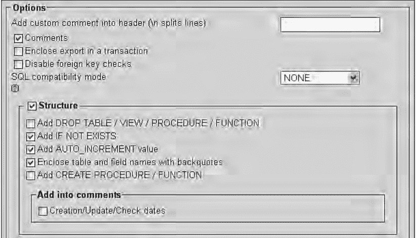

通用的 SQL 选项是：

- **在标题中添加自定义注释**：我们可以为此导出添加自己的注释（例如，**每月备份**），它将显示在导出标题中（在 PHP 版本号之后）。如果注释有多行，我们必须使用特殊字符 \n 来分隔每一行。
- **注释**：在此处取消选中复选标记会导致导出中完全没有注释。
- **将导出包含在事务中**：从 MySQL 4.0.11 开始，我们可以使用 START TRANSACTION 语句。此命令结合开头处的 SET AUTOCOMMIT=0 和结尾处的 COMMIT，要求 MySQL 在一次事务中执行导入（当我们重新导入此文件时），确保所有更改作为一个整体完成。
- **禁用外键检查**：在导出文件中，我们可以添加 `DROP TABLE` 语句。然而，通常如果表在外键约束中被引用，则无法删除该表。此选项通过在导出文件中添加 `SET FOREIGN_KEY_CHECKS=0` 来覆盖验证。
- **SQL 兼容模式**：这让我们可以选择导出的 SQL 方言。我们必须了解打算导入此文件的系统。选项包括 **MySQL 3.23**、**MySQL 4.0**、**Oracle** 和 **ANSI**。

**结构** 部分的选项是：

- **添加 DROP TABLE / DROP VIEW**：在每个 `CREATE TABLE` 语句之前添加 `DROP TABLE IF EXISTS` 语句，例如：`DROP TABLE IF EXISTS `author``。这样，我们可以确保导出文件在已存在相同表的数据库上执行，更新其结构但销毁之前的表内容。`DROP VIEW` 用于视图。
- **添加 IF NOT EXISTS**：向 `CREATE TABLE` 语句添加 `IF NOT EXISTS` 修饰符，避免在表已存在时导入时出错。
- **添加 AUTO_INCREMENT 值**：将表的自增信息放入导出中，确保表中插入的行将获得下一个确切的自增 ID 值。
- **用反引号括起表名和字段名**：反引号是保护可能包含特殊字符的表名和字段名的常规方式。在大多数情况下，有它们是有用的。然而，如果目标服务器（导出文件将被导入到该服务器）运行的是早于 3.23.6 的 MySQL 版本，则不建议使用反引号，因为该版本不支持反引号。
- **添加 CREATE PROCEDURE / FUNCTION**：这会将此数据库中找到的所有存储过程和函数包含在导出中。
- **添加到注释中**：这会添加信息（以 SQL 注释的形式），这些信息无法直接导入，但仍然是有价值且可读的表信息。这里的信息量取决于关系系统设置（参见第 11 章）。事实上，使用已激活的关系系统，我们将获得以下选择：


选择 **关系** 和 **MIME 类型** 将在结构导出中生成一个额外的部分。

```
-- COMMENTS FOR TABLE `book`:
--  `isbn`
--   `book number`
--  `page_count`
--   `approximate`
--  `author_id`
--   `see author table`
--
--
-- MIME TYPES FOR TABLE `book`:
--  `cover_photo`
--   `image/jpeg`
--  `date_released`
--   `text_plain`
--  `description`
--   `text_plain`
--
--
-- RELATIONS FOR TABLE `book`:
--  `author_id`
--   `author` -> `id`
--
```

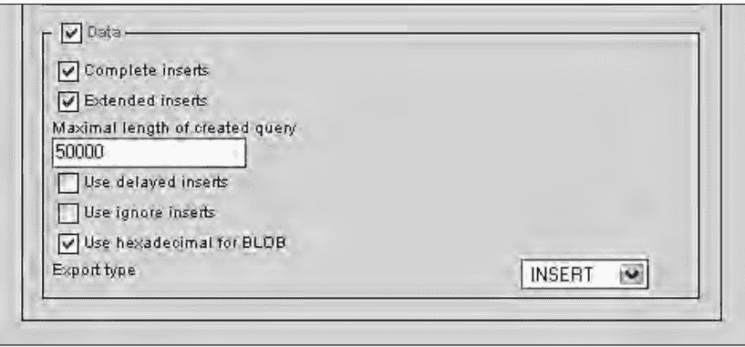

数据 部分可用的选项是：

```
```sql
INSERT INTO `author` (`id`, `name`, `phone`)
VALUES (1, 'John Smith', '+01 445 789-1234');
INSERT INTO `author` (`id`, `name`, `phone`)
VALUES (2, 'Maria Sunshine', '+01 455 444-5683');
```
```

```
```sql
INSERT INTO `author` VALUES (1, 'John Smith', '+01 445 789-1234'), (2, 'Maria Sunshine', '+01 455 444-5683');
```
```

- **完整插入**：为 author 表生成以下导出：

请注意，每个语句中都包含每个列名。生成的文件更大，但在各种 SQL 系统上更具可移植性，并且文档性更好。
- **扩展插入**：将整个表数据打包到单个 INSERT 语句中：

这种插入数据的方法比使用多个 INSERT 语句更快，但不太方便，因为它使 resultant 文件更难阅读。扩展插入还生成更小的文件，但该文件的每一行本身都不可执行，因为每一行都没有 INSERT 语句。如果您无法一次性导入完整文件，则无法使用文本编辑器拆分文件并分块导入。
- **创建查询的最大长度**：为扩展插入生成的单个 INSERT 语句可能变得太大并导致问题。因此，我们为该语句的长度设置字符数限制。
- **使用延迟插入**：向 INSERT 语句添加 DELAYED 修饰符。这会加速 INSERT 操作，因为它会被排队到服务器，服务器将在表未使用时执行它。请注意，这是一个 MySQL 非标准扩展，仅适用于 MyISAM、ISAM、MEMORY 和 ARCHIVE 表。
- **使用忽略插入**：通常，在导入时，我们不能为唯一键插入重复值，因为这会中止插入操作。此选项向 INSERT 和 UPDATE 语句添加 IGNORE 修饰符，从而跳过生成重复键错误的 行。
- **对 BLOB 使用十六进制**：此选项使 phpMyAdmin 以 0x 格式编码 BLOB 字段的内容。这种格式很有用，因为根据将用于操作导出文件的软件（例如文本编辑器或邮件程序），处理包含 8 位数据的文件可能有问题。然而，使用此选项会产生 BLOB 导出，其大小可能是原来的两倍，甚至更大。


- **导出类型：** 选项有 **INSERT**、**UPDATE** 和 **REPLACE**。其中最知名的是默认的 **INSERT** —— 使用 **INSERT** 语句将我们的数据导入回来。然而在导入时，我们可能处于表已存在且包含有价值数据的情况，而我们只想更新当前导出表中存在的字段。**UPDATE** 生成类似 UPDATE `author` SET `id` = 1, `name` = `John Smith`, `phone` = `111-1111` WHERE `id` = `1`; 的语句；当找到相同的 primary 或 unique 键时更新一行。第三种可能性 **REPLACE** 生成类似 REPLACE INTO `author` VALUES (1, `John Smith`, `111-1111`); 的语句；这些语句对于新行像 INSERT 语句一样工作，并基于 primary 或 unique 键更新现有行。

## “Save as file” 子面板

在之前的示例中，导出操作的结果显示在屏幕上，当然，数据也没有进行压缩。我们可以通过勾选 Save as file 复选框来通过 HTTP 传输导出文件。这会在浏览器中触发一个保存对话框，最终将文件保存到我们的本地工作站。

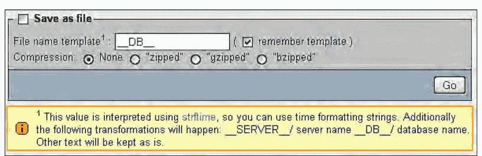

## 文件名模板

建议文件的名称将遵循文件名模板。在此模板中，我们可以使用特殊的 __SERVER__、__DB__ 和 __TABLE__ 占位符。这些占位符将被当前服务器、数据库或表名（对于单表导出）替换。请注意，单词前后各有两个下划线字符。我们还可以使用 PHP strftime 函数中的任何特殊字符；这对于根据当前日期或小时生成导出文件很有用。最后，我们可以放置任何其他字符字符串（不属于 strftime 特殊字符），它将被原样使用。文件扩展名根据导出类型生成。在本例中，它将为 .sql。以下是模板的一些示例：

- __DB__ 将生成 **marc_book.sql**
- __DB__-%Y%m%d 将给出 **marc_book-20071206.sql**

**remember template** 选项在激活时，会将输入的模板设置存储到 cookie 中（用于数据库、表或服务器导出），并在下次使用同类导出时将其带回。

默认模板可通过以下参数配置：

```
$cfg['Export']['file_template_table'] = '__TABLE__';
$cfg['Export']['file_template_database'] = '__DB__';
$cfg['Export']['file_template_server'] = '__SERVER__';
```

## 压缩

为了节省传输时间并获得更小的导出文件，phpMyAdmin 可以压缩为 ZIP、GZIP 或 BZIP2 格式。phpMyAdmin 原生支持 ZIP 格式。然而，GZIP 和 BZIP2 格式仅在 PHP 服务器分别使用 --with-zlib 或 --with-bz2 配置选项编译时才有效。以下参数控制面板中呈现哪些压缩选项：

```
$cfg['ZipDump'] = TRUE;
$cfg['GZipDump'] = TRUE;
$cfg['BZipDump'] = TRUE;
```

安装 phpMyAdmin 为多位用户使用的系统管理员可以选择将所有这些参数设置为 FALSE，以避免大量用户同时压缩其导出时产生的潜在开销。这种情况通常造成的开销比所有用户同时传输未压缩文件的情况更大。

在旧版本的 phpMyAdmin 中，压缩文件是在 Web 服务器内存中构建的。这导致了一些问题：

- 文件生成取决于分配给运行 PHP 脚本的内存限制。
- 在文件生成和压缩期间，没有传输发生。因此，用户倾向于认为操作未在工作且出现崩溃。
- 无法实现大型数据库的压缩。

$cfg['CompressOnFly'] 参数（默认设置为 TRUE）被添加以生成（对于 gzip 和 bzip2 格式）包含更多头的压缩文件。现在，传输几乎立即开始。文件以更小的块发送，因此整个过程消耗的内存要少得多。

## 字符集选择

本节解释了一个鲜为人知的功能——选择导出文件的确切字符集的可能性。

此功能通过将 $cfg['AllowAnywhereRecoding'] 设置为 TRUE 来激活。我们可以在此处看到它对界面的影响。

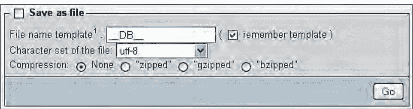

当此参数打开时，phpMyAdmin 会验证重新编码的条件是否满足。对于数据的实际编码，Web 服务器的 PHP 组件必须支持 iconv 或 recode 模块。如果不是这种情况并且参数已设置为 TRUE，则会生成以下错误消息：

**无法加载进行字符集转换所需的 iconv 或 recode 扩展。要么配置 PHP 以启用这些扩展，要么在 phpMyAdmin 中禁用字符集转换。**

如果显示此消息，请查阅系统文档（PHP 或操作系统）以获取安装程序。

另一个参数（$cfg['RecodingEngine']）指定实际的重新编码引擎——选项为 auto、iconv 和 recode。如果设置为 auto，phpMyAdmin 将首先尝试 iconv 模块，然后尝试 recode 模块。

## 汉字支持

如果 phpMyAdmin 检测到使用日语，它会检查 PHP 是否支持 mb_convert_encoding() 多字节字符串函数。如果支持，则在以下页面上会显示额外的单选按钮——export、import 和 query box，以便我们可以选择 EUC-JP 和 SJIS 日文编码。

以下是来自导出页面的示例：


## CSV

此格式被大量程序理解，您可能会发现它在交换数据时很有用。请注意，这是一个仅包含数据格式——这里没有 SQL 结构。

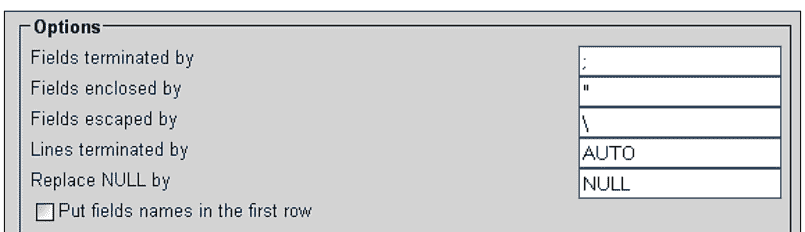

可用的选项有：

- **字段以...终止：** 我们在此处放置一个逗号，这意味着每个字段后都会放置一个逗号。
- **字段被...包围：** 我们在此处放置一个包围字符（例如引号），以确保包含终止字符（逗号）的字段不会被视为两个字段。
- **字段转义符：** 如果导出生成器在字段内找到 **字段被...包围** 字符，则 **字段转义符** 字符将被放置在其前面以保护它。例如，"John \"The Great\" Smith"。
- **行以...终止**：这决定了结束每一行的字符。我们应该根据将操作生成的导出文件的操作系统在此处使用适当的行分隔符。此选项的默认值来自 $cfg['Export']['csv_terminated'] 参数，其默认包含 `AUTO`。`AUTO` 值在浏览器操作系统为 Windows 时生成 \r\n 值，否则为 \n。然而，如果导出文件 intended for a machine with a different OS，这可能不是最佳选择。
- **将 NULL 替换为**：这决定了导出文件中任何字段中发现的 NULL 值的占位字符串。
- **在第一行放置字段名**：这获取有关每个字段含义的一些信息。一些程序将使用此信息来命名列。

最后，我们选择 **author** 表。

结果是：

```
"id","name","phone"
"1","John Smith","+01 445 789-1234"
"2","Maria Sunshine","+01 455 444-5683"
```

## 适用于 MS Excel 的 CSV

此导出模式生成适用于 Microsoft Excel 的 CSV 文件。我们可以选择确切的 Microsoft Excel 版本。

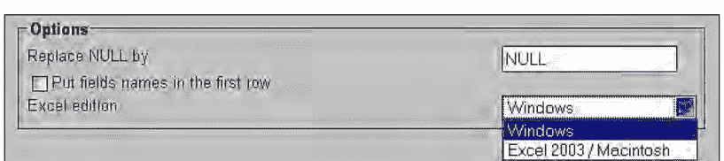

## PDF

从版本 2.8.0 起，可以通过导出为 PDF 来创建表的 PDF 报告。此功能一次仅适用于一个表，并且我们必须勾选 **Save as file** 复选框以正常操作。我们可以为此报告添加标题，并且它也会自动分页。在 2.8.0 到 2.8.2 版本中，此导出格式不支持非文本（BLOB）数据，如 book 表中所示。如果我们在该表中尝试它，将会产生错误结果。

在这里，我们在 author 表上测试它。


PDF 由于其固有的矢量特性而有趣——结果可以缩放。让我们看看从 Acrobat Reader 看到的生成的报告：

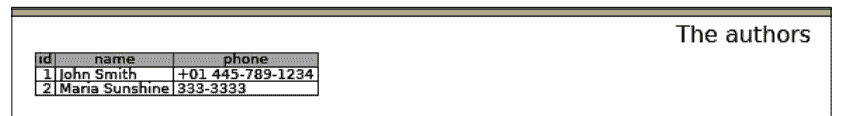

## Microsoft Excel 2000

此导出格式直接生成适用于所有理解 Excel 2000 格式的软件的 .xls 文件。我们可以指定应替换 NULL 值的字符串。**在第一行放置字段名** 选项在激活时，会将表的列名作为电子表格的第一行生成。同样，**Save as file** 复选框应被勾选。这会生成一个文件，其中每个表的列成为电子表格列。

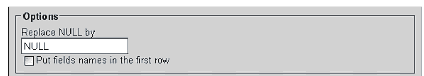


## Microsoft Word 2000

此导出格式直接生成适用于所有理解 Word 2000 格式的软件的 .doc 文件。我们发现的选项与 Microsoft Excel 2000 导出中的选项相似，还有一些更多。我们可以独立导出表的结构和数据。

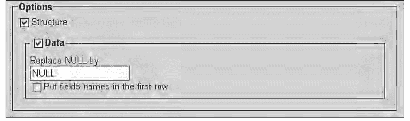

请注意，对于此格式和 Excel 格式，我们可以为一次导出选择多个表。但是，如果其中一个表包含非文本数据，就会产生不愉快的结果。以下是 author 表的结果：

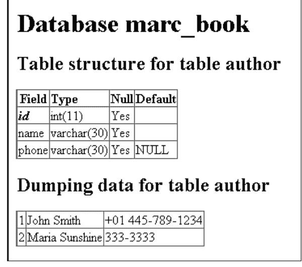

## LaTeX

LaTeX 是一种排版语言。phpMyAdmin 可以生成一个 .tex 文件，以横向表格格式表示表的结构和/或数据。请注意，此文件无法直接查看，必须进一步处理或转换才能用于预期的最终媒体。

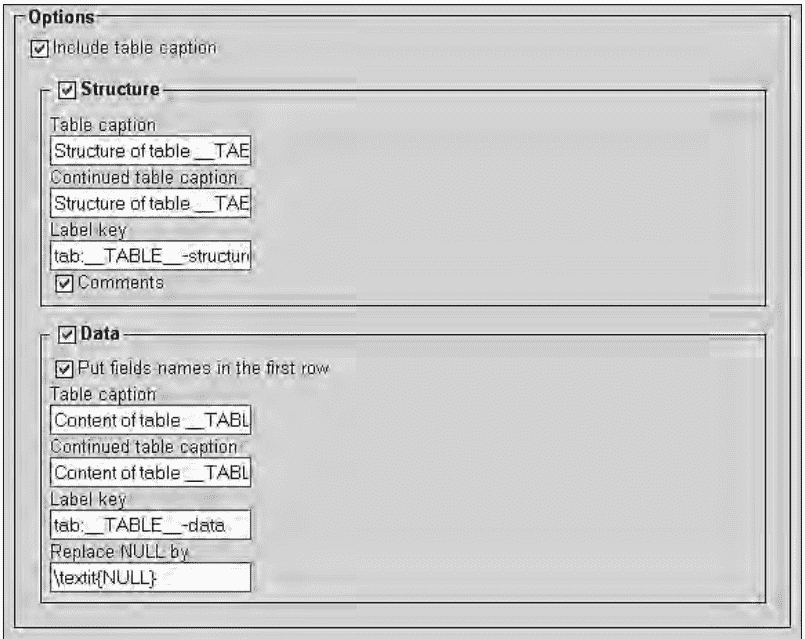

可用的选项是：

- **包含表格标题**：在表格输出中显示标题。
- **结构和数据**：熟悉的选择，用于请求结构、数据或两者。
- **表格标题**：放在第一页的标题。
- **续表标题**：放在每一页上的标题。
- **关系、注释、MIME 类型**：我们希望作为输出的其他结构信息。如果关系基础设施已就位，则可以使用这些选项（详见第 11 章）。

## XML

这种格式在当今数据交换中非常流行。在 **导出** 界面中选择 **XML** 不会提供选项选择。下面是 **author** 表的输出。

```
<?xml version="1.0" encoding="utf-8" ?>
<!--
-
- phpMyAdmin XML Dump
- version 3.1.1
- http://www.phpmyadmin.net
-
- Host: localhost
- Generation Time: Dec 21, 2007 at 01:13 PM
- Server version: 5.0.67
- PHP Version: 5.2.6
-->

<!--
- Database: `marc_book`
-->
<marc_book>
    <!-- Table author -->
    <author>
        <id>1</id>
        <name>John Smith</name>
        <phone>+01 445-789-1234</phone>
    </author>
    <author>
        <id>2</id>
        <name>Maria Sunshine</name>
        <phone>333-3333</phone>
    </author>
</marc_book>
```

## Native MS Excel (pre-Excel 2000)

phpMyAdmin 提供了一个实验性模块，可直接导出为 **.xls** 格式——MS Excel 和 OpenOffice Calc 理解的原生电子表格格式。当此支持被激活时（稍后会详细介绍），我们会看到一个新的导出选项 **Native MS Excel**，以及与 Microsoft Excel 2000 相同的选项。

我们可以选择将字段名称放在电子表格的第一行，使用 **将字段名称放在第一行**。

此功能依赖于 PEAR 模块 **Spreadsheet_Excel_Writer**，其当前版本为 0.9.1，并生成 Excel 5.0 格式文件。该模块记录在 http://pear.php.net/package/Spreadsheet_Excel_Writer，但 phpMyAdmin 环境下的完整安装记录如下：

- 1. 确保 PHP 服务器具有 PEAR 支持。（如果没有 PEAR 支持，pear 命令将失败。）PEAR 本身记录在 http://pear.php.net。
- 2. 如果我们以安全模式运行 PHP，必须确保允许包含 PEAR 模块。假设模块位于 /usr/local/share/pear 下，我们应在 php.ini 中有 safe_mode_include_dir = /usr/local/share/pear 这一行。
- 3. 然后我们使用 pear -d preferred_state=beta install -a Spreadsheet_Excel_Writer 安装该模块（因为该模块目前处于 beta 状态）。此命令通过互联网获取必要的模块并将其安装到我们的 PEAR 基础设施中。
- 4. 我们需要在 phpMyAdmin 主目录下为 .xls 生成准备一个临时目录。在 Linux 系统上，可以使用 mkdir tmp ; chmod o+rwx tmp 创建。
- 5. 我们将 config.inc.php 中的 $cfg['TempDir'] 参数设置为 './tmp'。

我们现在应该能够看到新的 **Native MS Excel data** 导出选项。

## Open document spreadsheet

此电子表格格式是开放文档（http://en.wikipedia.org/wiki/OpenDocument）的一个子集，该格式因 OpenOffice.org 办公套件而流行。我们需要只选择一个表进行导出，以便获得连贯的电子表格。以下是我们的 author 表，导出为名为 author.ods 的文件，随后从 OpenOffice 查看：

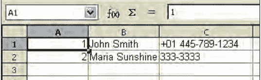

## Open document text

这是开放文档标准的另一个子集，这次面向文本处理。可用选项如以下屏幕截图所示：

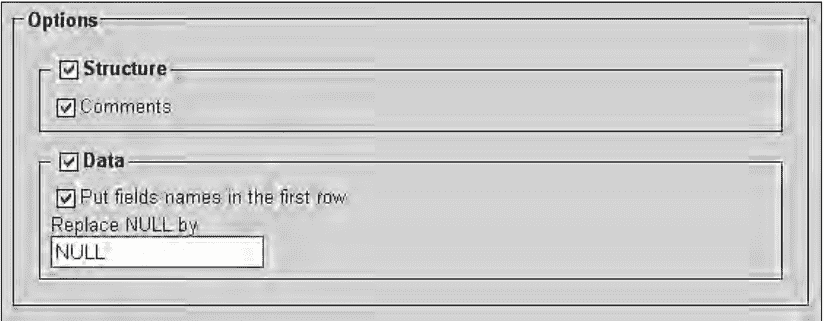

我们的 author 表现已导出并从 OpenOffice 查看。

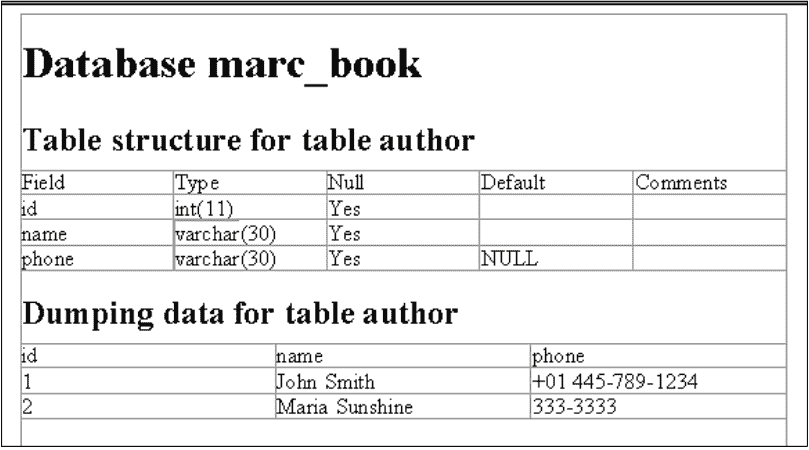

## YAML

YAML 的全称是 YAML Ain't Markup Language。YAML 是一种人类可读的数据序列化格式；其官方网站是 http://www.yaml.org。此格式在 phpMyAdmin 内部没有可供选择的选项。以下是 author 表的 YAML 导出：

```
1:
  id: 1
  name: John Smith
  phone: +01 445-789-1234

2:
  id: 2
  name: Maria Sunshine
  phone: 333-3333
```

## CodeGen

此选项将来可能支持与代码开发相关的许多格式。目前，它可以导出为 NHibernate 对象关系映射（ORM）格式。更多详情请参阅 http://en.wikipedia.org/wiki/Nhibernate。

## Texy! text

Texy! 是一种格式化工具（http://texy.info/en/），具有自己的简化语法。以下是此格式的导出示例：

```
===Database marc_book

== Table structure for table author
|------|
|Field|Type|Null|Default|
|------|
|/**id**/|int(11)|Yes|NULL
|name|varchar(30)|Yes|NULL
|phone|varchar(30)|Yes|NULL

== Dumping data for table author
|1|John Smith|+01 445 789-1234
|2|Maria Sunshine|333-3333
```

## Table exports

表视图中的导出链接会打开特定表的导出子面板。它与数据库导出面板类似，但没有表选择器。然而，在“另存为文件”子面板之前，还有一个用于拆分导出的额外部分。

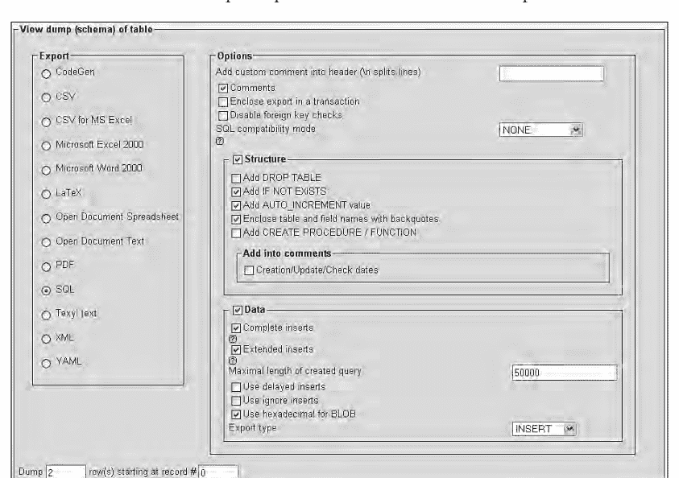

## Split-file exports

“转储从记录 # 0 开始的 2 行”对话框使我们能够将文件拆分为块。根据确切的行大小，我们可以尝试不同的行数值，以确定在 Web 服务器达到内存或执行时间限制之前，单个导出文件可以容纳多少行。然后我们可以使用类似 book00.sql 和 book01.sql 的名称为导出文件命名。

## Selective exports

在 phpMyAdmin 界面的各个位置，我们可以导出所看到的结果，或选择要导出的行。

## Exporting partial query results

当 phpMyAdmin 显示结果时（此处为查询 author_id 为 2 的书籍的结果），页面底部会出现一个导出链接。

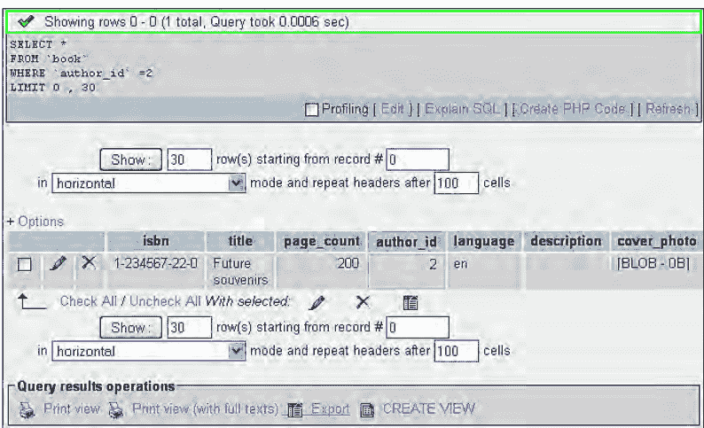

点击此链接会打开一个特殊的导出面板，顶部包含查询以及其他表导出选项。通过此面板生成的导出将仅包含此结果集的数据。

> 单表查询的结果可以用所有可用格式导出，而多表查询的结果只能以 CSV、XML 和 LaTeX 格式导出。

## Exporting and checkboxes

无论何时我们看到结果（例如浏览或搜索时），都可以勾选想要的行旁边的复选框，并使用“已选择：导出”图标生成仅包含这些行的部分导出文件。

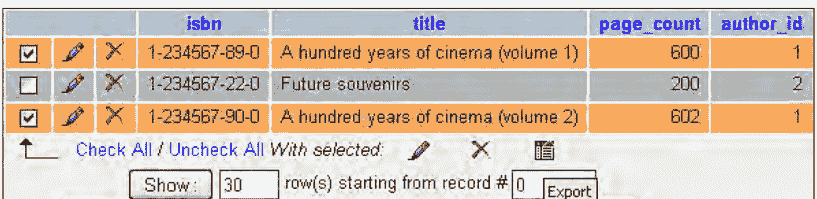

## Multi-database exports

任何用户都可以在一次操作中导出其有权访问的数据库。

在主页上，导出链接会将我们带到下一页所示的屏幕。它与其它导出页面的结构相同，只是数据库列表不同。

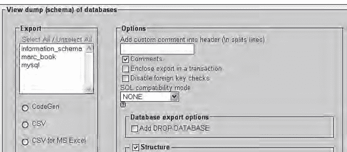

> 导出大型数据库可能成功也可能不成功。这取决于其大小、所选选项以及 Web 服务器的 PHP 组件设置（尤其是内存大小和执行时间）。


## 在服务器上保存导出文件

与其通过 HTTP 在网络上传输导出文件，可以直接将其保存到 Web 服务器的文件系统中。这可能更快，并且对执行时间限制不那么敏感，因为从服务器到客户端浏览器的整个传输过程被绕过。最终，可以使用 FTP 或 SFTP 等文件传输协议来检索文件，因为将其留在同一台机器上并不能提供良好的备份保护。

在服务器上保存导出文件之前，必须在 Web 服务器上创建一个特殊目录。通常，这是 phpMyAdmin 主目录的子目录。我们将使用 save_dir 作为示例。该目录必须具有特殊权限。首先，Web 服务器必须对该目录具有写入权限。此外，如果 Web 服务器的 PHP 组件以安全模式运行，则 phpMyAdmin 脚本的所有者必须与 save_dir 相同。

在 Linux 系统上，假设 Web 服务器以组 apache 运行，并且脚本由用户 "marc" 拥有，以下命令即可解决问题：

```
# mkdir save_dir
# chown marc.apache save_dir
# chmod g=rwx save_dir
```

> 适当的拥有权和权限掩码高度取决于所选择的 Web 服务器和所使用的 SAPI（服务器应用程序编程接口）（请参阅 http://en.wikipedia.org/wiki/Server_Application_Programming_Interface），它会影响目录和文件的创建和访问方式。PHP 可能使用脚本的所有者作为访问用户，也可能是 Web 服务器本身的用户/组。

我们还必须在 $cfg['SaveDir'] 中定义 './save_dir' 目录名。这里我们使用相对于 phpMyAdmin 目录的路径，但绝对路径同样适用。

“另存为文件”部分将出现一个新的“保存到服务器...”部分：

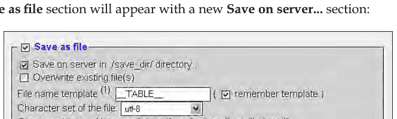

单击 Go 后，我们将收到确认消息或错误消息（如果 Web 服务器没有保存文件的必要权限）。


> 再次保存文件并使用相同的文件名时，请选中 **覆盖现有文件(s)** 复选框。

## 用户特定的保存目录

我们可以在 $cfg['SaveDir'] 参数中使用特殊字符串 %u。该字符串将被已登录的用户名替换。例如，使用

```
$cfg['SaveDir'] = './save_dir/%u';
```

这将给我们一个屏幕上的选择，**保存到服务器上的 /save_dir/marc/ 目录**。这些目录（每个潜在用户一个）必须存在并且必须具有适当的权限，如上一节所述。

## 内存限制

生成导出文件会使用一定量的内存，这取决于表的大小和所选的选项。$cfg['MemoryLimit'] 参数可以包含正在运行的 PHP 脚本使用的内存量的限制（以字节为单位）。默认情况下，该参数设置为 0，表示没有限制。请注意，如果 PHP 已激活安全模式，更改 $cfg['MemoryLimit'] 没有任何效果。相反，强制执行的限制来自 php.ini 中的 memory_limit 指令。

## 摘要

在本章中，我们检查了触发导出的各种方式——从数据库视图、表视图或结果页面。我们还列出了各种可用的导出格式、其选项、压缩导出文件的可能性以及它可能被发送到的各种位置。

在下一章中，只要所选格式受 phpMyAdmin 支持，我们就有机会将我们的结构和数据导入回来。
