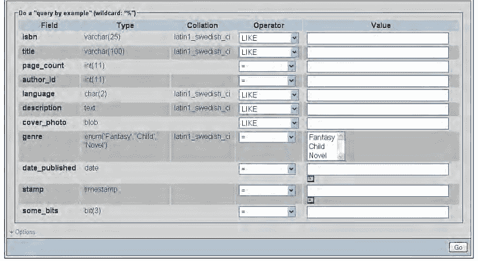
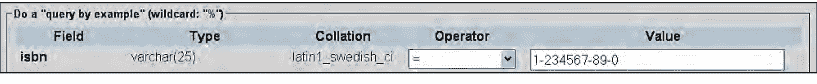
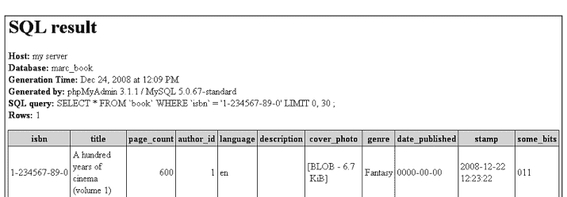
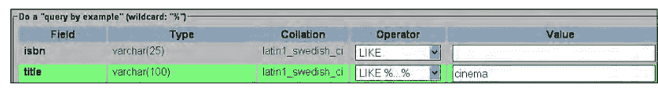
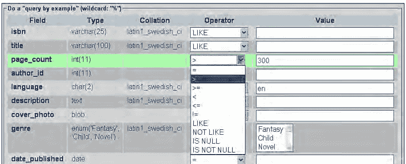
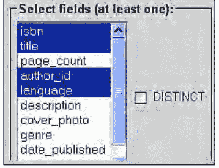
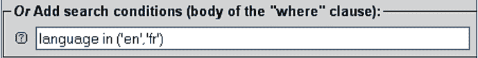
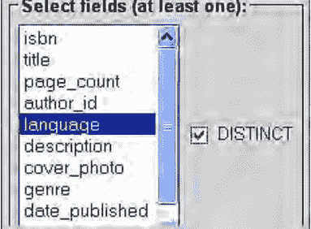
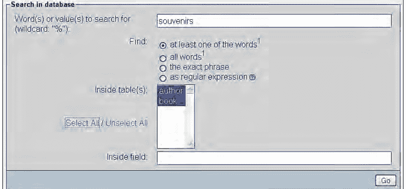
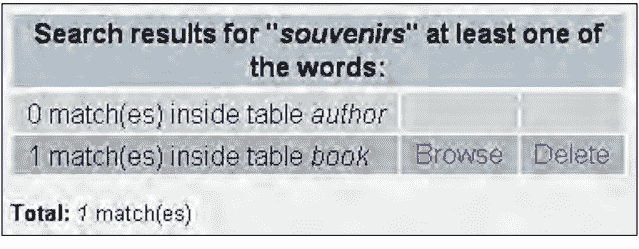

# 9 搜索数据

在本章中，我们介绍可用于查找所需数据的机制，而不仅仅是逐页浏览表并对其进行排序。本章涵盖单表搜索以及整个数据库搜索。第 13 章是对本章的补充，并以示例介绍了多表查询。

### phpMyAdmin 的日常使用

对于某些用户而言，phpMyAdmin 的主要用途是搜索模式，用于查找和更新数据。为此，phpMyAdmin 团队使能够通过 `$cfg['DefaultTabTable']` 参数定义表视图中起始页面所在的子页面。将它设置为 `'tbl_select.php'` 可定义搜索的默认子页面。

使用此模式，应用程序开发人员可以以其构建的界面未预期的方式查找数据——调整并有时修复数据。

### 单表搜索

本节描述了可进行单表搜索的搜索子页面。

### 进入搜索子页面

搜索子页面可以通过在表视图中点击“Search”链接访问。这里已对 book 表执行了此操作：



搜索界面中最常用的部分（按示例查询）是立即显示的部分，而其他对话框则隐藏在滑块中，可通过“Options”链接激活（本章后面会详细介绍这些对话框）。

### 按字段搜索条件——按示例查询

搜索面板的主要用途是为某些字段输入条件，以便仅检索我们感兴趣的数据。这称为按示例查询，因为我们给出所查找内容的示例。我们的第一次检索将涉及查找 ISBN 为 1-234567-89-0 的图书。我们只需在 isbn 框中输入此值并选择运算符“=”。



点击“Go”会给出这些结果（以下截图中部分显示）。


这是一个标准的结果页面。如果结果分页显示，我们可以在其中导航，并在过程中编辑和删除所选子集的数据。phpMyAdmin 的另一个功能是，将用作条件的字段通过更改列的边框颜色来突出显示，以便在结果页面上更好地反映其重要性。

即使这是我们搜索的列，也没有必要指定 isbn 列必须显示。我们本可以仅选择 title 列用于显示（参见“选择要显示的字段”部分），并将 isbn 列作为条件。

### 搜索空值/非空值

在 3.1.0 版本中，运算符列表中添加了两个有用的运算符：

```
= ''
!= ''
```

当您想在某个字段中搜索空值（= ''）或非空值（!= ''）时，应使用这些运算符。通常，在字段的“值”中输入空白意味着该字段不参与搜索过程。但是，使用其中一个运算符时，该字段会包含在生成的搜索查询中。

请勿将此方法与搜索 NULL 值混淆，两者完全不同。事实上，NULL 值（请参阅 http://en.wikipedia.org/wiki/Null_(SQL) 获取更完整的解释）是一个特殊值，表示该列中的某些信息缺失。

### 打印视图

我们在结果页面上看到“Print view”和“Print view (with full texts)”链接。这些链接会直接向打印机生成结果的更正式报告（不带导航界面）。在我们的例子中，使用 Print view 会产生以下内容：



该报告包含有关服务器、数据库、生成时间、phpMyAdmin 版本、MySQL 版本以及生成的 SQL 查询的信息。另一个链接“Print view (with full texts)”将完整打印 TEXT 字段的内容。

### 通配符搜索

假设我们正在寻找不太精确的内容——标题中包含“cinema”的所有图书。首先，我们返回搜索页面。对于这种类型的搜索，我们将使用 SQL 的 LIKE 运算符。该运算符接受通配符——% 字符（匹配任意数量的字符）和下划线（_）字符（匹配单个字符）。因此，我们可以使用 %cinema% 让 phpMyAdmin 查找匹配单词“cinema”的任何子字符串。如果我们省略两个通配符，则将获得仅该单个词的精确匹配。

这种子字符串匹配更容易访问，因为它是运算符下拉列表的一部分。我们只需输入单词 cinema 并使用运算符 LIKE %...% 即可执行该匹配。我们应避免在大型表（数千行）上使用这种形式的 LIKE 运算符，因为在这种情况下 MySQL 不会为数据检索使用索引，导致等待时间可能累积到半小时（或更长）。这就是为什么即使这种搜索方法在较小的表上常用，该运算符也不是下拉列表中的默认值。

以下是使用运算符 LIKE %...% 请求对 cinema 进行搜索的屏幕截图：



> LIKE 运算符可用于其他类型的通配符搜索，例如 History%，它将在标题开头搜索该词。这种形式的 LIKE 查询也有使用索引的好处，如果 MySQL 找到一个可加快数据检索的索引。

使用这两种查询方法中的任何一种都会产生以下结果：

|  |  |  | isbn | title | page_count | author_id | language | description |
|---|---|---|---|---|---|---|---|---|
| ☐ | ✎ | ✕ | 1-234567-89-0 | A hundred years of cinema (volume 1) | 600 | 1 | en |  |
| ☐ | ✎ | ✕ | 1-234567-90-0 | A hundred years of cinema (volume 2) | 602 | 1 | en |  |

% 字符（匹配任意数量的字符）和下划线（_）字符（匹配单个字符）是此处可用的通配符。

### 大小写敏感性

在前面的示例中，我们本可以将 cinema 替换为 CINEMA 并获得类似的结果。原因是 title 列的排序规则是 latin1_swedish_ci。这里，ci 表示比较以不区分大小写的方式进行。请参阅 http://dev.mysql.com/doc/refman/5.1/en/case-sensitivity.html 了解更多详情。

### 组合条件

我们可以在同一查询中使用多个条件（例如，查找超过 300 页的英文图书）。由于 page_count 字段是数字的，因此运算符中有更多比较选择，如以下屏幕截图所示：



### 搜索选项

Options 滑块会显示额外的面板以进一步细化搜索过程。

### 选择要显示的字段

在 Options 滑块中，选择字段面板可方便选择要在结果中显示的字段。默认情况下所有字段都被选中，但我们可以按住 control 键点击其他字段以进行必要的选择。Mac 用户可以使用 command 键点击来选择/取消选择字段。

以下是此示例中感兴趣的字段：



我们还可以在字段选择旁边的文本框中指定每页的行数。添加搜索条件框将在接下来的“应用 WHERE 子句”部分中进行解释。

### 排序结果

显示顺序对话框允许指定结果的初始排序顺序。在此对话框中，下拉菜单包含表的所有列；我们需要选择要排序的列。默认情况下排序为升序，但也可以选择降序。

需要注意的是，在结果页面上，我们可以使用第 4 章中解释的技术更改排序顺序。

### 应用 WHERE 子句

有时，我们可能想输入查询示例部分函数列表中未提供的搜索条件。该列表无法包含语言中的每一种可能变化。假设我们想使用 IN 子句查找所有英语或法语图书。为此，我们可以使用“添加搜索条件”部分。




> 完整的搜索表达式是通过组合搜索条件、逻辑 AND 以及在查询示例行中输入的其他条件生成的。

我们可以有一个更复杂的搜索条件列表，这些条件将输入到同一个文本框中，可能包含括号以及诸如 AND 或 OR 之类的运算符。

文档链接指向 MySQL 手册，在那里我们可以看到大量可用的函数。 （每个函数都适用于特定字段类型。）

## Obtaining distinct results

有时，我们可能希望避免重复获取相同的结果。 例如，如果我们想知道客户在哪些城市，只显示每个城市名称一次就足够了。 这里，我们想知道我们的书籍是用哪些语言编写的。 在“选择字段”对话框中，我们只选择语言字段，并勾选 DISTINCT，如以下屏幕截图所示：



点击 Go 后会产生以下图像：


> 使用 **DISTINCT**，我们只能看到每种语言一次。 如果没有此选项，包含 **en** 的行会出现三次。

## Complete database search

在之前的示例中，搜索仅限于一张表。 这假设知道必要信息可能存储的确切表（和列）。

当数据隐藏在数据库的某个地方，或者当相同的数据可以在各种列中呈现时（例如 **title** 列或 **description** 列），使用数据库搜索方法会更容易。

我们进入 `marc_book` 数据库的数据库视图中的 **Search** 页面：



在 **Word(s) or value(s)** 部分，我们输入想要查找的内容。 这里 % 通配符可能很有用。 我们输入 **souvenirs**。

在 **Find** 部分，我们指定如何处理输入的值。 我们可能需要查找输入的 **at least one of the words**、**all words**（无特定顺序）或 **the exact phrase**（按相同顺序，出现在列中的某处）。 另一个选择是使用 **regular expression**，这是一种更复杂的模式匹配方式。 我们将保留默认值 — **at least one of the words**。

我们可以选择要限制搜索的表或选择所有表。 由于我们只有两个（小型）表，因此我们同时选择两者。

> 由于搜索将在所选每个表的每一行上执行，如果行数或表数过大，我们可能会遇到一些时间限制。 因此，可以通过将 $cfg['UseDbSearch'] 设置为 FALSE 来停用此功能。 （默认设置为 TRUE。）

点击 Go 会为我们找到以下内容：



这是匹配数量和相关表的概览。 我们可能会在不感兴趣的表中得到一些匹配。 然而，对于看起来有希望的匹配，我们可以浏览结果页面，或删除不需要的行。

## Restricting search to a column

有时，某个特定列名是属于一张（或多张）表的一部分，而我们只想在此列内部进行搜索。 例如，假设我们在查找 "Marc"，但这个名字也可能是书名的一部分。 因此，我们希望将搜索限制为所选表中仅 "name" 列。 这可以通过在 Inside 字段选择中输入 "name" 来实现。

## Summary

在本章中，我们概述了使用“query by example criteria”以及附加条件规范的单表搜索——选择显示的值和排序结果。 我们还查看了通配符搜索和完整数据库搜索。 下一章将解释如何对表执行操作——例如更改表的属性，如其存储引擎。 表的修复和优化主题也在本章中有所涉及。
