# 10 Table and Database Operations

## Table and Database Operations

在前几章中，我们主要处理表字段。 在本章中，我们将学习如何执行影响整个表或数据库的一些操作。 我们将介绍表属性及其修改方法，并讨论多表操作。

各种启用表操作的链接已放在表视图的 Operations 子页面上。 以下是此子页面的概览：

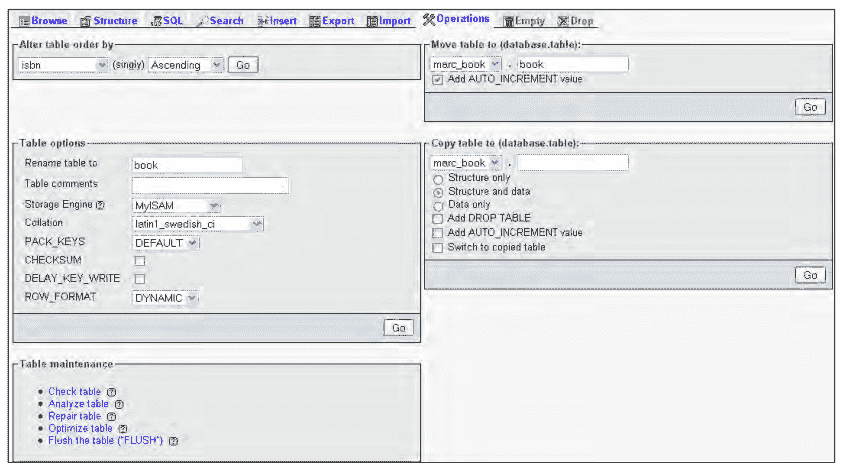

## Table maintenance

在表的生命周期中，它会反复被修改；因此，它会不断增长和缩小。 服务器可能会出现故障，导致某些表处于损坏状态。

使用 Operations 子页面，我们可以执行各种操作，接下来列出。 然而，并非每个操作都适用于每种表类型。

- **Check table:** 扫描所有行以验证已删除的链接是否正确。 同时，还会计算校验和以验证键的完整性；如果一切正常，我们应该会收到 OK 消息。
- **Analyze table:** 分析并存储键分布；这将在后续的 JOIN 操作中使用，以确定表应连接的顺序。
- **Repair table:** 修复 MyISAM 和 ARCHIVE 引擎中表的任何损坏数据。 请注意，表可能损坏到我们甚至无法进入其表视图！ 在这种情况下，请参阅 *Multi-Table Operations* 部分以获取修复程序。
- **Optimize table:** 当表包含开销时很有用。 在大量删除行或 VARCHAR 字段长度更改后，表中会残留丢失的字节。 phpMyAdmin 会在各个地方（例如在 Structure 视图中）警告我们，如果它认为表应该被优化。 此操作是对表的某种碎片整理。 在 MySQL 4.x 中，此操作仅适用于 MyISAM、Berkeley (DB) 和 InnoDB 引擎中的表。 在 MySQL 5.x 的情况下，相关表位于 MyISAM、InnoDB 和 ARCHIVE 引擎中。
- **Flush table:** 当出现许多连接错误且 MySQL 服务器阻止进一步连接时，必须执行此操作。 刷新将清除一些内部缓存并允许正常操作恢复。
- **Defragment table:** InnoDB 表中的随机插入或删除会使其索引碎片化。 表应定期进行碎片整理以加快数据检索。

> 操作基于可用的底层 MySQL 查询——phpMyAdmin 仅调用这些查询。

## Changing table attributes

表属性是表的各种属性。 本节讨论其中一些的设置。

## Table storage engine

我们可以更改的第一个属性称为 Storage Engine。

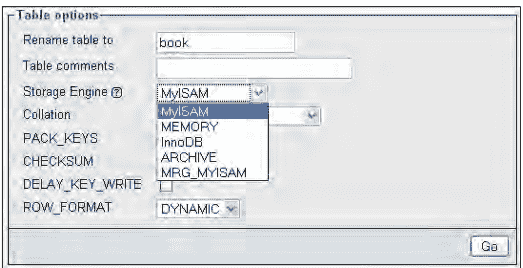

这控制着表的整体行为——其位置（磁盘上或内存中）、索引结构，以及是否支持事务和外键。 下拉列表根据我们 MySQL 服务器支持的存储引擎而变化。

> 如果行数很大，更改表的存储引擎可能是一项耗时操作。

## Table comments

这允许我们为表输入注释。

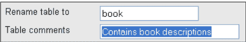

这些注释将在适当位置显示——例如，在导航面板中，在表视图中表名称旁边，以及在导出文件中。 当 $cfg['ShowTooltip'] 参数设置为其默认值 TRUE 时，导航面板如下所示：

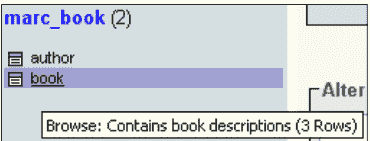

$cfg['ShowTooltipAliasDB'] 和 $cfg['ShowTooltipAliasTB'] 的默认值（FALSE）会产生我们之前看到的行为——真正的数据库和表名称显示在左侧面板中，并在 Database 视图的 Structure 子页面中显示。 当鼠标指针移到表名称上时，会出现注释。 如果其中一个参数设置为 TRUE，则相应的项（DB 的数据库名称和 TB 的表名称）将作为工具提示显示，而不是名称。 这次，鼠标悬停会显示该项的真实名称。 当真实的表名没有意义时，这很方便。

$cfg['ShowTooltipAliasTB'] 还有另一种可能性——'nested' 值。 如果我们使用此功能，会发生以下情况：

- 真正的表名显示在左侧面板中
- 表注释（例如 project__）被解释为项目名称并按原样显示（参见第 3 章中的 Nested display of tables within a database 部分）

## Table order

当我们浏览表，或执行诸如 SELECT * from book 之类的语句而不指定排序顺序时，MySQL 使用行物理存储的顺序。 此表顺序可以使用 Alter table order by 对话框进行更改。 我们可以选择任何字段，表将按该字段重新排序一次。 我们在示例中选择 author_id，并在点击 Go 后，表按该字段排序。

如果我们知道大部分时间将按此顺序检索行，则重新排序很方便。 此外，如果我们稍后使用 ORDER BY 子句，并且表已在该字段上物理排序，则性能应该更高。

只要表中没有更改（没有插入、删除或更新），这种默认排序就会持续。 这就是为什么 phpMyAdmin 显示（单个）警告的原因。

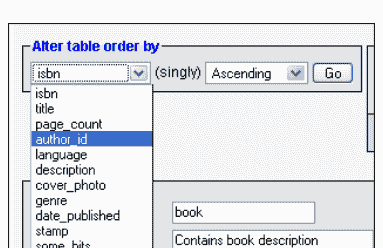


在对 **author_id** 进行排序后，作者 **1** 的书籍会先显示，其后是作者 **2** 的书籍，以此类推（我们说的是在没有显式排序的情况下对表的默认浏览）。我们还可以将排序顺序指定为 **升序** 或 **降序**。

如果我们插入另一行，描述作者 **1** 的新书籍，然后点击 **浏览**，该书籍不会与该作者的其他书籍一起显示，因为排序是在插入之前完成的。

## 表排序规则

为了更好地了解各层级排序规则更改的问题，让我们先创建一个名字中包含字符 **é** 的新作者：

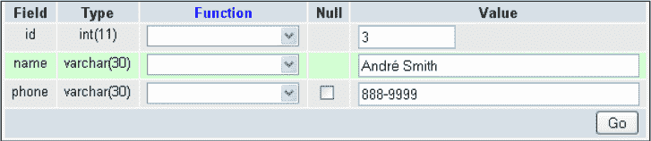

name 列当前具有 **latin1_swedish_ci** 排序规则，可通过 **结构** 页面查看。在 **操作** 页面，如果我们将 author 表的排序规则从 **latin1_swedish_ci** 改为例如 **utf8_general_ci**，则会生成：

```
ALTER TABLE `author` DEFAULT CHARACTER SET utf8 COLLATE
utf8_general_ci
```

因此，我们只更改了将来将添加到此表的列的默认排序规则。

为了进一步测试排序规则更改，我们可以进入 **结构** 页面并将 author 的 **name** 列的排序规则更改为 **utf8_general_ci**（通过点击 **更改** 图标）。完成此操作后，我们浏览 **author** 表，仍然能正确看到 **é** 字符，因为 MySQL 在排序规则更改时更新了该列的内容。

## 切换连接排序规则的影响

更改连接排序规则（来自主页排序规则对话框）可能会产生意想不到的效果。让我们将其切换为 latin1_bin 并再次浏览我们的 author 表：

|  |  |  | id | 名称 | 电话 |
|---|---|---|---|---|---|
| ☐ | ✏️ | ❌ | 1 | John Smith | +01 445 789-1234 |
| ☐ | ✏️ | ❌ | 2 | Maria Sunshine | 333-3333 |
| ☐ | ✏️ | ❌ | 3 | Andr♦ Smith | 888-9999 |

数据库中以 UTF-8 编码的数据现在（错误地）被解释为 latin1，导致显示不一致。因此，我们必须小心排序规则的更改，并且应撤消本节和上一节中进行的排序规则更改。

## 表选项

其他影响表行为的属性可以使用 表选项 对话框指定：

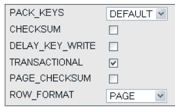

选项如下：

- **PACK_KEYS**: 设置此属性会导致索引更小。可以更快地读取，但更新需要更多时间。适用于 MyISAM 存储引擎。
- **CHECKSUM**: 这会使 MySQL 为每一行计算校验和。这会导致更新变慢，但查找损坏的表变得更容易。仅适用于 MyISAM。
- **DELAY_KEY_WRITE**: 这指示 MySQL 不要立即写入索引更新，而是将其排队以便稍后写入。这可以提高性能。仅适用于 MyISAM。
- **ROW_FORMAT**: 对于支持此功能的存储引擎（MyISAM、InnoDB、PBXT 和 Maria），会提供行格式的选择。默认值是该表行格式的当前状态。
- **TRANSACTIONAL, PAGE_CHECKSUM**: 适用于 Maria 存储引擎。目前记录在 http://dev.mysql.com/doc/refman/5.1-maria/en/se-maria-tableoptions.html。
- **auto-increment**: 这会更改自动递增值。仅当表的 primary key 具有自动递增属性时才显示。

## 重命名、移动和复制表

**重命名** 操作最容易理解——表只是更改其名称并保留在同一数据库中。

**移动** 操作（如下图所示）可以以两种方式操作表——更改其名称以及存储它的数据库。

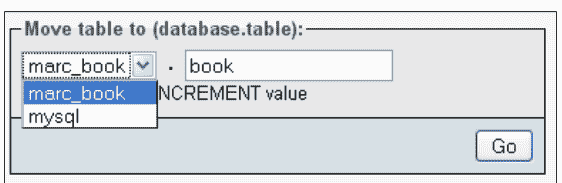

MySQL 不直接支持移动表。因此，phpMyAdmin 必须在目标数据库中创建表，复制数据，然后最终删除源表。

**复制** 操作保持原始表不变，并将其结构或数据（或两者）复制到另一个表，可能在另一个数据库中。这里，**book-copy** 表将是 book 源表的精确副本。复制后，我们仍停留在 book 表的表视图中，除非选择 **切换到已复制的表**。

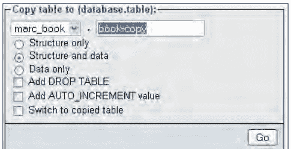

**仅结构** 复制用于创建具有相同结构的测试表。

## 向表追加数据

复制对话框也可以用于将数据从一个表追加（添加）到另一个表。两个表必须具有相同的结构。此操作是通过输入要复制数据的表并选择 仅数据 来实现的。

例如，当来自各种来源（各种出版商）的书籍数据存储在多个表中，并且我们希望将所有数据汇总到一个地方时，我们希望追加数据。对于 MyISAM，可以使用 Merge 存储引擎（它是一组相同的 MyISAM 表）获得类似的结果。但是，如果表是 InnoDB，我们需要依赖 phpMyAdmin 的复制功能。

## 多表操作

在数据库视图中，每个表名旁边都有一个复选框，表列表下方有一个下拉菜单。这使我们能够快速选择一些表并一次对所有这些表执行操作。在这里，我们选择 book-copy 和 book 表，并为所选表选择 检查表 操作。

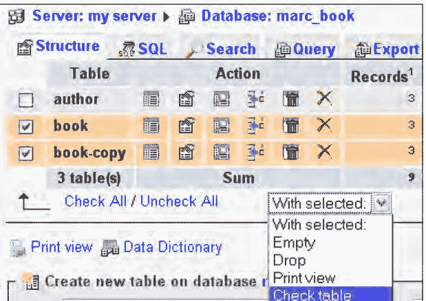

我们也可以使用 全选 / 取消全选 快速选择或取消选择所有复选框。

## 修复“正在使用”的表

多表模式是修复损坏表的唯一方法（除非我们知道要输入的确切 SQL 查询）。此类表可能在数据库列表中显示为正在使用标志。在 phpMyAdmin 支持论坛寻求帮助的用户经常从经验丰富的 phpMyAdmin 用户那里收到此提示。

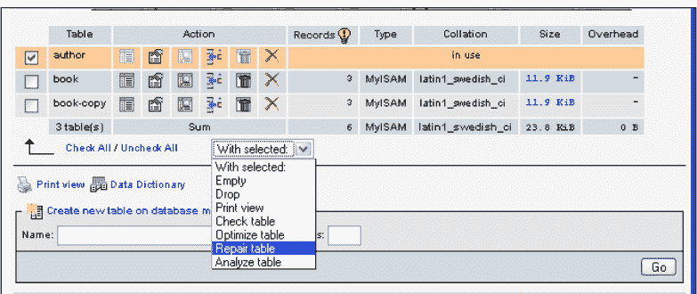

## 数据库操作

数据库视图中的 操作 选项卡提供了访问面板，可让我们对整个数据库执行操作。

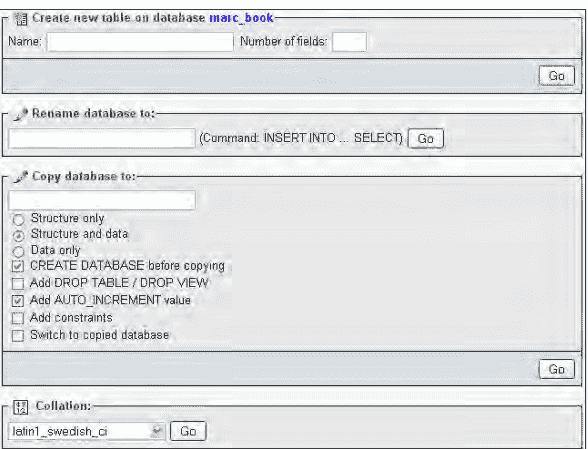

## 重命名数据库

提供了一个 重命名数据库为 对话框。虽然此操作不直接受 MySQL 支持，但 phpMyAdmin 通过创建新数据库，重命名每个表（从而将其发送到新数据库）并删除原始数据库来间接执行此操作。

## 复制数据库

即使 MySQL 本身不原生支持此操作，也有可能完全复制数据库。

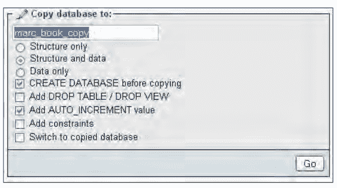

## 总结

本章涵盖了我们可以对整个表或数据库执行的各种操作。它还介绍了表维护操作，用于表修复和优化，更改各种表属性，表移动（包括重命名和移动到另一个数据库）以及多表操作。在下一章中，我们将开始研究依赖于链接表基础设施的高级功能，例如关系系统。
