# 11 关系系统

## 关系系统

欢迎来到本书的章节，我们开始介绍高级功能。关系系统允许用户更紧密地使用 phpMyAdmin，正如我们在以下章节中将看到的那样。本章解释了如何定义表间关系。它还解释了如何安装链接表基础设施——高级功能的前提条件。

## 关系型 MySQL

当应用程序开发人员使用 PHP 和 MySQL 构建 Web 界面或其他数据操作应用程序时，他们通常使用底层 SQL 查询在表之间建立关系。示例包括：“获取发票及其所有项目”和“获取作者的所有书籍”。

在 phpMyAdmin 的早期版本中，MySQL 存储了哪个表属于哪个数据库的信息。然而，关系数据结构（表如何相互关联）并未存储到 MySQL 中。关系是由应用程序临时建立的，以生成有意义的结果。换句话说，关系在我们脑海中。

phpMyAdmin 的开发人员和用户认为这是 MySQL 的不足之处。因此，团队开始构建基础设施以支持 MyISAM 表的关系。该基础设施不断发展，以支持日益增长的特殊功能。我们可以将此基础设施描述为元数据，即关于数据的数据。

phpMyAdmin 2.2.0 已具有书签功能，即召回经常使用的查询的能力（在第 14 章中描述），而版本 2.3.0 概括了元数据系统。后续版本建立在此设施之上。示例包括：具有基于 MIME 的转换的 2.5.x 系列（在第 16 章中描述）和具有名为 Designer 的图形关系构建器的 2.10.x 系列（在本章中描述）。


## InnoDB 与 PBXT

InnoDB 是一种 MySQL 存储引擎，其网页为 http://www.innodb.com。它由 Oracle 的子公司 Innobase Oy 开发。由于 InnoDB 子系统必须由系统管理员激活，因此它可能并非在每个 MySQL 服务器上都可用。

PrimeBase XT 存储引擎或 PBXT（http://www.primebase.org）可用于 MySQL 5.1 和 6.0，由 PrimeBase Technologies 开发。最低要求的 MySQL 版本为 5.1，因为该版本支持 PBXT 及其他第三方用于提供替代存储引擎的可插拔存储引擎 API。该事务性存储引擎比 InnoDB 更新。通常在从其网站下载后进行编译步骤安装。对于某些操作系统，提供预编译的二进制文件——请访问上述网站获取下载和安装说明。

在考虑关系方面时，使用 InnoDB 或 PBXT 存储引擎为表带来的好处如下：

- 它们支持基于外键的引用完整性，外键是外表（或引用表）中的键。相比之下，仅使用 phpMyAdmin 的内部关系（稍后讨论）则不会进行自动引用完整性验证。
- InnoDB 和 PBXT 表的导出结构包含已定义的关联。因此，它们可以轻松导入回以实现更好的跨服务器互操作性。

这些存储引擎的外键功能可以有效替代 phpMyAdmin 基础设施中处理关联的部分。我们将看到 phpMyAdmin 如何与 InnoDB 和 PBXT 外键系统交互。

> phpMyAdmin 基础设施的其他部分（例如书签）在 InnoDB、PBXT 或 MySQL 中没有等价物。因此，仍需要它们才能访问完整的 phpMyAdmin 功能集。然而，在 MySQL 5.x 中，视图是受支持的，并且与 phpMyAdmin 的书签相似。


## 关联表基础设施

关系系统的基础设施存储在遵循预定结构的表中。这些表中的数据由 phpMyAdmin 根据我们在界面上的操作生成和维护。

## 基础设施的目标

元数据表包含针对所有存储引擎的信息，以支持 phpMyAdmin 的特殊功能，如书签和转换。此外，对于不支持外键的存储引擎中的表，表之间的关系保存在此基础设施中。

## 基础设施的位置

这些表可以存储在两个可能的位置：

- 用户的数据库——以便每个拥有数据库的 Web 开发人员都能受益于这些功能。
- 一个名为 pmaDB（phpMyAdmin 数据库）的专用数据库。在多用户安装（稍后讨论）中，此数据库可供多个用户访问，同时保持元数据私有。

由于此基础设施默认不存在，并且 phpMyAdmin 的开发人员希望推广它，因此在数据库视图的“操作”子页面中，界面会为每个数据库显示以下错误消息：

```
The additional features for working with linked tables have been deactivated. To find out why click here.
```

此消息可通过以下参数禁用（默认情况下设置为 FALSE）：

```
$cfg['PmaNoRelation_DisableWarning'] = TRUE;
```

> 无论当前数据库如何，该消息都相同，因为基础设施是为我们所有的数据库和表（或多用户安装中的所有用户）共享的。

## 安装关联表基础设施

即使基础设施只有一部分缺失，之前的错误消息也会显示。当然，在全新安装时，所有部分都缺失——我们的数据库尚未了解 phpMyAdmin，需要配备此基础设施。按照上一条消息中的链接，会弹出一个面板，解释 pmaDB 及其 supposed 部分的表要么缺失要么未定义。

必须认识到，只有满足以下两个条件，关系系统才能正常工作：

- config.inc.php 中存在正确的定义
- 对应的表（以及可能数据库）已创建

为了创建与当前 phpMyAdmin 版本相匹配的必要结构，phpMyAdmin 安装目录的 scripts 子目录中提供了一个名为 create_tables.sql 的命令文件。但是，在了解可能的选项——多用户安装或单用户安装之前，我们不应盲目执行它。

## 多用户安装

在此设置中，我们将有一个独立的数据库——pmadb——用于存储元数据表。我们的控制用户将对该数据库拥有特定权限。每个用户将使用其登录名和密码工作，用于访问其数据库。然而，每当 phpMyAdmin 本身访问 pmadb 以获取某些元数据时，它将使用控制用户的权限。

> 只有具有为另一用户（此处为 pma 用户）分配权限的 MySQL 系统管理员才能设置多用户安装。如果您不处于此情况，请参阅“单用户安装”部分。

我们首先确保控制用户 pma 已创建，如第 2 章所述，并且其在 config.inc.php 中的定义是合适的。

```
$cfg['Servers'][$i]['controluser'] = 'pma';
$cfg['Servers'][$i]['controlpass'] = 'bingo';
```

然后我们在 scripts 目录中查找 create_tables.sql。可能有针对不同 MySQL 版本的其他脚本可用，因此我们应选择最合适的那个。接下来，我们将此脚本复制到本地工作站并编辑它。我们替换以下行：

```
-- GRANT SELECT, INSERT, DELETE, UPDATE ON `phpmyadmin`.* TO
--   `pma`@localhost;
```

为这些：

```
GRANT SELECT, INSERT, DELETE, UPDATE ON `phpmyadmin`.* TO
  `pma`@localhost;
```

然后我们通过导入执行此脚本（参见第 8 章）。净效果是创建 phpmyadmin 数据库，为用户 pma 分配适当的权限，并用所有必要的表填充数据库。

## 基础设施和 config.inc.php

现在是时候调整 config.inc.php 中所有与关系功能相关的参数了。这可以通过第 1 章中看到的设置脚本轻松完成，或通过从 config.sample.inc.php 文件粘贴适当的行来完成。这些数据库和表名称就是刚刚创建的：

```
$cfg['Servers'][$i]['pmadb'] = 'phpmyadmin';
$cfg['Servers'][$i]['bookmarktable'] = 'pma_bookmark';
$cfg['Servers'][$i]['relation'] = 'pma_relation';
$cfg['Servers'][$i]['table_info'] = 'pma_table_info';
$cfg['Servers'][$i]['table_coords'] = 'pma_table_coords';
$cfg['Servers'][$i]['pdf_pages'] = 'pma_pdf_pages';
$cfg['Servers'][$i]['column_info'] = 'pma_column_info';
$cfg['Servers'][$i]['history'] = 'pma_history';
$cfg['Servers'][$i]['designer_coords'] = 'pma_designer_coords';
```

> 由于表名区分大小写，我们必须使用安装脚本创建的表名。我们可以自由更改表名（参见所列配置指令的右侧部分），前提是在数据库中相应更改。

pmadb 和每个表都有特定的功能，如下所列：

- pmadb: Defines the database where all tables are located
- bookmarktable: Contains the bookmarks (explained in Chapter 14)
- relation: Defines inter-table relations, as used in many of the phpMyAdmin's features
- table_info: Contains the display field (explained later in this chapter)
- table_coords and pdf_pages: Contain the metadata necessary for drawing a schema of the relations in a PDF format (explained in Chapter 15)
- column_info: Used for column-commenting and MIME-based transformations (explained in Chapter 16)
- history: Contains SQL query history information (explained in Chapter 12)
- designer_coords: Holds the coordinates used by the Designer feature (explained later in this chapter)


每个 phpMyAdmin 版本之间，基础设施可能会得到增强。（更改在 Documentation.html 中有说明。）这就是为什么 phpMyAdmin 有各种检查来确定表的结构的原因。如果我们知道正在使用最新结构，可以将 $cfg['Servers'][$i]['verbose_check'] 设置为 FALSE 以避免检查，从而略微提高 phpMyAdmin 的速度。

安装现已完成。我们将在接下来的章节中测试功能。我们可以通过返回主页进行快速检查；警告信息应该已经消失。

## 单用户安装

即使系统管理员只允许我们使用一个数据库，我们仍然可以使用 phpMyAdmin 的所有关系功能。

在此设置中，我们将使用我们的普通数据库（假设其名称为 marc_book）来存储元数据表，并在 config.inc.php 中将我们自己的登录名（marc）定义为控制用户。

```
$cfg['Servers'][$i]['controluser'] = 'marc';
$cfg['Servers'][$i]['controlpass'] = 'bingo';
```

下一步是修改 scripts/create_tables.sql 文件的本地副本，以用所有需要的表填充我们的数据库。它们将具有 pma_ 前缀以便轻松识别。（另请参阅多用户安装部分中关于 scripts 目录中可能可用的其他脚本的说明。）

如果我们使用 scripts/create_tables.sql，需要做的修改是删除以下行：

```
CREATE DATABASE IF NOT EXISTS `phpmyadmin`
  DEFAULT CHARACTER SET utf8 COLLATE utf8_bin;
USE phpmyadmin;
```

这是因为我们不会使用 phpmyadmin 数据库。接下来，我们应该在 phpMyAdmin 中打开我们的 marc_book 数据库。现在我们可以执行脚本了。有两种方法可以做到这一点：

- 由于我们已经在编辑器中有脚本，可以直接复制行并粘贴到 SQL 子页面的查询框中。
- 另一种方法是使用第 8 章中显示的导入技术。我们选择刚刚修改的 create_tables.sql 脚本。

创建后，左侧面板会显示特殊的 pma_ 表以及我们的普通表。

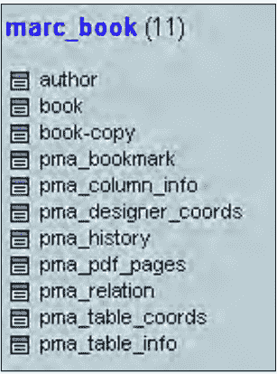

最后一步是调整 config.inc.php 中与关系功能相关的所有参数。请参考上一节，除了 pmadb 参数中的数据库名称：

```
$cfg['Servers'][$i]['pmadb'] = 'marc_book';
```

## 使用关系视图定义关系

在安装了链接表基础设施后，数据库视图和表视图中现在有更多选项可用。我们现在将在表视图的结构子页面中检查一个新的链接 – 关系视图。

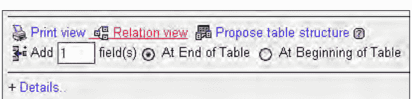

此视图用于：

- 定义当前表与其他表的关系
- 选择显示字段

我们的目标在这里是在 **book** 表（包含 **author** ID）和 **author** 表（按 ID 描述每个作者）之间创建关系。我们从 **book** 表的表视图开始，进入 **Structure**，然后单击 **Relation view** 链接。

### 内部关系

由于 **book** 表采用 MyISAM 格式，我们会看到以下屏幕（否则显示会不同，如后面 *Foreign Key Relations* 部分所述）：

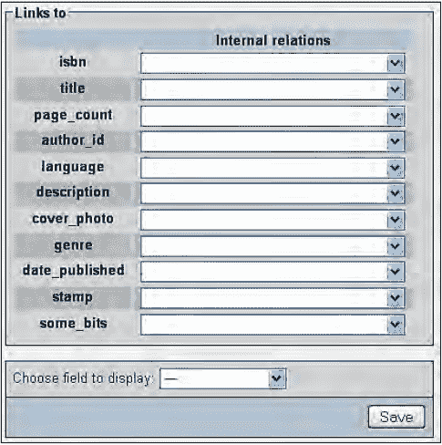

此屏幕允许我们创建 **Internal relations**（存储在 pma_**relation** 表中），因为 MySQL 本身对 MyISAM 表没有任何关系概念。每个列旁边的空下拉列表表示没有任何关系（链接）到任何外表。

### 定义关系

我们可以将 **book** 表的每个字段关联到另一个表（或同一表中的字段，因为有时需要自引用关系）中的字段。界面会在同一数据库的所有表中查找唯一和非唯一键，并在下拉列表中显示这些键。（目前不支持从界面创建到其他数据库的内部关系。）对于 **author_id** 字段的适当选择是从 **author** 表中选择相应的 **author_id** 字段——也称为 **defining the foreign key**。

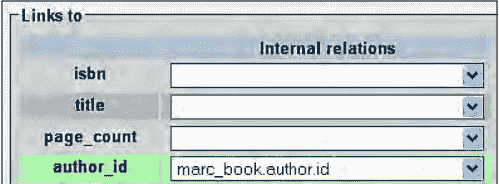

然后我们单击保存，定义将保存在 phpMyAdmin 的基础设施中。要删除关系，只需返回屏幕，选择空选项，然后单击保存即可。

### 定义显示字段

我们 author 表的主键是 author_id，这是一个我们为键目的而编造的唯一数字。我们表中的 name 字段——name——表示作者姓名。将作者姓名作为 book 表中每一行的描述会很有趣。这就是显示字段的目的。我们通常应为每个作为外表参与关系的表定义一个显示字段。

我们将在“已定义关系的优势”部分看到此信息如何显示。我们现在进入 author 表（在本例中为外表）的关系视图并指定显示字段。我们选择 name 作为显示字段并单击保存。

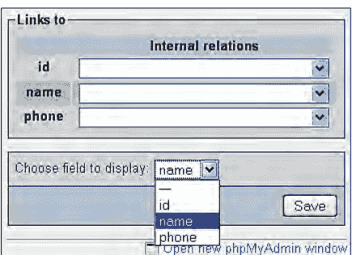

phpMyAdmin 仅允许为一个表定义一个显示字段，并且该字段在该表用作外表的任何关系中都使用。

此关系的定义现已完成。虽然我们没有将 author 表中的任何字段关联到另一个表，但可以这样做。例如，我们可以在此表中有一个国家代码，并可以创建与国家表国家代码的关系。

我们将在后面的部分讨论已定义此关系的益处。现在，我们将看看如果我们的表受 InnoDB 或 PBXT 存储引擎控制会发生什么。

## 外键关系

InnoDB 和 PBXT 存储引擎为我们提供了一个外键系统。

> 您可以选择，本节中的练习可以用 InnoDB 或 PBXT 完成。文中选择了 InnoDB。

首先，我们将 book 和 author 表切换到 InnoDB 存储引擎。我们可以从表视图中的 Operations 子页面执行此操作。我们首先对 author 表执行此操作，如以下屏幕截图所示：

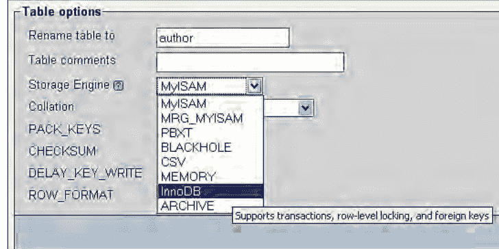

当 book 表的存储引擎更改为 InnoDB 时会出现问题。此表中有全文索引，而 InnoDB 引擎目前不支持这种类型的索引：

```
ALTER TABLE `book` ENGINE = InnoDB;
MySQL said:
#1214 - The used table type doesn't support FULLTEXT indexes
```

为了消除此错误消息，我们返回 book 表的 **Structure** 并删除 **description** 字段上的全文索引。当我们在此屏幕上时，让我们也删除我们在 **author_id** 和 **language** 上创建的组合索引。我们这样做是因为我们希望在本章后面看到缺少索引的后果。此时，我们能够将 book 表切换到 InnoDB。

InnoDB 中的外键系统在相关表之间维护完整性。因此，我们不能向 book 表添加不存在的作者 ID。此外，当对主表（在我们的例子中为 book）执行 DELETE 或 UPDATE 操作时，操作是可编程的。

在 **Structure** 子页面打开 book 表并进入 **Relation view**，现在会显示不同的页面：

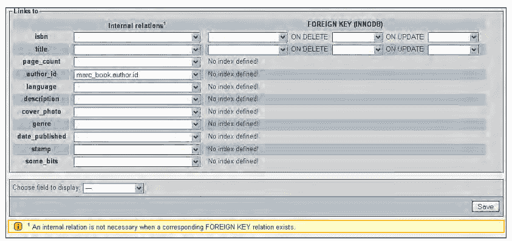

此页面告诉我们：

- 我们已为 **author_id** 到 author 表定义了内部关系。
- 我们尚未定义任何 InnoDB 关系。
- 当在 InnoDB 中定义了相同的关系时，我们将能够删除内部关系。事实上，phpMyAdmin 建议我们：“**An internal relation is not necessary when a corresponding FOREIGN KEY relation exists**”。因此，最好将其删除。
- InnoDB 关系可用于 **ON DELETE** 和 **ON UPDATE** 选项。


在可能的相关键选择中，我们可以看到同一数据库中所有 InnoDB 表中定义的键。（在 phpMyAdmin 中，目前不支持跨数据库关系。）我们甚至可以看到当前表中定义的键，因为自引用关系是可能的。我们现在删除 **author_id** 字段的内部关系并点击 **保存**。我们希望为 **author_id** 字段添加一个 InnoDB 类型的关系，但我们无法做到。在这一行我们看到 **未定义索引！** 消息。这是因为在 InnoDB 或 PBXT 中定义外键只有在两个字段都定义为索引时才可以进行。

> 有关约束的其他条件在 MySQL 手册中进行了说明。请参阅 http://dev.mysql.com/doc/refman/5.0/en/innodb-foreign-key-constraints.html。

因此，我们回到 book 表的 **结构** 页面并为 **author_id** 字段添加一个普通（非唯一）索引，生成：

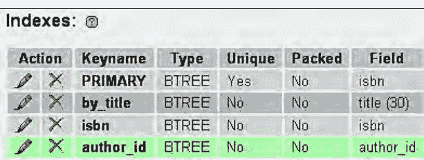

在 **关系视图** 中，我们可以再次尝试添加我们想要的关系；这次它成功了！

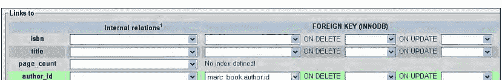

我们还可以使用 **ON DELETE** 和 **ON UPDATE** 选项设置一些操作。例如，**ON DELETE CASCADE** 会使 MySQL 在从父表中删除对应行时自动删除相关（外键）表中的所有行。例如，当父表为 **invoices**，外键表为 **invoice-items** 时，这将很有用。

> 如果我们尚未这样做，我们应该为 author 表定义显示字段，如 Internal phpMyAdmin Relations 部分所述。

## 无关联表基础设施的外键

即使未安装关联表基础设施，我们仍会在 InnoDB 或 PBXT 表的 结构 页面上看到 Relation View 链接。这会带我们进入一个屏幕，在此我们可以定义外键，在本例中为 book 表。

请注意，如果我们选择此方式，则无法定义关联表（此处为 author）的显示字段，因为它属于 phpMyAdmin 的基础设施。因此，我们将失去查看外键关联描述的好处。

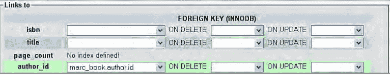

## 使用 Designer 定义关系

基于 Ajax 的 Designer 功能出现在 phpMyAdmin 2.10 中。它提供了一种基于鼠标的管理关系（内部和基于外键）以及为每个表定义显示字段的方式。它还可以充当：

- 访问现有表结构并访问表创建页面的菜单。
- 如果我们想要包含所有表的 PDF 架构，则为 PDF 架构管理器。

在 Designer 工作区中，我们可以在同一面板上处理所有表的关系。另一方面，Relation view 每次仅显示单个表的关系。

我们可以通过点击 Database view 中的 Designer 菜单选项卡来访问此功能。

> 如果此菜单选项卡未出现，则是因为我们尚未安装本章前面所述的关联表基础设施——尤其是 designer_coords 特殊表。

## 界面概览

Designer 页面包含可查看表的主工作区。该工作区会根据表的位置动态地扩大和缩小。顶部菜单包含图标，将鼠标悬停在其上时会显示其描述。以下是顶部菜单图标功能的摘要：

- **显示/隐藏左侧菜单**：用于左侧菜单的显示
- **保存位置**：将工作区的当前状态保存到基础设施中
- **创建表**：退出设计器并进入创建表的对话框
- **创建关系**：将设计器置于创建关系模式
- **选择显示字段**：指定代表表的字段
- **重新加载**：再次获取表的信息
- **帮助**：提供关于选择关系的说明
- **Angular 链接/直接链接**：指定关系链接的形状
- **吸附到网格**：影响表移动相对于想象网格的行为
- **全部小/大**：隐藏或显示每个表的列列表
- **切换小/大**：反转每个表的列显示模式，因为该模式可通过表的角图标 V 或 > 选择
- **导入/导出**：生成 PDF
- **移动菜单**：顶部菜单可以向右移动并返回

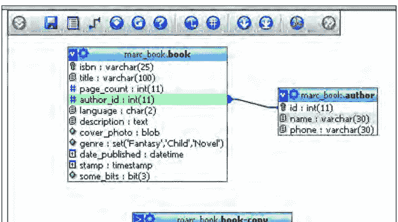

点击 **显示/隐藏左侧菜单** 图标时会出现侧边菜单。其目的是展示完整的表列表，决定哪些表出现在工作区，并启用访问特定表的 **结构** 页面。在此示例中，我们选择如图所示从工作区中移除 **book-copy** 表：

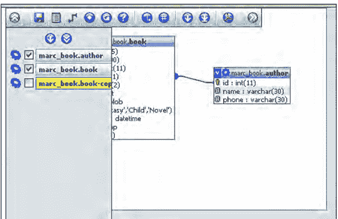

如果我们希望此移除永久生效，我们点击顶部的 **保存位置** 图标。该图标还会保存我们表在工作区上的当前位置。

表可以通过拖动其标题栏在工作区上移动，表的列列表可以通过每个表的左上角图标使其可见/不可见。在此列列表中，小图标显示我们的数据类型（数字、文本、日期），并告诉我们该列是否为键。

## 定义关系

由于我们已经使用 Relation view 定义了一个关系，我们将首先了解如何删除它。Designer 不允许更改关系。然而，Designer 允许删除和定义关系。

问号顶部图标显示一个面板，解释在哪里点击以选择关系以便后续删除。

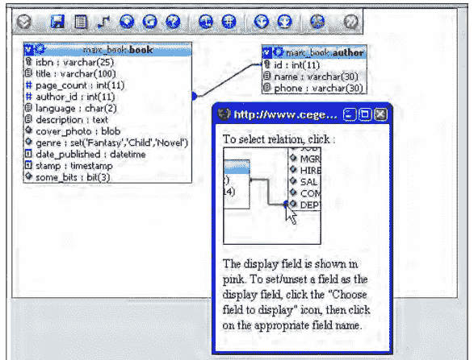

让我们在适当的位置点击以删除此关系。我们会得到一个确认面板，在其上点击 Delete。

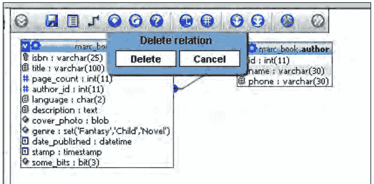

然后我们可以继续重新创建它。为此，我们首先点击 Create relation 图标。此时光标会变成一条简短的消息，显示 Select referenced key。在我们的例子中，被引用键是 author 表的 id 列；因此我们将光标移到该列上并点击它。会进行验证，确保我们选择的是主键或唯一键。

接下来，光标变为 **Select foreign key** 后，我们将其移到 book 表的 **author_id** 列并再次点击。这确认了关系的创建。目前，界面不允许创建复合键（具有多于一列的键）。

## 外键关系

在 InnoDB 或 PBXT 表之间删除或定义关系的流程与内部关系相同。唯一的例外是，在创建时会出现不同的确认面板，使我们能够指定 ON DELETE 和 ON UPDATE 操作。

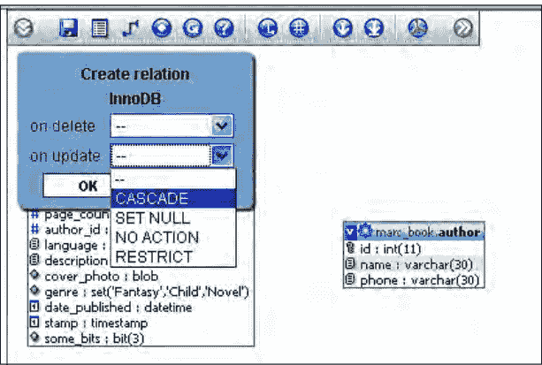

## 定义显示字段

在工作区中，我们注意到 **author** 表中的 name 列具有特殊的背景颜色。这表明该列用作显示字段。我们只需点击顶部的 **选择显示字段** 图标，并将简短消息 **选择显示字段** 拖到另一列——例如 phone 列。这会将显示字段更改为该列。如果我们将消息拖到现有的显示字段列上，我们将移除该列作为表的显示字段。

## 导出为 PDF 架构

在第 15 章中，我们将了解如何为数据库的子集生成 PDF 架构。我们可以将此类架构中的表坐标导入 Designer's 工作区，反之亦可将其导出到 PDF 架构。为此提供了 Import/export coordinates 顶部图标。

## 已定义关系的好处

在本节中，我们将查看当前可以测试的已定义关系的好处。其他好处将在第 13 章和第 15 章中描述。关联表基础设施的额外好处将在第 14 章和第 16 章中出现。

这些好处适用于内部和外键关系。

## 外键信息

让我们通过进入 Search 子页面并选择显示前四列来浏览 book 表。我们看到相关键（author_id）现在是一个链接。将鼠标指针移到任何 author_id 值上会显示作者姓名（由 author 表的显示字段定义）。

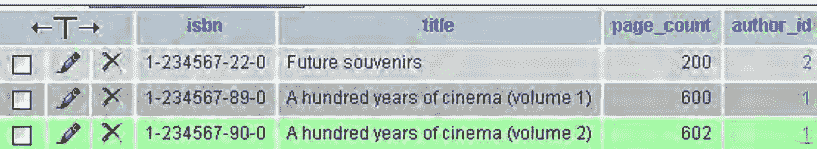

点击 author_id 会带我们到与此特定作者相关的表——author——：

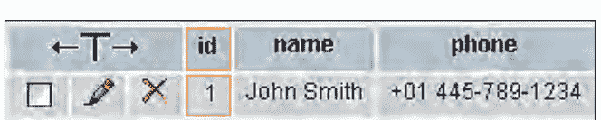


## 外键的下拉列表

回到书表，在插入模式（或编辑模式）中，我们现在会看到每个具有定义关系的字段的可能键的下拉列表。该列表以两种顺序包含键和描述（显示字段）——键到显示字段以及显示字段到键。这使我们能够使用键盘，并输入键或显示字段的首字母。

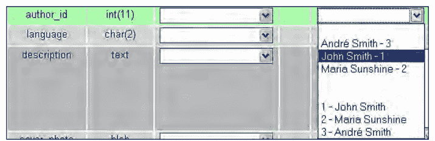

只有键（本例中为 1）会被存储在书表中。显示字段仅用于辅助我们。

默认情况下，如果外表中的行数最多为 100 行，则会显示此下拉列表。这由以下参数控制：

```
$cfg['ForeignKeyMaxLimit'] = 100;
```

对于更大的外表，会出现一个不同的窗口——外表窗口（见下一节），可以浏览。

我们可能希望在下拉列表中以不同的方式查看信息。这里，John Smith 是内容，1 是 ID。默认显示由以下控制

```
$cfg['ForeignKeyDropdownOrder'] = array( 'content-id', 'id-content');
```

我们可以在定义数组中使用一个或两个字符串——content-id 和 id-content——并按我们偏好的顺序排列。因此，将 $cfg['ForeignKeyDropdownOrder'] 定义为 array('id-content') 将只产生以下选择：

- 1 – John Smith
- 2 – Maria Sunshine
- 3 – André Smith

## 可浏览的外表窗口

我们当前的作者表条目很少。因此，为了说明此机制，我们将把 $cfg['ForeignKeyMaxLimit'] 设置为人为的低数值 1。现在在书表的插入模式中，我们会看到 author_id 的一个小表形图标。此图标会打开另一个窗口，该窗口将显示 author 表的值以及一个搜索输入字段。左侧的值按键值排序（这里是 author_id 列），右侧按描述排序。

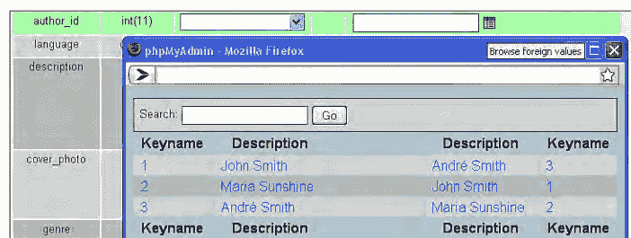

选择其中一个值（通过点击键值或描述）会关闭此窗口并将值带回 author_id 列。

## 引用完整性检查

我们在第 10 章讨论了操作子页面及其表维护部分。对于此练习，我们假设书表和作者表都不受 InnoDB 或 PBXT 存储引擎控制。如果我们为作者表定义了内部关系，则书表会出现一个新的选择 – 检查引用完整性。

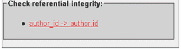

对于每个定义的关联都会出现一个链接（author_id -> author.id），点击它会开始验证。对于每一行，都会验证外表中对应键的存在性，并报告错误（如有）。如果结果页面报告零行，则是好消息！

此操作存在的原因是，对于不原生支持外键的存储引擎下的表，MySQL 和 phpMyAdmin 都不会强制执行引用完整性。例如，完全可能将无效的 **author_id** 值导入书表。

## 元数据的自动更新

phpMyAdmin 会将内部关系的元数据与通过 phpMyAdmin 对表所做的每一次更改保持同步。例如，重命名关系的一部分列会使 phpMyAdmin 在关系的元数据中重命名此列。这保证了内部关系即使在列名更改后仍能继续 functioning。删除列或表时也会发生同样的情况。

> 如果结构更改是在 phpMyAdmin 之外进行的，则应手动维护元数据。

## 列注释

在 MySQL 4.1 之前，MySQL 结构本身不支持为列添加注释。尽管如此，得益于 phpMyAdmin 的元数据——我们可以对列进行注释。然而，自 MySQL 4.1 以来，原生列注释已被支持。好消息是，对于任何 MySQL 版本，phpMyAdmin 中的列注释始终通过 **Structure** 页面访问，通过编辑每个字段的结构。在以下示例中，我们需要注释三个列。因此，我们选择它们并点击 **With selected** 选择附近的铅笔图标。

|   | Field | Type |
|---|---|---|
| ☑ | isbn | varchar(25) |
| ☐ | title | varchar(100) |
| ☑ | page_count | int(11) |
| ☑ | author_id | int(11) |

为了获得此处所示的下一个面板，我们通过将 $cfg['DefaultPropDisplay'] 设置为 'vertical' 以垂直模式工作。我们输入以下注释：

- isbn: book number
- page_count: approximate
- author_id: cf author table

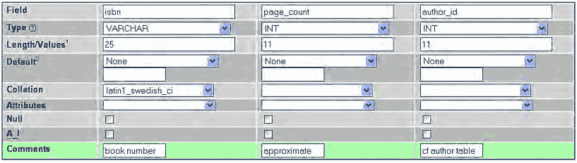

然后我们点击保存。

这些注释会出现在各个地方——例如，在导出文件（见第 7 章）中，在 PDF 关系模式（见第 15 章）中，以及在浏览模式中。

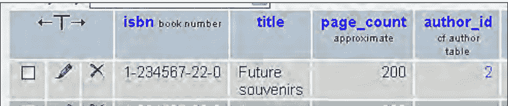

如果我们不希望注释出现在浏览模式中，可以将 $cfg['ShowBrowseComments'] 设置为 FALSE。（默认值为 TRUE。）

列注释也会作为工具提示出现在 Structure 页面中，并且列名会用破折号下划线标出。要停用此行为，可以将 $cfg['ShowPropertyComments'] 设置为 FALSE。（该项默认也为 TRUE。）

## 自动迁移

每当 phpMyAdmin 检测到列注释已存储在其元数据中，并且我们使用的是 MySQL 4.1.2 或更高版本时，它会自动将这些列注释迁移到原生的 MySQL 列注释。

## 摘要

本章介绍了如何安装保持特殊元数据（关于表的数据）所需的必要基础设施，以及如何在 InnoDB 和非 InnoDB 表之间定义关系。它还检查了 phpMyAdmin 在存在关系时的修改行为以及外键。最后，它涵盖了 Designer 功能、列注释以及如何从表中获取信息。第 12 章将介绍输入 SQL 命令的手段，当 phpMyAdmin 的界面不足以完成我们所需的操作时，这些命令很有用。
