# 12 输入 SQL 命令

## 输入 SQL 命令

本章解释了我们如何将自己的 SQL 命令（查询）输入到 phpMyAdmin 中，以及如何保留这些查询的历史记录。

## SQL 查询框

phpMyAdmin 允许我们通过其图形界面完成许多数据库操作。然而，在某些时候，我们必须依赖 SQL 查询输入来实现复杂操作。以下是一些复杂查询的示例：

```
SELECT department, AVG(salary) FROM employees GROUP BY department
HAVING years_experience > 10;
SELECT FROM_DAYS(TO_DAYS(CURDATE()) +30);
```

要输入此类查询，查询框可在 phpMyAdmin 内的多个位置获得。

## 数据库视图

我们遇到的第一个查询框是在数据库视图中进入 SQL 菜单时。

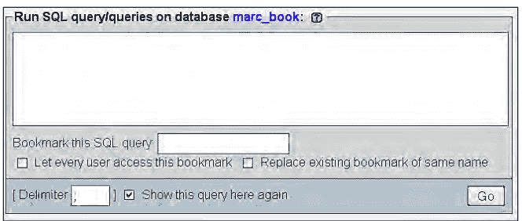

此框很简单——我们输入一些有效的（希望是）MySQL 语句并点击 Go。在查询文本区域下方，有与书签相关的选择（第 14 章后面会解释）。通常，我们不必更改标准的 SQL 分隔符，即分号。然而，如果需要，有分隔符对话框（见第 17 章）。

要使默认查询出现在此框中，我们可以使用 $cfg['DefaultQueryDatabase'] 配置指令来设置，默认情况下它是空的。我们可以在此指令中放置一个类似 SHOW TABLES FROM %d 的查询。此查询中的 %d 参数将被当前数据库名称替换，从而在查询框中得到 SHOW TABLES FROM `marc_book`。

## 表视图

在表视图的 SQL 菜单中，有一个略有不同的框。

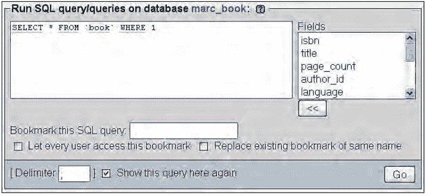

右侧有一个字段选择器和一个插入按钮（<<）。该框已具有如前一屏幕截图所示的默认查询。

此默认查询由 $cfg['DefaultQueryTable'] 配置指令生成，其中包含 SELECT * FROM %t WHERE 1。这里，%t 被当前表名替换。$cfg['DefaultQueryTable'] 中还提供了一个占位符 %f。此占位符将被此表的完整字段列表替换，从而生成以下查询：

```
SELECT `isbn`, `title`, `page_count`, `author_id`, `language`, `description`, `cover_photo`, `genre`, `date_published`, `stamp`, `some_bits` FROM `book` WHERE 1.
```


WHERE 1 是一个始终为真的条件。因此，查询可以照常执行。我们可以用想要的条件替换 1，或者输入一个完全不同的查询。

## 字段选择器

字段选择器是一种加快查询生成的方式。通过选择一个字段并点击箭头 <<，该字段名称会被复制到查询框中当前光标位置。这里，我们选择 author_id 字段，删除数字 1，然后点击 <<。接着添加条件 = 2。

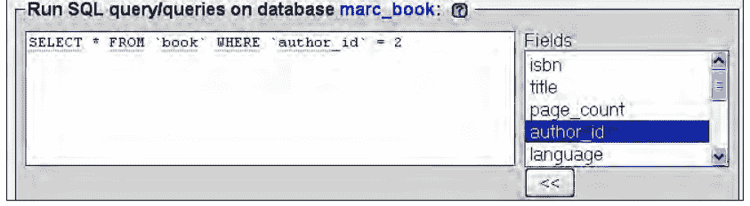

“再次在此处显示此查询”选项（默认情况下已选中）可确保如果我们仍在同一页面，查询在执行后会保留在框中。对于像 UPDATE 或 DELETE 这样会影响表但不会产生单独结果页面的查询，这种情况更容易看到。

## 点击查询框

我们可能希望使用 $cfg['TextareaAutoSelect'] 配置指令来更改查询框内点击的行为。其默认值是 FALSE，这意味着点击时不会自动选择内容。如果将此指令更改为 TRUE，则首次点击此框时会选择其所有内容。（这是一种快速将内容复制到别处或从框中删除内容的方式。）下一次点击会将光标置于点击位置。

## 查询窗口

在第 3 章中，我们讨论了此窗口的目的以及更改某些参数（如尺寸）的步骤。此窗口可通过左侧面板中的 SQL 图标或查询窗口链接轻松打开，非常适合输入查询并进行测试。

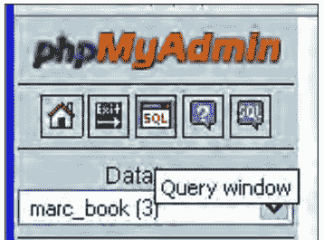

以下屏幕截图显示了出现在右侧面板上的查询窗口：

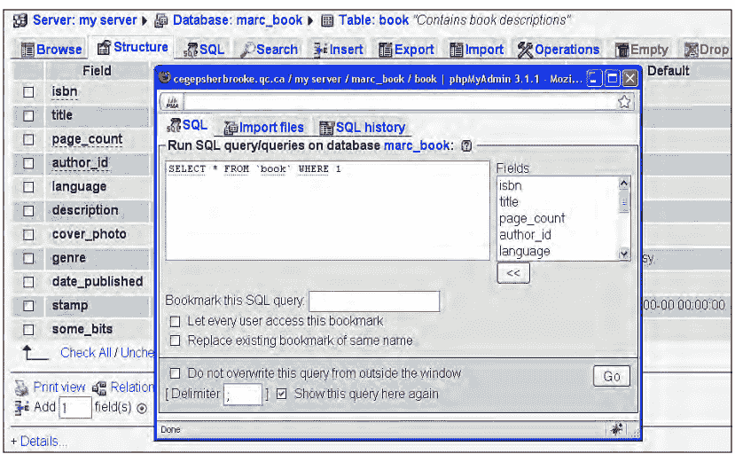

屏幕截图中看到的窗口包含与表视图上下文中使用的相同的 **字段** 选择器和 **<<** 按钮。此独立的查询窗口仅在启用 JavaScript 的浏览器中受支持。

## 查询窗口选项

**SQL** 选项卡是此窗口中的默认活动选项卡。这来自配置指令 `$cfg['QueryWindowDefTab']`，其默认包含 **sql**。

如果我们希望另一个选项卡成为默认活动选项卡，可以将 **sql** 替换为 **文件** 或 **历史**。另一个值 **完整** 会同时显示三个选项卡的所有内容。

在查询窗口中，我们看到一个 **不要从窗口外部覆盖此查询** 的复选框。通常情况下，该复选框未选中。我们在生成查询时所做的更改会反映在查询窗口中。这称为 **同步**。例如，从左侧或右侧面板选择不同的数据库或表会相应地更新查询窗口。但是，如果我们开始直接在此窗口中输入查询，复选框将被选中以保护其内容并移除同步。这样，此处编写的查询将被锁定并受到保护。

## 基于会话的 SQL 历史记录

此功能会将我们执行的全部成功 SQL 查询作为 PHP 会话数据收集，并修改查询窗口以使其可用。这种默认类型的历史记录是临时的，因为 `$cfg['QueryHistoryDB']` 默认设置为 FALSE。

## 基于数据库的 SQL 历史记录（永久）

由于我们已安装了关联表基础设施（参见第 11 章），因此有更强大的历史机制可用。通过将 `$cfg['QueryHistoryDB']` 设置为 TRUE 来触发此机制。

在我们从其中一个查询框尝试一些查询后，会建立一个历史记录，只能从查询窗口中看到。

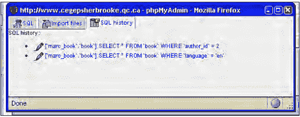

我们可以看到（按相反顺序）最近的成功查询以及它们所执行的数据库。仅从查询框输入的查询会保留在此历史记录中。由 phpMyAdmin 生成的查询（例如通过点击 **浏览** 生成的查询）不会保留在此处。

它们可以点击立即执行，并且 **编辑** 图标可用于将记录的查询插入查询框以进行编辑。

将保留的查询数量由 $cfg['QueryHistoryMax'] 控制，默认设置为 25。此限制并非出于性能原因，而是为了实现视觉上无障碍的视图而设定的实用限制。额外的查询在登录时会被消除，这一过程传统上称为 **垃圾回收**。查询存储在 $cfg['Servers'][$i]['history'] 中配置的表中。

## 在查询窗口中编辑查询

在成功查询的结果页面上，会出现一个包含已执行查询的标题，如以下屏幕截图所示：

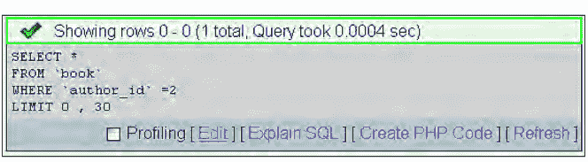

点击 **编辑** 会打开查询窗口的 **SQL** 选项卡，并准备好修改此查询。这是因为该参数的以下默认设置：

```
$cfg['EditInWindow'] = TRUE;
```

当其设置为 FALSE 时，点击 **编辑** 不会打开查询窗口；相反，查询会出现在 **SQL** 子页面的查询框中。

## 多语句查询

在 PHP 和 MySQL 编程中，我们只能使用 mysql_query() 函数调用一次发送一个查询。phpMyAdmin 允许我们使用分号作为分隔符在一次传输中发送多个查询。假设我们在查询框中输入以下查询：

```
INSERT INTO author VALUES (100,'Paul Smith','111-2222');
INSERT INTO author VALUES (101,'Melanie Smith','222-3333');
UPDATE author SET phone='444-5555' WHERE name LIKE '%Smith%';
```

我们将收到以下结果屏幕：

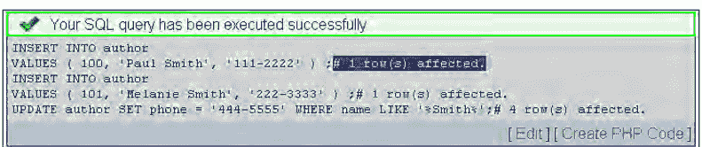

我们通过注释看到受影响的行数，因为 $cfg['VerboseMultiSubmit'] 设置为 TRUE。

让我们再次发送相同的查询列表并观察结果：

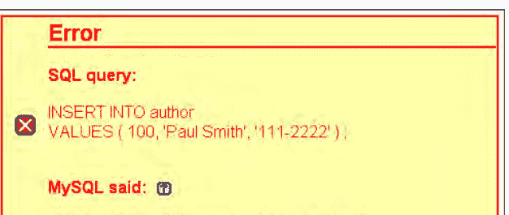

收到一条 Duplicate entry 错误，提示值 100 已存在，这是正常的。我们看到的是第一个 INSERT 语句的结果；那下一个会怎样？执行在第一个错误处停止，因为 $cfg['IgnoreMultiSubmitErrors'] 设置为 FALSE，指示 phpMyAdmin 不要忽略多语句中的错误。如果将其设置为 TRUE，程序将依次尝试所有语句，我们会看到两个 Duplicate entry 错误。

如果我们尝试多个 SELECT 语句，此功能将无法按预期工作。我们将只看到最后一个 SELECT 语句的结果。

## 漂亮打印（语法高亮）

默认情况下，phpMyAdmin 会解析并高亮显示其处理的任何 MySQL 语句的各个元素。这由 $cfg['SQP']['fmtType'] 控制，默认设置为 'html'。此模式为每个不同元素（保留字、变量、注释等）使用特定颜色，如位于主题特定 layout.inc.php 文件中的 $cfg['SQP']['fmtColor'] 数组所述。

在之前的示例中，fmtType 设置为 `text`，因为这种模式在书中更易读。此模式会在 MySQL 语句内部的逻辑点插入换行符，但不涉及颜色。当 fmtType 设置为 `html` 时，phpMyAdmin 会以语法高亮报告 SQL 语句。然而，将 fmtType 设置为 `none` 会移除所有格式，保持我们的语法不变。

> 配置文件中用于保存某些参数的多维数组反映了 phpMyAdmin 开发团队采用的编程风格。这确保了参数名称不会过长。

## SQL 验证器

每次 phpMyAdmin 传输查询时，MySQL 服务器都会对其进行解释并提供反馈。查询的语法必须遵循 MySQL 规则，这与标准 SQL 不同。然而，符合标准 SQL 可确保我们的查询可在其他 SQL 实现中使用。

我们可以使用一个免费的外部服务 Mimer SQL Validator。它根据 Core SQL-99 规则验证我们的查询并生成报告。Validator 可直接从 phpMyAdmin 使用，其主页位于 http://developer.mimer.com/validator/index.htm。

> 出于统计目的，此服务会在其服务器上匿名存储收到的查询。在存储查询时，它会将数据库、表和列名替换为通用名称。查询中包含的字符串和数字会被替换为通用值以保护原始信息。

## 系统要求

此 Validator 以 SOAP 服务的形式提供。我们的 PHP 服务器必须支持 XML、PCRE 和 PEAR。我们还需要一些 PEAR 模块。以下命令（由系统管理员在服务器上执行）安装我们需要的模块：

```
pear install Net_Socket Net_URL HTTP_Request Mail_Mime Net_DIME SOAP
```

如果由于某些模块处于 beta 状态而导致此命令出现问题，我们可以执行以下命令，该命令将安装 SOAP 及其他依赖模块：

```
pear -d preferred_state=beta install -a SOAP
```


## 使验证器可用

一些参数必须在 config.inc.php 中进行配置。将 $cfg['SQLQuery']['Validate'] 设置为 TRUE 可启用 Validate SQL 链接。

我们还应启用 Validator 本身（因为在未来的 phpMyAdmin 版本中可能提供其他验证器）。这可通过将 $cfg['SQLValidator']['use'] 设置为 TRUE 来完成。

Validator 默认使用匿名 Validator 账户访问，如以下命令配置：

```
$cfg['SQLValidator']['username'] = '';
$cfg['SQLValidator']['password'] = '';
```

相反，如果公司已为我们提供了一个账户，我们可以在此处使用该账户信息。

## 验证器结果

Validator 返回两种报告——一种是在查询符合标准时，另一种是在查询不符合标准时。

## 符合标准的查询

我们将尝试一个简单的查询：SELECT COUNT(*) FROM book。像往常一样，我们在查询框中输入此查询并发送。在结果页面上，我们现在看到一个额外的链接——Validate SQL。

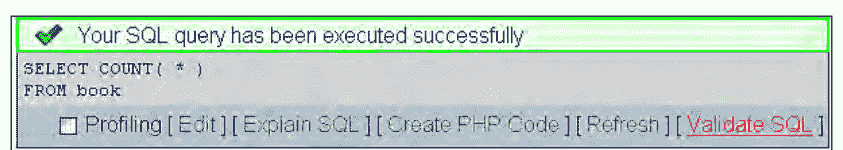

点击 Validate SQL 会产生以下报告：

```
Conforms to Core SQL-99
SQL queries stored anonymously for statistical purposes.
```

我们可以选择点击 Skip Validate SQL 来查看原始查询。

## 不符合标准的查询

让我们尝试另一个在 MySQL 中能正确工作的查询：SELECT * FROM book WHERE language = 'en'。将其发送到 Validator 会产生以下报告：

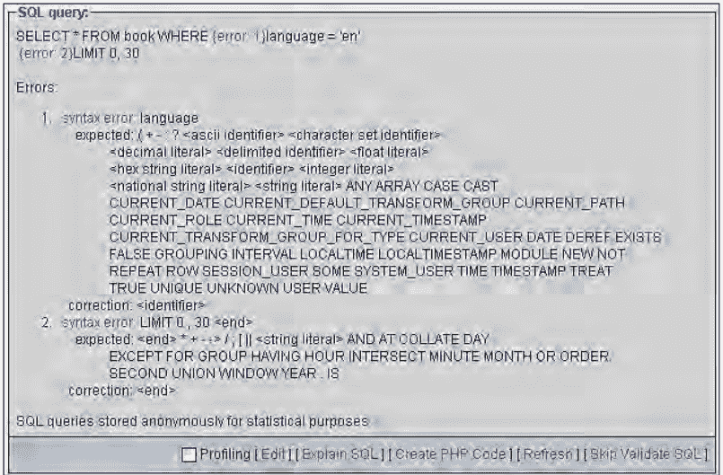

每次 Validator 发现问题时，它都会在错误位置添加类似 {error: 1} 的消息，并在报告中添加脚注。这次，language 列名是非标准的。因此，Validator 告诉我们它在此处期望一个标识符。关于 LIMIT 子句的使用还报告了另一个非标准错误，该子句是由 phpMyAdmin 添加到查询中的。

另一个例子是反引号。如果我们只是为 book 表点击 **Browse**，phpMyAdmin 会生成 SELECT * FROM `book`，用反引号将表名括起来。这是 MySQL 保护标识符的方式，标识符可能包含特殊字符，例如空格、国际字符或保留字。然而，将此查询发送到 Validator 会显示反引号不符合标准 SQL。我们甚至可能收到两个错误，每个反引号一个。

## 摘要

本章帮助我们了解查询框的目的并展示它们的位置。它还概述了 Query 窗口选项、多语句查询、如何使用字段选择器、如何使用 SQL Validator，以及最后如何获取已输入命令的历史记录。下一章将展示如何借助 phpMyAdmin 的查询生成器在不输入的情况下生成多表查询。
