# 13 多表查询生成器

数据库视图或表视图中的 **Search** 页面用于单表查找。本章介绍数据库视图中可用的多表 **Query by example (QBE)** 功能。

许多 phpMyAdmin 用户在表视图中逐表工作，因此往往会忽略多表查询生成器，而这是一个用于微调查询的绝佳功能。查询生成器不仅在多表情况下有用，在单表情况下也很有用。它使我们能够为一列指定多个条件，而表视图中的 **Search** 页面不具备此功能。

> 本章中的示例假定已完成链接表基础设施的多用户安装（参见第 11 章），并且在第 10 章练习期间创建的 book-copy 表仍存在于 marc_book 数据库中。

要打开此功能页面，我们进入特定数据库的数据库视图（查询生成器一次仅支持在一个数据库上工作）并点击 **Query**。

对面页面的截图显示了初始 QBE 页面。它包含以下元素：

- 条件列
- 添加条件行的界面
- 添加条件列的界面
- 表选择器

## 多表查询生成器

- 查询区域
- 更新或执行查询的按钮

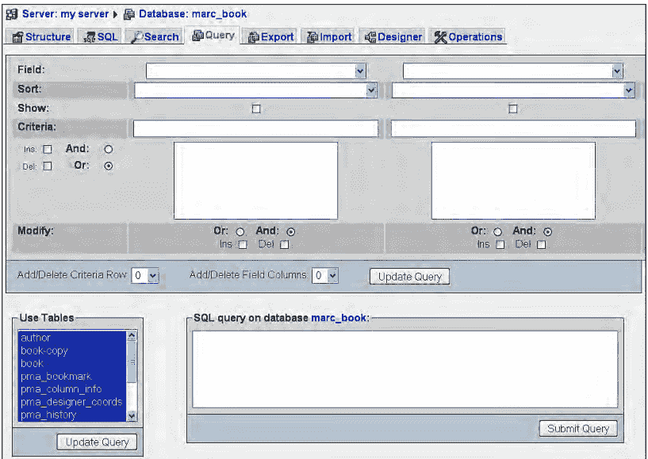

## 选择表

初始选择包含所有表。在此示例中，我们假设链接表基础设施已安装在 marc_book 数据库中。（参见第 11 章中的“Single-user installation”部分。）因此，字段选择器包含大量字段。对于我们的示例，我们将仅使用 author 和 book 表。因此，我们仅从 Use Tables 选择器中选择这些表。

然后我们点击 Update Query。这会刷新屏幕并减少字段选择器中可用的字段数量。我们始终可以使用浏览器在下拉菜单中进行多项选择的机制（通常是 control-click）稍后更改所选表。

## 列条件

默认情况下提供三个条件列。本节讨论编辑其条件的选项。这些包括选择字段、排序单个列、为单个列输入条件等选项。

## 字段选择器：单列或所有列

字段选择器包含所选表的各个列，以及每个表以星号 (*) 结尾的特殊选择，这意味着所有字段都被选中。

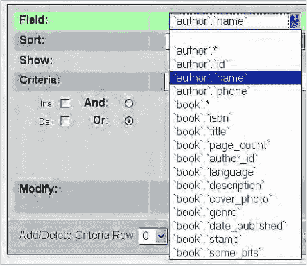

要显示 author 表中的所有字段，我们将选择 `author`.* 并勾选 Show 复选框，而不在 Sort 和 Criteria 框中输入任何内容。在我们的例子中，我们选择 `author`.`name`，因为我们想为作者姓名输入一些条件。

## 排序

对于每个选定的单个列，我们可以指定排序（升序或降序），或让该行保持不变（不排序）。如果我们选择多个排序列，排序将从左到右进行。

> 当我们要求对列进行排序时，我们通常会勾选 Show 复选框。但这不是必要的，因为我们可能只想执行排序操作而不显示该列。

## 显示列

我们勾选 Show 复选框以便在结果中看到该列。有时，我们可能只想对列应用条件，而不将其包含在结果页面中。在这里，我们添加 phone 列，要求对其进行排序，并选择同时显示 name 和 phone number。我们还要求按升序对 name 进行排序。排序将首先按 name 进行，如果姓名相同，则按 phone number 进行。这是因为 name 在 phone 列左侧的条件列中，因此优先级更高。

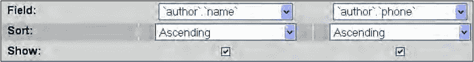

## 更新查询

在任何时候，我们都可以点击 Update Query 按钮查看生成的查询进度。我们必须在执行查询之前至少点击一次。现在，让我们点击它并查看查询区域中生成的查询。在以下示例中，我们将在每次修改后点击 Update Query。

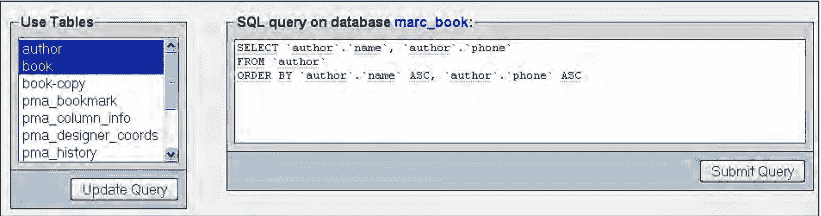

我们已选择了两个表，但尚未从 book 表中选择任何列。因此，该表未在生成的查询中提及。

## 条件

在 Criteria 框中，我们可以为每个对应列输入条件（遵守 SQL WHERE 子句的语法）。默认情况下，我们有两个条件行。要查找姓名中包含 Smith 的所有作者，我们使用 LIKE 条件（LIKE '%SMITH%'）并点击 Update Query。

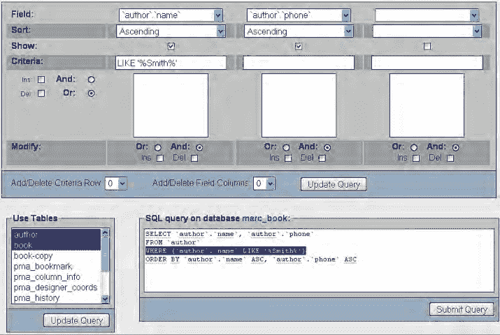

我们还有另一行可用于输入额外条件。假设我们还想找到作者 **Maria Sunshine**。这次我们使用 = 条件。两个条件行将由 OR 运算符连接，该运算符默认从界面左侧选择。

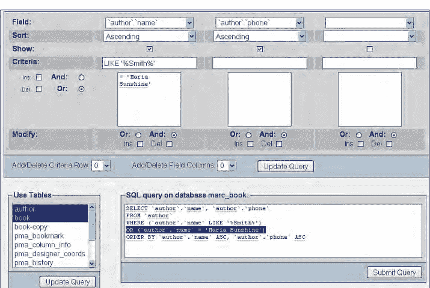

为了演示 OR 运算符能更好地连接条件行，现在让我们在电话号码上添加一个条件 LIKE '%8%'。

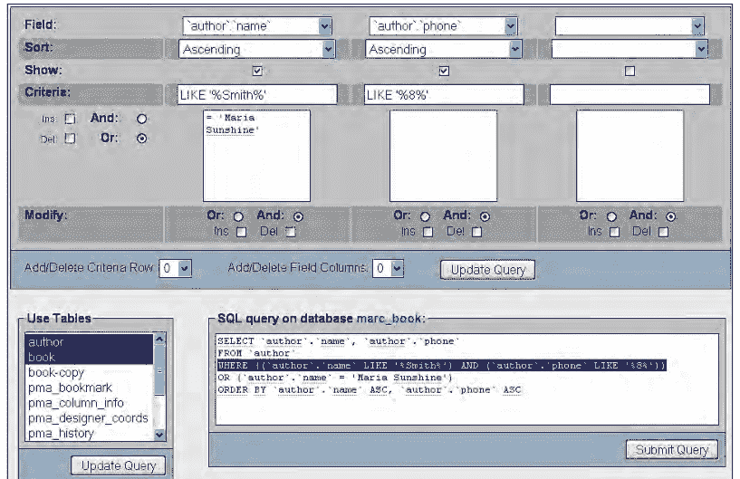

通过检查 AND 和 OR 运算符的位置，我们可以看到条件的第一行是由 AND（因为在 name 列下选择了 AND）运算符连接的，而第二行条件是通过 OR 运算符连接到其余部分的。我们刚刚添加的条件（LIKE '%8%'）并不意味着要查找任何人，因为我们已将姓名为 "Smith" 的所有作者的电话号码更改为 "444-5555"（在第 12 章中）。

如果我们想在同一列上添加另一个条件，只需添加一个条件行即可。

## 调整条件行数

条件行数可以通过两种方式更改。首先，我们可以在 Criteria 下选择 Ins 复选框来添加一个条件行（在点击 Update Query 之后）。由于此复选框一次只能添加一个条件行，我们将取消选中它并改用 Add/Delete Criteria Row 对话框。在此对话框中，我们选择添加两行。

再次点击 **Update Query** 按钮会显示以下屏幕：

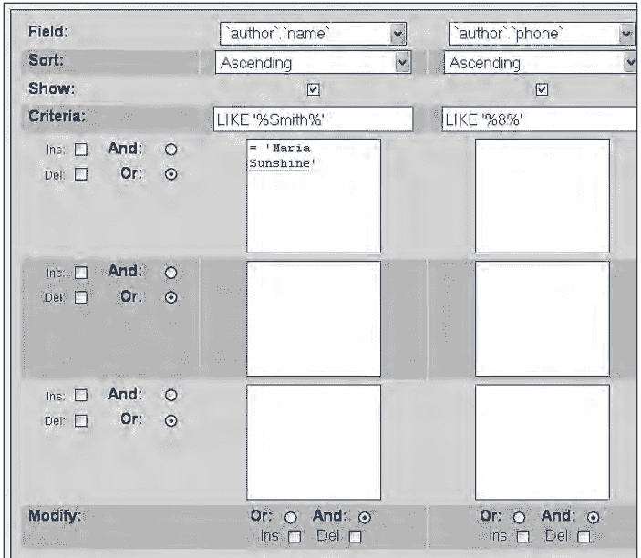

现在，你可以看到有两条额外的条件行（目前为空）。我们也可以删除条件行。这可以通过在 **Add/Delete Criteria Row** 对话框中选择负数，或通过勾选要删除的行旁边的 **Del** 复选框来完成。让我们删除我们刚刚添加的两行，因为我们现在不需要它们。**Update Query** 按钮会刷新页面以应用指定的调整。

## 调整条件列数

使用类似的机制，我们可以通过勾选每列下的 INS 或 Del 复选框，或使用 Add/Delete Field Columns 对话框来添加或删除列。我们已经有一个未使用的列（为节省空间，未在之前的图片中显示）。在这里，我们使用位于未使用列下方的 Ins 复选框添加了一列（这次我们需要它）：

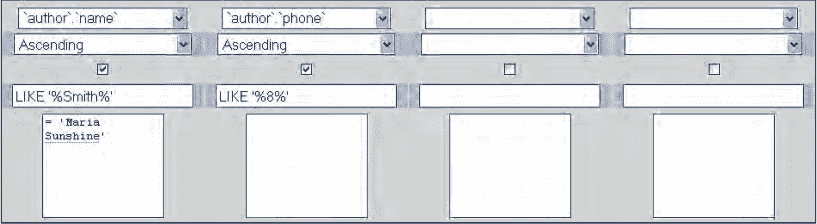

## 自动连接

phpMyAdmin 可以为其构建的查询生成表之间的连接。现在让我们用 book 表中的 title 和 genre 字段填充我们两个未使用的列，并看看更新查询时会发生什么。

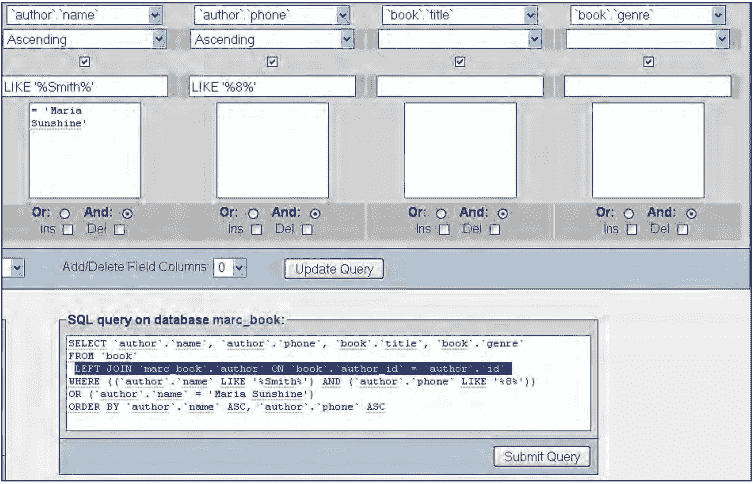

现在有两个额外的条件列，分别与 `book`.`title` 和 `book`.`genre` 列相关。phpMyAdmin 利用其对表之间定义的关系的了解，在 author_id 键字段上生成了一个 LEFT JOIN 子句（在前一图中突出显示）。当前版本的不足之处在于只检查内部关系，而不检查 InnoDB 关系。

> 连接中可能涉及两个以上的表。

## 执行查询

点击 Submit Query 按钮会将查询发送以执行。在以下图中，你可以看到上半部分完整的生成查询和下半部分的结果数据行：

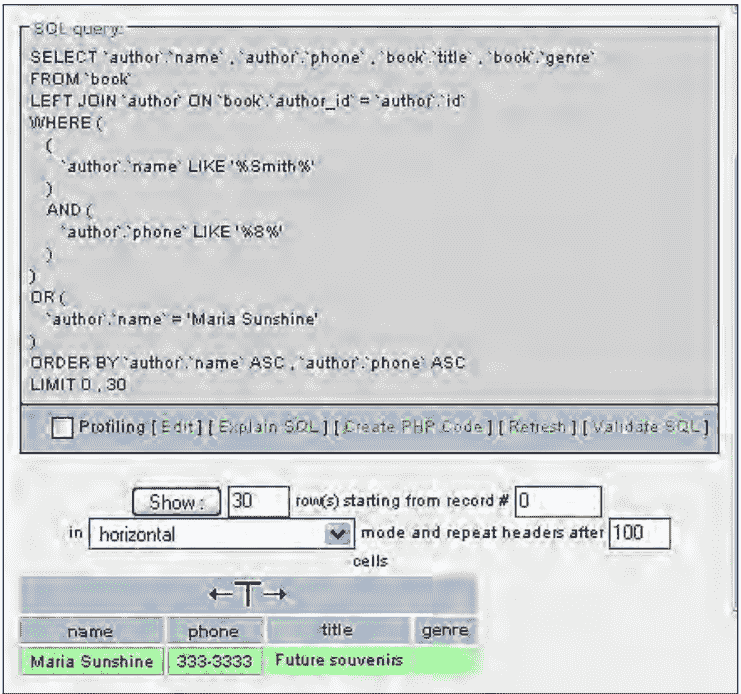

一旦提交查询，除了使用浏览器的 **Back** 按钮外，没有简单的方法返回到查询生成页面。下一章讨论如何保存生成的查询以便以后执行。

## 摘要

本章涵盖了各个方面，包括打开查询生成器、选择表、输入列条件、排序和显示列，以及更改条件行或列的数量。它还向我们展示了如何使用 AND 和 OR 运算符来定义行和列之间的关系，以及如何使用表之间的自动连接。第 14 章将向你展示如何永久保存查询的书签。
