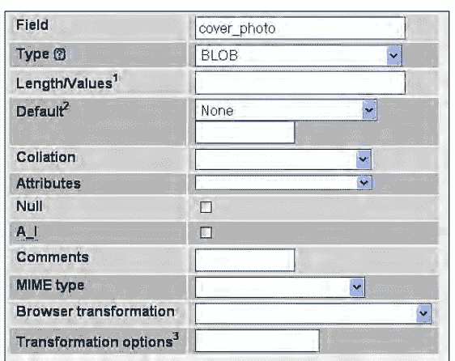
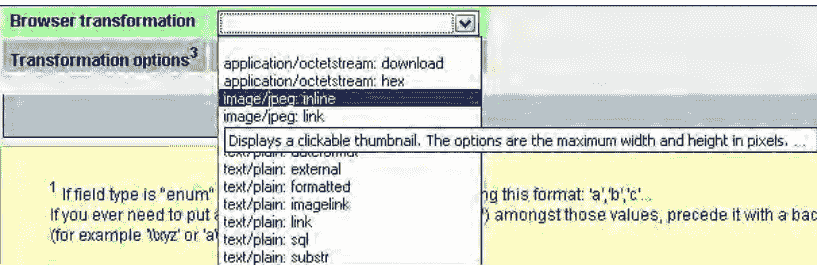
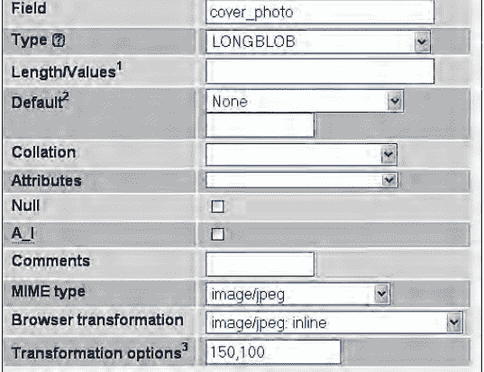
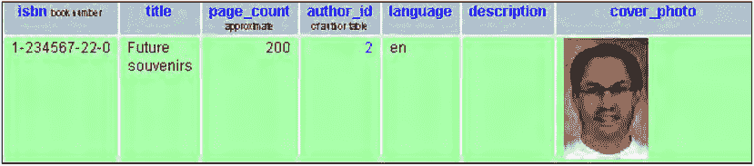
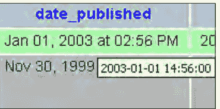
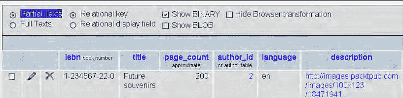
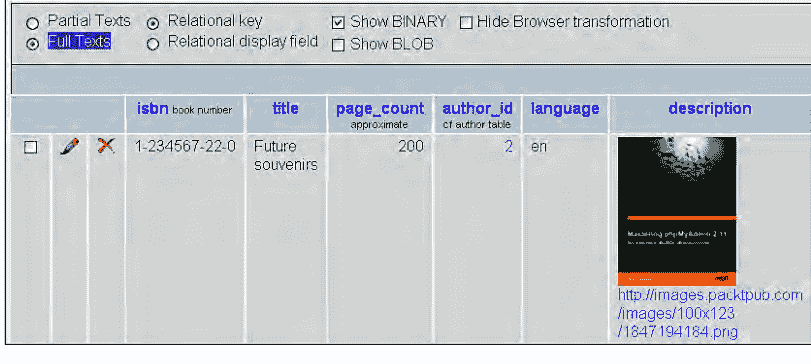
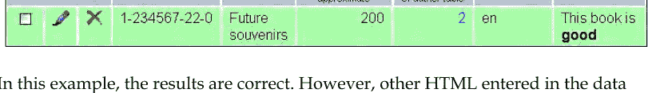
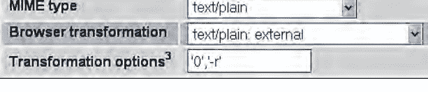
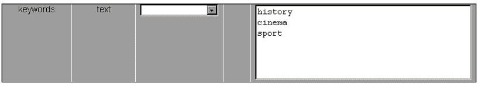

# 16 MIME-Based Transformations

在本章中，我们将介绍 phpMyAdmin 的一个强大功能——在表 **Browse** 期间根据称为转换的特定规则转换列内容的能力。通常，浏览表只显示其中存储的原始数据。然而，基于 MIME 的转换允许更改显示格式。

## Display behavior in browse mode

通常，每个行的确切内容都会显示，除了：

- **TEXT** 和 **CHARACTER** 字段可能会根据 $cfg['LimitChars'] 被截断，具体取决于我们是否选择查看 **Full Texts**
- **BLOB** 字段可能会被诸如 [**BLOB - 1.5 KB**] 的消息替换

我们将使用术语 **cell** 来表示特定行的特定列。包含“Future souvenirs”书封面照片的单元格（一个 **BLOB** 列）目前显示为诸如 %oPNG\r\nZ\n\0\0\0\rIHDR\0 之类的神秘数据，或显示 **BLOB** 字段大小的消息。能够直接在 phpMyAdmin 中看到图片的缩略图（在 *Clickable thumbnail* 部分下的第二张截图中显示）以及可能的全尺寸图片本身会很有趣。这将通过适当的转换实现。

## Display options

在 Browse 模式下，Options 链接会显示一个滑块，其中包含其他选项，如隐藏浏览器转换复选框。我们可以在想要在单元格的真实数据与其转换版本之间切换时使用它。

## Enabling transformations

我们将转换定义为一种机制，通过该机制，使用为该列定义的元数据，在浏览时转换与列相关的所有单元格。只有结果页面上可见的单元格会被转换。转换逻辑本身是用 PHP 脚本编写的，存储在 libraries/transformations 中，并使用插件架构调用。

要启用此功能，我们必须在 config.inc.php 中将 $cfg['BrowseMIME'] 设置为 TRUE。必须建立链接表基础设施（参见第 11 章），因为转换所需的元数据在官方 MySQL 表结构中不可用。这是专门为 phpMyAdmin 做的补充。


> 在 phpMyAdmin 主页的文档部分，有一个链接指向更多信息，供希望学习插件内部结构以编写自己的转换的开发人员参考。

## The MIME column's settings

如果我们进入书表的结构页面的表视图并点击 cover_photo 的 Change 链接，我们会看到字段的三个额外属性（前提是转换功能已启用）：

- MIME 类型
- 浏览器转换
- 转换选项



对于特定字段，只能指定一种转换类型。这里，字段是 BLOB 字段。因此，它可以保存任何类型的数据。为了使 phpMyAdmin 正确解释和操作数据，转换系统必须被告知数据格式和预期结果。因此，我们必须确保上传的数据始终遵循相同的格式。

我们将首先了解这些属性的用途，然后在转换示例部分尝试一些可能性。

## MIME types

MIME 规范 (http://en.wikipedia.org/wiki/MIME) 被选为元数据属性，用于对列保存的数据类型进行分类。多用途互联网邮件扩展 (MIME) 最初设计用于扩展邮件，现在也用于描述其他协议的内容类型。在 phpMyAdmin 的上下文中，当前可能的值为：

- image/jpeg
- image/png
- text/plain
- application/octetstream

text/plain 类型可以为包含任何类型文本的列选择（例如 XHTML 或 XML 文本）。在转换示例部分，您将看到要实现特定效果需要选择哪种 MIME 类型。

## Browser transformations

这里设置要执行的确切转换。每个 MIME 类型可能支持多个转换。例如，对于 **image/jpeg** MIME 类型，我们有两个可用转换——**image/jpeg: inline** 用于图片的可点击缩略图，以及 **image/jpeg: link** 用于仅显示链接。

如以下图片所示，将鼠标移到下拉菜单中的每个选项上会提供相应转换的简短说明。更完整的转换说明和可能选项可在点击 **transformation descriptions** 链接后获得。



## Transformation options

在 *Examples of transformations* 部分，我们将看到某些转换接受选项。例如，生成图片的转换需要以像素为单位的宽度和高度。选项列表中的值用逗号分隔，一些选项可能需要在引号中括起来。

一些选项有默认值，我们必须注意遵守选项的文档顺序。例如，如果有两个选项，而我们只想为第二个选项指定值，可以使用空引号作为第一个选项的占位符，让系统使用其默认值。

## Requirements for image generation

正常的缩略图生成要求 Web 服务器上存在某些组件，并且 config.inc.php 中的参数配置正确。


## GD2 库

phpMyAdmin 使用一些内部函数来创建缩略图。这些函数需要在我们的 PHP 服务器上存在 GD2 库。

phpMyAdmin 可以检测正确的 GD2 库是否存在，但此检测需要一些时间。它并非在每个会话中只进行一次，而是在 phpMyAdmin 中几乎每次执行操作时都会进行。

将 config.inc.php 中的 $cfg['GD2Available'] 参数设置为其默认值 'auto' 表示需要检测库的存在性和版本。

如果我们知道 GD2 库可用，将 $cfg['GD2Available'] 设置为 yes 将使执行更快。如果 GD2 库不可用，建议将此参数设置为 no。

要了解服务器上有哪些 GD2 库，我们可以进入 phpMyAdmin 的主页并点击显示 PHP 信息。如果此链接不存在，我们必须将 $cfg['ShowPhpInfo'] 参数设置为 true。然后我们查找标题为 gd 的部分并验证识别的版本。

gd

|  |  |
|---|---|
| GD 支持 | enabled |
| GD 版本 | bundled (2.0.28 compatible) |
| GIF 读取支持 | enabled |
| GIF 创建支持 | enabled |
| JPG 支持 | enabled |
| PNG 支持 | enabled |
| WBMP 支持 | enabled |
| XBM 支持 | enabled |

## JPEG 和 PNG 库

如果我们或我们的用户想要为这些类型的图像生成缩略图，则我们的 PHP 服务器需要支持 JPEG 和 PNG 图像。有关更多详细信息，请参阅 http://php.net/manual/en/ref.image.php。

## 内存限制

在某些 PHP 服务器上，php.ini 中 memory_limit 的默认值是 8 MB。这对于正确的图像处理来说太低了，因为用于生成最终图像的 GD 函数需要一些工作内存。例如，在一次测试中，从 300 KB 的 JPEG 图像生成缩略图需要 memory_limit 中的 11 MB 值。

## 转换示例

我们现在将讨论一些转换示例。

## 可点击缩略图（.jpeg 或 .png）

我们将首先将 cover_photo 字段类型从 BLOB 改为 MEDIUMBLOB，以确保我们可以上传大小超过 65 KB 的照片。

然后我们输入以下属性：



这里，选项以宽度和高度的形式呈现。如果我们省略选项，默认值是 100 和 100。缩略图生成代码保留图像的原始宽高比。因此，输入的值是生成图像的最大宽度和高度。然后我们使用第 6 章中的说明在单元格中上传 .jpeg 文件。结果，我们在该表的浏览模式下得到以下内容：



可以点击此缩略图以显示全尺寸照片。

> 缩略图不会存储在 MySQL 中的任何位置，而是在每次进入此行集的浏览模式时生成。在双 Xeon 3.2GHz 服务器上，我们通常会体验到每秒生成六张 JPEG 图像的速度。

对于 .png 文件，我们必须使用 **image/png** 作为 MIME 类型，并使用 **image/png: inline** 作为转换。

## 图像链接

要获取没有缩略图的链接，我们使用 **image/jpeg: link** 转换。
没有转换选项。此链接可用于查看照片（通过左键单击链接），然后可能下载它（通过右键单击照片本身）。

| isbn 书号 | 标题 | page_count 近似 | author_id 作者表 | 语言 | 描述 | cover_photo | 类型 |
|---|---|---|---|---|---|---|---|
| 1-234567-22-0 | Future souvenirs | 200 | 2 | en |  | [BLOB] |  |

## 日期格式化

我们在 book 表中有名为 **date_published** 的字段；让我们将其类型更改为 **DATETIME**。然后，我们将其 MIME 类型设置为 **text/plain**，浏览器转换设置为 **text/plain: dateformat**。下一步是编辑“Future souvenirs”书籍的行，并在 **date_published** 字段中输入 **2003-01-01 14:56:00**。
当我们浏览表时，现在可以看到该字段已被格式化。将鼠标移过该字段会显示未格式化的原始内容。



此转换接受两个选项。第一个是将被添加到原始值的小时数，默认为零。如果我们基于 **通用协调时间 (UTC)** 存储所有时间，但希望为特定时区（UTC+5）显示它们，则添加小时数会很有用。第二个选项是我们想要使用的时间格式，由任意 PHP `strftime` 参数组成。因此，如果我们在转换选项中放入此内容 – '0','Year: %Y' – 我们将得到：

| date_published | stamp |
|---|---|
| Year: 2003 | 2006-07-22 09:51:50 |
| Year: 19?? | 2000-00-00 00:00:00 |
| Year: 1999 | 0000-00-00 00:00:00 |

## 文本中的链接

假设我们在 book 表的 **description** 字段中放入了一个完整的 URL – http://domain.com/abc.pdf –。在浏览表时，链接的文本会显示，但我们无法点击它。我们现在将看到在这种情况下 **text/plain** MIME 类型的用途。

## text/plain: link

如果我们在刚才提到的场景中使用 **text/plain** MIME 类型和 **text/plain: link** 浏览器转换，我们仍然会看到链接的文本，并且可以点击它。

| isbn 书号 | 标题 | page_count 近似 | author_id 作者表 | 语言 | 描述 |
|---|---|---|---|---|---|
| 1-234567-22-0 | Future souvenirs | 200 | 2 | en | http://domain.com/abc.pdf |
| 1-234567-89-0 | A hundred years of cinema (volume 1) | 600 | 1 | en |  |

如果我们想要指向的所有文档都位于一个公共 URL 前缀下，我们可以将此前缀（例如，http://domain.com/）放在第一个转换选项中，并在引号内。然后，我们只需在每个单元格中放入 URL 的最后一部分（abc.pdf）。

可用第二个转换选项来设置标题。这将在浏览模式下显示，而不是 URL 内容，但点击仍会带我们到预期的 URL。

> 如果我们仅使用第二个转换选项，我们必须在应输入第一个选项的位置加上引号。可以这样做：` `, `this is the title`

## text/plain: imagelink

此转换与前一个类似，只是单元格中放置的是指向图像的 URL。此图像将被获取并与链接文本一起在单元格中显示。该图像可以在 Web 上的任何位置，包括我们的本地服务器。

这里我们有以下三个可用选项：

- 常用 URL 前缀（如 text/plain: link 中的）
- 图像宽度（以像素为单位，默认值：100）
- 高度（默认值：50）

对于我们的测试 URL，您应输入以下选项：

```
` `, `100`, `123`
```

如果链接的文本太长，则转换不会发生。默认情况下，选择了部分文本显示选项。



在这种情况下，我们可以切换到完整文本以显示完整的链接。然后我们可以看到完整的图像。



其他转换，例如 image/jpeg: inline 和 image/png: inline，指定图像的确切 MIME 类型。在这些情况下，phpMyAdmin 使用 GD2 库函数进行缩略图生成。然而，text/plain: imagelink 转换中包含的链接可能引用任何浏览器支持的图像类型。因此，phpMyAdmin 只会根据转换中定义的大小选项，使用 HTML img 标签及其宽度和高度属性显示调整大小后的图像。要查看原始图像，我们可以点击链接或缩略图。

## 保留原始格式

通常，在显示文本时，phpMyAdmin 会帮助您去掉特殊字符。例如，如果我们在某本书的 description 字段中输入 This book is <b>good</b>，在浏览表时我们通常会看到 This book is <b>good</b>。然而，如果我们对该字段使用转换 text/plain: formatted，浏览时我们将得到以下内容：



在此示例中，结果是正确的。然而，数据字段中输入的其他 HTML 可能会产生令人惊讶的结果（包括无效的 HTML 页面）。例如，由于 phpMyAdmin 使用 HTML 表格呈现结果，数据字段中未转义的 </table> 标签会破坏输出。


## 显示文本的一部分

text/plain: substr 转换可用于仅显示文本的一部分。以下是选项：

- First：文本中开始的位置（默认值：0）
- Second：字符数（默认值：所有剩余文本）
- Third：显示为后缀以表明已发生截断的内容；默认显示省略号 (...)

请记住 $cfg['LimitChars'] 会对每个非数值字段进行字符截断。因此，text/plain: substr 是一种逐字段微调的机制。

## 下载链接

假设我们想在 MySQL 中为每本书存储一个小的音频评论。我们在 book 表中添加一个新字段，名称为 audio_contents，类型为 MEDIUMBLOB。我们将其 MIME 类型设置为 application/octetstream 并选择 application/octetstream: download 转换。在“转换选项”中，我们插入 'comment.wav'。

|  |  |
|---|---|
| MIME 类型 | application/octetstream |
| 浏览器转换 | application/octetstream: download |
| 转换选项³ | 'comment.wav' |

此 MIME 类型和扩展名会通知浏览器传入的数据，浏览器应打开适当的播放器。要插入评论，我们首先以 .wav 格式录制它，然后将文件内容上传到某本书的 audio_contents 字段中。在浏览表时，我们可以看到用于音频评论的链接 comment.wav。


> 第 17 章描述了 BLOB 流技术，这更适合更大的数据块（例如，使用 phpMyAdmin 观看存储在 MySQL 中的电影！）。

## 十六进制表示

字符在 MySQL（一般来说是计算机）中以数值数据存储，并转换为屏幕或打印机可理解的内容。用户有时会从一个应用程序剪切并粘贴数据到 phpMyAdmin，如果字符未被 MySQL 直接支持，则会导致意外结果。我记得一个案例，涉及在 Microsoft Word 文档中输入的特殊引号并粘贴到 phpMyAdmin。能够看到确切的十六进制代码很有帮助，这可以通过使用 application/octetstream: hex 转换来实现。

在以下示例中，此转换将应用于我们 book 表的 title 字段。浏览包含 Future souvenirs 标题的行时，我们可以看到：


由于我们知道该列使用哪种字符集编码，因此可以将内容与描述每个字符的图表进行比较。例如，http://en.wikipedia.org/wiki/Latin1 描述了 latin1 字符集。

## SQL 漂亮打印

术语 pretty printing (http://en.wikipedia.org/wiki/Pretty_printing) 指的是“美化”源代码的一种方式。假设我们使用一个表来存储关于 SQL 的课程文本。在一个列中，我们可能放置了示例 SQL 语句。使用 text/plain: sql 转换时，在浏览表时这些 SQL 语句将以彩色并带语法高亮显示。

## IP 地址

IP（v4）地址可以编码为长整数（例如，通过 PHP ip2long() 函数），并存储到 MySQL UNSIGNED INT 列中。要将其转换回熟悉的点分字符串（例如，127.0.0.1），可以使用 text/plain: longToIpv4 转换。

## 外部应用程序

先前描述的转换直接在 phpMyAdmin 内部实现。然而，一些转换最好通过现有的外部应用程序执行。

text/plain: external 转换使我们能够将单元格的数据发送到在 Web 服务器上启动的另一个应用程序，捕获该应用程序的输出，并在单元格位置显示它。

此功能仅在 Linux 或 UNIX 服务器上受支持（在 Microsoft Windows 下，输出和错误重定向无法被 PHP 进程轻松捕获）。此外，PHP 不应在安全模式下运行。因此，该功能可能在托管服务器上不可用。

出于安全原因，应用程序的确切路径和名称不能在 phpMyAdmin 中作为转换选项设置。应用程序名称直接设置在 phpMyAdmin 脚本之一内部。

首先，在 phpMyAdmin 安装目录中，我们编辑 libraries/transformations/ 中的 text_plain_external.inc.php 文件，并找到以下部分：

```
$allowed_programs = array();
//$allowed_programs[0] = '/usr/local/bin/tidy';
//$allowed_programs[1] = '/usr/local/bin/validate';
```

默认情况下未配置任何外部应用程序，我们必须显式添加自己的应用程序。

> 转换脚本的名称使用以下格式构造——MIME 类型、双下划线，然后是指示转换发生的部分。

每个允许的程序及其完整路径必须在此描述，索引号从 0 开始。然后我们保存对该脚本的修改，并在需要时将其放回服务器。剩余的设置在选择其他浏览器转换选项的面板中完成。

当然，我们现在将在转换菜单中选择 text/plain: external。

作为第一个选项，我们放置应用程序编号（例如，0 用于 tidy 应用程序）。第二个选项保存我们需要传递给该应用程序的参数。如果我们希望 phpMyAdmin 对结果应用 htmlspecialchars() 函数，我们将第三个参数设为 1——默认情况下已完成。我们也可以在那里放置 0 以避免使用 htmlspecialchars() 保护输出。

如果我们想避免重新格式化单元格的行，我们将第四个参数设为 1。这将使用 NOWRAP 修饰符，并且默认情况下已完成。

## 外部应用程序示例：单元格内排序

此示例展示了如何对一个单元格的文本内容进行排序。我们首先修改 **text_plain_external.inc.php** 脚本，如上文所述，以添加 **sort** 程序：

```
$allowed_programs[0] = '/bin/sort';
```

请注意，我们的新程序的索引号为 0。

然后我们在 book 表中添加一个 **TEXT** 字段和 **keywords**。最后，我们填写 MIME 相关信息，将转换选项输入为 '0','-r'。



这里的 '0' 指的是 **sort** 的索引号，而 '-r' 是 **sort** 的一个参数，使程序按相反顺序排序。

接下来，我们 **Edit** 书籍 "A hundred years of cinema (volume 1)" 的行，以任意顺序输入一些关键词（如以下屏幕截图所示）并点击 **Go** 以保存更改。



为了测试外部程序的效果，我们浏览表并查看单元格内已排序的关键词。

| date_published | stamp | keywords |
|---|---|---|
| Year: 2003 | 2006-07-22 10:20:10 |  |
| Year: 1999 | 2006-07-22 10:58:39 | sport
history
cinema |

请注意，关键词以逆序排序显示。

## 摘要

在本章中，我们学习如何通过各种方法转换数据来改善浏览体验。本章还概述了 .jpeg 和 .png BLOB 字段的缩略图和全尺寸图像，如何生成链接、格式化日期、仅显示文本的一部分以及如何执行外部程序来重新格式化单元格内容。第 17 章将介绍 phpMyAdmin 对 MySQL 5.0 和 5.1 版本中新功能 的支持。
