# 17 MySQL 5.0 和 5.1 支持

## MySQL 5.0 和 5.1 支持

MySQL 5.0 引入了许多新功能。这些功能的发布平息了许多开发人员和行业观察者的说法，他们声称 MySQL 相比于已经具备这些功能的某些竞争对手产品是一个较差的产品。视图、存储过程、触发器、标准的 INFORMATION_SCHEMA 以及（最近）分析机制现在已出现在 MySQL 体系中。

在 MySQL 5.1 的新功能中，与 Web 界面相关的内容（例如分区和事件）在 phpMyAdmin 中得到支持。

## 视图

MySQL 5.0 引入了对命名和可更新视图的支持。视图是一个派生表（可将其视为虚拟表），其定义存储在数据库中。对一个或多个表（甚至视图）执行的 SELECT 语句被存储为视图，也可以被查询。

视图可用于：

- 限制列的可见性（例如，不显示薪资）
- 限制行的可见性（例如，不显示特定世界地区的数据）
- 隐藏更改的表结构（以便旧应用程序可以继续工作）

由于视图本身附带一些权限，因此授予整个视图的权限比在底层表上定义繁琐的列特定权限更容易。


在从 5.0 之前的版本升级后，要在服务器上激活对视图的支持，管理员必须执行 mysql_fix_privileges_tables 脚本，如 MySQL 手册所述。

> 每个用户必须具有适当的 SHOW VIEW 或 CREATE VIEW 权限才能查看或操作视图。这些权限存在于全局（服务器）、数据库和表级别。

phpMyAdmin 支持两种创建视图的方式。我们先解释手动方法，然后再介绍更直观的方式。

## 手动创建视图

要手动创建视图，我们使用查询框输入相应的语句。让我们输入以下行并点击 Go：

```
CREATE VIEW book_author AS
SELECT book.isbn, book.title, author.name FROM book
LEFT JOIN author ON author.id = book.author_id
```

> 创建视图意味着用户对所涉及的表具有权限，或者至少对视图中提及的所有列具有 SELECT 或 UPDATE 等权限。

此时，视图已创建，左侧面板已更新以反映这一事实。如果我们刷新浏览器页面然后访问 marc_book 数据库，我们将看到：

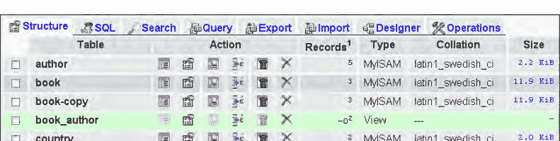

在左侧面板中，book_author 视图旁边有一个不同的图标，表示它不是普通表。在右侧面板中，我们看到新创建视图的信息。视图的记录数目前显示为 0（本章后面的性能提示部分会详细介绍），Type 列中显示为 View。视图没有关联的排序规则或大小。

此创建步骤是手动完成的。视图上的其他操作由 phpMyAdmin 界面处理。

## 右侧面板和视图

由于视图与表具有某些相似性，其名称可在导航面板中与普通表名称一起使用。点击视图名称后，会显示一个类似于表的面板，但菜单选项卡比普通表少。事实上，某些操作对视图来说没有意义——例如，Import。这是因为视图实际上不包含数据。然而，其他操作，如 Browse，则完全可以接受。

让我们浏览此视图：

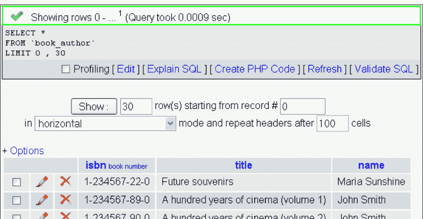

我们注意到，在生成的 SQL 查询中，看不到我们原始的 CREATE VIEW 语句。原因是我们使用 SELECT 语句从视图中选择，隐藏了我们是从视图中提取数据的事实。然而，导出视图的结构将显示 MySQL 内部如何存储我们的视图。

```
CREATE ALGORITHM=UNDEFINED DEFINER=`marc`@`%` SQL SECURITY DEFINER VIEW `book_author` AS select `book`.`isbn` AS `isbn`, `book`.`title` AS `title`, `author`.`name` AS `name` from (`book` left join `author` on((`book`.`author_id` = `author`.`id`)));
```

右侧面板的菜单可能看起来与表相似。然而，在必要时，phpMyAdmin 会生成处理视图的适当语法。例如，点击 **Drop** 将会产生：

**是否真的要：DROP VIEW 'book_author'**

此时，我们可以确认（或不确认）此视图的删除。

> 要对现有视图执行操作，用户需要在视图级别具有适当的权限，但不一定需要在该视图涉及的表上具有任何权限。这就是我们实现列和表隐藏的方式。

## 从结果创建视图

创建复杂视图可能需要在查询框中输入完整的语句。另一种可能性是利用 phpMyAdmin 的 **Search**（表级）或 **Query**（数据库级）功能构建一个相当复杂的查询，执行它，然后轻松地从结果创建视图。我们将看到这是如何完成的。

我们提到视图可用于限制列（事实上是表）的可见性。假设书籍的页数是高度机密信息。我们打开 book 表，点击 **Search**，并选择列的子集：

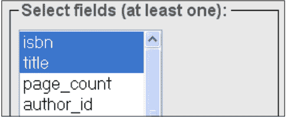

点击 **Go** 会生成结果页面，其中在 **Query results operations** 部分可以看到 **CREATE VIEW** 链接。我们使用此链接访问视图创建面板，其中 **AS** 框中已包含底层查询。我们需要为此视图选择一个名称（此处为 **book_public_info**），并且可以为其可选地设置不同的列名（此处为 **number, title**）。其他选项可以影响视图的行为，已在 MySQL 手册中解释（http://dev.mysql.com/doc/refman/5.1/en/create-view.html）。

点击 Go 会生成我们请求的视图。

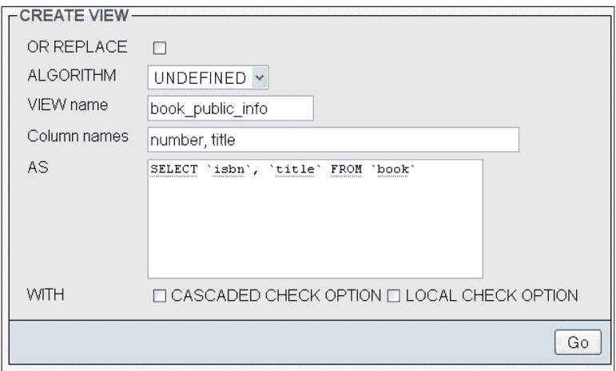

CHECK OPTION 子句会影响可更新视图的行为（这在前面引用的 MySQL 手册页面中有解释）。

## 重命名视图

phpMyAdmin 不支持直接从界面重命名视图。然而，自 MySQL 5.0.14 起，只要我们在同一数据库内重命名，就允许使用 RENAME TABLE 语句（从 phpMyAdmin 的查询框）。例如，RENAME TABLE book_public_info TO book_public_info2。

## 性能提示

phpMyAdmin 有一个配置参数 $cfg['MaxExactCountViews']，它控制 phpMyAdmin 的行计数阶段。有时，视图包含许多巨大的表，浏览它会使大量虚拟行出现。因此，该参数的默认值 0 确保视图不会进行行计数。在这种情况下，浏览视图时我们会看到相当奇怪的结果：Showing rows 0 -1 (0 total, Query took 0.0006 sec)。但这比减慢服务器速度更可接受。

尽管如此，如果我们希望看到视图的更精确行数，我们可以在该参数中放置一个更大的值，该值充当行计数阶段的上限。

## 过程—存储过程和函数

在 phpMyAdmin 开始包含这些功能支持之前花了一些时间。原因在于存储过程和函数是代码块（如子程序），作为数据库的一部分保存，而 phpMyAdmin 作为 Web 界面，更偏向于使用鼠标快速完成的操作。

尽管如此，phpMyAdmin 提供了一些功能，允许开发人员创建此类例程，保存它们，召回它们以进行一些修改，然后删除它们。

过程通过 CALL 语句访问，我们可以向其传递参数。另一方面，函数从 SQL 语句（例如 SELECT）访问，类似于返回值的其他 MySQL 内部函数。

> 需要 CREATE ROUTINE 和 ALTER ROUTINE 权限才能创建、查看和删除存储过程或函数。需要 EXECUTE 权限来运行例程，尽管该权限通常会自动授予其创建者。

## 创建存储过程

我们将创建一个过程，通过添加特定数量的页数来更改特定书籍的页数。该书籍的 ISBN 和要添加的页数将是此过程的输入参数。

## 更改分隔符

标准 SQL 分隔符是分号，并且该字符将在我们的过程中用于分隔 SQL 语句。然而，CREATE PROCEDURE 语句本身就是一条 SQL 语句；因此，我们必须想出一种方法来指示 MySQL 解析器该语句在哪里结束。查询框有一个 Delimiter 输入框，默认包含分号。因此，我们将其更改为另一个字符串，按惯例是双斜杠 //。

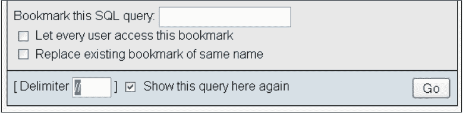

## 输入过程

然后我们在主查询框中输入过程的代码：

```
CREATE PROCEDURE `add_page`(IN param_isbn VARCHAR(25), IN param_pages INT, OUT param_message VARCHAR(100))
BEGIN
  IF param_pages > 100 THEN
    SET param_message = 'the number of pages is too big';
  ELSE
    UPDATE book SET page_count = page_count + param_pages WHERE isbn=param_isbn;
    SET param_message = 'success';
  END IF;
END
//
```

点击 Go 后，如果语法正确，我们会收到成功消息。如果不是，嗯，是时候重新检查我们的打字能力或调试语法了。不幸的是，MySQL 不带过程调试器。

## 测试过程

再次在查询框中，我们通过输入以下语句来测试我们的过程。这里，我们使用 SQL 变量 @message，它将接收 OUT 参数 param_message 的内容：

```
call add_page('1-234567-22-0', 4, @message);
SELECT @message;
```

然后我们可以验证该书籍的页数是否已增加。我们还需要测试有问题的案例：

```
call add_page('1-234567-22-0', 101, @message);
SELECT @message;
```

此过程现在可使用 mysqli 扩展从 PHP 调用。


## 操作

存储过程存储在数据库内部，并且不绑定到特定的表。因此，操作存储过程和函数的界面可以在数据库级别的“结构”页面下的“例程”滑块中找到。

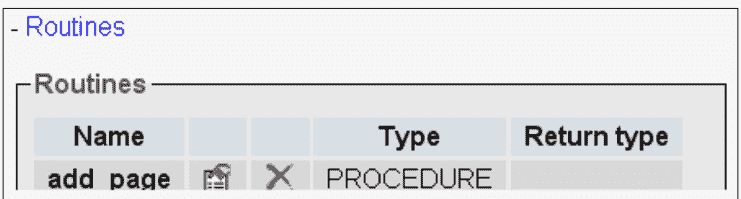

第一个图标会将该存储过程的文本调入查询框进行编辑。第二个图标用于删除该存储过程。编辑存储过程时，我们注意到文本已被部分修改。

```
DROP PROCEDURE `add_page` //
CREATE DEFINER=`marc`@`%` PROCEDURE `add_page`(IN param_isbn VARCHAR(25), IN param_pages INT, OUT param_message VARCHAR(100))
BEGIN
  IF param_pages > 100 THEN
    SET param_message = 'the number of pages is too big';
  ELSE
    UPDATE book SET page_count = page_count + param_pages WHERE isbn=param_isbn;
    SET param_message = 'success';
  END IF;
END
```

首先出现了 DROP PROCEDURE。这很正常，因为 MySQL 没有提供可以修改存储过程体的语句。因此，每次想要更改存储过程时都必须先删除它。确实存在 ALTER PROCEDURE 语句，但它只能更改存储过程的特性——例如添加注释。然后显示了 DEFINER 子句。它是在创建时生成的，表示创建该存储过程的用户。

此时，我们对代码进行必要的修改，然后点击 Go 保存该存储过程。


> 可能很诱人打开 book 表的结构页面并查找操作该表的存储过程列表，例如我们的 add_page() 存储过程。然而，所有存储过程都存储在数据库级别，代码本身（UPDATE book）与存储过程的存储位置之间没有直接链接。

## 手动创建函数

函数与存储过程类似。然而，函数只能返回一个值，而存储过程可以有多个 OUT 参数。另一方面，在 SELECT 语句中使用存储函数似乎更自然，因为它避免了使用中间 SQL 变量来保存 OUT 参数值的需要。

函数的目的是什么？例如，函数可用于计算订单的总成本，包括税费和运费。将此逻辑放在数据库内部而不是应用层，有助于记录应用-数据库接口。它还避免了在每个需要处理此逻辑的应用中重复业务逻辑。

我们不应将 MySQL 5.0 的函数与 UDF（用户定义函数）混淆，后者在 MySQL 5.0 之前就已存在。UDF 由用 C 或 C++ 编写的代码构成，编译为共享对象，并通过 CREATE FUNCTION 语句和 SONAME 关键字引用。

phpMyAdmin 对函数的处理在许多方面与我们之前介绍的存储过程类似：

- 用于输入函数的查询框
- 使用分隔符
- 操作已定义函数的机制

让我们定义一个根据代码检索国家名称的函数。我更喜欢使用 param_ 前缀来明确标识函数定义中的参数，并使用 var_ 前缀表示局部变量。我们将使用可靠的 SQL 查询框输入函数的代码，同样指示该框使用 // 作为分隔符。

```
CREATE FUNCTION get_country_name(param_country_code CHAR(2))
  RETURNS VARCHAR(50)
BEGIN
  DECLARE var_country_name VARCHAR(50) DEFAULT 'not found';
  SELECT description
    INTO var_country_name
    FROM country
    WHERE code = param_country_code;
    RETURN var_country_name;
END
//
```

我们应注意，我们新建的函数可以在数据库的结构页面上看到，与其朋友 add_page 存储过程一起：

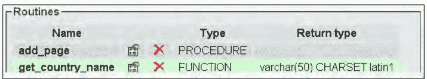

## 测试函数

测试该函数：

```sql
SELECT CONCAT('ca->', get_country_name('ca'), ', zz->', get_country_name('zz')) as test;
```

我们得到的结果：

ca->Canada, zz->not found

## 导出存储过程和函数

导出数据库时，存储过程和函数默认不会出现在 SQL 导出中。在导出页面的结构对话框中，存在一个复选框“Add CREATE PROCEDURE / FUNCTION / EVENT”，用于将它们包含在 SQL 导出文件中。如果我们尝试，就会得到：

```sql
DELIMITER $$
--
-- Procedures
--
CREATE DEFINER=`marc`@`%` PROCEDURE `add_page`(IN param_isbn VARCHAR(25), IN param_pages INT, OUT param_message VARCHAR(100))
BEGIN
  IF param_pages > 100 THEN
    SET param_message = 'the number of pages is too big';
  ELSE
    UPDATE book SET page_count = page_count + param_pages WHERE isbn=param_isbn;
    SET param_message = 'success';
END IF;
END$$
--
-- Functions
--
CREATE DEFINER=`marc`@`%` FUNCTION `get_country_name`
(param_country_code CHAR(2)) RETURNS varchar(50) CHARSET latin1
BEGIN
  DECLARE var_country_name VARCHAR(50) DEFAULT 'not found';
  SELECT description into var_country_name FROM country WHERE code = param_country_code;
  RETURN var_country_name;
END$$

DELIMITER ;
```

## 触发器

触发器是我们关联到表上的代码，在某些操作发生时执行——例如在 book 表中进行新的 INSERT 之后。该操作不需要在 phpMyAdmin 内部发生。

与与整个数据库相关的且在数据库结构页面可见的例程相反，每个表的触发器都从该特定表的结构页面访问。

> 在 MySQL 5.1.6 之前，我们需要 SUPER 权限来创建和删除触发器。在 5.1.6 版本中，TRIGGER 表级权限被添加到权限系统中。因此，用户不再需要强大的 SUPER 权限来执行这些任务。

为了执行以下练习，我们需要在 author 表中添加一个新 INT 列——total_page_count。

这里的想法是，每次创建新书时，其页数将被加到作者的总页数中。我知道有些人可能会主张在这里不保留单独的总计列，而是在需要时每次都计算总计。事实上，在现实世界中处理这种情况时必须做出设计决策。我们是否需要非常快速地检索总页数，例如用于网页目的？而从包含数千行的生产表中计算该值的响应时间是多少？无论如何，由于我需要它作为示例，这里做出设计决策很容易。

不要忘记，在将其添加到表结构之后，total_page_count 列应最初用正确的总数进行初始化。（然而，这不是我们触发器的目的。）

## 手动创建触发器

当前 phpMyAdmin 版本没有触发器创建的界面。因此，我们在查询框中输入触发器定义，特别注意在分隔符框中输入 //：

```
CREATE TRIGGER after_book_insert AFTER INSERT ON book
FOR EACH ROW
BEGIN
  UPDATE author
    SET total_page_count = total_page_count + NEW.page_count
    WHERE id = NEW.author_id;
END
```

之后，我们的 book 表的结构页面在“详细信息”滑块下显示一个新的“触发器”部分，可像例程一样使用，以编辑或删除触发器：

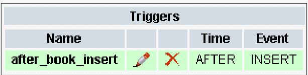

## 测试触发器

与测试存储过程或函数相反，没有 CALL 序列，也没有 SELECT 语句中的函数来执行触发器。只要定义的 operation（book INSERT）发生，代码就会执行（在我们的例子中，在插入之后）。因此，我们只需插入一本新书即可看到 author.total_page_count 列已更新。

当然，对该列进行完全自动管理将涉及在 book 表上创建 AFTER UPDATE 和 AFTER DELETE 触发器。


## 信息架构

在 SQL:2003 标准中，对数据字典（或数据库元数据）的访问由一个名为 information_schema 的结构提供。由于这是标准的一部分，并且已存在于其他数据库系统中，将此功能实现到 MySQL 中的决定是非常好的。

> MySQL 添加了一些标准中没有的信息——例如，INFORMATION_SCHEMA.COLUMNS.COLUMN_TYPE。请注意，如果您计划在软件项目中使用此信息，它必须保持对其他 SQL 实现的可移植性。

phpMyAdmin 用户将 information_schema 看作是一个普通的数据库，其中包含视图，用于描述托管在此服务器上的数据库结构的许多方面。以下是可以看到的一个子集（事实上，对此数据库的唯一可能操作是 SELECT）。

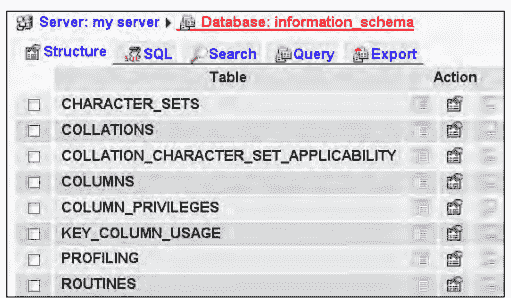

在内部，phpMyAdmin 在检索元数据时，对其某些操作调用 information_schema 而不是相应的 SHOW 语句。然而，phpMyAdmin 开发者注意到——并且在 2007 年 MySQL 用户大会上其他开发者也证实了这一点——当服务器托管数百个数据库或表时，涉及 information_schema 上 WHERE 子句的一些 SELECT 操作非常缓慢（等待时间长达数分钟）。因此，在 MySQL 的当前状态下，在我们的编程项目中使用此功能时必须谨慎。

$cfg['Servers'][$i]['hide_db'] 参数可用于将此“数据库”隐藏给可能会因突然出现一个自己一无所知的数据库而感到困惑的用户。这可能取决于他们在 MySQL 方面的专业水平。在 phpMyAdmin 的多用户安装中，我们无法让每个人都满意此参数的值。

## 性能分析

在 MySQL 5.0.37 和 5.1.28 版本中添加了分析支持。我们之前看到分析复选框出现在查询结果中。

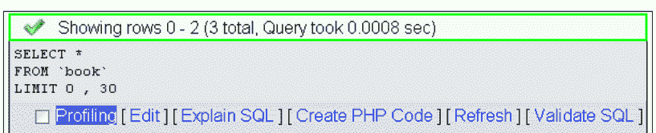

当此框被选中时，phpMyAdmin 将分析每个查询（包括当前查询），并显示每个 MySQL 内部操作的执行时间报告。

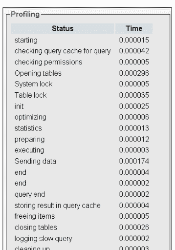

尽管分析系统可以报告有关操作的额外信息（例如，CPU 时间，甚至内部服务器的函数名称），phpMyAdmin 目前仅显示操作的名称及其持续时间。

## 分区

用户定义的分区（http://dev.mysql.com/doc/refman/5.1/en/partitioning.html）在 MySQL 5.1 中提供。在 phpMyAdmin 中使用此功能需要了解其语法，因为有许多分区类型。此外，对于每种分区类型，分区的数量和与每个分区关联的值过于随机，无法在 Web 界面上轻松表示。

## 表创建

让我们通过创建一个名为 test 的表来尝试一下，该表包含一个字段。在表创建面板上，如果连接到 MySQL 5.1 服务器，phpMyAdmin 会显示一个 PARTITION 定义对话框：

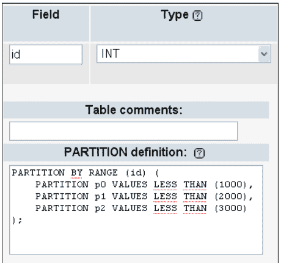

在这里，我们输入一个 PARTITION BY RANGE 子句，它将在 id 列上创建分区。

## 操作

对于已定义分区的表，Operations 子页面显示一个分区维护对话框，我们可以在其中：

- 选择一个分区然后要求对其执行诸如 Rebuild 之类的操作
- 删除所有分区

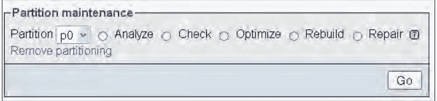

## 导出

最后，以 SQL 模式导出此 test 表会产生带有嵌入注释的语句，MySQL 5.1 服务器会识别并解释这些语句以重新创建相同的分区。

```
CREATE TABLE `test` (
  `id` int(11) NOT NULL
) ENGINE=MyISAM DEFAULT CHARSET=latin1
/*!50100 PARTITION BY RANGE (id)
(PARTITION p0 VALUES LESS THAN (1000) ENGINE = MyISAM,
 PARTITION p1 VALUES LESS THAN (2000) ENGINE = MyISAM,
 PARTITION p2 VALUES LESS THAN (3000) ENGINE = MyISAM) */;
```

## 事件调度器

事件调度器（http://dev.mysql.com/doc/refman/5.1/en/events.html），MySQL 5.1 的另一个新功能，允许创建将根据计划自动运行的任务。计划非常灵活，例如，可以让一个语句从 2011 年 5 月 18 日午夜开始每十秒运行一次。这些可以是一次性事件或循环事件。

## 激活调度器

我们应该首先验证调度器是否在我们的服务器上处于活动状态。如果不是，我们需要激活它。否则，什么都不会发生！我们首先在查询框中输入以下语句：

```
SHOW VARIABLES LIKE `event%`;
```

接下来，我们查找名为 event_scheduler 的变量。如果此变量设置为 OFF，我们需要要求系统管理员（或拥有 SUPER 权限的人）执行以下语句：

```
SET GLOBAL event_scheduler = ON;
```

## 授予 EVENT 权限

每个想要创建或删除事件的用户都需要 EVENT 权限，要么是全局的，要么是在他/她计划添加事件的数据库上。请参阅第 18 章，了解授予此类权限的详细信息。

## 创建事件

当前的 3.1.x phpMyAdmin 版本没有用于选择 CREATE EVENT 语句各个部分的 Web 界面。因此，唯一剩下的方法是使用 SQL 查询框输入语句并了解其语法！这里，我们将使用一个完全虚构的示例：

```
CREATE EVENT add_page_count
    ON SCHEDULE
        EVERY 1 MINUTE
    DO
        UPDATE author set total_page_count = total_page_count + 1 WHERE id = 1;
```

现在，您可以通过不时浏览 author 表来获得一些乐趣，并看到 author 1 的计数器在递增。

## 事件操作

事件与一个数据库相关，这就是为什么您会在 marc_book 数据库的结构页面上看到一个 Events 滑块。激活它会显示此面板：


事实上，这是一个循环事件。我们可以使用第一个图标来编辑事件（这将具有删除并重新创建事件的效果），并使用 X 图标将其删除。

## 导出

通过在 Add CREATE PROCEDURE/ FUNCTION / EVENT 选项旁边打勾，可以在 SQL 数据库导出的末尾生成与事件相关的语句。请记住，一些事件可能有结束时间；因此，它们可能在您创建它们和您尝试导出之间已经消失！

## BLOB 流式传输

从 3.1.0 版本开始，phpMyAdmin 支持 MySQL 的可扩展 BLOB 流式传输基础设施。http://blobstreaming.org 网站解释了该项目的目标。请注意，其某些文档涉及命令行实用程序，这些实用程序在 phpMyAdmin 等 Web 界面的上下文中几乎没有或没有用处。在继续阅读之前，您应该熟悉 BLOB 流式传输术语，例如存储库和字段引用。

在本节中，我们将使用此技术上传一部电影并在 phpMyAdmin 中从流式传输中观看它。

## 系统要求

phpMyAdmin 中所选的实现方法依赖于以下所有组件：

- MySQL 5.1
- PBXT（PrimeBase XT 存储引擎）
- PBMS（PrimeBase Media Streaming）

PBXT 是一个支持流式传输的存储引擎。虽然通过 PBMS UDF 支持其他非流式传输存储引擎，但此机制未在 phpMyAdmin 中实现。

所需组件的存在可以从 phpMyAdmin 的主页上通过单击 Engines 链接并查找以下行来验证：

```
PBXT / High performance, multi-versioning transactional engine
PBMS / The Media Stream engine for MySQL
```

如果这些行不存在，请按照 http://www.primebase.org 上的说明安装 PBXT，或按照 BLOB Streaming 网站上的说明安装 PBMS。

> 您不会在表的 **Operations** 子页面存储引擎选择中看到 PBMS。PBMS 不是可以与表结构关联的存储引擎。

## 配置

一些 PBMS 系统变量会影响 BLOB 流式传输行为，可以在 `config.inc.php` 中定义。有关它们的更多详细信息请参阅 http://blobstreaming.org/documentation/#sysvar。要放入服务器定义中的推荐值是：

```
$cfg['Servers'][$i]['bs_garbage_threshold'] = 50;
$cfg['Servers'][$i]['bs_repository_threshold'] = '32M';
$cfg['Servers'][$i]['bs_temp_blob_timeout'] = 600;
$cfg['Servers'][$i]['bs_temp_log_threshold'] = '32M';
```

## phpMyAdmin 中的实现限制

在当前的 3.1.1 版本的 phpMyAdmin 中，使用 BLOB 流式传输存在一些限制。第一个限制与 MySQL 服务器有关。在刚刚启动的服务器上，全局 MySQL 变量 `pbms_field_references` 可能设置为 **off**。由于字段引用在 BLOB 引用中被广泛使用，phpMyAdmin 尝试将参数设置为 on，而这只能由拥有 SUPER 权限的用户完成。因此，此类用户必须通过 phpMyAdmin 登录一次以将此参数设置为适当的值，并且每次 MySQL 服务器重新启动时都必须重复此操作。

第二个限制与用于将数据发送到 BLOB 存储库的上传机制有关。数据必须首先从工作站传输到 Web 服务器，然后从 Web 服务器传输到 MySQL 服务器。第一次传输通过正常的 HTTP 上传进行。请参阅第 8 章 *导入结构和数据* 中的 *传输限制* 部分，了解有关上传要求的更多详细信息。为了避免被此限制阻碍，您可以使用 Web 服务器上传目录（也在第 8 章中描述）。

> 这里需要说明一个关于主机名的重要注意事项：在 `config.inc.php` 中，您服务器名称在 `$cfg['Servers'][$i]['host']` 中应为 **FQDN（完全限定域名）**。它不应该是诸如“localhost”之类的名称；否则，用于检索流式传输数据的链接将无法工作。


## 创建 PBMS 系统表

如果所有要求都已满足，我们可以进入 Operations 子页面中的 marc_book 数据库。我们应该会看到一个 BLOB Repository 对话框、一个 Status: Disabled 消息以及一个 Enable 按钮。我们现在需要点击 Enable 来在此数据库内部创建 PBMS 系统表。PBMS 需要两个系统表（pbms_repository 和 pbms_reference），以及另一个（pbms_custom_content_type）用于 phpMyAdmin 的内部需求。

创建后，我们会在同一页面看到 Status: Enabled，但看不到新创建的系统表。通常，这些表在 phpMyAdmin 内部保持不可见，因为用户不应直接操作它们。

我们还看到一个 Disable 按钮。点击它会显示一个警告：

> 你即将禁用一个 BLOB Repository！你确定要禁用数据库 marc_book 的所有 BLOB 引用吗？

确认此警告消息会使 PBMS 忘记此数据库中的所有 BLOB 引用，这最终会删除从此数据库引用的所有 BLOB 流数据（如果该数据没有来自其他数据库的其他引用）。

## 表准备

对于本次练习，我们将使用 book.cover_photo 列，并使用 LONGBLOB 来保存 BLOB 引用（请记住，流数据本身位于 BLOB 仓库中，而 LONGBLOB 列仅用于包含引用）。我们确保 book 表使用 PBXT 存储引擎，如果不是这样，我们只需转到该表的 Operations 并更改引擎，如第 10 章所述。

> 目前，使用 LONGBLOB 作为 BLOB 引用是 PBXT 的要求。

## 上传到 BLOB 仓库

我们终于准备好尝试第一次向仓库上传。在 book 表中，我们访问 Insert 面板（或编辑现有行）。注意 cover_photo 列对话框中的新的 Upload to BLOB repository 选项：

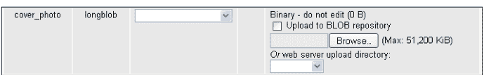

有人可能会问为什么会显示这个新选项。毕竟，我们不是想上传到 BLOB 仓库吗？也许！但由于此 LONGBLOB 列也可能保存常规数据，因此存在两种可能性：

- 点击 **Upload to BLOB repository** 选项，然后浏览文件或在 Web 服务器上传目录中选择一个文件。这将把文件发送到仓库以便稍后流式传输。
- 不点击该选项，从而将数据直接发送到此列（不用于稍后流式传输）。

显然，我们选择第一个选项并上传我们喜欢的电影（我们可以先尝试一个较短的）。如果上传成功，我们会看到类似以下的查询：

```
UPDATE `marc_book`.`book`
SET `cover_photo` = '~*marc_book/~1-150-15591197-0*3907219'
WHERE `book`.`isbn` = '1-234567-22-0' LIMIT 1;
```

这里，cover_photo 被更新为 BLOB 引用，由 PBMS 存储引擎生成的一个数字。

## 从仓库流式传输数据

当浏览我们的表并查看我们已向 BLOB 仓库上传的行时，我们会在 cover_photo 列下，根据数据格式，看到以下其中一条消息：

- View image
- Play audio
- View video
- Download file

点击显示的消息会直接从服务器的 8080 端口向浏览器流式传输，并发送适当的 MIME 类型以告知浏览器应期望的格式。

我们还看到已上传数据的 MIME 类型（此处为 video/mp4）。

|  |  |  | 1-234567-22-0 | Future souvenirs | 200 | 2 | en |  | video/mp4 (Download file) |
|---|---|---|---|---|---|---|---|---|---|
| □ |  | X | 1-234567-22-0 | Future souvenirs | 200 | 2 | en |  | video/mp4 (Download file) |

## 更改仓库数据

如果上传数据的 MIME 类型未被正确解释，可以通过点击此链接并输入正确的类型来修改它。请注意，此功能在 3.1.1 版本中仍在开发中。

最后，在编辑此行时，我们会看到 **Remove BLOB Repository Reference** 选项。在此选项上打勾并保存行会告诉 PBMS 引擎忘记此引用，最终从仓库中消除 BLOB 数据。

## 摘要

MySQL 5.0 的新功能帮助产品符合标准。尽管 phpMyAdmin 对这些功能的支持有限（尤其是缺乏面向语法的编辑器），但它提供了一组基本功能来处理视图、例程、触发器和 information_schema，并显示分析信息。phpMyAdmin 还支持 MySQL 5.1 分区和事件、PBXT 存储引擎以及 BLOB 流式传输。下一章介绍 MySQL 服务器的管理员，重点是用户账户和权限的管理。
