# 18 MySQL 服务器管理

## MySQL 服务器管理

本章将讨论系统管理员如何使用 phpMyAdmin 服务器管理功能进行日常用户账户维护、服务器验证和服务器保护。非管理员也可以从 phpMyAdmin 获取服务器信息。

服务器管理主要是通过 Server 视图进行的，可通过 phpMyAdmin 主页上的菜单标签访问。

## 用户和权限管理

**Privileges** 子页面（仅在以特权用户登录时可见）包含用于管理 MySQL 用户账户的对话框。它还包含用于在全局、数据库和表级别管理权限的对话框。此子页面是分层的。例如，在编辑用户的权限时，我们可以看到全局权限以及数据库特定的权限。然后我们可以深入查看此数据库-用户组合的表特定权限。

## 用户概览

进入 **Privileges** 子页面时显示的第一个页面称为 **User overview**。它显示所有用户账户及其全局权限的摘要，如下图所示：

## MySQL 服务器管理

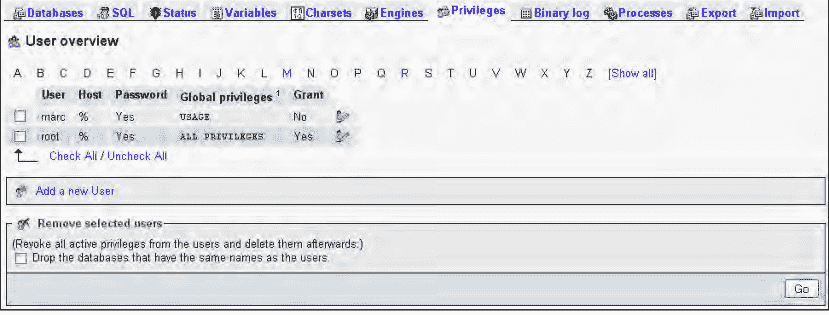

从此页面，我们可以：

- 使用用户行上的 **Edit** 链接编辑用户的权限
- 使用复选框通过 **Remove selected users** 对话框删除用户
- 访问提供 **Add a new User** 对话框的页面

显示的用户列表具有以下特征的列：

- **User**：我们正在定义的用户账户。
- **Host**：此用户账户将连接到 MySQL 服务器的机器名称或 IP 地址。此处的值为 % 表示所有主机。
- **Password**：如果定义了密码则包含 **Yes**，如果没有则包含 **No**。密码本身无法从 phpMyAdmin 界面看到，也无法通过直接查看 `mysql.user` 表看到，因为它使用单向哈希算法进行混淆。
- **Global privileges**：为每个用户列出。
- **Grant**：如果用户可以将自己的权限授予他人，则包含 **Yes**。

## 权限重载

在 User Overview 底部，显示以下消息：

> 注意：phpMyAdmin 直接从 MySQL 的权限表获取用户的权限。如果这些表的内容因手动更改而与服务器使用的权限不同，则应继续之前重新加载权限。

这里，**reload the privileges** 可以点击。有效的权限（服务器基于其进行访问决策的权限）是位于服务器内存中的权限。从 **User overview** 页面进行的权限修改同时在内存和磁盘上的 mysql 数据库中进行。直接对 mysql 数据库所做的修改不会立即生效。**reload the privileges** 操作从数据库读取权限并使其在内存中生效。

## 添加用户

**Add a new User** 链接会打开一个用于创建用户账户的对话框。首先，我们看到描述账户本身的面板。

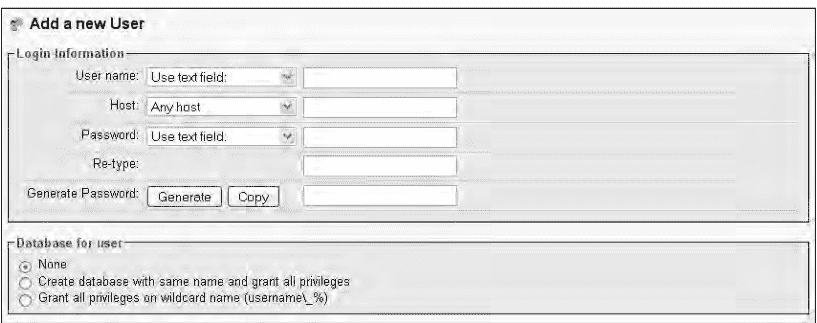

**Add a new User** 对话框的第二部分是指定此用户的全局权限的位置，这些权限适用于整个服务器（参见 *Global privileges* 部分）。

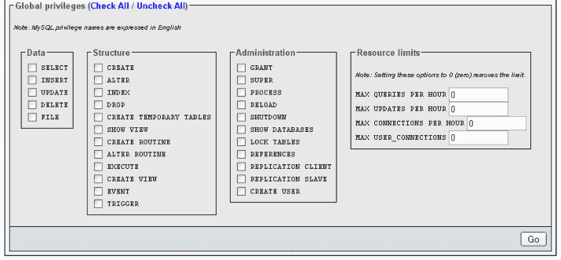


## 用户名

用户名菜单提供两个选项。我们可以选择“使用文本字段”并在框中输入用户名，或选择“任意用户”来创建匿名用户（空白用户）。让我们选择“使用文本字段”并输入 bill。

## 主机

默认情况下，此菜单设置为“任意主机”，主机值为 %。 “本地”选项表示“localhost”。 “使用主机表”选项（会在主机字段中创建空白值）表示在 mysql.hosts 表中查找数据库特定权限。选择“使用文本字段”允许我们输入想要的确切主机值。让我们选择“本地”。

## 密码

即使可以不使用密码创建用户（使用“无密码”选项），最好还是设置密码。我们必须输入两次（因为看不到输入内容）以确认预期的密码。让我们输入 bingo。

一些管理员更喜欢通过让 phpMyAdmin 自己生成密码来提高安全性。在“生成密码”对话框中，点击“生成”会在屏幕上显示一个随机密码（明文）。此时，我们应记下密码以便转交给用户。然后点击“复制”会将此密码填入“密码”和“重新输入”字段。

## 数据库创建和权限

一种常见惯例是为用户分配与其同名的数据库的权限。为此，“用户数据库”部分提供复选框“创建与名称相同的数据库并授予所有权限”。点击此复选框可自动完成流程，同时创建数据库和相应的权限。请注意，使用此方法，每个用户将仅限于一个数据库（用户 bill，数据库 bill）。

另一种可能性是允许用户创建与用户名具有相同前缀的数据库。因此，另一个选项“在通配符名称上授予所有权限（username\_%）”通过分配通配符权限来实现此功能。这样设置后，用户 bill 就可以创建数据库 bill_test、bill_2、bill_payroll 等；phpMyAdmin 在此情况下不会预先创建数据库。

## 全局权限

全局权限决定用户对所有数据库的访问权限。因此，这些权限有时被称为“超级用户权限”。除非有充分理由，否则普通用户不应拥有这些权限中的任何一个。

当然，如果我们确实要创建超级用户，我们将选择他/她需要的每个全局权限。这些权限进一步分为 **Data**、**Structure** 和 **Administration** 组。

在我们的示例中，**bill** 不会有任何全局权限。

## 资源限制

我们可以限制该用户在此服务器上使用的资源（例如，每小时最大查询数）。零表示无限制。我们不会对 **bill**   imposing 任何资源限制。

以下屏幕截图显示了屏幕的状态，就在点击 **Go** 创建此用户定义之前（剩余字段设置为默认值）：

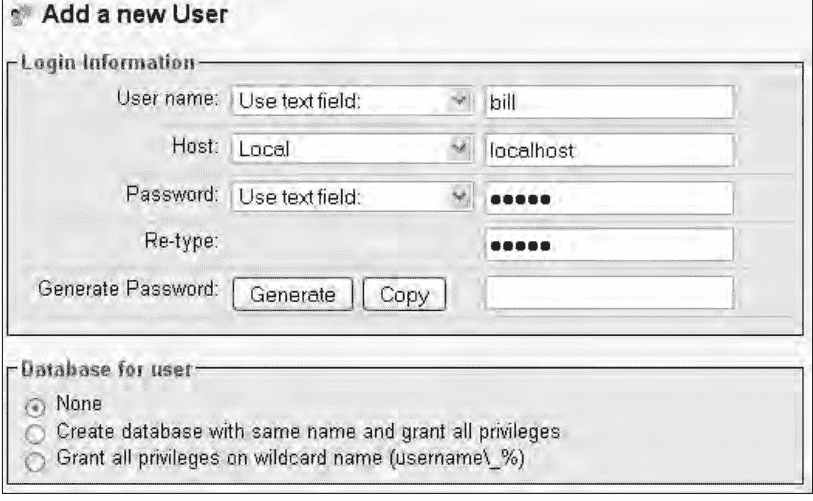

## 编辑用户

编辑用户的页面在用户创建后出现，或在用户概览页面中点击某个用户的“编辑”时出现。此页面上有四个部分，每个部分都有自己的 Go 按钮。因此，每个部分独立操作，具有不同的用途。

## 编辑权限

编辑用户权限的部分与“添加新用户”对话框的外观相同，用于查看和更改全局权限。

## 数据库特定权限

在此部分，我们定义用户有权访问的数据库及其确切权限。

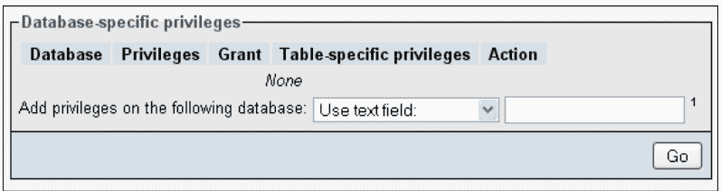

如上图所示，我们看到 None，因为我们尚未定义任何权限。定义数据库权限有两种方法。首先，我们可以从下拉菜单中选择一个现有数据库。

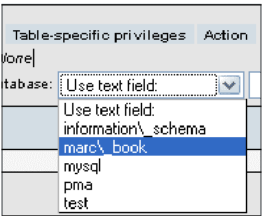

这仅为所选数据库分配权限。我们也可以选择 **Use text field** 并输入数据库名称。我们可以插入一个不存在的数据库名称，以便该用户稍后创建它（前提是在下一面板中给予他/她 CREATE 权限）。我们还可以使用特殊字符，例如下划线和百分号作为通配符。

例如，在此处输入 **bill** 将使他能够创建 **bill** 数据库，而输入 **bill%** 将使他能够创建以 **bill** 开头的任何名称的数据库。对于我们的示例，我们将输入 **bill**。

下一个屏幕用于设置 **bill** 在 **bill** 数据库上的权限并创建表特定权限。

要了解特定权限的含义，我们可以将鼠标移到权限名称上（权限名称始终为英文），当前语言中会显示有关该权限的解释。我们为 **bill** 在此数据库上授予 **SELECT, INSERT, UPDATE, DELETE, CREATE, ALTER, INDEX, and DROP** 权限。然后点击 **Go**。

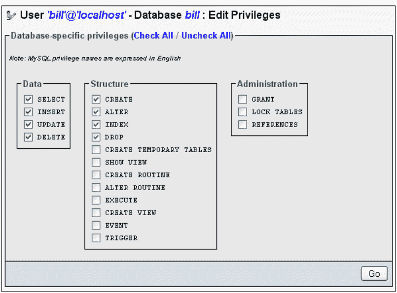

分配权限后，界面仍停留在同一位置，以便我们进一步细化这些权限。目前我们无法分配表特定权限，因为数据库尚未存在。

返回 **bill** 的常规权限页面的方法是点击 **'bill'@'localhost'** 标题。

这会带我们回到熟悉的页面，除了一个部分发生变化。

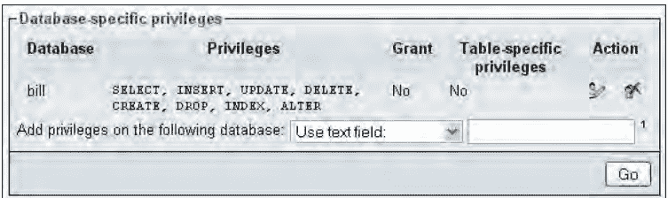

我们看到用户 **bill** 在 **bill** 数据库上的现有权限（我们可以 **Edit** 或 **Revoke**），并且可以为 **bill** 在另一个数据库上添加权限。我们还看到 **bill** 在 **bill** 数据库上没有表特定权限。

## 更改密码

此对话框是 **Edit user** 页面的组成部分，我们可以使用它来更改 **bill** 的密码或删除它。删除密码将使 **bill** 能够无需密码登录。

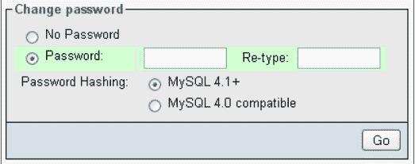

## 更改登录信息或复制用户

此对话框可用于更改用户的登录信息，或将他的/她的登录信息复制到新用户。例如，假设 Bill 打电话告诉我们，他更喜欢登录名 **billy** 而不是 **bill**。我们只需在用户名后添加 y，选择 **Local** 作为主机，并选择 **delete the old one from the user tables**。

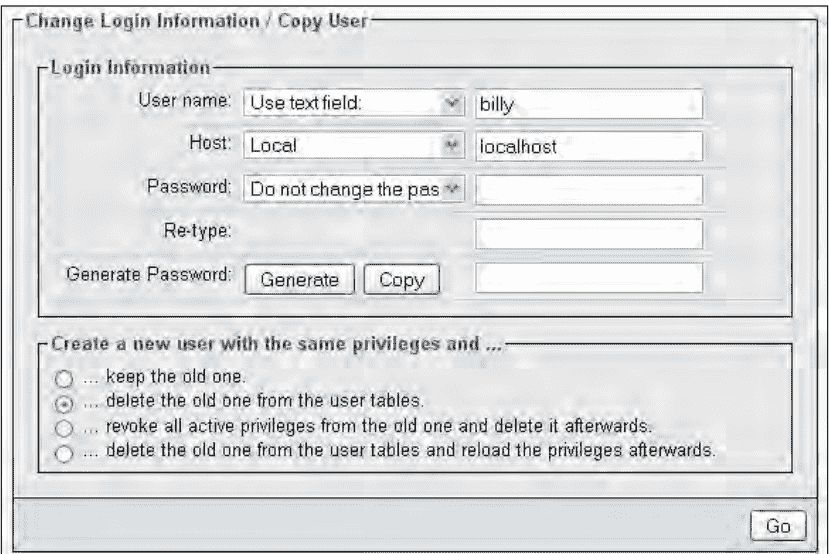

此操作后，bill 在 mysql 数据库中不再存在。此外，他的所有权限，包括对 bill 数据库的权限，都将被转移到新用户 billy。但 bill 的用户定义仍存在于内存中，因此仍然有效。如果我们改为选择 delete the old one from the user tables and reload the privileges afterwards 选项，bill 的用户定义将立即失效。

或者，我们也可以基于 bill 创建另一个用户，使用 keep the old one 选项。我们可以通过选择 Do not change the password 将密码转移到新用户，或通过输入两次新密码来更改它。revoke all active privileges... 选项会立即终止该用户如果已登录时的有效当前权限。

## 删除用户

这是在权限页面的用户概览部分完成的。我们选择要删除的用户。然后（在 Removing selected users 中）我们可以选择 Drop，以删除与我们正在删除的用户同名的任何数据库。点击 Go 会有效地删除所选用户。

## 数据库信息

数据库子页面旨在快速获取每个数据库的权限信息。可选地，它还可用于在无需点击导航面板中每个数据库的情况下获取这些数据库的全局统计信息。当我们进入数据库子页面时，会看到现有数据库的列表。

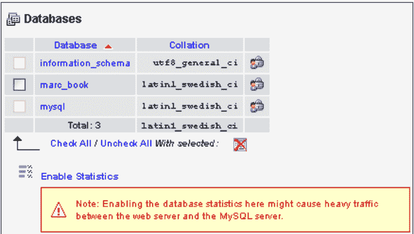

我们还看到一个 Enable Statistics 链接。默认情况下，统计信息未启用，因为计算所有数据库中所有表的大小和索引的大小可能会消耗宝贵的 MySQL 服务器资源。

## 启用统计

如果我们点击此 Enable Statistics 链接，会出现一个修改后的页面。对于每个数据库，我们会得到该数据库中表的默认排序规则，以及表数量和所有表的总行数。接下来，给出表数据部分使用的空间信息，然后是所有索引占用的空间和所有表的总空间。最后，在 Overhead 下呈现通过优化该数据库中的某些表可以收回的空间。


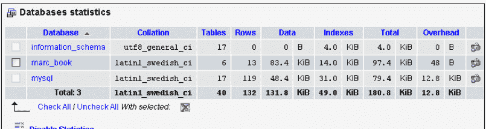

## 排序统计

默认情况下，列表按数据库名称按升序排序。如果我们需要找到表最多的数据库或占用空间最多的数据库，只需单击 Tables 或 Total 列标题即可相应地进行排序。再次单击则会反转排序顺序。

## 检查数据库权限

单击“检查权限”图标会显示特定数据库上的所有权限。用户的全局权限可能会在此处显示，因为它也赋予其访问此数据库的权限。我们还可以查看特定于此数据库的权限。“编辑”链接会带我们进入另一个页面，用于编辑用户的权限。

有权访问“marc_book”的用户

| 用户 | 主机 | 类型 | 权限 | 授权 | 操作 |
|------|------|------|------------|-------|--------|
| admin | % | global | ALL PRIVILEGES | Yes | |
| marc | % | wildcard: marc% | SELECT, INSERT, UPDATE, DELETE, CREATE, DROP | No | |
| root | % | global | ALL PRIVILEGES | Yes | |

## 删除选定的数据库

这是一项不应轻率对待的操作。要删除一个或多个数据库，我们在要删除的数据库名称旁放置复选标记，然后单击“已选择”旁边的红色 X。然后我们会看到一个确认屏幕。

## 服务器信息

状态、变量和进程菜单选项卡可用于获取有关 MySQL 服务器的信息，或对特定进程进行操作。

## 服务器状态验证

这些统计数据反映了 MySQL 服务器的总活动，包括（但不限于）phpMyAdmin 发送的查询产生的活动。

## 通用状态页面

单击“状态”链接会生成有关服务器的运行时信息。该页面包含多个部分。首先，我们会获得已用运行时间和启动时间的信息。然后我们会获得流量和连接的总数和平均值（其中 ø 表示平均值）。

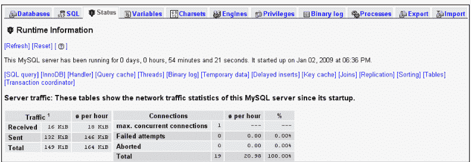

接下来，显示有关查询的统计信息（此处仅部分显示）。每小时、每分钟和每秒的平均查询数可很好地反映服务器负载。

随后是每个 MySQL 命令的统计信息，包括绝对次数、每小时平均值以及占总数的百分比。

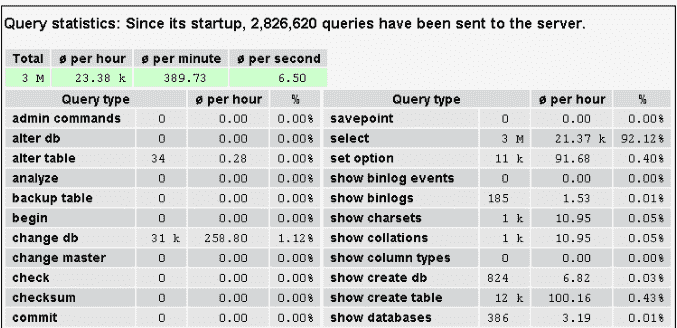

根据 MySQL 版本的不同，还会显示包含服务器信息的许多其他部分。

## InnoDB 状态

在支持 InnoDB 的服务器上，**InnoDB 部分**末尾会出现一个链接。单击该链接后，会显示有关 InnoDB 子系统 的信息，包括最近一次发生的 InnoDB 错误的信息。

```
InnoDB Status

========================================
040709 15:27:16 INNODB MONITOR OUTPUT
========================================
Per second averages calculated from the last 2 seconds
---------
SEMAPHORES
---------
OS WAIT ARRAY INFO: reservation count 3, signal count 3
Mutex spin waits 0, rounds 0, OS waits 0
RW-shared spins 6, OS waits 3; RW-excl spins 0, OS waits 0
---------
TRANSACTIONS
---------
Trx id counter 0 7424
Purge done for trx's n:o < 0 6989 undo n:o < 0 0
Total number of lock structs in row lock hash table 0
LIST OF TRANSACTIONS FOR EACH SESSION:
---TRANSACTION 0 0, not started, process no 17315, OS thread id 1158499248
MySQL thread id 115, query id 2522 localhost root
SHOW INNODB STATUS
---------
FILE I/O
---------
I/O thread 0 state: waiting for i/o request (insert buffer thread)
I/O thread 1 state: waiting for i/o request (log thread)
I/O thread 2 state: waiting for i/o request (read thread)
I/O thread 3 state: waiting for i/o request (write thread)
Pending normal aio reads: 0, aio writes: 0,
ibuf aio reads: 0, log i/o's: 0, sync i/o's: 0
Pending flushes (fsync) log: 0; buffer pool: 0
48 OS file reads, 4 OS file writes, 4 OS fsyncs
0.00 reads/s, 0 avg bytes/read, 0.00 writes/s, 0.00 fsyncs/s
```

## 服务器变量

Variables 子页面显示 MySQL 服务器的各种设置，这些设置可以在例如 my.cnf MySQL 配置文件中定义。这些值无法在 phpMyAdmin 中更改。

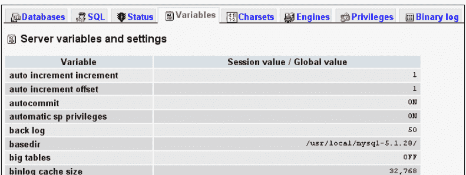

## 服务器进程

Processes 子页面可供超级用户和普通用户使用。普通用户只能看到属于他/她的进程，而超级用户可以看到所有进程。

此页面列出服务器上的所有活动进程。有 Kill 链接，允许我们终止特定进程。

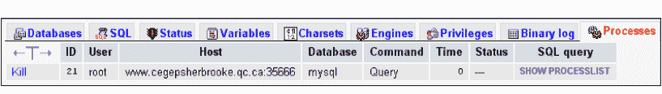

此示例中只有一个正在运行的进程——即 SHOW PROCESSLIST 命令本身创建的进程。由于我们在看到页面时该进程已不再运行，因此该进程无法被终止。通常情况下，服务器上会运行更多进程。

## 存储引擎

有关各种存储引擎的信息以两级格式提供。首先，Engines 选项卡显示当前 MySQL 版本可能使用的引擎概览。此服务器上已启用的引擎名称可点击。

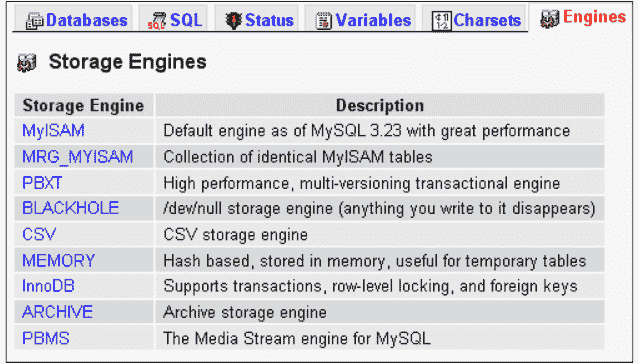

单击某个引擎名称会显示其设置的详细面板。将鼠标悬停在上标数字上会显示有关特定设置的更多信息。

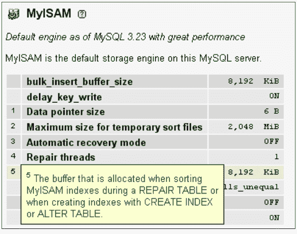

## 可用的字符集和排序规则

主页上的 **字符集** 菜单选项卡会打开 Server 视图中的 **字符集** 子页面，其中列出了 MySQL 服务器支持的字符集和排序规则。每个字符集的默认排序规则会以不同的背景颜色显示（使用 `$cfg['BrowseMarkerColor']` 中定义的行标记颜色）。

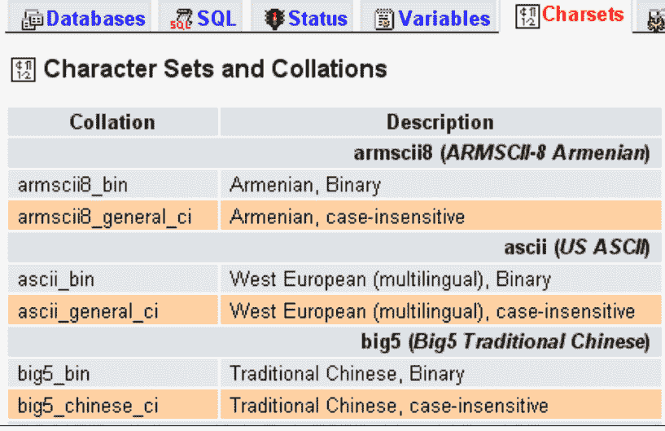

## 二进制日志

如果 MySQL 的二进制日志在我们的服务器上处于活动状态，则 Server 视图中的菜单会更改，以便出现 **二进制日志** 选项卡。此选项卡通过 `SHOW BINLOG EVENTS` 命令提供对界面的访问。此命令生成已更新我们服务器数据的 SQL 语句列表。该列表可能非常庞大，目前 phpMyAdmin 未使用分页技术限制其显示。因此，我们可能会达到浏览器的内存限制，这取决于我们使用的特定浏览器。

在以下屏幕中，我们选择要检查的二进制日志（除非服务器只有一个二进制日志），然后语句将被显示。

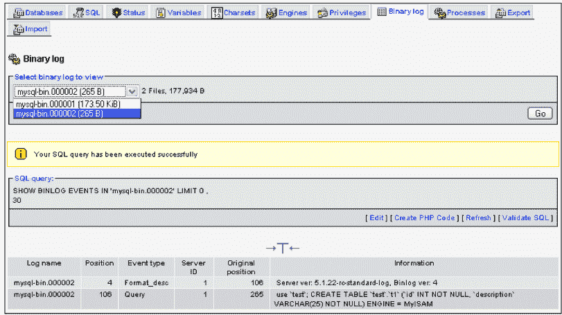

## 摘要

本章涵盖了系统管理员可用的各种功能，例如用户账户管理、权限管理、数据库权限检查和服务器状态验证。适当的 MySQL 权限系统知识对于妥善维护 MySQL 服务器至关重要，本章提出了以用户及其权限概念为中心的练习。接下来是附录 A，其中讲述了 phpMyAdmin 项目的历史。

## phpMyAdmin 历史

本附录详细介绍了 phpMyAdmin 在其十年历史中的诞生和演变。这是一款始于 1998 年的个人业余项目，该软件在功能和参与人数方面都得到了发展。作为这一增长的证明，我能找到的最早的源代码包（版本 1.1.0）占用了 9 KB，而版本 3.1.2 的大小为 3.4 MB。

## 早期事件

第一个内部版本（0.9.0）由来自瑞士的 Tobias Ratschiller 编程，日期为 1998 年 9 月 9 日。他随后于 1998 年 10 月 26 日发布了版本 1.0.1。早期版本在 Tobias 的网站 http://www.phpwizard.net 上提供（该网站已不再与其关联）。Tobias 在随附的说明中写道：


> > "这项工作基于 Peter Koppelwieser 的 MySQL-Webadmin。是他的想法使用 PHP3 创建 MySQL 的基于 Web 的界面。虽然我没有使用他的任何源代码，但有一些概念是我借鉴他的。phpMyAdmin 的创建是因为 Peter 告诉我他不会再进一步开发他的（很棒的）工具。"

与今天的版本（距原版十年后）相比，第一个版本在功能上 somewhat 有限。尽管如此，它仍可用于创建数据库和表、编辑其结构以及输入和检索数据。在下面的图中，您可以看到左侧面板已就位以列出数据库名称（尚未列出表名称），右侧面板是管理数据库或表的 workspace。这就是版本 1.3.0 中数据库界面的样子：


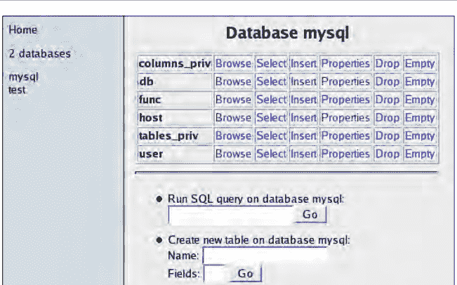

处理表格时，你会看到以下界面：

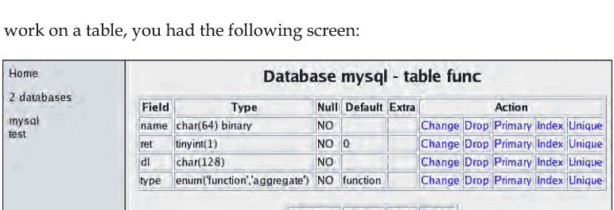

我当时使用的是 phpMyAdmin 1.2.0 版本（1998 年 11 月 29 日发布），立刻被能够使用 Web 应用维护远程数据库的想法所吸引。然而，我在加拿大魁北克省谢布鲁克学院工作的学生都是法语使用者。因此，我联系了 Tobias，提议通过将所有信息外包到一个信息文件中来改造他的源代码。他接受了提议，我创建了英语和法语的信息文件。然后，在 1998 年 12 月 27 日，Tobias 发布了 1.3.1 版本，这是第一个多语言版本。（同时，他也成功创建了德语信息文件。）

1999 年及 2000 年上半年，Tobias 改进了导航系统，添加了功能，并合并了更多语言文件。他的项目站点维护着一个讨论论坛，允许提出新想法并讨论补丁。2.1.0 版本于 2000 年 8 月 6 日发布，这是 Tobias 发布的上一个版本，他已无更多时间投入该项目。

## 项目重启

然而，用户群已经成倍增长，他们要求获得更多产品功能。补丁在互联网上流传，但没有协调方式。第三方已发布安全警报（及修复），但没有发布新版本。最后，在 2001 年 3 月 31 日，Olivier Müller 在 SourceForge.net 上注册了 phpMyAdmin 项目，并发布了 2.2.0 预发布版本。当时被称为非官方版本。这次项目重启吸引了一些开发者，他们现在有了 SourceForge 基础设施（CVS 服务器、论坛、错误跟踪器和邮件列表）来加快开发。我个人于 2001 年 5 月重新加入项目，并开始修复和改进代码，就像我的共同开发者一样。

我们于 2001 年 5 月 28 日成为官方版本，因为 Tobias 接受了我们的版本作为新的官方版本。我记得那几个月非常紧张的开发工作，每天都有改进和错误修复，以及新的文档部分。这项努力在 2001 年 8 月 31 日达到顶峰，发布了 2.2.0 版本。

以下是 2.2.0 版本公告文件中的摘录：


> “在五个月、五个 beta 版本和四个候选版本之后，phpMyAdmin 开发者很高兴地宣布 phpMyAdmin 2.2.0 可用。[...] 2001 年 3 月 31 日。Olivier Müller（瑞士）在 Marc Delisle（魁北克）、Loïc Chapeaux（法国）以及另外八名开发者的支持下，在原包维护者的授权下，在 SourceForge.net 上重启了 phpMyAdmin 项目。现在，经过五个月的补丁、错误修复、新功能和测试，2.2.0 版本终于准备就绪。”

该版本包含安全修复和七种新语言（带动态语言检测）。代码已被重构以符合 CSS2 和 XHTML 1.0，并遵循 PEAR 编码规范。书签功能出现在该版本中，这来自名为“phpMyBookmark”的独立插件。

在随后的一年里，开发继续进行，发布了七个次要版本。2.2.x 系列的最后一个版本是 2.2.7-pl1，它也是最后一个在 PHP 3 下完全测试的版本。我们于 2002 年 4 月 3 日注册了 phpmyadmin.net 作为项目的官方域名——这个日期值得注意。

## 分发商

phpMyAdmin 的分发商列表太长且复杂，难以收集，但这里有一些提示。首先，MySQL 网站的“下载”页面有一个“contrib”部分，其中在 phpMyAdmin 诞生后不久就提到了它。此外，许多如果不是全部的 Linux 分发商都在其套件中包含了 phpMyAdmin。最后，一些打包构建者为各种平台准备套件。我只提一下 Apache Friends 的著名 XAMPP 套件，可在 http://www.xampp.org 获取。早在 2002 年中，Apache Friends 小组就已经忙于集成 Apache、PHP、MySQL 和 phpMyAdmin。

## 演进

2002 年 8 月 11 日，2.3.0 版本发布。由于新功能太多，页面变得过长。因此，该版本是“大拆分版本”，创建子页面以将相关功能分组，从而增强数据库和表格视图。

团队开始每两个月发布一个新次要版本（2.3.1、2.3.2……）的计划。2.4.0 版本于 2003 年 2 月 23 日发布，包含新的服务器/用户管理功能。然后是 2003 年 5 月 11 日发布的 2.5.0 版本，以标记新的 MIME 类型单元格转换系统。

2.6.0 版本于 2004 年 9 月 27 日发布，增加了对 PHP 5 中可用的新 mysqli 扩展的支持，以获得更好的性能和改进的安全性。该版本的界面已重新设计，包括新图标和主题管理器。本书中解释了所有这些功能。2005 年 4 月 16 日，2.6.2 版本诞生，增加了对 MySQL 视图的基本支持。

2005 年 6 月，phpMyAdmin 开发团队的首次会议在德国卡尔斯鲁厄的 LinuxTag 2005 期间举行。来自瑞士、德国、捷克共和国和加拿大的六名团队成员出席，展示了 phpMyAdmin 并与活动参与者讨论其功能。我们还在同一场合庆祝了 PHP 和 MySQL 的 10 周年纪念，以及这些产品的各自创始人——Rasmus Lerdorf 和 Michael “Monty” Widenius。在此之前几周，在圣克拉拉的 MySQL 用户大会上，一场演讲的标题为“PHP 5 + MySQL 5 = A Perfect 10”。事实上，我们意识到这一周年纪念在产品成熟度方面意味着什么。

2.7.0 版本于 2005 年 12 月 4 日发布。通过该版本，我们结束了对旧配置文件的支持——即 phpMyAdmin 2.3.0 之前的配置文件。此外，在 2.7.0 中，新的基于插件的导入模块首次亮相。

2.8.0 版本于 2006 年 3 月 6 日发布。它包含了一个新的基于 Web 的设置机制。从 2.8.0 开始，团队开始采用新的版本号方案。2.8 系列仅包含对 2.8.0 中已存在功能的修复。以下是预计在 2.8.0 之后发布的版本示例：

- 2.8.0.1，用于紧急事项如安全修复
- 2.8.1，包含 2.8 系列的常规修复
- 2.9.0，包含新功能

2.9.0 版本于 2006 年 9 月 20 日发布，增加了许多小改进，如字体大小选择器、新导出格式以及使用外部身份验证方法的可能性。2.10.0 版本于 2007 年 2 月 27 日发布，其主要亮点是 Designer——一个基于图形的 Ajax 关系管理器。2.11.0 版本于 2007 年 8 月 21 日发布，提供了创建视图的支持。它还提供了管理存储过程、函数和触发器的支持。

## GoPHP5 与 3.x 分支

phpMyAdmin 最终接受邀请成为 GoPHP5 倡议（见 http://GoPHP5.org）的初始成员。该倡议促进 Web 主机采用 PHP 5。这意味着 phpMyAdmin 在 2008 年 2 月 5 日之后的新功能发布需要服务器至少运行 PHP 5.2。

为了更好地体现新的 PHP 要求，团队将主版本号切换为 3。同时，决定在 3.x 分支中停止支持 MySQL 5.0 之前的版本。

3.0 版本于 2008 年 9 月 27 日发布，支持 MySQL 5.1 功能，如分区和事件调度器。该版本还具有新的起始页面并使用 JavaScript 效果。然后，在 2008 年 11 月 11 日，3.1 版本整合了新的设置脚本和 BLOB 流支持——这是 Google Summer of Code 2008 两名学生的成果。该版本还增加了对 Swekey 硬件身份验证的支持。

phpMyAdmin 持续流行。自 2001 年 4 月以来，累计下载量在本书撰写时（2009 年 1 月）已达到令人印象深刻的超过一千七百万次。


## 奖项

phpMyAdmin 已获得一些奖项，可在项目主页的“奖项”部分看到。首先，它于 2002 年 12 月被 SourceForge 的管理员授予“每月项目”称号。在我们准备放在 SourceForge POTM 页面上的访谈式文档中，我写道我对我们产品的下载率印象深刻，当时为每分钟三次。（此后，我们在高峰日达到了每分钟十次。）

phpMyAdmin 在 2003 年“最佳 PHP 应用/工具”类别中获得了德国 PHP Magazine 及其国际版读者的 75% 投票。该奖项于 2003 年 11 月在法兰克福举行的国际 PHP 大会上正式颁发给团队的两名成员。德国 PHP Magazine 在 2005 年和 2006 年再次举办读者选择，phpMyAdmin 在这两年的比赛中均获胜。

SourceForge.net 于 2006 年首次举办“社区选择奖”，phpMyAdmin 在两个类别中获胜——数据库和系统管理。我于四月代表团队出席了在波士顿 LinuxWorld 的颁奖典礼。该项目还在第五届年度 OS/2 World Awards 上获得了“年度最佳 PHP 应用”奖。2006 年底，我们的项目在第三届“Trophées du Libre”大赛中获得银奖杯；我前往法国领取奖杯。

2007 年，在 SourceForge.net“社区选择奖”中，phpMyAdmin 被提名为“最佳开发者工具或实用程序”类别，并赢得了“最佳系统管理员工具或实用程序”奖。

2008 年初，MySQL AB 被 Sun Microsystems 以 10 亿美元收购。我认为这给了 SourceForge.net 提出新奖项类别的灵感：“最有可能成为下一个 10 亿美元收购对象”。然而，正如预期的那样，phpMyAdmin 也获得了该奖项，同时还获得了“最佳系统管理员工具或实用程序”奖。phpMyAdmin 也是“最佳开发者工具或实用程序”的决赛入围者。


phpMyAdmin 还获得了 InfoWorld 2008 年“最佳开源平台和中间件（MySQL 管理）”奖。

## 摘要

本附录涵盖了 phpMyAdmin 的历史——从 1998 年的起源，到 2001 年的项目重新启动，以及其后的演变。它详细介绍了每个主要版本，解释了 phpMyAdmin 在 GoPHP5 计划中的作用，并列出了该软件产品获得的奖项列表。下一个附录通过检查一些错误信息并提出解决方案，解释了如何排查 phpMyAdmin 的故障。
