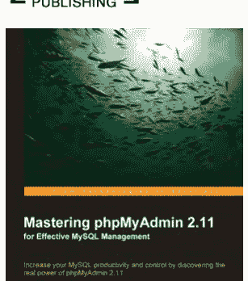
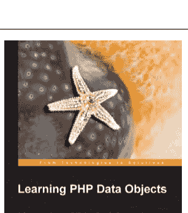
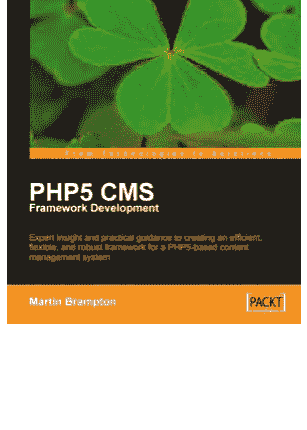
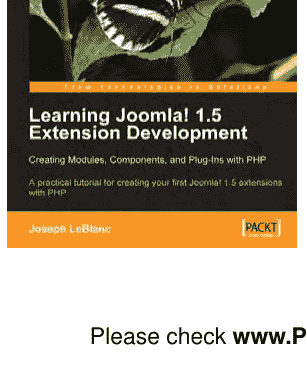

# B 故障排除和支持

## 故障排除和支持

本附录提出了解决一些常见问题的指南，并提供了避免这些问题的提示。它还解释了如何与开发团队互动以获得支持、报告错误和贡献。

## 系统要求

Documentation.html 文件（随下载包一起提供）开头的一个部分讨论了我们使用的特定 phpMyAdmin 版本的系统要求。必须满足这些要求，并且环境必须正确配置以避免出现问题。

一些问题，例如 phpMyAdmin 错误，实际上是由服务器环境引起的。有时，Web 服务器未正确配置为解释 .php 文件，或者 Web 服务器内部的 PHP 组件未使用 mysql 或 mysqli 扩展运行。MySQL 账户可能配置不当。这可能发生在家庭服务器以及托管服务器上。

当我们怀疑有问题时，可以尝试一个简单的 PHP 脚本 test.php，其中包含以下内容以检查 PHP 组件是否正确响应。

```
<?php
echo 'hello';
?>
```

我们应该看到 hello 消息。如果这有效，我们可以尝试另一个脚本：

```
<?php
phpinfo();
?>
```

该脚本显示有关 PHP 组件的信息，包括可用的扩展。我们至少应该看到关于 MySQL 的部分（证明 mysql 扩展可用），其中提供有关 MySQL 客户端 API 版本的信息。

我们还可以尝试其他连接到 MySQL 的 PHP 脚本，以查看问题是否比 phpMyAdmin 不能工作更普遍。一般来说，我们应该运行每个组件的最新稳定版本。

## 基础配置

我们应始终仔细检查安装方式，包括正确的权限和所有权。在修改 config.inc.php 时可能会出现拼写错误。

## 解决常见错误

为帮助解决问题，我们应首先确定错误消息的来源。以下是可能生成错误消息的各种组件：

- MySQL 服务器：这些消息由 phpMyAdmin 转发，后者显示 MySQL said 后跟消息
- Web 服务器的 PHP 组件：例如，Parser error
- Web 服务器：错误可以从浏览器中看到，或在 Web 服务器的日志文件中看到。
- Web 浏览器：例如，JavaScript 错误

错误消息和其他问题部分主要基于 phpMyAdmin 帮助论坛上的各种消息以及 Documentation.html 的 FAQ 部分。

## 错误消息

本节指的是 phpMyAdmin 显示的明确错误消息。

## 无法加载 MySQL 扩展

要连接到 MySQL 服务器，PHP 需要 mysql 扩展（对于 MySQL 4.1+ 推荐使用 mysqli 扩展），它是一组 MySQL 函数。该扩展可能作为 PHP 服务器的一部分编译。也可能需要动态加载，在这种情况下，phpMyAdmin 可能尝试加载它但失败。此错误意味着没有其他 PHP 脚本可以连接到 MySQL 服务器。

所需扩展包含在文件中，在 Linux 或 UNIX 上可以命名为 mysql.so 或 mysqli.so，在 Windows 上为 mysql.dll（可能是 mysqli.dll）。如果我们的 PHP 服务器来自软件包，我们可以找到并安装另一个软件包——可能称为 php-mysql 或 php-mysqli。（名称取决于发行版。）否则，我们可以根据 PHP 文档说明自行编译 PHP 服务器并使用适当的扩展。

## #2003 - 无法连接到 MySQL 服务器

此消息表明 MySQL 服务器未运行，或无法从 Web 服务器访问。它也可能是套接字（Linux/UNIX）或命名管道（Windows）配置问题。

## 套接字问题（Linux/UNIX）

php.ini 中配置的套接字（下面给出示例）与正在运行的 MySQL 服务器的套接字不对应。

```
mysql.default_socket = /tmp/mysql.sock
```

因此，PHP 无法访问 MySQL。我们可以将其更改为：

```
mysql.default_socket = /var/lib/mysql/mysql.sock
```

然而，为了确保，我们必须找到该套接字的确切位置。

## 命名管道问题（Windows）

这是与上面指示类似的问题，但发生在 Windows 上。可以通过使用正确的命名管道调整 mysql.default_socket 来解决，该命名管道用于本地连接到 MySQL 服务器。例如：

```
mysql.default_socket = MySQL
```

## MySQL said: Access denied

当我们了解相关的登录参数时，可以解决此错误。

## 使用 http 身份验证时

我们不能同时使用基于 .htaccess 文件的 Web 服务器安全机制和 config.inc.php 中的 http 身份验证。作为变通方法，请改用 cookie 作为身份验证类型而不是 http。

## 使用 http、cookie 或 config 身份验证时

config.inc.php 中的 host 参数必须与用户访问权限中定义的 host 匹配。有时，系统管理员可能会创建一个授权用户 bill 和主机 localhost 的账户。如果我们在 config.inc.php 中尝试使用 127.0.0.1 主机，MySQL 将拒绝它，即使它指向同一台机器。如果我们尝试使用机器的真实名称（mysql.domain.com）而定义为 localhost，也会出现相同问题。

## Access denied ... "using password: NO"

如果消息以 using password: NO 结尾，则意味着我们未传输密码，MySQL 正在拒绝此登录尝试。config.inc.php 中可能未设置密码值。

## Access denied ... "using password: YES"

已传输密码，但主机/用户名/密码组合已被 MySQL 拒绝。

## Warning: cannot add header information

此问题是由 config.inc.php 中存在某些字符（例如空行或空格）引起的——要么在开头的 <?php 标签之前，要么在结尾的 ?> 标签之后。我们应该使用支持 .php 文件的编辑器将其删除（如第 1 章所述）。

## MySQL said: Error 127, Table Must Be Repaired

在左侧面板中，我们单击数据库名称。在右侧面板中，我们选择出现错误的表的名称（使用相关复选框）。然后我们从下方的下拉列表中选择 Repair。更多详细信息请参见第 10 章。

## BLOB 列在键规范中使用但未指定键长度

MySQL 要求对 BLOB 列设置的索引大小受限。创建列时可用的简单索引创建技术不允许指定大小。因此，我们需要不带索引创建列。然后我们返回 Structure 页面，并使用 Create an index 对话框选择 BLOB 列并为索引设置大小。


## IIS：未指定输入文件

这是一个权限问题。**Internet Information Server (IIS)** 必须能够读取我们的脚本。由于服务器以用户 **IUSR_machinename** 运行，我们必须按照以下步骤操作：

- 1. 右键单击安装 phpMyAdmin 的文件夹。
- 2. 选择 **属性**。
- 3. 在 **安全** 选项卡下单击 **添加**，并从列表中选择 **IUSR_machinename** 用户。
- 4. 确保该用户对目录具有读取权限。

## 修改行时出现“404：未找到页面”错误

这发生在 config.inc.php 中的 $cfg['PmaAbsoluteUri'] 参数未正确设置时。第 1 章说明了如何处理此参数。

## 其他问题

在这里，我们介绍那些不会以特定错误消息显示在屏幕上的问题的解决方案。

## 空白页面或奇怪字符

默认情况下，phpMyAdmin 使用输出缓冲和压缩技术来加快结果向浏览器的传输。这些技术可能会干扰 Web 服务器的其他组件，导致显示问题。我们可以在 config.inc.php 中将 $cfg['OBGzip'] 设置为 FALSE。这应该可以解决问题。

## 无法创建数据库

如果 phpMyAdmin 检测到用于登录的帐户没有创建数据库的权限，则 **无权限** 会出现在主页上的 **创建数据库** 对话框旁边。这种情况在托管服务器上经常发生，因为系统管理员更喜欢为每个客户创建一个数据库。

如果我们不在托管服务器上，此消息只是反映了我们既没有全局 **CREATE** 权限，也没有对通配符数据库规范的任何 **CREATE** 权限。

## 导入大型文件或上传大型 BLOB 文件时出现问题

通常，这些问题表明我们在传输过程中达到了限制。第 8 章解释了这些限制和建议的处理方法。作为最后的手段，我们可能需要拆分大型文本文件。（在互联网上搜索 **文件分割器**。）

## MySQL root 密码丢失

MySQL 手册在 http://www.mysql.com/doc/en/Resetting_permissions.html 解释了通用解决方案。

该解决方案涉及停止 MySQL 服务器并使用特殊选项 `skip-grant-tables` 重新启动它（这基本上是在没有安全性的情况下启动服务器）。停止和重新启动服务器的方式取决于所使用的服务器平台。然后我们可以使用 phpMyAdmin 以超级用户（如 root）的身份和任意密码连接到服务器。下一步是更改 root 的密码（参见第 18 章）。然后我们可以使用正常程序停止 MySQL 服务器并重新启动它。（安全性将再次生效。）

## 创建表时字段名称重复

这是一个奇怪的症状。当我们尝试创建包含例如一个名为 FIELD1 且类型为 VARCHAR(15) 的字段的表时，看起来 phpMyAdmin 已发送命令创建两个同名字段 FIELD1。该问题不是由 phpMyAdmin 引起的，而是由环境引起的。在这种情况下，Apache Web 服务器似乎配置良好，可以运行 PHP 脚本，而实际上并非如此。然而，此错误仅在某些脚本中出现。

该问题发生在 Apache 配置文件中使用两组不同的（且冲突的）指令时。第一组指令为：

```
SetOutputFilter PHP
SetInputFilter PHP
```

第二组为：

```
AddType application/x-httpd-php .php
```

这些指令集可能位于两个不同的 Apache 配置文件中，因此难以注意到。推荐的方式是使用 AddType。使用此方法，我们只需对其他行添加注释（如以下代码段所示）并重新启动 Apache。

```
#SetOutputFilter PHP
#SetInputFilter PHP
```

## 身份验证窗口显示多次

当我们尝试使用与 $cfg['PmaAbsoluteUri'] 中设置的不同 URL 启动 phpMyAdmin 时会出现此问题。例如，服务器可能有多个名称，或者我们可能尝试使用 IP 地址而不是名称。

## phpMyAdmin 修改了列大小

为了更高效的列定义，MySQL 本身有时会决定更改列类型和大小。这主要发生在 CHAR 和 VARCHAR 上。

## 看到许多不属于我们的数据库

此问题大多在升级到 MySQL 4 后出现。自动服务器升级程序会向所有用户授予全局权限 CREATE TEMPORARY TABLES、SHOW DATABASES 和 LOCK TABLES。这些权限还使用户能够查看所有数据库的名称（但不能查看其表），直到我们按照 MySQL 手册中所述升级 GRANT 表权限。如果用户不需要这些权限，我们可以撤销这些权限。用户然后只能看到他们有权访问的数据库。

## 无法存储大于 127 的值

如果我们定义了类型为 TINYINT 的列，则这是正常的，因为 127 是此列类型的最大值。类似问题也可能出现在其他数值列类型中。将类型更改为 INT 可扩展可用值的范围。

## 寻求支持

支持的起点是主页 http://www.phpmyadmin.net，其中包含文档和支持部分。在那里，您将找到讨论论坛的链接以及各种跟踪器的链接，例如：

- Bug tracker
- Feature requests tracker
- Translations tracker
- Patches tracker
- Support tracker

## 常见问题解答

Documentation.html 文件是产品的一部分，其中包含一个冗长的、带编号问题的常见问题解答部分。建议将此常见问题解答部分作为求助的第一来源进行查阅。

## 帮助论坛

开发团队建议您首先使用产品的论坛搜索遇到的问题，然后在提交错误报告之前开始新的论坛讨论。

## 创建 SourceForge 帐户

创建（免费）SourceForge 用户帐户并将其用于在论坛上发帖是强烈推荐的。这可以更好地跟踪问题和答案。

## 选择主题标题

开始新的论坛主题时，仔细选择摘要标题非常重要。标题如 "Help me!"、"Help a newbie!"、"Problem" 或 "phpMyAdmin error!" 难以处理，因为答案会与这些标题关联，进一步引用会变得有问题。更好的标题是："Import with UploadDir"、"User can't but root can login" 或 "Server not responding"。

## 阅读答案

由于人们会阅读并几乎总是回答您的问题，在论坛上对答案提供反馈确实可以帮助回答者，以及有相同问题的人。

## 支持跟踪器

这是另一个寻求支持的地方。此外，如果我们提交的错误报告实际上是支持请求，该报告将被移至支持跟踪器。使用您的 SourceForge 用户帐户，您将收到此跟踪器更改的通知。

## 错误跟踪器

在此跟踪器中，我们可以看到尚未修复的错误，以及为下一个版本修复的错误。（为避免出现重复的错误报告。）

## 环境描述

由于开发人员会尝试重现提到的问题，因此描述您的环境会有所帮助。此描述可以简短，但应包含以下项目：

- phpMyAdmin 版本（团队不过期望它是当前稳定版本）
- Web 服务器名称和版本
- PHP 版本
- MySQL 版本
- 浏览器名称和版本

通常，无需指定服务器或客户端运行的操作系统，除非我们注意到该错误仅与一个操作系统相关。例如，FAQ 5.1 描述了一个用户无法创建包含超过十四列的表的问题。这仅在 Windows 98 下发生。

## 错误描述

我们应提供发生情况的精确描述（包括任何错误消息、预期结果和我们获得的实际结果）。如果报告每个错误报告仅描述一个问题（除非问题明显相关），则报告很容易管理。

有时，附上简短的导出文件以帮助开发人员重现问题可能会有所帮助。欢迎提供屏幕截图。

## 为项目贡献

自 1998 年以来，数百人贡献了翻译、新功能代码、建议和错误修复。


## 代码库
开发团队维护着一个不断演进的代码库，并定期发布版本。下载主页部分的一段文字描述了如何使用 Subversion 获取开发中的最新版本。（也可以通过下载 Subversion 快照来完成。）如果贡献（翻译更新、补丁、新功能等）指的是最新的代码库，而不是过时的 phpMyAdmin 版本，将会得到更高优先级的考虑。

## 翻译更新
查看项目当前 55 种语言的列表，您会注意到它们维护情况并不均衡。有关翻译的详细信息可在 http://www.phpmyadmin.net/home_page/translations.php 获取。您可以尝试通过电子邮件联系特定语言的官方翻译人员，以提出对最近添加消息的修正或翻译。如果此人未回复，您可以将修改发送到翻译跟踪器，放在压缩的 (.zip) 文件中。

## 补丁
如果补丁以相对于当前代码库的上下文差异形式提交，并附带已解决问题的说明或实现的新功能，开发团队可以更轻松地管理补丁。贡献者将在 Documentation.html 中正式署名，或至少在 ChangeLog 中署名。

## 未来的 phpMyAdmin 版本
以下是开发团队正在考虑的下一版本的要点：
- 对 MySQL 新功能的改进支持
- 用户偏好设置永久存储
- 内部代码改进

## 摘要
本附录介绍了如何防止配置良好的服务器出现问题，以及在哪里以及如何寻求帮助。附录还解释了一些常见错误并提出解决方案。此外，《为项目做出贡献》部分介绍了如何贡献以帮助改进 phpMyAdmin。

## 索引
A
ALTER ROUTINE 权限 262
身份验证，phpMyAdmin
简介 29
身份验证类型 29
控制用户 29
cookie 身份验证 31, 32
HTTP 身份验证 30
HTTP 身份验证，限制 30
注销功能 30
密码存储，cookie 身份验证 31
以及查询历史功能，
比较 219, 220
创建 220
执行 225
功能 219
从 pma_bookmark 表执行 228
初始查询 223
操作 226
多查询书签 224
参数化书签，创建 226
参数 226
参数值，传递给书签 227
公共书签 223
公共书签，效果 223
召回 225
召回，选择 225
存储 222
B
二进制大对象。参见 BLOB 字段
位字段 110
BLOB 字段
简介 104, 105
二进制内容 105, 106
BLOB 流
配置 275
数据，从存储库流式传输 277
实现限制，在 phpMyAdmin 中 275
PBMS 系统工具，创建 276
存储库数据，修改 278
存储库，上传 276, 277
系统要求 274
系统要求，MySQL 5.1 274
系统要求，PBMS 274
系统要求，PBXT（PrimeBase XT 存储引擎）274
表，准备 276
书签
浏览模式
简介 78
彩色标记行 84
列长度，显示选项 85
列长度，限制 85
自定义 86
数据，排序 83, 84
不同值，浏览 85
标题词 84
错误跟踪器，phpMyAdmin
简介 313
错误描述 313
环境描述 313
C
单元格 241
字符集 50
排序规则
简介 50
MySQL 版本 4.1.x 50
### 列注释
简介 193
自动迁移 194
### 列条件，多表查询生成器
结果中的列，显示 212
条件框 212
条件列，调整 216
条件行，调整 214
条件行，删除 215
编辑 211
字段选择器 211
LIKE 条件 212, 213
查询，更新 212
排序 211
### config.inc.php 文件，phpMyAdmin
简介 14
创建，手动 22
在 Windows 客户端编辑 22
权限 14
### 配置参数
$cfg['AllowArbitraryServer'] 35
$cfg['AllowUserDropDatabase'] 99
$cfg['BgcolorOne'] 86
$cfg['BgcolorTwo'] 86
$cfg['blowfish_secret'] 31
$cfg['Border'] 86
$cfg['BrowseMarkerColor'] 84
$cfg['BrowseMarkerEnable'] 84
$cfg['BrowseMIME'] 242
$cfg['BrowsePointerColor'] 84
$cfg['CharEditing'] 77
$cfg['CharTextareaRows'] 78
$cfg['Confirm'] 95
$cfg['CtrlArrowsMoving'] 91
$cfg['DisplayServerList'] 60
$cfg['DefaultConnectionCollation'] 53
$cfg['DefaultDisplay'] 80
$cfg['DefaultLang'] 51
$cfg['DefaultPropDisplay'] 102
$cfg['DefaultQueryDatabase'] 198
$cfg['DefaultQueryTable'] 198
$cfg['DefaultTabDatabase'] 64
$cfg['DefaultTabServer'] 66
$cfg['DefaultTabTable'] 65
$cfg['EditInWindow'] 202
$cfg['ErrorIconic'] 45
$cfg['Error_Handler']['display'] 37
$cfg['ExecTimeLimit'] 144
$cfg['FilterLanguages'] 52
$cfg['ForeignKeyDropdownOrder'] 191
$cfg['ForeignKeyMaxLimit'] 191
$cfg['GD2Available'] 245
$cfg['HeaderFlipType'] 81
$cfg['IgnoreMultiSubmitErrors'] 203
$cfg['Import'] 143
$cfg['InsertRows'] 76
$cfg['Lang'] 52
$cfg['LeftBgColor'] 54
$cfg['LeftDisplayLogo'] 54
$cfg['LeftDisplayServers'] 60
$cfg['LeftFrameDBTree'] 56
$cfg['LeftFrameLight'] 55
$cfg['LeftFrameTableLevel'] 58
$cfg['LeftFrameTableSeparator'] 58
$cfg['LeftPointerColor'] 54
$cfg['LeftPointerEnable'] 54
$cfg['LeftWidth'] 54
$cfg['LightTabs'] 66
$cfg['LimitChars'] 85, 251
$cfg['LoginCookieRecall'] 32
$cfg['MainPageIconic'] 53
$cfg['MaxExactCount'] 64
$cfg['MaxRows'] 82
$cfg['MemoryLimit'] 145
$cfg['ModifyDeleteAtLeft'] 89
$cfg['ModifyDeleteAtRight'] 89
$cfg['MySQLManualBase'] 4
$cfg['MySQLManualType'] 4
$cfg['NaturalOrder'] 46
$cfg['NavigationBarIconic'] 82
$cfg['OBGzip'] 309
$cfg['Order'] 83
$cfg['PDFDefaultPageSize'] 237
$cfg['PersistentConnections'] 25
$cfg['PmaAbsoluteUri'] 23, 309, 311
$cfg['PmaNoRelation_DisableWarning'] 175
$cfg['PropertiesIconic'] 89
$cfg['QueryFrame'] 66
$cfg['QueryHistoryDB'] 201
$cfg['QueryHistoryMax'] 202
$cfg['QueryWindowDefTab'] 201
$cfg['QueryWindowHeight'] 67
$cfg['QueryWindowWidth'] 67
$cfg['RecodingEngine'] 128
$cfg['RepeatCells'] 86
$cfg['ReplaceHelpImg'] 47
$cfg['RestrictColumnTypes'] 92
$cfg['RestrictFunctions'] 92
$cfg['RightBgColor'] 62
$cfg['RightBgImage'] 62
$cfg['ServerDefault'] 34
$cfg['Servers'][$i] 34
$cfg['Servers'][$i]['AllowDeny']['order'] 38
$cfg['Servers'][$i]['AllowDeny']['rules'] 38
$cfg['Servers'][$i]['AllowRoot'] 39
$cfg['Servers'][$i]['auth_type'] 30
$cfg['Servers'][$i]['bookmarktable'] 221
$cfg['Servers'][$i]['connect_type'] 25
$cfg['Servers'][$i]['controlpass'] 178
$cfg['Servers'][$i]['controluser'] 30
$cfg['Servers'][$i]['extension'] 24
$cfg['Servers'][$i]['hide_db'] 40
$cfg['Servers'][$i]['history'] 202
$cfg['Servers'][$i]['host'] 24
$cfg['Servers'][$i]['only_db'] 39
$cfg['Servers'][$i]['password'] 28
$cfg['Servers'][$i]['port'] 24
$cfg['Servers'][$i]['socket'] 24
$cfg['Servers'][$i]['user'] 28
$cfg['Servers'][$i]['verbose'] 24
$cfg['Servers'][$i]['verbose_check'] 178
$cfg['ShowAll'] 82
$cfg['ShowBrowseComments'] 194
$cfg['ShowChgPassword'] 63
$cfg['ShowFunctionFields'] 93
$cfg['ShowFunctionFields'] 92
$cfg['ShowPhpInfo'] 63
$cfg['ShowPropertyComments'] 194
$cfg['ShowSQL'] 71
$cfg['ShowStats'] 63
$cfg['ShowTooltipAliasDB'] 166
$cfg['ShowTooltipAliasTB'] 166
$cfg['SQLQuery']['Edit'] 79
$cfg['SQLQuery']['Explain'] 79
$cfg['SQLQuery']['Refresh'] 79
$cfg['SQLQuery']['ShowAsPHP'] 79
$cfg['SQLQuery']['Validate'] 205
$cfg['SQLValidator']['password'] 205
$cfg['SQLValidator']['username'] 205
$cfg['SQP']['fmtColor'] 203
$cfg['SQP']['fmtType'] 203
$cfg['SuggestDBName'] 70
$cfg['TextareaAutoSelect'] 199
$cfg['ThBgcolor'] 86
$cfg['ThemeDefault'] 48
$cfg['ThemeManager'] 48
$cfg['ThemePath'] 48
$cfg['ThemePerServer'] 49
$cfg['UploadDir'] 151
$cfg['UseDbSearch'] 161
$cfg['VerboseMultiSubmit'] 203
$cfg['WYSIWYG-PDF'] 235
$cfg['ShowHttpHostTitle'] 45
控制用户 29
CREATE ROUTINE 权限 262
CSV 文件，导入
CSV 导出选项 148
CSV 方法 148
使用 LOAD DATA 的 CSV 149
D
数据
删除 95
编辑 89
函数，应用于数据 92
导入功能，访问 143
导入 143
导入，CSV 文件 147, 149
导入，文件大小限制 144
导入，内存限制 145
导入，其他限制 144
导入，SQL 文件 146
导入，时间限制 144
导入，传输限制 144
部分导入 145
搜索 153
单行，删除 95
数据库
附加表，创建 87
创建 69
数据字典 231, 232
删除 98
Inside 字段选项使用 161


多表操作 170
多表查询生成器 209
操作标签 171
打印视图 230
搜索 160
结构子页面 229
表属性 165
表，创建 71
表维护 164
数据库，创建
关于 69
附加表，创建 87, 88
授权数据库创建 70, 71
CREATE 权限 69
主页，MySQL 69
无权限 69
数据库导出
关于 118
CodeGen 选择 137
逗号分隔值（CSV）格式 119
CSV 格式 129
CSV 用于 MS Excel 130
在 NHibernate 对象关系映射（ORM）中导出 137
LaTeX 格式 133
Microsoft Excel 2000 格式 131
Microsoft Word 2000 格式 132
原生 MS Excel 格式 134
开放文档电子表格格式 135
开放文档文本格式 136
PDF 格式 131
另存为文件子面板 126
SQL 119
SQL，选项 122
子面板 119
Text! 格式 137
YAML 格式 137
数据库信息，MySQL 服务器
关于 288
数据库，删除 289
启用统计 288
权限，检查 289
统计，排序 289
数据库，左侧面板
处理 60
界面限制 60
速度配置参数 61
数据库操作
数据库，复制 172
数据库，重命名 172
重命名数据库 172
数据，删除
关于 95
空选项 98, 99
多行，删除 96
行，删除 97
单行 95
行，删除 89
数据，编辑
使用 Ctrl + 箭头键 91
数据导航 90
编辑图标 90
编辑模式 89
函数名称显示，限制 92
函数，应用于数据 92
多行编辑 94
空值，管理 91
行，删除 89
行，编辑 89
数据行，复制 93
数据操作
数据，删除 89, 95
数据导航 90
函数，应用于数据 92
多行编辑 94
多行，删除 96
空值，处理 91
行，删除 97
数据行，复制 93
单行，删除 95
定义关系，优势
可浏览的外键表窗口 192
外键下拉列表 191
外键信息 190
元数据，自动更新 193
引用完整性检查 192
设计器
菜单图标 186
PBXT 关系 189
PDF 模式，导出 190
关系，定义 187
关系，定义为 185
显示/隐藏左侧菜单图标 187
显示选项 242
文档，phpMyAdmin
数据库，打印视图 230
数据字典 231
## E
编辑 PDF 功能 239
空选项 98, 99
ENUM 字段 107
错误信息，phpMyAdmin
BLOB 相关错误 308
无法添加头信息 308
无法加载 MySQL 扩展 306, 307
无法连接到 MySQL 服务器 307
使用配置认证 308
错误 404，页面未找到 309
生成，组件 306
使用 http 认证 307
IIS，未指定输入文件 309
MySQL，访问被拒绝 307
MySQL，表必须修复 308
命名管道问题 307
密码传输问题 308
套接字问题 307
事件调度器，MySQL 5.1
激活 272
事件，创建 273
事件，导出 274
事件，操作 273
事件权限，授予 273
## F
字段
添加到表 101, 102
属性，编辑 103
位字段 110
BLOB 字段 104, 105
DATE 字段 108
DATETIME 字段 108
ENUM 字段 107, 108
使用水平模式 103
SET 字段 107, 108
TEXT 字段，控制布局 104
TEXT 字段，使用 104
TIMESTAMP 字段 108, 110
使用垂直模式 102
外键
下拉列表 191
信息 190
函数，MySQL 5.0
手动创建 265, 266
导出 266, 267
测试 266
## G
垃圾回收进程，
查询窗口 202
GD2 库 245
SQL，通用选项 122-123
全局权限，MySQL 服务器 283
## H
十六进制表示，
转换 252
历史，phpMyAdmin 297
## I
iconv 模块
数据重新编码 128
图像生成，需求
关于 244
GD2 库 245
JPEG 和 PNG 库 245
内存限制 245
导入数据
CSV 文件 147, 149
文件大小限制 144
文件上传 145
LOAD DATA INFILE 语句 143
内存限制 145
其他限制 144
部分导入 145
SQL 和 CSV 格式，比较 147
SQL 文件 146
时间限制 144
时间限制，因素 144
传输限制 144
索引管理 74
EXPLAIN 命令 115
全文索引 113
索引，编辑 113
索引问题，检测 115
多字段索引 112
MyISAM 表 113
单字段索引 111
表优化 114
InnoDB
关于 174
优势 174
外键功能 174
关系 182
MySQL 服务器中的状态 291
表 174
表，无关联表基础设施 185
Internet 协议。参见基于 IP 的访问控制
## J
JPEG 和 PNG 库 245
## K
Kanji 支持 128
## L
LaTeX 格式，数据库导出
关于 133
选项 133
XML 格式 134
左侧面板，phpMyAdmin
关于 43
附加表，创建 87
自定义 53, 54
数据库，处理 60
数据库名称，树形显示 56
数据库，选择 54
元素 53
完整模式 55
轻量模式 55
轻量模式，数据库视图 56
轻量模式，表单 55
logo，配置 54
嵌套级别功能 58
服务器列表 59
表，快速浏览 58
表简要统计 57
表，在数据库中嵌套显示 58
使用 LIKE 操作符 156
关联表
书签 219
函数 177
基础设施 174
基础设施，目标 175
基础设施，安装 175
基础设施，位置 175
InnoDB 表，无关联表基础设施 185
多用户安装 176, 177
多用户安装，表函数 177
关系视图 179
单用户安装 178
## M
元数据 173
列注释 193, 194
MIME
属性 242
浏览器转换 244
列设置 242, 243
转换，选项 244
转换设置 241
类型 243, 244
多用途互联网邮件扩展。参见 MIME
多行编辑 94
多表操作
关于 170
正在使用的表，修复 171
多表查询生成器
关于 209
表之间自动连接 217
列条件，编辑 211
结果中列，显示 212
条件列，调整 216
条件行，调整 214
条件行，移除 215
字段选择器 211
LIKE 条件 212
查询，执行 217
查询，更新 212
选择 210
排序 211
使用 209
### MySQL
关于 8
备份 117
BLOB 字段 104
浏览模式 78
字符集 50
排序规则 50
数据库 69
转储 117
导出 117
函数，应用于数据 92
索引管理 114
InnoDB 174
mysqldump 工具 117
PrimeBase XT 存储引擎 174
关系数据结构 173
关系型 MySQL 173
表，创建 71
版本 4.1.x 50
### MySQL
视图 257
### MySQL 5.0
关于 257
函数 265, 266
information_schema 269, 270
存储过程 262
分析 270, 271
触发器 267, 268
### MySQL 5.1
事件调度器 272
分区 271
### MySQL server
关于 289
二进制日志 294
字符集 294
排序规则 294
复制用户 287
数据库创建，权限 282
数据库信息 288
数据库特定权限 284
有效权限 281
全局权限 283
主机 282
InnoDB 状态 291
登录信息，修改 287
新用户，添加 281
密码 282
密码，修改 286
权限管理 279
进程 292
移除 287
状态页面 290, 291
状态，验证 290
存储引擎 293
用户管理 279
用户名 282
用户概览页面 279
用户，资源限制 283
变量 292
### MySQL-Webadmin 297
## N
### 原生 MS Excel 格式，数据库导出
134, 135
## O
### 开放文档电子表格格式，数据库导出 135
### 开放文档文本格式，数据库导出
136
### 操作符
!= “ 155
= “
155
### 其他问题，phpMyAdmin
认证窗口，显示更多
超过一次 311
空白页面 309
无法存储大于 127 的值 311
列大小已更改 311
数据库，无法创建 309
重复字段名称 310
MySQL，root 密码丢失 310
问题，导入大文件 310
问题，上传大 BLOB 文件 310
未知数据库 311
奇怪字符 309
## P
### 面板，phpMyAdmin
主页 44
- 语言选择器 51, 52
- 左侧面板 43
- 登录面板 43
- 查询窗口 44, 66
- 右侧面板 43
- 分区，MySQL 5.1
- 导出 272
- 操作子页面 272
- 表，创建 271, 272
- PBMS 274
- PDF 页面
- 自动布局功能 234
- 显示 236, 237
- 显示，选项 236, 237
- 编辑 236, 234
- 嵌入字体 238
- 字体位置 238
- 字体，使用 238
- 新页面，创建 233
- 规划 233
- TrueType 字体 238
- PDF，关系模式
- 关于 232
- PDF 布局，使用设计器功能 239
- PDF 页面，编辑 233
- 表，添加 232
- 表，与其他表关联 232
- PHP 8
- PHP 超文本处理器。参见 PHP
- phpMyAdmin
- 关于 7
- 高级功能 10
- 基于 Ajax 的设计器 185
- 任意服务器 35
- 认证 29
- 奖项 302, 303
- 备份 117
- 基础配置 306
- 基本功能 9
- BLOB 流 274
- 书签功能 173
- 日历弹出，用于数据输入 108
- 字符集，选择 128
- 颜色选择器功能 49
- 压缩文件，问题 127
- config.inc.php 文件 14
- config.inc.php 文件，权限 14
- 配置 13
- 配置，原则 15
- CSV 文件，导入 147
- 数据库 69
- 数据库，排序 46
- 数据，导入 143
- 数据，部分导入 145
- 数据结构，文档 229
- 使用 Deja VuSans 字体 238
- DELIMITER 分隔符 143
- 分销商 300
- 下载 11
- 错误信息 306
- 功能 155
- 功能 9
- 未来版本 314
- GD2 库 245
- GoPHP5 301
- 头部和底部，显示 46
- 历史 297
- 图标，配置 45
- 索引管理，选项 111
- information_schema 269
- 输入字段，为 CHAR 显示 77
- 输入字段，为 VARCHAR 显示 77
- 使用 Apache IIS 安装 13
- 安装 10
- 安装，在 Linux 服务器上 13
- 安装，在本地 Windows 服务器上 13
- 安装在远程服务器上，使用 Windows 客户端 12
- 安装，先决条件信息 11
- 接口 43
- 内部关系视图 180
- 日文编码 128
- Kanji 支持 128
- 语言，选择 51
- 关联表 174
- 基于 MIME 的转换 241
- 使用多维数组 204
- 多服务器配置 34
- 多语句查询 202
- MySQL 认证 27
- MySQL 文档链接，显示 47
- 需要 10
- 官方版本 299
- 其他问题 309


面板 43
参数，MySQL 服务器 21
分区 271
phpMyBookmark 300
PmaAbsoluteUri 参数 23
打印视图 229
分析 270
查询窗口 200
关系型 MySQL 173
安全 36
选择性导出 139
服务器管理功能 10
服务器管理特性 279
服务器，配置 34
特定服务器配置 23
特定服务器配置，参数 27
特定服务器部分 23
滑块 50
SQL 文件，导入 147
SQL 查询框 197
起始页面 45
支持 311
语法高亮 203
系统要求 11, 305, 306
表名，排序 46
临时目录 145
主题 48
Unicode 51
非官方版本 299
版本 1.3.0 298
版本 2.2.7-p11 300
版本 2.3.0 300
版本 2.4.0 300
版本 2.5.0 300
版本 2.6.0 300
版本 2.6.2 300
版本 2.7.0 301
版本 2.8.0 301
版本 2.9.0 301
版本 2.10.0 301
版本 2.11.0 301
版本 3.0 301
版本 3.1 301
视图 257
警告，基于 Web 的安装脚本 18
基于 Web 的安装脚本 16
基于 Web 的安装脚本，其他配置参数 22
Windows 标题配置 45

### phpMyAdmin 项目贡献
代码库 314
补丁 314
翻译更新 314

### 主键 74
### PrimeBase Media Streaming。参见 PBMS
### PrimeBase XT 存储引擎
关于 174
优势 174
表 174

## Q
### QEB
关于 209
初始页面 209
页面，元素 209, 210

### 查询
编辑 202
历史和书签，比较 219, 220
多语句查询 202
多表查询生成器 209

### 按示例查询。参见 QEB
### 按示例查询，单表搜索
空值，搜索 155
非空值，搜索 155
搜索 154, 155

### 查询窗口
尺寸 67

## R
### 重新编码模块
数据重新编码 128

### 关系型 MySQL
关于 173
InnoDB 174
PrimeBase XT 存储引擎 173, 174

### 关系视图
关于 179, 180
列注释 193, 194
显示字段，定义 181
字段，关联 180
外键系统，定义 180
外键系统，InnoDB 183
InnoDB 存储引擎 182, 184
内部关系视图 180
PrimeBase XT 存储引擎 182, 184
关系，移除 181
用途 179

### 右侧面板，phpMyAdmin
关于 43
数据库视图 63
默认服务器页面 66
主页 44
图标，用于主页和菜单标签 66
服务器视图 65
表视图 65

## S
### 保存为文件子面板，数据库导出
压缩文件 127
文件名模板 126
记住模板 127

### 搜索数据
单表搜索 153
搜索数据库 160

### 搜索选项，单表搜索
显示字段，选择 158
显示顺序对话框 158
获取不同结果 159, 160
使用的逻辑运算符 159
where 子句使用 158, 159

### 安全，phpMyAdmin
数据库列表，限制 39
目录级保护 36
错误处理程序 37
传输中数据，保护 40
基于 IP 的访问控制 37
级别 36
规则，基于 IP 的访问控制 37, 38
Swekey 硬件认证 40

### 选择性导出
关于 139
导出和复选框 140
部分查询结果，导出 139

### 特定服务器配置，phpMyAdmin
关于 23
配置认证类型 28
连接，测试 28
content_type 25
MySQL，扩展 24
持久连接 25
端口 25
套接字 25

SET 字段 106

### 单表搜索
关于 153
大小写敏感 157
使用同一查询的多个条件 157
phpMyAdmin 使用 153
打印视图 155, 156
按示例查询，搜索 154, 155
搜索选项 158
搜索子页面，访问 153, 154
通配符，搜索 156, 157

### SQL
和 CSV 格式，比较 147
文件，导入 146
历史，基于数据库 201, 202
历史，会话基于 201
LIKE 运算符 156
查询框 197
查询窗口 200
上传目录 151
验证器 204
视图 257

### SQL 查询框
关于 197
数据库视图 198

### SQL 验证器
关于 204
配置 205
非标准一致查询 206
报告 205
标准一致查询 205

SUPER 权限 267

### 支持，phpMyAdmin
回答，问题 312
错误跟踪器 313
常见问题 312
帮助论坛 312
主页 311
SourceForge 账户，创建 312
支持跟踪器 312
主题标题，选择 312

## T
### 表
附加表，创建 87, 88
追加，数据到表 170
属性，修改 165
复制操作 169
创建 71
数据插入，手动 76
输入字段，为 CHAR 显示 77
输入字段，为 VARCHAR 显示 77
移动操作 169
操作子页面 163
重命名 169

### 表属性
关于 165
修改 165

### 表属性，修改
auto-increment，表选项 169
checksum，表选项 168
delay_key_write，表选项 168
其他属性 168
pack_keys，表选项 168
row_format，表选项 168
表排序规则属性 167
表注释属性 165
表选项 168
表顺序属性 166
表存储引擎属性 165
transactional page_checksum，表选项 169

### 表排序规则属性，表属性
关于 167
连接排序规则，切换 168

### 表，创建
附加表 87
附加表，创建 87
字段名 73
字段，选择 71
第一个表 72
索引，添加到字段 75
主键 74
表名 73

### 表导出
关于 138
分文件导出 138

### 表维护
关于 164
分析表 164
检查表 164
碎片整理表 164
刷新表 164
优化表 164
修复表 164

### 表操作
追加数据到表 170
复制 169, 170
移动 169
多表操作 170
重命名 169

### 表
删除 98
选择 210

### 表视图，SQL 查询框
点击进入查询框 199
字段选择器按钮 198

### 转换
关于 242
单元格排序，外部应用程序 254
可点击缩略图 246, 247
日期格式化 247, 248
下载链接 251
启用 242
示例 246
外部应用程序 253
十六进制表示 252
IP (v4) 地址 252
文本中的链接 248
链接到图像 247
原始格式，保留 250
文本部分，显示 251
源代码，美化 252
text/plain imagelink 249, 250
text/plain link 248, 249

### 触发器，MySQL 5.0
关于 267, 268
创建，手动 268
测试 268, 269

## U
### Unicode
关于 51
优势 51
转换格式 51
Unicode 转换格式 (UTF) 51
UTF-8 51

通用协调时间 (UTC) 248

### 用户，MySQL 服务器
复制用户 287
数据库创建，权限 282
数据库特定权限 284
编辑权限 284
全局权限 283
主机 282
登录信息，修改 287
新用户，添加 281
新用户，编辑 284
密码 282
密码，修改 286
移除 287
资源限制 283
用户名 282

### 用户概览页面，权限管理
关于 279, 280
重新加载 280, 281
用户列表列 280

## V
### 垂直模式，字段
使用 102

### 视图，MySQL 5.0
关于 257
创建，从结果 260, 261
创建，手动 258
视图操作 259
重命名 261
右侧面板 259, 260
用途 257

## W
### Web
关于 7

### Web 应用程序
关于 8

### Web 服务器
上传目录 151, 152

## X
### XML 格式，数据库导出 134

## Y
### YAML Ain’t Markup Language。参见 YAML 格式，数据库导出
### YAML 格式，数据库导出 137


## 感谢购买
精通 phpMyAdmin 3.1 进行有效的 MySQL 管理

## Packt 开源项目版税

当我们销售基于开源项目撰写的书籍时，我们会直接向该项目支付版税。因此，通过购买《精通 phpMyAdmin 3.1 进行有效的 MySQL 管理》，Packt 已将收到的部分资金给予 phpMyAdmin 项目。

从长远来看，我们将自己和您——我们的书籍的客户和读者——视为开源生态系统的一部分，为我们出版的项目提供可持续收入。Packt 的目标是建立出版版税作为服务的重要组成部分，并支持可持续开源的商业模式。

如果您正在从事一个开源项目，希望我们对其进行出版并随后支付版税，请与我们联系。

## 为 Packt 撰写

我们欢迎所有有兴趣撰稿的人的咨询。书稿提案应发送至 author@packtpub.com。如果您的书稿想法仍处于早期阶段，并且您希望在撰写正式书稿提案之前先进行讨论，请联系我们；我们的其中一位约稿编辑将与您联系。

我们不仅仅寻找已出版的作者；如果您具备强大的技术技能但没有写作经验，我们经验丰富的编辑可以帮助您发展写作事业，或为您提供专业知识的额外回报。

## 关于 Packt Publishing

Packt，发音为 'packed'，于 2004 年 4 月出版了第一本书《Mastering phpMyAdmin for Effective MySQL Management》，随后继续专注于出版针对特定技术和解决方案的高度聚焦的书籍。

我们的书籍和出版物分享了您同行的 IT 专业人士在适应和定制当今系统、应用程序和框架方面的经验。我们的解决方案型书籍为您提供定制正在使用的软件和技术的知识和能力，以完成工作。与您过去看到的 IT 书籍相比，Packt 的书籍更具体、更少泛化。我们独特的商业模式使我们能够提供更集中的信息，让您了解更多所需的内容，减少不必要的内容。

Packt 是一家现代而独特的出版公司，专注于为开发人员、管理员和新手等社区生产高质量、领先的书籍。欲了解更多信息，请访问我们的网站：www.PacktPub.com。




## 精通 phpMyAdmin 2.11 实现高效 MySQL 管理

ISBN: 978-1-847194-18-3      平装本：340页

通过发现 phpMyAdmin 2.11 的真正威力，提升你的 MySQL 生产力和控制力

- 1. 有效地使用 phpMyAdmin 管理你的 MySQL 数据库。
- 2. 使用 MySQL 服务器管理工具管理用户和权限。
- 3. 掌握 phpMyAdmin 的隐藏功能和能力。



## 学习 PHP 数据对象

ISBN: 978-1-847192-66-0      平装本：200页

PHP 数据对象的初学者指南，PHP 5 的数据库连接抽象库

- 1. PDO 概述
- 2. 创建数据库并连接到它
- 3. 错误处理
- 4. 高级功能



## PHP 5 CMS 框架开发

ISBN: 978-1-847193-57-5      平装本：328页

专家见解和实用指导，帮助你为基于 PHP 5 的内容管理系统创建高效、灵活且健壮的框架

- 1. 学习如何为你的定制需求设计、构建和实现完整的 CMS 框架
- 2. 使用面向对象、MVC 实现坚实的架构
- 3. 构建用于自定义菜单、模块、组件、会话、用户跟踪等的基础设施
- 4. 由 CMS 应用的资深开发者撰写



## 学习 Joomla! 1.5 扩展开发

ISBN: 978-1-847191-30-4      平装本：200页

使用 PHP 创建你的第一个 Joomla! 1.5 扩展的实用教程

- 1. 为 Joomla! 编写你自己的扩展
- 2. 创建具有后端和前端功能的新型自包含组件
- 3. 创建可配置的站点模块以在每个页面上显示信息
- 4. 将你的扩展分发给其他 Joomla! 用户

