# 1 什么是响应式？

如果您购买了本书，您可能已经听说过响应式编程（甚至是函数式响应式编程）。如今，许多开发者声称在自己的项目中使用它；互联网上也很容易找到文章，称其与旧范式相比有多么惊人。但请知道，您用手头的工具做得非常出色。

学习新的编程范式非常困难。大多数时候，在您掌握它之前，您甚至不知道自己需要它，而且您总是要问自己，这是否真的值得花费数小时学习，还是只是所有酷孩子都在谈论的新流行词，并没有为您的编程技能增添真正的价值。

也许您以前尝试过响应式编程，甚至在小型项目中使用过它，或者像我一样，您只是认为不值得一试，但由于某种原因，您决定给这个范式一个机会，（您总是渴望知识，我知道，几年前我也处在您的位置）。我花了很长时间才理解我为什么需要响应式编程以及如何掌握它。我希望确保您比我有更轻松的路径。

本书将指导您了解响应式编程原理，并通过大量示例，我将向您展示如何处理和组合不同数据源或事件，以创建惊人的实时应用程序。在本第一章中，我们将使用 `bacon.js` 库来了解基础知识，然后我们将深入研究 **Reactive Extensions (RxJS)**。

在深入编程之前，您需要了解响应式编程是什么以及它旨在解决的问题。

本章将涵盖以下几点：

- 了解响应式编程是什么
- 响应式编程与命令式编程的比较
- 了解响应式编程解决的问题
- 安装本书中所需的工具
- 函数式响应式编程的第一个示例将使用 JavaScript 库

## 响应式范式

响应式编程是一种范式，其主要关注点是使用异步数据流。您可能会阅读许多书籍，并在互联网上看到，响应式范式是关于变化的传播或一些技术解释，这只会使理解变得更加困难。

命令式编程使您描述计算机必须执行的步骤来执行任务。相比之下，函数式响应式编程为您提供传播变化的构造，以便您可以专注于做什么而不是怎么做。

这可以用两个数字的简单求和来说明。在命令式编程中 a = b + c 只在那行代码中求值，因此如果您更改 b 或 c 的值，a 的值不会改变。但在响应式编程世界中，您可以监听变化。想象一下 Microsoft Excel 电子表格中的相同求和，每当您更改列 b（或 c）的值时，它都会重新计算 a 的值，因此您始终为对这些变化感兴趣的人传播变化。

事实是，您可能已经在每次向网页中的鼠标点击或按键添加监听器时使用异步数据流，您将其作为参数传递给函数以对该用户输入做出反应。因此，鼠标点击可以被视为一个事件流，您可以观察它并在发生时执行一个函数。但这只是事件流的一种用法。

响应式编程将这一点提升到下一个层次——使用它，您可以监听并对任何变化做出反应，从中创建一个事件流，因此您可以对变量或属性、数据库、用户输入、外部源等的变化做出反应。例如，您可以将股票价值的变化视为事件流，并使用它实时向用户展示何时买入或卖出。外部源流的另一个常见示例是您的 Twitter 动态或 Facebook 时间线。此外，函数式响应式编程使您能够对数据或事件流进行过滤、映射、组合、缓冲等操作。因此，使用股票示例，您可以轻松监听不同的股票，使用 **filter function** 获取值得购买的股票，并向用户实时显示它们的列表，如下图所示：

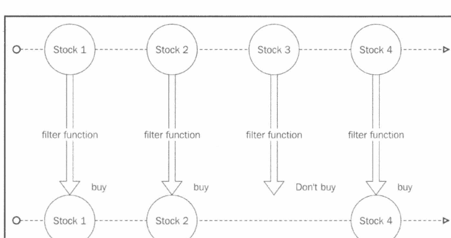

## 我为什么需要它？

函数式响应式编程在实现以下场景时特别有用：

- 图形用户界面
- 动画
- 机器人技术
- 仿真
- 计算机视觉


几年前，用户在 Web 应用中能做的全部事情就是填写表单并将数据提交到服务器。如今，我们的 Web 应用和移动应用向用户呈现了更丰富的界面，使其能够获得实时信息并提供更多交互可能性。因此，随着应用的演进，我们需要更多工具来实现新的需求。

使用它，你可以将数据的来源抽象到应用程序的业务逻辑中——这让你能够编写更简洁且解耦的代码，提高复用性，并使代码更易于测试，因为你可以轻松模拟你的流来测试业务逻辑。

在本书记述中我们将使用 Reactive Extensions 来解释并实现一个示例响应式应用。Reactive Extensions 在业界被广泛使用，并且它们针对不同的语言（.Net、Scala、JavaScript、Ruby、Java 等）有实现，因此你可以轻松地将本书中学到的内容翻译到其他语言。

在我个人看来，Reactive Extensions 有一些概念对于不熟悉响应式编程的人来说很难理解。因此，我们将使用一个更简单的库（bacon.js）来学习基础知识，一旦你理解了基础和概念，我将使用 RxJS 给你提供更多工具。

## 安装工具

在开始使用响应式编程之前，我们需要安装本书中将使用的工具。

### Node.js

我们将使用 node 版本 6.9.1，这是撰写本文时最新的 LTS 版本。你可以在以下链接找到适用于 Windows、Mac 和 Linux 的版本：

```
https://nodejs.org/en/download/releases/.
```


我们将在本书中使用大量箭头函数，因此我们期望你熟悉这一 ES6 特性。你可以在任何高于 4.x 的 node 版本中运行此处描述的代码。

### bacon.js

在本章的第一章中我们将使用 bacon.js，这是一个用于 JavaScript 的函数式响应式编程库。该库可在服务器和客户端中使用。我们将使用它向你介绍一些函数式响应式编程的概念，因为它更容易入门。我们将使用版本 0.7.88。

要在服务器上安装它，只需在 node 项目中运行以下命令：

```
npm i baconjs@0.7.88 --save
```

要将其添加到 HTML 页面，只需将以下代码片段粘贴到其中：

```
<script
src="https://cdnjs.cloudflare.com/ajax/libs/bacon.js/0.7.88/Bacon.min.js">
</script>
```


不用担心版本没有高于 1.x；bacon.js 是稳定的。

### RxJS

本书中我们需要遵循的最后一个工具是 RxJS；我们将在后面的章节中使用该库。该库也可在客户端和服务器上运行，我们将使用版本 4.1.0。

要在服务器上安装它，只需在 node 项目中运行以下命令：

```
npm i rx@4.1.0 --save
```

要将其添加到 HTML 页面，只需将以下代码片段粘贴到其中：

```
<script src="https://cdnjs.cloudflare.com/ajax/libs/rxjs/4.1.0/rx.all.js">
</script>
```


对于使用其他包管理器的用户，你也可以从 Bower 和 NuGet 安装 bacon.js 和 RxJS。

## 使用响应式编程编写你的第一个代码

现在你已经安装了创建第一个函数式响应式编程程序所需的所有工具，我们可以开始了。对于这个第一个程序，我们将使用 bacon.js。

bacon.js 让你可以使用事件（它称之为 EventStream）和动态值（它称之为 Property）。EventStream 代表事件（或数据）的流，它是一个可观察对象，你可以订阅它以接收该流上的新事件通知。Bacon 带有大量内置函数，可从不同来源创建事件流，例如按钮点击、按键、间隔、数组、Promise 等（你也可以创建自己的来源）。Property 是一个可观察对象。与 EventStream 类似，两者的区别在于 Property 具有当前值。因此，每当你需要了解某物的变化和当前状态时，你将使用 Property；如果你只是想收到事件通知而不需要了解某物的当前状态，那么你使用 EventStream。Property 可以使用 bacon.js API 中的 toProperty() 或 scan() 方法从 EventStream 创建。

像其他任何函数式响应式编程一样，Bacon 有一组操作符让你可以处理事件，因此你可以将事件映射到其他内容，可以过滤某些事件，可以缓冲事件，可以合并不同的事件源等等。

我们将使用 Node.js 运行第一个示例，让我们开始：

- 1. 打开你的终端并为此第一个项目创建一个文件夹。
- 2. 现在创建项目：
  - 1. 导航到你创建的文件夹。
  - 2. 输入以下命令：
- 3. 不断按 Enter 接受默认配置。
- 4. 如果操作正确，你应该会在控制台看到类似这样的消息：

```
npm init
```

```
{
"name": "example1",
"version": "1.0.0",
"description": "",
"main": "index.js",
"scripts": {
"test": "echo \"Error: no test specified\" && exit 1"
},
"author": "",
"license": "ISC",
"dependencies": {}
}
```

好的，现在我们有了测试项目。在这个项目中我们将实现一个计时器——基本上，我们想要的是每秒打印当前时间。我们将使用和不使用函数式响应式编程库来实现它，所以首先让我们以传统方式实现。

创建名为 traditionalInterval.js 的文件并将以下代码粘贴进去，保存：

```
setInterval(
    () => console.log(new Date())
,1000);
```

这段代码使用 setInterval() 函数每 1000 毫秒（每秒）调用一次我们的函数。现在，使用以下命令在终端中运行此程序：

```
node ./traditionalInterval.js
```

如果操作正确，它将每秒在你的终端中打印当前日期，如下所示：

```
2016-10-30T20:28:22.778Z
2016-10-30T20:28:23.796Z
2016-10-30T20:28:24.803Z
2016-10-30T20:28:25.808Z
2016-10-30T20:28:26.809Z
2016-10-30T20:28:27.815Z
2016-10-30T20:28:28.820Z
```

要停止程序，只需按 Ctrl + C。

现在让我们看看如何使用 bacon.js 实现相同的程序进行函数式响应式编程。首先，我们需要在项目上安装 bacon.js，如“安装工具”部分所述，也如下所述：

```
npm i baconjs@0.7.88 --save
```

在项目中安装了 bacon.js 后，我们就可以实现程序了。首先创建名为 baconInterval.js 的文件，然后由于我们将在项目中需要该库，请在文本编辑器中打开此文件并粘贴以下代码：

```
var Bacon = require("baconjs");
```

现在我们已将 Bacon 添加到代码中，我们可以使用它创建一个每秒打印当前时间的计时器。

在向你展示执行此操作的代码之前，了解我们如何使用函数式响应式编程对该问题建模很重要。如前所述，bacon.js 实现了事件流的概念，它是一个可观察的事件流。要创建计时器，我们需要一种特殊的流类型，能够每 x 秒发出事件，这样我们就可以监听该流以打印当前日期。

bacon.js 具有大量内置函数，可从不同来源创建 EventStreams。我们稍后会讨论可用的函数，但此时我们需要了解 Bacon.interval() 函数，它让我们可以创建一个每 x 秒发出一次事件的 EventStreams，其中 x 为事件之间的时间（以毫秒为单位）。因此，如果我们想每秒发送一个事件，必须按如下方式使用它：

```
Bacon.interval(1000);
```

这段代码创建了一个每秒发出一次事件的 EventStream。现在我们需要一种方法来接收该流中的事件，以便在控制台打印当前日期。我们可以使用 onValue() 函数来做到这一点——该函数让我们订阅以监听该流上的事件，并接收要执行的函数作为参数，因此它让我们更改代码以使用它。完整代码如下：

```
var Bacon = require("baconjs");
Bacon
    .interval(1000)
    .onValue(
        ()=> console.log(new Date())
    );
```

如果运行此代码，你将看到如下输出：

```
2016-10-30T20:28:22.778Z
2016-10-30T20:28:23.796Z
2016-10-30T20:28:24.803Z
2016-10-30T20:28:25.808Z
2016-10-30T20:28:26.809Z
2016-10-30T20:28:27.815Z
2016-10-30T20:28:28.820Z
```

你仍然需要按 Ctrl + C 来停止程序。


这里我们从一个间隔创建 EventStream。bacon.js 有很多内置方法来创建事件流；我们将在第 2 章《首次响应》中更详细地介绍这些方法。

恭喜，你刚刚使用函数式响应式编程创建了你的第一个程序。现在，让我们稍微修改一下。

我们将实现相同的代码，但使用一个 frp 运算符。为此我们将使用 map () 运算符——该运算符接收一个映射函数作为参数。该函数接收一个输入值并将其转换为另一个值。与其监听流上的事件并在控制台打印当前日期，不如监听流中的事件，将这些事件映射到当前日期，然后打印结果。创建一个名为 baconIntervalMap.js 的文件并粘贴以下代码：

```javascript
var Bacon = require("baconjs");
Bacon
    .interval(1000)
    .map(()=>new Date())
    .onValue((currentDate)=>console.log(currentDate));
```

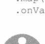

使用 map () 运算符我们可以编写更具描述性的代码。这也使我们能够解耦代码并测试每个函数，而不是整个代码。我们将在第 4 章《转换数据 - Map、Filter 和 Reduce》中更详细地介绍 map () 运算符。

如果运行此代码，你将看到与之前代码相同的输出。

在第一个示例（没有 bacon.js）中，我们有一个难以测试的硬编码，因为代码的所有逻辑都紧密结合在一起。在下一个示例中，我们改进了代码的可测试性，因为我们将事件源与操作分离，因此我们可以通过模拟 EventStream 来测试我们的 onValue() 函数，但获取当前日期的逻辑仍然与操作（在控制台打印）绑定在一起。最后一个示例（使用 map()）的可测试性高得多，因为我们可以单独测试代码的每个部分。

让我们看看我们问题的最后一个版本。与其每秒永远打印当前日期，我们将每秒只打印当前日期五次。我们可以在不使用 frp 的情况下实现它；创建一个名为 traditionalInterval5times.js 的文件并粘贴以下代码：

```javascript
var count = 0;

var intervalId = setInterval(()=>{
    console.log(new Date());
    count++;
    if(count===5){
        clearInterval(intervalId);
    }
},1000);
```

现在我们的代码变得复杂得多。要实现所提议代码的新版本，我们需要一个外部计数器（以确保我们只运行代码五次），并且我们需要间隔调度程序的引用，以便以后可以停止它。通过查看此代码，很难理解它试图做什么，而且正如你可能已经注意到的那样，它真的很难测试。

你可能想知道我们如何更改上一个 frp 代码来实现；如果我们有一种方法只能监听 Bacon 的 EventStream 上的五个事件，那就太好了，所以我向你介绍 take() 方法。此方法让你只能监听 EventStream 上的给定数量的事件。因此，将我们之前的代码更改为只运行五次非常简单；创建一个名为 baconIntervalMap5times.js 的文件并粘贴以下代码：

```javascript
var Bacon = require("baconjs");

Bacon
    .interval(1000)
    .take(5)
    .map(()=>new Date())
    .onValue((currentDate)=>console.log(currentDate));
```


take() 运算符让我们只能监听 EventStream 上的前 x 个事件。我们将在第 8 章《还有什么？ - 更多运算符》中更详细地介绍此运算符。

我们的新代码就是这么简单。我们不需要更改流源、映射函数或订阅函数；我们只需要从流中取出五个事件即可。

在这个最终示例中，我们可以看到函数式响应式编程如何改善我们的代码可读性。在使用 setInterval() 的代码中，我们必须添加一个计数器变量，以确保我们按正确的次数运行日志函数。我们还必须记住清除间隔，以免无限期运行此代码。另一方面，在使用 frp 的代码中，我们所要做的就是使用 take() 描述转换以显示我们想要多少项，使用 map() 获取当前日期，最后订阅以对该流的事件做出反应。

如果进展对你来说太快了，不用担心——我只是想让你用一些 `frp` 代码动手实践一下。在接下来的章节中，我们将以更多细节看到这些概念。

## Summary
## 摘要

In this chapter, we learned what functional reactive programming is and how it compares with imperative programming. We also learned where it comes from and modeled and implemented our first functional reactive program using the `bacon.js` library. We compared it with a program with and without `frp` and saw how it can improve our code maintainability and testability by separating the source of the events from the actions caused by them.
在本章中，我们学习了什么是函数式响应式编程以及它与命令式编程的比较。我们还学习了它的来源，并使用 `bacon.js` 库建模并实现了我们的第一个函数式响应式程序。我们将其与有和没有 `frp` 的程序进行了比较，并看到了它如何通过将事件源与由此引起的操作分离来改善代码的可维护性和可测试性。

In the next chapter, we will take a more in-depth look into the `bacon.js` library, and what we can do with event streams, and we will also start to model and implement more complex examples using new operators.
在下一章中，我们将更深入地研究 `bacon.js` 库，以及我们可以用事件流做什么，并且我们还将开始使用新运算符建模和实现更复杂的示例。

# 2 Reacting for the First Time
# 2 首次响应
# Reacting for the First Time
# 首次响应

In the previous chapter, you started understanding the motivations behind using functional reactive programming in your systems; you also saw how a program using this paradigm fared against a program without it. You learned how reactive programming can improve code readability and testability by decoupling your event sources from the action you take when the action occurs.
在上一章中，你开始理解在系统中使用函数式响应式编程背后的动机；你还看到了使用这种范式的程序与不使用它的程序相比如何。你学习了响应式编程如何通过将事件源与操作发生时采取的操作解耦来改善代码可读性和可测试性。

We started with some basic examples using `bacon.js` as the reactive programming library for JavaScript. In the examples, we began with creating our first EventStream from an interval. Then we started using some operators (`map()` and `take()`). Finally, we subscribed to this event source to take actions in the case of an event occurrence. This was just a kind introduction to functional reactive programming.
我们从使用 `bacon.js` 作为 JavaScript 的响应式编程库的一些基本示例开始。在示例中，我们首先从间隔创建第一个 EventStream。然后我们开始使用一些运算符（`map()` 和 `take()`）。最后，我们订阅了此事件源以在事件发生时采取行动。这只是对函数式响应式编程的友好介绍。

When reading most of the functional reactive programming libraries (for any language), you will see a lot of diagrams explaining how the operator works. In the previous chapter, I presented the following diagram to illustrate a **filter function**:
在阅读大多数函数式响应式编程库（适用于任何语言）时，你会看到很多解释运算符如何工作的图表。在上一章中，我展示了以下图表来说明一个 **过滤函数**：

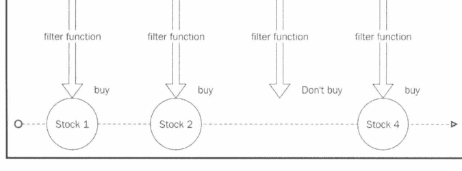

We will cover what this illustration means in detail in this chapter. Learning how to read this will make reading documentation on libraries a lot easier.
我们将在本章中详细介绍此插图的意思。学习如何阅读它将使阅读库文档变得容易得多。

Functional reactive programming is a paradigm which is hard to master, so after the quick introduction, you'll now move on to learning how to implement more complex programs using the bacon.js library.
函数式响应式编程是一个难以掌握的范式，因此在快速介绍之后，你现在将继续学习如何使用 bacon.js 库实现更复杂的程序。

This chapter will cover the following points:
本章将涵盖以下几点：

- Understanding bacon.js observable objects (EventStream and Property) and their differences
- Modeling a functional reactive program
- Subscribing to an observable
- Unsubscribing from an observable
- Reading a reactive programming operator diagram
- Using operators to transform an observable
- 理解 bacon.js 可观察对象（EventStream 和 Property）及其差异
- 建模函数式响应式程序
- 订阅可观察对象
- 取消订阅可观察对象
- 阅读响应式编程运算符图
- 使用运算符转换可观察对象

### The bacon.js observables
### bacon.js 可观察对象

In functional reactive programming, an observable is an object where you can listen for events. This way, you can, for instance, create an observable for a button and then listen and act when a click happens.
在函数式响应式编程中，可观察对象是一个可以监听事件的对象。这样，你就可以例如为按钮创建一个可观察对象，然后在点击时监听并采取行动。

The bacon.js gives you two flavors of an observable: the first one is EventStream and the other is Property. We will see the difference between the two objects later. To listen to events in an observable (or subscribe to an observable), you can use the onValue() method with a callback. So if you want to log every event in an EventStream, you can use the following code:
bacon.js 为你提供了两种可观察对象的风格：第一个是 EventStream，另一个是 Property。我们稍后会看到这两个对象的区别。要监听可观察对象中的事件（或订阅可观察对象），你可以使用 onValue() 方法并带有一个回调。因此，如果你想记录 EventStream 中的每个事件，可以使用以下代码：

```
myEventStream.onValue(function(event){
  console.log(event);
});
```

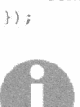

We will see how to create an EventStream in more detail later.
我们稍后将更详细地介绍如何创建 EventStream。

As we saw in the example in the last chapter, we can transform our observable using bacon.js operators. These operators let us filter, combine, map, buffer, and do a lot of other interesting things with our EventStream.
正如我们在上一章的示例中看到的，我们可以使用 bacon.js 运算符转换我们的可观察对象。这些运算符让我们可以过滤、组合、映射、缓冲，并对我们的 EventStream 执行许多其他有趣的操作。

An observable can either finish or stay open to propagate events forever; it can also contain (and propagate) errors. We will see this in more detail later.
可观察对象要么结束，要么保持打开状态以永远传播事件；它也可以包含（并传播）错误。我们稍后会更详细地介绍这一点。

### Creating our first observable
### 创建我们的第一个可观察对象

The bacon.js gives us a multitude of methods to create observables. We can create them from DOM events, promises, interval, and so on. Sometimes we might need to create an observable from our own source, so let's learn how to create our own event streams.
bacon.js 为我们提供了多种创建可观察对象的方法。我们可以从 DOM 事件、promise、间隔等创建它们。有时我们可能需要从自己的源创建可观察对象，因此让我们学习如何创建自己的事件流。

### Observables from DOM events (asEventStream)
### 来自 DOM 事件的可观察对象（asEventStream）

To create an EventStream from DOM events (a mouse click for instance), we will need an HTML page with jQuery (or Zepto.js); bacon.js adds the asEventStream() method for all jQuery objects. So if we want to create an EventStream from a button click, we can use the following code:
要从 DOM 事件（例如鼠标点击）创建 EventStream，我们需要一个带有 jQuery（或 Zepto.js）的 HTML 页面；bacon.js 为所有 jQuery 对象添加了 asEventStream() 方法。因此，如果我们想从按钮点击创建 EventStream，可以使用以下代码：

```
var clickEventStream = $('#myButton').asEventStream('click');
```

This line creates an EventStream from button clicks on a DOM object with the ID myButton. If we want to execute an action every time this button is clicked, we will need to use the onValue() method from this event stream. The following code shows an alert on the screen every time the user clicks on the button:
这一行从 ID 为 myButton 的 DOM 对象的按钮点击创建 EventStream。如果我们想在每次点击此按钮时执行一个操作，我们需要使用此事件流的 onValue() 方法。以下代码在用户每次点击按钮时在屏幕上显示一个警报：

```
clickEventStream.onValue(function(){
  alert('Button clicked');
});
```

This code adds a function to be called every time an event happens in this EventStream object, as it emits an event every time myButton is clicked. The following code will show an alert every time this button is clicked.
此代码添加了一个函数，每当此 EventStream 对象中发生事件时调用它，因为每次点击 myButton 时它都会发出一个事件。以下代码将在每次点击此按钮时显示一个警报。


由于这是你的第一个 HTML 代码，我将在这里粘贴完整的 HTML，以便你可以创建文件并在自己的浏览器中测试它：

```
<html>
    <head></head>
    <body>
        <button id="myButton">CLICK</button>
        <script src="https://cdnjs.cloudflare.com/ajax/libs/jquery/3.1.1/jquery.min.js"></script>
        <script src="https://cdnjs.cloudflare.com/ajax/libs/bacon.js/0.7.88/Bacon.min.js"></script>
        <script>
            var clickEventStream = $('#myButton').asEventStream('click');
            clickEventStream.onValue(function(){
                alert('Button clicked');
            });
        </script>
    </body>
</html>
```

## 从 Promise 创建可观察对象（fromPromise）

你也可以从 ES6 promise 或 jQuery AJAX 创建 EventStream。这些流只会包含单个值（失败时为错误），并且会结束。我们需要一个 promise 来测试此方法：

```
var promiseObject = Promise.resolve(10);
```

在这里，我们正在创建一个成功的 promise，它将返回值为 10。要将此 promise 转换为 EventStream，我们使用以下代码：

```
Bacon
    .fromPromise(promiseObject);
```


请注意，你需要 Node.js 版本 4 或更高版本，或现代浏览器来测试此代码（旧浏览器未实现 promise）。

## 从 Node 事件发射器创建可观察对象（fromEvent）

许多 Node.js 模块实现了事件发射器，它基本上是一个对象，具有在每次事件发生时调用的 on() 方法。我们可以将这些对象转换为 bacon.js 的 EventStream，以利用所有的转换功能。fromEvent() 方法具有以下签名：

```
Bacon
    .fromEvent(eventEmitter,eventName);
```

参数为 eventEmitter；Node eventEmitter 对象；以及 eventName，事件的名称。我们可以使用 fs 模块来展示此方法的使用。

要使用使用事件发射器的 fs Node 模块读取文件，我们需要使用以下代码为文件创建一个 readStream：

```
var fs = require('fs');
var FILE_PATH = 'SOME FILE';
var readStream = fs.createReadStream(FILE_PATH,'utf8');
```

然后，使用 on() 方法订阅此发射器上的事件，如下所示：

```
readStream.on('data',(content)=>console.log(content));
```

要将此代码转换为使用 bacon.js EventStream 的代码，我们需要更改以下代码的最后一行：

```
var eventStream = Bacon.fromEvent(readStream,'data');
eventStream
    .onValue((content)=> console.log(content));
```

因此与方法签名相比，我们的 eventEmitter 参数是 readStream 对象，eventName 为 data。

fromEvent() 方法也可以用于监听 DOM 事件（类似于 asEventStream() 方法），如下代码所示：

```
var clickEventStream =
Bacon.fromEvent(document.getElementById('#myButton'), 'click');
```

## 从数组创建可观察对象（fromArray）

要从数组创建可观察对象，可以使用 fromArray() 方法，如以下代码所示：

```
var myArray = [1,2,3];
Bacon
  .fromArray(myArray);
```

## 从数组顺序创建可观察对象（sequentially）

要以给定间隔从数组中逐项传递每个项目来创建可观察对象，我们可以使用 sequentially() 方法，如下所示：

```
var myArray = [1,2,3];
var intervalBetweenItens = 100;
Bacon
  .sequentially(intervalBetweenItens ,myArray);
```

此代码以每次发射间隔 100 毫秒的方式发射数组的项目。

## 从间隔创建可观察对象（interval）

我们可以从间隔创建可观察对象；如果希望执行重复任务，这尤其有用，并且可以用作 setInterval() 方法的替代。由 interval() 方法创建的 EventStream 永不结束；此方法具有以下签名：

```
Bacon.interval(intervalInMilliseconds);
```

它只接收一个参数，即事件之间的间隔（以毫秒为单位），并且将以空对象作为事件发射。假设你运行了以下代码：

```
Bacon
  .interval(100)
  .onValue((event)=>{
    console.log(event);
  });
```

如果是这样，你将看到以下输出：

```
{}
{}
{}
{}
```

它将一直打印空对象，直到你终止程序。

## 从其他源创建可观察对象

bacon.js 还有其他内置方法可从常见的 EventStream 源创建可观察对象。本章的目标不是解释 bacon.js API 的所有函数。你可以通过参考 bacon.js 文档来查看其他可能的 EventStream 源。创建 EventStream 的最后一个重要方法是允许你从任意源创建 EventStream 的方法。这就是 fromBinder() 方法。

fromBinder() 方法具有以下签名：

```
Bacon.fromBinder(publisher);
```

它接收一个 publisher 函数作为参数；这是一个只有一个参数的函数，允许你为 EventStream 推送事件，如以下示例所示：

```
var myCustomEventStream = Bacon.fromBinder(function(push){
    push('some value');
    push(new Bacon.End());
});
```

以下代码创建了一个 EventStream，它发射一个字符串然后结束 EventStream。如你所见，Bacon.End() 是一个特殊对象，告诉 bacon.js 何时关闭 EventStream。

以下示例向 EventStream 发送更多事件并将其打印到控制台：

```
var myCustomEventStream = Bacon.fromBinder(function(push){
    push('some value');
    push('other value');
    push('Now the stream will finish');
    push(new Bacon.End());
});
myCustomEventStream
.onValue((value)=>
    console.log(value)
);
```

如果运行此代码，你应该会看到以下输出：

```
some value
other value
Now the stream will finish
```

当我们想在可观察对象上传播错误时，需要使用 Bacon.Error() 类型来包装错误。bacon.js 无法自动封装抛出的异常；你始终需要手动封装它。还需要注意的是，当发生错误时，bacon.js 不会结束你的可观察对象（但你可以配置它）。让我们按如下方式更改之前的代码以添加错误：

```
var myCustomEventStream = Bacon.fromBinder(function(push){
    push('some value');
    push('other value');
    push(new Bacon.Error('NOW AN ERROR HAPPENED'));
    push('Now the stream will finish');
    push(new Bacon.End());
});
myCustomEventStream
    .onValue((value)=>
        console.log(value)
    );
```

它将给出相同的输出并忽略你的错误，因为你尚未为此可观察对象添加错误处理程序（我们稍后将看到如何使用 onError() 方法添加处理程序）。但是如果我们希望在发生错误时立即结束可观察对象，我们可以调用可观察对象的 endOnError() 方法，如此代码所示：

```
var myCustomEventStream = Bacon.fromBinder(function(push){
    push('some value');
    push('other value');
    push(new Bacon.Error('NOW AN ERROR HAPPENED'));
    push('Now the stream will finish');
    push(new Bacon.End());
}).endOnError();
myCustomEventStream
    .onValue((value)=>
        console.log(value)
    );
```

它将给出以下输出：

```
some value
other value
```


如你所见，它永远不会打印 Now the stream will finish，因为错误发生在它之前。

## 属性

现在你知道 EventStream 是什么以及如何创建它；如前所述，它是一个可观察对象。然而，bacon.js 还有另一种特殊的 observable 形式，称为 Property。Property 是一个具有当前值概念的 EventStream。你可以使用 toProperty() 或 scan() 方法从任何 EventStream 创建 Property；它特别适用于表示 DOM 数据绑定。

要从 EventStream 创建 Property，可以使用具有以下签名的 toProperty() 方法：

```
eventStream.toProperty(initialValue);
```

initialValue 参数是可选的。如果你决定省略它，你将拥有一个没有初始值的 Property。如果你传递它，它将被用作此 Property 的当前值，直到流发出第一个值。

创建 Property 的另一种方式是使用 scan() 方法。此方法类似于 Javascript 数组对象的 reduce() 方法。给定一个种子对象和累加器函数，scan() 方法将遍历你的 EventStream 以从结果创建 Property：

```
Bacon
.sequentially(100, ['a','b','c','d'])
.scan('=> ', (acc,b)=> acc+b)
.onValue((value)=>console.log(value));
```

在此示例中，我们首先从字符串数组创建 EventStream，然后调用 scan() 方法使用种子值 => 创建 Property，并使用一个函数连接这些值，我们将结果打印到控制台以进行每次 scan 迭代。因此运行此代码将给出以下输出：

```
=>
=> a
=> ab
=> abc
=> abcd
```


## 可观察对象的变化

在上一节中，我们看到了如何使用 `scan()` 方法从 EventStream 创建一个 Property。当我们使用此方法（实际上，当我们使用任何操作符时），我们不会改变原始的可观察对象；我们总是创建一个新的可观察对象。因此，它永远不会干扰可观察对象的其他订阅（和转换）。我们可以修改之前的代码，同时监听 EventStream 和 Property 上的事件；现在我们将看到，在这两个中的一个中进行更改不会影响另一个：

```
var eventStream = Bacon
    .sequentially(100,['a','b','c','d']);

eventStream.onValue((value)=>{
    console.log('From the eventStream :'+value);
});

var property = eventStream.scan('=> ',(acc,b)=> acc+b);

property.onValue((value)=>{
    console.log('From the property :'+value);
});
```

它给出的输出如下：

```
From the property :=>
From the eventStream :a
From the property :=> a
From the eventStream :b
From the property :=> ab
From the eventStream :c
From the property :=> abc
From the eventStream :d
From the property :=> abcd
```

这表明使用 `scan()` 方法在 Property 中连接数组不会改变原始 `eventStream` 的行为。

## 对变化做出反应

如前所述，可观察对象是一个可以监听事件的对象。在此对象中监听事件的行为称为 **订阅**。在这里，我们将看到订阅可观察对象的不同方式，以及如何停止监听此可观察对象中的事件（取消订阅）。

## 订阅

我们将订阅可观察对象称为添加一个在事件发生时被调用的函数的行为。使用 bacon.js，我们可以在发出值时收到通知（`onValue()`、`log()` 和 `assign()` 方法），当发生错误时（`onError()` 方法），或当我们的可观察对象关闭时（在结束时）。

## 使用 onValue() 方法订阅

订阅可观察对象最常见的方式是使用 `onValue()` 方法。

此方法具有以下签名：

```
observable.onValue(functionToBeCalledWhenAnEventOccurs);
```

所以让我们订阅 `eventStream` 来记录此流上的每个事件，如下所示：

```
Bacon
.fromArray([1,2,3,4,5])
.onValue((number)=>console.log(number));
```

这段代码会在控制台输出以下内容：

1
2
3
4
5

此函数可用于任何类型的可观察对象（EventStream 和 Property）。唯一的区别是，在 Properties 中，如果 Property 的初始值存在，则会触发 onValue() 函数。查看以下代码：

```
var initialValue =0;
Bacon
    .fromArray([1,2,3,4,5])
    .toProperty(initialValue)
    .onValue((number)=>console.log(number));
```

这将给出以下输出：

```
0
1
2
3
4
5
```

订阅可观察对象时，了解如何取消订阅也很重要。onValue() 方法返回一个函数；调用此函数将取消订阅你的函数与此可观察对象。因此我们可以从 interval 创建一个可观察对象，并在每次传播事件时打印一条消息，如下所示：

```
Bacon
    .interval(1000)
    .onValue(()=>console.log("event happened"));
```

它将每秒打印一次消息 event happened，直到我们终止进程为止。但如果我们愿意，可以使用 onValue() 的返回值在一段时间后取消订阅我们的可观察对象，如下所示：

```
var unsubscribe = Bacon
    .interval(1000)
    .onValue(()=>console.log("event happened"));

setTimeout(function(){
    console.log("unsubscribing")
    unsubscribe();
},4000);
```

使用此代码，程序将取消订阅你的可观察对象。这样，它会正常退出并打印以下输出：

```
event happened
event happened
event happened
unsubscribing
```

## 使用 log 方法订阅

到目前为止，每次我们创建可观察对象时，我们都使用 onValue() 方法来监听可观察对象中的事件。在我们的示例中，我们通常只是将值打印到控制台，因为这是测试 bacon.js 中的可观察对象和操作符时的常见用法 bacon.js 有一个特殊的方法，可以通过它将所有事件打印到控制台。所有可观察对象都有 log() 方法。此方法将每个事件打印到控制台，并在事件流结束时打印 <end> 字符串。我们可以用它与 EventStreams：

```
Bacon
  .fromArray([1,2,3,4,5])
  .log();
```

这段代码会在控制台输出以下内容：

```
1
2
3
4
5
<end>
```

如你所见，在所有事件之后，它将打印 <end> 字符串以表示 EventStream 的结束。如果我们决定将其与无限流一起使用（使用 interval() 方法创建的流），它永远不会打印 <end> 字符串（正如你所期望的）。参考以下代码：

```
Bacon
  .interval(100)
  .log()
```

这将打印以下输出：

```
{}
{}
{}
{}
```

它将一直打印，直到你关闭程序。

我们也可以将 log() 方法与 Property 一起使用，如以下示例所示：

```
var stringProperty = Bacon
    .fromArray(['a','b','c','d'])
    .scan('=> ', (acc,b)=> acc+b);

stringProperty.log();
```

这将打印以下输出：

```
=>
=> a
=> ab
=> abc
=> abcd
<end>
```

如你所见，这也会为 Property 打印 <end> 字符串。


log() 方法对于调试目的以及测试和查看操作符的工作方式特别有用。它是查看操作符运行的最快方式。

## 使用 assign 方法订阅

assign() 方法允许你在每次事件发生时在对象上调用一个函数。它对于设置 DOM 元素的内容特别有用。你可以使用它通过 jQuery 设置 DOM 对象类的值：

```
observable
    .assign($("#myElement"), "class");
```


assign() 方法只是 onValue() 方法的同义词。

## 当发生错误时采取行动

在前面的章节中，我们看到了如何在 bacon.js 上封装错误。现在，我们将使用 onError() 方法在发生这种情况时采取行动。此方法具有与 onValue() 方法相同的签名并且工作方式类似，但仅适用于 bacon 错误。现在有了此方法，我们可以更改我们在上一节中使用的代码以在发生时打印错误。如下所示：

```
var myCustomEventStream = Bacon.fromBinder(function(push){
    push('some value');
    push('other value');
    push(new Bacon.Error('NOW AN ERROR HAPPENED'));
    push('Now the stream will finish');
    push(new Bacon.End());
});
myCustomEventStream
.onError((value)=>
    console.log(value)
);
```

它将打印以下内容：

**NOW AN ERROR HAPPENED**


正如你可能期望的那样，onError() 方法也返回一个函数以取消订阅。

## 阅读操作符的工作原理

在整本书中，你将看到许多解释操作符工作原理的图表。这些图表是可观察对象及其操作的可视化表示。通常，图表由三部分组成。顶部显示一条带有球的线，表示可观察对象的初始状态。线本身代表一个可观察对象。圆圈是此可观察对象中发生的事件，它们从左到右推送；因此，最左边的球是第一个事件，第二个是第二个，以此类推。这在以下图表中有所说明：

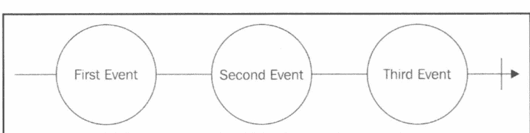

因此，前面的线代表一个发出三个事件的可观察对象。每个圆圈中心的字符串是该事件发出的值。图表右侧的短垂直线表示此可观察对象的结束。此图表是以下可观察对象的图形表示：

```
Bacon
.fromArray([
    'First Event',
    'Second Event',
    'Third Event'
]);
```

如我们所知，可观察对象可以永远存在（使用 Bacon.interval() 方法创建的那些）。为了表示这种可观察对象，我们删除右侧的短线。这样，我们就表明此可观察对象中未来可能会发生其他事件，但我们对它们不感兴趣，如以下图表所示：

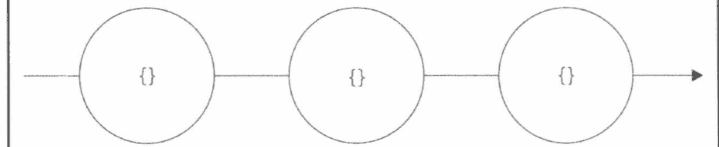

这个图表是对以下可观察对象的可能表示：

```
Bacon
    .interval(1000);
```

请注意，在这种情况下事件之间的时间无关紧要，因此我们决定在图形表示中省略它（我们通常省略此信息，因为这是实现细节）。Bacon.interval() 方法始终发出一个空对象，因此我们在每个圆圈的中心绘制括号。

使用这种图形表示的主要原因是展示运算符如何转换可观察对象。因此，为了显示使用的是哪个运算符，我们添加一个指向下方的箭头，并附上运算符的名称以及如果需要的话运算符的内容。因此，如果我们想表示 map() 运算符的使用，可以使用以下图表：

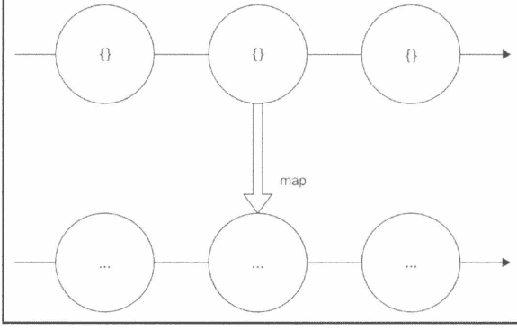

如前所述，当运算符应用于可观察对象时，它会创建一个新的可观察对象（不会改变原始可观察对象）。因此，我们添加一条新线来表示操作后创建的新可观察对象。在这条新线上，我决定省略圆圈中心的数值（只添加三个点），因为 map() 运算符的工作方式超出了本次讨论的范围。


有时我们想要表示多个运算符。在这种情况下，我们只需继续串联更多线条。某些运算符允许你处理多个可观察对象，这会使图表更复杂。但不用担心，我们会在它们第一次出现时解释这些变化。

## 使用 bacon.js 转换事件

在学习函数式响应式编程时，一个重要的事情是如何转换可观察对象发出的事件。这样，你就可以使用连续的函数调用从原始输入创建新对象。这也提高了代码的重用性；对可观察对象的每次转换都会创建一个新的可观察对象，而每个可观察对象可以有多个订阅的监听器。

在对我们的可观察对象应用任何转换之前，让我们实现一个可观察对象来生成并打印当前日期。为此，让我们使用 Bacon.interval() 方法。因此，以下代码将每秒发出一个空对象：

```
var eventSource = Bacon
    .interval(1000);
```


请记住，Bacon.interval() 每 x 毫秒发出一个空对象，其中 x 是传递给函数的参数——在我们的示例中，每 1000 毫秒，即每秒一次。

现在我们可以订阅一个函数来打印当前日期到控制台。我们可以通过添加以下行使用 onValue() 函数来实现这一点：

```
eventSource
    .onValue(() => {
        console.log(new Date());
    });
```

这将持续打印如下输出：

```
2016-11-23T21:21:43.291Z
2016-11-23T21:21:44.315Z
2016-11-23T21:21:45.319Z
```

它运行良好并解决了我们的问题，但请记住问题——我们想要一个可观察对象来生成并打印当前日期到控制台。不幸的是，bacon.js 没有任何可观察对象可以每隔给定秒生成当前日期，但我们可以使用运算符将空对象更改为当前日期。该运算符的返回结果将是一个新的可观察对象，它将每秒发出当前日期，这正是我们从一开始想要的。然后，我们可以使用 onValue() 方法订阅此运算符以打印当前日期。

幸运的是，这样的运算符存在，而且也是最常用的运算符之一。它被称为 map() 运算符。它允许你添加一个函数来映射另一个对象中发出的事件。它的签名如下：

```
eventStream.map(handler);
```

签名中的 handler 是一个函数，它接收发出的事件并返回一个新对象来替代原始事件（基本上，我们将输入映射到输出）。你可以在以下图表中看到它的说明：

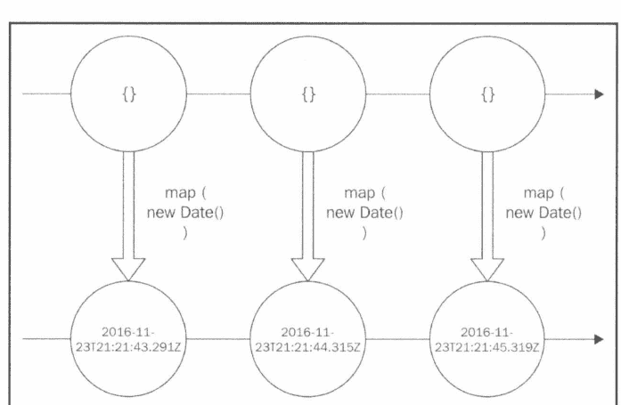

该图表准确描述了我们希望可观察对象的工作方式。我们使用 Bacon.interval() 方法生成一个新的可观察对象，该对象将使用 map() 函数发出当前日期。此函数在每次发出对象时执行。

查看此图表可以更轻松地理解如何使用 map () 函数来实现所需的行为。我们需要在原始代码中做一些小的更改，以使用 map () 运算符创建一个新的 EventStream，并将订阅更改为仅记录发出的事件。因此，使用 map () 运算符实现的所述图表的最终实现如下：

```
Bacon
    .interval(1000)
    .map(
        (i)=> new Date()
    )
    .onValue((date)=>console.log(date));
```

这会给你与之前代码相同的输出：

```
2016-11-23T21:21:43.291Z
2016-11-23T21:21:44.315Z
2016-11-23T21:21:45.319Z
```

在本节中，我想向你展示重用 eventStream 的示例。为此，我们将稍微改变原始问题。现在，我们只想打印秒数为偶数的日期。为此，我们需要一个新的运算符：filter() 运算符。此运算符允许你通过省略不感兴趣的某些事件来创建新的可观察对象。它的签名如下：

```
eventStream.filter(handler);
```

这里，handler 是一个函数，它接收发出的事件作为输入并返回 true 或 false（实际上，任何真值或假值）。因此，因为我们只想打印秒数为偶数的日期，我们将把以下 handler 作为参数传递给 filter 运算符：

```
(date)=>date.getSeconds() % 2 == 0
```

如你所见，此函数接收当前日期作为参数并获取该日期的秒数部分。此外，它使用 mod 运算符来判断它是否为偶数。


请注意，这种方法的一个优点是创建小型函数来实现代码的每个部分。这使我们的代码更易于测试，因为我们可以轻松地为每个函数创建单元测试。

现在，要实现只发出偶数日期的这个新可观察对象，我们所需要做的就是将 `filter()` 函数链接到我们之前的可观察对象，以便创建一个新的可观察对象，我们可以订阅它最终打印我们想要的内容。你可以在以下图表中看到此 `filter()` 运算符的使用：

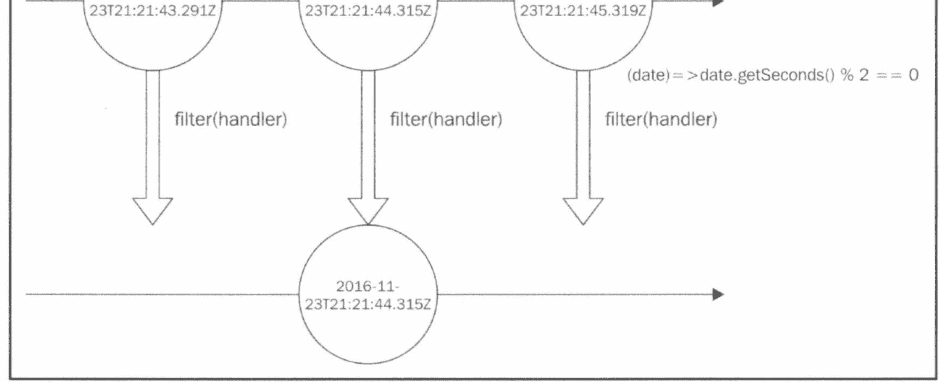

如该图表所示，在创建的可观察对象上，我们不发出秒数为奇数的日期。因此，我们没有它们的圆圈。现在，让我们更改使用 `map()` 函数的代码以同时使用 `filter()` 运算符。这可以很容易地通过以下代码完成：

```
Bacon
    .interval(1000)
    .map(
        (i)=> new Date()
    )
    .filter(
        (date)=>date.getSeconds() % 2 == 0
    )
    .onValue((date)=>console.log(date));
```

如果你在 node 程序中运行此代码，你会看到类似这样的结果：

```
2016-11-23T22:08:56.677Z
2016-11-23T22:08:58.715Z
2016-11-23T22:09:00.723Z
```

请注意，我们的新输出只包含秒数为偶数的日期。


这个输出有点令人困惑。可能很难看出它只打印秒数为偶数的日期（因为最后一部分是毫秒而不是秒）。因此，让我们在代码中做最后一次更改。如你所料，我们可以使用之前使用的相同运算符。为了演示这一点，让我们再次使用 map() 运算符从日期生成字符串。现在我们希望将输出更改为如下所示：

```
The number in the second part of the date XXX is YYY which is as even number
```

为此，让我们将过滤后的可观察对象与 map() 运算符链接起来，为可观察对象中的每个事件生成此字符串。新的可观察对象可以用以下图表表示：

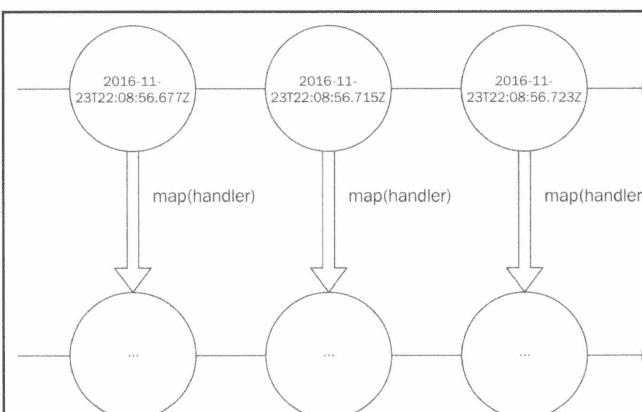


The handler function will be used to generate the final string from the date. As the result string is big, I decided to omit it in the result code, but it will follow the pattern I've described. So, first our handler function on the map() function should be as follows:

```
(date)=> 'The number in the second part of the date ' +
    date.toISOString() + ' is ' + date.getSeconds() +
    ' which is an even number'
```

Now, all we have to do is change our last observable with the map() operator. We can do this as follows:

```
Bacon
    .interval(1000)
    .map(
        (i)=> new Date()
    )
    .filter(
        (date)=>date.getSeconds() % 2 == 0
    )
    .map(
        (date)=> 'The number in the second part of the date ' +
        date.toISOString() + ' is ' + date.getSeconds() +
        ' which is an even number'
    )
    .onValue((date)=>console.log(date));
```

Running this code will display the following output, which accentuates the seconds part, making it easier for us to see that it really is an even number:

```
The number in the second part of the date 2016-11-23T22:29:42.694Z
    is 42 which is an even number
The number in the second part of the date 2016-11-23T22:29:44.749Z
    is 44 which is an even number
The number in the second part of the date 2016-11-23T22:29:46.757Z
    is 46 which is an even number
```

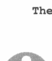

The Bacon.js has a lot of built-in operators. You can see their descriptions in their APIs. In this section, we only wanted to show how you can use operators to create new observables. We will see a few more operators in depth in the chapters which follow, using RxJS.

## 重用可观察对象

In the previous section, we saw how we can use operators to create new observables, but until this moment, we have never tried reusing an observable. To do this, I propose a change in the program we created in the previous section. We still want to print the string for every date where the seconds part is an even number. But now, let's also print the string a second has passed every second. To do this, we can use another Bacon.interval call to generate a new observable that emits an empty object every second. Once this is done, we can map each object in the observable to the string we want and finally subscribe to print, as you can see in the following code:

```
Bacon
    .interval(1000)
    .map(
        ()=> 'a second has passed'
    )
    .onValue((str)=> console.log(str));
```

If you add the preceding code to the last program, you will see the following output:

```
a second has passed
The number in the second part of the date 2016-11-23T22:42:18.683Z
    is 18 which is an even number
a second has passed
a second has passed
The number in the second part of the date 2016-11-23T22:42:20.696Z
    is 20 which is an even number
a second has passed
a second has passed
The number in the second part of the date 2016-11-23T22:42:22.702Z
    is 22 which is an even number
```

This solution is okay, but we can reuse the first Bacon.interval(), storing it in a variable. This way, we don't have to keep repeating this code every time we want a source of events emitting every second, using a variable as follows:

```
var emitsEverySecondStream = Bacon.interval(1000);
```

We can create better code by reusing this variable as follows:

```
var emitsEverySecondStream = Bacon.interval(1000);
emitsEverySecondStream.map(
    (i)=> new Date()
)
.filter(
    (date)=>date.getSeconds() % 2 == 0
)
```
```
.map(
    (date)=> 'The number in the second part of the date ' +
    date.toISOString() + ' is ' + date.getSeconds() +
    ' which is an even number'
)
.onValue((date)=>console.log(date));
emitsEverySecondStream.map(
    ()=> 'a second has passed'
)
.onValue((str)=> console.log(str));
```

This code gives us the same kind of output as from the previous example.

Another important feature when reusing observables is the ability to add multiple subscribers to the same observable. You can see this happening in the following code:

```
var eventStream = Bacon
    .interval(1000)
    .map(
    ()=> 'a second has passed'
    );
eventStream
    .onValue((str)=>console.log('Subscriber 1 prints => ' + str));
eventStream
    .onValue((str)=>console.log('Subscriber 2 prints => ' + str));
eventStream
    .onValue((str)=>console.log('Subscriber 3 prints => ' + str));
```

In this code, we added three subscriptions to the same EventStream. This will give us the following output:

```
Subscriber 1 prints => a second has passed
Subscriber 2 prints => a second has passed
Subscriber 3 prints => a second has passed
Subscriber 1 prints => a second has passed
Subscriber 2 prints => a second has passed
Subscriber 3 prints => a second has passed
```


Remember that the onValue() function returns a function to unsubscribe that function from the observable. So if you want, you can unsubscribe from each subscription individually without affecting other subscriptions.

## 可观察对象的延迟求值

In bacon.js, an observable doesn't emit any event unless someone is subscribed to listen to it. We can easily check this behavior using doAction(). This operator lets us run an arbitrary function every time an event is emitted from an observable.

If you create an observable from an array and add a doAction() operator to log your events then, without a subscription, it will print nothing to the console. So if you run the following code, you will see your program doesn't give you any output:

```
Bacon
.fromArray([1,2,3])
.doAction((value)=>
    console.log('running doAction')
);
```

As you can see in this code, we have no subscriber for the EventStream. This is why no event is emitted. However, if we add a subscriber to this EventStream, we will see the program print running doAction for each value:

```
Bacon
.fromArray([1,2,3])
.doAction((value)=>
    console.log('running doAction')
)
.log();
```

The preceding code gives you the following output:

```
running doAction
1
running doAction
2
running doAction
3
<end>
```

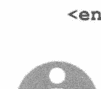

It is really important to keep this behavior in mind because ignoring this can lead to bugs that are really hard to identify.

## 摘要

In this chapter, you learned the basics of functional reactive programming using the `bacon.js` library. We wanted to give you the taste of functional reactive programming and also get your hands dirty with a lot of different examples.

You learned about observables and the different types of observables that bacon.js has implemented. You also learned about some of the built-in methods that help you create observables in bacon.js and also how you can create your own observable using the `fromBinder()` method.

Apart from this, you also learned how to subscribe and unsubscribe from an observable, how to use operators to transform an observable, and the importance of reuse in this context.

In the next chapter, we will start using RxJS as it gives us more tools for functional reactive programming. We will see how it compares with bacon.js and understand the basics of this new tool.
