# 4 转换数据 - Map、Filter 和 Reduce

# 转换数据 - Map、Filter 和 Reduce

在上一章中，我们开始讨论在程序中使用 RxJS。为了开始使用它，我们将 Reactive Extensions 中的 Observables 与 bacon.js 中的 EventStreams 和 Properties 进行了比较。然后我们查看了一些可用于创建 Observables 的最常见数据源，如下所示：

- 数组
- Range
- Interval
- Promises 和回调
- DOM 事件
- 任意数据源

在对如何创建 Observables 的 RxJS API 进行了初步概述后，我们学习了如何订阅它们，以便在 Observable 中有新数据可用时采取行动。订阅 Observable 意味着不仅能够对新传入的数据做出反应，还能在发生错误或 Observable 完成时采取某些行动。为此，我们学习了如何使用 `subscribe()` 方法，使用函数或通过创建 Observer。

我们还学习了如何使用 Subjects。Subjects 允许我们创建新的 Observables 并持续向它们推送数据。

RxJS 为我们提供了对 Observables 甚至应用程序生命周期的更多控制。此外，在上一章中，我们使用了 Disposables 和 Schedulers。它们让我们能够拆除对象并控制如何在 Observable 序列中发布项目。

凭借我们迄今为止积累的知识，我们现在准备向我们的 observables 添加操作符，使其更具可重用性和可测试性。

在本章中，我们将查看构成任何函数式响应式程序骨干的四个操作符。它们如下：

- map()
- flatMap()
- filter()
- reduce()

这些是最广泛使用/最重要的操作符。本章将充满大量示例，帮助你理解这些操作符的用法。如果你能很好地掌握它们，它们将使你在函数式响应式编程中的道路变得容易得多，使你能够学习更具体的操作符以及如何组合操作符。

在本章中，你将学习以下主题：

- 向 Observables 添加操作符
- 使用 map() 和 flatMap() 操作符
- 使用 filter() 操作符
- 使用 reduce() 操作符

## 向 observables 添加操作符

在第 2 章《Reacting for the First Time》中，我们使用 bacon.js 使用了操作符。它们让我们在数据到达给定 Observable 的订阅者之前对其进行转换。RxJS 中的操作符的工作方式与 bacon.js 中的类似；有些甚至具有相同的名称。它们只是从 Observable 对象调用的方法，如以下示例所示：

```
Rx.Observable
  .just('Hello ')
  .map((msg)=>msg+'World')
  .subscribe((msg)=> console.log(msg));
```

在这个示例中，我们创建了一个 Observable，它只发出一个字符串，并在此 Observable 上调用了 map() 操作符并订阅它以在控制台中显示结果：

```
Hello World
```


如果你记不起第 2 章《Reacting for the First Time》中介绍的 map() 操作符，不用担心！我们将在本章后面看到更多关于它的内容以及它的作用。

每次你在 observable 上调用一个操作符时，它都会返回一个新的 observable，并应用该转换。这样，我们就可以轻松地链式调用多个操作符，如下所示：

```
Rx.Observable
.of(1,2,3)
.map((num)=>num*2)
.filter((num)=> num>2)
.subscribe((num)=>console.log(num));
```

在前面的示例中，我们创建了一个发出三个数字的 Observable。然后我们在此 Observable 上调用 map() 操作符来先转换数据，然后应用 filter() 操作符来生成一个新的 Observable。这段代码也可以写成如下形式：

```
var initialObservable = Rx.Observable.of(1,2,3);
var initialMappedObservable = initialObservable
    .map((num)=>num*2);
var initialMappedAndFilteredObservable = initialMappedObservable
    .filter((num)=> num>2);
initialMappedAndFilteredObservable.subscribe((num)=>console.log(num));
```

两者在执行时提供相同的输出：

```
4
6
```

应用操作符后创建的每个 Observable 都可以被订阅，从而提高代码的复用性。使用操作符，我们可以编写更简洁且更易于测试的代码，因为它让我们能够将数据的来源与对数据的处理分离。

## map() 操作符

map() 操作符在函数式语言和框架中处理数组或其他类型的序列时很常见。在 JavaScript 中，数组对象有一个名为 map() 的方法。该方法现在在所有现代浏览器中都可用。

map() 操作符对 Observable 中的每个元素调用提供的函数一次。该函数以 Observable 中的对象作为输入并返回另一个对象。因此，map() 操作符返回的 Observable 将传播对原始 Observable 的每个元素调用 map 函数的结果。

提供的函数在原始 Observable 传播对象时立即被调用；调用顺序相同。

因此 map() 操作符具有以下签名：

```
observable.map(mapFunction, [thisContext]);
```

第一个参数是必需的，第二个是可选的：
- mapFunction: 这是一个函数，它以 observable 的元素作为输入并返回另一个要传播的对象
- thisContext: 这是任何用作 mapFunction 的 this（JavaScript 上下文）的对象

如果我们有一个数字的 Observable 并想通过将这些数字加倍来创建一个新的 Observable，我们可以使用 map() 操作符，如下所示：

```
Rx.Observable
  .of(1,2,3)
  .map((i)=>i*2)
  .subscribe((i)=>console.log(i));
```

在这段代码中，首先我们创建了一个传播三个数字（1、2 和 3）的 Observable。然后，我们在此 Observable 上应用 map() 操作符；这创建了一个具有映射后对象的新 Observable。然后我们订阅此 Observable 以记录所有元素。如果运行前面的代码，你将在控制台中看到以下输出：

```
2
4
6
```

此操作可以用以下图表表示：

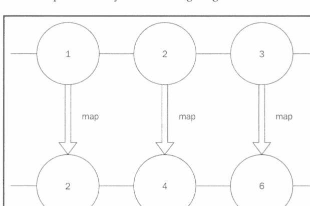

此操作符可用于任何类型的对象，并且如本章所述，它不会更改初始 Observable，并且始终创建一个新的 Observable：

```
var namesObservable = Rx.Observable.of("John", "Mary")

var helloObservable = namesObservable.map((name)=>"Hello "+name)
helloObservable.subscribe((i)=>console.log(i));

var thanksObservable = namesObservable.map((name)=>name+" thanks for your visit.")
thanksObservable.subscribe((i)=>console.log(i));
```

在前面的代码中，我们从两个用户名（John 和 Mary）创建了一个 Observable。然后我们将其映射为一个对每个用户说 hello 的字符串 Observable，并订阅该 observable 以在控制台中打印每条消息。我们还使用原始 Observable（仅包含名称）为不同的消息创建了一个新的 Observable，然后订阅它以记录消息。如果运行前面的代码，你将看到以下输出：

```
Hello John
Hello Mary
John thanks for your visit.
Mary thanks for your visit.
```


此操作符有一个别名，称为 `select`。

## flatMap() 操作符

在上一节中，我们看到了 `map()` 操作符以及如何使用它将 observable 中的一个对象映射为另一个对象。`flatMap()` 操作符的工作方式类似。它接收一个函数作为参数。作为参数提供的函数必须返回一个 Observable，并且该 Observable 的元素将被传播。

这个操作符可能看起来有点令人困惑，但还有另一种理解方式。`flatMap()` 操作符对原始数组中的每个元素运行给定的函数。它创建一个 Observable，该 Observable 将发出来自其他 Observable 的每条数据，同时保持顺序。

`flatMap()` 操作符的签名如下所示：

```
observable.flatMap(flatMapFunction, [thisContext]);
```

第一个参数是必需的，第二个是可选的：
- `flatMapFunction`: 这是一个函数，它以 observable 的元素作为输入并返回另一个其元素将被传播的 observable
- `thisContext`: 这是任何用作 `flatMapFunction` 的 `this`（JavaScript 上下文）的对象

你可以在以下代码中看到此操作符的示例用法：

```
Rx.Observable
  .of(1,2,3)
  .flatMap((i)=>Rx.Observable.of(i,i*2))
  .subscribe((i)=>console.log(i));
```

在前面的示例中，我们首先创建一个将传播三个数字（1、2 和 3）的 Observable。然后，我们在此 Observable 上应用 `flatMap()` 操作符；这将创建一个新的 Observable，该 Observable 将发出每个 Observable 发出的每个值，并且它将由 `flatMapFunction` 返回。`flatMapFunction` 返回一个包含该值及其两倍的 Observable。因此在值 1 的示例中，我们创建一个发出值 1 和 2 的 Observable；对于值 2，我们发出 2 和 4；对于值 3，我们发出 3 和 6。

如果我们运行前面的代码，它将显示以下输出：
1
2
2
4
3
6

此操作可以用以下图表表示：

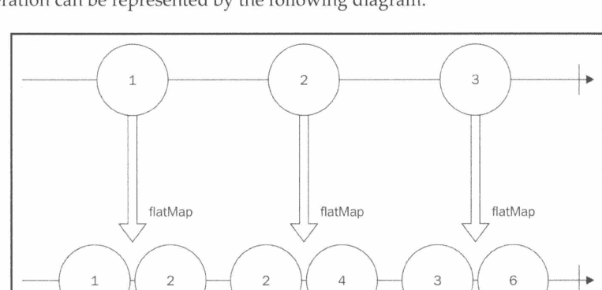

我们可以轻松地链式调用不同的操作符，如下所示：

```
Rx.Observable
    .of(1,2,3)
    .map((i)=>i+1)
    .flatMap((i)=>Rx.Observable.of(i,i*2))
    .subscribe((i)=>console.log(i));
```

在前面的示例中，我们链式调用了 map() 和 flatMap() 操作符。首先我们为 1、2 和 3 创建一个 Observable，然后使用 map() 操作符为每个值加 1（现在我们有一个值为 2、3 和 4 的 Observable）。然后，我们使用 flatMap() 操作符发出一个包含该值及其两倍的新序列。

如果运行前面的代码，你将看到以下输出：
2
4
3
6
4
8


此操作符有一个别名，称为 `selectMany`。

## filter() 操作符

`filter()` 操作符让你在从原始 Observable 中省略部分数据后创建一个新的 Observable。它接收一个作为参数的函数，该函数对原始 Observable 中的每个元素调用，并且必须返回 true 或 false（实际上它可以是任何 truthy 或 falsy 值）。如果对某个对象执行 `filterFunction` 的结果为 true，则该对象将被传播；否则将被省略。

`filter()` 操作符具有以下签名：

```
observable.filter(filterFunction,[thisContext]);
```

第一个参数是必需的，第二个是可选的：
- `filterFunction`: 这是一个函数，它以 observable 的元素作为输入并返回任何 truthy 或 falsy 值。如果对给定对象执行此函数的结果为 true，则该对象将被传播；否则将被省略。
- `thisContext`: 这是任何用作 `filterFunction` 的 `this` 的对象

我们可以按如下方式看到 `filter()` 的使用示例：

```
Rx.Observable
.of(1,2,3)
.filter((i)=> i % 2 === 1 )
.subscribe((i)=>console.log(i));
```


在前面的示例中，我们首先创建一个 Observable，它将传播三个数字（1、2 和 3）。然后，我们在此 Observable 上应用 `filter()` 操作符；这将创建一个新的 Observable，它只会发出满足 i % 2 === 1 的值 i。因此新的 Observable 只传播奇数。

如果运行前面的代码，你将看到以下输出：

1
3

此操作也可以用下面的图表表示：

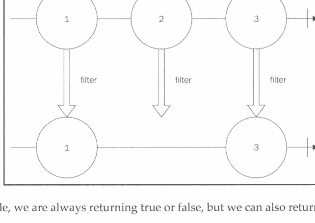

在此示例中，我们始终返回 true 或 false，但我们也可以返回任何 truthy 或 falsy 值。

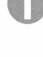

Truthy 值是指在作为布尔值求值时表现为 true 的任何对象。Falsy 值是指在作为布尔值求值时表现为 false 的值。

Falsy 值如下：

- False
- 0
- ""(empty string)
- Null
- Undefined
- NaN

JavaScript 中所有其他值都是 truthy 值。

下面是一个仅过滤 Observable 中 truthy 值的示例：

```
Rx.Observable
.of(0,1,"hello",null,"")
.filter((i)=> i )
.subscribe((i)=>console.log(i));
```

如果运行前面的代码，你将看到以下输出：

```
1
hello
```


该操作符有一个别名叫做 where。

### reduce() 操作符

reduce() 操作符允许你运行一个函数，将 Observable 的所有值累积起来，生成一个仅包含一个值（累积值）的新 Observable。

该操作符的签名如下：

```
observable.reduce(accumulatorFunction,[initialValue]);
```

第一个参数是可选的，第二个参数是强制的：

- `accumulatorFunction`: 这是一个用于从 observable 累积值的函数。该函数最多可接收四个参数：
  - `acc`: 这是累积值
  - `currentValue`: 这是本次迭代中使用的值
  - `currentIndex`: 这是本次迭代的基于零的索引
  - `source`: 这是所使用的 observable
- `initialValue`: 这是初始累加器

我们可以使用此函数将包含数字的 Observable 中的所有值相加，如下所示：

```
Rx.Observable
.of(1,2,3)
.reduce((acc,current)=>acc+current)
.subscribe((i)=>console.log(i));
```

在此示例中，我们首先创建一个 Observable，它将传播三个数字（1、2 和 3）。然后，我们在此 Observable 上应用 reduce() 操作符；这将创建一个仅包含一个值的新 Observable，该值是此序列中每个元素的总和。

此方法按以下迭代运行：

1. 如果提供了初始值，我们将其用作累加器，并将序列中的第一个元素用作当前值；如果没有，则使用序列中的第一个元素作为累加器，第二个作为当前值。
2. 对累加器和当前值运行 `accumulatorFunction`。
3. 将当前值设为序列中的下一个元素。
4. 返回步骤 2，直到处理完整个列表。

因此，如果运行前面的代码，你将看到以下输出：

此操作可以用下面的图表表示：

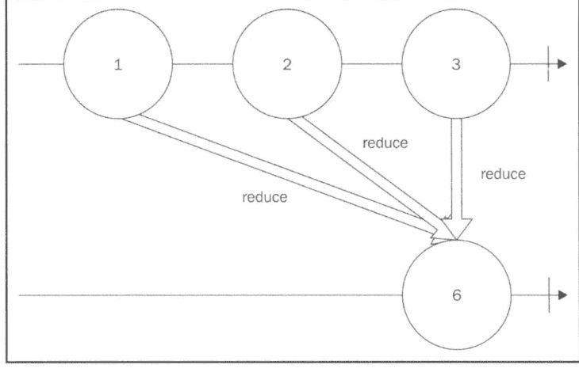

我们也可以为 reduce() 操作符提供初始值，如以下示例所示：

```
Rx.Observable
.of("w","o","r","l","d")
.reduce((acc,current)=>acc+current, "Hello ")
.subscribe((i)=>console.log(i));
```

正如你所想象的，运行此代码将连接整个字符串，因此你可以在控制台看到以下消息：

```
Hello world
```

### Summary

在本章中，我们学习了如何将操作符应用于 observable。这有助于解耦我们的代码并提高其可测试性和可读性。这是在 RxJS 中首次使用以下操作符，如 map()、flatMap()、filter() 和 reduce()。

这些是 RxJS 中使用最广泛的操作符，因此也是最重要的操作符。我们在 bacon.js 中使用过其中一些，但在本章中，我们能够更深入地研究每一个；图表和示例只帮助我们更好地理解它们的使用。

在下一章中，我们将讨论 observable 上的背压问题以及我们可以采取哪些措施来缓解此问题。我们还将了解更多关于从 observable 过滤数据的操作符。

# 5 世界变化太快 - 处理背压的操作符

# 世界变化太快 - 处理背压的操作符

在上一章中，我们学习了如何使用操作符转换 observable 发出的数据，以及如何链式使用此操作符，使其可重用，因为每个操作符都会创建一个新的 observable，该 observable 可被多个观察者使用。

我们学习了如何使用以下四个不同的操作符：

- `map()`
- `flatMap()`
- `filter()`
- `reduce()`

这些操作符在函数式响应式编程中最重要且最常用。我们看到了示例和图表，以确保我们理解如何使用这些操作符。

这些操作符的使用超出了上一章。我们将在整本书中继续使用它们，并在最后两章中大量使用它们，因为我们将使用函数式响应式编程（使用 `RxJS` 库）创建一个实时网络聊天的客户端和服务器

在本章中，我们将介绍程序中的一个常见问题以及如何使用函数式响应式编程操作符来缓解它。此问题称为 **背压**。我们还将介绍更多用于从 observable 过滤数据的操作符。

在本章中，我们将介绍以下主题：

- 什么是背压？
- 如何使用 RxJS 缓解背压？
- 处理背压的有损策略
- 处理背压的无损策略
- 缓冲 observable
- 暂停 observable
- 处理背压的操作符
- 过滤数据的操作符

### 什么是背压？

在使用函数式响应式编程时，我们使用数据或事件流（称为 observable）来建模问题，这些流可以被转换（使用操作符）并最终导致某些效果（通过观察者）。现在想象一下，我们有一个 observable，其发出数据的速度比观察者处理的速度快；这将导致一个称为背压的问题。

当我们希望保持 observable 以一定的节奏运行时，也会出现此问题。想象一下，你想将某个 hashtag 的所有推文记录到控制台，但你希望每隔几秒最多记录一条，以确保用户可以阅读推文。如果该 hashtag 每秒的推文数超过人类阅读能力，也会导致背压。

使用 RxJS，我们有两种可能的策略来处理此问题。

我们可以丢弃一些数据。你可能对用户鼠标的所有移动或某个 hashtag 的所有推文都不感兴趣。你只关心大局。

你也可以将数据排队，直到你有能力处理它或批量处理它。

### 处理背压的常见策略

在 RxJS 中，我们有几个操作符可以用来缓解背压问题，它们属于两种不同的策略家族：有损策略和无损策略。我们将在本章中详细了解每一种。

### 处理背压的有损策略

处理背压的有损策略是我们想要丢弃一些数据时必须使用的策略。正如我们所讨论的，你可能对用户鼠标的所有移动都不感兴趣。


有损策略允许你使用常量内存来缓解背压问题，因为我们不保留任何缓冲区。

### throttle() 操作符

处理背压的第一个有损技术是 throttle() 操作符。此操作符允许你以一定的间隔传播 observable 发出的元素。

此操作符非常适合实现速率限制，例如以人类可阅读的速度显示推文的问题。

throttle() 操作符的签名如下：

```
observable.throttle(interval, [scheduler]);
```

第一个参数是强制的，第二个是可选的：

- interval: 这是数据发出之间以毫秒为单位的时间间隔
- scheduler: 用于传播数据


最简单展示此操作符用法的方式是将其应用于已以特定速率发出元素的可观察对象。我们可以使用 throttle() 方法进一步限制该速率并验证响应。我们可以通过 interval() 方法创建 Observable 来实现，如以下示例所示：

```
Rx.Observable
.interval(50)
.subscribe((i)=>console.log(i));
```

如果运行此示例，你将在控制台中看到大量数字被快速打印：

```
0
1
2
3
//continues printing until you stop the program
```

但我们可以使用 throttle() 操作符来控制输出速率。使用此方法，我们还会丢弃部分数据，因此不会看到所有数字都被打印：

```
Rx.Observable
.interval(50)
.throttle(1000)
.subscribe((i)=>console.log(i));
```

如果运行此代码，你将看到如下输出：

```
0
18
37
//continues printing until you stop the program
```


控制台中打印的数字在不同执行中可能会有所不同。

此操作在下图中进行了说明：

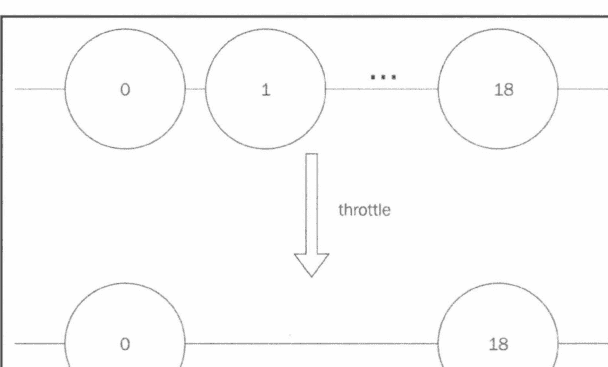

在此示例中，我们使用的是无限序列。现在让我们在有限的可观察对象中测试此操作符，并将其应用于 subject（以便不忘记如何使用 subject）：

```
var subject = new Rx.Subject();

var throttledObserver = subject.throttle(50);

throttledObserver.subscribe(
    (i)=>console.log(i),
    (err)=>console.log(err),
    ()=>console.log('Finished')
);

subject.onNext(0);
subject.onNext(1);

setTimeout(()=>{
    subject.onNext(2);
    subject.onNext(3);
    subject.onCompleted();
},200);
```

在前面的代码中，我们首先创建了一个 `subject`。然后我们调用 `throttle()` 操作符，以每 50 毫秒最多一个的最大速率接收数据，并 `subscribe` 到它（用于数据、错误和完成）。然后我们将数据推送到我们的 `subject`。如果运行此代码，我们将看到以下输出：

```
0
2
Finished
```

`throttle()` 方法首先会传播可观察对象中的第一个元素（数字 0），第二个元素（数字 1）将被丢弃（因为我们没有经过 50 毫秒的间隔）。我们在 200 毫秒后才有新数据可用，我们会传播它（数字 2），因为自上次数据传播（数字 0）以来我们已等待超过 50 毫秒。然后我们将 `subject` 中的最后一个元素（数字 3）推送出去，它将被丢弃（自上次发射（数字 2）以来不到 50 毫秒），最后我们完成 `subject`。

## sample() 操作符

`sample()` 操作符也可以以有损的方式用于缓解背压问题。它允许你在每个给定间隔接收来自可观察对象的数据。

`sample()` 操作符具有以下签名：

```
observable.sample(interval, [scheduler]);
```

第一个参数是必需的，第二个是可选的：

- `interval`：这是数据发射之间以毫秒为单位的时间间隔。此参数也可以是一个 `observable`。在这种情况下，该 `observable` 将用于采样数据。
- `scheduler`：用于传播数据

让我们使用 `throttle()` 方法中的相同示例（使用 `interval()` 方法创建 `Observable`）并将其更改为使用 `sample()` 方法：

```
Rx.Observable
  .interval(50)
  .sample(1000)
  .subscribe((i)=>console.log(i));
```

如果运行此代码，你将看到如下输出：

```
18
37
//continues printing until you stop the program
```


控制台中打印的数字在不同执行中可能会有所不同。

此操作在下图中进行了说明：

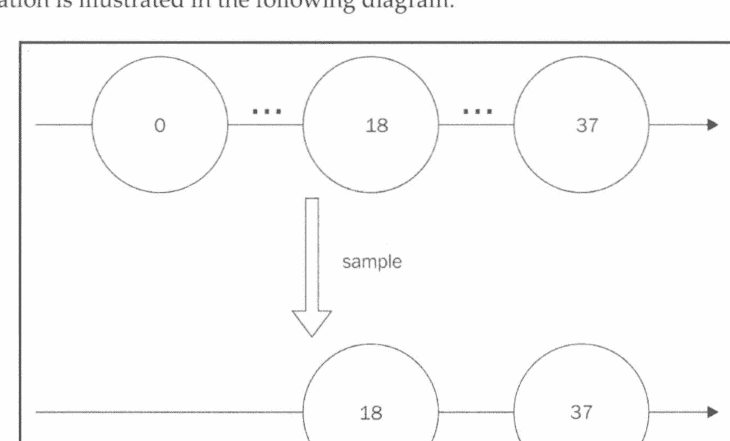

我们也可以修改此代码以使用 sample() 可观察对象而不是数字：

```
Rx.Observable
  .interval(50)
  .sample(Rx.Observable.interval(1000))
  .subscribe((i)=>console.log(i));
```

运行此代码将打印与之前相同的输出。

此代码与 throttle() 方法中的另一个示例略有改动：

```
var subject = new Rx.Subject();
var sampledObserver = subject.sample(50);

sampledObserver.subscribe(
    (i)=>console.log(i),
    (err)=>console.log(err),
    ()=>console.log('Finished')
);
subject.onNext(0);
subject.onNext(1);

setTimeout(()=>{
    subject.onNext(2);
    subject.onNext(3);
    subject.onCompleted();
},200);
```

如果运行此代码，你将看到以下输出：

```
1
3
Finished
```

这是因为 sample() 操作符会等待 50 毫秒并发送最后发出的数据（数字 1）。在超过 50 毫秒后，没有数据发出，因此它不会传播任何数据。200 毫秒后，我们在 subject 中推送两个数字（2 和 3）并完成它，因此 sample() 方法会传播最后一个（数字 3）并结束。

## debounce() 操作符

用于背压的下一个有损技术是使用 debounce() 操作符。此操作符仅在可观察对象的最后一次发射过去后经过一定间隔才发出数据。

此方法非常适合实现诸如边输入边搜索之类的功能，因为我们可能不想为用户的每次按键都调用服务器。使用此方法，我们可以让用户继续输入，仅在用户停止输入几毫秒后才进行搜索。

debounce() 操作符具有以下签名：

```
observable.debounce(interval, [scheduler]);
```

第一个参数是必需的，第二个是可选的：

- `interval`：这是等待的时间（毫秒）
- `scheduler`：用于传播数据

`throttle()` 操作符的第一个示例使用由 `interval()` 创建的 `Observable`。现在让我们更改该示例以使用 `debounce()` 操作符：

```
Rx.Observable
  .interval(50)
  .debounce(1000)
  .subscribe((i)=>console.log(i));
```

如果运行此代码，控制台中不会打印任何内容，因为 `Observable` 从未在不发射值的情况下停留 1000 毫秒，但让我们假设我们可以将 debounce 设置为 10 而不是 1000，如下所示：

```
Rx.Observable
  .interval(50)
  .debounce(10)
  .subscribe((i)=>console.log(i));
```

在这种情况下，你将在控制台中看到以下内容被打印：

```
0
1
2
3
//continues printing until you stop the program.
```

此操作在下图中进行了说明：

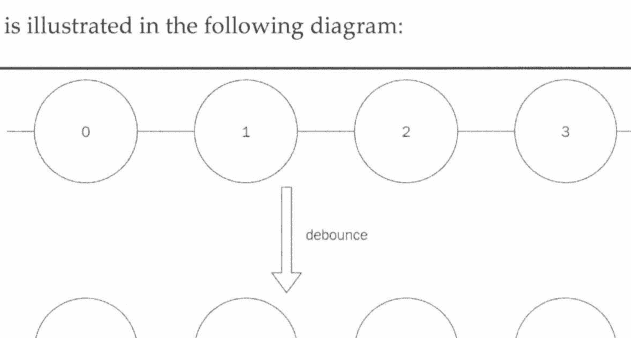

现在让我们看看我们讨论的用户输入过快的情况。让我们检查以下示例：

```
<html>
<head></head>
<body>

<input type="text" id="my_input" />

<ul id="my_ul"></ul>

<script
src="https://cdnjs.cloudflare.com/ajax/libs/rxjs/4.1.0/rx.all.js"></script>

<script>
Rx.Observable
    .fromEvent(document.getElementById("my_input"),"keyup")
    .map(function(e){return e.target.value;})
    .debounce(200)
    .subscribe(function(text){
        var node = document.createElement("li");
        var textnode=document.createTextNode("CALLING THE SERVER WITH ==> "+text);
        node.appendChild(textnode);
        document.getElementById('my_ul').appendChild(node);
    });
</script>
</body>
</html>
```

在此示例中，我们创建一个 HTML 页面，其中包含一个文本输入、一个 ul 用于显示我们运行 subscribe() 函数的时刻，并将 RxJS 库作为依赖项添加。然后我们有一个包含脚本的脚本块。

在此脚本中，我们首先为输入文本中的每个 keyup 事件创建一个 Observable。我们将此事件映射到输入文本的值（我们输入的文本），因为我们不想为每次按键都运行订阅。我们将对其进行 200 毫秒的 debounce，因此只有在输入文本中超过 200 毫秒未输入时才调用观察者。我们的观察者创建一个 li，其中包含用于搜索的文本。由于我们没有要调用的 API，因此我们只会将其添加到页面中。


这在下面的截图中有所说明：

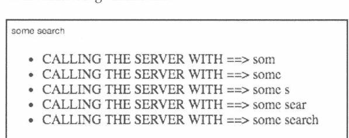

## pausable() 可观察对象

实现有损反压处理技术的最后一个操作符是 pausable() 操作符。该操作符返回一个 pausable() 可观察对象，这样我们就可以暂停它（暂停期间丢弃所有数据），并在准备好接收更多数据时恢复它。

pausable() 方法的签名如下：

```
observable.pausable();
```

如你所见，它不接受任何参数。

我们可以在以下代码中看到此操作符的使用示例：

```
var pausableObservable = Rx.Observable
    .interval(50)
    .pausable();
pausableObservable.subscribe((i)=>console.log(i));

pausableObservable.pause();

setTimeout(()=>{
    pausableObservable.resume();
},2000);
```

如果运行此代码，你将在控制台看到以下输出：

```
0
1
2
3
//continues printing until you stop the program
```

在此示例中，我们创建了一个每 50 毫秒发出一次数据的 Observable，但在订阅后立即暂停它，因此没有数据发出。然后在 2000 毫秒后，一个函数被调用，我们恢复可观察对象，于是它开始打印数据。


此方法仅适用于热可观察对象。通过 interval() 方法创建的可观察对象是冷可观察对象，因此不会丢弃任何数据。

现在让我们在 subject 中检查此方法：

```
var subject = new Rx.Subject();
var pausableObservable = subject.pausable();

pausableObservable.subscribe(
  (i)=>console.log(i),
  (err)=>console.log(err),
  ()=>console.log('Finished')
);

pausableObservable.pause();

subject.onNext(0);
subject.onNext(1);

setTimeout(()=>{
  subject.onNext(2);
  subject.onNext(3);
  subject.onCompleted();
},200);
setTimeout(()=>{
  pausableObservable.resume();
},2000);
```

我们使用的是本节所有示例中使用的同一个 subject。唯一的变化是我们先暂停它，然后再推送任何数据，并且只在所有数据推送完毕后才恢复它，因此如果运行此代码，我们将在控制台看到以下打印内容：

```
Finished
```

所有数据都被丢弃，因为数据是在可观察对象暂停期间推送的。此操作在下面的图表中有所说明：

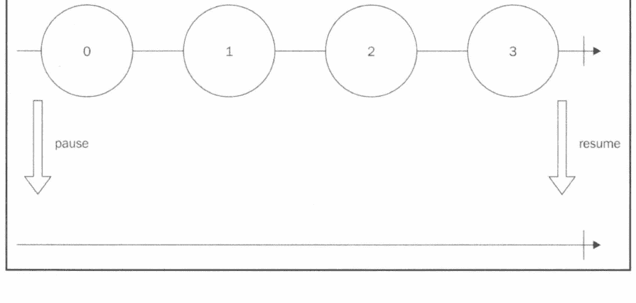

## 处理反压的无损操作符

处理反压的无损策略是我们无法承受数据丢失时必须使用的策略。如果你使用它们来显示网页聊天中的消息，你可能希望对它们进行缓冲。


使用无损策略缓解反压问题时要小心，因为这会增加程序所需的内存。

## 缓冲

处理反压的第一个无损技术是使用缓冲区存储数据，以便我们可以批量处理。

所有用于缓冲数据的操作方法名称都以 buffer 开头（这里我们将学习 bufferWithCount()、bufferWithTime() 和 bufferWithTimeOrCount()），基本上它们会将数据存储在内存中，直到缓冲区被填满并传播包含数据的数组。


如果可观察对象传播错误消息，则该消息将立即发送，而不会先发出缓冲区，即使缓冲区包含数据。

## bufferWithCount() 操作符

第一个用于缓冲数据的方法是 bufferWithCount()。bufferWithCount() 方法允许你指定缓冲区的大小。使用此方法，数据将存储在数组中，直到该数组的大小达到给定计数，然后此数组将被传播。

bufferWithCount() 方法的签名如下：

```
observable.bufferWithCount(size, [skip]);
```

第一个参数是必需的，第二个是可选的：

- size：这是一个指定缓冲区大小的数字。
- skip：这是一个指定创建下一个缓冲区时应跳过多少个项目的数字。如果未提供，则默认为 size（这样下一个缓冲区将只包含新元素）。

现在让我们看一个此方法的使用示例：

```
Rx.Observable
  .interval(50)
  .bufferWithCount(2)
  .subscribe((arr)=>console.log(arr));
```

在此示例中，我们首先创建一个间隔为 50 毫秒的 Observable。我们然后使用 bufferWithCount() 方法将其缓冲为 10 个一组，最后打印到控制台。

如果运行此代码，你将看到以下输出：

```
[ 0, 1]
[2, 3]
//continues printing until you stop the program
```

此操作在下面的图表中有所说明：

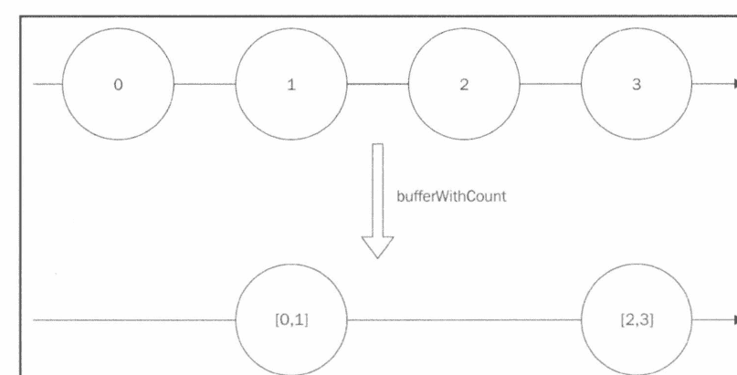

现在让我们看看如果在我们的 `buffer` 中传播错误会发生什么。为此，让我们创建一个 `subject`：

```
var subject = new Rx.Subject();

var bufferedObservable = subject.bufferWithCount(2);

bufferedObservable.subscribe(
  (i)=>console.log(i),
  (err)=>console.log('An error happened ' + err.message),
  ()=>console.log('Finished')
);

subject.onNext(0);
subject.onNext(1);
subject.onNext(2);

subject.onError(new Error(':('));

subject.onNext(3);
subject.onCompleted();
```

在此示例中，我们首先创建一个 `subject` 并使用 `bufferWithCount()` 创建每两个项目一组的数据块并订阅它。然后我们推送三个值（0、1 和 2）。前两个（0 和 1）将被传播并打印到控制台，第三个被缓冲，直到错误被推送到 `subject`。这使得错误直接通过可观察对象传播。

如果运行此代码，你将看到以下输出：

```
[ 0, 1 ]
An error happened :(
```

现在，你可能会想知道如果一个可观察对象完成而计数未达到期望计数会发生什么。为了测试它，我们可以使用一个简单的程序：

```
Rx.Observable
  .of(0,1,2,3,4)
  .bufferWithCount(2)
  .subscribe((i)=> console.log(i));
```

如果运行此代码，你将看到以下输出：

```
[ 0, 1 ]
[ 2, 3 ]
[ 4 ]
```

因此，如你所见，如果原始可观察对象完成，RxJS 将刷新当前缓冲区。

现在让我们看看第二个参数是如何工作的，比较两个订阅：

```
var observable = Rx.Observable.interval(1000);

var observableWithDefaultSkip = observable.bufferWithCount(4);
var observableWithSkipOne = observable.bufferWithCount(4,1);

observableWithDefaultSkip.subscribe((arr)=>console.log('with default skip :'+arr));
observableWithSkipOne.subscribe(
  (arr)=>console.log('with default skip equals to one:'+arr)
);
```

如果运行此代码（并等待片刻），你将看到如下输出：

```
with default skip :0,1,2,3
with default skip equals to one:0,1,2,3
with default skip equals to one:1,2,3,4
with default skip equals to one:2,3,4,5
with default skip equals to one:3,4,5,6
with default skip :4,5,6,7
with default skip equals to one:4,5,6,7
//continues printing until you stop the program
```

从输出可以看出，如果你不提供 skip 值，缓冲区在被传播后基本上会被清除。这样它每 4 秒才运行一次（因为我们的原始可观察对象每秒推送一个值，需要 4 秒才能填满数组中的四个项目），但如果你提供一个 skip 值，它将移除这数量的项目（从左到右）并始终在数组末尾推送新值。这样它每秒运行一次（因为我们的缓冲区始终保留上一个缓冲区的三个项目，只需 1 秒即可填满数组）。

最后，bufferWithCount() 方法的一个有用应用是计算序列中最后 X 个数字的平均值。为了展示此应用，让我们首先创建一个用于生成随机数的 Observable：

```javascript
var randomNumbersGenerator = Rx.Observable
    .interval(100)
    .map((i)=>Math.floor(Math.random()*100));
```

这里我们创建一个每 100 毫秒生成一个项目的 Observable。然后我们将其映射为 0 到 99 之间的整数值。

现在让我们计算最后五个项目的平均值。为此，我们调用 bufferWithCount() 方法，大小为 5，skip 为 1。然后我们计算平均值并打印到控制台。

完整代码如下：

```javascript
var randomNumbersObservable = Rx.Observable
    .interval(100)
    .map((i)=>Math.floor(Math.random()*100));

randomNumbersObservable
    .bufferWithCount(5,1)
    .map((arr)=>{
        var sum = arr.reduce((acc,b)=>acc+b);
        return sum/arr.length;
    })
    .subscribe((i)=>console.log('The average of the last five items is: '+i));
```


如果运行此代码，你将看到如下输出（值可能因程序的不同执行而有所变化）：

```
The average of the last five items is: 54.8
The average of the last five items is: 60.6
The average of the last five items is: 62.6
//... continues printing until you stop the program
```

## bufferWithTime() 操作符

下一个用于缓冲数据的操作符让你在一定时间内缓冲数据。它叫做 bufferWithTime()。此操作符会将数据存储在数组中，直到经过给定的时间。

bufferWithTime() 方法具有以下签名：

```
observable.bufferWithTime(time, [skipTime], [scheduler]);
```

第一个参数是必需的，另外两个是可选的：

- time: 这是缓冲数据的时间（以毫秒为单位），在传播之前
- skipTime: 这与 bufferWithCount() 中的 skip 参数类似，但它是跳过的毫秒时间
- scheduler: 用于传播数据

此方法的使用示例如下：

```
Rx.Observable
  .interval(100)
  .bufferWithTime(210)
  .subscribe((arr)=>console.log(arr));
```

它从 interval() 创建一个 Observable，将数据缓冲 1000 毫秒，然后使用 subscribe() 将其记录到控制台。

运行此代码，你将看到以下输出：

```
[ 0, 1 ]
[ 2, 3 ]
[ 4, 5 ]
//continues printing until you stop the program
```

此操作在以下图表中进行了说明：

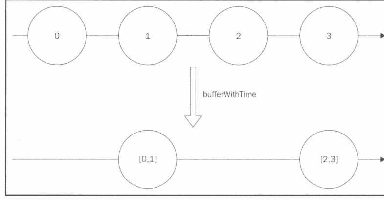

现在，你可能会想知道如果时间已过而原始 observable 没有发送数据会发生什么；你有两个合理的猜测：

- 数据不会被传播
- 会传播一个空数组

为了测试它，让我们从 interval() 创建一个 Observable 并对其使用 filter()，以便只传播几个元素：

```
Rx.Observable
.interval(50)
.filter((i)=>i<10)
.bufferWithTime(150)
.subscribe((arr)=>console.log(arr));
```

如果运行此代码，我们将看到以下输出：

```
[ 0, 1 ]
[ 2, 3, 4 ]
[ 5, 6, 7 ]
[ 8, 9 ]
[]
[]
[]
//keeps printing empty array
```

因此，查看控制台中的输出，很容易看出正确答案：会传播一个空数组。

我们还可以将来自 `bufferWithCount()` 操作符的最后一个示例更改为，每秒计算最后 5 秒内数字的平均值。为此，我们所要做的就是使用操作符 `bufferWithTime()` 并调整 time 和 `skipTime` 参数：

```
var randomNumbersObservable = Rx.Observable
    .interval(100)
    .map((i)=>Math.floor(Math.random()*100));

randomNumbersObservable
    .bufferWithTime(5000,1000)
    .map((arr)=>{
    var sum = arr.reduce((acc,b)=>acc+b);
    return sum/arr.length;
    })
    .subscribe((i)=>console.log('The average of the last five second is: '+i));
```

正如你所见，我们将操作符 `bufferWithCount()` 改为使用 `bufferWithTime()`。我们将缓冲 5000 毫秒并使用 1000 毫秒的窗口，并且还更改了要在控制台中打印的消息，因为现在我们显示的是 `The average of the last five seconds` 而不是最后五个项目。

如果运行此代码，你将看到如下输出：

```
The average of the last five seconds is: 48.875
The average of the last five seconds is: 50.08163265306123
The average of the last five seconds is: 49.61224489795919
The average of the last five seconds is: 49.3125
//continues printing until you stop the program
```

## bufferWithTimeOrCount() 操作符

我们将看到的最后一个用于缓冲数据的操作符是 `bufferWithTimeOrCount()` 操作符。在最近的两次课程中，我们学习了 `bufferWithCount()` 操作符，它让我们可以对数组的大小设置限制，以及 `bufferWithTime()` 操作符，它让我们可以对填充缓冲区的時間设置限制。有时我们可能希望对两者都设置最大值。

`bufferWithTimeOrCount()` 方法具有以下签名：

```
observable.bufferWithTimeOrCount(time,count,[scheduler]);
```

前两个参数是必需的，最后一个是可选的：

- `time`: 这是以毫秒为单位 `buffer` 数据的时间，在传播之前
- `count`: 这是 `buffer` 的最大大小
- `scheduler`: 用于传播数据

我们可以从其他 `buffer` 操作符中使用相同的示例来查看此操作符的实际效果：

```
Rx.Observable
  .interval(100)
  .bufferWithTimeOrCount(1000,5)
  .subscribe((arr)=>console.log(arr));
```

在此示例中，我们将始终基于 count 进行限制（因为在 1000 毫秒的时间跨度内，我们在 `Observable` 上生成超过 5 个项目），因此运行此代码，我们将看到以下输出：

```
[ 0, 1, 2, 3, 4 ]
[ 5, 6, 7, 8, 9 ]
[ 10, 11, 12, 13, 14 ]
[ 15, 16, 17, 18, 19 ]
//continues printing until you stop the program
```

但如果我们使用较短的时间更改参数，例如 150 毫秒，它将在时间上达到上限：

```
Rx.Observable
  .interval(100)
  .bufferWithTimeOrCount(150,5)
  .subscribe((arr)=>console.log(arr));
```

以下输出将被打印：

```
[ 0 ]
[ 1, 2 ]
[ 3 ]
[ 4, 5 ]
//continues printing until you stop the program
```

这些是基本示例。此操作符的一个更酷的用途是在 DOM 元素中检测鼠标的三次点击。

在 Vanilla JS 中实现这种行为可能非常混乱，但使用 RxJS 则非常简单：

```
<html>
<head>
</head>
<body>
<span id="my_span">TRIPLE CLICK</span>
<ul id="my_ul"></ul>
<script src="https://cdnjs.cloudflare.com/ajax/libs/rxjs/4.1.0/rx.all.js"></script>
<script>
Rx.Observable
.fromEvent(document.getElementById("my_span"),"click")
.bufferWithTimeOrCount(1000,3)
.filter(function(arr){
return arr.length===3;
})
.subscribe(function(){
var node = document.createElement("li");
var textnode = document.createTextNode("TRIPLE CLICK DETECTED");
node.appendChild(textnode);
document.getElementById('my_ul').appendChild(node);
});
</script>
</body>
</html>
```

在此 HTML 页面中，我们有一个 span，我们将在其中监听三次点击。为此，我们使用 fromEvent() 方法从其点击事件创建一个 Observable，然后我们缓冲点击一秒钟或三次点击（以先发生者为准），因为我们想要检测三次点击。我们现在过滤 Observable，仅在数组大小等于 3 时传播（这就是我们进行三次点击的情况），最后我们订阅以在 HTML 页面上添加一个 li，显示该 span 被点击了三次（现在，尝试在没有函数式响应式编程的情况下实现相同的行为）。

如果你实现此示例（并在 span 中进行一些 TRIPLE CLICK），你将看到如下页面：

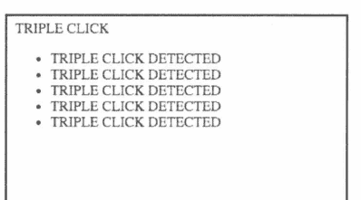

## 可暂停的 observable（带缓冲）

我们已经学习了如何以有损的方式暂停和恢复 observable；现在我们将看到一个操作符，用于在暂停时暂停 observable 并保留缓冲区，以便不会丢失任何数据。

用于暂停并保留缓冲区的操作符称为 pausableBuffered()，其签名如下：

```js
observable.pausableBuffered();
```

正如你所见，它不接受任何参数。

我们可以在以下代码中看到此操作符的使用示例：

```js
var pausableObservable = Rx.Observable
    .interval(500)
    .pausableBuffered();

pausableObservable.subscribe((i)=>console.log(i));

pausableObservable.pause();

setTimeout(()=>{
    pausableObservable.resume();
},4000);
```

在此示例代码中，我们创建一个 `Observable` 并在其上调用 `pausableBuffered()`。然后我们 `pause` 它并等待 4000 毫秒 `resume`。如果运行此代码，你将在控制台中看到以下输出：

```
0
1
2
3
4
//continues printing until you stop the program
```

查看输出，我们还可以注意到，即使被缓冲，数据在 `pausable` observable 上始终逐个传播。此方法还为程序员提供了完全控制何时停止和 `resume` observable 的能力。

## 受控 observable

我们将看到的最后一个无损的应对背压策略是 `controlled()` 操作符。此操作符为程序员提供了对缓冲区的完全控制，因为它允许你 `buffer` 所有数据并随时请求你想要的数据量。

此操作符具有以下签名：

```
observable.controlled();
```

正如你所见，此方法不接收任何参数。

创建 `controlled()` observable 后，你可以使用 `request()` 方法请求给定数量的项目。`request()` 方法具有以下签名：

```
controlledObservable.request(count);
```

参数 `count` 是必需的：

- `count`: 这是从 `Observable` 中提取的项目数（如果不存在，则默认为零）。


以下代码展示了此方法的示例用法：

```
var controllableObservable = Rx.Observable
  .interval(100)
  .controlled();

controllableObservable.subscribe((i)=>console.log(i));

controllableObservable.request(2);
setTimeout(()=>{
  console.log("Requesting more");
  controllableObservable.request(4);
},3000);
```

在此示例中，我们从 interval() 创建一个 Observable，并使用 controlled() 方法将其转换为 controlled() 可观察对象。然后我们订阅它并请求两个值（控制台中将打印 0 和 1）。然后我们等待 3000 毫秒并请求另外四个项目（2、3、4 和 5）。

如果运行此代码，你将看到以下输出：

```
0
1
Requesting more
2
3
4
5
```

以下图表说明了此操作：

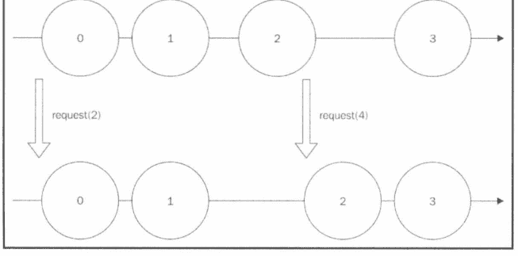

现在让我们更改示例，以请求比 Observable 中可用数据更多的数据：

```
var controllableObservable = Rx.Observable
    .of(0,1)
    .controlled();
controllableObservable.subscribe((i)=>console.log(i));
controllableObservable.request(3);
```

在此示例中，我们的 Observable 仅包含两个项目（0 和 1），我们将请求三个项目。如果运行此代码，你将看到以下输出：

0
1

因此，如果我们请求的數據多于 observable 中可用的數據，它只会发送所有可用的數據。

以下图表说明了此操作：

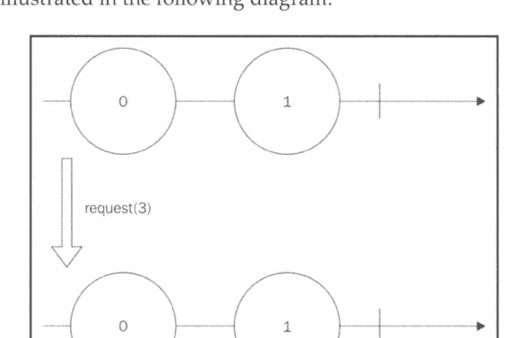

controlled() 可观察对象是一个强大的工具，因为它使程序员能够完全控制何时以及想要多少个项目。

对于最后一个示例，让我们看看如果在 controlled() 可观察对象中传播错误会发生什么：

```
var subject = new Rx.Subject();

var controlledObservable = subject.controlled();

controlledObservable.subscribe(
  (i)=>console.log(i),
  (err)=>console.log('An error happened ' + err.message),
  ()=>console.log('Finished')
);

subject.onNext(0);
subject.onNext(1);
subject.onNext(2);

subject.onError(new Error(':('));
subject.onNext(3);
subject.onCompleted();

controlledObservable.request(5);
```

使用 subject，我们可以轻松地将数据推送到流中。此 subject 在本章中用于推送错误时使用相同。唯一的变化发生在最后一行，在那里我们为 controlled() 可观察对象请求五个项目。

如果运行此代码，你将看到以下输出：

```
0
1
2
An error happened :(
```

从输出来看，我们可以看到 controlled() 可观察对象会在错误发生之前拉取数据（并运行观察者），然后传播错误。

## 更多过滤数据的方式

在 RxJS 中，我们还有其他用于过滤数据的操作符。在本节中，我们将学习以下操作符：

- first()
- take()
- takeLast()
- takeWhile()
- skip()
- skipWhile()

当我们只对 observable 中的数据子集感兴趣时，可以使用这些操作符。


RxJS 上还有其他用于过滤数据的操作符，但这些是最常见的。

## first() 操作符

first() 操作符返回一个新的 observable，其中仅包含满足给定条件的 observable 中的第一个元素。此操作符的签名如下：

```
observable.first([condition], [context], [defaultValue]);
```

所有参数都是可选的：

- `condition`：这是值必须满足才能被检索的函数
- `context`：这是给定条件函数中使用的参数
- `defaultValue`：如果 observable 已耗尽且没有项目满足给定条件，则用作默认值的值

如果未提供条件，此操作符将返回 Observable 中的第一个元素。以下示例展示了这一点：

```
Rx.Observable
  .of(1,2,3)
  .first()
  .subscribe((i)=>console.log(i));
```

如果运行此代码，你将看到以下输出：

1

以下图表说明了此操作：

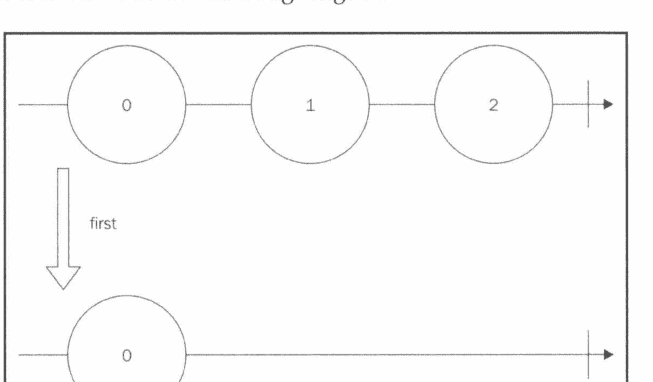

我们也可以提供条件函数。在以下示例中，我们将使用条件函数来检索 Observable 上的第一个偶数：

```
Rx.Observable
  .of(1,2,3)
  .first((i)=>i%2===0)
  .subscribe((i)=>console.log(i));
```

如果运行此代码，它将打印 observable 中的第一个偶数，如下所示：

2

如果没有元素满足条件，我们也可以提供默认值：

```
var defaultValue = 'no even numbers';
Rx.Observable
  .of(1,3,5)
  .first((i)=>i%2===0,null,defaultValue)
  .subscribe((i)=>console.log(i));
```

请注意，我们已从 observable 中移除了所有偶数，因此运行此代码时将打印以下内容：

no even numbers

## take() 操作符

此操作符返回一个 observable，其中包含来自 observable 的给定数量的连续数据。它的签名如下：

```
observable.take(count, [scheduler]);
```

第一个参数是必需的，最后一个是可选的：

- count：这是从 observable 中检索的元素数量
- scheduler：当 count 等于 0 时，用于传递 onCompleted() 方法

此操作符的用法非常简单，可以在以下示例中看到：

```
Rx.Observable
    .of(1,3,5)
    .take(2)
    .subscribe((i)=>console.log(i));
```

在此示例中，我们只取序列中的前两个元素，因此运行此代码时，我们将看到以下输出：

1
3

以下图表说明了此操作：

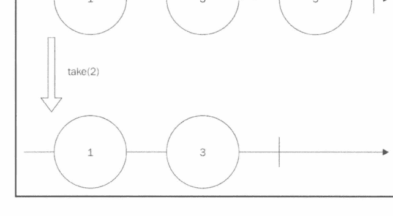

## takeLast() 操作符

takeLast() 操作符与 take() 操作符类似。唯一的区别是它从 observable 的末尾取给定数量的元素。它的签名如下：

```
observable.take(count);
```

第一个参数是必需的：

- count：这是从 observable 末尾检索的元素数量

我们可以更改上一节的示例以使用此操作符：

```
Rx.Observable
.of(1,3,5)
.takeLast(2)
.subscribe((i)=>console.log(i));
```

在此代码中，takeLast() 操作符生成一个新的 Observable，其中包含原始 Observable 中的最后两个元素（3 和 5），因此，如果运行此代码，你将看到以下输出：

3
5

以下图表说明了此操作：

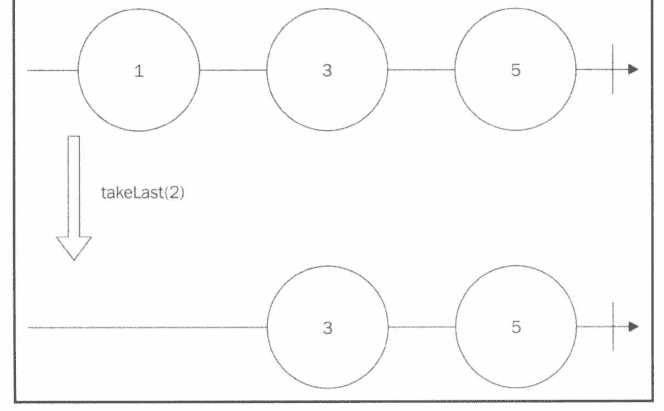

此操作符会保留一个缓冲区，其大小足以存储请求的元素数量。

## takeWhile() 操作符

这是我们在本章中看到的 take() 系列的最后一个操作符。此操作符允许你从 observable 中满足给定条件函数的第一个连续元素序列创建 observable。它的签名如下：

```
observable.takeWhile(condition,[context]);
```

第一个参数是必需的，最后一个是可选的：

- condition：这是元素必须满足的给定函数
- context：此参数在条件函数中使用

我们可以使用此操作符获取第一个连续的偶数序列，如以下示例所示：

```
Rx.Observable
    .of(2,4,5,6)
    .takeWhile((i)=>i%2===0)
    .subscribe((i)=>console.log(i));
```

在此代码中，我们将测试偶数。它将从开头开始测试，并在第一个元素不满足给定条件时停止。因此，由于条件满足前两个数字（2 和 4），但不满足第三个数字（5），它只会打印前两个：

2
4

以下图表说明了此操作：

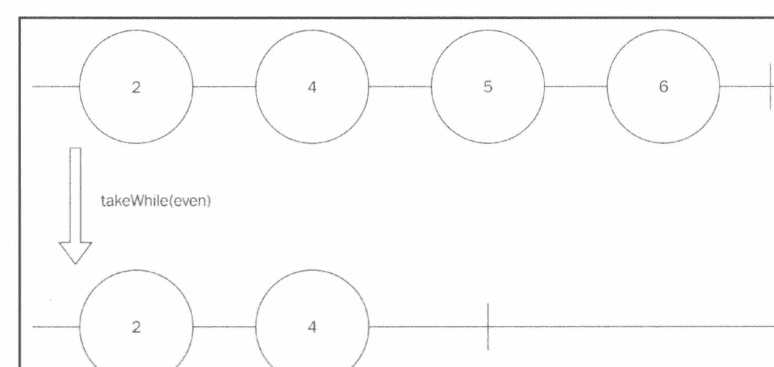

如果第一个元素不满足条件，它将返回一个空的 Observable。如果我们更改之前的示例，使用一个函数来测试奇数，我们可以按如下方式看到此行为：

```
Rx.Observable
.of(2,4,5,6)
.takeWhile((i)=>i%2===1)
.subscribe((i)=>console.log(i));
```

如果运行此代码，控制台中将不会打印任何内容，因为第一个元素（2）不是奇数。

## skip() 操作符

skip() 操作符返回一个 Observable，它跳过开头给定的元素数量并在 Observable 完成之前传播其他元素。它的签名如下：

```
observable.skip(count);
```

唯一的参数是必需的：

- count：这是要跳过的元素数量


在下面的示例中，我们将使用 skip() 操作符来跳过 Observable 中的第一个元素：

```
Rx.Observable
    .of(1,2,3)
    .skip(1)
    .subscribe((i)=>console.log(i));
```

如果运行这段代码，它将打印以下内容：

2
3

此操作在下面的图表中进行了说明：

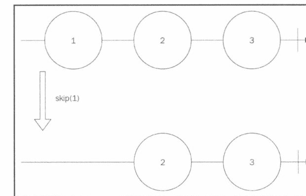

此操作符可以与 take() 操作符一起使用，从原始 Observable 中提取一个范围：

```
Rx.Observable
    .of(1,2,3,4)
    .skip(1)
    .take(2)
    .subscribe((i)=>console.log(i));
```

在这个示例中，我们从值 1、2、3 和 4 创建一个 Observable。然后我们跳过第一个，因此现在我们有元素：2 和 3。我们最后只取其中两个，所以如果运行这段代码，我们将看到以下输出：

2
3

## skipWhile() 操作符

本章的最后一个操作符 skipWhile() 操作符与 takeWhile() 操作符类似，但它会在给定的条件函数满足时跳过元素。它的签名如下：

```
observable.skipWhile(condition, [context]);
```

第一个参数是必需的，第二个是可选的：

- condition：这是一个用于测试要跳过的元素的函数
- context：这是要在条件函数中使用的参数

为了说明此操作符，我们可以使用 takeWhile() 中的相同示例，但改用 skipWhile() 函数：

```
Rx.Observable
    .of(2,4,5,6)
    .skipWhile((i)=>i%2===0)
    .subscribe((i)=>console.log(i));
```

在这段代码中，我们将从序列开始跳过偶数元素，并在找到第一个非偶数时停止。因此如果运行这段代码，我们将看到以下输出：

5
6

此操作在下面的图表中进行了说明：

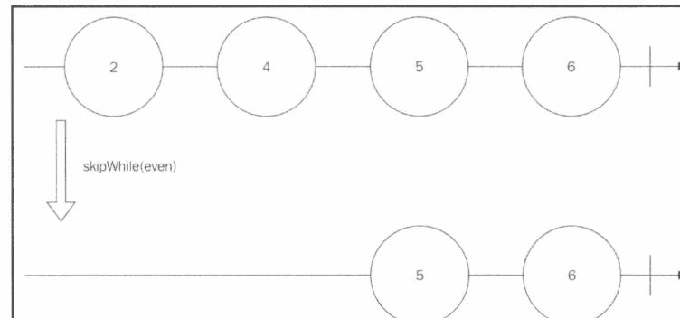

## 总结

在本章中，我们学习了如何处理大量数据。我们称之为背压问题。我们可以使用两种不同的方法来处理背压：有损策略和无损策略。

我们还学习了每种方法的优点和缺点，以及可以用来缓解它们的运算符。

在本章结束时，我们还获得了更多查询 observables 中数据的工具，例如 `first()` 操作符，一些 `take()` 操作符和一些 `skip()` 操作符。

在下一章中，我们将学习用于组合不同数据源的操作符。

# 6 太多来源 - 组合 Observables

# 太多来源 - 组合 Observables

在上一章中，我们学习了如何使用不同的操作符来处理背压问题，学习了两种不同的策略来处理此问题：

- Lossy strategy
- Loss-less strategy

对于每种策略，我们学习了不同的操作符实现有损策略来处理背压问题。学习了以下操作符：

- `throttle()`
- `sample()`
- `debounce()`
- `pause()`

为了实现无损策略来处理背压问题，我们学习了以下操作符：

- `bufferWithCount()`
- `bufferWithTime()`
- `bufferWithTimeOrCount()`
- `pause()` using buffering
- `controlled()`

我们还学习了何时使用每种策略，这取决于我们可用的内存量以及是否能承受丢失任何数据。

最后，我们学习了用于过滤数据的新的操作符，以及 filter() 操作符。此操作符让我们避免在 observable 上计算不必要的事件。我们学习了以下用于过滤数据的操作符：

- `first()`
- `take()`
- `takeLast()`
- `takeWhile()`
- `skip()`
- `skipWhile()`

如果你没有熟悉背压问题。请花时间重新阅读本章，因为这个问题非常常见，任何自称函数式响应式编程大师的人都必须能够识别并缓解这个问题。

在本章中，我们将看到如何组合不同的 observables 以创建新的 observables，我们还将使用更复杂和详细的示例来教授新概念，让你走出舒适区并进一步提高你的函数式响应式编程技能。

在本章中，我们将学习以下主题：

- 我何时需要组合 observables？
- 运行 observables in parallel
- 串联 observables
- 组合来自不同 observables 的数据
- 在更复杂的示例中重用来自前几章的方法和操作符

## 我何时需要组合 observables？

函数式响应式编程的主要优点之一是它使代码重用变得容易，因为我们将数据源（observable）与我们对该数据进行的转换（操作符）分离，以及它发生时引起的影响（观察者采取的操作），我们可以轻松重用代码的每个部分。

在前几章中，我们看到了如何通过向其添加多个观察者来重用 observable。现在我们可以更进一步，将这些 observables 组合起来创建一个新的数据源；这将给我们更大的能力。

当我们组合（具体来说是串联）observables 时，我们还可以避免重复代码，这与良好代码的主要概念之一一致，即 **Don't Repeat Yourself (DRY)**。

一个简单且易于理解的组合 observables 以避免订阅两个 observables 的示例可能发生在常见任务中。想象一下，我们想在网站中实现一个搜索工具。在我们的搜索工具中，我们希望在用户按下 *Enter*（并且搜索框获得焦点）或用户点击搜索按钮时执行搜索。使用 RxJS，很容易使用 `fromEvent()` 方法为搜索框中的回车键点击创建 observable，并且也很容易使用相同的方法为搜索按钮的点击创建 observable。如果没有连接这两个 observables 的能力，我们将不得不订阅每个 observable 创建两个不同的订阅。这不仅是不必要的，而且还可能导致错误，因为任何订阅都可能单独终止。但正如我们将在本章中看到的，我们可以将这两个 observables 串联起来创建一个新的 observable，当任何源发出数据时它就会发出数据，并且我们只订阅此 observable 来创建更易读、容易出错且语义正确的代码。

我们还学习了如何使用 observables 来帮助我们控制应用程序的流程，使用它来包装 promises 或甚至回调。因此我们也可以组合 observables 以并行运行这些异步计算。

## 运行 observables

在 JavaScript 中处理异步计算是一项艰巨的任务，因为所有代码都在单个线程中运行。因此，为了保持该线程可用，大多数处理 I/O 的操作符使用回调在数据可用时将控制权返回给你的程序。


> 线程的概念以及 JavaScript 虚拟机内部的工作方式超出了本书的范围，了解它并不是必要的。

大量使用回调函数的通常会导致一个称为 **callback hell** 的问题，这基本上是代码中有太多回调，使其从程序员的角度来看很难阅读。为了缓解这个问题，promises 现在是标准 JavaScript 的一部分，并且被所有现代浏览器实现。由于 promises 本质上是可组合的，它使你的代码更简洁，并为你提供摆脱回调地狱的安全途径。

但 promises 只有基本的构造可以相互组合，因此 RxJS（以及 JavaScript 中大多数函数式响应式编程库）为你提供了内置方法将 promise 转换为 observable 使其在使用操作符时更具可组合性。

话虽如此，很容易看出为什么函数式响应式编程，凭借串联和组合 observables（可以是异步计算）的能力，是处理你的应用程序流程控制的自然解决方案。

## 串联 observables

RxJS 提供了一些操作符将多个 observables 组合成一个包含所有事件的 observable，最常见的操作符是 `concat()` 和 `merge()`，它们只是创建一个包含其他所有数据的新的 observable，但在本章中我们还将学习如何使用其他操作符进行更有趣的组合。

## 使用 concat() 操作符

串联两个数据源（observables）最常见的操作符是 `concat()` 操作符。此操作符接收多个 observables 作为参数，并从左到右串联所有 observables。它保留 observables 中元素的顺序，并且只有在当前 observable 已经终止时才传播下一个 observable 的数据。

此操作符具有以下签名：

```
observable.concat(observables);
```

它接受任意数量的参数，但它们都必须是 observables：

- `observable`：它是任意数量的 observables


最简单的示例就是用它来合并两个可观察对象：

```
Rx.Observable
.just(1)
.concat(Rx.Observable.just(2))
.subscribe((k)=>console.log(k));
```

在这段代码中，我们创建了一个仅包含元素 1 的 Observable 序列。然后我们使用 concat() 运算符将其与仅包含元素 2 的 Observable 序列连接起来，最后订阅以记录最终 Observable 中的所有元素。因此如果运行这段代码，我们将看到以下输出：

1
2

可以通过以下图表来解释这段代码：

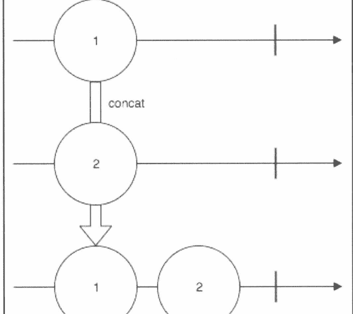

现在让我们稍微修改代码以连接另一个 Observable：

```
Rx.Observable
  .just(1)
  .concat(
    Rx.Observable.just(2),
    Rx.Observable.just('Hello World!!!')
  ).subscribe((k)=>console.log(k));
```

由于我们只添加了另一个发出值 'Hello World!!!' 的可观察对象，因此很容易理解该程序的输出，如下所示：

```
1
2
Hello World!!!
```

这种实现之所以可能，是因为 concat() 运算符接受多个可观察对象作为参数，但相同的程序也可以写成如下形式：

```
Rx.Observable
  .just(1)
  .concat(Rx.Observable.just(2))
  .concat(Rx.Observable.just('Hello World!!!'))
  .subscribe((k)=>console.log(k));
```

如果我们两次使用 concat() 运算符而不是使用两个参数调用它，结果是相同的。

正如我们之前讨论的，concat() 运算符在生成新的 Observable 时保持输入的顺序，并且只有在当前 Observable 完成时才会发出下一个 Observable 的数据。我们可以通过对示例进行少量修改来看到这种行为，如下所示：

```
Rx.Observable
  .just(1)
  .concat(
    Rx.Observable.interval(1000),
    Rx.Observable.just('Hello World!!!')
  ).subscribe((k)=>console.log(k));
```

在此示例中，最终的 Observable 将发出第一个的值（值 1），并且在它完成后会转到下一个。由于由 interval() 方法创建的 Observable 是无限的，因此它永远不会发出最后一个 Observable 中的 Hello World!!! 字符串。因此运行这段代码会得到以下输出，并且会一直打印连续的数字，直到我们终止程序：

```
1
0
1
2
3
//Keeps printing until we stop the program
```

## 使用 merge() 运算符

在上一节中，我们学习了如何使用 concat() 运算符连接可观察对象，保持每个可观察对象从左到右的顺序。我们还看到，如果其中一个可观察对象是无限的，则此后的其他可观察对象永远不会传播数据。当我们想要连接可观察对象以保留数据的顺序而不是可观察对象的顺序时，我们使用 merge() 运算符。

该运算符具有以下签名：

```
observable.merge(observable);
```

它接受任意数量的参数，但它们都必须是可观察对象：

- observable: 这是要合并的另一个可观察对象


该方法还有另一个签名，您可以在其中设置同时订阅的可观察对象的最大数量，但在 RxJS 中这种情况并不常见，我们将在本书中避免使用它，以使概念更容易理解。

我们可以更改 concat() 运算符的第一个示例并使用 merge() 运算符来合并两个可观察对象：

```
Rx.Observable
.just(1)
.merge(Rx.Observable.just(2))
.subscribe((k)=>console.log(k));
```

在此示例中，我们只是将 concat() 运算符更改为 merge() 运算符，但由于我们没有无限的可观察对象也没有异步的可观察对象，因此在输出上看不到任何差异，如下所示：

```
1
2
```

现在让我们更改之前的示例，该示例使用 interval() 方法创建的 Observable：

```
Rx.Observable
.just(1)
.merge(Rx.Observable.interval(1000))
.merge(Rx.Observable.just('Hello World!!!'))
.subscribe((k)=>console.log(k));
```

在上一节中，我们看到了类似此代码的输出，但使用的是 concat() 而不是 merge()，在该示例中 Hello World!!! 消息不会被打印，因为由 interval() 创建的 Observable 永远不会完成，并且由于 concat() 运算符保留可观察对象的顺序，因此它永远不会传播来自最后一个的数据。但 merge() 运算符在数据传播时保留顺序，因此当我们运行此代码时，我们会在控制台中看到以下输出：

```
1
Hello World!!!
0
1
2
//Keeps printing sequential numbers until we stop the program
```

可以通过以下图表来解释这段代码：

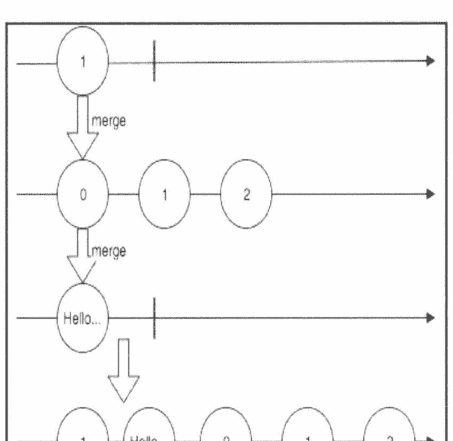

本章前面我们展示了可观察对象连接的一个示例用法，用于创建搜索框（或任何文本框），当用户按下 Enter 按钮或点击相关按钮时执行操作。merge() 运算符非常适合在网页中实现这种行为，可以在以下示例中看到：

```
<html>
<head></head>
<body>

<input type="text" id="my_input" />
<button id="my_button">Search</button>
<span id="my_span"></span>

<script src="https://cdnjs.cloudflare.com/ajax/libs/rxjs/4.1.0/rx.all.js"></script>
<script>
var enterKeyUpObservable = Rx.Observable
.fromEvent(document.getElementById("my_input"),"keyup")
.filter(function(e){
return e.keyCode===13;
});

var searchClickObservable = Rx.Observable
.fromEvent(document.getElementById("my_button"),"click");

var enterKeyUpOrSearchClickObservable =
searchClickObservable.merge(enterKeyUpObservable);
</script>
</body>
</html>
```

```
enterKeyUpOrSearchClickObservable.subscribe(function(){
  var text = document.getElementById("my_input").value;
  document.getElementById('my_span').innerHTML = "searched for ===>" + text;
  });
</script>
</body>
</html>
```

在这段代码中，我们从所有 Enter 键抬起事件创建了一个 `Observable`（`var enterKeyUpObservable`），然后从搜索按钮的所有点击中创建了一个 `Observable`（`var searchClickObservable`）。我们最后使用 `merge()` 运算符合并这两个可观察对象，这给我们一个新 `Observable`（`var enterKeyUpOrSearchClickObservable`），并订阅它以用消息填充 span 元素。


要实现这种行为，我们必须使用 `merge()` 运算符。如果我们尝试改用 `concat()` 运算符，它只会监听最左边的可观察对象，因为它是一个无限的可观察对象。如果你好奇，可以将此代码更改为使用 `concat()` 运算符而不是 `merge()` 运算符并测试页面。

如果你在浏览器中打开它，你将看到以下屏幕：

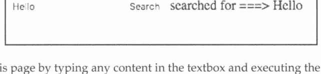

你可以通过在文本框中输入任何内容并通过在文本框中按 *Enter* 或点击 **Search** 按钮来执行订阅函数来测试此页面。

## 使用 concatAll() 运算符

该运算符类似于 concat() 运算符，但它连接可观察对象内部的所有可观察对象。该运算符具有以下签名：

```
observable.concatAll();
```

如你所见，它不接收任何参数，因为它会连接可观察对象内的所有可观察对象。这种行为可以在以下示例中看到：

```
Rx.Observable.of(
Rx.Observable.just(1),
Rx.Observable.fromPromise(Promise.resolve(2)),
Rx.Observable.of(3,4)
).concatAll()
.subscribe((k)=>console.log(k));
```

在此示例中，我们使用 of() 方法创建了一个 Observable，其中包含三个可观察对象。第一个仅发出值 1，第二个仅发出值 2（使用 Promise），第三个发出两个值 3 和 4。然后我们使用 concatAll() 方法生成一个发出四个值的单个 Observable。因此，如果我们运行此代码，我们将在控制台中看到以下输出：

- 1
- 2
- 3
- 4


此方法遵循 concat() 方法的相同规则，因此它将遵循可观察对象的顺序，如果你的序列中有一个无限的可观察对象，则下一个可观察对象永远不会被执行。

## 使用 mergeAll() 运算符

此方法类似于 concatAll() 运算符，遵循 merge() 运算符的规则。因此它合并可观察对象内的所有可观察对象。它具有以下签名：

```
observable.mergeAll();
```


如你所见，它不接收任何参数，因为它会合并可观察对象内的所有可观察对象。以下示例可以看出这种行为：

```
Rx.Observable.of(
  Rx.Observable.just(1),
  Rx.Observable.fromPromise(Promise.resolve(2)),
  Rx.Observable.of(3,4)
).mergeAll()
.subscribe((k)=>console.log(k));
```

现在我们使用 mergeAll() 操作符而不是 concatAll() 操作符，它会遵循传播数据的顺序，并且由于我们有一个来自 Promise 的可观察对象，其值会被延迟（因为 promise 是异步的），而其他值会先被传播，因此它会在你的控制台打印以下输出：

1
3
4
2

## 组合可观察对象

我们已经学习了如何创建一个包含其他可观察对象中所有数据的可观察对象，但我们也可以使用其他操作符来组合这些数据或在它们之间进行选择，而不是简单地传播所有内容。

### 使用 forkJoin() 操作符

此操作符允许你并行运行多个可观察对象并传播每个可观察对象的最后一个元素，因此此操作符非常适合在 JavaScript 中实现 promise 或回调操作的流程控制，正如我们在本章中已经讨论过的。

此操作符具有以下签名：

```
Rx.Observable.forkJoin(observables);
```

这是一个静态方法而不是实例方法，它接收任意数量的参数，最后一个是可选的：

- observables：要执行的任意数量的可观察对象序列


它也可以接受最后一个参数来连接生成数组中的项目，但这不是常见用例，因为你可以使用 map() 操作符对数组进行操作轻松实现。

forkJoin() 操作符保留可观察对象的顺序，以下代码中可以看到此用法的示例：

```
Rx.Observable
  .forkJoin(
    Rx.Observable.fromPromise(Promise.resolve(1)),
    Rx.Observable.just(2)
  ).subscribe((k)=>console.log(k));
```

如果你运行此代码，你将看到以下输出：

[ 1, 2 ]

正如我们之前讨论的，此操作符仅传播每个可观察对象序列的最后一个值，这使其非常适合 promise 和回调（它们只发出一个值），但我们也可以将其与任何可观察对象一起使用。

我们可以更改代码以使用无限可观察对象并看看会发生什么：

```
Rx.Observable
  .forkJoin(
    Rx.Observable.fromPromise(Promise.resolve(1)),
    Rx.Observable.interval(100)
  ).subscribe((k)=>console.log(k));
```

如果你运行此代码，你将看不到控制台有任何打印，并且你的程序也永远不会结束。这是因为第二个参数是一个无限可观察对象，所以 forkJoin() 操作符会等待它完成以传播所有值。

我们可以更改此代码以仅从无限可观察对象中取几个元素。这样它就会结束：

```
Rx.Observable
  .forkJoin(
    Rx.Observable.fromPromise(Promise.resolve(1)),
    Rx.Observable.interval(100).take(5)
  ).subscribe((k)=>console.log(k));
```

现在如果运行此代码，你将看到以下输出：

[ 1, 4 ]

这包含第一个可观察对象传播的值 1 和值 4，后者是第二个可观察对象传播的最后一个元素（因为我们从 interval() 中取了 5 个）。

此操作可以用以下图表描述：

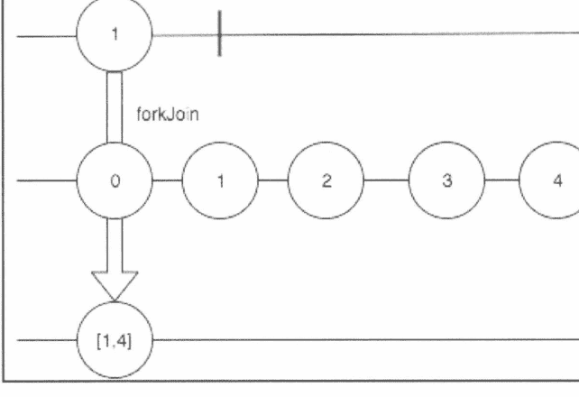

### 使用 zip() 操作符

此操作符允许你合并给定可观察对象的值。它将为每个可观察对象的相同索引的每个元素运行给定的函数。因此，如果你有两个可观察对象并将它们 zip，它将为第一个可观察对象的第一个元素和第二个可观察对象的第一个元素运行给定的函数。如果有更多元素可用，它将为第一个可观察对象的第二个元素、第二个可观察对象的第二个元素运行该函数，以此类推。


此操作符类似于 underscore 和 lodash 等库中的 zip() 函数。

此操作符具有以下签名：

```
Rx.Observable.zip(observables, [reduceFunction]);
```

它接收任意数量的参数，最后一个是可选的。如果缺少最后一个参数，它将只生成一个包含每个可观察对象值的数组：

- observables：要进行 zipped 的任意数量的可观察对象
- reduceFunction：用于将元素组合成单个值的函数；如果未提供此函数，它将生成一个包含值的数组

zip() 操作符的简单示例是 zipping 两个可观察对象，每个包含两个值，省略 reduceFunction 参数，如以下代码所示：

```
var namesObservable = Rx.Observable.of('John', 'Mary');

var lastNamesObservable = Rx.Observable.of('Doe', 'Jane');

Rx.Observable.zip(
    namesObservable,
    lastNamesObservable
).subscribe((k)=>console.log(k));
```

如果你运行此代码，你将在控制台看到以下输出：

```
[ 'John', 'Doe' ]
[ 'Mary', 'Jane' ]
```

此代码可以用此图表描述：

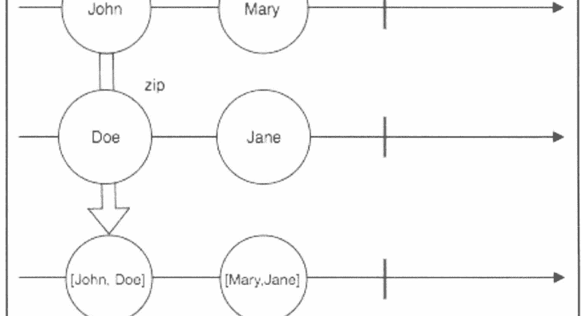

我们可以传递 `reduceFunction` 使输出更有趣：

```
var namesObservable = Rx.Observable.of('John', 'Mary');

var lastNamesObservable = Rx.Observable.of('Doe', 'Jane');

Rx.Observable.zip(
    namesObservable,
    lastNamesObservable,
    (name,lastName) => name + ' ' + lastName
).subscribe((k)=>console.log(k));
```

在此示例中，给定的函数将为每对执行，因为该函数基本上连接 name 和 lastName。此示例中 zip() 操作符生成的可观察对象包含 John 和 Mary 的全名，因此当我们 subscribe() 到它并将结果记录到控制台时，我们可以看到如下输出：

```
John Doe
Mary Jane
```

此操作符也可以用于更多可观察对象。在以下示例中我们将 zip 三个可观察对象：

```
Rx.Observable
    .zip(
        Rx.Observable.just(1),
        Rx.Observable.fromPromise(Promise.resolve(2)),
        Rx.Observable.just(3)
    ).subscribe((k)=>console.log(k));
```

当你运行此代码时，你可以看到以下输出：

```
[ 1, 2, 3 ]
```


看看这个最后示例的输出，很容易看出 zip() 操作符使用与可观察对象相同的顺序给出结果，在传播之前等待当前迭代的每个元素可用。

现在你可能会想知道当其中一个可观察对象在其他可观察对象之前完成时会发生什么。让我们在以下示例中检查这一点：

```
Rx.Observable
    .zip(
        Rx.Observable.interval(100),
        Rx.Observable.just('second'),
        Rx.Observable.of('third', 'more on third observable')
    ).subscribe((k)=>console.log(k));
```

当我们运行此代码时，我们在控制台看到以下输出并且程序退出：

```
[ 0, 'second', 'third' ]
```


看看输出，很容易看出由 zip() 操作符生成的可观察对象在被 zipped 的第一个可观察对象完成时结束。

### 使用 zipIterable() 操作符

zipIterable() 操作符的工作方式与 zip() 操作符类似。唯一的区别是它允许你将可观察对象与 JavaScript 可迭代对象（如数组、集合和映射）进行 zip。

此操作符具有以下签名：

```
observable.zipIterable(iterables,[reduceFunction]);
```

它接收任意数量的参数，最后一个是可选的。如果缺少最后一个参数，它将只生成一个包含值的数组：

- `iterables`：要与可观察对象进行 zipped 的任意数量的 `iterables`
- `reduceFunction`：用于将元素组合成单个值的函数；如果未提供此函数，它将生成一个包含值的数组

我们可以在使用 zip() 操作符的第一个示例中做一个小的改动，使用 zipIterable() 操作符对可迭代对象进行操作：

```
var namesObservable = Rx.Observable.of('John', 'Mary');

var lastNamesArray = ['Doe', 'Jane'];

namesObservable
.zipIterable(lastNamesArray)
.subscribe((k)=>console.log(k));
```

如果你运行此代码，你将看到如下输出：

```
[ 'John', 'Doe' ]
[ 'Mary', 'Jane' ]
```

我们也可以更改它以使用 reduceFunction，就像我们对 zip() 操作符所做的那样：

```
var namesObservable = Rx.Observable.of('John', 'Mary');

var lastNamesArray = ['Doe', 'Jane'];

namesObservable
.zipIterable(
  lastNamesArray,
  (name,lastName) => name + ' ' + lastName
).subscribe((k)=>console.log(k));
```

正如我们所期望的，输出如下：

```
John Doe
Mary Jane
```

最后，我们可以用相同的代码与其他形式的迭代对象，如 Set（）：

```
var namesObservable = Rx.Observable.of('John', 'Mary');

var lastNamesArray = new Set(['Doe', 'Jane']);

namesObservable
.zipIterable(
  lastNamesArray,
  (name,lastName) => name + ' ' + lastName
).subscribe((k)=>console.log(k));
```


zipIterable() 操作符与 zip() 操作符类似。它只是让可观察对象和普通迭代对象之间的互操作变得更容易。

## 摘要

在本章中，我们重点关注了组合可观察对象的优势；我们了解到，可以使用它们并行运行异步任务，在监听多个源时避免代码重复，并提高代码的重用性和可读性。

我们还学习了不同用于组合和统一可观察对象的操作符。最常用且使用最广泛的操作符是 concat()、merge() 和 zip()。

但我们也学习了一些其他用于组合可观察对象的操作符，因为它们为我们提供了更多互操作代码的工具。

到目前为止，我们只是忽略了可观察对象可能传播的错误。在下一章中，重点将放在处理这些错误以及为我们的函数式响应式应用程序创建测试上。因此，我们将学习在可观察对象中检测错误、处理可观察对象中的错误、模拟可观察对象以及测试函数式响应式程序。

# 7 有问题 - 测试和处理错误

# 有问题 - 测试和处理错误

在上一章中，我们学习了提高代码重用性和可读性的强大工具。这个工具是通过组合可观察对象来创建新的数据源。我们还学习了如何并行运行多个异步可观察对象。

我们在上一章中学到的最重要的操作符是：

- `concat()`
- `merge()`
- `forkJoin()`
- `zip()`

使用这些操作符可以帮助我们避免代码重复，给出了可读代码的一个非常重要的座右铭：**不要重复自己 (DRY)**。

在本章中，我们将重点关注两个非常重要的议题，不仅对于使用函数式响应式编程实现的程序，而且对于所有程序都适用：

- 处理错误
- 测试我们的代码
  - 我们将看到当错误发生时可观察对象会发生什么，以及我们可以做什么来处理此错误并确保我们的代码按预期继续运行。

- 另一方面，函数式响应式编程最酷的事情之一就是能够将数据源与要执行的操作解耦。这使得我们的代码更具可测试性，因为我们可以模拟其中的任何部分。
- 在本章中，我们将学习如何在浏览器和 Node.js 上测试程序。对于那些对测试 JavaScript 代码没有任何熟悉的人，我们将快速浏览一些用于此目的的框架。
- 随着本书的推进，主要思路是使我们的示例更复杂。我们将在测试部分看到这一发展，因此请现在花时间回顾前面的章节，或在您遇到不熟悉的操作符时随时回顾。

### 处理错误

在异步代码中检测和处理错误是困难的任务。对于同步代码，我们可以使用著名的 try/catch/finally 块。使用此块处理异常很容易，如以下代码所示：

```
try{
    throw new Error('An error occurred');
} catch(err) {
    console.log('Treating the error');
} finally{
    console.log('Last computation');
}
```

不幸的是，我们不能在异步代码上使用 try/catch/finally。在 JavaScript 中我们大部分时间都在运行异步代码，因此语言和社区制定了一些策略。

最初，处理异步代码的唯一可用策略是使用回调函数，因此 JavaScript 中的大多数库都添加了 onSuccess() 和 onError() 方法，它们接受一个在发生错误或数据可用时执行的回调函数。不同的框架使用不同的方法来实现这一点，例如，在 jQuery 中是 ajaxError() 和 ajaxSuccess()。Node.js 社区看到了标准化这种行为的必要性（因为这在 JavaScript 中非常常见），因此创建了 Node.js 回调标准。

该标准强制使用单个函数，该函数接收异步计算的两个参数：第一个是错误对象（如果发生错误），第二个是成功结果（如果成功）。来自 Node 的回调标准仍然可以在核心函数和多个库中看到。此标准的示例可在 fs 模块中使用，该模块是 Node 与文件系统交互的模块：

```
var fs = require('fs');

fs.readFile('this_file_doesnt_exist.txt',function(e,data){
  if(e){
    console.log('An error happened');
    return;
  }
  console.log(data);
});
```

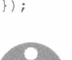

如果您之前有 Node.js 的经验，您已经熟悉这种模式。

正如您可能知道的那样，使用回调会导致一个称为回调地狱的问题，当您有多个回调彼此嵌套时就会发生这种情况，这使得代码难以理解。因此，创建了 Promise 对象，其中包含一个用于处理错误的 catch() 方法：

```
new Promise(function(resolve,reject){
  reject(new Error('An error occurred'));
}).catch(function(err){
  console.log('Treating the error');
});
```

在此代码中，我们有一个失败的 Promise，其中错误使用 catch() 方法处理。如您所见，这些选项都不像标准的 try/catch/finally 那样简单，但这种解决方案目前还不适用于异步代码，因此我们必须使用其中一种可用策略。

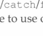

在即将到来的 JavaScript 版本中，我们将拥有 async/await 功能，这将让我们再次使用 try/catch/finally 块。

在函数式响应式编程中，我们有不同的策略来处理错误，我们将在本节中看到。

### 错误发生时采取行动

当错误发生时，可观察对象停止发送新数据。我们可以使用不同的策略，例如切换到另一个可观察对象或重试，但这些更高级，因此首先我们将看到观察者如何被错误通知。正如您可能记得的，可观察对象中的 subscribe() 方法允许您传递最多三个函数，或允许观察者在发生错误时收到通知。

请看以下签名：

```
observable.subscribe([onNext], [onError], [onCompleted]);
```

参数是可选的：

- onNext：当此可观察对象中有新数据可用时调用此函数。该函数接收数据本身作为参数。
- onError：当错误通过此可观察对象传播时调用此函数。该函数接收 Error 作为参数。
- onCompleted：当可观察对象耗尽并且所有数据都已传播时调用此函数。

此方法还具有以下签名的重载实现：

```
observable.subscribe(observer);
```

它接受以下单个参数：

- observer：当有数据可用、发生错误或可观察对象耗尽时，观察者对象会收到通知。观察者对这些可能的每个事件都有特定的方法。

因此，我们有两种可能的方式来接收可观察对象中错误的通知；第一种如下：

```
Rx.Observable
.throw(new Error('An error occurred'))
.subscribe(
  (data)=> console.log(data),
  (e)=> console.log('ERROR'),
  ()=>console.log('finished')
);
```

第二种，是显式使用观察者对象的实现：

```
var observer = Rx.Observer
.create(
  (data)=> console.log(data),
  (e)=> console.log('ERROR'),
  ()=>console.log('finished')
);
Rx.Observable
.throw(new Error('An error occurred'))
.subscribe(observer);
```

这两种实现是等价的，如果运行其中任何一个代码，您将看到以下输出：

```
ERROR
```

正如您所见，当错误传播到观察者时，onCompleted() 函数不会被调用。

正如我们已经讨论过的，当错误发生时，可观察对象会停止。我们可以在以下代码中看到这种行为：

```
var observable = Rx.Observable.create(function(source){
  source.onNext(1);

  source.onError(new Error('An error occurred'));

  source.onNext(2);
  source.onCompleted();
});

observable.subscribe(
  (data)=> console.log(data),
  (e)=> console.log('ERROR'),
  ()=>console.log('finished')
);
```


在此代码中，我们创建了一个 `observable`，它会先调用 `onNext()` 并传入 1，然后调用 `onError()` 并传入一个 `Error` 对象，接着再次调用 `onNext()` 并传入 2，最后调用 `onCompleted()` 方法。如果运行此代码，你将看到以下输出：

```
1
ERROR
```

正如我们所预期的一样，错误发生后它停止传播任何数据或事件。这是默认行为，但有时我们可能需要在错误到达观察者之前使用其他工具来处理错误，我们将在下一节看到这些策略。

## 处理错误

在上一节中，我们学习了如何对观察者上的错误做出反应，但我们还有其他策略可以在将错误传播给观察者之前处理错误。这些策略包括以下几点：

- 回退到另一个 observable
- 重试此 observable 的计算
- 延迟错误传递

这些策略可以通过我们在本章中将要探索的操作符来实现。

## catch() 操作符

`catch()` 操作符让你尝试另一个 observable。当发生错误时，它可以在类级别或实例级别使用。

在类级别，`catch()` 操作符具有以下签名：

```
Rx.Observable.catch(observables);
```

如你所见，它接收任意数量的参数：

- `observables`：在首次失败时用作回退的任意数量的 observables。它们会从左到右尝试，直到某个 `Observable` 成功。

最简单地看到此操作符运行的方式是通过以下示例：

```
Rx.Observable.catch(
    Rx.Observable.throw(new Error('An error occurred')),
    Rx.Observable.just('Hello')
).subscribe(
    (m)=> console.log(m),
    (e)=> console.log('Error found')
);
```

在此示例中，我们从 Observable 类调用 catch()，因此它会尝试第一个 Observable。由于此 Observable 失败（它使用 throw() 创建），它将尝试下一个 Observable，而下一个成功。然后此 Observable 被传播，通知观察者数据，因此运行此代码时你将在控制台中看到 Hello 消息被打印。

现在，让我们看看如果第一个 observable 在传播任何错误之前发出一些数据会发生什么：

```
var observableWithError = Rx.Observable.create(function(source){
    source.onNext(1);

    source.onError(new Error('An error occurred'));

    source.onNext(2);
    source.onCompleted();
});

Rx.Observable.catch(
    observableWithError,
    Rx.Observable.just('Hello')
).subscribe(
    (m)=> console.log(m),
    (e)=> console.log('Error found')
);
```

如果运行此代码，你将看到以下输出：

```
1
Hello
```

因此，它会将错误发生前的所有数据传播给观察者，并且当错误发生时，它将转到下一个 Observable。

现在让我们看看如果第二个 Observable 也失败，但我们有一个第三个 Observable 会发生什么：

```
Rx.Observable.catch(
  Rx.Observable.throw(new Error('An error occurred')),
  Rx.Observable.throw(new Error('Another error occurred')),
  Rx.Observable.just('Hello')
).subscribe(
  (m)=> console.log(m),
  (e)=> console.log('Error found')
);
```

在这种情况下，它会尝试第一个 Observable，但由于它失败，它会尝试第二个 Observable。由于这也失败，它会尝试第三个 observable，而第三个成功。如果运行此代码，你将在控制台中看到 Hello 消息被打印。

对于最后一个示例，让我们看看当第一个 Observable 成功时会发生什么：

```
Rx.Observable.catch(
  Rx.Observable.just('Hello'),
  Rx.Observable.just('Hello again')
).subscribe(
  (m)=> console.log(m),
  (e)=> console.log('Error found')
);
```

catch() 操作符的工作方式与 try/catch 块完全相同，因此如果尝试的 observable 在没有任何错误的情况下运行，它永远不会将执行传递给后续的。这就是当你运行此代码时，你在控制台中看到以下输出的原因：

Hello

当在 Observable 实例中使用时，catch() 操作符的工作方式相同，使用该 Observable 作为第一次尝试，但它只接受一个参数，如以下示例所示：

```
Rx.Observable
  .throw(new Error('An error occurred'))
  .catch(Rx.Observable.just('Hello'))
  .subscribe(
    (m)=> console.log(m),
    (e)=> console.log('Error found')
  );
```

此代码的工作方式与前一个完全相同；正如你所预期的那样，它将在控制台中打印 Hello 消息。

如果你想在 Observable 实例中使用多个 catch()，你将不得不多次调用 catch() 操作符：

```
Rx.Observable
    .throw(new Error('An error occurred'))
    .catch(Rx.Observable.throw(new Error('Another error occurred')))
    .catch(Rx.Observable.just('Hello'))
    .subscribe(
      (m)=> console.log(m),
      (e)=> console.log('Error found')
    );
```

## onErrorResumeNext() 操作符

onErrorResumeNext() 操作符按从左到右的顺序运行一系列 observables，当当前 observable 完成或发生错误时传递到下一个 observable。此方法在 Observable 类中可用，具有以下签名：

```
Rx.Observable.onErrorResumeNext(observables);
```

如你所见它接收任意数量的参数：

- observables：按从左到右执行的任意数量的 observables；下一个 observable 在当前完成或失败时开始。

我们可以重用上一节中的一些示例，只更改操作符以说明 onErrorResumeNext() 操作符的工作方式：

```
Rx.Observable.onErrorResumeNext(
  Rx.Observable.throw(new Error('An error occurred')),
  Rx.Observable.just('Hello')
).subscribe(
  (m)=> console.log(m),
  (e)=> console.log('Error found')
);
```

在此代码中，onErrorResumeNext () 操作符将创建一个 Observable，该 Observable 执行第一个 Observable，并在第一个失败时执行第二个；因此，运行此代码时你将在控制台中看到 Hello 消息被打印。然而，通过此示例我们无法真正将其与 catch () 操作符区分开来，所以让我们尝试一个不同的示例：我们将创建三个 Observable，其中一个 Observable 会传播一个值然后失败，另外两个会各自传播一个值并成功完成。所有三个 Observable 都可以在以下代码中看到：

```
var observableWithError = Rx.Observable.create(function(source) {
    source.onNext(1);

    source.onError(new Error('An error occurred'));

    source.onNext(2);
    source.onCompleted();
});
var helloObservable = Rx.Observable.just('Hello');
var helloAgainObservable = Rx.Observable.just('Hello again');
```

现在，在同一程序中，让我们使用 onErrorResumeNext () 操作符和 catch () 操作符与这三个 Observable 以比较输出：

```
Rx.Observable.onErrorResumeNext(
    observableWithError,
    helloObservable,
    helloAgainObservable
).subscribe(
    (m)=> console.log('onErrorResumeNext operator propagated ===> ' + m),
    (e)=> console.log('Error found')
);
```

```
Rx.Observable.catch(
    observableWithError,
    helloObservable,
    helloAgainObservable
).subscribe(
    (m)=> console.log('catch operator propagated===> '+m),
    (e)=> console.log('Error found')
);
```

在此示例中，这些操作符的使用很简单。我们仅为三个 observables 调用每个操作符并 `subscribe()` 以监听每个 observables 中的数据（或错误），以便我们可以比较输出。当你执行此程序时，你将在控制台中看到以下输出：

```
onErrorResumeNext operator propagated ===> 1
onErrorResumeNext operator propagated ===> Hello
onErrorResumeNext operator propagated ===> Hello again
catch operator propagated===> 1
catch operator propagated===> Hello
```

查看此输出很容易看出 `catch()` 操作符的行为与同步计算中的 `try/catch` 块相同，而 `onErrorResumeNext()` 会尝试执行所有 observables。

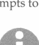

`catch()` 操作符尝试一个 observable，并且仅在它失败时才将执行处理到下一个，而 `onErrorResumeNext()` 按从左到右的顺序执行所有 observables，当当前一个完成或失败时传递到下一个。

## retry() 操作符

此操作符再次让你在出现错误时执行 `observable` 指定次数。最常见的用例是对资源进行 HTTP 调用，并在发生错误时重试几次。`retry()` 操作符具有以下签名：

```
observable.retry(retryAttempts);
```

它只接收一个参数：

- `retryAttempts`：这是一个数字，表示此 `observable` 必须重试的次数。

为了测试此操作符，我们将尝试获取 Google 搜索页面并在传播错误之前重试三次（你可以将 Google 页面更改为任何其他 URL）。为此，我们将使用 `request-promise` 库，该库使用 `promise()` 获取 URL，然后使用 `fromPromise()` 方法从该 `promise()` 创建一个 `Observable`。首先，我们需要为 node 安装 `request-promise` 和 `request` 库：

```
npm i request@2.79.0 --save
npm i request-promise@4.1.1 --save
```


然后我们可以使用以下代码来实现所述行为：

```
var Rx = require('rx');
var request = require('request-promise');

Rx.Observable.fromPromise(
  request('http://www.google.com')
).retry(3)
.subscribe(
  (htmlPage)=>console.log(htmlPage)
);
```

如果你执行这段代码，你将在控制台中看到 Google 页面被打印出来。


你可以尝试将此运算符用于任何可用的间歇性资源，以准确了解其工作原理。

## mergeDelayError() 运算符

本章中处理错误的最后一个运算符是 mergeDelayError() 运算符。当你合并两个或多个可观察对象（使用 merge() 运算符）时，如果其中一个可观察对象传播了错误，该错误将被传播到生成的可观察对象并停止它，如以下示例所示：

```
var observableWithError = Rx.Observable.create(function(source){
  source.onNext('hello');

  source.onError(new Error('An error occurred'));

  source.onNext('hello again');
  source.onCompleted();
});

Rx.Observable.merge(
  observableWithError,
  Rx.Observable.interval(100).take(4)
).subscribe(
  (m)=>console.log(m),
  (e)=>console.log('Error')
);
```

在此示例中，我们创建一个 Observable，它发出一个值（1）然后是一个错误。我们使用 merge() 运算符将其与从 interval() 生成的 Observable 合并（其中我们只取四个值）。当你执行它时，你将看到以下输出：

```
hello
Error
```

从输出中可以看出，生成的 Observable 仅传播了第一个 Observable 的第一个元素。它没有机会传播从 interval() 创建的 Observable。

现在，让我们更改此代码以改用 mergeDelayError() 运算符：

```
var observableWithError = Rx.Observable.create(function(source){
  source.onNext('hello');

  source.onError(new Error('An error occurred'));

  source.onNext('hello again');
  source.onCompleted();
});

Rx.Observable.mergeDelayError(
  observableWithError,
  Rx.Observable.interval(100).take(4)
).subscribe(
  (m)=>console.log(m),
  (e)=>console.log('Error')
);
```

如果你运行此代码，你将看到以下输出：

```
hello
0
1
2
3
Error
```

现在输出已更改；使用 mergeDelayError() 将错误传播延迟了（直到所有其他可观察对象完成）。

mergeDelayError() 的签名如下：

```
Rx.Observable.mergeDelayError(...observables);
```

它接受任意数量的参数，但它们都必须是可观察对象：

- `observables`：它是将被合并的 `observables`

这对于现在了解如何在 RxJS 中处理错误来说已经足够了。

## 测试我们的应用程序

测试应用程序是程序员的主要关注点之一。

无论你使用什么范式、语言或框架来开发程序，你都必须始终注意你的测试。

一个良好的测试套件可以确保你的代码和应用程序的质量更好。

它也可以被其他程序员用来帮助他们阅读和理解你的代码，并且有助于你解耦并改进程序的架构。

本书不是关于测试的，所以我不会试图宣扬它们，但我建议你始终测试你的代码，这一点至关重要。我会给你一些建议并展示函数式响应式编程如何帮助你解耦代码，从而提高其可测试性。

在进入任何解释或代码之前，让我们先学习 JavaScript 中单元测试的基础知识。

如果你已经测试你的 JavaScript 代码，你可以跳到“使用 RxJS 测试应用程序”部分。

## 服务器端测试

测试 JavaScript 应用程序时，你需要的第一件事是一个测试运行器。

测试运行器是为你提供创建测试的工具、执行它们并提供测试结果的程序。一个非常著名的 Node.js 测试运行器叫做 mocha，这也是我们在本书中进行服务器端测试时将使用的运行器。

首先，我们需要使用以下命令安装它：

```
npm install mocha@3.2.0 --save-dev
```

现在让我们创建一个基本测试来看看它是如何工作的：

```
var assert = require('assert');
describe('Math test', function() {
    it('should return -1 when evaluating the minimum between -1 and 1',
    function() {
        assert.equal(-1, Math.min(-1,1));
    });
    it('should return 1 when evaluating the maximum between -1 and 1',
    function() {
        assert.equal(1, Math.max(-1,1));
    });
});
```

在这段代码中，我们引入了 assert 模块来执行测试的断言。describe() 函数允许你将多个测试分组在给定的标题下，而 it() 函数执行给定的测试函数。

因此，这里我们创建一个名为 Math test 的组来测试 JavaScript Math 类中的数学函数。在这个组中，我们有两个测试，它们是作为参数传递给 it() 函数的函数；第一个是对 Math.min() 函数的测试，另一个是对 Math.max() 函数的测试。

要运行此测试，你需要在终端中执行以下命令：

```
mocha example_mocha_test_7_18.js
```

这里，example_mocha_test_7_18.js 是包含我的示例的文件名；如果你执行此测试，你将在控制台中看到以下内容：

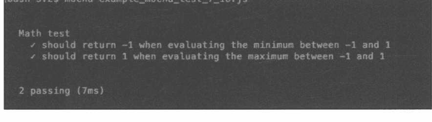

此输出显示我们在 Math test 组下执行了两个测试并且都成功了。

现在让我们更改第二个测试使其失败：

```
var assert = require('assert');
describe('Math test', function() {
    it('should return -1 when evaluating the minimum between -1 and 1',
```

```
function() {
    assert.equal(0, Math.min(-1,1));
});
    it('should return 1 when evaluating the maximum between -1 and 1',
function() {
    assert.equal(1, Math.max(-1,1));
});
});
```

唯一的变化是在第二个测试的断言中进行了修改。现在我们的测试将期望 0 是 -1 和 1 之间的最小值（请注意测试是错误的，仅用于说明测试失败时发生的情况）。现在再次运行你的测试，你将看到以下输出：

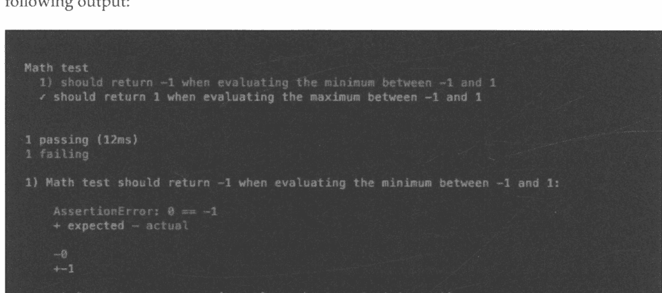

现在它显示一个测试通过，一个测试失败。对于失败，它还显示了期望值、接收到的值以及发生的位置，这当然使得更容易找到你的错误（在本例中是测试中的错误）以便修复它。

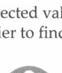

mocha 是我们将在本书中用于测试所有服务器代码的运行器。

## 浏览器中测试

在上一节中我们学习了如何在 Node.js 环境中使用 mocha，但该框架也可以用于在浏览器环境中执行客户端测试。为此我们需要创建一个 HTML 页面并向其中添加 mocha 的 CSS 和 js：

要添加 mocha.css，你在 HTML 中添加以下行：

```
<link href="https://cdn.rawgit.com/mochajs/mocha/2.2.5/mocha.css" rel="stylesheet" />
```

要添加 JavaScript，你在 HTML 中添加以下行：

```
<script src="https://cdn.rawgit.com/mochajs/mocha/2.2.5/mocha.js"></script>
```

在服务器端我们可以使用 Node.js 的默认 assert 模块，但由于该模块在浏览器上下文中不可用，我们必须添加一个库来处理代码的断言。我们将使用的库叫做 chai。要将其添加到你的 HTML 页面，只需添加以下行：

```
<script
src="https://cdnjs.cloudflare.com/ajax/libs/chai/3.5.0/chai.min.js"></script>
```

现在你可以在浏览器上下文中执行测试了。

我们在上一节中看到的 Math 类的相同示例测试已在此 HTML 文件中实现：

```
<html>
    <head>
        <meta charset="utf-8">
        <title>Tests</title>
        <link href="https://cdn.rawgit.com/mochajs/mocha/2.2.5/mocha.css" rel="stylesheet" />
    </head>
    <body>
        <div id="mocha"></div>

        <script src="https://cdn.rawgit.com/mochajs/mocha/2.2.5/mocha.js"></script>
        <script src="https://cdnjs.cloudflare.com/ajax/libs/chai/3.5.0/chai.min.js"></script>

        <script>
            mocha.setup('bdd');
            var assert = chai.assert;
            describe('Math test', function() {
                it('should return -1 when evaluating the minimum between -1 and 1',
```

```
function() {
    assert.equal(-1, Math.min(-1,1));
});
    it('should return 1 when evaluating the maximum between -1 and 1',
function() {
    assert.equal(1, Math.max(-1,1));
});
});
    mocha.run();
</script>
</body>
</html>
```

此 HTML 文件中还有一些补充说明：

-   Mocha 还需要一个 id 为 `mocha` 的 `<div>` 来渲染测试结果。
-   你需要在测试之前调用 `mocha.setup`；在我们的例子中 `mocha.setup('bdd')` 暴露了测试中使用的 `describe()` 和 `it()` 函数。
-   在你调用 `mocha.run()` 时测试会被执行，因此请确保在测试代码之后调用它。

如果在浏览器中打开此 HTML 页面，你会看到如下截图的页面：

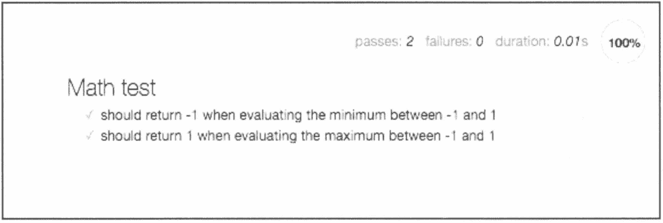

在浏览器中运行代码可以让你在代码和测试中访问 DOM 元素，我们可以创建一个简单的测试来验证这一点。

正如我们所知，运行 mocha 的页面必须有一个 id 为 mocha 的 <div> 来显示结果。我们可以使用 DOM 添加一个测试来检查此 <div> 是否存在。为此，将以下测试组添加到你的测试页面：

```
describe('Mocha tests on browser', function() {
    it('should have a div with id mocha', function() {
        assert.isNotNull(document.getElementById('mocha'));
    });
});
```

在这个例子中，我们查询 DOM 中 id 为 mocha 的元素，并使用 assert.isNotNull() 来检查元素是否存在。正如我们所知，该元素存在于此页面中，因此我们的测试应该通过。如果在浏览器中打开此 HTML 页面，你会看到以下内容：

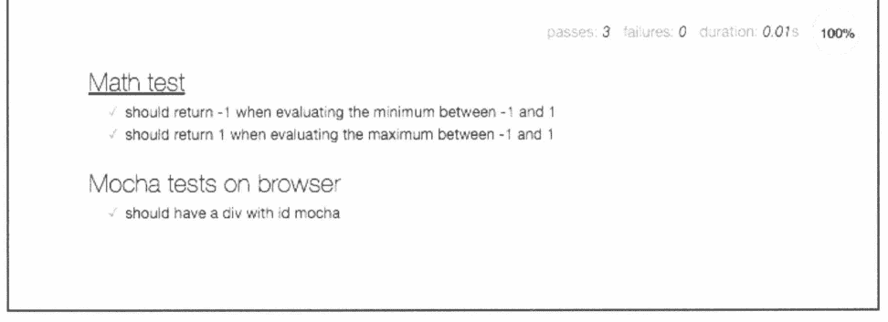

因此，所有测试都运行正确，我们可以访问 DOM；现在我们准备好为响应式代码创建测试了。

## 使用 RxJS 测试应用程序

在开发中使用函数式响应式编程时，你将数据的来源与数据可用时采取的动作分开。这可以帮助测试你的应用程序，因为你可以模拟你的可观察对象来测试观察者，并使其独立于真实的数据源。

为了演示这种行为，想象一个程序获取网页并提取该页面上的所有数字。我们可以使用正则表达式来实现：

```
var Rx = require('rx');
var request = require('request-promise');
```

```
var parser = {
    getPageObservable: (url)=>Rx.Observable.fromPromise(request(url)),
    parseContentObservable: (observable)=>observable
        .flatMap((str)=>Rx.Observable
        .fromArray(
            str.replace( /\D+/g, ' ').split(' ')
        )
    ).filter((i)=>i!=''),
    getAndParseUrl: function(url){
    var observable = this.getPageObservable(url);
    return this.parseContentObservable(observable);
    }
};

parser
    .getAndParseUrl('http://www.google.com')
    .subscribe((m)=>console.log(m));
module.exports = parser;
```

在这个例子中，我们创建一个名为 parser 的 var，其中包含三个方法：

-   第一个名为 getPageObservable()，用于获取给定页面。
-   第二个是 parseContentObservable()，它使用正则表达式将页面中的所有非数字项替换为空格，然后使用 split 方法创建一个包含数字的数组。我们使用 fromArray() 方法从该数组创建一个 Observable，并使用 flatMap() 将原始 Observable 映射为一个新的 Observable，该 Observable 会逐个传播每个值；最后我们使用 filter() 从解析的内容中删除所有空白字符串。
-   第三个方法名为 getAndParseUrl()，仅应用前两个方法。对于最后，我添加了一个对 getAndParseUrl() 的调用以将其打印到控制台，以便我们可以看到结果（如果想查看，请取消注释）。

如果运行此代码，你将看到 http://www.google.com 网页中的所有数字都打印在控制台中。

首先要注意的是，我为程序的每个步骤创建了不同的方法，现在我可以单独测试每个方法。如果我想测试第一个方法，我真的必须获取一个页面来比较结果，但对于另外两个方法，我可以创建假的可观察对象来比较我的测试结果。parseContentObservable() 方法的一个可能测试可以在以下代码中看到：

```
var assert = require('assert');
var Rx = require('rx');
```

```
var parser = require('./example7_22');

describe('Parser test', function(){
    it('should find the number 123', function(done) {
        var found = false;
        parser.parseContentObservable(
            Rx.Observable.just('some random123 string')
        )
        .subscribe(function(m){
            assert.equal(123,m);
            found = true;
        },
        function() {},
        function(){
            assert.equal(true,found);
            done()
        })
    });
});
```

在这个例子中，我们使用包含一个数字的随机字符串创建一个测试。然后我们使用一个 function() 进行订阅，当调用时它会启用一个标志。对于数字的断言，我们使用一个空函数（function()）来监听错误（你也可以在这里让测试失败）。对于最后，我们使用一个 function() 在 Observable 完成时调用。此函数断言标志已被修改并告诉 mocha 测试已完成（调用 done() 函数）。在测试 RxJS 时，你几乎总是会测试异步代码，因此你需要调用 done() 函数。

我们在测试示例中真正重要的地方在于，我们如何将网页的获取解耦并将其替换为使用 just() 方法创建的简单可观察对象来模拟此行为。

相同的模式也可以应用于观察者。只要你将观察者创建为独立的代码片段，你就可以始终独立于你的可观察对象对其进行测试。为了演示这一点，我们将实现简单的代码，当可观察对象推送新元素时创建一个 li 元素。为此，我们将在测试页面中实现整个代码，如以下代码所示：

```
<html>
    <head>
        <meta charset="utf-8">
        <title>Tests</title>
        <link href="https://cdn.rawgit.com/mochajs/mocha/2.2.5/mocha.css"
        rel="stylesheet" />
    </head>
    <body>
<ul id="container"></ul>
<div id="mocha"></div>

<script
src="https://cdn.rawgit.com/mochajs/mocha/2.2.5/mocha.js"></script>
<script
src="https://cdnjs.cloudflare.com/ajax/libs/chai/3.5.0/chai.min.js"></script>
<script
src="https://cdnjs.cloudflare.com/ajax/libs/rxjs/4.1.0/rx.all.min.js"></script>
<script>
var clickObservableFactory = function(element){
    return Rx.Observable.fromEvent(element,'click');
};

window.observerFactory = function(){
    return Rx.Observer.create(function(value){
        var node = document.createElement("li");
        var textnode = document.createTextNode("clicked");
        node.appendChild(textnode);
        document.getElementById("container").appendChild(node);
    });
};
</script>
<script>
mocha.setup('bdd');
var assert = chai.assert;
describe('Page test', function() {
    it('should create a li element for each click', function() {
        var observer = window.observerFactory();
        observer.onNext();
        observer.onNext();
        assert.equal(2,document.getElementById('container')
.getElementsByTagName('li').length);
    });
});
mocha.run();
</script>
</body>
</html>
```

如果在浏览器中打开此页面，你将看到如下截图的输出：

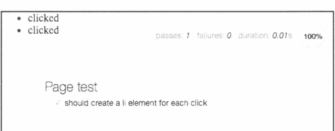

在这段代码中，我们使用 create() 方法创建 Observer。为了测试其行为，我们不需要程序中的任何可观察对象；我们只需调用它的 onNext() 方法即可执行。同样可以对 onError() 和 onCompleted() 方法执行此操作，这使得测试我们的应用程序变得容易得多。

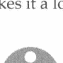

整个代码都放在同一个 HTML 页面中，因此我们不需要使用无头浏览器来测试我们的代码。当我们创建示例应用程序时，我们将实现测试并使用无头浏览器来查看其运行情况。如果你对此没有经验，将在后续过程中进行解释。

## 总结

本章非常重要，因为它回答了任何使用任何程序范式的程序员的两个主要问题：

-   我如何在程序中处理错误？
-   我如何更好地测试我的程序？

从错误的角度来看，我们了解了使用 JavaScript 的响应式扩展时传播错误的默认行为，以及当我们想要更好地控制这些错误时可以使用哪些运算符。


从测试的角度来看，我们学习了如何在服务器和浏览器中测试我们的应用程序，以及解耦应用程序对可测试性的优势，因为它让我们能够测试代码的更小块并轻松模拟其他部分。

在下一章中，我们将研究一些不适合之前任何章节但仍然重要的操作符。我们还将回顾到目前为止学到的示例。
