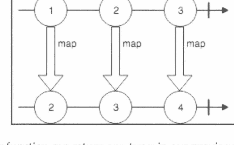
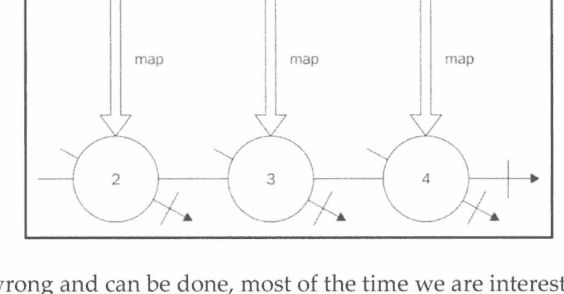
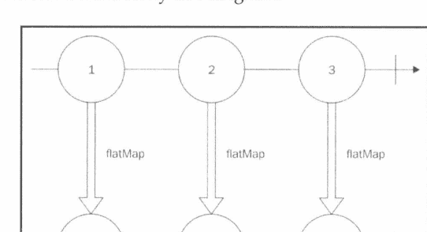
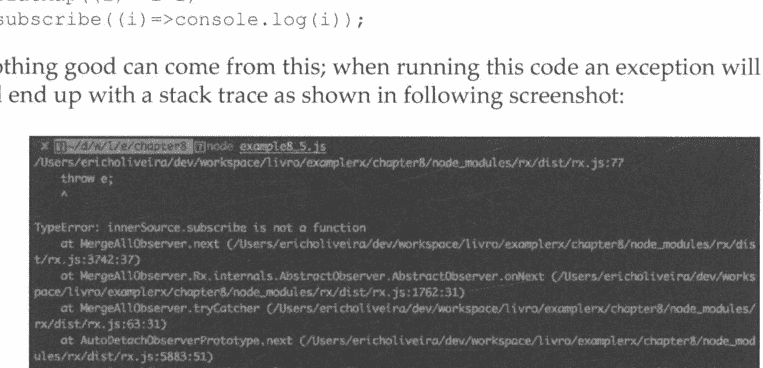
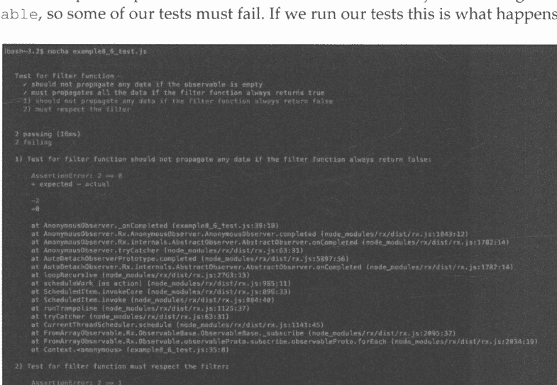
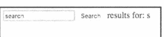
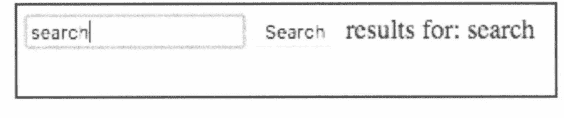
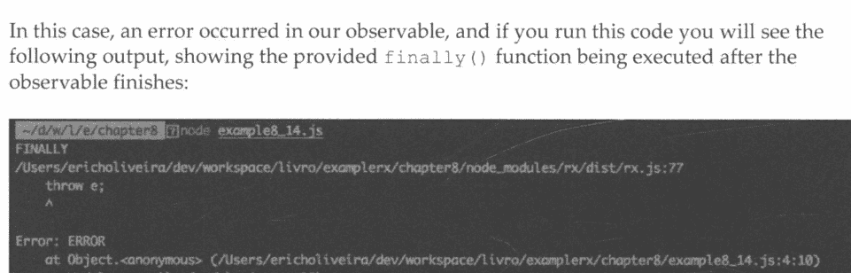

# 8 关于操作符的更多内容

在上一章中，我们学习了如何在响应式应用程序中处理错误；我们看到，如果不对可观察对象的错误进行处理，错误将被传播，通知该可观察对象的所有观察者，并且可观察对象会停止，而永远不会调用观察者的 onCompleted() 方法。除此之外，我们还学习了一组用于改变这种行为并更好地控制错误的运算符，如下所示：

- `catch()`
- `onErrorResumeNext()`
- `retry()`
- `mergeDelayError()`

这些运算符让我们能够更好地控制何时传播错误以及在发生错误时该做什么。

上一章的另一个非常重要的教训是使用函数式响应式编程的程序的测试实现，因为在这种范式中我们始终使用异步计算，我们的测试需要准备好支持这种行为。

函数式响应式编程的特性让我们能够将数据的来源与其发生的效果（可观察对象和观察者）解耦，我们学习了这如何帮助我们更好地构建测试，为测试更小的代码块提供更多工具。

在本章中，我们有两个主要目标：

- 使用更高级的示例回顾本书的一些教训
- 学习更高级且重要的运算符

我们将从回顾迄今为止学到的内容开始，因为接下来的一些运算符有点难以理解，而有些基本上是其他运算符的派生；之后我们将深入研究一些新运算符。

本章将帮助你成为函数式响应式编程的高级用户，在本章之后，你将学习如何组合运算符并使用本书中收集的工具创建一个客户端-服务器聊天应用程序。

因此，真正重要的是你对迄今为止学到的内容有良好的了解。

### 迄今为止的道路

在之前的章节中，我们学习了很多关于函数式响应式编程的知识，以及如何使用它来提高代码的可读性和可维护性；我们使用了两个不同的库：

- bacon.js
- RxJS

我们从 bacon.js 开始，因为它更简单易学，可以开始创建响应式代码，但在这一介绍之后，我们探索了 RxJS，因为它实现了其他概念，我们可以用它们来改进我们的应用程序。

这两个库并不是 JavaScript 中用于函数式响应式编程的唯一可用库，但通过理解它们，你可能可以轻松学习一些其他可用的库。

RxJS 相对于 JavaScript 中其他函数式响应式编程库的另一个优势是它是 Rx 规范的实现。你可以在多种其他语言和平台上找到这种实现，例如 RxJava 和 RxSwift，因此对函数式响应式编程和 RxJS 的良好理解可以提高你在其他平台上的编码技能。

现在，在我们进一步深入 RxJS 的更高级概念和示例之前，确保前几章的概念在你的脑海中建立了坚实的基础非常重要，以便我们可以继续前进。如果你感到不舒服，请随时重读一些章节或部分，并注意下一节，因为它将包含你必须掌握的最基本信息，以便使用函数式响应式编程创建自己的程序。

### RxJS 的基础

在第 3 章《充满变化的世界 - 响应式扩展来救援》中，我们学习了可观察对象和观察者；这两个对象是函数式响应式编程最重要的部分。可观察对象是能够监听环境中发生的事件并通知其他对象这些事件的对象；被通知的对象称为观察者，它们有能力对可观察对象传播的事件做出反应。它们最多可以监听三个事件：

- `onNext()`: 当新数据由可观察对象传播给此观察者时触发
- `onError()`: 当错误由可观察对象传播给此观察者时触发
- `onCompleted()`: 当可观察对象在没有任何错误的情况下完成时触发

RxJS 提供了使用一些内置函数从不同数据源创建可观察对象的机会，但它也允许你为可能需要的任何数据源创建自定义可观察对象。

Subject 是一类特殊的对象，允许你创建可推送的可观察对象，这意味着你可以在任何时候添加数据、错误或完成它。

本章的另一个重要教训是我们第一次订阅。观察者必须订阅可观察对象以监听来自该可观察对象的事件，从而创建订阅；如果观察者不再对该可观察对象的事件感兴趣，也可以随时取消订阅。

函数式响应式编程的大部分威力来自于运算符的使用。运算符让你在数据到达观察者之前与可观察对象传播的数据进行交互和修改。实际上，在内部，每次你在可观察对象上调用运算符时，它并不会修改该可观察对象，而是创建一个新的可观察对象，该可观察对象将传播修改后的数据。这非常重要，因为有了这种行为，我们知道向可观察对象添加运算符不会改变该可观察对象的其他订阅所传播的数据。

运算符有不同的类型，可以用来实现很多东西。我们需要很多章节来解释它们中的一些是如何工作的以及如何修改数据；对于下一节，我们将回顾它们的一些用法，突出它们之间的差异，同时学习一些我们已知的运算符的新示例。接下来的部分是：

- map() 运算符与 flatMap() 运算符：这两个运算符之间的差异可能很微妙，但它们非常重要；在本节中，我们将通过大量示例看到它们之间的差异
- 过滤数据：过滤数据的一些我们已经学过的运算符的新示例和用法
- 聚合数据：再次展示如何聚合可观察对象传播的数据的新示例
- 超越基础：更仔细地查看一些其他非常重要的运算符，如用于缓解背压问题和用于组合可观察对象的运算符


如果你已经知道这些部分中的一些内容，可以随意跳过，但我强烈建议你花时间阅读它们，以确保你已经学会了。

### map() 运算符与 flatMap() 运算符

这两个运算符可能是函数式响应式编程中最重要、最常用的运算符，因此真正重要的是知道如何区分它们。

map() 运算符允许你传递一个参数函数，该函数接收可观察对象的数据作为输入并返回将被传播的新数据。这种新数据可以是任何类型。你可以在以下示例中看到 map() 运算符：

```
Rx.Observable
.of(1,2,3)
.map((i)=>i+1)
.subscribe((i)=>console.log(i));
```

这段代码非常简单，只是在可观察对象的每个元素上加一并将其记录到控制台，因此运行它你会看到以下输出：

2
3
4

你可以在以下图表中看到此操作的表示：



正如我们讨论的，你的函数可以返回任何类型；在之前的示例中我们将一个数字映射到另一个数字，但让我们看看如果将一个数字映射到一个字符串会发生什么：

```
Rx.Observable
.of(1,2,3)
.map((i)=>'received number => '+i)
.subscribe((i)=>console.log(i));
```

这段代码也很简单，没有出错的余地，所以你可能已经知道执行这段代码的输出如下：

received number => 1
received number => 2
received number => 3

是的，非常简单，只是一个字符串，但如果我提供给 map() 运算符的函数返回一个 Observable 而不是这样会怎样：

```
Rx.Observable
.of(1,2,3)
.map((i)=>Rx.Observable.just(i+1))
.subscribe((i)=>console.log(i));
```


现在我们提供给 map() 运算符的函数返回一个 Observable，其包含单个值，即原始值加 1，当你运行这段代码时，你会看到以下输出：

```
JustObservable { _value: 2, _scheduler: ImmediateScheduler {} }
JustObservable { _value: 3, _scheduler: ImmediateScheduler {} }
JustObservable { _value: 4, _scheduler: ImmediateScheduler {} }
```

所以它创建了一个包含 observable 的 observable；此操作可以用下图描述：



虽然这并不错误且可以实现，但大多数时候我们关注的是 observable 的值，而此时 flatMap() 运算符派上用场。该运算符接收一个参数，即将给定值映射到 observable 的函数，因此该函数的返回值必须始终是 observable，并且该运算符会生成一个新的 observable，将所有 observable 的所有值传播出来；它基本上映射值然后展平你的 observable of observables。

以下是使用 flatMap() 的相同代码：

```
Rx.Observable
.of(1,2,3)
.flatMap((i)=>Rx.Observable.just(i+1))
.subscribe((i)=>console.log(i));
```

这段代码会给出你期望的输出：

2
3
4

此操作可以用下图描述：



你可能会想，如果提供给 flatMap() 运算符的函数没有返回 observable 会发生什么；让我们在以下示例中查看：

```
Rx.Observable
.of(1,2,3)
.flatMap((i)=>i+1)
.subscribe((i)=>console.log(i));
```

好事不会发生；运行这段代码时会发生异常，你会得到如下截图中所示的堆栈跟踪：



这显然是错误的。

因此请记住，提供给 map() 运算符的函数可以返回任何类型，如果你返回一个 observable，它将创建一个 observable of observables，而提供给 flatMap() 运算符的函数必须始终返回一个 observable。

我们可以使用运算符来模拟其他运算符，而 flatMap() 非常强大，因为你可以用它来模拟许多不同的运算符；例如，让我们仅使用 flatMap() 运算符来模拟 filter() 运算符。

## 挑战 - 仅使用 flatMap() 运算符创建过滤元素的函数

为了展示 flatMap() 运算符的强大功能，我们可以创建一个函数，仅使用 flatMap() 运算符来模拟 filter() 运算符；该函数必须具有以下签名：

```
filterUsingFlatMap(observable,filter);
```

它将接收两个参数，两者都是必需的：

- `observable`：它是用于过滤数据的 observable
- `filter`：它是一个函数，用于选择元素是否应被过滤

它必须返回一个用于过滤的 observable。

在编写函数之前，让我们先创建一个测试套件来测试它。

让我们使用上一章学到的 mocha。我们可以使用 describe() 函数来定义我们的测试组：

```
var assert = require('assert');
var Rx = require('rx');
var filterUsingFlatMap = require('./example8_6');
describe('Test for filter function', function() {
  //Test goes here
});
```

在这段代码中，我们导入了 assert 模块和 Rx 模块，前者用于对我们的测试进行断言，后者用于创建 observable 进行测试。第三个模块包含我们想要测试的函数；该函数包含在名为 example8_6 的文件中（可以从网站下载）。我也会在这里给出它的实现。

describe() 函数为我们的实现创建一组测试，我设计了四个测试；它们并不详尽，你当然可以想出更多测试来确保实现正确。

第一个测试确保当将一个空 observable 作为参数传递给 filter() 函数时，该函数返回的 observable 不会发出任何数据；可在以下代码中看到：

```
it('should not propagate any data if the observable is empty',
function(done) {
    var eventCalled = false;
    var observable = Rx.Observable.empty();
    filterUsingFlatMap(observable,function noop(){})
        .subscribe(
            function(){eventCalled=true},
            function(){eventCalled=true},
            function(){
                assert.equal(eventCalled,false);
                done();
            }
        )
});
```

对于此测试，我们必须确保 onNext() 和 onError() 事件永远不会被调用。为了测试它，我决定创建一个标志（eventCalled），每当结果 observable 发出这些事件中的任何一个时就更改该标志的值。然后我们创建一个空 observable 并将其作为参数传递给 filterUsingFlatMap() 函数；我们还添加了一个 empty() 函数，因为在测试中我们不关心它，并添加了一个 onCompleted() 函数来断言标志未发生变化并通过调用 done() 函数结束测试。

下一个测试确保当我们的 filter() 函数返回 true 时数据会被传播，可在以下代码中看到：

```
it('must propagates all the data if the filter function always returns true', function(done) {
    var counter=0,elements = [1,2];
    var observable = Rx.Observable.fromArray(elements);
    filterUsingFlatMap(observable,function(){return true;})
        .subscribe(
            function(){counter++;},
            function noop(){},
            function(){
                assert.equal(counter,elements.length);
                done();
            }
        )
});
```

对于此测试，我们添加一个计数器来计算传播的元素数量，每当调用 onNext () 方法时就将 1 加到该计数器；我们还创建一个数组（elements）并从中创建一个 observable，并在我们的 onCompleted() 方法中确保计数器等于数组中的元素数量（这确保了所有数据都被传播）并结束测试。

第三个测试做完全相反的事情，确保当我们的 filter() 函数返回 false 时所有数据都被过滤，可在以下代码中看到：

```
it('should not propagate any data if the filter function always return false',function(done){
    var counter=0,elements = [1,2];
    var observable = Rx.Observable.fromArray(elements);
    filterUsingFlatMap(observable,function(){return false;})
        .subscribe(
            function(){counter++},
            function noop(){},
            function(){
                assert.equal(counter,0);
                done();
            }
        );
});
```

这个测试与上一个非常相似；唯一的变化是它期望计数器为零（这意味着没有数据被传播）。

对于最后一个测试，我们取一个数组并过滤偶数，其实现可在以下代码中看到：

```
it('must respect the filter',function(done){
    var counter=0,elements = [1,2];
    var elementFound;
    var observable = Rx.Observable.fromArray(elements);
    filterUsingFlatMap(observable,function(i){return i % 2===0;})
        .subscribe(
            function(i){
                counter++;
                elementFound=i;
            },
            function noop(){},
            function(){
                assert.equal(counter,1);
                assert.equal(elementFound,2);
                done();
            }
        );
});
```

在这里我们更改了 filter() 函数，使其对偶数返回 true，对奇数返回 false；我们还将找到的元素存储在一个变量中，并且由于该数组中唯一的偶数是 2，我们期望计数器等于 1 且找到的元素等于 2。

现在我们有了测试，可以准备仅使用 flatMap() 实现我们的 filter() 函数了；一个好的做法是在尝试真正实现之前先让测试失败，所以让我们尝试以下 filter() 函数的实现：

```
var Rx = require('rx');
module.exports = function(observable,filter){
return observable;
};
```

在我们第一次尝试实现 filter() 函数时，我们只是返回原来的 observable，因此我们的一些测试必须失败。如果我们运行测试，会发生以下情况：



两个测试通过了：一个检查当可观察对象为空时不传播任何数据，另一个检查当 `filter()` 函数返回 true 时传播所有数据；由于我们返回的是自身可观察对象，因此这两个测试被接受是合理的，但有两个测试失败，如前一个截图所示。

现在让我们尝试仅使用 `flatMap()` 运算符来实现我们的函数。`filter()` 函数必须在 `filter()` 返回 true 时传播数据，并在返回 false 时省略；我们可以通过使用 `just()` 方法返回一个可观察对象来轻松地使用 `flatMap()` 传播数据：

```
var Rx = require('rx');
module.exports = function(observable,filter){
    return observable.flatMap(
        (data)=>Rx.Observable.just(data)
    );
};
```

我们甚至不需要测试它，因为我们知道它会失败；我们需要找到一种方法根据给定的 filter 省略数据。

如何使用 `flatMap()` 省略数据？

答案很简单。我们可以返回使用 `empty` 方法创建的可观察对象。用此方法创建的可观察对象是空的，因此它们将在结果中省略数据。最后一步是执行 `filter()` 函数来决定是否必须传播数据。

使用仅 `flatMap()` 运算符的函数的最终代码如下：

```
var Rx = require('rx');
module.exports = function(observable,filter){
    return observable.flatMap(
        (data)=>{
            if(filter(data)){
                return Rx.Observable.just(data);
            }else{
                return Rx.Observable.empty();
            }
        }
    );
};
```

因此我们调用 `filter()` 函数并传入数据，如果结果为 truthy 值，我们返回仅包含此数据的可观察对象；否则我们返回一个空可观察对象，从结果中省略该数据。

如果我们在这个新函数上执行测试，我们将看到以下输出：

```
[bash-3.2$ mocha example8_6_test.js

Test for filter function
  ✓ should not propagate any data if the observable is empty
  ✓ must propagate all the data if the filter function always returns true
  ✓ should not propagate any data if the filter function always return false
  ✓ must respect the filter

4 passing (15ms)
```

现在我们的测试按预期工作了，我们刚刚仅使用 `flatMap()` 运算符实现了一个 `filter()` 函数。


欢迎将此作为练习实现更多测试。

## 过滤数据

我们学习了一些用于从可观察对象过滤数据的不同运算符；`filter()` 运算符可能是最常见和最有用的。使用此运算符时，你必须提供一个函数作为每个由可观察对象传播的元素使用的过滤器；该函数的返回值将用于决定数据是否应被传播，当函数结果被求值时就会发生这种情况，如果结果是：

- 一个 truthy 值：对象会被传播
- 一个 falsy 值：对象会被省略
- falsy 值有：
  - False
  - Null
  - Undefined
  - 0
  - NaN（不是数字）
  - ""（空字符串）
- truthy 值有：
  - 任何非 falsy 值

所以当你看到以下代码时：

```
Rx.Observable
  .interval(100)
  .filter(
    (i)=> i%3
  )
  .take(4)
  .subscribe((i)=>console.log(i));
```

控制台会打印什么值？

+   1. 3,6,9,12
+   2. 1,2,4,5
+   3. 1,2,4
+   4. 3

正确答案是选项 2，即：

1
2
4
5

这种情况发生是因为我们首先使用 `interval()` 函数创建了一个生成连续数字的可观察对象；然后我们创建了一个包含此可观察对象过滤后数据的新的可观察对象。`filter()` 函数对值使用 `%` 运算符，该运算符返回除以给定数字后的余数，因此在我们的示例中，`filter()` 函数返回数字与三相除的余数，该函数对 3 的倍数返回 0，否则返回 1 或 2，0 是 falsy 值而 1 和 2 是 truthy 值，因此 3 的倍数被省略；然后我们使用 `take()` 运算符从中创建一个仅包含四个元素的可观察对象。

所有这些运算符创建一个包含前四个不是 3 的倍数的自然数的可观察对象，因此，选项 2（1、2、4 和 5）是正确答案。

## 聚合数据

聚合数据最重要的运算符是 `reduce()` 运算符，与其他运算符一样，`reduce()` 运算符返回一个新的可观察对象；在这种情况下，返回的可观察对象包含单个值，该值是函数对原始可观察对象的所有元素执行的结果。

我们可以使用 `reduce()` 运算符在可观察对象中找到较低的数值：

```js
Rx.Observable
.of(1,5,0,9,56,-2,13)
.reduce(function(a,b){
  if(a<b){
    return a;
  }else{
    return b;
  }
})
.subscribe((i)=>console.log(i));
```

在这个示例中，可观察对象中的值将从左到右扫描，并使用 `reduce()` 函数检查哪个更低（if/else 块），然后我们记录结果。因此，正如预期的那样，结果是：

-2


`reduce()` 运算符可用于数学运算；实际上，RxJS 包含一些数学运算符，如 min、max 和 sum，每个都可以使用 `reduce()` 运算符轻松实现。你也可以使用 `reduce()` 运算符进行其他操作，如创建数组、新对象、连接字符串等；每当你需要聚合数据时，`reduce()` 运算符都可以成为你的盟友。

## 超越基础

RxJS 提供的远不止用于对数据进行简单转换的运算符，我们学习了一些更复杂的用法，并将回顾其中最重要的部分。

## 处理背压

背压发生在每次接收数据的速度快于在给定时间内处理能力的时候。

在开始为背压编写解决方案之前，你必须决定是否愿意花费内存或丢失数据。

当你可以丢失数据时，你可以使用有损策略；该策略的优点是内存消耗低，并且可以利用恒定内存来缓解问题。我们学习的有损运算符如下：

- `throttle()`
- `sample()`
- `debounce()`
- `pausable()`

如果不能丢失数据，你可以使用内存来存储正在处理的数据；你将用于处理背压的策略是无损策略。我们学习了以下用于处理背压的无损运算符：

- `bufferWithCount()`
- `bufferWithTime()`
- `bufferWithTimeOrCount()`
- `pausableBuffered()`
- `controlled()`

了解程序的限制（内存或数据）将帮助你决定使用哪些运算符。

## 组合可观察对象

最重要的是记住，你甚至可以组合可观察对象来使用两者的数据创建一个新的可观察对象。

对此有三个非常重要的运算符：

- `merge()`
- `concat()`
- `zip()`

`concat()` 运算符生成一个新的可观察对象，包含所有提供的可观察对象的数据；数据在新可观察对象上按可观察对象的顺序传播，因此它首先传播第一个可观察对象的所有数据，然后在完成后再进入下一个，依此类推。一件重要的事情是，如果一个可观察对象是无限的（因此永远不会完成），它就永远不会进入下一个。

`merge()` 运算符与 `concat()` 运算符类似，但它遵循值的顺序，因此它监听所有可观察对象中的数据，并在数据发生时立即将其传播到创建的可观察对象。使用此运算符时，即使其中一个可观察对象是无限的，它也会传播所有数据。

`zip()` 运算符与其他两个略有不同，因为它从其他可观察对象的组合创建一个新的可观察对象；默认情况下它传播一个包含每个可观察对象值的数组，但你也可以提供一个函数按你想要的方式组合它们。


> 因此，这就是我们对本书迄今为止最重要的一些课程的快速回顾；请随意回顾你的弱点。在本章中，我们将学习一些其他高级运算符。

## 其他重要运算符

RxJS 中的一些重要运算符与我们迄今为止学习过的运算符组没有完美的对应关系，但它们可以用几行代码轻松解决一些复杂和特定的问题，让你在使用时感觉像个魔术师。现在我们将学习它们。

## `flatMapLatest()` 运算符

此运算符与 `flatMap()` 运算符类似，但它仅传播来自最近转换的可观察对象的项。


想象一个输入时搜索的功能。在此功能中，每次按键你都会执行一次搜索并在屏幕上展示当前结果；如果你正在访问外部资源，例如数据库或 API，一些搜索可能比其他搜索花费更长时间，而这种搜索的天真实现（例如使用 flatMap()）可能会显示错误的结果。请看下面的示例：

- 1. 一个用于在数据库中搜索姓名的搜索框。
- 2. 用户输入字母 J 并开始搜索所有以字母 J 开头的可用姓名。
- 3. 用户输入字母 O 并开始搜索所有以 JO 开头的可用姓名。
- 4. 以 JO 开头的姓名搜索完成并展示结果（例如 John 和 Joe）。
- 5. 第一次搜索（以 J 开头的姓名）最终完成（它花费的时间比 JO 搜索更长），并使用以 J 开头的姓名更改展示的结果（例如 Jean、June、John）。
- 6. 展示的结果是错误的，因为用户搜索框显示的是 JO，而其中一些展示结果并不以 JO 开头（Jean 和 June）。

flatMapLatest() 操作符非常适合这种情况，因为在示例中，如果 J 的结果花费更长时间完成，则会被丢弃。

flatMapLatest() 操作符具有以下签名：

```
observable.flatMapLatest(selectorFunction, [selectorContext]);
```

它接收最多两个参数；第一个是强制性的，第二个是可选的：

- selectorFunction：它是一个将值映射到可观察序列的函数
- selectorContext：在 selectorFunction 中使用的此参数（上下文）

以下代码展示了此操作符的使用示例：

```
Rx.Observable
.of(1,2,3)
.flatMapLatest(
  (i)=>Rx.Observable.just(i+1)
).subscribe((k)=>console.log(k));
```

此示例很简单，它的工作方式与 flatMap() 操作符相同；它会给出以下输出：

2
3
4

我们可以实现输入时搜索功能来查看差异；为此，让我们创建一个包含实现功能的 HTML 页面并比较结果：

```html
<html>
    <head></head>
    <body>
        <input type="text" id="my_input"/>
        <button id="my_button">Search</button>
        <span id="my_span"></span>
        <script src="https://cdnjs.cloudflare.com/ajax/libs/rxjs/4.1.0/rx.all.js"></script>
        <script>
            var enterKeyUpObservable = Rx.Observable
                .fromEvent(document.getElementById("my_input"),"keyup")
                .flatMap(function(e){
                    var value = document.getElementById("my_input").value;
                    return Rx.Observable
                        .just("results for: "+value)
                        .delay(Math.max((10 - value.length)*1000,100));
                });
            enterKeyUpObservable.subscribe(function(text){
                document.getElementById('my_span').innerHTML = text;
            });
        </script>
    </body>
</html>
```

此 HTML 页面将公开一个搜索框，当你在其中输入时它会执行一次假搜索，以文本形式显示搜索中使用的值；我们使用 flatMap() 操作符来模拟搜索功能，并使用延迟来模拟执行搜索所需的时间，如果你运行此 HTML 页面并在搜索框中输入内容，你将看到以下截图：



它仅显示字母 s 的结果，但我们想要的是所有给定输入的结果；要修复此问题，我们只需改用 flatMapLatest() 操作符即可。使用以下代码：

```
var enterKeyUpObservable = Rx.Observable
    .fromEvent(document.getElementById("my_input"),"keyup")
    .flatMapLatest(function(e){
        var value = document.getElementById("my_input").value;
        return Rx.Observable
            .just("results for: "+value)
            .delay(Math.max((10 - value.length)*1000,100));
    });
```

你将看到类似以下内容的 HTML 页面：



## The flatMapFirst() operator

此操作符从第一个映射的可观察对象传播数据，并且只有在它完成并丢弃完成前所有其他可观察对象后才会转到下一个。

flatMapFirst() 操作符具有以下签名：

```
observable.flatMapFirst(selectorFunction,[selectorContext]);
```

它接收最多两个参数；第一个是强制性的，第二个是可选的：

- selectorFunction：它是一个将值映射到可观察序列的函数
- selectorContext：在 selectorFunction 中使用的此参数（上下文）

以下代码展示了此操作符的使用示例：

```
Rx.Observable
    .interval(50)
    .flatMapFirst(
        (i)=>Rx.Observable.interval(30)
            .map((k)=>'running for: '+i+' flatMapFirst: '+k)
            .take(3)
    ).subscribe((i)=>console.log(i));
```

在此示例中，我们从 interval() 创建一个 Observable；此可观察对象将每 50 毫秒发出从零开始的连续整数。我们使用 flatMapFirst() 将其映射到也从 interval() 创建的可观察对象以生成字符串（此字符串仅用于调试目的，以显示原始可观察对象中正在运行的值），然后我们取三个项目（以确保它完成并可以转到下一个）并订阅它们。

如果你运行此代码，你将看到以下输出：

```
running for: 0 flatMapFirst: 0
running for: 0 flatMapFirst: 1
running for: 0 flatMapFirst: 2
running for: 3 flatMapFirst: 0
running for: 3 flatMapFirst: 1
running for: 3 flatMapFirst: 2
running for: 5 flatMapFirst: 0
running for: 5 flatMapFirst: 1
//keeps printing until we stop the program
```

通过查看输出，更容易理解此操作符的工作方式；它开始为值 0 运行（从原始可观察对象传播的第一个值），并传播来自 flatMapped 可观察对象的所有元素（格式为 running for: 0 flatMapFirst: X 的前三个字符串）。它丢弃在 flatMapFirst() 的可观察对象运行时传播的所有值；因此，值 1 和 2 被丢弃，它转到下一个值，即值 3，执行重复。

此操作符有一个别名，称为 selectSwitchFirst。

## The finally() operator

此操作符简单且有用，其工作方式类似于 try/catch/finally 块中的 finally。它在原始可观察对象完成（即使在失败的情况下）后执行指定的函数。

它具有以下签名：

```
observable.finally(action);
```

它只接收一个参数且是强制性的：

- **action**：当原始可观察对象完成时（即使在失败的情况下）要执行的函数

此操作符很简单，两个示例就足以理解它。

第一个示例展示了其在可观察对象优雅完成时的用法：

```
Rx.Observable
.just(1)
.finally(()=>console.log('FINALLY'))
.subscribe((i)=>console.log(i));
```

如果你运行此代码，你将看到以下输出，显示在可观察对象完成之后提供的 finally 函数被执行：

```
1
FINALLY
```

另一个示例展示了此操作符在失败情况下的行为：

```
Rx.Observable
.throw(new Error('ERROR'))
.finally(()=>console.log('FINALLY'))
.subscribe((i)=>console.log(i));
```

在这种情况下，我们的可观察对象中发生了错误，如果你运行此代码，你将看到以下输出，显示在可观察对象完成之后提供的 finally() 函数被执行：



## The groupBy() operator

此操作符允许你对可观察序列的值进行分组。它将生成一个包含每个组的可观察对象的可观察对象。

它具有以下签名：

```
observable.groupBy(groupFunction,[valueSelector]);
```

它接收两个参数，第一个强制性，第二个可选：

- `groupFunction`：它是一个用于决定值属于哪个组的函数
- `valueSelector`：它是一个用于选择要传播的值的函数；如果未指定，则传播其自身的值

此操作符的一个简单使用示例是在可观察序列中将奇数和偶数分开：

```
Rx.Observable
.of(0,1,2,3,4,5)
.groupBy((i)=>i%2)
.subscribe((obs)=>{
  obs.toArray().subscribe((arr)=>console.log(arr))
});
```

在此示例中，我们使用 groupBy() 操作符将偶数和奇数分开，因为它为每个组生成一个可观察对象，订阅函数接收到的参数是一个可观察对象，我们然后将其转换为仅包含一个数组的可观察对象并记录它；因此，如果我们运行此代码，我们将在控制台中看到打印偶数数组和奇数数组：

```
[ 0, 2, 4 ]
[ 1, 3, 5 ]
```

使用第二个参数的另一个使用示例是按首字母对姓名进行分组：

```
Rx.Observable
.of(
  {name:'Mary',lastName:'Jane'},
  {name:'John',lastName:'Doe'},
  {name:'Jean',lastName:'Carter'},
  {name:'Erich',lastName:'Oliveira'})
.groupBy(
  (person)=>person.name[0],
  (person)=>person.name+' '+person.lastName
```


```
).flatMap(
    (personObservable)=>personObservable.toArray()
).map(
    (arr)=>'Names starting with '+arr[0][0]+': '+arr.join()
).subscribe((str)=>console.log(str));
```

这个示例稍微复杂一些。我们从包含四个人名和姓氏的对象创建了一个 Observable，然后使用 groupBy() 按其姓名的首字母对它们进行分组，并将对象映射为包含姓名和姓氏的字符串（groupBy() 的第二个参数）；结果是一个可观察对象的可观察对象。然后我们使用 flatMap() 将其转换为数组的可观察对象；最后我们将这些数组映射为包含其首字母和数组中所有名称的字符串并记录它。

如果运行此代码，您将看到以下输出：

```
Names starting with M: Mary Jane
Names starting with J: John Doe,Jean Carter
Names starting with E: Erich Oliveira
```

## do() 操作符

此操作符允许您执行任意函数；它对于调试目的非常有用，因为您可以记录数据并更好地了解可观察对象的工作流。

它具有以下签名：

```
observable.do(execute);
```

它只接收一个参数并且是强制性的：

- execute：它是此可观察对象要执行的函数，它将作为参数接收可观察对象传播的值

此操作符的示例用法可在以下代码中看到：

```
Rx.Observable
.of('Joe DiMaggio','Friedrich Nietzsche','Nayara Neves','Marco Antonio')
.map((name)=>name.split(' ')[1])
.do((data)=>console.log('[DEBUG] Data after map operator: '+data))
.filter((name)=>name.indexOf('N')===0)
.do((data)=>console.log('[DEBUG] Data after filter operator:'+data))
.subscribe((result)=>console.log(result));
```

在此示例中，我们使用一些名称创建了一个 Observable；然后我们使用 map() 操作符传播每个人的姓氏。由于我们想要追踪执行过程，我们使用 do() 操作符在操作符使用后记录值；do() 操作符不会改变可观察对象传播的数据。然后我们过滤以仅保留以字符 N 开头的姓氏；我们再次添加 do() 以继续追踪数据，最后订阅它。

如果运行此代码，您将在控制台中看到以下输出：

```
[DEBUG] Data after map operator: DiMaggio
[DEBUG] Data after map operator: Nietzsche
[DEBUG] Data after filter operator: Nietzsche
Nietzsche
[DEBUG] Data after map operator: Neves
[DEBUG] Data after filter operator:Neves
Neves
[DEBUG] Data after map operator: Antonio
```

查看此结果，您可以逐步了解执行的发生情况。它首先传播名称 Joe DiMaggio，将其映射为 DiMaggio，并对其进行过滤。由于它不以字符 N 开头，因此不会继续传播。然后它进入名称 Friedrich Nietzsche，该名称一直传播到最后；名称 Nayara Neves 和 Marco Antonio 也是如此。

请注意，如果我们移除 do() 操作符：

```
Rx.Observable
.of('Joe DiMaggio','Friedrich Nietzsche','Nayara Neves','Marco Antonio')
.map((name)=>name.split(' ')[1])
.filter((name)=>name.indexOf('N')===0)
.subscribe((result)=>console.log(result));
```

我们将得到以下输出：

```
Nietzsche
Neves
```

这正是相同的输出（移除了调试信息），表明 do() 操作符永远不会改变可观察对象的值。


此操作符有两个别名，称为 tap 和 doAction。

## 摘要

在本章中，我们开始回顾迄今为止学到的最重要的概念，并重新审视了关于函数式响应式编程和响应式扩展的一些常见误解。

在我们的回顾中，我们学习了 map() 和 flatMap() 之间的区别、flatMap() 操作符的强大功能、过滤数据和 falsy/truthy 值、聚合数据、处理背压的策略以及组合可观察对象。

在本章其他部分，我们学习了一些新的操作符，例如 flatMapLatest()、flatMapFirst()、finally()、groupBy() 和 do()。

我们已经学会了如何组合可观察对象；在下一章中我们将学习一个名为 transducer 的新概念。Transducers 让我们能够组合操作符，从而提高可读性和可重用性，有助于使用函数式响应式编程编写更清晰、更简洁的应用程序。
