# 9 组合

在上一章中，我们使用 RxJS 回顾了一些函数式响应式编程的关键概念，包括：

- 可观察对象传播哪些事件
- 什么是可观察对象？
- 一些重要操作符的回顾：
  - map() 和 flatMap() 操作符之间的差异
  - 从另一个操作符模拟一个操作符的挑战
  - 过滤数据
  - 聚合数据
- RxJS 程序的测试
- 缓解背压问题
- 组合可观察对象

关注此回顾对于更好地、更清晰地理解函数式响应式编程至关重要，有了这些知识，我们就能为更高级的主题做好更充分的准备，例如上一章的一些操作符：

- flatMapLatest()
- flatMapFirst()
- finally()
- groupBy()
- do()

在本章中，我们将在进入最终项目之前学习最后一个主题。利用本书中的所有知识，我们已经学会了如何组合可观察对象，现在我们将学习如何使用一个名为 transducer 的新概念独立地组合转换。

## 什么是 transducer？

Transducers 是可组合的算法转换；它们提供了一种组合操作符以创建新操作符的方法。它们独立于输入源和输出，因此不仅可以应用于可观察对象，还可以应用于数组、流和集合。

Transducers 允许您描述想要应用于输入源的操作，这样您就可以创建要应用于它们的操作管道，而无需创建任何中间聚合。

您可能还记得从前面的章节中，每次我们将一个操作符应用于可观察对象时都会创建一个新的可观察对象，因此如果我们将两个操作符应用于可观察对象，我们将创建两个额外的可观察对象，如果我们将三个操作符应用于可观察对象，我们将创建三个额外的可观察对象，依此类推。使用 transducers 时不会发生这种情况，因为您首先描述想要应用于数据源的所有转换，因此无需创建任何中间可观察对象，这会导致代码性能提升。

使用 transducer 的另一个优点是它为代码添加了额外的抽象层，让您在甚至不知道将使用哪种类型的数据之前就能描述如何转换数据。这一额外的抽象层让您能够重用更多代码，并独立测试转换。

因此，使用 transducers 的主要优点如下：

- 性能提升，因为它避免了可观察对象（或任何其他被迭代的对象）中间形式的创建
- 提高代码可维护性：
  - 可测试性提升，因为它允许您独立测试转换
  - 可重用性提升，因为它允许您描述想要应用于数据源的转换并在其他源中重用它
- 可读性提升，因为它允许您描述转换，为代码添加更多语义

要在代码中使用 transducers，您需要添加另一个依赖项，即实现 transducer 的库；目前有两种重要的库得到 RxJS 支持，它们如下：

- transducers-js: https://github.com/cognitect-labs/transducers-js
- transducers.js: https://github.com/jlongster/transducers.js

另一个需要注意的重要事项是，由于 transducers 与输入源无关，它们没有提供我们在 RxJS 中学习过的所有操作符。实际上，无论您选择哪种实现，都只包含其中少数几个。


单词 transducer 来自 transform 和 reduce 两个词的组合。

## JavaScript 可用的 transducer 实现

正如我们在上一节中看到的，有两个重要的实现可用，并且由于 transducers 库实现了协议，因此应该很容易切换实现。为了展示 transducers 的示例用法，我们需要选择其中一个，我将选择使用 transducers-js；因为两者大致同样流行，但 transducers-js 提供了更多转换，因此您尝试、测试和玩弄起来应该更容易一些。

这两种实现都可以在 node 和浏览器中使用。在本章中，我们只在 node 中使用它，要使用它，我们所要做的就是使用 npm 安装它：

```
npm install transducers-js
```


在本书中，我们将使用 transducers-js 库的 0.4.174 版本；要安装此特定版本，请改运行以下命令：

```
npm install transducers-js@0.4.174
```


## transducers-js API

在学习如何使用 transducers-js 与 RxJS 之前，了解此库中可用的转换非常重要。由于我们已经在 RxJS 中学习了其中大部分转换，这里快速概述了 `transducers-js` 库 API 中可用的一些转换及其各自的作用：

- transducers.complement (function): 它接收一个函数并返回其补函数（否定函数调用的结果）。
- transducers.filter (function): 它接收一个函数并根据对数据调用该函数的结果进行过滤。
- transducers.first(): 它返回第一个输入。
- transducers.map (function): 它使用给定的函数将每个值映射为另一个值。
- transducers.partitionAll (integer): 它将输入映射为给定大小的数组。
- transducers.reduce (function, initialObject, iterable): 它接收一个函数、一个初始值和要归约的可迭代对象作为参数。它返回从初始值开始并应用给定函数对给定可迭代对象进行归约的结果。
- transducers.remove (function): 它与 `filter()` 操作类似，但当给定函数返回真值时移除该值。
- transducers.take (integer): 它返回一个可迭代对象，其中包含前 n 项，n 为作为参数传递给 `take()` 函数的整数。
- transducers.takeWhile (function): 它在给定函数返回 true 时返回所有元素。


这不是可用方法的详尽列表，但它包含了相当一部分，足以让我们开始使用 transducers。所有可用方法都可以在链接 http://cognitect-labs.github.io/transducers-js/classes/transducers.html 中找到。

## 使用 transducers

正如我们在前几节中讨论的，transducers 是一种对可迭代对象进行算法转换组合的方式；为了演示这一点，让我们首先在最简单的可迭代对象——数组——中使用一个 transducer。

要在数组上运行 transducer，我们首先需要一种方法来在给定的可迭代对象上运行给定的转换。

为此我们使用 into() 方法，其签名如下：

```
transducers.into(emptyIterable,transformation,iterable)
```

它接收三个参数，且全部为必填：

- emptyIterable: 它是一个空的可迭代对象，用于存储对可迭代对象应用转换的结果
- transformation: 它是要应用于可迭代对象的函数或 transducers
- iterable: 它是要转换的可迭代对象

使用此函数我们可以对数组实现转换，让我们看看如何使用它实现一个简单的 map：

```
var t = require('transducers-js');

var iterableObject = [1,2,3,4];
var mapTransducer = t.map((i)=>i+1);

var result = t.into(
  [],
  mapTransducer,
  iterableObject
);

console.log(result);
```

此示例执行以下操作：

- 1. 导入 transducers-js 库并将其存储在 t 变量中。
- 2. 创建一个名为 iterableObject 的数组，转换将在其上应用；该数组包含值 [1,2,3,4]。
- 3. 创建一个 transducer，将可迭代对象的每个值映射为其加一，名为 mapTransducer。
- 4. 调用 into 方法，使用 mapTransducer 对 iterableObject 进行迭代，并将结果放入作为方法第一个参数传递的空数组中；结果存储在 result 变量中。
- 5. 将 result 变量记录到控制台；此步骤按预期在控制台打印值 [ 2, 3, 4, 5 ]。

这是一个简单的示例，展示了对数组的简单转换，但使用 transducers 我们可以组合多个转换以应用于可迭代对象。组合本身使用 comp() 方法完成；该方法的签名如下：

```
transducers.comp(...transformations)
```

它接收任意数量的参数，每个参数都是要应用于可迭代对象的转换。

为了演示该方法，让我们使用 map 和 filter 转换实现一个 transducer，对可迭代对象中的每个数字加一并过滤只保留偶数：

```
var t = require('transducers-js');
var iterableObject = [1,2,3,4];

var mapTransducer = t.map((i)=>i+1);
var filterTransducer = t.filter((i)=>i%2===0);

var composedTransducer = t.comp(mapTransducer,filterTransducer);

var result = t.into(
    [],
    composedTransducer,
    iterableObject
);

console.log(result);
```

这段新代码创建了我们第一个转换组合，具体步骤如下：

- 1. 导入 `transducers-js` 库并将其存储在 `t` 变量中。
- 2. 创建一个名为 `iterableObject` 的数组，转换将在其上应用，该数组包含值 `[1, 2, 3, 4]`。
- 3. 创建一个 transducer，将 `iterable` 对象的每个值映射为其加一，名为 `mapTransducer`。
- 4. 创建一个 transducer，过滤 `iterable` 对象的每个值只保留偶数，名为 `filterTransducer`。
- 5. 创建转换的组合，遵循从左到右的参数顺序，因此首先应用 `map()` 转换，然后应用 `filter()` 转换，名为 `composedTransducer`。
- 6. 调用 `into()` 方法，使用 `composedTransducer` 对 `iterableObject` 进行迭代，并将结果放入作为方法第一个参数传递的空数组中；结果存储在 `result` 变量中。
- 7. 将 `result` 变量记录到控制台；此步骤按预期在控制台打印值 `[ 2, 4 ]`。


请记住顺序很重要，因此当我们对 `iterable` 对象 `[1, 2, 3, 4]` 运行 map 转换时，结果是每个数字加一 `[2, 3, 4, 5]`，然后我们过滤只保留偶数 `[2, 4]`，如输出所示。

如果我们交换传递给 `t.comp` 的参数顺序，我们首先应用 `filter` 然后应用 `map`，因此我们首先只过滤偶数；然后应用将每个值加一的 `map` 转换，在之前的代码中我们更改了这一行的顺序：

```
var composedTransducer = t.comp(filterTransducer,mapTransducer);
```

使用此更改运行代码会得到不同的输出：

[ 3, 5 ]

当我们使用此小更改运行时，必须首先过滤数组 ([ 1, 2, 3, 4]) 以保留偶数 ([ 2, 4 ])，然后将其映射为值加一，这给出了输出 [ 3, 5 ]。

## 使用 transducers 与 RxJS

在上一节中，我们学习了如何将 transducer 应用于 JavaScript 中最简单的 `iterable` 对象——数组。但我们更感兴趣的是如何在使用 RxJS 进行函数式响应式编程中使用此工具。

使用 transducers 与 RxJS 我们可以看到性能提升，因为我们将避免创建中间 observable 序列，并且可以通过转换的组合来提高代码的整体质量。

要在 RxJS 中使用 transducer，我们需要使用 RxJS 库的 transduce 操作符；该操作符的签名如下：

```
observable.transduce(transducer)
```

它只接收一个必填参数：

- transducer: 它是要应用于 observable 序列的 transducer 转换

transduce 操作符像其他任何 observable 操作符一样返回一个新的操作符，但由于我们可以在单个 transducer 内部组合多个转换，因此我们只会创建一个新的 observable。


想象一个 observable，我们在上面应用两个操作符，filter() 操作符和 map() 操作符，对于每个应用的操作符，RxJS 都会创建一个新的中间 observable，创建两个新的 observable。如果我们决定改为创建一个组合两种转换的 transducer，RxJS 只会创建一个额外的 observable，这带来了性能提升；我们将在本章的基准测试部分看到 transducers 方法的性能提升。

现在让我们看看 transducers 与 observable 序列的示例用法。首先让我们使用 transducers 实现一个简单的 map：

```
var t = require('transducers-js');
var Rx = require('rx');

var mapTransducer = t.map((i)=>i+1);
Rx.Observable
.of(1,2,3,4)
.transduce(mapTransducer)
.subscribe((i)=>console.log(i));
```

在这里我们简单地创建一个 mapTransducer 将可迭代对象的每个值加一，然后创建一个包含四个值的 Observable，使用 mapTransducer 对其应用 transduce 操作符，最后订阅以记录此 observable 序列的内容。

执行此代码给出的输出如下：

2
3
4
5


The code can be described by the following diagram:

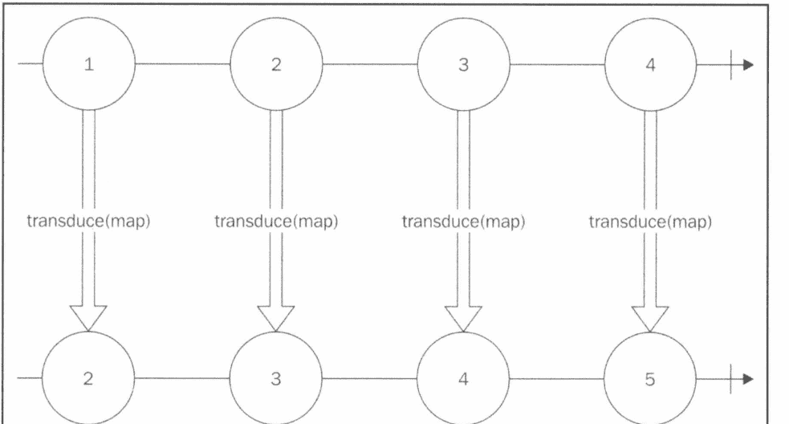

请注意，传递给 transduce 操作符的参数转换器与上一节中用于对数组应用转换的转换器相同；我们甚至可以在两个不同的对象中使用同一个转换器，如以下代码所示：

```
var mapTransducer = t.map((i)=>i+1);

Rx.Observable
.of(1,2,3,4)
.transduce(mapTransducer)
.subscribe((i)=>console.log(i));

var resultArray = t.into(
  [],
  mapTransducer,
  [1,2,3,4]
);
console.log(resultArray);
```

在这段代码中，我们基本上添加了一段代码来在数组上运行可观察序列中使用的同一个 mapTransducer，输出如下：

```
2
3
4
5
[ 2, 3, 4, 5 ]
```

正如预期的那样，可观察序列的值会逐一打印，包含原始值加 1，数组序列也会打印，包含数组的原始值加 1，且没有任何错误。这展示了转换器的多功能性，因为它们可以在不同的数据结构中使用而无需任何更改。

我们还可以在 RxJS 中使用转换器的组合，使用以下代码：

```
var mapTransducer = t.map((i)=>i+1);
var filterTransducer = t.filter((i)=>i%2===0);
var composedTransducer = t.comp(mapTransducer,filterTransducer);

Rx.Observable
.of(1,2,3,4)
.transduce(composedTransducer)
.subscribe((i)=>console.log(i));
```

正如你所见，转换器的组合方式与数组示例中完全相同，我们在 transduce() 操作符上使用 composedTransducer 来在可观察对象上运行它。

执行这段代码会得到以下输出：

```
2
4
```

以下代码可以用下面的图表来描述：

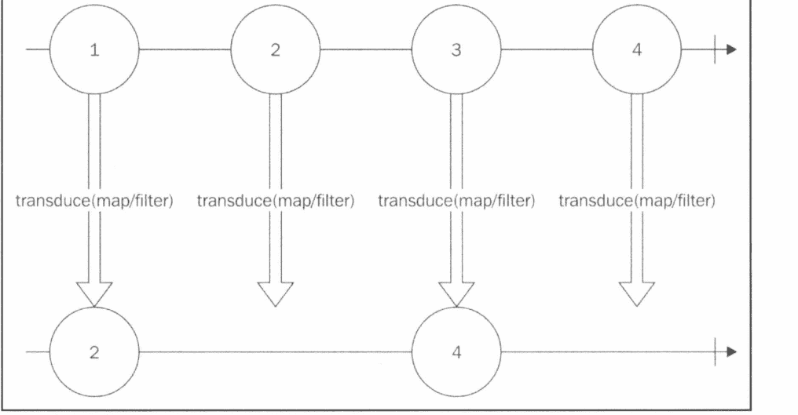

正如图表所示，没有创建中间可观察对象；相同的代码可以使用可观察对象的 map() 和 filter() 操作符实现，但它会增加额外可观察对象的创建，降低代码性能。

如果我们决定使用 map() 和 filter() 操作符而不是转换器来实现相同的代码，我们可以使用以下代码：

```
var mapFunction = (i)=>i+1;
var filterFunction = (i)=>i%2===0;

Rx.Observable
.of(1,2,3,4)
.map(mapFunction)
.filter(filterFunction)
.subscribe((i)=>console.log(i));
```

该代码的输出将相同，但在内部它会创建中间可观察对象，如该图表所示：

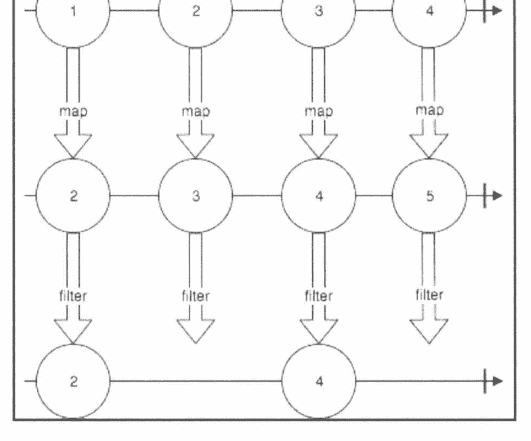

## 测试转换器

使用转换器时，你可以将转换数据的逻辑与数据源分离；这样你就可以为每个转换器创建测试，而无需添加可观察对象。

为了测试转换器，我们将使用迄今为止用于测试可观察对象的完全相同的工具；不同之处在于，我们可以使用任何可迭代的数据源（如数组或可观察对象）来测试转换器的逻辑。

由于可观察对象本质上是异步数据结构，每当我们想要测试一个可观察对象，或测试应用于可观察对象的转换时，我们都需要创建异步测试。由于转换器独立于当前数据源工作，我们可以使用数组来测试其行为；使用数组我们可以创建同步测试，这通常使它们更快且更易于编写和阅读。

让我们看看如何使用可观察对象来测试转换器。为此，让我们先创建一个转换器，将数字映射为其加 1，然后过滤以仅保留偶数；这是我们在之前示例中已使用的同一个转换器，因此无需解释每一步：

```
var mapAndFilter = t.comp(
    t.map((i)=>i+1),
    t.filter((i)=>i%2===0)
);
```

现在我们可以使用可观察对象为其创建一个单元测试：

```
var assert = require('assert');

describe('Transducer test', function() {
    it('should return empty when running for empty observables',
    function(done) {
        var found = false;
        Rx.Observable.empty()
            .transduce(mapAndFilter)
            .subscribe(
                function(){
                    found = true;
                },
                function noop(){},
                function(){
                    assert.equal(false,found);
                    done();
                }
            );
        });
    });
```

到目前为止，我们只有一个测试；该测试检查如果数据源为空，转换器是否返回空。为此，我们首先创建一个名为 found 的标志变量；如果我们在该可观察对象中传播任何内容，该标志将被设为 true。我们为错误监听器添加一个空函数，并在完成可观察对象时检查我们的标志是否仍为 false，然后结束测试。

如果 `found` 标志的值仍为 `false`，这意味着没有元素被传播。如果我们运行此测试，我们将在控制台中看到以下消息，显示我们的测试已通过：

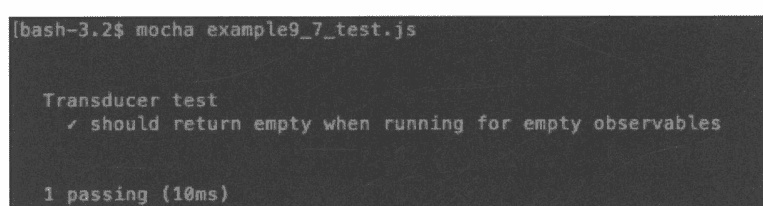

让我们再添加一个使用包含一些值的可观察对象的测试：

```
it('should return propagates 2,4 when running for an observable containing 1,2,3,4', function(done) {
  Rx.Observable.of(1,2,3,4)
  .transduce(mapAndFilter)
  .toArray()
  .subscribe(
    function(value){
      assert.equal(2,value.length);
      assert.equal(2,value[0]);
      assert.equal(4,value[1]);
    },
    function noop(){},
    function(){
      done();
    }
  );
});
```

在这个新测试中，我们添加了一个使用包含值 1、2、3 和 4 的可观察对象的测试用例，然后将转换器应用于它，并在结果可观察对象上使用 `toArray()` 操作符，以创建一个仅传播一个包含该可观察对象所有值的数组的新可观察对象。我们知道传播的值必须是数组 [ 2, 4 ]，为了检查这一点，我们必须添加三个断言；第一个确保我们有一个包含两个元素的数组，第二个确保第一个元素是 2，第三个确保第二个元素是 4。我们最终在可观察对象完成时结束测试。

如果我们运行此测试，我们将在控制台中看到以下消息，显示我们的测试已通过：

```
bash-3.2$ mocha example9_7_test.js

Transducer test
  ✓ should return empty when running for empty observables
  ✓ should return propagates 2,4 when running for an observable containing 1,2,3,4

2 passing (13ms)
```

但我们都知道转换器可以独立于数据源运行，因此我们可以使用同步方法通过数组而不是可观察对象更轻松地创建完全相同的测试。让我们再向我们的测试套件添加两个使用数组而不是可观察序列的测试：

```
it('should return empty when running for empty data sources',function(){
  var dataSource = [];
  var result = t.into(
    [],
    mapAndFilter,
    dataSource
  );
  assert.equal(0,result.length);
});
it('should propagates 2,4 when running for a data source containing 1,2,3,4',function(){
  var dataSource = [1,2,3,4];
  var result = t.into(
    [],
    mapAndFilter,
    dataSource
  );
  assert.equal(2,result.length);
  assert.equal(2,result[0]);
  assert.equal(4,result[1]);
});
```

使用数组而不是可观察对象的测试由于其同步特性更容易理解。在第一个测试中，我们创建一个空数组，将转换器应用于它，并检查结果是否为空，而在第二个测试中，我们创建一个包含要测试元素的数组，并进行三个断言以确保它返回预期结果。如果我们使用新的测试用例运行测试套件，我们将在控制台中看到以下输出：

```
bash-3.2$ mocha example9_7_test.js

Transducer test
  ✓ should return empty when running for empty observables
  ✓ should return propagates 2,4 when running for an observable containing 1,2,3,4
  ✓ should return empty when running for empty data sources
  ✓ should propagates 2,4 when running for a data source containing 1,2,3,4

4 passing (15ms)
```

它显示所有测试都已通过，正如我们所预期的那样。

使用转换器我们可以轻松测试想要应用于数据的转换，而且甚至更简单，因为我们可以使用同步数据结构（如数组）进行测试，而不是异步数据结构（如可观察对象）。

## 使用转换器的 JavaScript 代码性能比较

使用转换器与 RxJS 的优点之一是可以获得的性能提升，到目前为止我们只是评论了这一改进，现在我们将添加一些基准测试，以便你亲眼看到性能优势。这里呈现的结果基于在我个人电脑上运行；不同电脑上的执行可能会导致不同的结果。

运行基准测试最常用和最著名的库称为 benchmarks。我们可以使用 npm 在 Node.js 环境中安装它。要将其添加到你的项目中，只需输入以下命令：

```
npm install benchmark@2.1.2
```


Before we start to use the library to benchmark transducers, let's see how we can use it through an example. Let's compare the difference between calling a function to sum two numbers using call or apply:

```
var Benchmark = require('benchmark')
var suite = new Benchmark.Suite;

var sum = (a,b)=>a+b;

suite.add('Sum using call', function() {
  sum.call(this,1,2);
})
.add('Sum using apply', function() {
  sum.apply(this,[1,2]);
})
.on('cycle', function(event) {
  console.log(event.target.toString());
})
.on('complete', function() {
  console.log('Fastest is ' + this.filter('fastest').map('name'));
})
.run();
```

In our example, we do the following steps:

- 1. Require the benchmark module.
- 2. Create a new `suite` of tests and store it in the `suite` variable.
- 3. Create the function we want to benchmark.
- 4. We must add functions to be tested in our `suite`; to do this we call the `add()` method, passing a string to identify this test, and the function to be tested. In the first test we want to see the performance of calling the `sum()` function using `call`.
- 5. The next test added to the `suite` runs the same function using `apply`.
- 6. We add a listener to the `cycle` event, which is called every time one cycle of benchmarks is finalized; we add a console log to show the performance results of this test.
- 7. We add a listener to the `complete` event, which is called when our test `suite` finishes; here we log the `fastest` test.
- 8. We run our performance test.

I named this file benchmark_example_1.js, so to run this performance test you must execute the following command:

```
node benchmark_example_1.js
```

When executing this program, it will take a few seconds before you see anything printed in the console; don't worry, benchmark.js is running the first test of our suite, and as soon as it is available it will print the results as follows:

```bash
bash-3.2$ node benchmark_example_1.js
Sum using call x 56,758,714 ops/sec ±0.37% (94 runs sampled)
Sum using apply x 37,697,012 ops/sec ±0.84% (87 runs sampled)
Fastest is Sum using call
```

The first two lines show the execution of each test of our suite; the first number shows the number of operations it could do per second (higher is better), the second, the percentage, is the margin of error of this result, and the last is the number of samples it needed to execute to find this margin of error. The last line prints the fastest method, and it shows the fastest method is to use call instead of apply.

In our execution it was able to execute the sum using call 56,758,714 times per second with a margin of error of 0.37%, and the test with apply 37,697,012 times per second with a margin of error of 0.84%; as we can see, the ops/sec of Sum using call is higher and for this reason it is faster.

Now let's see the difference of when transducers instead of regular transformations on RxJS. We will benchmark the same transducer containing a simple map() and filter() function. So we first must create the functions used to map and filter along with the values we want to propagate in our observable:

```javascript
var values = [1,2,3,4];
var mapFunction = (i)=>i+1;
var filterFunction = (i)=>i%2===0;
```

After this we must create the tests of our suite; the first test will be implemented using transducers:

```javascript
suite.add('Transducer', function(deferred) {
  var transducer = t.comp(
    t.map(mapFunction),
    t.filter(filterFunction)
  );
  Rx.Observable.fromArray(values)
    .transduce(transducer)
    .subscribe(function(){},function(){},function(){
deferred.resolve();
});
},{defer:true})
```

We first create our transducer, then an observable using the array we created. And as this is an asynchronous test we call deferred.resolve() when our test is concluded and we add the flag defer:true to mark our test as an asynchronous test.

Now we need to create the test using regular map() and filter() operators; it can be done as follows:

```
.add('Map/Filter', function(deferred) {
Rx.Observable.fromArray(values)
.map(mapFunction)
.filter(filterFunction)
.subscribe(function(){},function(){},function(){
deferred.resolve();
});
},{defer:true})
```

After this we must add the listeners to log the results of our tests as we did in our first example:

```
on('cycle', function(event) {
console.log(event.target.toString());
})
.on('complete', function() {
console.log('Fastest is ' + this.filter('fastest').map('name'));
})
.run();
```

Then we can execute the code, and see the results:

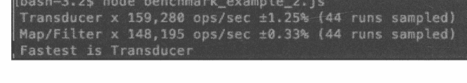

Looking at the results we can see the transducer is a little faster than the map()/filter() option, but let's see what happens if we change our array containing the values of the observables, so our observables propagate more data:

```
var values =
[1,2,3,4,5,6,7,8,9,10,11,12,13,14,15,16,17,18,19,20,21,22,23,24,25];
```

Now if we run our suite of tests we will see:

```
bash-3.2$ node benchmark_example_2.js
Transducer x 50,562 ops/sec ±0.69% (41 runs sampled)
Map/Filter x 37,451 ops/sec ±0.44% (43 runs sampled)
Fastest is Transducer
```

The number of operations per second is decreased in both, as is expected since we are processing more data. Perhaps the performance improvement from using transducers is a lot better, on our first execution the map()/filter() implementation was almost 7% slower than the transducer implementation, but in this execution it was almost 26% slower, so it's clear that you can have great performance improvements using transducers on big observables.

Looking at the results we can see real performance gains with the use of transducers.

## Summary

In this chapter, we learned what transducers are. They are a way to compose transformations to be applied to iterable sources, and they are independent of the data source.

We learned the advantages of using transducers–algorithmic transformation composition, performance improvement, better testability, better readability, and independency from the data source

In the advantages we learned how we can compose multiple transformations to create a transformation decoupled from the data source, and how we can reuse the same transducer in completely different data sources.

One section showed the advantage of testing a transducer, as it lets us use synchronous code to test, and how we can have a big performance improvement using this tool.

Now you are ready to create and implement your own applications using functional reactive programming; remember you had the advantage of using Reactive Extensions throughout this book, so most of the knowledge you learned here can be used in other platforms or languages as there are several implementations of Reactive Extensions on other platforms.

Functional reactive programming is an amazing way to model your application and to handle the flow of your data, and you have already mastered it. Congratulations.

Before we finish this book I felt that it was important to have a first hands-on with you on functional reactive programming, to do so I decided to create a web chat project using it. Web chat is a perfect candidate for functional reactive programming as it implies a continuous source of data flowing to and from your application.

In the next chapter, we will implement the server side of our web chat application, using nodes; we will go through the implementation and test of our code, so we will see how we can model our messages and listen to incoming messages from the client, and also how we can better deliver them.

I expect to use most of the concepts that we have learned in this book in the next two chapters, so let's create our first project.

# 10 A Real-Time Server

# A Real-Time Server

In the last chapter, we covered an advanced topic in functional reactive programming, called the transducer. Transducers enable us to create a composition of transformations of data. One of the main advantages of transducers is the possibility of making your data transformations independent from the source of your data; with the `transducers-js` library we can use transducers on observables and in any iterable object.

With transducers, we can:

- Write better tests as it make it easy to decouple the source of the data to the transformations applied to it
- Improve the performance of our code; as it skips the need for any intermediate iterable
- Improve the maintainability of your code, when we compose transformations to create new transformations we can reuse them throughout our codebase, and avoiding code repetition is a good idea

Throughout this book, we have learned:

- What are observables?
- What is an operator?
- How can we listen to incoming data?
- How can we transform incoming data?
- How can we compose different sources of data?
- How can we reuse sources of data?
- How can we mitigate the problem of receiving data faster than we can process?
- Two different frameworks to implement functional reactive programming in JavaScript


- 如何使用 RxJS 测试程序？
- 什么是转导子？

凭借这些知识，你应该有能力使用函数式响应式编程实现自己的应用程序，但在开始新应用程序之前，我想给你一个示例应用程序，该应用程序在服务器和客户端都广泛使用函数式响应式编程。

我们的示例应用程序将由一个在浏览器中运行的客户端应用程序和一个在 node 上运行的服务器应用程序组成。在两者中，我都会向你展示应用程序的架构以及选择该架构的原因，以及代码和该代码的测试。

A `web chat` 是展示 observables 和 RxJS 用法的完美应用程序，因为这是一个高度交互的应用程序。创建它时我们将使用一个 **WebSocket 服务器** 来接收和传递用户消息。

本章中，我们将探讨以下主题：

- 使用 JavaScript 实现基于 WebSocket 的服务器
- 使用 observables 监听并向 `web chat` 应用程序客户端传递数据
- 为我们的应用程序创建测试
- 查看如果需要如何扩展我们的应用程序，使其支持如 Redis 的发布/订阅服务器，以接收和向其他服务器传递消息

## Web 聊天服务器

为了在 JavaScript 项目中展示函数式响应式编程和 RxJS 的使用，我们将实现一个 Web 聊天服务器。这是一个完美的选择，因为该应用程序的特性。

在 Web 聊天中，用户不断发送和接收消息；在某些聊天服务器的实现中，你甚至可以直接从文本框发送命令来移除或阻止用户、设置提醒等。因此，很容易看出消息如何被建模为通过 observable 序列传播的数据，以及区分来自该通道的消息（来自用户消息的命令）的重要性。

也可以使用 WebSocket 实现此服务器，这也将向我们展示 RxJS 如何非常适合任何使用 WebSockets 的应用程序。

最后但同样重要的是，需要注意的是，一个 `web chat` 应用程序可能很容易实现，但随着你决定为其创建新功能，它可能会变得任意复杂。

对于我们的 Web 聊天应用程序，想法是保持简单，但向你展示如何实现更复杂的功能。我们的 `web chat` 应用程序将具有：

- 广播消息
- 私人消息
- 一些命令
- 测试


一些功能在聊天应用程序中很常见，例如频道/房间，但我们不会实现这些功能，因为你只需从已实现的功能派生即可轻松实现它们。我们也不会为用户实现登录和密码，因为这完全超出了本书的范围，也不会给你任何额外的知识。

## 创建项目

我们将在 node 中实现 `web chat` 应用程序的后端，因此第一步是创建一个文件夹来存储我们的项目，并在该文件夹内使用以下命令启动项目：

```
npm init
```

此命令会要求你输入大量项目的元数据。你可以保留所有默认值，只需一直按 *回车* 直到结束。此后我们需要安装一些用于实现项目的库；第一个是 RxJS，要安装它你必须输入以下命令：

```
npm install rx@4.1.0 --save
```

我们还需要一个库来实现 WebSocket 服务器：我们将使用最著名的 JavaScript WebSocket 实现库 `socket.io`，使用以下命令：

```
npm install socket.io@1.7.3 --save
```

我们将使用 `express` 来提供客户端的 HTML 页面，因此需要安装它：

```
npm install --save express@4.15.2
```

最后，我们需要一个运行器来执行应用程序的测试，为此我们将使用以下命令安装 `mocha`：

```
npm install mocha@3.2.0 --save-dev
```

在你的项目文件夹中，你应该创建两个新文件夹：一个名为 `src`，我们将把应用程序的源代码放在其中，另一个名为 `tests`，我们将把应用程序的所有测试放在其中。

完成此初始步骤后，你的项目文件夹应包含一个名为 `package.json` 的文件，以及三个名为 `node_modules`、`src` 和 `tests` 的文件夹。


你可以为包含源代码和测试的文件夹选择不同的名称，但这将是本书中使用的名称，因此，如果你更改它们，请记住在执行某些命令时更改名称。

## 服务器的架构

为了实现我们之前描述的功能，我们将使用一个简单的架构，并且在源代码中只需要三个文件。

第一个是 `index.js` 文件，包含我们的 WebSocket 服务器的初始化以及接收聊天用户的消息；每个用户的数据将作为一个 observable 实现。通过此 observable 传递的所有数据都将调用负责该消息的服务，并且每条消息的 `service` 属性将包含该服务的名称。

所有服务都将实现在单个文件 `services.js` 中；该文件中的每个服务可能会返回一个 observable，并且在返回 observable 的情况下，我们的客户端将开始监听来自该 observable 的消息。最初我们只有四个服务：

- `sendMessage()`：此服务向已连接的客户端发送消息；它可以是私人消息或广播消息。消息的属性将包含该消息的接收者。
- `listenToMessages()`：此服务返回一个包含所有发送给该客户端的消息的 observable。
- `blockUser()`：此服务返回一个不包含被阻止用户消息的 observable。
- `command()`：此服务可用于实现一些命令。我们最初只实现两个命令，一个向所有用户显示当前时间，另一个回显你自己的消息。使用此方法你可以轻松创建新命令。

最后，你项目的最后一部分是我们的 data source，名为 data_source.js。对于我们的首次实现，没有理由将数据保存或检索到数据库中，因为这只是一个示例应用程序，我们不想保留消息历史或其他需要数据库的功能。因此，我们的数据源将只包含一个 observable（实际上是一个 subject），我们可以在其中推送和监听数据。

如果我们需要保留历史记录，我们可以轻松地向应用程序添加 MongoDB 或任何其他数据库来检索此消息历史记录。

在我们的初始实现之后，我们将添加一个 Redis 服务器，以便通过我们的服务器通信消息。

此图描述了我们在服务器上通信的工作方式：

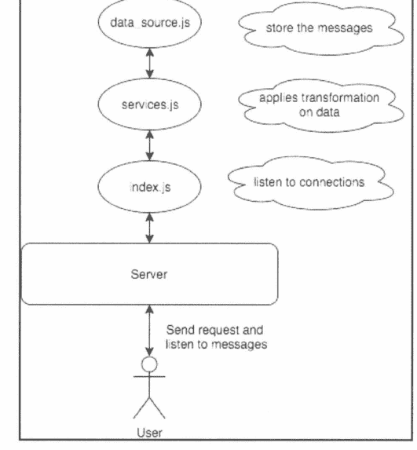

## 实现服务器

要实现我们的服务器，我们需要实现上一示例中描述的系统的三个部分。我们将首先创建数据源，然后是 WebSocket 服务器，最后是我们的服务及其测试。

## DataSource

由于我们对保留消息历史记录或为服务器实现登录不感兴趣（用户只需输入一个名称并使用该名称），我们可以使用一个简单的 observable 来实现我们的 DataSource；此 DataSource 将只包含用户之间发送的消息和广播消息。

我们的 DataSource 必须有两个方法：第一个推送新消息，第二个监听传入消息。我们可以使用 RxJS Subject 来实现此行为，因为它允许我们将数据推送到 observable。我们也可以使用 create() 方法使用 observable 从任意源创建它，但使用 Subject 的代码将更容易阅读和理解：

```
let Rx = require('rx');
let messagesSubject = new Rx.Subject();
module.exports = {
  push(data){
    messagesSubject.onNext(data);
  },
  get(){
    return messagesSubject;
  }
};
```

在这段代码中，我们执行了以下步骤：

1. 创建了一个 Subject 并将其存储在 messagesSubject 变量中。
2. 导出了包含两个方法的对象：
   - 第一个方法是 push() 方法，它仅使用提供的数据调用此 Subject 的 onNext() 方法以将其通过 Subject 推送
   - 第二个方法是 get() 方法，它仅返回我们的 Subject，以便其他人可以监听数据


在我们的数据源中，我们本可以直接实例化 Subject 并导出它，但这样会将数据源耦合到 RxJS 实现上，并且每个需要它的文件都必须知道需要使用 onNext() 方法来推送数据。这现在不是问题，因为这只是一个示例应用，但是一旦我们添加 Redis（或其他任何数据库），这就会成为问题，因此我决定创建这个对象，而不是直接导出 Subject 对象。


我不会出于同样的原因为我们的数据源创建测试：我们现在可以很容易地为它创建测试，但是一旦我们为其添加任何数据库，如果你想继续测试数据源，你可能不得不找到一种方法来模拟该数据库，而这超出了本书的范围。

## 发送消息的服务

我们将创建的第一个服务是发送消息的服务。此消息可以发送给单个用户（私密）或所有用户（广播）。

我们的服务将具有以下签名：

```
sendMessage (payload);
```

此服务没有返回值，并且只接收一个参数，该参数是强制性的：

- `payload`: 这是一个包含要发送的消息的对象；它最多可包含三个属性：
  - `from`: 此属性是强制性的，它是一个表示发送消息的用户字符串
  - `content`: 此属性是强制性的，它是一个表示消息内容的字符串
  - `to`: 此属性是可选的，它是一个表示消息接收者的字符串；如果省略，则消息发送给所有用户

我们的服务必须实现以下规则：

- 必须支持向所有用户发送消息（广播）
- 必须支持向单个用户发送消息（私密）
- 如果未提供 payload，则不能发送消息
- 如果没有内容（content 属性）或没有发送者（from 属性），则不能发送消息

在实现我们的服务之前，我们需要为其创建一个测试。

## 测试实现

在上一节中我们创建了我们的数据源，到目前为止，我们的数据源只是一个 RxJS subject，我们可以在其中推送和监听数据。然而，我们的数据源可能是一个数据库，因此出于这个原因，我们在测试时将始终使用模拟数据源。那么，让我们实现我们的模拟数据源；在 tests 文件夹内创建一个名为 mock_datasource_factory.js 的文件，并粘贴以下代码：

```
let Rx = require('rx');
module.exports = function () {
    let messagesSubjectMock = new Rx.Subject();
    return{
        push(data){
            messagesSubjectMock.onNext(data);
        },
        get(){
            return messagesSubjectMock;
        }
    };
};
```

在这段代码中，我们导出了一个函数，在执行时它会创建一个 Subject 并返回一个包含 push() 和 get() 方法的对象，用于发送数据和监听数据。我们的实现与原始 DataSource 实现非常相似，但由于我们在每次函数调用时都会创建一个新的 Subject，因此我们可以在每个测试中执行它，以便每个测试都有自己的数据源。这样一个测试就不会影响另一个测试。

现在，让我们实现我们的测试；对于此服务，我们只需要实现两个测试：一个检查方法是否可以发送私密消息，另一个检查它是否可以发送广播消息。更完整的套件还将实现检查以查看服务是否强制 payload 不为 null，以及是否包含 from 和 content 属性，但这会使我们的代码变得更大，更难以保持在书籍的范围内，所以让我们保持测试简单。

在实现测试之前，我们必须至少创建一个服务的虚拟实现，以便我们可以对其进行测试：在 src 文件夹中创建一个名为 services.js 的文件，并粘贴以下代码：

```
module.exports = function(dataSource){
    return{
        sendMessage(){},
        command(){},
        listenToMessages(){},
        blockUser(){}
    };
};
```

我们的文件将导出一个接收数据源作为参数的函数，并返回一个包含我们四个方法的对象。我们以这种方式实现它，以便我们可以将数据源注入到我们的服务中，并且可以使用 DataSource 运行我们的测试，而我们的应用程序使用另一个数据源。

现在我们有了基本结构，让我们实现我们的测试：在 tests 文件夹中创建一个名为 send_message_test.js 的文件，并粘贴以下代码：

```
let assert = require('assert');
let mockDataSourceFactory = require('./mock_datasource_factory');
let servicesFactory = require('../src/services');
```

这里我们只是要求 assert 模块进行测试断言，我们的模块创建模拟数据源，以及我们的模块创建服务。现在添加一个测试套件，其中包含一个测试：

```
describe('Send Message Test',function(){
    it('Must support sending a message',function(done){
        let mockDataSource = mockDataSourceFactory();
        let services = servicesFactory(mockDataSource);
        let from = 'Jim';
        let to = 'John Doe';
        let content = 'foobar';
        let message = {to:to,content:content, from:from};
        let subscription = mockDataSource
            .get()
            .subscribe(function(message){
                assert.equal(message.from,from);
                assert.equal(message.to,to);
                assert.equal(message.content,content);
                subscription.dispose();
                done();
            });
        services.sendMessage(message);
    });
});
```

这里我们创建了测试套件来测试 sendMessage 服务。我们还使用 it() 函数向套件添加了一个测试。此测试将检查我们的服务是否可以将数据发送给用户。在服务实现中，我们首先创建一个 DataSource（mockDataSource）；在下一行，我们使用此 DataSource 创建服务并将其存储在 services 变量中（我们将在每个测试中都这样做）；然后我们为我们的消息创建发送者（from）、接收者（to）和内容（content）；最后，我们创建我们的消息（message）。下一步是监听我们的模拟数据源以查看消息是否已发送。我们向其添加一个订阅，并在该订阅中验证消息属性（from、to 和 content）。然后我们结束订阅并调用 done() 方法来完成测试。最后一步是发送消息。

完成此测试后，我们可以实现下一个测试以验证我们的服务是否可以向所有用户发送消息，因此将以下测试添加到我们的测试套件中：

```
it('Must support broadcast message', function(done) {
    let mockDataSource = mockDataSourceFactory();
    let services = servicesFactory(mockDataSource);
    let from = 'Jim';
    let content = 'foobar';
    let message = {content:content, from:from};
    let subscription = mockDataSource
        .get()
        .subscribe(function(message){
            assert.equal(message.from,from);
            assert.equal(message.content,content);
            subscription.dispose();
            done();
        });
    services.sendMessage(message);
});
```

该测试与私密消息的测试类似。我们只是从消息中省略了属性 to，因为没有接收者的消息必须发送给所有用户。

现在我们可以针对我们的服务运行测试套件。为此，在项目文件夹内运行以下命令：

```
mocha tests/send_message_test.js
```

运行此测试后，我们可以在控制台中看到结果：

```
bash-3.2$ mocha tests/send_message_test.js

Send Message Test
  1) Must support sending a message
  2) Must support broadcast message

0 passing (4s)
2 failing

1) Send Message Test Must support sending a message:
   Error: timeout of 2000ms exceeded. Ensure the done() callback is being called in this test.

2) Send Message Test Must support broadcast message:
   Error: timeout of 2000ms exceeded. Ensure the done() callback is being called in this test.
```

如你所见，我们所有的测试都失败了，因为我们还没有为我们的服务实现。

## 服务实现

现在我们有了服务的测试，我们就可以创建此服务的实现。为此，将 services.js 文件中 sendMessage 服务的当前实现更改为以下内容：

```
sendMessage(payload) {
    if(payload && payload.content && payload.from){
        dataSource.push({
            from: payload.from,
            to:payload.to,
            content: payload.content
        });
    }
}
```

我们服务的实现很简单：它只是验证 payload 是否存在以及是否具有 content 和 from 属性；如果我们的参数有效，我们所要做的就是将消息推送到我们的数据源。


现在我们可以使用相同的命令再次运行测试并查看结果：

```
bash-3.2$ mocha tests/send_message_test.js

Send Message Test
  ✓ Must support sending a message
  ✓ Must support broadcast message

2 passing (11ms)
```

现在我们的服务按预期通过了，因此我们可以进入下一个服务。

## 用于监听新消息的服务

我们下一个服务将用于监听新消息。它必须返回一个 observable，其中包含的数据目的地为给定用户。

我们的服务将具有以下签名：

```
listenToMessages (payload, [observable]) ;
```

它接收两个参数，但只有第一个是强制性的：

- `payload`：它是一个包含用户信息的对象，并且必须有一个属性：
  - `me`：此属性是强制性的——它是一个表示正在监听消息的用户的字符串
- `observable`：它是消息被推送到的 observable

我们的服务必须实现以下规则：

- 必须返回一个仅包含给定用户数据的 observable，这意味着由给定用户发送的消息、发给该用户的私信以及广播消息
- 如果提供了 observable，我们必须更改此 observable 以遵循第一条规则，并且必须将第一条规则应用于 DataSource（其中包含所有消息）

现在我们知道了规则，我们可以为其实现测试。

## 测试实现

我们将为此服务创建三个测试：第一个检查此服务返回的 observable 是否包含发送给给定用户的数据；第二个检查是否包含广播消息；第三个检查是否不包含发送给其他用户的私信。

创建一个名为 listen_to_messages_test.js 的文件并粘贴以下代码以创建我们的测试套件：

```
let assert = require('assert');
let mockDataSourceFactory = require('./mock_datasource_factory');
let servicesFactory = require('../src/services');

describe('Listen to message Test',function(){
    it('Must listen to messages sent to me',function(done){
        let mockDataSource = mockDataSourceFactory();
        let services = servicesFactory(mockDataSource);
        let me = 'John Doe';
        let content = 'foobar';
        let message = {to:me,content:content};
        let subscription = services
            .listenToMessages({me:me})
            .subscribe(function(message){
                assert.equal(message.to,me);
                assert.equal(message.content,content);
                subscription.dispose();
                done();
            });
        mockDataSource.push(message);
    });
});
```

第一个测试检查 sendMessage 服务返回的 observable 是否包含给定用户的消息。此测试与 sendMessage 服务的测试类似，但这里我们做的是相反的操作。我们订阅 listenToMessages() 服务返回的 observable，并在测试的最后一行直接将数据推送到我们的 mock DataSource。

下一个测试将检查是否包含广播消息：

```
it('Must listen to messages sent to all',function(done){
    let mockDataSource = mockDataSourceFactory();
    let services = servicesFactory(mockDataSource);
    let me = 'John Doe';
    let content = 'foobar';
    let message = {content:content};
    let subscription = services
        .listenToMessages({me:me})
        .subscribe(function(message){
            assert.equal(message.content,content);
            subscription.dispose();
            done();
        });
    mockDataSource.push(message);
});
```

它几乎与之前的测试相同。唯一的区别是推送到 DataSource 的消息不包含 to 属性，这意味着广播消息。

在最后一个测试中，我们检查它是否不包含发给其他用户的私信：

```
it('Must not listen to messages sent to others',function(done){
    let mockDataSource = mockDataSourceFactory();
    let services = servicesFactory(mockDataSource);
    let receivedMessage = false;
    let me = 'John Doe';
    let to = 'other';
    let content = 'foobar';
    let message = {to:to,content:content};
    let subscription = services
        .listenToMessages({me:me})
        .subscribe(function(message){
            receivedMessage = true;
        },function noop(){
        },function(){
            assert.equal(receivedMessage,false);
            done();
        });
    mockDataSource.push(message);
    mockDataSource.get().onCompleted();
});
```

这里我们的测试有点不同：我们推送一条包含 to 属性的消息，该属性与正在监听数据的用户不同，以检查我们是否未收到此消息。我们在测试开始时添加一个标志（receivedMessage）并将其初始化为 false，在我们的订阅中。如果我们收到任何数据，我们就将标志设为 true。我们放置一个空函数来监听错误，并添加一个在 observable 完成时调用的函数。此函数检查我们的标志是否仍为 false 并结束测试。在创建订阅后，我们必须推送消息并完成 observables。

现在我们已经实现了三个测试，并且可以使用以下命令执行它们：

```
mocha tests/listen_to_messages_test.js
```

结果在控制台中：

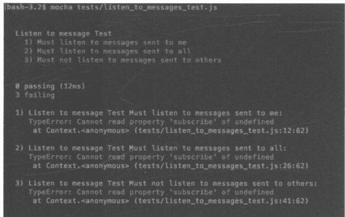

这表明所有测试都失败了，正如预期的那样。

## 服务实现

现在我们要做的就是实现我们的服务。为此，请更改文件 services.js 中的 listenToMessages() 服务以使用此实现：

```
listenToMessages(payload,observable){
    let me = payload.me;
    observable = observable || dataSource.get();
    return observable.filter(function(message){
        return !message.to || message.to === me || message.from === me;
    });
}
```

我们的服务很简单：第一行我们存储用户，第二行我们存储将要监听的 observable；如果没有提供 observable，我们从包含所有消息的 DataSource 获取 observable；然后我们返回应用过滤器后的 observable，以检查消息是否没有 to 属性（广播），或 to 属性是否等于用户（私信），或 from 属性是否等于用户（用户发送的消息）。

当我们再次运行测试时，我们将在控制台中看到所有测试都通过了：

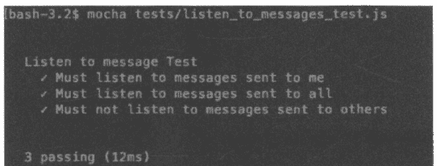

现在我们的测试通过了，因此我们离我们的网络聊天服务器又近了一步。


凭借这两个服务，我们已经拥有了构建非常基础的网络聊天所需的所有服务，并且我们将再添加两个服务来提升我们的技能。

## 用于阻止来自特定用户的消息的服务

下一个服务将用于阻止来自特定用户的消息。它必须返回一个 observable，并且此 observable 不能传播被阻止用户发送的消息。

我们的服务将具有以下签名：

```
blockUser(payload, [observable]);
```

它接收两个参数，但只有第一个是强制性的：

- `payload`：这是一个包含要被阻止用户信息的对象；它必须有两个属性：
  - `me`：此属性是强制性的，它是一个表示正在监听消息的用户的字符串
  - `blocked`：此属性是强制性的，它是一个表示要被阻止的用户的字符串
- `observable`：消息为此用户推送到的 observable

我们的服务必须实现以下规则：

- 必须返回一个 observable，并且此 observable 不能包含被阻止用户发送的任何消息
- 如果没有提供 observable，它必须调用 `listenToMessages()` 服务以获取该用户的 observable

现在我们知道了规则，我们可以实现一个测试。

## 测试实现

我们将为我们的 `blockUser()` 服务只创建一个测试：我们的测试将检查在调用服务后我们是否没有收到来自特定用户的消息。

创建一个名为 `block_user_test.js` 的文件并粘贴以下代码以实现我们的测试套件：

```js
let assert = require('assert');
let mockDataSourceFactory = require('./mock_datasource_factory');
let servicesFactory = require('../src/services');

describe('Block user Test',function(){
    it('Must not receive message from blocked user',function(done){
        let mockDataSource = mockDataSourceFactory();
        let services = servicesFactory(mockDataSource);
        let receivedMessage = false;
        let me = 'John Doe';
        let blocked = 'Jim';
        let content = 'foobar';
        let message = {to:me,content:content};
        let subscription = services
            .blockUser({blocked:blocked,me:me})
            .subscribe(function(message){
                receivedMessage = true;
            },function noop(){
            },function(){
                assert.equal(receivedMessage,true);
                subscription.dispose();
                done();
            });
        mockDataSource.push(message);
        mockDataSource.get().onCompleted();
    });
});
```


在我们的测试中，我们创建一个要发送给用户的消息，然后使用 blockUser() 服务来阻止来自该用户的消息，并订阅返回的 observable。我们使用与 listenToMessages() 服务测试的最后一个测试中相同的技巧，使用一个标志来确保我们不会收到该消息。

我们可以使用以下命令运行此测试：

```
mocha tests/block_user_test.js
```

当我们运行此代码时，我们将在控制台中看到以下输出：

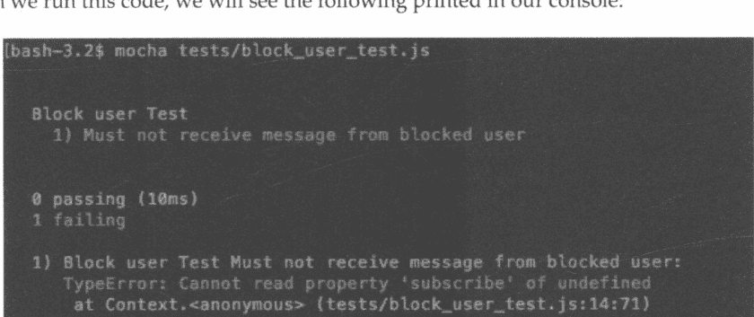

再次，测试如预期失败，因为我们尚未实现服务。

## Service implementation

现在是时候实现我们的服务来阻止来自特定用户的消息了。为此，请将文件 services.js 中的 blockUser() 服务更改为使用以下实现：

```
blockUser(payload,observable){
    let blocked = payload.blocked;
    observable = observable || this.listenToMessages(payload);
    return observable.filter(function(message){
        return message.from !== blocked;
    });
}
```

该实现与 `listenToMessages()` 服务中的实现类似。我们必须调用 filter 操作符以避免传播来自被阻止用户的消息。一件重要的事情是，如果没有将 observable 作为参数传递，我们将从 `listenToMessages()` 服务获取一个，因为它确保用户只能收听他可以收听的消息。

如果我们针对此实现运行测试，我们将在控制台中看到以下结果：

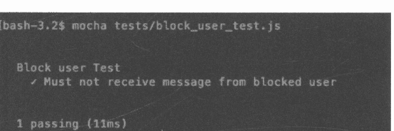

此测试现在已通过，因此我们只需要实现最后一个服务。

## Service to send a command

我们将实现的最后一个服务将是一个执行命令的服务。在多个网络聊天中，您可以使用斜杠（/）字符在消息开头传递命令。每个网络聊天都有自己的实现，它们可以执行不同的操作，例如踢出另一用户、禁止用户、为每个用户发送 GIF、显示当前时间等等。

在我们的发送命令服务中，我们将实现两个不同且简单的命令：第一个命令将生成 1 到 6 之间的随机数，并命名为 `roll_a_dice`；另一个命令将命名为 `echo`，它只会将用户发送的消息原样返回。

我们的服务将具有以下签名：

```
command(payload);
```

它将只接收一个必填参数：

- `payload`：这是一个包含执行命令信息的对象；它最多可以有三个属性：
  - `from`：此属性为必填项；它是一个表示发送命令的用户的字符串。
  - `action`：此属性为必填项；它是一个表示命令的字符串（在我们的实现中可以是 `roll_a_dice` 或 `echo`）。
  - `content`：此属性仅由 `echo` 命令使用；它包含要回显给用户的字符串

我们的服务必须实现以下规则：

- 必须实现 `roll_a_dice` 命令，该命令会向执行命令的用户发送一条包含 1 到 6 之间随机数的消息
- 必须实现 `echo` 命令，该命令会向执行命令的用户发送一条与用户发送的消息相同的信息
- 此服务发送的所有消息必须以服务器作为消息发送者
- 如果用户调用命令服务并传递不受支持的命令，服务器必须向用户回复，告知该命令不受支持

现在我们知道了规则，我们可以为它们实现测试。

## Test implementation

我们将为我们的命令服务创建三个测试：第一个将测试 `roll_a_dice` 命令是否按预期工作；第二个将检查 `echo` 命令；最后一个将检查使用不受支持的命令时服务的响应。

创建一个名为 `command_test.js` 的文件，并粘贴以下代码以实现我们的测试套件：

```
let assert = require('assert');
let mockDataSourceFactory = require('./mock_datasource_factory');
let servicesFactory = require('../src/services');

describe('Command Test',function(){
    it('Must support roll_a_dice command',function(done){
        let mockDataSource = mockDataSourceFactory();
let services = servicesFactory(mockDataSource);
let me = 'John Doe';
let message = {from:me,action:'roll_a_dice'};
let myMessagesObservable = services.listenToMessages({me:me});
let subscription = myMessagesObservable
    .subscribe(function(message){
        assert.equal(message.from,'server');
        assert.equal(message.to,me);
        assert.equal(/Result is [1-6]/
            .test(message.content),true);
        subscription.dispose();
        done();
    });
    services.command(message);
});
});
```

我们的第一个测试将检查 `roll_a_dice` 命令是否按预期工作。我们首先创建我们的 mock DataSource 并像在其他测试中一样生成我们的服务。然后我们创建一个包含属性 `from`（使用命令的用户）和属性 `action` 等于 `roll_a_dice` 的对象，并将其存储在一个名为 `message` 的变量中。之后，我们调用服务来收听消息以获取我们的 observable 并订阅它。在我们的订阅中，我们将检查消息发送者是否为服务器，接收者是否为调用命令的用户，以及消息内容是否符合预期。最后我们调用命令服务来测试它。

下一个测试将检查 `echo` 命令是否按预期工作：

```
it('Must support echo command',function(done){
    let mockDataSource = mockDataSourceFactory();
    let services = servicesFactory(mockDataSource);
    let me = 'John Doe';
    let content= 'foobar';
    let message = {from:me,action:'echo',content:content};
    let myMessagesObservable = services.listenToMessages({me:me});
    let subscription = myMessagesObservable
        .subscribe(function(message){
            assert.equal(message.from,'server');
            assert.equal(message.to,me);
            assert.equal(message.content,content);
            subscription.dispose();
            done();
        });
    services.command(message);
});
```

这个测试看起来与另一个测试非常相似。唯一的区别是我们将 `action` 更改为 `echo`，添加一个 `content` 属性，并且在我们的 `subscription` 中，我们检查内容是否符合预期。

我们的最后一个测试将断言执行不受支持的命令时必须发生的情况：

```
it('Must send a message if the action is not supported',function(done){
    let mockDataSource = mockDataSourceFactory();
    let services = servicesFactory(mockDataSource);
    let me = 'John Doe';
    let content= 'foobar';
    let message = {from:me,action:'some_action'};
    let myMessagesObservable = services.listenToMessages({me:me});
    let subscription = myMessagesObservable
        .subscribe(function(message){
            assert.equal(message.from,'server');
            assert.equal(message.to,me);
            assert.equal(message.content,
            'The action some_action is not supported');
            subscription.dispose();
            done();
        });
    services.command(message);
});
```

再次，我们的测试与其它测试类似。唯一的区别是我们将 action 的值更改为不受支持的值（`some_action`），并检查服务回复的消息是否为预期的消息。

要运行我们的测试，请执行以下命令：

```
mocha tests/command_test.js
```

当您运行此命令时，您将在控制台中看到测试结果：

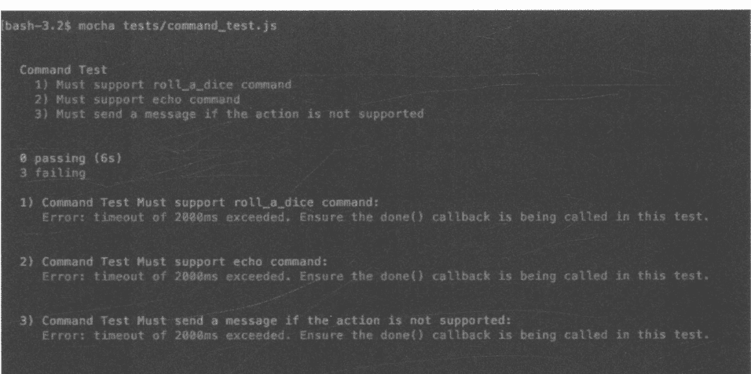

所有我们的服务都失败了，正如预期的那样。

## Service implementation

要实现我们的命令服务，请更改您的 services.js 文件，将命令服务的实现切换为使用以下内容：

```
command(payload) {
    switch(payload.action) {
        case 'roll_a_dice':
            this.sendMessage({
                from:'server',
                to:payload.from,
                content:'Result is '
                '+Math.round(1+Math.random()*5)
            });
            break;
        case 'echo':
            this.sendMessage({
                from:'server',
                to:payload.from,
                content:payload.content
            });
            break;
        default:
```

```
this.sendMessage({
    from:'server',
    to:payload.from,
    content:'The action '+payload.action +' is not supported'});
}
```

我们的服务的实现很简单：我们只需在 action 属性上使用一个 switch 块来决定发送哪条消息。第一个 case 是 roll_a_dice，在这种情况下我们发送一条消息，其内容以 Result is 开头并包含 1 到 6 之间的随机数字。

第二个 case 用于 echo 命令，我们只需发送一条包含接收到的相同内容的消息。

如果 action 属性不满足其他任何 case，我们就进入 default，只发送一条说明命令不受支持的消息。

现在我们将为此实现运行测试：

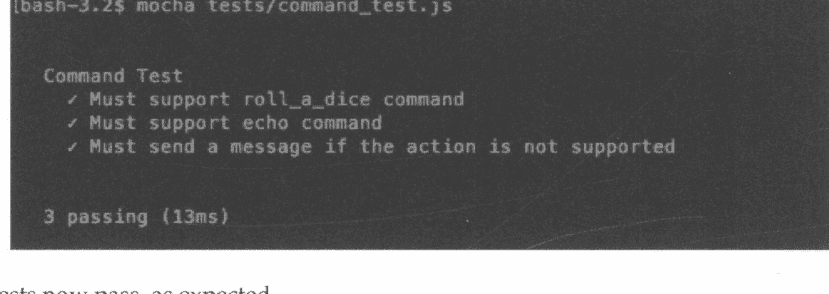

我们的测试现在按预期通过了。

这是最后一个需要实现的服务。因此，现在我们已经实现了所有服务和测试，可以使用以下命令一起执行所有测试：

```
mocha tests/*_test.js
```

我们可以在控制台看到，所有测试都通过了：

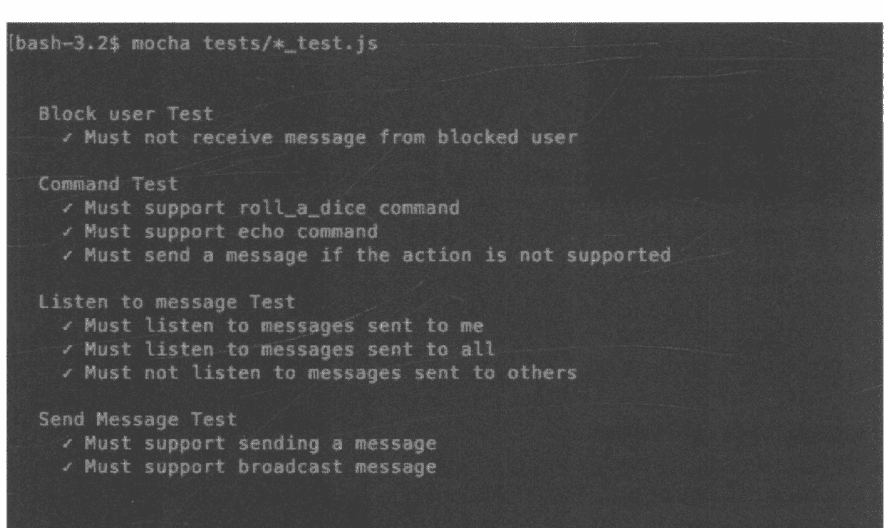

## Handling WebSocket connections

我们将使用 socket.io 库来处理 WebSocket 连接。这是 Node.js 社区中使用最广泛的 WebSocket 库。

现在，让我们开始 WebSocket 实现。打开你的 index.js 文件并将以下代码放入其中：

```
let Rx = require('rx');
let dataSource = require('./data_source');
let services = require('./services')(dataSource);
```

目前，我们只是导入了响应式扩展、我们的数据源并创建了服务。现在我们需要启动服务器：

```
let app = require('express')();
let http = require('http').Server(app);
let io = require('socket.io')(http);
http.listen(3000, ()=>console.log('Server listening on port 3000'));
```

在这里，我们创建一个 HTTP 服务器，将其传递给 socket.io 库，并使其在 3000 端口监听。现在我们必须等待连接：为此我们创建一个 Observable 来监听连接事件：

```
Rx.Observable.fromEvent(io,'connection')
```

我们为其创建一个订阅：

```
Rx.Observable.fromEvent(io,'connection')
.subscribe(function(client) {
});
```

现在我们必须实现订阅，并在订阅中监听来自该客户端的事件。客户端将以字符串形式发送 JSON，因此我们需要将其解析回 JSON。我们还需要调用正确的服务；每次我们的服务返回一个新的 Observable 时，我们必须切换到该 Observable。最后，当客户端断开连接时，我们必须停止我们的 Observable：

```
function(client) {
    let currentObservable = null;
    Rx.Observable.fromEvent(client, 'request')
        .map((payload)=>JSON.parse(payload))
        .flatMapLatest((payload)=> {
            let serviceObservable = services[payload.service](payload,
currentObservable);
            if(serviceObservable){
                currentObservable = serviceObservable;
            }
            return currentObservable;
        })
        .takeUntil(Rx.Observable.fromEvent(client,'disconnect'))
        .subscribe(data => client.emit('message',data));
}
```

我们需要做的第一件事是创建一个变量来存储当前正在监听的 Observable；我们需要它是因为 blockUser() 服务必须将其作为参数接收。然后我们为客户端的所有类型为 request 的事件创建一个 Observable，并使用 map() 运算符将我们的 payload 映射为 JSON 对象。

现在我们有一个 Observable，它会发出客户端发送的 JSON 对象。下一步是调用相应的服务。由于我们知道我们的服务可能会返回一个 Observable，在这种情况下我们必须使用它，因此我们需要将其存储在 currentObservable 变量中；我们使用 flatMapLatest 而不是 flatMap，因为我们只想保留最后返回的 Observable。

我们还必须在客户端断开连接时结束我们的 Observable，我们使用 takeUntil() 运算符来实现这一点，如果客户端发送 disconnect 事件则结束 Observable。

最后，我们要做的就是将消息发送回我们的用户，我们通过在 observable 中添加一个订阅来实现这一点。

所以下面是我们 index.js 文件的最终代码：

```
let Rx = require('rx');
let dataSource = require('./data_source');
let services = require('./services')(dataSource);
let app = require('express')();
let http = require('http').Server(app);
let io = require('socket.io')(http);
http.listen(3000, ()=>console.log('Server listening on port 3000'));

Rx.Observable.fromEvent(io,'connection')
.subscribe(function(client) {
  let observable = null;
  Rx.Observable.fromEvent(client, 'request')
    .map((payload)=>JSON.parse(payload))
    .flatMapLatest((payload)=> {
      let serviceObservable =
        services[payload.service](payload,observable);
      if(serviceObservable){
        observable = serviceObservable;
      }
      return observable;
    })
    .takeUntil(Rx.Observable.fromEvent(client,'disconnect'))
    .subscribe(data => client.emit('message',data));
});
```

这就是使用 RxJS 库的函数式响应式编程实现网络聊天所需的所有内容。在我们的实现中，一切都在同一个服务器上进行。让我们看看如何添加更多服务器并使它们相互通信。

## Scaling the server

目前，如果我们决定部署多个服务器，我们的实现将无法使用。

想象一下用户 A 连接到服务器 A，用户 B 连接到服务器 B 的场景；用户 A 和用户 B 无法聊天，因为他们在不同的服务器上。

为了使来自不同服务器的连接用户能够通信，我们需要找到一种方法让我们的服务器相互通信，我们可以使用 Redis 数据库来实现这一点。除了其他出色的功能外，Redis 还支持称为发布/订阅模式的功能。有了这种模式，服务器可以发布一条消息，所有订阅以监听该消息的服务器都会收到它。

有了这个功能，Redis 是解决我们服务器通信问题的完美数据库，因此让我们看看如何连接到它以接收消息，以及如何更改我们的数据存储以支持它。

## Connecting to Redis

要使用 Redis 数据库，我们需要一个库来连接它，Node 最常用的库称为 ioredis。该库可在 npm 上获得，并支持 Redis 的所有功能。

要安装 ioredis，只需在项目中执行以下命令：

```
npm install ioredis@2.5.0 --save
```

正如我们在上一节中所讨论的，我们将使用 Redis 作为我们网络聊天实现中所有消息的发布/订阅代理。

在使用 Redis 之前，你需要在机器上安装它，你可以按照官方网站上的说明进行安装。

此图显示了在具有多个 Node.js 服务器的环境中用户发送消息时发生的情况：

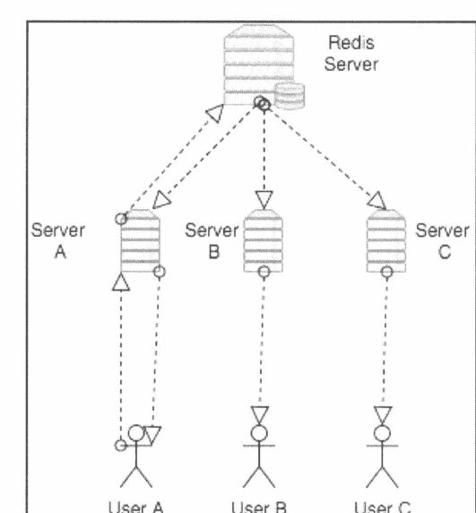

此图显示了一个用户（名为 User A），它连接到一台服务器（名为 Server A），该用户随后向 Server A 发送消息，该服务器随后在 Redis 中发布此消息，所有服务器都订阅以监听 Redis 服务器上的消息，然后 Redis 将消息发送给所有服务器中的每一个，最后将消息发送回所有已连接用户。

这种架构是我们如何使多个服务器通信的简单实现，这并不打算成为解决此问题的最佳架构。

## Using Redis as the DataSource for messages

现在我们必须更改我们的 DataSource 以使用 Redis 而不是原始实现中的基本 subject。为此，只需更改 data_source.js 文件，使用以下实现代替：

```
let Rx = require('rx');
let Redis = require('ioredis');

let subscriber = new Redis();
let publisher = new Redis();
const TOPIC = 'web_chat';
subscriber.subscribe(TOPIC);
let messagesObservable =
Rx.Observable.fromEvent(subscriber,'message',(channel,message)=>JSON.parse(
message));
module.exports = {
  push(data){
    publisher.publish(TOPIC,JSON.stringify(data));
  },
  get(){
    return messagesObservable;
  }
};
```

在这段代码中，我们首先导入 RxJS 和 ioredis 库；然后我们与 Redis 服务器建立两个连接，一个用于发布，另一个用于监听消息。由于我们在本地机器上运行 Redis，因此无需向构造函数传递任何参数。在下一行，我们为消息将被发布到的 TOPIC 创建一个名称。此名称可以是任何内容，但所有服务器必须使用相同的 TOPIC。你也不需要手动创建此 TOPIC，因为 Redis 会自动为你创建。我们最后订阅此 TOPIC 并创建一个 Observable 来监听该订阅的消息。我们需要做的最后一件事是实现导出的方法（push() 和 get()）：在 push() 中我们只需将其发布到 Redis，在 get() 中我们只需返回创建的 Observable。

如果我们想使用 Redis 在它们之间通信来将我们的应用程序分发到多个服务器上，这就是我们需要做的全部内容。


## 摘要

在本章中，我们使用 RxJS 创建了第一个应用程序。Web 聊天应用程序非常适合使用函数式响应式编程，因为其交互性。在本章中，我们学习了如何使用 RxJS 将 WebSocket 服务器建模为连接的可观察对象。我们还学习了如何将 DataSource 建模为消息的可观察对象，有两种不同的方式：首先，仅在单个本地服务器上保留消息；其次，使用 Redis 作为发布/订阅代理将消息发送到其他服务器。我们还研究了使用运算符来实现部分服务。

通过这个应用程序，我们看到了如何从不同的事件源创建可观察对象，以及如何使用运算符来实现部分业务规则。

本章的另一个重要收获是为系统实现测试。在测试中，我们学习了如何从一个简单的可观察对象创建一个假数据源，并在每个测试中使用不同的数据源以保持彼此独立。

在下一章中，我们将实现应用程序的客户端。通过应用程序的这一部分，我们将看到如何使用函数式响应式编程对用户交互进行建模，以及在浏览器中运行的函数式响应式应用程序的测试实现方法。

下一章将检验你实现迄今为止所学概念的能力。

# 11 实时客户端

# 实时客户端

在上一章中，我们使用函数式响应式编程实现了第一个应用程序；我们决定使用 WebSockets 实现实时网络聊天，因为其固有的交互性使其成为函数式响应式编程的完美候选。

我们决定在应用程序的所有层级中使用 RxJS；我们用它来：
- 对服务器和传入的 WebSocket 连接进行建模
- 实现某些服务的业务规则
- 实现应用程序的 DataSource
- 实现应用程序的测试

在服务器实现中，我们有机会从不同源实现可观察对象，甚至实现一个主题来推送数据。

从测试的角度来看，我们只为服务实现了一些基础测试；我们不想对代码进行全覆盖，但这些测试的构造和架构可以轻松复制，以为服务创建更多测试，甚至为应用程序的其他层实现新测试。

最后，我们学习了如何利用 Redis 来通信我们的服务器应用程序，并实现了一个简单的架构来提高网络聊天的可扩展性。需要注意的一点重要事项是，鉴于我们在代码中使用的模块化和解耦架构，将 Redis 引入我们的应用程序是多么容易。

这是最后一章，在本章中，我们将为实时网络聊天实现客户端应用程序；在本章中你将学习：
- 如何在客户端应用程序中使用 RxJS
- 如何通过 WebSocket 连接对从服务器接收到的消息进行建模
- 如何使用函数式响应式编程对输入和用户的交互性进行建模
- 如何使用 RxJS 为客户端应用程序实现测试
- 批量更改 DOM 以提高性能
- 打包和构建我们的应用程序

对于我们的网络聊天客户端，我们将不使用任何 **单页应用 (SPA)** 框架；我们将尝试使用最少的库来实现项目。如果你使用任何特定框架，你可以轻松地在个人项目中使用本章中的相同构造。

## 安装依赖项

为了实现网络聊天应用程序的客户端应用程序，我们将尝试将依赖项保持在最低限度；我们这样做是为了鼓励你避免在应用程序中滥用库，并展示使用 RxJS 进行函数式响应式编程的良好结构化应用程序是多么强大。

为了保持代码简单并避免添加太多配置，我们将使用 **browserify** 来打包客户端。

The browserify is a bundler that lets us use commonJS when implementing client-side applications. This means we can import data from different files/modules using require in the same way you do on Node.js applications.

要使用 browserify，我们必须将其作为依赖项安装在我们的应用程序中；为此，我们必须在应用程序的文件夹中运行以下命令：

```
npm i browserify@14.1.0 --save-dev
```

使用 browserify，我们已经可以将应用程序打包成单个 JavaScript 文件。

我们不会为 JavaScript 文件添加压缩器，因为这只是一个示例应用程序，但是，在创建实际应用程序时，请务必在将 JavaScript 文件发送给用户之前对其进行压缩。

为了保持应用程序简单，我们还将避免使用任何 CSS 预处理器，并将页面的样式保持在最低限度。


你可以在此应用程序上使用 webpack 或任何其他打包器，这是一个很好的练习，让你在最后改进它，使其尽可能接近生产就绪。

我们将使用服务器应用程序的同一代码库，因此无需再次安装 RxJS，因为它已在上一章中安装。要实现我们的代码，我们只需要一个额外的库，即 socket.io-client。

我们将使用此客户端通过 WebSocket 连接，并发送和接收来自服务器的消息。

要安装 socket.io-client，我们必须在包含应用程序的文件夹中运行以下代码：

```
npm i socket.io-client@1.7.3 --save
```

现在我们有了实现应用程序所需的内容，我们必须安装将用于测试应用程序的依赖项。

## 客户端的结构

为了实现客户端应用程序，我们将在项目中创建两个文件夹；第一个称为 static，它将包含客户端的 HTML 页面和构建的 JavaScript 文件，第二个称为 client，它将包含客户端应用程序的 JavaScript 源代码。

在 static 文件夹中，创建一个名为 index.html 的文件，它将是客户端的基础 HTML，并粘贴以下代码：

```
<!doctype html>
<html>
<head>
<title>Reactive chat</title>
<style>
* { margin: 0; padding: 0; box-sizing: border-box; }
body { font: 13px Helvetica, Arial; }
    .message_container { background: #ddd; padding: 3px; position:
fixed; bottom: 0; width: 100%; }
    .message_container input { border: 0; padding: 10px; width: 90%;
margin-right: .5%; }
    .message_container button { width: 9%; background: #99ff99; border:
none; padding: 10px; }
    #messages { list-style-type: none; margin: 0; padding: 0; }
    #messages li { padding: 5px 10px; }
    #messages li:nth-child(odd) { background: #eee; }
</style>
</head>
<body>
<ul id="messages"></ul>
<div class="message_container">
    <input id="message_input"/><button id="send_message">Send
message</button>
</div>
<script src="/bundle.js"></script>
</body>
</html>
```

此 HTML 页面仅包含在聊天中使用的最小样式，以及一个 <ul> 元素，我们将在其中显示聊天消息，以及一个 <div>，其中包含一个用户可以输入消息的输入框，以及一个用于发送这些消息的按钮。最后，它使用一个名为 bundle.js 的脚本文件；该文件将在构建过程后创建，并将包含我们实现示例应用程序所需的所有代码。

在 client 文件夹中我们需要三个文件：
- connection.js: This file contains all the logic to connect to the WebSocket server; this logic includes sending and receiving messages from the server
- events.js: This file contains all the logic to listen to events from the DOM, so this file will map the user interaction into observable objects
- index.js: This file will make the connection between connection.js and events.js; in this file we will make the WebSocket connection listen to and receive messages from the DOM

因此你可以立即创建这些文件并保持空实现。


之后你应该有如下的文件夹结构：

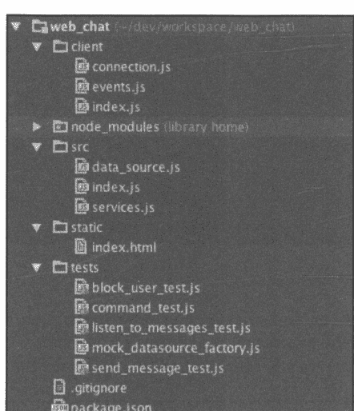

现在我们准备第一次构建我们的应用程序。

## 第一次构建应用程序

为了创建我们的应用程序，我们必须能够提供至少两个静态文件，index.html，即 HTML 页面，以及 bundle.js 文件，其中包含用 JavaScript 编写的应用程序的所有逻辑。

使用 express 提供静态文件极其简单。为此，让我们修改 src 文件夹内的 index.js 文件（src/index.js），我们在其中实现了 express 服务器，并粘贴以下代码：

```
app.use(express.static('static'));
```

这段代码告诉 express 将 static 文件夹中的所有文件作为静态文件提供；现在我们将能够第一次看到我们的页面。为此，使用以下命令运行你的应用程序：

```
node src/index.js
```

不要忘记启动 Redis 服务器，因为我们使用它来通信消息。如果不启动 Redis 服务器，你会看到类似这样的错误：

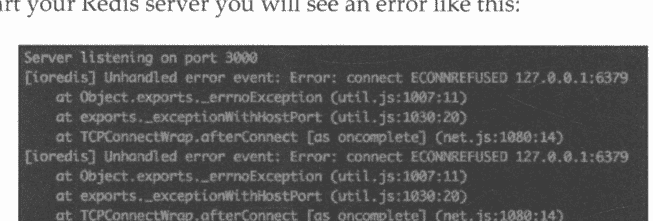

所以，不要忘记运行 Redis 服务器。

启动 Redis 服务器并运行我们的 node 应用程序后，我们就可以在浏览器中第一次看到 `web chat` 应用程序了，因此在浏览器中输入 `http://localhost:3000`，你将看到应用程序正在运行：

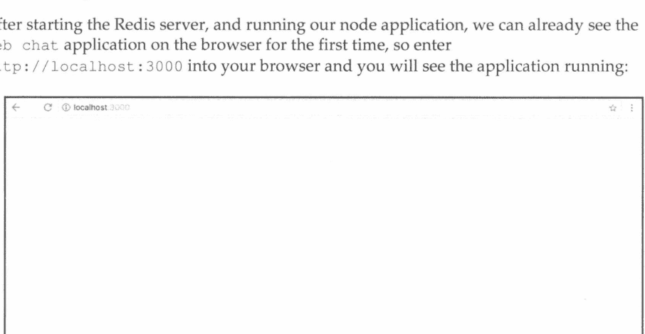

如果你能看到此屏幕，恭喜！我们离实现我们的 web chat 应用程序又近了一步。现在我们能够为我们的应用程序提供静态文件，我们必须找到一种方法来构建 JavaScript 文件；为此我们需要使用 browserify。

browserify 接收一个文件作为参数，并将跟随并添加该文件的所有依赖项（require），直到将所有内容打包到单个文件中。此文件将包含运行我们的 web chat 应用程序所需的所有代码。由于我们已经安装了 browserify，我们要做的就是使用以下命令生成文件：

```
browserify client/index.js -o static/bundle.js
```

此命令告诉 browserify 从 client 文件夹中的 index.js 文件开始，并收集所有依赖项以在 static 文件夹内生成名为 bundle.js 的文件。

运行此代码后，你应该在 static 文件夹内看到生成的 bundle.js 文件。


现在我们将准备 package.json 文件，以便在启动应用程序之前始终测试和构建应用程序。如果你不知道如何确切地更改 package.json 文件也不用担心，因为我会粘贴它的最终结果。

让我们修改项目根目录中的 package.json 文件，以便使用它来构建我们的应用程序。首先，让我们添加服务器的测试。正如你可能记得的——要测试我们的服务器应用程序，我们必须运行以下命令：

```
mocha tests/*test.js
```

因此我们必须将此命令添加到 package.json 中 scripts 属性里的 test 属性中；现在我们可以使用以下命令运行测试：

```
npm test
```

要运行我们的项目，我们使用以下命令：

```
node src/index.js
```

因此，我们可以将此命令添加到 package.json 文件中 scripts 属性里的 start 属性中；现在我们可以使用以下命令启动我们的应用程序：

```
npm start
```

现在让我们在 package.json 上添加一个构建客户端应用程序的命令；让我们在 package.json 文件的 scripts 属性中添加 build-client 属性，包含以下命令：

```
browserify client/index.js -o static/bundle.js
```

现在我们可以使用以下命令构建客户端应用程序：

```
npm run build-client
```

最后，让我们使我们的项目在启动时始终构建和测试。为此，在 scripts 属性中添加 prestart 属性，包含以下命令，以构建和测试我们的应用程序：

```
npm run build-client && npm test
```

如果你正确遵循这些说明，你最终应该得到如下的 package.json 文件：

```
{
  "name": "web_chat",
  "version": "1.0.0",
  "description": "Web chat application",
  "main": "src/index.js",
  "scripts": {
    "prestart": "npm run build-client && npm test",
    "start": "node src/index.js",
    "test": "mocha tests/*test.js",
    "build-client": "browserify client/index.js -o static/bundle.js"
  },
  "author": "Erich Oliveira",
  "license": "ISC",
  "dependencies": {
    "express": "^4.15.2",
    "ioredis": "^2.5.0",
    "rx": "^4.1.0",
    "socket.io": "^1.7.3",
    "socket.io-client": "^1.7.3"
  },
  "devDependencies": {
    "browserify": "^14.1.0",
    "mocha": "^3.2.0"
  }
}
```

现在我们可以使用以下命令运行我们的应用程序：

```
npm start
```

你将在控制台中看到以下输出，显示你的应用程序已打包、测试通过，并且应用程序正在运行：

```
bash-3.2$ npm start
> web_chat@1.0.0 prestart /Users/ericholiveira/dev/workspace/web_chat
> npm run build-client && npm test

> web_chat@1.0.0 build-client /Users/ericholiveira/dev/workspace/web_chat
> browserify client/index.js -o static/bundle.js

> web_chat@1.0.0 test /Users/ericholiveira/dev/workspace/web_chat
> mocha tests/*test.js

Block user Test
  ✓ Must not receive message from blocked user

Command Test
  ✓ Must support roll_a_dice command
  ✓ Must support echo command
  ✓ Must send a message if the action is not supported

Listen to message Test
  ✓ Must listen to messages sent to me
  ✓ Must listen to messages sent to all
  ✓ Must not listen to messages sent to others

Send Message Test
  ✓ Must support sending a message
  ✓ Must support broadcast message

9 passing (34ms)

> web_chat@1.0.0 start /Users/ericholiveira/dev/workspace/web_chat
> node src/index.js

Server listening on port 3000
```

现在我们已经完成了应用程序的构建，我们准备实现客户端，并将从与服务器的通信开始。

## 连接到服务器应用程序

我们将使用 WebSockets 通过 socket.io-client 连接到服务器。在服务器上我们将连接和请求建模为 observable 对象，我们将在客户端也这样做。为此，打开 client 文件夹内的 connection.js 文件，并导入我们将要使用的模块：

```
var Rx = require('rx');
var io = require('socket.io-client');
```

到目前为止，我们只导入了 rx 模块，我们将使用它来创建 observables，以及 socket.io-client，我们将使用它来启动连接。

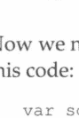

我们不会在客户端使用 ES6，以避免将其转译为 ES5 的额外步骤并使其在所有主要浏览器上工作。

现在我们需要连接到服务器。由于我们在 3000 端口运行，我们可以使用以下代码实现：

```
var socket = io('http://localhost:3000');
```

我们只能在连接建立后开始发送消息；因此，我们需要 observables 来监听 connect 和 disconnect 事件：

```
var connectionObservable = Rx.Observable.fromEvent(socket,'connect');
var disconnectObservable = Rx.Observable.fromEvent(socket,'disconnect');
```

在此文件中我们需要一种向服务器发送数据并从服务器监听数据的方式；因此我们将导出两个函数。

第一个公开的函数用于向服务器发送数据，我们将它命名为 addSender；它的签名如下：

```
addSender(observable);
```

它只接收一个必填参数：

- **observable**: An `observable` object whose events are going to be propagated to the server

它的实现如下：

```
function(observable){
    connectionObservable
        .flatMap(observable)
        .takeUntil(disconnectObservable)
        .map(function(data){
            return JSON.stringify(data);
        })
        .subscribe(function(data){
            socket.emit('request',data);
        });
}
```

实现相当直接；由于我们只能在连接建立后发送消息，我们将从 `connectionObservable` 开始，并使用 `flatMap()` 操作符，这样在连接建立后它将开始传播我们想要发送到服务器的数据。

我们还需要停止向服务器发送消息如果 socket 断开连接，因此我们添加 `takeUntil()` 操作符以在断开连接时停止 observable。

我们将以 JSON 字符串的形式向服务器发送数据；因此我们需要使用 `JSON.stringify` 函数将每个数据映射为 JSON 字符串。

在最后一步，我们订阅创建的 observable 并使用 `socket.emit` 向服务器发送数据。


为了保持代码和示例简单，我们的应用程序中不会处理重连。

我们需要公开的另一个方法必须用于监听来自服务器的传入消息；我们将它命名为 `listen`，它的签名如下：

```
listen(event);
```

它只接收一个必填参数：

- event：它是一个字符串，包含来自服务器的传入消息的事件名称

它将具有以下实现：

```
function(event){
    var eventObservable = Rx.Observable.fromEvent(socket,event);
    return connectionObservable
        .flatMap(eventObservable)
        .takeUntil(disconnectObservable);
}
```

在此函数中，我们首先从 socket 中的给定事件名称创建一个 Observable，并应用我们在之前方法中使用的相同技巧，仅在连接时监听数据，从 connectionObservable 开始，以 disconnectObservable 结束。

这两个方法是我们开始发送和接收 WebSocket 消息所需要的全部内容。

如果你正确地遵循了说明，你最终会得到如下文件：

```
var Rx = require('rx');
var io = require('socket.io-client');
var socket = io('http://localhost:3000');

var connectionObservable = Rx.Observable.fromEvent(socket,'connect');
var disconnectObservable = Rx.Observable.fromEvent(socket,'disconnect');

module.exports = {
    addSender:function(observable){
        connectionObservable
            .flatMap(observable)
            .takeUntil(disconnectObservable)
            .map(function(data){
                return JSON.stringify(data);
            })
            .subscribe(function(data){
                socket.emit('request',data);
            });
    },
    listen:function(event){
        var eventObservable = Rx.Observable.fromEvent(socket,event);
        return connectionObservable
            .flatMap(eventObservable)
            .takeUntil(disconnectObservable);
}
};
```

## 使用 RxJS 管理用户输入

现在我们必须实现可观察对象来监听用户输入；它们将被用来向服务器发送消息。

让我们在 client 文件夹内实现 events.js 文件。

第一步是使用 RxJS 模块：

```
var Rx = require('rx');
```

我们希望在用户点击“发送消息”按钮时或在用户在消息框中按回车时每次都发送用户消息。

因此，我们需要两个可观察对象，第一个在用户点击“发送消息”按钮时触发：

```
var sendPressedObservable = Rx.Observable
.fromEvent(document.getElementById('send_message'),'click');
```

这个可观察对象很简单，只会在用户点击按钮时传播事件。

第二个可观察对象将在用户在消息框中按下 Enter 键时传播事件：

```
var enterPressedObservable = Rx.Observable
.fromEvent(document.getElementById('message_input'),'keypress')
.filter(function(event){
    var ENTER_KEY_CODE=13;
    return event.keyCode===ENTER_KEY_CODE ||
    event.which===ENTER_KEY_CODE;
});
```

这个可观察对象监听消息框中所有按键被按下的事件；然后我们过滤，只在按下的键是 Enter 键时传播。


数字 13 代表 Enter 键的代码；我们将其与变量 event 的属性 keyCode 和 which 进行比较，以实现浏览器兼容性。

现在我们必须合并这两个可观察对象，以创建一个在按下 Enter 键或用户点击 **发送消息** 按钮时传播的可观察对象。

我们可以用以下代码实现：

```
var messageSubmitObservable = sendPressedObservable
.merge(enterPressedObservable)
```

当用户点击此按钮时，他希望传播消息框的内容，我们可以用 map() 操作符来实现这一点：

```
.map(function() {
  return document.getElementById('message_input').value;
})
```

如果值为空则没有理由传播数据，因此我们还添加了一个过滤器来检查是否有内容发送：

```
.filter(function(message) {
  return message != "";
})
```

最后，我们希望在用户发送消息时清除消息框的内容，因此我们需要使用 do() 操作符添加一个副作用：

```
.do(function() {
  document.getElementById('message_input').value='';
})
```

现在我们有一个可观察对象，每当用户想要发送消息时就会发出数据；这个可观察对象的代码如下：

```
var messageSubmitObservable = sendPressedObservable
  .merge(enterPressedObservable)
  .map(function() {
    return document.getElementById('message_input').value;
  }).filter(function(message) {
    return message != "";
  }).do(function() {
    document.getElementById('message_input').value='';
  });
```

在此文件中，我们希望映射所有可能的用户输入，因此最后需要做的是导出这个可观察对象，以便另一个文件可以映射消息并将其发送到服务器：

```
module.exports=messageSubmitObservable;
```

如果你正确地遵循了说明，你的 client 文件夹中的 events.js 文件将具有以下内容：

```
var Rx = require('rx');

var sendPressedObservable = Rx.Observable
    .fromEvent(document.getElementById('send_message'),'click');

var enterPressedObservable = Rx.Observable
    .fromEvent(document.getElementById('message_input'),'keypress')
    .filter(function(event){
        var ENTER_KEY_CODE=13;
        return event.keyCode===ENTER_KEY_CODE ||
        event.which===ENTER_KEY_CODE;
    });

var messageSubmitObservable = sendPressedObservable
    .merge(enterPressedObservable)
    .map(function(){
        return document.getElementById('message_input').value;
    }).filter(function(message){
        return message !="";
    }).do(function(){
        document.getElementById('message_input').value='';
    });
module.exports=messageSubmitObservable;
```

现在我们必须实现一种方式来向服务器发送用户消息。

## 连接用户交互和服务器通信

现在我们已经实现了监听用户交互的可观察对象，并且也实现了一种与服务器通信的方式，现在我们必须实现三件事：

- 用户提供其姓名的方式
- 在用户希望时向服务器发送消息
- 在屏幕上显示来自服务器的传入消息

为了实现我们应用程序的这一最后部分，将用户交互与服务器连接起来，我们将实现位于 client 文件夹中的 index.js 文件。

实现此功能的第一步是引入我们需要的模块：

```
var Rx = require('rx');
var connection = require('./connection');
var events = require('./events');
```

通过这三行代码，我们引入了 RxJS 模块以及 connection 和 events 模块。现在我们可以询问用户其姓名，并将使用 prompt 来实现这一点：

```
var logged = prompt("Please enter your name", "");
```

现在当你运行应用程序并在浏览器中打开它时，你将被提示输入姓名，如此截图所示：

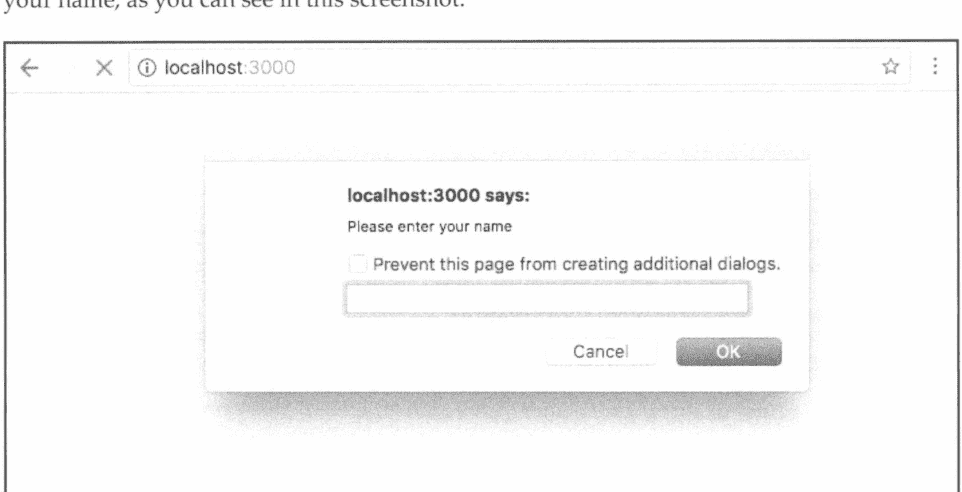

你提供的姓名将用于消息中。

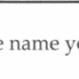

为了让示例尽可能简单，我们决定不创建任何形式的身份验证。

现在我们需要为用户创建消息的可观察对象。

这可以用以下代码实现：

```
var messagesObservable = events.map(function(value){
    var userName,splittedUserInput,action,content;
    if(value.indexOf('!')===0){
        userName = value.substring(1);
        return {service:'blockUser',blocked:userName,from:logged};
    }
    if(value.indexOf('/')===0){
        splittedUserInput = value.split(' ');
        action = splittedUserInput[0].substring(1);
        content = splittedUserInput.slice(1).join(' ');
        return {
            service:'command',
            action:action,
            content:content,
            from:logged
        };
    }
    if(value.indexOf('@')===0){
        splittedUserInput = value.split(' ');
        userName = splittedUserInput[0].substring(1);
        content = splittedUserInput.slice(1).join(' ');
        return {
            service:'sendMessage',
            to:userName,
            content:content,
            from:logged
        };
    }
    return {service:'sendMessage',content:value,from:logged};
}).merge(
    Rx.Observable.of({service:'listenToMessages',me:logged})
);
```

在这里，我们需要将用户输入映射到服务器期望的消息格式，我们将使用 map() 操作符来实现这一点；消息可以遵循四种不同的模式来调用不同的服务：

- 如果消息以感叹号 (!) 开头，则是阻止用户的消息，感叹号后面必须跟用户名；我们在此函数中的第一个 if() 子句中处理这种类型的消息
- 如果消息以斜杠 (/) 开头，则是命令消息，后面必须跟命令；在我们的服务器上我们支持两种不同的命令，echo 和 roll_a_dice；这由第二个 if() 子句处理


-   如果消息以 at 符号（@）开头，则为私信，必须后跟 `userName` 和发给该用户的消息；这在第三个 `if()` 子句中处理
-   如果以上都不适用，则为广播消息。

除此之外，我们还将其与包含单条消息的 observable 合并。该消息用于在服务器上调用 `listenToMessages` 方法，以便我们可以开始为该用户监听消息。

下一步是使用此 observable 向服务器发送消息，我们可以使用 `addSender()` 方法来实现，如以下代码所示：

```
connection.addSender(messagesObservable);
```

现在我们能够使用用户的输入向服务器发送消息。下一步是监听来自服务器的消息并将其显示在屏幕上。我们可以使用 `listen()` 方法：

```
connection.listen('message')
    .map(function(message){
        var li = document.createElement("li");
        li.innerText = message.from + ' says to '+
        (message.to || 'everybody')+' : '+message.content;
        return li;
    }).subscribe(function(node){
        document.getElementById("messages").appendChild(node);
    });
```

在这里，我们开始监听来自服务器的所有传入消息；然后我们使用 `map()` 运算符将这些消息映射为 li DOM 元素，最后，我们 `subscribe` 到 observable 以在屏幕上显示消息。

如果你一直按照说明操作到此，你将在 `client` 文件夹中得到一个 `index.js` 文件，内容如下：

```
var Rx = require('rx');
var connection = require('./connection');
var events = require('./events');

var logged = prompt("Please enter your name", "");

var messagesObservable = events.map(function(value){
    var userName, splittedUserInput, action, content;
    if(value.indexOf('!')===0){
        userName = value.substring(1);
        return {service:'blockUser',blocked:userName,from:logged};
}
if(value.indexOf('/')===0){
    splittedUserInput = value.split(' ');
    action = splittedUserInput[0].substring(1);
    content = splittedUserInput.slice(1).join(' ');
    return {
        service:'command',
        action:action,
        content:content,
        from:logged
    };
}
if(value.indexOf('@')===0){
    splittedUserInput = value.split(' ');
    userName = splittedUserInput[0].substring(1);
    content = splittedUserInput.slice(1).join(' ');
    return {
        service:'sendMessage',
        to:userName,
        content:content,
        from:logged
    };
}
return {service:'sendMessage',content:value,from:logged};
}).merge(
    Rx.Observable.of({service:'listenToMessages',me:logged})
);

connection.addSender(messagesObservable);

connection.listen('message')
.map(function(message){
    var li = document.createElement("li");
    li.innerText = message.from + ' says to '+
    (message.to || 'everybody')+' : '+message.content;
    return li;
})
.subscribe(function(node){
    document.getElementById("messages").appendChild(node);
});
```

恭喜！这意味着你已经拥有了第一个使用 RxJS 进行函数式响应式编程的应用。你已经可以使用它发送和接收消息了。

如果你运行应用程序并在浏览器中打开它，你就可以开始使用它，其工作方式如下：

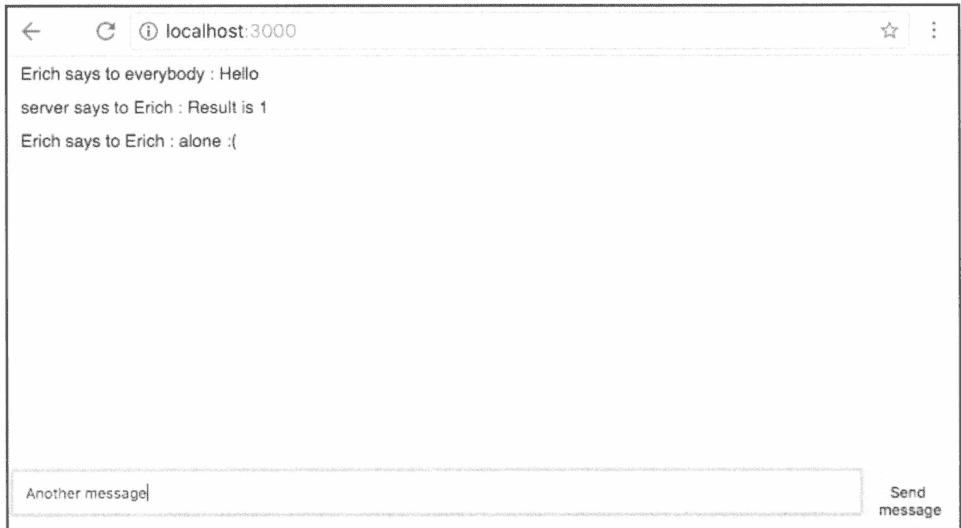

你甚至可以打开两个浏览器来查看其运行情况：

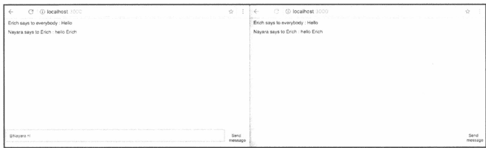

现在我们已经完成了网页聊天的[content]
-   如果消息以 at 符号（@）开头，则为私信，必须后跟 `userName` 和发给该用户的消息；这在第三个 `if()` 子句中处理
-   如果以上都不适用，则为广播消息。

除此之外，我们还将其与包含单条消息的 observable 合并。该消息用于在服务器上调用 `listenToMessages` 方法，以便我们可以开始为该用户监听消息。

下一步是使用此 observable 向服务器发送消息，我们可以使用 `addSender()` 方法来实现，如以下代码所示：

```
connection.addSender(messagesObservable);
```

现在我们能够使用用户的输入向服务器发送消息。下一步是监听来自服务器的消息并将其显示在屏幕上。我们可以使用 `listen()` 方法：

```
connection.listen('message')
    .map(function(message){
        var li = document.createElement("li");
        li.innerText = message.from + ' says to '+
        (message.to || 'everybody')+' : '+message.content;
        return li;
    }).subscribe(function(node){
        document.getElementById("messages").appendChild(node);
    });
```

在这里，我们开始监听来自服务器的所有传入消息；然后我们使用 `map()` 运算符将这些消息映射为 li DOM 元素，最后，我们 `subscribe` 到 observable 以在屏幕上显示消息。

如果你一直按照说明操作到此，你将在 `client` 文件夹中得到一个 `index.js` 文件，内容如下：

```
var Rx = require('rx');
var connection = require('./connection');
var events = require('./events');

var logged = prompt("Please enter your name", "");

var messagesObservable = events.map(function(value){
    var userName, splittedUserInput, action, content;
    if(value.indexOf('!')===0){
        userName = value.substring(1);
        return {service:'blockUser',blocked:userName,from:logged};
}
if(value.indexOf('/')===0){
    splittedUserInput = value.split(' ');
    action = splittedUserInput[0].substring(1);
    content = splittedUserInput.slice(1).join(' ');
    return {
        service:'command',
        action:action,
        content:content,
        from:logged
    };
}
if(value.indexOf('@')===0){
    splittedUserInput = value.split(' ');
    userName = splittedUserInput[0].substring(1);
    content = splittedUserInput.slice(1).join(' ');
    return {
        service:'sendMessage',
        to:userName,
        content:content,
        from:logged
    };
}
return {service:'sendMessage',content:value,from:logged};
}).merge(
    Rx.Observable.of({service:'listenToMessages',me:logged})
);

connection.addSender(messagesObservable);

connection.listen('message')
.map(function(message){
    var li = document.createElement("li");
    li.innerText = message.from + ' says to '+
    (message.to || 'everybody')+' : '+message.content;
    return li;
})
.subscribe(function(node){
    document.getElementById("messages").appendChild(node);
});
```

恭喜！这意味着你已经拥有了第一个使用 RxJS 进行函数式响应式编程的应用。你已经可以使用它发送和接收消息了。

如果你运行应用程序并在浏览器中打开它，你就可以开始使用它，其工作方式如下：


你甚至可以打开两个浏览器来查看其运行情况：


现在我们已经完成了网页聊天的[content]
-   如果消息以 at 符号（@）开头，则为私信，必须后跟 `userName` 和发给该用户的消息；这在第三个 `if()` 子句中处理
-   如果以上都不适用，则为广播消息。

除此之外，我们还将其与包含单条消息的 observable 合并。该消息用于在服务器上调用 `listenToMessages` 方法，以便我们可以开始为该用户监听消息。

下一步是使用此 observable 向服务器发送消息，我们可以使用 `addSender()` 方法来实现，如以下代码所示：

```
connection.addSender(messagesObservable);
```

现在我们能够使用用户的输入向服务器发送消息。下一步是监听来自服务器的消息并将其显示在屏幕上。我们可以使用 `listen()` 方法：

```
connection.listen('message')
    .map(function(message){
        var li = document.createElement("li");
        li.innerText = message.from + ' says to '+
        (message.to || 'everybody')+' : '+message.content;
        return li;
    }).subscribe(function(node){
        document.getElementById("messages").appendChild(node);
    });
```

在这里，我们开始监听来自服务器的所有传入消息；然后我们使用 `map()` 运算符将这些消息映射为 li DOM 元素，最后，我们 `subscribe` 到 observable 以在屏幕上显示消息。

如果你一直按照说明操作到此，你将在 `client` 文件夹中得到一个 `index.js` 文件，内容如下：

```
var Rx = require('rx');
var connection = require('./connection');
var events = require('./events');

var logged = prompt("Please enter your name", "");

var messagesObservable = events.map(function(value){
    var userName, splittedUserInput, action, content;
    if(value.indexOf('!')===0){
        userName = value.substring(1);
        return {service:'blockUser',blocked:userName,from:logged};
}
if(value.indexOf('/')===0){
    splittedUserInput = value.split(' ');
    action = splittedUserInput[0].substring(1);
    content = splittedUserInput.slice(1).join(' ');
    return {
        service:'command',
        action:action,
        content:content,
        from:logged
    };
}
if(value.indexOf('@')===0){
    splittedUserInput = value.split(' ');
    userName = splittedUserInput[0].substring(1);
    content = splittedUserInput.slice(1).join(' ');
    return {
        service:'sendMessage',
        to:userName,
        content:content,
        from:logged
    };
}
return {service:'sendMessage',content:value,from:logged};
}).merge(
    Rx.Observable.of({service:'listenToMessages',me:logged})
);

connection.addSender(messagesObservable);

connection.listen('message')
.map(function(message){
    var li = document.createElement("li");
    li.innerText = message.from + ' says to '+
    (message.to || 'everybody')+' : '+message.content;
    return li;
})
.subscribe(function(node){
    document.getElementById("messages").appendChild(node);
});
```

恭喜！这意味着你已经拥有了第一个使用 RxJS 进行函数式响应式编程的应用。你已经可以使用它发送和接收消息了。

如果你运行应用程序并在浏览器中打开它，你就可以开始使用它，其工作方式如下：


你甚至可以打开两个浏览器来查看其运行情况：


现在我们已经完成了网页聊天的[content]
-   如果消息以 at 符号（@）开头，则为私信，必须后跟 `userName` 和发给该用户的消息；这在第三个 `if()` 子句中处理
-   如果以上都不适用，则为广播消息。

除此之外，我们还将其与包含单条消息的 observable 合并。该消息用于在服务器上调用 `listenToMessages` 方法，以便我们可以开始为该用户监听消息。

下一步是使用此 observable 向服务器发送消息，我们可以使用 `addSender()` 方法来实现，如以下代码所示：

```
connection.addSender(messagesObservable);
```

现在我们能够使用用户的输入向服务器发送消息。下一步是监听来自服务器的消息并将其显示在屏幕上。我们可以使用 `listen()` 方法：

```
connection.listen('message')
    .map(function(message){
        var li = document.createElement("li");
        li.innerText = message.from + ' says to '+
        (message.to || 'everybody')+' : '+message.content;
        return li;
    }).subscribe(function(node){
        document.getElementById("messages").appendChild(node);
    });
```

在这里，我们开始监听来自服务器的所有传入消息；然后我们使用 `map()` 运算符将这些消息映射为 li DOM 元素，最后，我们 `subscribe` 到 observable 以在屏幕上显示消息。

如果你一直按照说明操作到此，你将在 `client` 文件夹中得到一个 `index.js` 文件，内容如下：

```
var Rx = require('rx');
var connection = require('./connection');
var events = require('./events');

var logged = prompt("Please enter your name", "");

var messagesObservable = events.map(function(value){
    var userName, splittedUserInput, action, content;
    if(value.indexOf('!')===0){
        userName = value.substring(1);
        return {service:'blockUser',blocked:userName,from:logged};
}
if(value.indexOf('/')===0){
    splittedUserInput = value.split(' ');
    action = splittedUserInput[0].substring(1);
    content = splittedUserInput.slice(1).join(' ');
    return {
        service:'command',
        action:action,
        content:content,
        from:logged
    };
}
if(value.indexOf('@')===0){
    splittedUserInput = value.split(' ');
    userName = splittedUserInput[0].substring(1);
    content = splittedUserInput.slice(1).join(' ');
    return {
        service:'sendMessage',
        to:userName,
        content:content,
        from:logged
    };
}
return {service:'sendMessage',content:value,from:logged};
}).merge(
    Rx.Observable.of({service:'listenToMessages',me:logged})
);

connection.addSender(messagesObservable);

connection.listen('message')
.map(function(message){
    var li = document.createElement("li");
    li.innerText = message.from + ' says to '+
    (message.to || 'everybody')+' : '+message.content;
    return li;
})
.subscribe(function(node){
    document.getElementById("messages").appendChild(node);
});
```

恭喜！这意味着你已经拥有了第一个使用 RxJS 进行函数式响应式编程的应用。你已经可以使用它发送和接收消息了。

如果你运行应用程序并在浏览器中打开它，你就可以开始使用它，其工作方式如下：


你甚至可以打开两个浏览器来查看其运行情况：


现在我们已经完成了网页聊天的[content]
-   如果消息以 at 符号（@）开头，则为私信，必须后跟 `userName` 和发给该用户的消息；这在第三个 `if()` 子句中处理
-   如果以上都不适用，则为广播消息。

除此之外，我们还将其与包含单条消息的 observable 合并。该消息用于在服务器上调用 `listenToMessages` 方法，以便我们可以开始为该用户监听消息。

下一步是使用此 observable 向服务器发送消息，我们可以使用 `addSender()` 方法来实现，如以下代码所示：

```
connection.addSender(messagesObservable);
```

现在我们能够使用用户的输入向服务器发送消息。下一步是监听来自服务器的消息并将其显示在屏幕上。我们可以使用 `listen()` 方法：

```
connection.listen('message')
    .map(function(message){
        var li = document.createElement("li");
        li.innerText = message.from + ' says to '+
        (message.to || 'everybody')+' : '+message.content;
        return li;
    }).subscribe(function(node){
        document.getElementById("messages").appendChild(node);
    });
```

在这里，我们开始监听来自服务器的所有传入消息；然后我们使用 `map()` 运算符将这些消息映射为 li DOM 元素，最后，我们 `subscribe` 到 observable 以在屏幕上显示消息。

如果你一直按照说明操作到此，你将在 `client` 文件夹中得到一个 `index.js` 文件，内容如下：

```
var Rx = require('rx');
var connection = require('./connection');
var events = require('./events');

var logged = prompt("Please enter your name", "");

var messagesObservable = events.map(function(value){
    var userName, splittedUserInput, action, content;
    if(value.indexOf('!')===0){
        userName = value.substring(1);
        return {service:'blockUser',blocked:userName,from:logged};
}
if(value.indexOf('/')===0){
    splittedUserInput = value.split(' ');
    action = splittedUserInput[0].substring(1);
    content = splittedUserInput.slice(1).join(' ');
    return {
        service:'command',
        action:action,
        content:content,
        from:logged
    };
}
if(value.indexOf('@')===0){
    splittedUserInput = value.split(' ');
    userName = splittedUserInput[0].substring(1);
    content = splittedUserInput.slice(1).join(' ');
    return {
        service:'sendMessage',
        to:userName,
        content:content,
        from:logged
    };
}
return {service:'sendMessage',content:value,from:logged};
}).merge(
    Rx.Observable.of({service:'listenToMessages',me:logged})
);

connection.addSender(messagesObservable);

connection.listen('message')
.map(function(message){
    var li = document.createElement("li");
    li.innerText = message.from + ' says to '+
    (message.to || 'everybody')+' : '+message.content;
    return li;
})
.subscribe(function(node){
    document.getElementById("messages").appendChild(node);
});
```

恭喜！这意味着你已经拥有了第一个使用 RxJS 进行函数式响应式编程的应用。你已经可以使用它发送和接收消息了。

如果你运行应用程序并在浏览器中打开它，你就可以开始使用它，其工作方式如下：


你甚至可以打开两个浏览器来查看其运行情况：


现在我们已经完成了网页聊天的[content]
现在我们已经完成了网页聊天的[content]
现在我们已经完成了网页聊天的[content]
现在我们已经完成了网页聊天的[content]
-   如果消息以 at 符号（@）开头，则为私信，必须后跟 `userName` 和发给该用户的消息；这在第三个 `if()` 子句中处理
-   如果以上都不适用，则为广播消息。

除此之外，我们还将其与包含单条消息的 observable 合并。该消息用于在服务器上调用 `listenToMessages` 方法，以便我们可以开始为该用户监听消息。

下一步是使用此 observable 向服务器发送消息，我们可以使用 `addSender()` 方法来实现，如以下代码所示：

```
connection.addSender(messagesObservable);
```

现在我们能够使用用户的输入向服务器发送消息。下一步是监听来自服务器的消息并将其显示在屏幕上。我们可以使用 `listen()` 方法：

```
connection.listen('message')
    .map(function(message){
        var li = document.createElement("li");
        li.innerText = message.from + ' says to '+
        (message.to || 'everybody')+' : '+message.content;
        return li;
    }).subscribe(function(node){
        document.getElementById("messages").appendChild(node);
    });
```

在这里，我们开始监听来自服务器的所有传入消息；然后我们使用 `map()` 运算符将这些消息映射为 li DOM 元素，最后，我们 `subscribe` 到 observable 以在屏幕上显示消息。

如果你一直按照说明操作到此，你将在 `client` 文件夹中得到一个 `index.js` 文件，内容如下：

```
var Rx = require('rx');
var connection = require('./connection');
var events = require('./events');

var logged = prompt("Please enter your name", "");

var messagesObservable = events.map(function(value){
    var userName, splittedUserInput, action, content;
    if(value.indexOf('!')===0){
        userName = value.substring(1);
        return {service:'blockUser',blocked:userName,from:logged};
}
if(value.indexOf('/')===0){
    splittedUserInput = value.split(' ');
    action = splittedUserInput[0].substring(1);
    content = splittedUserInput.slice(1).join(' ');
    return {
        service:'command',
        action:action,
        content:content,
        from:logged
    };
}
if(value.indexOf('@')===0){
    splittedUserInput = value.split(' ');
    userName = splittedUserInput[0].substring(1);
    content = splittedUserInput.slice(1).join(' ');
    return {
        service:'sendMessage',
        to:userName,
        content:content,
        from:logged
    };
}
return {service:'sendMessage',content:value,from:logged};
}).merge(
    Rx.Observable.of({service:'listenToMessages',me:logged})
);

connection.addSender(messagesObservable);

connection.listen('message')
.map(function(message){
    var li = document.createElement("li");
    li.innerText = message.from + ' says to '+
    (message.to || 'everybody')+' : '+message.content;
    return li;
})
.subscribe(function(node){
    document.getElementById("messages").appendChild(node);
});
```

恭喜！这意味着你已经拥有了第一个使用 RxJS 进行函数式响应式编程的应用。你已经可以使用它发送和接收消息了。

如果你运行应用程序并在浏览器中打开它，你就可以开始使用它，其工作方式如下：


你甚至可以打开两个浏览器来查看其运行情况：


现在我们已经完成了网页聊天的[content]
-   如果消息以 at 符号（@）开头，则为私信，必须后跟 `userName` 和发给该用户的消息；这在第三个 `if()` 子句中处理
-   如果以上都不适用，则为广播消息。

除此之外，我们还将其与包含单条消息的 observable 合并。该消息用于在服务器上调用 `listenToMessages` 方法，以便我们可以开始为该用户监听消息。

下一步是使用此 observable 向服务器发送消息，我们可以使用 `addSender()` 方法来实现，如以下代码所示：

```
connection.addSender(messagesObservable);
```

现在我们能够使用用户的输入向服务器发送消息。下一步是监听来自服务器的消息并将其显示在屏幕上。我们可以使用 `listen()` 方法：

```
connection.listen('message')
    .map(function(message){
        var li = document.createElement("li");
        li.innerText = message.from + ' says to '+
        (message.to || 'everybody')+' : '+message.content;
        return li;
    }).subscribe(function(node){
        document.getElementById("messages").appendChild(node);
    });
```

在这里，我们开始监听来自服务器的所有传入消息；然后我们使用 `map()` 运算符将这些消息映射为 li DOM 元素，最后，我们 `subscribe` 到 observable 以在屏幕上显示消息。

如果你一直按照说明操作到此，你将在 `client` 文件夹中得到一个 `index.js` 文件，内容如下：

```
var Rx = require('rx');
var connection = require('./connection');
var events = require('./events');

var logged = prompt("Please enter your name", "");

var messagesObservable = events.map(function(value){
    var userName, splittedUserInput, action, content;
    if(value.indexOf('!')===0){
        userName = value.substring(1);
        return {service:'blockUser',blocked:userName,from:logged};
}
if(value.indexOf('/')===0){
    splittedUserInput = value.split(' ');
    action = splittedUserInput[0].substring(1);
    content = splittedUserInput.slice(1).join(' ');
    return {
        service:'command',
        action:action,
        content:content,
        from:logged
    };
}
if(value.indexOf('@')===0){
    splittedUserInput = value.split(' ');
    userName = splittedUserInput[0].substring(1);
    content = splittedUserInput.slice(1).join(' ');
    return {
        service:'sendMessage',
        to:userName,
        content:content,
        from:logged
    };
}
return {service:'sendMessage',content:value,from:logged};
}).merge(
    Rx.Observable.of({service:'listenToMessages',me:logged})
);

connection.addSender(messagesObservable);

connection.listen('message')
.map(function(message){
    var li = document.createElement("li");
    li.innerText = message.from + ' says to '+
    (message.to || 'everybody')+' : '+message.content;
    return li;
})
.subscribe(function(node){
    document.getElementById("messages").appendChild(node);
});
```

恭喜！这意味着你已经拥有了第一个使用 RxJS 进行函数式响应式编程的应用。你已经可以使用它发送和接收消息了。

如果你运行应用程序并在浏览器中打开它，你就可以开始使用它，其工作方式如下：


你甚至可以打开两个浏览器来查看其运行情况：


现在我们已经完成了网页聊天的基础，我们将看到在使用 RxJS 的客户端应用中可以做的两个新的有趣技巧。第一个是监听开箱即用的事件，如三连击，并了解如果没有函数式响应式编程，实现起来会困难得多，以及我们如何通过批处理对 DOM 的更改来获得性能提升。

## 使用 RxJS 改进交互

使用函数式响应式编程的一个优势是，它使创建丰富的用户界面变得更容易，为用户与网站交互创造新的方式。有几种方法可以做到这一点。

在本节中，我们将为我们的网页聊天应用创建一个彩蛋。彩蛋是可以按照一个或多个步骤访问的隐藏功能。

我们的彩蛋将通过在消息框中进行三连击来访问。每当某个用户在消息框中进行三连击时，我们都会用 /roll_a_dice 命令填充消息框。


在本节中，我想向你展示如何使用函数式响应式编程轻松地为用户创建新的交互方式。我选择使用三连击，因为它不是标准交互，我将比较使用和不使用函数式响应式编程实现它所需的代码。

首先让我们看看如何使用 RxJS 实现它。

要实现它，让我们更改 client 文件夹中的 events.js 文件，并在文件末尾创建一个 Observable 来监听消息框中的点击；我们可以用以下代码来做到这一点：

```
Rx.Observable
.fromEvent(document.getElementById('message_input'),'click')
```

现在我们需要在特定时间范围内检测消息框中的连续点击；假设三连击必须在最多 800 毫秒内发生。要实现这一点，我们可以使用 bufferWithTime() 运算符，但如果用户点击非常快怎么办。用户已经完成了三次点击后，应用程序没有理由等待所有时间；因此，我们将使用 bufferWithTimeOrCount() 运算符。

然后我们需要在 Observable 上应用该运算符：

```
Rx.Observable
.fromEvent(document.getElementById('message_input'),'click')
.bufferWithTimeOrCount(800,3)
```

使用此运算符，将在用户进行三次点击或在第一次点击后给定的时间框架过去时触发事件，因此我们还需要添加一个 filter() 来确保用户完成了三次点击。

可以用以下代码完成：

```
Rx.Observable
.fromEvent(document.getElementById('message_input'),'click')
.bufferWithTimeOrCount(800,3)
.filter(function(events){
  return events.length === 3;
})
```

就这样；此 observable 在用户在消息框中执行三连击操作时触发事件。

现在我们需要将消息框的值更改为 /roll_a_dice 命令，我们可以通过在此 Observable 中订阅来实现：

```
Rx.Observable
.fromEvent(document.getElementById('message_input'),'click')
.bufferWithTimeOrCount(800,3)
.filter(function(events){
  return events.length === 3;
}).subscribe(function(){
  document.getElementById('message_input').value='/roll_a_dice';
});
```

如果你运行此代码并在浏览器中测试它，你会看到每当你在其中进行三连击时，消息框就会被填充为 /roll_a_dice 命令：

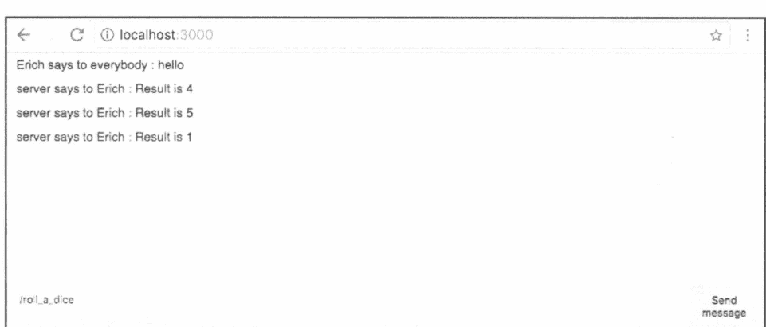

现在让我们看看如何在不使用函数式响应式编程的情况下实现相同的行为。相同的行为可以用以下代码实现：

```
var count=0;
var timer;
document.getElementById('message_input').addEventListener("click", function() {
    count++;
    if(!timer){
        timer = setTimeout(function() {
            count=0;
            timer=null;
        },800);
    }
    if(count===3){
        count=0;
        clearTimeout(timer);
        timer=null;
        document.getElementById('message_input').value='/roll_a_dice';
    }
});
```

正如你所见，它更难阅读。我们需要在另一个作用域中创建两个变量，一个用于计算点击次数并检查是否等于三，另一个用于在间隔后重置计数器。

使用这种方法时，我们还需要手动启动和清除超时。

不用说，现在它更难理解、阅读、重用、维护和测试。

## 批处理对 DOM 的更改

在开发前端应用程序时，性能的最大问题之一是对 DOM 的访问。

在 DOM 中更改或添加节点会对应用程序的性能产生严重影响。

使用 RxJS，我们可以使用缓冲区在应用到 DOM 之前聚合更改，从而轻松缓解此问题。在我们的网页聊天应用中，每当用户发送消息或你发送消息时，我们都需要向 DOM 中添加一个新节点。鉴于我们应用程序的性质，我们不期望每秒接收多条消息（否则用户将无法阅读消息），但如果你正在实现一个具有实时数据的图表，这种行为很快就会成为你的瓶颈。


在本节中，我们将对应用程序做一个小的改动，以便所有对 DOM 的更改在应用前先进行缓冲。我将展示这种技术，因为它可以在其他多个应用中使用。

在 index.js 文件中我们有以下代码；我们用它来监听来自服务器的传入数据：

```javascript
connection.listen('message')
.subscribe(function(message){
  var node = document.createElement("li");
  var textnode = document.createTextNode(message.from + ' says to '+(message.to || 'everybody')+' : '+message.content);
  node.appendChild(textnode);
  document.getElementById("messages").appendChild(node);
});
```

在这段代码中，每当服务器收到一条新消息时，我们会立即在 DOM 中显示它；为了最小化对 DOM 的访问，我们可以轻松地将来自服务器的传入消息缓冲几毫秒。

要实现这种行为，我们可以使用 bufferWithTime() 操作符在 500 毫秒的时间范围内缓冲消息。如前所述，鉴于我们应用程序的性质，使用它无法期望获得巨大的性能提升，但是，对于其他应用程序，我们可以缓冲更长时间并获得更多好处。

所以第一步是添加该操作符：

```javascript
connection.listen('message')
.bufferWithTime(500)
//keeps with the other operators and subscription
```

bufferWithTime() 操作符如果在给定时间范围内没有传播消息，将会传播空数组，因为我们不想运行订阅。如果我们没有收到任何消息，我们必须在此之后添加一个 filter() 来检查是否收到了消息。我们可以通过检查数组的长度是否大于 0 来做到这一点，如以下代码所示：

```javascript
connection.listen('message')
.bufferWithTime(500)
.filter(function(messages){
  return messages.length > 0;
})
//keeps with the other operators and subscription
```

现在我们必须更改 map() 操作符使用的函数，使其返回包含所有消息的新 DOM 元素：

```javascript
.map(function(messages){
    var li;
    var i=0;
    var fragment = document.createDocumentFragment();
    for(;i<messages.length;i++){
        li = document.createElement("li");
        li.innerText = messages[i].from + ' says to '+(messages[i].to || 'everybody')+' : '+messages[i].content;
        fragment.appendChild(li);
    }
    return fragment;
})
//keeps with subscription
```

在我们新的 map() 函数中，我们创建一个文档片段用作包含消息的所有 li 元素的容器，并返回该片段。

采用这种新方法，浏览器不会为每条新消息不断计算样式和布局，而会将更改批量处理在 500 毫秒的时间范围内。

我们需要做的最后一件事是订阅最终的 observable，以便最终将更改应用到 DOM 并显示消息。我们的最终代码如下所示：

```javascript
connection.listen('message')
    .bufferWithTime(500)
    .filter(function(messages){
        return messages.length > 0;
    })
    .map(function(messages){
        var li;
        var i=0;
        var fragment = document.createDocumentFragment();
        for(;i<messages.length;i++){
            li = document.createElement("li");
            li.innerText = messages[i].from + ' says to '+(messages[i].to || 'everybody')+' : '+messages[i].content;
            fragment.appendChild(li);
        }
        return fragment;
    })
    .subscribe(function(node){
        document.getElementById("messages").appendChild(node);
    });
```

如果您运行应用程序并尝试发送一些消息，您将看到应用程序按预期运行：

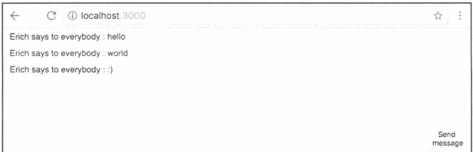


如今许多框架使用不同的策略来避免对 DOM 应用更改，因为这可以带来很大的性能提升。在这里，您可以看到如何使用 RxJS 中提供的几个函数式响应式编程操作符轻松实现这种策略，以避免对 DOM 的更改。

现在您的 index.js 文件应如下所示：

```js
var Rx = require('rx');
var connection = require('./connection');
var events = require('./events');

var logged = prompt("Please enter your name", "");

var messagesObservable = events.map(function(value){
    var userName, splittedUserInput, action, content;
    if(value.indexOf('!')===0){
        userName = value.substring(1);
        return {service:'blockUser',blocked:userName,from:logged};
    }
    if(value.indexOf('/')===0){
        splittedUserInput = value.split(' ');
        action = splittedUserInput[0].substring(1);
        content = splittedUserInput.slice(1).join(' ');
        return {
            service:'command',
            action:action,
            content:content,
            from:logged
        };
    }
}
if(value.indexOf('@')===0){
    splittedUserInput = value.split(' ');
    userName = splittedUserInput[0].substring(1);
    content = splittedUserInput.slice(1).join(' ');
    return {
        service:'sendMessage',
        to:userName,
        content:content,
        from:logged
    };
}
    return {service:'sendMessage',content:value,from:logged};
}).merge(
    Rx.Observable.of({service:'listenToMessages',me:logged})
);

connection.addSender(messagesObservable);

connection.listen('message')
    .bufferWithTime(500)
    .filter(function(messages){
        return messages.length > 0;
    })
    .map(function(messages){
        var li;
        var i=0;
        var fragment = document.createDocumentFragment();
        for(;i<messages.length;i++){
            li = document.createElement("li");
            li.innerText = messages[i].from + ' says to '+
                (messages[i].to || 'everybody')+' : '+messages[i].content;
            fragment.appendChild(li);
        }
        return fragment;
    })
    .subscribe(function(node){
        document.getElementById("messages").appendChild(node);
    });
```

## 测试应用程序

您可以创建多种方式来为应用程序创建测试；其中一个可能的选项是为应用程序创建单元测试。

如果我们决定为客户端应用程序创建单元测试，我们需要一种方法来模拟与服务器的连接；这将涉及为测试创建新的（且略复杂）构建。

我们也可以创建端到端测试，以测试用户的整个流程。这样做可能需要使用一些外部工具在浏览器上下文中运行测试并自动化用户输入。这还涉及额外运行 Selenium 或 CasperJS 等工具的步骤。

关于如何测试前端应用程序的不同方式，有几本书。在这里，我选择实现最简单的解决方案，即使用 mocha 创建测试页面，如第 7 章《Something is Wrong - Testing and Dealing with Errors》中所述。

为此，让我们在 static 文件夹内创建一个名为 index_test.html 的页面；该页面将是 index.html 页面的副本，但它将包含我们应用程序的测试。它将基于第 7 章《Something is Wrong - Testing and Dealing with Errors》中的测试 HTML 文件。

将以下内容粘贴到该页面中：

```html
<html>
<head>
<meta charset="utf-8">
<title>Tests</title>
<link href="https://cdn.rawgit.com/mochajs/mocha/2.2.5/mocha.css" rel="stylesheet" />
</head>
<body>
<div id="mocha"></div>
<div style="display:none">
<ul id="messages"></ul>
<div class="message_container">
<input id="message_input"/><button id="send_message">Send message</button>
</div>
</div>
<script src="https://cdn.rawgit.com/mochajs/mocha/2.2.5/mocha.js"></script>
<script src="https://cdnjs.cloudflare.com/ajax/libs/chai/3.5.0/chai.min.js"></script>
<script>
window.prompt=function () {
return "Erich";
};
</script>
<script src="/bundle.js"></script>
<script>
    mocha.setup('bdd');
    var assert = chai.assert;
    describe('Web chat test', function() {
        // Your test goes here
    });
    mocha.run();
</script>
</body>
</html>
```

此页面包含 mocha 和 chai 库以及用于运行测试的 mocha div。由于我们决定尽可能保持代码简单并测试整个用户流程，我们需要用于为应用程序创建 observable 的 HTML 元素（消息框、发送按钮以及所有消息的容器）；我们将它们放在一个隐藏的 div 中，因此不会在屏幕上显示。

由于我们不想弹出一个询问用户名的屏幕，我们还重写了默认的 prompt 函数，使其始终返回相同的名称；该名称将由已登录用户使用。

最后，我们有一个包含 mocha 运行的所有测试的脚本块。

我们要实现的第一个测试是用于公共消息；给定用户必须能够发送公共消息，并且它必须放在 ul 元素内。

这将是我们第一个测试：

```javascript
it('should send and receive public messages', function(done) {
    setTimeout(function() {
        document.getElementById("message_input").value = "hello";
        document.getElementById("send_message").click();
        setTimeout(function() {
            assert.equal(document
                .getElementById("messages").children.length,1);
            assert.equal(document
                .getElementById("messages").children[0].innerText,
                "Erich says to everybody : hello"
            );
            done();
        },500);
    },100);
});
```


在本测试中，我们首先运行一个 setTimeout() 来等待连接可用（我们等待 100 毫秒，这应该足够了），然后我们用一条消息填充消息框以强制点击发送按钮。我们再次等待几毫秒以便消息被送达，并检查 <ul> 元素的内容，以查看是否包含该消息。我们最后结束测试，调用 done() 函数。

为了测试我们的应用程序，我们需要一切都在运行，因此，在保存此文件后，启动你的应用程序并在浏览器中打开以下地址：
http://localhost:3000/index_test.html.

你可以在此屏幕中看到你的测试通过：

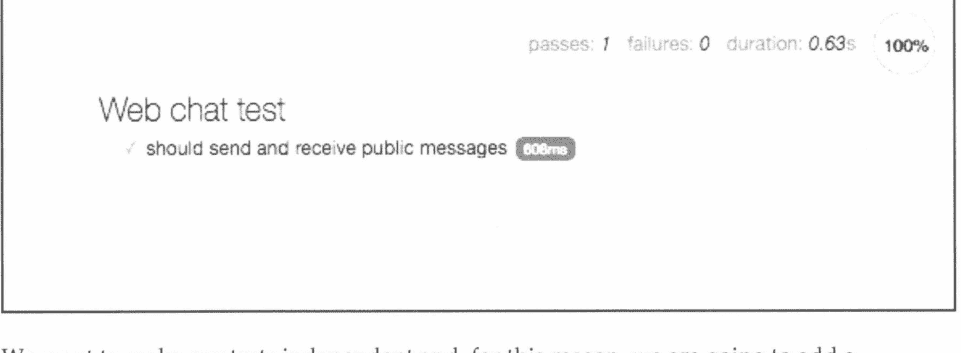

我们希望使测试相互独立，因此，我们将添加一个 beforeEach 钩子，在每次测试前清理 HTML 元素：

```
beforeEach(function() {
    document.getElementById("message_input").value = "";
    document.getElementById("messages").innerHTML = "";
});
```

所有其他测试都遵循与第一个测试相同的模式。

在第二个测试中，我们将检查私有消息：

```
it('should send and receive private messages', function(done) {
    setTimeout(function(){
        document.getElementById("message_input").value = "@Erich hello";
        document.getElementById("send_message").click();
```

```
setTimeout(function(){
assert.equal(document.getElementById("messages").children.length,1);
assert.equal(
document.getElementById("messages").children[0].innerText,
"Erich says to Erich : hello"
);
done();
},500);
},100);
});
```

此测试与第一个测试的唯一区别是发送和接收的消息。

在第三个测试中，我们将查看 roll_a_dice 命令是否有效：

```
it('should support roll_a_dice command', function(done) {
    setTimeout(function(){
        document.getElementById("message_input").value = "/roll_a_dice";
        document.getElementById("send_message").click();
        setTimeout(function(){
            assert.equal(document
                .getElementById("messages").children.length,1);
            assert.equal(
                /server says to Erich : Result is [1-6]/ .test(
                document.getElementById("messages")
                .children[0].innerText ),true );
            done();
        },500);
    },100);
});
```

这里我们使用正则表达式来检查文件的内容，因为服务返回的数字可以在 1 到 6 之间任意取值。

最后一个测试检查 echo 命令是否按预期工作：

```
it('should support echo command', function(done) {
    setTimeout(function(){
        document.getElementById("message_input").value = "/echo hello";
        document.getElementById("send_message").click();
        setTimeout(function(){
            assert.equal(document
                .getElementById("messages").children.length,1);
            assert.equal(document
                .getElementById("messages").children[0].innerText,
                "server says to Erich : hello"
            );
```

```
done ();
},500);
},100);
});
```

如果你正确地完成了以上步骤，你可以在浏览器中运行测试并看到类似此屏幕的画面：

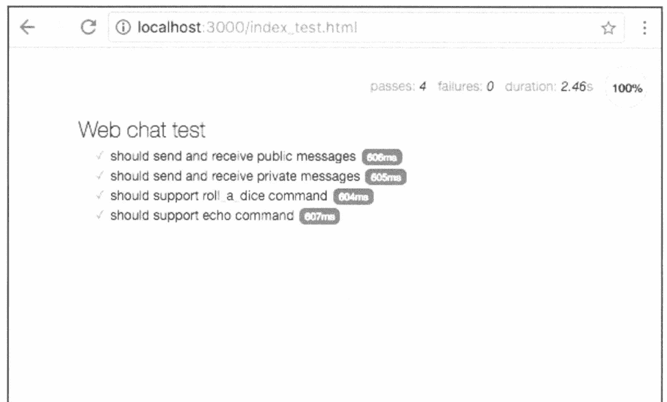

你的测试的最终代码如下所示：

```
<html>
<head>
    <meta charset="utf-8">
    <title>Tests</title>
    <link href="https://cdn.rawgit.com/mochajs/mocha/2.2.5/mocha.css" rel="stylesheet" />
</head>
<body>
<div id="mocha"></div>
<div style="display:none">
    <ul id="messages"></ul>
    <div class="message_container">
```

```
<input id="message_input"/><button id="send_message">Send message</button>
    </div>
</div>
<script src="https://cdn.rawgit.com/mochajs/mocha/2.2.5/mocha.js"></script>
<script
src="https://cdnjs.cloudflare.com/ajax/libs/chai/3.5.0/chai.min.js"></script>
<script>
    window.prompt=function(){
        return "Erich";
    };
</script>
<script src="/bundle.js"></script>
<script>
    mocha.setup('bdd');
    var assert = chai.assert;
    beforeEach(function(){
        document.getElementById("message_input").value = "";
        document.getElementById("messages").innerHTML = "";
    });
    describe('Web chat test', function() {
        it('should send and receive public messages', function(done) {
            setTimeout(function(){
                document.getElementById("message_input").value = "hello";
                document.getElementById("send_message").click();
                setTimeout(function(){
                    assert.equal(document
                        .getElementById("messages").children.length,1);
                    assert.equal(document
.getElementById("messages").children[0].innerText,
                        "Erich says to everybody : hello"
                    );
                    done();
                },500);
            },100);
        });
        it('should send and receive private messages', function(done) {
            setTimeout(function(){
                document.getElementById("message_input").value = "@Erich hello";
                document.getElementById("send_message").click();
                setTimeout(function(){
                    assert.equal(document
                        .getElementById("messages").children.length,1);
                    assert.equal(document
```

```
.getElementById("messages").children[0].innerText,
"Erich says to Erich : hello"
);
        done();
      },500);
    },100);
  });
  it('should support roll_a_dice command', function(done) {
    setTimeout(function(){
      document.getElementById("message_input").value =
"/roll_a_dice";
      document.getElementById("send_message").click();
      setTimeout(function(){
        assert.equal(document
          .getElementById("messages").children.length,1);
        assert.equal(
          /server says to Erich : Result is [1-6]/ .test(
            document.getElementById("messages")
            .children[0].innerText ), true );
        done();
      },500);
    },100);
  });
  it('should support echo command', function(done) {
    setTimeout(function(){
      document.getElementById("message_input").value =
        "/echo hello";
      document.getElementById("send_message").click();
      setTimeout(function(){
        assert.equal(document
.getElementById("messages").children.length,1);
        assert.equal(document
.getElementById("messages").children[0].innerText,
          "server says to Erich : hello"
        );
        done();
      },500);
    },100);
  });
});
  mocha.run();
</script>
</body>
</html>
```

恭喜！通过此测试，我们使用函数式响应式编程完成了项目。现在你已经掌握了 RxJS，可以在自己的项目中使用它。

作为最后的练习，你可以尝试改进此应用程序中的测试或创建新的交互。

## 摘要

在本章中，我们使用函数式响应式编程创建了项目的最后一部分；在这里，我们使用了本书其他部分的大量知识，例如在浏览器中使用函数式响应式编程、从用户输入创建可观察对象、使用几种不同的操作符、将消息和连接建模为可观察对象、订阅可观察对象、缓冲来自可观察对象的数据以批量处理它，以及为前端应用程序创建简单的测试。

我们没有使用本书中学习到的所有知识，因为很难找到一个使用所有内容的示例应用程序，同时又保持足够简单以用作书中的示例。

请记住，这些知识很重要，可以在日常工作中用于其他程序。
