### 1
Sheet Metal Basics
– Exploring Sheet Metal Properties and Material Selection

SolidWorks 是全球领先的 **三维 (3D) 计算机辅助设计 (CAD)** 建模软件之一，拥有数百万用户。然而，虽然许多人使用 SolidWorks 进行 3D 实体建模，但也有许多更专业的模块用于创建其他类型的模型。SolidWorks Sheet Metal 模块是其中最重要的一项，因为它释放了钣金制造和生产巨大的潜力。

在本章中，我们将探讨钣金是什么以及为什么它很重要。我们将学习如何使用 **Base Flange** 创建 Sheet Metal 模型以及如何编辑模型的 **Sheet Metal 属性。**

我们还将介绍 **Flattening** *parts* 并简要了解最常用于钣金的材料。

到本章结束时，您将了解如何开始 Sheet Metal *parts* 以及如何调整其基本参数，同时对钣金制造和使用也有更广泛的了解。

在本章中，我们将涵盖以下主要主题：

- Introducing Sheet Metal
- Creating a **Base Flange**
- **Sheet Metal** properties
- Other **Base Flange** options and flattening parts
- Considerations when selecting sheet metal materials

#### Technical requirements

要完成本节及所有后续章节，您需要一份 SolidWorks 软件程序的副本，并具备基本的操作知识。这包括如何执行诸如开始新的 *parts*、创建和编辑草图和特征以及使用常用工具等操作。对于完全不熟悉 SolidWorks 的读者，建议先打好实体建模的基础，然后再学习本书涵盖的 Sheet Metal 模块。

在本书的课程中，如果某个教程或工具出现问题，请尝试重新检查所有之前的步骤，甚至尝试关闭 *part* 并从头开始。

SolidWorks 中的错误消息通常描述性很强，并且通常会告诉用户确切的问题所在。因此，如果出现错误，请避免在未正确阅读的情况下点击 **OK**，并尝试执行消息中建议的操作。

如果问题仍然存在，请随时通过 Twitter 在线联系我，网址为 www.twitter.com/johnoellison。

#### SolidWorks versions

本书中的示例和演示均使用 SolidWorks 2021 制作。SolidWorks 的其他版本在界面和某些选项的标签等方面可能存在非常细微的差异，但总体而言，工作流程应该非常相似。如果您在这些差异上遇到困难，请使用前面提供的详细信息联系我。

#### Units of measurement

在整本书中，**毫米** (**mm**) 被用作测量单位，但可以根据读者的偏好进行调整，通过将模型的单位设置为 **英寸** (')，例如，然后在添加尺寸时在 **Smart Dimension** 工具中输入毫米数值后跟 mm。这将自动将毫米值转换为英寸（或您选择的单位类型）。

#### Terminology

在整本书中，“sheet metal”（小写）指的是现实世界中通用的行业和制造方法，而“Sheet Metal”（大写）则特指 SolidWorks Sheet Metal 模块。

术语“part”指的是现实生活中的组件或物品，而 *part*（斜体）则特指 SolidWorks *part* 文档。

#### Introducing Sheet Metal

钣金零件是指——顾名思义——由金属平板制成的零件。众多不同的制造技术，如弯曲、切割和成型，使这些简单的平板能够转变为复杂的 3D 零件。钣金的流行在现代时代急剧增长，因为它允许设计师和工程师使用广泛可用的材料类型——平板——并使用相对低成本的工具和工艺以工业规模创建复杂产品。

很可能您在家里、车库或工作场所快速环顾四周，就会发现数十件使用钣金技术制作的物品。这些物品的范围从非常简单的物品，如直角支架，到更复杂的产品，如家具，一直到精细的设计，如计算机或电子外壳。钣金还用于制造飞机零件或汽车车身等非常复杂的物品，尽管最先进的成型零件超出了 SolidWorks Sheet Metal 的范围。

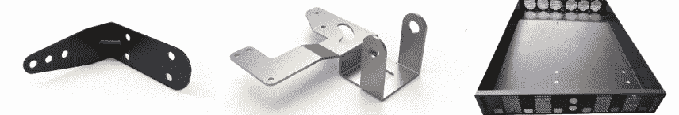

Figure 1.1: Examples of sheet metal parts

SolidWorks Sheet Metal 模块的美妙之处在于它允许用户创建这些 3D 形状，然后将其展平为板材，并导出为可用于制造的 **二维 (2D)** 设计。

SolidWorks Sheet Metal 的另一个优点是，尽管名称如此，它不必仅用于纯金属零件。Sheet Metal 可用于创建任何类型的可展平 3D 零件，无论其现实生活中的材料如何。尝试跳出“金属”标题的思维，就能解锁更广泛的用途。例如，Sheet Metal 可用于创建纸板包装。这可以在 3D 中建模，然后在虚拟中展开以便打印，用模切机裁切，然后制成 3D 盒子。Sheet Metal 甚至可用于创建纸艺折纸艺术品等多样化物品。

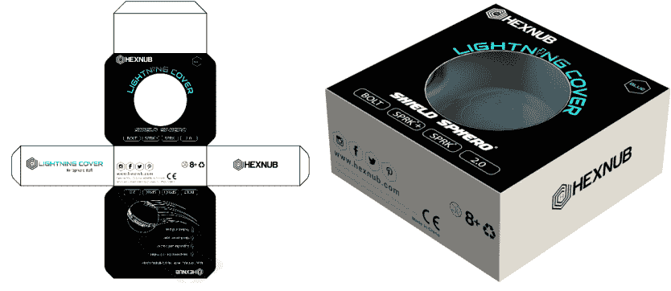

Figure 1.2: Sheet Metal isn't just for metal but any material, such as this cardboard packaging

Sheet Metal 是一套多样化的制造方法，将把您的建模和设计提升到下一个水平。总结如下：

- Sheet metal uses flat sheets to create 2D or 3D parts.
- Techniques include cutting, bending, and forming.
- SolidWorks Sheet Metal parts don't have to be metal!

在下一节中，我们将了解如何在 SolidWorks 中通过创建 Base Flange 来实际开始制作 Sheet Metal 零件，该 Base Flange 将成为这些零件的基础特征。

#### Creating a Base Flange

SolidWorks Sheet Metal 零件可以主要通过两种方式开始——要么创建 Base Flange，要么将现有的 3D 零件转换为 Sheet Metal 零件。本节将介绍 Base Flanges 的使用，这是开始新 Sheet Metal 零件最简单但也最灵活的方式。

#### 设置工作区

在了解更多关于 **Base Flanges** 之前，让我们先确保工作区已正确设置用于钣金建模。钣金工具可通过顶部菜单栏上的 **Insert** 菜单找到（图 1.3），但使用 **Sheet Metal** 选项卡或工具栏更快更方便：

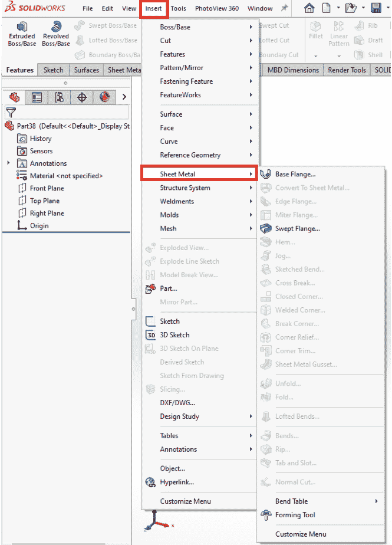

图 1.3：Insert 菜单中的钣金工具

#### 设置 Sheet Metal 选项卡或工具栏

要添加 Sheet Metal 选项卡，请按以下步骤操作：

- 1. 在 SolidWorks 零件文档中，右键单击命令管理器 Command Manager 上任何现有选项卡，或空白区域（图 1.4 中标记为 i）。
- 2. 选择 Tabs 子选项（图 1.4 中标记为 ii），并确保 Sheet Metal 选项旁有复选标记（图 1.4 中标记为 iii）。

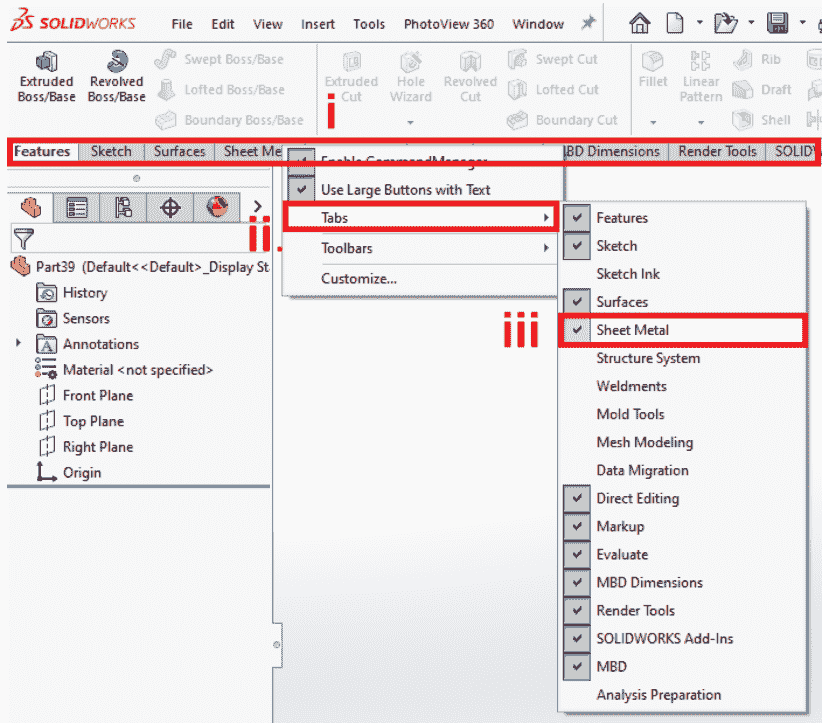

图 1.4：将 Sheet Metal 选项卡添加到命令管理器

这样就会将 Sheet Metal 选项卡添加到命令管理器的现有选项卡中。

要添加 **Sheet Metal** 工具栏：

- 1. **Sheet Metal** 工具栏可以像选项卡一样添加。首先，右键单击命令管理器 **Command Manager** 上任何现有选项卡，或空白区域（图 1.4 中标记为 i）。
- 2. 选择 **Toolbars** 子选项并确保 **Sheet Metal** 选项旁有复选标记。

> **应使用 Sheet Metal 工具栏还是 Sheet Metal 选项卡？**
> 默认情况下，**Sheet Metal** 选项卡和工具栏包含相同的一组工具。两者都可以在本书中使用，这取决于用户偏好。
> **Sheet Metal** 选项卡包含更大、更清晰的图标，但工具栏可以移动到 **Graphics Area** 以更方便地访问工具。

#### 创建 Base Flange

**Base Flange** 是钣金零件的第一个特征，也是创建新钣金零件最简单的方式，同时也提供最大的灵活性。这是因为一旦创建了 **Base Flange**，就可以添加弯曲和凸缘等附加特征，以类似标准实体建模的方式构建 3D 零件。相比之下，将现有零件转换为钣金（本书后面会介绍）可能会限制可以创建的零件类型，并在后期减少编辑选项。

要实际创建 **Base Flange**，首先需要绘制一个草图轮廓。可使用各种轮廓类型，但本节将介绍最简单的一种：**Single Closed** 轮廓。

要创建 **Base Flange**：

- 1. 开始一个新的 SolidWorks 零件。
- 2. 在适当的平面上开始草图，例如 **Top Plane**（图 1.5 中标记为 i）。
- 3. 绘制 **Base Flange** 轮廓。稍后本章将介绍不同的轮廓类型，但现在，只需创建一个封闭轮廓，例如 **Center Rectangle**（图 1.5 中标记为 ii）。
- 4. 通过使用 **Smart Dimension** 工具并将其链接到 **Origin**（图 1.5 中标记为 iii）来完全定义轮廓。使矩形高度为 200mm，宽度为 300mm。

#### 完全定义草图

在 SolidWorks 建模期间，完全定义草图非常重要，以确保草图实体固定且不会以意外的方式行为，例如移动位置。完全定义的草图实体将变为黑色，并且当草图完全定义时，屏幕右下角会显示提示（图 1.5 中标记为 iv）。

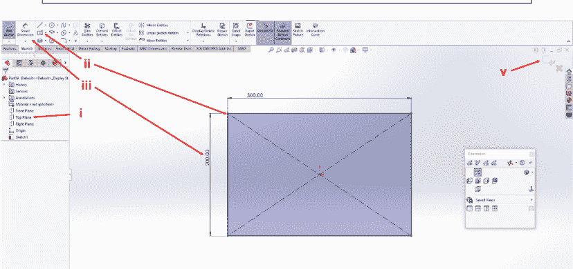

图 1.5：绘制 Base Flange 轮廓

- 5. 退出草图（图 1.5 中标记为 v）。
- 6. 选择 Sheet Metal 选项卡或工具栏并选择 Base Flange/Tab 选项——这应该是第一个图标（图 1.6 中标记为 i）。
- 7. 系统会提示您选择一个草图。选择刚刚绘制的草图，应会出现 Base Flange 的黄色预览（见图 1.6）。

#### Note

也可以跳过步骤 5，直接在草图内从 Sheet Metal 选项卡选择 Base Flange/Tab 选项。在这种情况下，正在编辑的草图将自动使用。

8. 输入以下设置（这些将在本章后面详细介绍）：

- Thickness: 1mm
- Bend Allowance: K-Factor, 0.5
- Auto Relief: Rectangular
- Ratio:0.5（图 1.6 中标记为 iii）

按 OK（图 1.6 中标记为 iv），Base Flange 特征即创建完成。

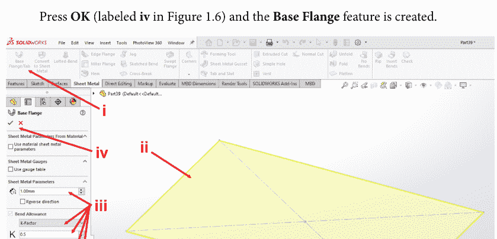

图 1.6：创建 Base Flange 特征

Base Flange 特征现已创建，FeatureManager 设计树左侧会出现 Base-Flange1（注意：您的编号可能不同）（图 1.7 中标记为 i）。可以通过左键单击该特征并选择 Edit Feature 以通常的方式编辑和调整该特征。

创建 Base Flange 特征会将整个零件转变为钣金零件，因此会自动在 FeatureManager 设计树中添加一些额外项目。这些项目表示零件是钣金模型，由以下部分组成：

- Sheet-Metal 文件夹：包含钣金零件的所有全局属性，例如 Thickness 和 Bend Radius 属性（图 1.7 中标记为 i）。

- Flat-Pattern 文件夹：此文件夹包含零件的展开版本（图 1.7 中标记为 iii）。默认情况下，此文件夹将被抑制，因此在此阶段会显示为灰色，但这将在本章后面详细介绍。
- Cut list 文件夹：此文件夹包含构成零件的所有单独板材。可以将其视为与普通实体建模中使用的 Solid Bodies 文件夹类似

文件夹名称后的数字表示零件由多少张板组成。例如，由两个单独的本体和盖板组成的零件将在 Cut list 文件夹后显示 (2)（图 1.7 中标记为 iv）。

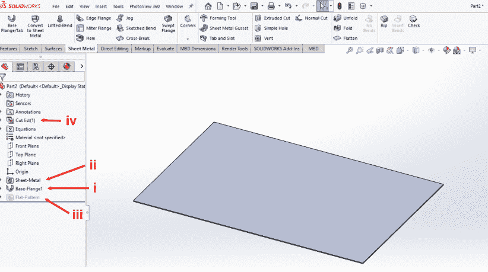

图 1.7：钣金零件详情

Base Flanges 通常是开始钣金零件的最佳方式，并且通常是钣金零件中创建的第一个特征。它们可以通过绘制封闭轮廓，然后从钣金工具中选择 Base Flange/Tab 选项来制作。

添加 Base Flange 特征会将零件转变为钣金零件，并会自动添加 Flat-Pattern、Cut list 和 Sheet-Metal 文件夹，我们将在下一节中进一步探索这些文件夹。

> **保存零件**
> 在此阶段，您的当前 *part* 可以保存，因为我们将在整本书中使用此文档。
> 
> 在 SolidWorks 中工作时，养成定期保存工作的习惯，以防止崩溃和其他问题。

#### 钣金属性

**Sheet Metal** 属性是适用于整个 *part* 的全局设置。本节介绍如何调整这些属性以及它们的实际含义。该部分包含一些相当枯燥的背景理论，但它是理解钣金的重要基础。其中一些底层理论在我们稍后实际使用和演示工具时将会变得更加清晰，因此如果某些部分在此阶段仍然有点令人困惑，请不要担心太多。

共有四个钣金属性：

- 1. **Sheet Thickness**
- 2. **Bend Radius**
- 3. **Bend Allowance**
- 4. **Auto Relief**

#### 编辑钣金属性并调整板厚

如前所述，钣金 *parts* 通常由厚度恒定的板材制成。因此，*part* 的 **thickness** 是钣金的重要方面。

要编辑 *part* 的 **Sheet Metal** 属性，只需在 FeatureManager 设计树中左键或右键单击 Sheet-Metal 文件夹（图 1.7 中标记为 **ii**）并选择 **Edit Feature**。

要设置厚度，调整 **Thickness** 字段下的值（图 1.8 中标记为 **i**）并按绿色 **OK** 勾号。例如，尝试设置 2mm 厚度并按 **OK**。您现在应该会看到 **Base Flange** 的厚度已从 1mm 变为 2mm。

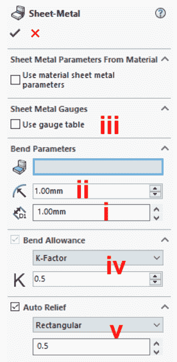

图 1.8：钣金属性

此 **厚度** 设置在整个 *零件* 中都是全局的，因此添加的任何新特征，例如 **边缘法兰**，也将使用相同的厚度进行制作。编辑 `Sheet-Metal` 文件夹中的单个值即可非常简单地调整整个 *零件* 以及构成它的所有特征。

#### 编辑弯曲半径

除了厚度之外，钣金 *零件* 的另一个非常重要的属性是 **弯曲半径**。

每当将一块平坦的金属板弯曲或折叠以创建 3D 零件时，弯曲过程中产生的拐角永远不会完全呈方形。即使使用非常薄且柔韧的材料，例如铝箔，也需要一个很小的弯曲半径。

在 SolidWorks 钣金中也是如此：弯曲半径始终是必需的（图 1.9），即使它很小。

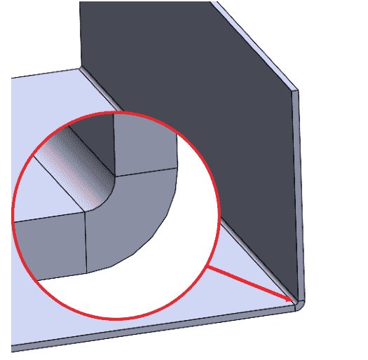

图 1.9：始终需要弯曲半径

在 SolidWorks 钣金中，弯曲半径指的是弯曲内部的大小，可在钣金属性中设置。

只需编辑钣金属性并调整值（图 1.8 中标记为 ii）。

默认情况下，钣金属性中设置的弯曲半径将应用于添加到零件的任何特征，尽管可以为特定弯曲覆盖弯曲半径，这将在本书后面介绍。

#### 我们应该将弯曲半径设置为多大？

尽管设置弯曲半径值本身很简单，但我们如何知道要使用什么值？弯曲半径取决于多种因素，例如材料类型、制造方法和材料的厚度。一般来说，随着板厚增加，弯曲半径值也会增加。为了形象化这一点，请考虑弯曲一薄片金属箔与弯曲一块厚板的区别——较薄的板可以形成更紧密的弯曲。

钢材弯曲的一般数值可能如下：

| 板厚 | 弯曲半径 |
|---|---|
| 1mm | R1.4mm |
| 2mm | R1.88mm |
| 3mm | R2.75mm |
| 4mm | R3.0mm |
| 5mm | R3.6mm |

确定 **弯曲半径** 有多种方法。

- **咨询您的制造商。** 确定 **弯曲半径** 的最可靠方法通常是直接与制作您 *零件* 的人员交谈。告诉他们您计划创建的内容、材料类型和厚度，他们应该能够推荐使用的设置。
- **在线或参考书籍中搜索。** 尝试搜索诸如 `1mm thick steel bending radius` 之类的短语。结果应能让您对设计开始时合适的数值有一个大致了解，然后可以通过调整钣金属性在后期进行微调。
- **使用 SolidWorks 规格表。** 规格号是根据重量测量金属板厚度的一种方法。SolidWorks 包含规格表，即内置于 SolidWorks 钣金中的预设尺寸列表。它们可用于查找常见的 **弯曲半径** 值。

激活 **规格表**：

- I. 在 **钣金** 属性顶部勾选 **Use gauge table** 复选框（*图 1.8* 中标记为 iii）。然后可以从下拉列表中选择一个表。

> **注意**
> SolidWorks 规格表要求计算机上安装 Microsoft Excel，否则将无法使用。

- II. 尝试选择诸如 `SAMPLE TABLE - STEEL` 的表（*图 1.10*）。钣金 *零件* 的厚度现在可以使用下拉列表中的规格号设置，而不是具体的厚度值。

III. 尝试不同尺寸以了解规格号与实际厚度之间的关系：

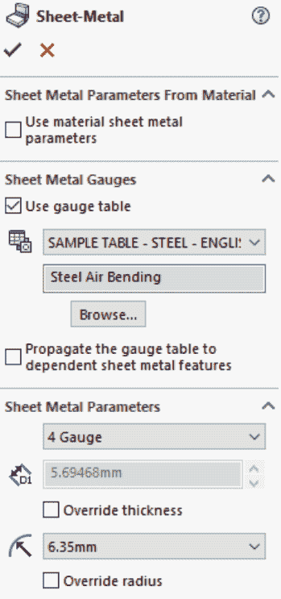

图 1.10：使用规格表

注意
较高的规格号对应于更薄的板。可以看出图 1.10 中 4 号钢为 5.69mm 厚，而 16 号钢仅为 1.51mm 厚。

随着规格号的变化，您会注意到 **弯曲半径** 值也会自动更改以对应新的板尺寸。正如预期的那样，较厚的板需要更高的 **弯曲半径** 值。

> **使用规格号时请谨慎！**
> 规格号特定于所用材料，因此很容易引起混淆。例如，钢的给定规格号 **不是** 与铝的相同厚度。**16 号** 钢为 1.52mm 厚，但 **16 号** 铝仅为 1.29mm 厚。因此，许多国际标准组织建议不要使用规格号，而应使用尺寸指定板厚。
> 
> 规格表可以很好地指示弯曲半径，但我建议仅将其作为参考，并直接设置和指定板厚。

**弯曲半径** 是 SolidWorks 钣金的一个重要 *方面*，每个弯曲 *零件* 都需要它。它可以在 **钣金** 属性中作为全局值设置，但如果需要，也可以为某些弯曲覆盖。

通过咨询制造商、在线搜索或使用 **规格表** 来了解所需的 **弯曲半径**。然而，如果使用规格号和表格，请务必确保材料选择正确，并在任何图纸上明确标注。明智的做法是仅将规格表作为参考，并另外指定确切的板厚。

#### 理解弯曲补偿

影响模型下一个钣金属性是 **弯曲补偿** 属性（图 1.8 中标记为 *iv*）。这使我们能够在将弯曲 *零件* 展开为平板后准确计算其尺寸。

为了了解 **弯曲补偿** 属性到底是什么以及为什么它很重要，让我们从侧面看一个简单的 *零件*。它由一个 **底板法兰** 和一个 **边缘法兰** 组成，如图 1.11 所示。

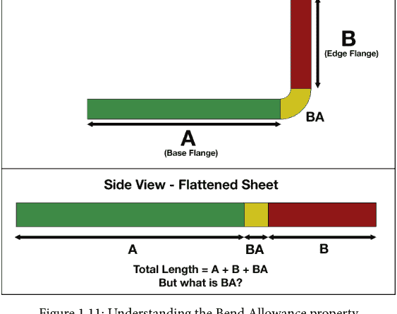

图 1.11：理解弯曲补偿属性

我们可以看到钣金 *零件* 的尺寸将是 **底板法兰** 的长度（图 1.11 中的 A）加上 **边缘法兰** 的长度（图 1.11 中的 B），再加上弯曲区域本身的大小（图 1.11 中的 **BA** 或弯曲补偿）。因此，当 *零件* 展平时，我们所需的板材总尺寸将为 **A + B + BA**。

然而，根据弯曲长度（**BA**）的测量位置和方式，我们可能会得到不同的值。例如，如果测量弯曲的内侧，长度可能为 5mm，但如果测量弯曲的外侧，则长度会更长——本例中为 15mm，如图 1.12 所示。

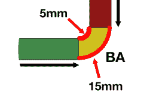

图 1.12：弯曲的大小取决于具体测量位置

**BA** 的长度由 **钣金** 属性中的 **弯曲补偿** 决定，并且有多种设置 **弯曲补偿** 的选项。

这些 **弯曲补偿** 选项为：

- **Bend Table**
- **K-Factor**
- **Bend Allowance**
- **Bend Deduction**
- **Bend Calculation**

每个选项都会产生略有不同的最终结果，但如果您不确定使用哪个选项，通常最好使用 **K-Factor** 弯曲补偿。

> **什么是 K-Factor 弯曲补偿？**
> K-Factor 是计算钣金弯曲所需尺寸的一种方法。每当金属板被弯曲时，弯曲内部总会有一个区域材料被压缩，弯曲外部的另一个区域材料被拉伸。在板材横截面的某个点，压缩和拉伸会完全相互抵消。在此边界上，材料长度不会发生变化。K-Factor 是指沿此边界的一条线，在该线上平坦零件和折叠零件之间长度没有变化（图 1.13）。

图 1.13：K-Factor 是材料横截面中一条假想线，在该线上弯曲零件与平坦零件之间尺寸没有变化

K-Factor 是一个比率，因此它始终介于 0 和 1 之间。弯曲的内侧 K-Factor 为 0，弯曲的外侧 K-Factor 为 1。因此，弯曲的中间 K-Factor 为 0.5，如图 1.14 所示。

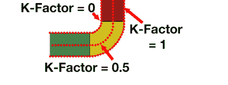

图 1.14：K-Factor 是一个比率，表示弯曲横截面上的线

##### 我应该使用什么 K-Factor 值？
K-Factor 取决于多种因素，例如材料和弯曲类型。如果您不确定使用什么值，那么对于大多数零件和材料来说，K-Factor 为 0.5 通常是一个不错的估计。
您也可以尝试询问制造商他们建议您使用什么值。

K-Factor 是计算 **弯曲余量** 的最简单方法，并且如果需要，可以通过编辑 **Sheet Metal** 属性在以后轻松更改。

#### 其他弯曲余量选项

除了 K-Factor 之外，还有其他几种计算 **弯曲余量** 的方法。如果您不熟悉这些方法，则强烈建议您使用 **K-Factor** 选项，如前所述。其他 **弯曲余量** 选项是：

- **弯曲余量**：这允许您具体定义 **弯曲余量** 的长度。如果制造商给您一个特定的值可以使用，这会很有用。然而，此选项应谨慎使用，因为可以输入任何值。因此，如果使用错误的值，可能会导致 **展开图** 零件的尺寸完全错误。
- **弯曲扣除**：此选项与 **弯曲余量** 选项 somewhat 相似，但它测量折叠 *零件* 的外部长度，然后减去某个值。同样，如果您不熟悉此方法，请谨慎使用，因为使用错误的 **弯曲扣除** 值可能会导致无法使用结果。
- **弯曲表**：此选项允许在 Microsoft Excel 中创建弯曲表。此表可以根据确切的弯曲细节，例如半径和角度，指定弯曲余量或扣除值。
- **弯曲计算**：最后，**弯曲计算** 选项允许使用方程式根据材料厚度、K-Factor 和弯曲半径等因素计算弯曲余量。

**弯曲余量** 选项对于确保您能够使用正确的平板尺寸来制作最终的弯曲零件非常重要。有多种选项可用，但如果您不熟悉 **弯曲余量**，则建议您只需使用 **K-Factor** 选项。**K-Factor** 值 0.5 可为大多数零件提供良好的估计，而您的制造商应能够根据材料类型和您确切的零件细节为您提供更详细的建议。

#### 自动补口选项

最终的 Sheet Metal 属性是 **自动补口**。这是一种在需要时自动为弯曲添加补口的方法。*图 1.15* 显示了一个简单的 **底边法兰**，其 **边法兰** 仅沿边缘延伸一部分。为了创建这种特定类型的弯曲，需要 **自动补口** 切口；否则，金属将无法正确弯曲：

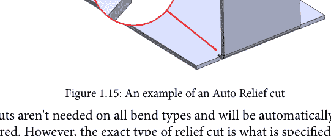

图 1.15：自动补口切口的示例

并非所有弯曲类型都需要 **自动补口** 切口，并且在需要时会自动添加。但是，补口切口的确切类型是在 **自动补口** 选项中指定的。

三种类型是：

- **矩形**：这会产生矩形切口（见图 1.16）。切口的大小由比率数决定，并与板材厚度相关——例如，比率为 0.5 且板材厚度为 1mm 时，会产生宽 0.5mm 的补口切口，并延伸 0.5mm 超出弯曲区域。注意：补口比率必须在 0.05 和 2.0 之间。
- **椭圆形**：这会产生更圆润的切口（见图 1.16），并且也使用基于板材厚度的比率，与 **矩形** 选项相同。
- **撕裂**：此选项基本上撕裂金属，而不提供可见的切口区域。这是能够展平和弯曲零件所需的最小值。

这三种选项在此处全部显示：

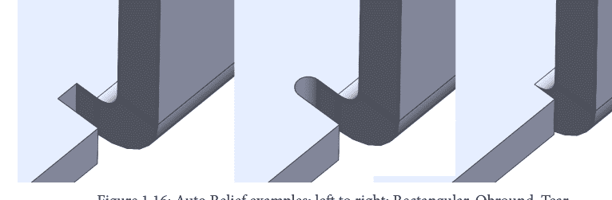

图 1.16：自动补口示例；从左到右：矩形、椭圆形、撕裂

**自动补口** 切口对于某些弯曲类型是重要要求，但它们会自动添加，因此此选项通常可以设置为比率为 0.5 的 **矩形** 或 **椭圆形**，除非您有特定要求。

#### Sheet Metal 属性回顾

**Sheet Metal** 属性是定义您的 Sheet Metal 零件的重要方式。它们可以通过编辑 FeatureManager 设计树中的 Sheet-Metal 文件夹来调整。它们通常适用于整个零件，尽管它们可以经常针对特定特征进行覆盖。

四个选项是：

- **厚度**：这决定了用于创建 **底边法兰** 和后续特征的板材厚度。
- **弯曲半径**：这设置弯曲的内部尺寸。SolidWorks Sheet Metal 中弯曲边缘始终需要 **弯曲半径**。
- **弯曲余量**：这使我们能够准确计算可用于创建弯曲 *零件* 的平板的正确尺寸。计算 **弯曲余量** 有多种方法，但如果您不确定，通常最好的选择是 **K-Factor** 值 0.5。
- **自动补口**：某些弯曲需要补口切口才能正确展平或折叠。如果需要，这些切口将自动添加，但此选项控制切口的大小和类型。

现在我们已经学习了 Sheet Metal 属性和创建 **底边法兰** 的基础知识，我们可以继续探索如何展平 3D *零件*，以及更高级类型的 **底边法兰**。

#### 其他底边法兰选项和展平零件

在上一节中，我们介绍了 **底边法兰**，它们通常是您的 Sheet Metal *零件* 的第一个特征。作为示例，我们绘制了一个简单的矩形，然后用它制作了一个矩形 **底边法兰**。这种类型的 **底边法兰** 称为 **单闭合** 轮廓，因为它只包含一个单一轮廓，并且该轮廓是闭合的（即，外周没有开口区域或间隙）。这可以在 *图 1.17* 中看到。

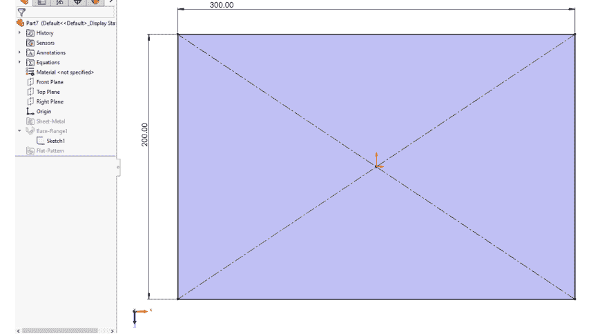

图 1.17：单闭合轮廓包含一个单一的闭合轮廓

然而，还有另外两种选项可用于创建不同种类的 **底边法兰**。这些是 **多重包含闭合** 和 **单开口轮廓**。不必太在意记住具体的名称，只要知道如何使用每种类型即可。

#### 多重包含闭合

对于我们之前的 **底边法兰**，我们只使用了一个单一的闭合轮廓，但闭合轮廓也可以在其内部包含 *其他闭合轮廓*。这种类型称为 **多重包含闭合**，可用于在 **底边法兰** 中添加孔和切口。示例显示在图 1.18 中。

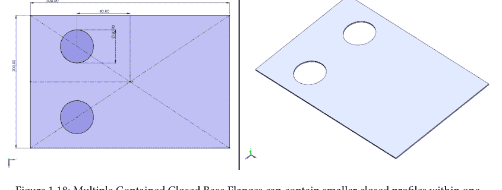

图 1.18：多重包含闭合底边法兰可以在一个较大的闭合轮廓内包含较小的闭合轮廓

尽管使用 **多重包含闭合** 选项创建 **底边法兰** 有时可以节省时间，但我个人建议创建非常简单的 **底边法兰**，然后将额外的切口和孔作为单独的特征添加。这种方法只需使以后在需要时更容易调整或删除额外的细节。

#### 单开口轮廓

除了使用闭合轮廓之外，还可以使用称为 **单开口轮廓** 的开口轮廓创建 **底边法兰**。这些可以从简单的单线到更复杂的草图实体集合不等。

要创建基本的 **单闭合轮廓底边法兰**：

- 1. 启动一个新的 *零件* 文档并在适当的平面上开始草图，例如 **前视平面**。
- 2. 绘制 **底边法兰**。将 **单开口轮廓** 选项视为法兰的侧视图或横截面视图可能最容易。对于第一个示例，尝试使用 **线** 工具绘制一条 100mm 长的单水平线（见 *图 1.19*）。
- 3. 通过从原点开始并使用 **智能尺寸** 工具设置线的长度来完全定义您的草图。

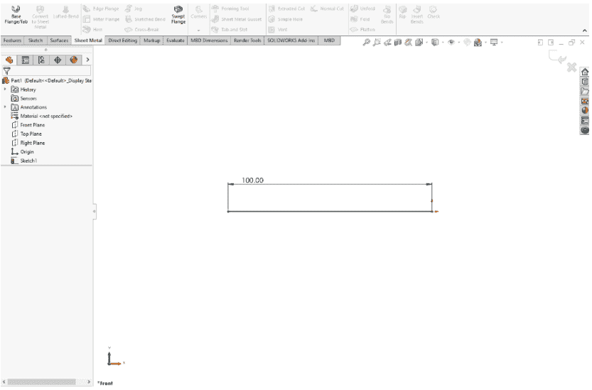

图 1.19：使用单线草图创建单开口轮廓底边法兰

- 4. 从 **Sheet Metal** 选项卡或工具栏中选择 **底边法兰/搭接** 选项。

5. **Base Flange** 的宽度可以使用屏幕左侧 **Property Manager** 中的 **Direction 1**（如果需要，还可以使用 **Direction 2**）选项进行设置。**Sheet Metal** 属性也可以在此阶段设置（见图 1.20）。

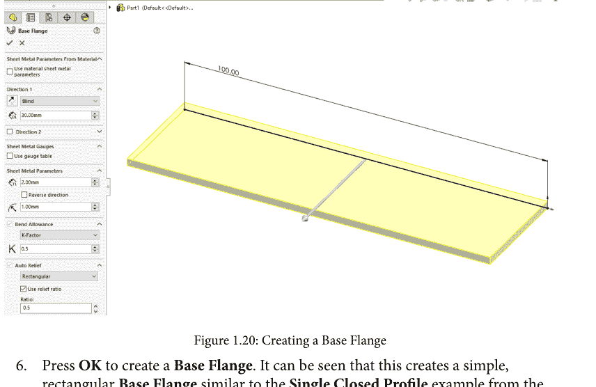

图 1.20：创建 Base Flange

6. 按下 **OK** 来创建 **Base Flange**。可以看到，这会创建一个简单的矩形 **Base Flange**，类似于第一部分中的 **Single Closed Profile** 示例。

这样，**Single Open Contour Base Flange** 可以被视为类似于普通实体建模中的 **Thin Feature Extrude** 选项。

#### 创建更复杂的 Base Flange 形状

使用 Single Open Contour 选项的真正优点在于，它允许你在一个特征中轻松创建更复杂、弯曲的形状。

- 1. 开始一个新的零件文档，并在适当的平面上开始草图，例如 Front Plane。
- 2. 使用 Line 工具绘制更复杂的形状。图 1.21 中可以看到一个示例 Z 或折弯形状。

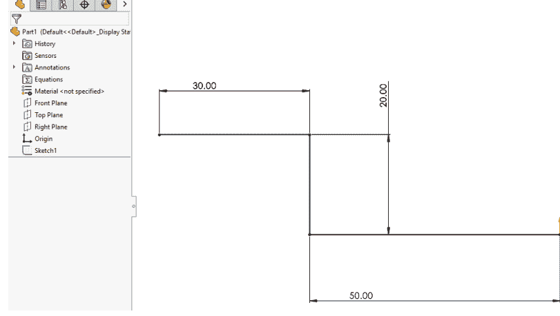

图 1.21：更复杂的 Single Open Contour 草图

- 3. 从 Sheet Metal 工具中选择 Base Flange/Tab 并设置所需选项。示例设置可以是：
  - Width: 10mm, Direction 1
  - Thickness: 2mm
  - Bend Radius: 1mm

4. 按下 **OK** 来创建 **Base Flange**（*图 1.22*）。可以看到，尽管底层草图有尖角，实际的 **Base Flange** 特征已使用在 **Sheet Metal** 属性中指定的 **Bend Radius** 自动创建了弯曲角：

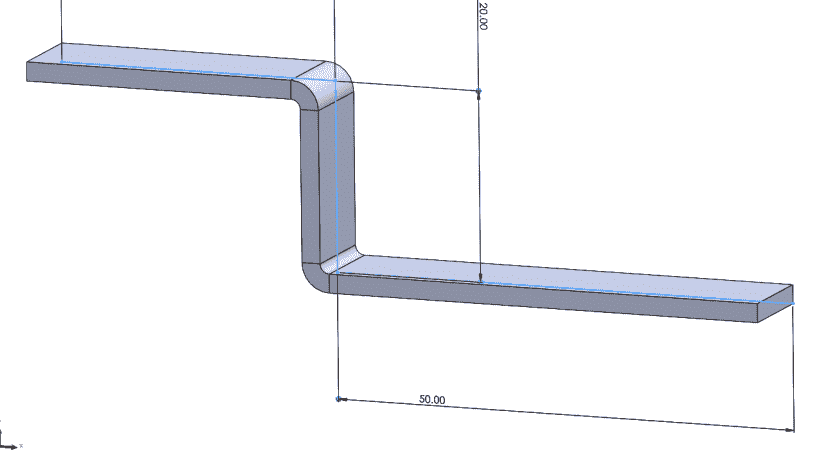

图 1.22：Single Open Contour Base Flange

使用 **Single Open Contours** 来创建 **Base Flanges** 可以成为简化生产诸如简单支架等零件的好方法。

请注意，这类草图不仅限于使用直线——如果需要，也可以使用圆弧和样条曲线。

#### 展平零件

现在我们已经创建了一个带有弯曲的 *part*，我们可以探索如何将 3D Sheet Metal *parts* 展平。展平是 SolidWorks Sheet Metal 模块的一项功能，确实为设计流程增加了巨大价值，因为它允许 *parts* 从成品状态准确转换为可从平板材料轻松制作的状态。

要展平 Sheet Metal 零件：

- 1. 在 Sheet Metal 零件内部，从 Sheet Metal 选项卡或工具栏中选择 Flatten 选项（图 1.23 中标记为 i）。
- 2. 零件将被展开为平板。请注意虚线轮廓，它表示展平零件的边界框，以及草图线，它们显示了弯曲线的所在位置（图 1.23 中标记为 ii）。
- 3. 如果你的弯曲线不可见，请尝试进入 View | Hide/Show | Sketches。
- 4. 还请注意，FeatureManager 设计树末尾的 Flat-Pattern 文件夹现在已取消抑制，因此不再变灰（图 1.23 中标记为 iii）。

使用 Flatten 选项本质上是取消抑制（或打开）Flat-Pattern 文件夹，从而展平零件。如果展开 Flat-Pattern 文件夹，则可以看到 Flat Pattern 特征，其中包含零件的弯曲细节。

- 5. 要取消展平——或折叠——零件，只需再次单击 Sheet Metal 选项卡或工具栏上的 Flatten 按钮，或单击图形区域右上角可见的 Flatten 按钮（图 1.23 中标记为 iv）。请注意，零件折叠起来，并且 Flat-Pattern 文件夹现在再次被抑制（或关闭）。

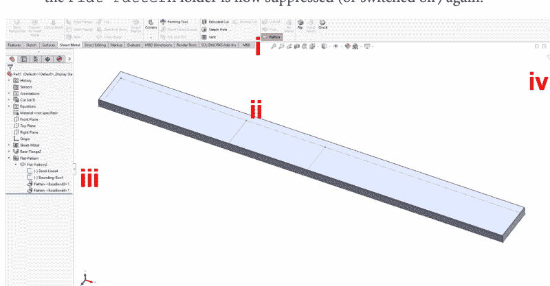

图 1.23：Flatten 选项

Flatten 选项是 SolidWorks Sheet Metal 的一个重要方面，允许零件展开。随着我们阅读本书并学习 Sheet Metal 工具，我们将在更实际的场景中看到此选项的使用。

#### Base Flange 选项和展平零件的回顾

有三种类型的 Base Flange（见图 1.24）：

- 1. **Single Closed Profile**：这是最基本类型的 Base Flange之一，使用一个完全封闭的单一轮廓，例如简单的矩形或正方形。虽然它很简单，但这种类型的 Base Flange 非常有用，很可能构成 Sheet Metal 零件的大多数 Base Flanges。
- 2. **Multiple Contained Closed**：封闭轮廓也可以包含较小的封闭轮廓，例如切口和孔。虽然这种类型的 Base Flange 在某些情况下可能有用，但通常更好的做法是使用 Single Closed Profile 创建简单的 Base Flange，然后将任何额外的孔、切口或细节作为单独的特征添加。这样在后期修改这些特征会容易得多。
- 3. **Single Open Contour**：Base Flange 也可以使用由线、圆弧和样条等单个草图实体组成的集合创建。这种类型的 Base Flange 在创建支架等物品时可能很有用。

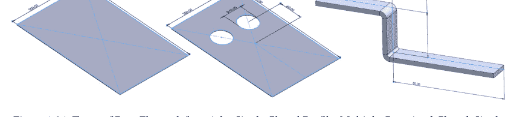

图 1.24：Base Flange 类型；从左到右：Single Closed Profile、Multiple Contained Closed、Single Open Contour

展平是 SolidWorks Sheet Metal 的一个重要方面，带弯曲的零件可以通过从 Sheet Metal 工具中选择 Flatten 选项轻松展平。这将取消抑制 Flat-Pattern 文件夹并展开零件中的任何弯曲。

到目前为止，本章中我们学习了如何开始 Sheet Metal 零件以及如何创建这些零件的大多数第一个特征——Base Flange。我们还研究了如何编辑对这些零件很重要的各种 Sheet Metal 属性。因此，现在我们对如何开始虚拟 Sheet Metal 零件有了一个合理的概念，我们将简要进入钣金的一个现实世界方面，并查看可用的各种钣金材料。

#### 选择钣金材料时的注意事项

有数十种金属可用于制造钣金零件，这些金属在用途、物理性能、成本和可用性方面各不相同。以下页面将给你一个概念，哪些可能最适合你的项目。

本节并非材料的详尽清单；它只是你可能遇到的一些最常见材料的概述。在这些材料中，还有许多特定的等级（子类型），每种都有略微不同的性能。如有疑问，请与你的钣金制造商和材料供应商讨论你的需求和预算，以找到最适合你需求的选择。

#### 钢和铝

我们周围绝大多数钣金零件都是由钢或铝制成的，其中钢可能是最常见的材料。

#### 钢的优点和缺点

钢是一种出色的通用材料，如果你不确定使用哪种材料，钢通常是一个稳妥的选择。钢之所以如此受欢迎和广泛使用，有很多原因。它非常坚固，易于焊接，并且具有延展性，这意味着与更奇特的金属相比，它更容易弯曲和成形。钢也相当便宜——对于相同重量而言，它的价格可能比铝便宜三倍——并且供应广泛。

材料选择总是有取舍的，因此每种材料都会有缺点。钢的主要缺点之一是它相当重——密度约为铝的二点五倍，具体取决于使用的确切等级。这意味着如果有两个大小和形状完全相同的零件，那么钢零件会比铝零件重得多。

钢还具有较差的耐腐蚀性，这意味着它经常会生锈。你见过生锈的钢制品，例如汽车车身。这种锈是金属与环境中的水和氧气等元素发生反应引起的腐蚀。锈会削弱并最终破坏金属。钢可以经过处理以防止或减缓腐蚀，但这会增加材料成本，而其他一些金属具有更自然的耐腐蚀性。

#### 铝的优缺点

铝是钣金中第二常见的材料，被广泛用于自行车车架、飞机零件和饮料罐等各种物品。

铝在航空航天行业如此受欢迎的原因之一是它比钢轻得多。它还具有极佳的天然耐腐蚀性，因此不需要额外的表面处理来防止生锈。铝的另一个优点是其延展性极佳，这意味着它很容易弯曲。想想铝箔有多柔韧，或者饮料罐有多容易被压扁。

不幸的是，这些积极的特性也伴随着缺点，铝比钢贵得多。然而，由于其密度较低，零件可以做得更轻，这在某种程度上抵消了这种成本。另一个因素是，虽然铝比钢轻，但它也更弱，这意味着承受相同载荷的零件在铝中必须做得更厚。然而，由于铝的密度较低，这些零件实际上可能比等效的钢零件更轻。因此，总的来说，根据使用的金属等级，铝通常具有比钢更好的强度重量比（SWR）。

#### 其他常见金属

钢和铝构成了绝大多数钣金零件，但还有一些其他材料相当常见，例如以下几种：

- **铜**：铜常用于电子元件或热交换部件等零件，因为它具有良好的导电性和导热性。

它也很容易弯曲和成型，并且具有良好的耐腐蚀性，因此常用于管道制造管道和装置。铜比钢和铝更贵，而且由于金属价格更高，一些地区存在铜盗窃问题。
- **黄铜**：这种金属是铜和锌的合金（混合物），外观与铜相似，但外观更明亮、更闪亮。因此，它常用于装饰品，如门环、装置和饰品。

它极具延展性，因此常用于制造铜管乐器中的乐器，如小号。黄铜具有卓越的耐腐蚀性，因此常出现在极端环境中，如船上的门把手。与铜一样，它是一种相当昂贵的金属，因此通常只少量使用。
- **不锈钢：** 钢可以与铬等其他金属合金化以创建不同等级的不锈钢。这种钢比普通钢具有更高的耐腐蚀性，同时仍保留了大部分强度和其他优点。因此，它常用于制造餐具或手术器械。

不锈钢钣金零件包括大型厨房设备等物品，例如水槽和台面。然而，这种改进的耐腐蚀性使不锈钢比普通钢贵得多。

本概述并非旨在成为金属的完整清单，其他专业材料可能包括锡、金和钛。每种材料都有特定的特性，适用于不同的应用和预算。如前所述，与您的钣金供应商和制造商讨论您的具体需求是明智的，以便为您的项目找到最佳匹配。

钣金材料特性的总结可在下表中看到：

| 材料类型 | 优点 | 缺点 |
|---|---|---|
| 钢 | 坚固、便宜、广泛供应；易于加工和焊接 | 重；耐腐蚀性差 |
| 铝 | 轻质；良好的 SWR；良好的耐腐蚀性；延展性 | 比钢贵；强度低于钢 |
| 铜 | 良好的导热和导电性；良好的耐腐蚀性；延展性 | 昂贵 |
| 黄铜 | 非常延展；良好的耐腐蚀性 | 昂贵 |
| 不锈钢 | 与钢相似的优点但具有极佳的耐腐蚀性 | 昂贵 |

#### 钣金厚度和板材尺寸

根据您居住的世界各地，钣金通常按号数或板材的实际厚度出售。如前所述，号数是根据材料重量来衡量钣金厚度的一种方法，通常号数越高，板材越薄。

号数针对每种材料是特定的，因此 **16 号** 钢的厚度与 **16 号** 铝不同。因此，强烈建议同时以实际厚度指定板材厚度，以避免任何混淆。

金属板材也有各种各样的板材尺寸，公制和英制均有。一些常见尺寸如图 1.26 所示，包括 48x120 " 或 2x1 米（m）：

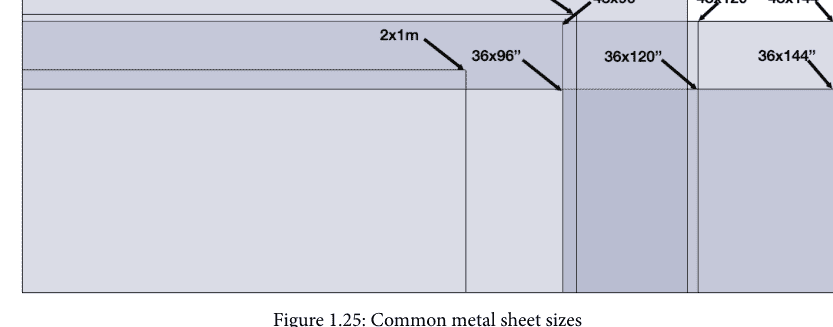

图 1.25：常见的金属板材尺寸

在制作非常大的零件或大量小零件时，值得检查您可用的板材尺寸并据此设计。如果制作大量小零件，甚至可以使用第三方“排样”软件将零件以最有效的方式排列在板材上，避免浪费材料。

#### 材料选择回顾

即使在 SolidWorks 中虚拟设计零件，也必须考虑这些零件在现实世界中如何制造，而其中一个重要方面是材料选择。大多数钣金零件由钢或铝制成，但其他常见金属包括铜、黄铜和不锈钢，每种材料都有独特的特性，适用于不同的需求。

板材厚度通常由实际厚度或号数定义。这基于材料的重量，这意味着相同的号数对不同材料给出不同的厚度。板材有各种常见的尺寸，可能会影响零件的设计。

#### 总结

在本章中，我们介绍了 SolidWorks Sheet Metal 并学习了如何设置 Sheet Metal 工作区并创建 **Base Flanges**。这些通常是 Sheet Metal *part* 中的第一个特征，我们介绍了三种不同类型：**Single Closed Profile**、**Multiple Contained Closed** 和 **Single Open Contour**。

接下来，我们探讨了四个 **Sheet Metal** 属性——**Thickness**、**Bend Radius**、**Bend Allowance** 和 **Auto Relief**——以及如何编辑它们以调整整个 *part* 的属性。

最后，我们学习了如何将 3D *parts* 展开，这对于它们在现实世界中由金属板材制成至关重要。类似地，我们查看了常见的钣金材料和板材尺寸，以及它们可能与最终设计相关的程度。

在 *第 2 章，使用边缘翻边添加弯曲* 中，我们将开始通过学习如何使用 **Edge Flanges** 为 **Base Flange** 添加更多细节来构建 3D 设计。
